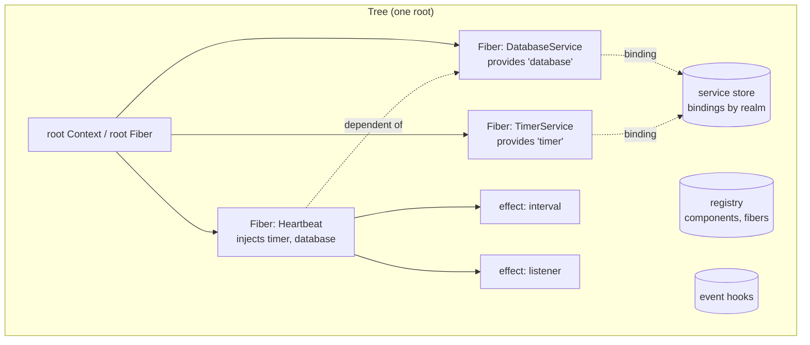
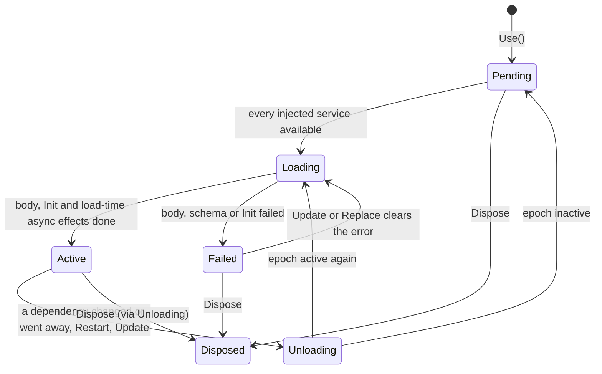

# cordis plugin framework: architecture

> **Status.** Describes what is **built** in this repository: the .NET port
> ([src/net](../src/net/README.md)) and the Go port ([src/go](../src/go/README.md)).
> Both ports track upstream [cordiverse/cordis](https://github.com/cordiverse/cordis)
> at `86f59e4`. The evidence in [§9](#9-proof-of-completion-and-correctness) was
> recorded on 2026-11-16 at commit `25f50db`. Statements that are reasoning, not
> recorded results, open with "Inference". How to build an agent orchestrator on
> this framework is in [usage.md](usage.md). IDs use an `AR` prefix.

## Contents

1. [Purpose and audience](#1-purpose-and-audience)
2. [Vocabulary](#2-vocabulary)
3. [What we want to achieve](#3-what-we-want-to-achieve)
4. [Why this framework](#4-why-this-framework)
5. [How it is implemented](#5-how-it-is-implemented)
6. [Failure, retry, rollback and cleanup](#6-failure-retry-rollback-and-cleanup)
7. [How to use it](#7-how-to-use-it)
8. [Decision records](#8-decision-records)
9. [Proof of completion and correctness](#9-proof-of-completion-and-correctness)
10. [Benefits, costs and limitations](#10-benefits-costs-and-limitations)
11. [Index](#11-index)

## 1. Purpose and audience

This document is for engineers who build agent hosts on this framework, for
reviewers who judge whether it is the right base, and for readers new to cordis.
It explains why the framework exists, how its pieces fit, what it guarantees
when things fail, and which decisions shaped the two ports. Read
[§2](#2-vocabulary) and [§5.1](#51-the-picture) first. The per-port READMEs hold
the API detail.

**The one-sentence idea.** In most dependency-injection containers the object
graph is fixed at startup. Here **service availability is a value that changes
over time**. A component declares what it needs, loads itself when that
appears, and unloads itself, releasing everything it acquired, when it goes away.

## 2. Vocabulary

Each term exists because the framework has to answer one question.

| Term | What it is | Why it exists |
|---|---|---|
| **Context** | The handle a component works through: get services, create effects, load child components. | Gives each piece of code a place in the tree, so the runtime knows who owns what it creates. |
| **Tree** | All contexts that share one root: one service store, one registry, one event bus and one logger. | The unit of isolation between independent hosts in one process, and the unit of locking. |
| **Component** | A unit of code that can be loaded: a name, the services it declares, an optional config schema, and a body. | The thing a host composes. Upstream renamed "plugin" to "component"; both ports follow. |
| **Fiber** | One live instance of a component, with its own context, config, state and effects. | One component can be loaded many times. Each instance needs its own lifetime. |
| **Effect** | A resource paired with its cleanup (a timer, a listener, a connection, a child fiber, a service binding). | Cleanup must never depend on the component remembering to do it. The fiber releases its effects for it. |
| **Service** | A value registered under a name by a fiber (`Provide`). The binding is itself an effect of that fiber. | The way components share capabilities without knowing which component provides them. |
| **Inject** | A component's declaration of the services it needs. | The runtime loads a fiber only while every declared service is available, and blocks access to undeclared ones. |
| **Dependent** | A fiber that loaded while using a binding that another fiber provides. | The provider must not release its resources while a dependent is still cleaning up ([AR-ADR-7](#ar-adr-7)). |
| **Epoch** | A fiber's identity of "what it is loaded against": its reload revision plus the id of every injected binding. | When the epoch changes, the fiber reloads; when a dependency disappears, the epoch becomes inactive and the fiber unloads. |
| **Inertia** | The one load or unload a fiber is running at a time. | Changes during a transition are not lost: the transition reconciles with the newest epoch when it ends. |
| **Realm** (isolate) | A private namespace for one service name below a context. | Two subtrees can each have their own `database` without seeing each other's. |
| **Intercept** | Per-subtree config layered on a service (for example, a log level). | Configures a shared service differently in different subtrees without a second instance. |
| **Registry** | The record of components in use and their fibers; supports in-place replacement. | Swapping an implementation without tearing its fibers out of the tree. |
| **Loader entry** | One item of a declarative tree (`id`, `name`, `config`, `group`, `isolate`, ...). | Hosts are often composed from a config file that changes at runtime. |
| **Desired state** | The loader's list of entries. | The loader reconciles the live fibers with it. |

**Ownership, access and desired state are different things.**
- **Ownership.** A fiber *owns* the effects it created, including child fibers and
  the service bindings it provides. Unloading releases exactly what it owns.
- **Access.** Injecting a service grants *access* to a binding another fiber owns.
  Access never transfers ownership: a dependent unloading releases nothing of the
  provider's.
- **Desired state.** The loader holds a *desired* list of entries and owns only
  the fibers it created for those entries. Reconciling never touches a fiber that
  code created with `Use`.

## 3. What we want to achieve

### 3.1 Problem

An agent host is made of parts whose availability changes while it runs. Model
runtimes and SDK sessions start, fail their model check, and are replaced by a
fallback. Tool servers (MCP) connect and drop. Subagents are spawned, retried,
and cancelled when a budget is spent. The configuration changes while the host
is live. Each of these parts holds resources (processes, sessions, timers,
files, listeners) that must be released in the right order, exactly once, even
when something fails half-way. Code that hand-wires this with `context.Context`
cancellation and ad-hoc registries tends to leak, double-release, or tear a
provider down while a consumer is still using it.

### 3.2 Outcomes

| ID | Outcome (observable behaviour) |
|---|---|
| <a id="ar-o-1"></a>**AR-O-1** | A component runs only while every declared service is available. It unloads when one goes away or is replaced, and reloads by itself when it comes back. |
| <a id="ar-o-2"></a>**AR-O-2** | Everything a component acquired is released when it unloads: exactly once, in reverse order, leaves of the tree first. This holds even when the load failed or panicked. |
| <a id="ar-o-3"></a>**AR-O-3** | A provider's resources outlive the cleanup of every dependent that used them. |
| <a id="ar-o-4"></a>**AR-O-4** | A component reaches only services it declared (plus root services). Realms keep same-named services apart, and intercepts layer config per subtree. |
| <a id="ar-o-5"></a>**AR-O-5** | A live fiber can be reconfigured, restarted or given a new implementation without restarting the host. A bad config is rejected before anything changes, and a failed fiber stays failed until it is told to retry. |
| <a id="ar-o-6"></a>**AR-O-6** | A host can be composed from a config tree that is reconciled entry by entry and kept in sync with a file. Edits from the file and from runtime are both kept. |
| <a id="ar-o-7"></a>**AR-O-7** | Components communicate through typed events whose listeners are owned (and removed) like any other effect. |
| <a id="ar-o-8"></a>**AR-O-8** | All of the above holds under concurrent use. The Go port passes the race detector, and notification handlers may call back into the framework without deadlock. |
| <a id="ar-o-9"></a>**AR-O-9** | Both ports implement the same upstream semantics at a recorded revision and pass the same behavioural tests. |

### 3.3 Scope and non-goals

In scope: the core (contexts, fibers, effects, services, registry, events,
logger), the timer service, and the loader with its JSON config file, in C# and Go.

Not in scope, by decision ([AR-ADR-17](#ar-adr-17)): hot module replacement,
YAML config, upstream's mixins and accessors, merged intercepts, and upstream's
later fs, server, http, env, cli and package-manager packages. The framework
is in-process. It does not isolate untrusted code. A plugin that must be
isolated runs out of process, and a cordis service talks to it ([§4](#4-why-this-framework)).

## 4. Why this framework

The requirement is a **dynamic** dependency graph with **owned lifetimes**.
Each candidate below covers only part of it.

| Option | What it gives | Pros | Cons |
|---|---|---|---|
| Static DI (Go: `wire`, `fx`, `dig`; .NET: `Microsoft.Extensions.DependencyInjection`) | A graph built once at startup, with scoped lifetimes | Mature, well known, fast | The graph is fixed. "A service went away" has no meaning, so dependents cannot unload and reload by themselves. Lifetimes are per scope, not per resource. |
| Hand-rolled registries with `context.Context` / `CancellationToken` | Exactly what one host needs | No dependency; tailor-made | Every host re-implements ordering, dependents, partial-failure cleanup and reload. Example: the kmap orchestrator's ledger, runtime and lead packages are about 7,200 lines of non-test Go, and each lifetime rule in them is hand-written ([usage.md §4.1](usage.md#41-the-kmap-orchestrator-today)). |
| Actor frameworks (Akka, Proto.Actor, Orleans) | Supervision trees, messaging, restarts | Strong failure model | Heavy. Message passing only; no service availability, no DI, no declarative reconcile. |
| Process plugins (`hashicorp/go-plugin`, MCP servers) | Out-of-process isolation, any language | Crash and security isolation | One process per plugin; no in-process dependency graph or shared lifetime. Complementary: a cordis service can own the client of such a plugin. |
| OSGi Declarative Services | Dynamic services with dependency tracking | The closest concept | JVM only. |
| **cordis** (this repository) | Dynamic availability, owned effects, realms, intercepts, typed events, loader with live config | Covers the whole requirement in one small model. Used as the base of a production agent harness ([deepseek-ai/deepseek-harness](https://github.com/deepseek-ai/deepseek-harness), "Everything is a Plugin"). | A new model for most engineers to learn. Upstream is TypeScript, so each language needs a port ([AR-ADR-2](#ar-adr-2)). In-process only. |

**Decision.** cordis, ported natively ([AR-ADR-1](#ar-adr-1), [AR-ADR-2](#ar-adr-2)).

## 5. How it is implemented

### 5.1 The picture



A fiber is created as an **effect of its parent's fiber**, so disposing a parent
disposes its subtree. Services are bindings in a store keyed by realm. A
fiber's dependency on a binding is recorded on the binding (its dependents),
which is how a provider knows to wait.

### 5.2 Fiber lifecycle



- **Epoch.** The revision is bumped by `Restart` and `Update`; it is
  followed by the uid of every injected binding. Any change starts a
  transition. An inactive epoch (a dependency missing) means unload.
- **Inertia.** A fiber runs one transition at a time. A change requested
  mid-transition updates the epoch only; the running transition hands over
  to the next one when it ends ([AR-ADR-6](#ar-adr-6)).
- **Load.** The schema resolves the config, then the body runs. A constructor
  component's instance is then initialised (`Init` / `IAsyncInit`), and the
  fiber waits for async effects started during the load. Only then does it
  become `Active` and its services become visible to dependents.
- **Unload.** The fiber waits until every dependent of its bindings has
  unloaded, then releases its effects one at a time in reverse order
  ([AR-ADR-7](#ar-adr-7), [AR-ADR-8](#ar-adr-8)), then releases the providers it
  depended on.

### 5.3 Service resolution

`Get(name)` walks from the caller's fiber to the root (upstream's `locate()`).
It succeeds when a fiber on the walk declares the name, returning the binding
that fiber loaded against, or provides the name itself in the same realm. It
stops at a context that isolates the name again. Root bindings are reachable
from every fiber. Anything else fails as *not injected*. A declared service
with no active provider fails as *unavailable*. Values that opt in are
specialised per caller (`IContextScoped` / `Scoped`), so that, for example, a
timer's effects belong to the fiber that asked for it ([AR-ADR-11](#ar-adr-11)).

`Lookup(name)` is the optional, unchecked read (upstream's `ctx.get(name)`): the
active provider of the name in the caller's realm, or nothing, with no inject
check and no failure. Both production users of cordis probe for services they do
not depend on this way. It only reads; a component that must reload with a
service declares it.

### 5.4 Realms and intercepts

`Isolate(name)` derives a context whose map gives `name` a fresh realm key.
Lookups through a derived map fall through to the parent; writes stay local.
`Intercept(name, config)` layers config the same way. A service reads the
layers nearest first, followed by the per-dependency config the component
declared with its inject.

### 5.5 Events

One key type per dispatch mode keeps listeners typed:

| Mode | Behaviour |
|---|---|
| emit | Listeners run in order; an error stops the dispatch. |
| parallel | Listeners run together; failures are returned as one aggregate that names the event. |
| bail | Listeners run in order until one answers. |
| waterfall | Listeners form a middleware chain around a terminal; calling `next` twice is an error. |

A listener is an effect of the registering fiber. A listener removed during a
dispatch is skipped.

### 5.6 Loader and config file

The loader reconciles a list of entries with the live tree. It creates new
entries, rebuilds entries whose shape changed, updates entries whose config
changed, and disposes removed ones, parents first. Groups load their children
from their own body. A disabled or pending group therefore holds its children
back, and a rebuilt group recreates them. The JSON config file component reads
the file on one serial loop and merges file and runtime edits per entry
against the last synced content (the file wins a true conflict). It writes
through a temporary file renamed over the original, and keeps the live tree
when the file goes missing or stops parsing.

### 5.7 Concurrency model (per port)

| | .NET | Go |
|---|---|---|
| Lock | One `Monitor` per tree (reentrant) | One `sync.Mutex` per tree (not reentrant) |
| User code under the lock | Internal events raised synchronously under it | None, except `Available()` checks and schemas. Notifications go to an ordered outbox, delivered after release by one goroutine at a time |
| Transitions | `async` methods that start with `await Task.Yield()` | A goroutine per transition |
| Waiting | `await fiber` | `fiber.Wait()` |
| Failures | Exceptions | Returned errors; panics recovered as `*PanicError` |

See [AR-ADR-4](#ar-adr-4) and [AR-ADR-5](#ar-adr-5).

### 5.8 Code layout

| Concern | .NET (`src/net`) | Go (`src/go`) |
|---|---|---|
| Context, scoping | `Cordis/Context.cs`, `ChainMap{TValue}.cs` | `cordis/context.go`, `chainmap.go` |
| Fiber, effects | `Cordis/Fiber.cs`, `EffectHandle.cs` | `cordis/fiber.go`, `effect.go` |
| Services | `Cordis/ServiceStore.cs`, `ServiceImpl.cs`, `Service.cs` | `cordis/store.go`, `keys.go` |
| Components, registry | `Cordis/ComponentFactory.cs`, `ComponentSource.cs`, `RegistryService.cs` | `cordis/component.go`, `registry.go` |
| Events, notifications | `Cordis/EventsService.cs`, `InternalEvents.cs` | `cordis/events.go`, `tree.go` |
| Logger | `Cordis/LoggerService.cs`, `Logger.cs` | `cordis/logger.go` |
| Timer | `Cordis.Timer/TimerService.cs` | `timer/timer.go` |
| Loader, config file | `Cordis.Loader/LoaderService.cs`, `JsonConfigFile.cs` | `loader/loader.go`, `configfile.go`, `merge.go` |
| Tests | `tests/Cordis.Tests` (custom runner) | `*_test.go`, `internal/testkit` |

## 6. Failure, retry, rollback and cleanup

| Situation | What happens | What is undone |
|---|---|---|
| The body, schema or `Init` fails (or panics, in Go) | The error is logged and the fiber becomes `Failed`. | Every effect the failed load created is released. Partial work is never kept. |
| A dependency goes away | The dependent unloads and becomes `Pending`; it reloads when a provider returns. | The dependent's effects. The provider's resources stay until the dependent has finished. |
| A provider is disposed | It notifies dependents, waits for each to unload, then releases its own effects. | The provider's effects, after its dependents'. |
| A single binding is withdrawn (its handle disposed) | Dependents are notified; the withdrawal waits for them. | That binding only. |
| `Restart` / `Update` while a load runs | The revision bumps. The running load finishes, then the fiber unloads and reloads once against the newest epoch. | The superseded load's effects. A failure of the superseded load is logged, but cannot fail the newer target. |
| `Update` with an invalid config on a loaded fiber | Rejected before anything changes. | Nothing (no rollback needed). |
| A failed fiber's provider changes | Nothing; failure is sticky ([AR-ADR-9](#ar-adr-9)). | Nothing. `Update` or `Replace` clears the error and retries. |
| A cleanup fails | Logged; the remaining cleanups still run. | **Uncertain:** that resource may leak; there is no retry. |
| `Registry.Replace(old, next)` | The fibers of `old` are *adopted* by `next` in place: same parent, config and position; new dependencies; the error cleared. Later uses of `old` are forwarded. | The old implementation's effects, as a normal reload. |
| A loader entry is removed or disabled | Its fiber is disposed; a group takes its children with it. | Only fibers the loader created for that entry. |
| The config file disappears or stops parsing | Logged; the live tree is kept; the file is not rewritten. | Nothing. |
| The root is disposed | All root effects are released in reverse order, so the whole tree unloads from the leaves up. | Everything in the tree. |

## 7. How to use it

The READMEs hold the full API ([Go](../src/go/README.md#usage),
[.NET](../src/net/README.md#usage)). The shape is the same in both:

```go
var DatabaseKey = cordis.NewServiceKey[*Database]("database")

var DatabaseComponent = cordis.Construct("DatabaseService",
    func(ctx *cordis.Context, _ cordis.None) (*Database, error) {
        db := &Database{}
        _, err := DatabaseKey.Provide(ctx, db) // a binding owned by this fiber
        return db, err                         // Init() gates dependents, Close() runs on unload
    })

var Report = cordis.Define("Report", func(ctx *cordis.Context, cfg ReportOptions) error {
    db, err := DatabaseKey.Get(ctx) // allowed: declared below
    if err != nil {
        return err
    }
    _, err = ctx.Effect("subscription", func() (cordis.Disposer, error) {
        sub := db.Subscribe(cfg.Topic)
        return sub.Close, nil // released when Report unloads
    })
    return err
}, cordis.WithInject("database"))

root := cordis.New()
report, _ := root.Use(Report, ReportOptions{Topic: "x"}) // Pending: no database yet
root.Use(DatabaseComponent, nil)                         // Report loads by itself
_ = report.Wait()
root.Dispose()                                           // leaves first
```

For a lead agent that spawns and manages subagents on this framework, see
[usage.md](usage.md).

## 8. Decision records

Each record states the decision, why it is needed, its pros and cons, the
outcome it serves, and how it is verified.

<a id="ar-adr-1"></a>
### AR-ADR-1 Port cordis's semantics rather than design a new model

- **Decision.** Reproduce upstream's model and terminology, tracking a recorded
  upstream revision (`86f59e4`). Record every deviation in the port's README.
- **Why.** The lifecycle rules (epochs, inertia, dependents, sticky failure) are
  subtle. Upstream has found and fixed the edge cases in its issue history (#98,
  #133, #189, #191, #196, #209, #266, ...).
- **Pros.** Proven semantics. A shared vocabulary with upstream and with
  deepseek-harness. Each upstream fix maps to a regression test.
- **Cons.** Upstream-only ideas that fit JavaScript poorly (proxies, mixins) must
  be translated or dropped. Upstream changes must be reviewed and ported by hand.
- **Serves.** [AR-O-9](#ar-o-9). **Verified by.** The upstream sync tables in
  both READMEs and the issue-numbered tests ([§9](#9-proof-of-completion-and-correctness)).

<a id="ar-adr-2"></a>
### AR-ADR-2 One native port per language

- **Decision.** Separate C# and Go implementations with the same semantics, not
  one core with bindings (FFI, WASM, or a sidecar process).
- **Why.** Components are in-process code holding in-process resources. A
  boundary between the component and its lifecycle manager would put a
  serialisation layer under every effect.
- **Pros.** Idiomatic APIs (`await` and `IAsyncDisposable`; errors, goroutines and
  `io.Closer`). No native dependencies. Each port can be read on its own.
- **Cons.** Two codebases to keep in step. Behaviour can drift; this is mitigated
  by porting each test to both.
- **Serves.** [AR-O-9](#ar-o-9). **Verified by.** Every .NET test has a Go
  counterpart named after it.

<a id="ar-adr-3"></a>
### AR-ADR-3 Explicit resolution instead of proxies

- **Decision.** Services are fetched with `Get` / `ServiceKey[T].Get`, not through
  a property proxy on the context.
- **Why.** Upstream uses JavaScript `Proxy` for dependency enforcement, caller
  attribution and mixins. Neither C# (`DispatchProxy` is interface-only and
  reflection-heavy) nor Go has a fitting equivalent.
- **Pros.** Type-safe. Visible in code review. AOT-friendly.
- **Cons.** More verbose than `ctx.database`. Mixins are dropped.
- **Serves.** [AR-O-4](#ar-o-4). **Verified by.** The "undeclared service access is
  rejected" tests.

<a id="ar-adr-4"></a>
### AR-ADR-4 One lock per tree, and no user code under it (Go)

- **Decision.** All state transitions of a tree are serialised by one lock. In
  Go, user code never runs under it, except `Available()` checks and schemas.
  Notifications are posted to an ordered outbox and delivered after release, one
  deliverer at a time. Read-only calls release the lock without delivering.
- **Why.** JavaScript is single-threaded. .NET can rely on a reentrant monitor,
  but Go mutexes are not reentrant, so a handler calling back into the framework
  would deadlock.
- **Pros.** Simple correctness argument (one lock). Handlers may call back. Order
  of notifications is preserved.
- **Cons.** A handler may run on whichever goroutine released the lock, so code
  that holds its own mutex while calling a mutating framework method may see
  handlers run on that goroutine. The loader is written around this, holding its
  lock only for its own fields. A slow handler delays its own goroutine's caller.
- **Serves.** [AR-O-8](#ar-o-8). **Verified by.**
  `TestHandlersMayCallBackIntoTheContext`; the race-detector runs.

<a id="ar-adr-5"></a>
### AR-ADR-5 Transitions run asynchronously; a body never runs inside `Use`

- **Decision.** `Use` returns at once. The load runs on its own goroutine (Go), or
  after `Task.Yield` (.NET).
- **Why.** Upstream defers every load to a microtask. A body that ran inside
  `Use` would run under the caller's locks and see a half-built parent.
- **Pros.** Callers never block on a child's load. Every load takes the same path.
- **Cons.** Callers must `Wait` before asserting state. Tests need waits, not
  sleeps.
- **Serves.** [AR-O-1](#ar-o-1), [AR-O-8](#ar-o-8). **Verified by.** The
  restart-while-loading and concurrent-update tests.

<a id="ar-adr-6"></a>
### AR-ADR-6 Epoch = reload revision + binding identities; one transition at a time

- **Decision.** A fiber reloads when this string changes and unloads when it is
  inactive. A change during a transition only updates the epoch.
- **Why.** It gives one rule for "provider replaced", "provider gone", "restart
  asked" and "config updated". It also guarantees that a restart requested
  mid-load is never lost (#189).
- **Pros.** No lost updates. No overlapping loads of one fiber. Concurrent updates
  settle on the latest config.
- **Cons.** Intermediate configs may never be loaded; under a burst of updates,
  only the last one runs.
- **Serves.** [AR-O-1](#ar-o-1), [AR-O-5](#ar-o-5). **Verified by.** "concurrent
  updates settle on the latest config" (applied `0,1,3`).

<a id="ar-adr-7"></a>
### AR-ADR-7 Providers outlive their dependents

- **Decision.** Every fiber that loaded against a binding is recorded as its
  dependent. A provider that unloads notifies its dependents, waits for each to
  finish cleanup, and only then releases its own effects (#191, #196, #277).
- **Why.** A dependent's cleanup often needs the service: flush to the
  database, close a session on the runtime.
- **Pros.** Cleanup code can use its dependencies safely.
- **Cons.** A dependent whose cleanup hangs holds its provider's unload. There is
  no timeout in the framework; a host that needs one bounds the cleanup itself.
- **Serves.** [AR-O-3](#ar-o-3). **Verified by.** "provider effects outlive a
  dependent's async cleanup", "withdrawing a service waits for a disposing
  consumer", "child of a provider that injects the parent service is drained first".

<a id="ar-adr-8"></a>
### AR-ADR-8 Effects unwind one at a time, in reverse order

- **Decision.** A fiber releases its effects sequentially, newest first. This
  deviates from upstream, which starts all disposers in reverse order and lets
  them run concurrently.
- **Why.** Deterministic order. Child fibers are effects, so a tree always unloads
  from the leaves up.
- **Pros.** Predictable teardown. Easier to reason about and test.
- **Cons.** Teardown time is the sum of the cleanups, not the longest one.
- **Serves.** [AR-O-2](#ar-o-2). **Verified by.** "effects dispose in reverse
  order", "nested trees unload from the leaves up".

<a id="ar-adr-9"></a>
### AR-ADR-9 A failed fiber stays failed until told to retry

- **Decision.** Provider changes do not re-run a failed fiber. `Update` or
  `Replace` clears the error (#98).
- **Why.** Re-running a body that fails deterministically on every provider
  change produces an error storm.
- **Pros.** Failures are visible and stable. Retry is an explicit act.
- **Cons.** A transient failure needs someone to call `Update` or `Restart`.
- **Serves.** [AR-O-5](#ar-o-5). **Verified by.** "failed fiber does not reload
  when a provider changes".

<a id="ar-adr-10"></a>
### AR-ADR-10 Config is resolved on every load; `Update` validates first

- **Decision.** The fiber stores the config as handed in. The schema resolves it
  on every load. On a loaded fiber, `Update` resolves first and rejects without
  changing anything. The commit notification carries the original config (#134).
- **Why.** Defaults and validation stay in one place. A loader can persist exactly
  what the user wrote.
- **Pros.** No half-applied configs. Clean write-back.
- **Cons.** The schema runs on every load (it must be quick and side-effect free).
- **Serves.** [AR-O-5](#ar-o-5), [AR-O-6](#ar-o-6). **Verified by.** "config is
  validated before the body runs", "update validates a loaded fiber up front and
  commits the original config".

<a id="ar-adr-11"></a>
### AR-ADR-11 Per-caller service specialisation is opt-in

- **Decision.** Only a service that asks (`ScopePerCaller` / `Scoped`) is cloned or
  specialised per caller.
- **Why.** A shallow clone of a stateful service silently diverges per caller.
- **Pros.** The hazard becomes a deliberate choice.
- **Cons.** A service that needs caller attribution must implement it.
- **Serves.** [AR-O-4](#ar-o-4). **Verified by.** "timers are owned by the calling fiber".

<a id="ar-adr-12"></a>
### AR-ADR-12 Failures as values in Go; panics recovered

- **Decision.** Go returns errors (`ErrInactive`, `*ServiceError`, `*ConfigError`,
  `*AggregateError`). A panic in component code is recovered as `*PanicError` and
  treated as a failure. .NET uses exceptions.
- **Why.** Go idiom. One faulty plugin must not take the host process down.
- **Pros.** Fault containment per fiber. `errors.Is` / `errors.As` work.
- **Cons.** Verbose bodies (`if err != nil`). Listener panics in synchronous
  `Emit` still reach the caller, as any synchronous Go call does.
- **Serves.** [AR-O-2](#ar-o-2). **Verified by.** `TestAPanickingBodyFailsTheLoad`.

<a id="ar-adr-13"></a>
### AR-ADR-13 Typed keys and generic constructors (Go); attributes (.NET)

- **Decision.** Go uses `ServiceKey[T]`, `EventKey[A]`, `BailKey[A,R]`,
  `WaterfallKey[A]`, and `Define[C]` / `Construct[C,T]`. .NET uses
  `[ServiceName]`, `[Inject]` and reflection over constructors.
- **Why.** Each language's natural way to carry types.
- **Pros.** Compile-time types. A Go component can decode its own JSON config, so
  the loader passes entry config through untouched.
- **Cons.** The two APIs look different. In Go, components are compared by
  pointer and must be defined once.
- **Serves.** [AR-O-4](#ar-o-4), [AR-O-7](#ar-o-7). **Verified by.** The event,
  bail and waterfall tests; "JSON config is decoded onto the defaults".

<a id="ar-adr-14"></a>
### AR-ADR-14 Loader: JSON file, per-entry three-way merge, the file wins conflicts

- **Decision.** One serial read/write loop. Merge against the last synced
  content. Atomic rename writes that never overwrite a file that changed since
  it was read. A runtime commit made while a reload is applied is kept.
- **Why.** Both a person (editing the file) and the runtime (`Update`) change
  the tree.
- **Pros.** No lost edits from either side in the common case. Crash-safe writes.
- **Cons.** A true conflict (both sides changed the same entry) resolves to the
  file and is only logged. JSON, not YAML.
- **Serves.** [AR-O-6](#ar-o-6). **Verified by.** "a runtime save keeps a
  concurrent file edit", "a deleted or corrupt file keeps the live tree",
  "watching survives rename-based saves".

<a id="ar-adr-15"></a>
### AR-ADR-15 Go: no third-party dependencies, so the config file is polled

- **Decision.** The Go module uses the standard library only. The config file is
  polled (100 ms by default) instead of watched with `fsnotify`.
- **Why.** A framework at the bottom of a host should not pull dependencies in.
- **Pros.** Nothing to vet or update. Polling sees rename saves reliably.
- **Cons.** Up to one poll interval of latency, and one small file read per tick.
- **Serves.** [AR-O-6](#ar-o-6). **Verified by.** `TestConfigFileWatchingSurvivesRenameBasedSaves`.

<a id="ar-adr-16"></a>
### AR-ADR-16 How a loader resolves a component name

- **Decision.** Go uses a `Resolver`, by default the `loader.Register` table (the
  `database/sql` driver pattern). .NET scans types (`TypeComponentResolver`).
- **Why.** Go has no runtime type lookup by name.
- **Pros.** Explicit: a config file can only name components the host registered.
- **Cons.** Every resolvable component must be registered.
- **Serves.** [AR-O-6](#ar-o-6). **Verified by.** "an invalid or failing entry
  does not stop its siblings" (an unknown name is reported).

<a id="ar-adr-17"></a>
### AR-ADR-17 What is not ported

- **Decision.** Leave out HMR, YAML and includes, mixins and accessors, merged
  intercepts, long stack stitching, and the later upstream packages. In Go, also
  `EffectHandle.Children`, the iterator form of `interval`, and debounce
  arguments.
- **Why.** Each depends on a JavaScript mechanism, or adds machinery no host here
  needs yet.
- **Pros.** A smaller surface to keep correct in two languages.
- **Cons.** Configs and code written for upstream need adapting (YAML to JSON,
  mixins to explicit calls).
- **Serves.** Scope ([§3.3](#33-scope-and-non-goals)). **Verified by.** The "Not
  ported" sections of the READMEs.

## 9. Proof of completion and correctness

### 9.1 Status

| Part | Design | Built | Local tests | Remote acceptance |
|---|---|---|---|---|
| .NET port | done | done | passed (48 of 48) | not applicable ([§9.4](#94-scope-of-the-guarantee)) |
| Go port | done | done | passed (55 of 55, race detector) | not applicable |

### 9.2 Recorded runs

| Port | Source | Command | Result |
|---|---|---|---|
| .NET | commit `25f50db`, .NET SDK 10.0.404 | `cd src/net && dotnet run --project tests/Cordis.Tests` | 48 passed, exit 0 (2026-11-16) |
| Go | working tree later committed unchanged as `25f50db`, Go 1.27.4 windows/amd64 | `cd src/go && go test -race -count=5 ./...` | `cordis`, `timer` and `loader` all `ok`, five consecutive runs (2026-11-16) |
| Go | same | `go vet ./...`, `gofmt -l .` | no findings |
| Go | same | `go run ./cmd/cordis-sample` | ran to completion; the dependent's cleanup was logged before its provider's |

Stress runs found two defects in the Go loader before commit, both fixed and
re-run 15 times: an over-strict test about which of two same-realm siblings wins,
and a real race in which a runtime commit made during a file reload was lost.

### 9.3 Outcome to test traceability

Test names are the .NET case names; the Go tests are named after them
(`TestEffectsDisposeInReverseOrder`, ...).

| Outcome | Tests |
|---|---|
| [AR-O-1](#ar-o-1) | dependents load and unload with their provider; provider identity change reloads dependents; IAsyncInit gates dependents |
| [AR-O-2](#ar-o-2) | effects dispose in reverse order; generator effects nest and unwind together; generator effect stops advancing once disposed and runs its finally (#268); nested plugin trees unload from the leaves up; disposed fiber settles to Disposed (#133); (Go) a panicking body fails the load |
| [AR-O-3](#ar-o-3) | provider effects outlive a dependent's async cleanup; withdrawing a service waits for a disposing consumer; child of a provider that injects the parent service is drained first |
| [AR-O-4](#ar-o-4) | undeclared service access is rejected; isolate creates a private realm; lookup stops at an isolation boundary (#209); a fiber injects and re-provides the same name in another realm; intercept layers config down the chain; context intercepts take priority over inject metadata (#206); timers are owned by the calling fiber |
| [AR-O-5](#ar-o-5) | config is validated before the plugin body runs; update validates a loaded fiber up front and commits the original config; update hook accepts a config in place (#56); restart while loading is not lost (#189); concurrent updates settle on the latest config; superseded load failure does not fail the latest update; failed fiber does not reload (#98); registry.Replace swaps the implementation (#266); Replace takes the new dependencies and restarts a failed fiber |
| [AR-O-6](#ar-o-6) | the eleven loader and json-file tests |
| [AR-O-7](#ar-o-7) | listeners unregister when their fiber unloads; bail; waterfall; waterfall rejects next twice (#44); a listener removed mid-dispatch is skipped (#242); parallel failures name the event and flatten in the logger (#205, #222); (Go) Once |
| [AR-O-8](#ar-o-8) | (Go) handlers may call back into the context; every Go test under `-race`; (.NET) the deadlock regression noted in its README |
| [AR-O-9](#ar-o-9) | the upstream sync tables in both READMEs; every .NET test has a Go counterpart |

### 9.4 Scope of the guarantee

The runs prove the stated behaviours for the tested builds, on Windows, with the
tested inputs. They do not cover other operating systems, very large trees,
long-running soak, or adversarial component code. The framework is a library
with no lab dependency, so there is no remote end-to-end acceptance for it.
Systems built on it, such as the orchestrator in [usage.md](usage.md), carry
their own real-environment scenarios.

## 10. Benefits, costs and limitations

**Benefits.**
- Lifetimes are owned, not remembered: cleanup order and exactly-once release
  come from the structure.
- Dependencies that appear late, disappear, or are replaced need no glue code.
- Subtrees can be isolated and configured differently in one process.
- Hosts can be composed and recomposed from a file while running.
- Each upstream fix has a regression test in both languages.

**Costs.**
- A new mental model (fibers, epochs, effects) for engineers used to static DI.
- Asynchronous loads: callers wait instead of assuming.
- Two ports to keep in step with upstream.

**Limitations.**
- In-process only. It gives no isolation from a misbehaving component beyond
  error and panic containment.
- No timeout on cleanup ([AR-ADR-7](#ar-adr-7)).
- A failed cleanup may leak its resource.
- Go: `Available()` and schemas run under the tree lock.

## 11. Index

| Outcome | Decisions | Implementation ([§5](#5-how-it-is-implemented)) | Proof |
|---|---|---|---|
| AR-O-1 | ADR-5, ADR-6 | §5.2 | §9.3 row AR-O-1 |
| AR-O-2 | ADR-8, ADR-12 | §5.2, §6 | §9.3 row AR-O-2 |
| AR-O-3 | ADR-7 | §5.2, §6 | §9.3 row AR-O-3 |
| AR-O-4 | ADR-3, ADR-11, ADR-13 | §5.3, §5.4 | §9.3 row AR-O-4 |
| AR-O-5 | ADR-6, ADR-9, ADR-10 | §5.2, §6 | §9.3 row AR-O-5 |
| AR-O-6 | ADR-10, ADR-14, ADR-15, ADR-16 | §5.6 | §9.3 row AR-O-6 |
| AR-O-7 | ADR-13 | §5.5 | §9.3 row AR-O-7 |
| AR-O-8 | ADR-4, ADR-5 | §5.7 | §9.3 row AR-O-8 |
| AR-O-9 | ADR-1, ADR-2, ADR-17 | §5.8 | §9.3 row AR-O-9 |
