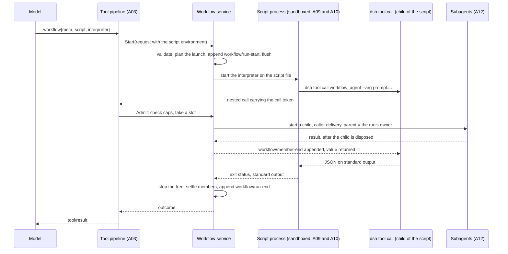

# Programmatic tool calling and workflows: Go specification

> **Status: design, not built.** Upstream facts were read at the pinned commit recorded in
> [../README.md](../README.md) and are cited as `path:line` under the upstream root. Statements that are
> reasoning and not read from source open with "Inference"; sections 6 to 9 are design and are
> inference throughout. IDs in this document use the area key `PTC`. Nothing here was built, run or tested.

| | |
|---|---|
| **Area key** | `PTC` (agent A11) |
| **Upstream packages** | 5: `ptc-runtime/ptc-runtime`, `ptc-runtime/ptc-runtime-node`, `workflow/workflow`, `workflow/workflow-ptc`, `workflow/tool-workflow` |
| **Serves outcomes** | [DH-O-9](../design.md#dh-o-9) (workflow runs), [DH-O-6](../design.md#dh-o-6), [DH-O-4](../design.md#dh-o-4), [DH-O-7](../design.md#dh-o-7), [DH-O-3](../design.md#dh-o-3), [DH-O-5](../design.md#dh-o-5), [DH-O-14](../design.md#dh-o-14) |
| **Depends on areas** | A03 (pipeline, tool endpoint, call tokens, prompt sections); A09 (starting and stopping the script process, output capture); A10 (launch plan, enforcement facts, the `sandbox/mode` event); A12 (subagents started from a workflow); A13 (job registry, for background runs); A24 (`dsh tool` command); A01, A05, A06 (event types, flush, closers, projections); A07 (spill, blobs); A08 (reading a script file); A17 (approval prompts); A21 (bundle and preset entries); the UI areas (run card) |
| **Priority** | P1: neither script calling nor workflows are needed for a first working harness, and both are on upstream's main paths (workflows are mounted in the base bundle, `packages/bundle/base/cordis.patch.yml:418-427`). P2 for background runs |

## 1. Purpose

Two things live here.

**Programmatic tool calling (PTC)** lets a model make many tool calls in one step by writing a program that loops over tools and returns only what matters. Upstream runs that program in a JavaScript guest runtime. The owner decided that the Go harness has none ([DH-ADR-8](../design.md#dh-adr-8)): the model writes an ordinary script and the script calls tools through the `dsh tool` command line. The command, its endpoint, its bounds and its logging belong to areas A03 and A24 ([tools.md](tools.md), [../libs/ptc-guest-runtime.md](../libs/ptc-guest-runtime.md)). What is left for this area is PTC as a product mode: the switch that turns script calling on for an agent, and the text that teaches the model to use it.

**Workflows** let a model coordinate many subagents with a program instead of turn by turn: "review each of these forty files, then merge the findings". Without them the model delegates one child at a time and carries every intermediate result in its own context. This area owns the workflow service: what a run is, the process that executes it, its limits, its record in the session log, its cancellation and its cleanup. It is the main design work of this document, because upstream's workflow script is JavaScript evaluated in the guest runtime that is not built.

## 2. Vocabulary

| Term | What it is | Why it exists |
|---|---|---|
| **Script-calling mode** | A per-preset switch. When on, a script the agent starts with a shell tool receives a call token, and the system prompt teaches the `dsh tool` command. | It is what PTC means in this design; with it off, the model is told nothing and no token exists. |
| **Hosting tool** | A tool whose call starts a script and hands it a call token: the shell tools (A09) and `workflow`. | Only a hosting call can be the parent of nested calls. |
| **Outer call, nested call** | As in [tools.md](tools.md) §2: the hosting call, and one tool call a script makes through `dsh tool call`. | Nested calls are logged inside the outer call's bracket. |
| **Workflow** | A script whose job is orchestration: it starts subagents, waits for them, and prints one result. | One model step drives many children. |
| **Run** | One execution of one workflow script: an id, a process, a record. | The unit that is started, observed, bounded, cancelled and cleaned up. |
| **Interpreter** | A named program that executes the script file: `bash`, `pwsh`, or one the operator configured. | There is no engine in the harness; the machine supplies the language. |
| **Member** | One subagent started by a run, with a sequence number, a label and an optional phase. | Lineage: every child is tied to a run and to the agent that owns the run. |
| **Run record** | The log-only session events that open and close a run and each member. | The run's place in the session log; what the UI and a resume read. |
| **Narration** | Lines the script writes to standard error. Shown live, not stored in the log. | Progress for a person watching; it never reaches the model except as a bounded tail on failure. |
| **Run budget** | The elapsed time a run may take, counted by the service. | Upstream has no overall deadline; a runaway run must end. |
| **Stop reason** | The closed set of ways a run ends: `completed`, `failed`, `cancelled`, `timeout`, `interrupted`. | A failure is a recorded fact, never an exception path. |
| **Settle** | To finish cleanup: the process tree is gone and every member's child is disposed, or a bound has passed and what remains is named. | A result is reported only after settle ([DH-O-9](../design.md#dh-o-9)). |

## 3. What upstream does

### 3.1 Packages

| Upstream unit | Package | Role | What it does |
|---|---|---|---|
| `UP-PKG-packages.ptc-runtime.ptc-runtime` | `@deepseek-ai/dsh-ptc-runtime` | definition | The abstract seam `ctx.ptcRuntime`: `resolve(request)`, `run(spec)`, `release(owner)`, `registerEnvironmentInitializer` (`packages/ptc-runtime/ptc-runtime/src/index.ts:86-164`), and the vocabulary of programs, bindings, output and eight failure kinds (`docs/subsystems/ptc-runtime.md:248-253`). |
| `UP-PKG-packages.ptc-runtime.ptc-runtime-node` | `@deepseek-ai/dsh-ptc-runtime-node` | provider | Runs each program in a Node child process under the sandbox seam, in one of four evaluation forms, with an RPC control pipe for host bindings and optional state kept in memory per owner (`packages/ptc-runtime/ptc-runtime-node/README.md:52-63`). |
| `UP-PKG-packages.workflow.workflow` | `@deepseek-ai/dsh-workflow` | definition | The seam `ctx.workflowEngine` with one method, `start(request)`, the run and result types, six `workflow/*` events and the error codes (`packages/workflow/workflow/src/index.ts:43-89`, `:111-123`, `:163-174`). |
| `UP-PKG-packages.workflow.workflow-ptc` | `@deepseek-ai/dsh-workflow-ptc` | provider | The only engine: evaluates the script in a `vm` context inside a PTC process and connects five helper functions to the subagent seam (`packages/workflow/workflow-ptc/src/host.ts:28-29`, `:193-204`; `src/runtime.ts:75-85`). |
| `UP-PKG-packages.workflow.tool-workflow` | `@deepseek-ai/dsh-tool-workflow` | consumer | The model-facing `workflow` tool, its prompt section, the durable run record and the background-job path (`packages/workflow/tool-workflow/src/index.ts:320-492`). |

### 3.2 Behaviour

**The PTC runtime.** A consumer hands the runtime a program text, a set of named host functions ("bindings"), a working directory, a deadline, a sandbox policy and a cancel signal, and gets back a completion value, ordered output, a truncation flag and at most one failure (`docs/subsystems/ptc-runtime.md:18-54`, `:87-108`). The Node provider starts a child process through the sandbox and subprocess seams and evaluates the program there; a binding call is a message on a separate control pipe. [../libs/ptc-guest-runtime.md](../libs/ptc-guest-runtime.md) §2 holds the full evidence and is not repeated. Three facts matter for a design without the runtime. Output stops at a byte cap while the program keeps running, and the result says it was truncated (`packages/ptc-runtime/ptc-runtime-node/README.md:85`). On timeout or cancel a per-call program's process tree is terminated at once, and a retained program's authority is revoked first, it is asked to stop, and its tree is killed after a grace period (`README.md:133`, `:157`). A program is a full Node program under the operating-system sandbox, so what it does directly leaves no log event (`README.md:89`). The runtime has three consumers: the `run_code` tool (area A03), the workflow engine (this area) and the experimental computer-use program tool.

**What a workflow is.** A plain JavaScript function body that orchestrates subagents and ends with `return <json-value>` (`packages/workflow/workflow/README.md:36`). Who writes it: the model, as the `script` argument of one `workflow` tool call (`packages/workflow/tool-workflow/src/index.ts:336-342`), or a plugin in code, as the experimental `ralph` tool does with a fixed script (`packages/experimental/tool-ralph/src/index.ts:453-461`). There are no saved workflows, no user-authored or skill-authored workflows, and a script cannot start another workflow (`packages/workflow/workflow/README.md:128`).

**What a script can do.** It gets six globals and nothing else by contract (`packages/workflow/workflow-ptc/src/runtime.ts:77-85`):

| Global | Behaviour | Evidence |
|---|---|---|
| `agent(prompt, opts?)` | Starts one subagent and resolves, when the child ends, to its final text or, with `opts.schema`, to a validated object. A failed child resolves to `null`. Options: `label`, `phase`, `schema`, `provider`, `model`. | `runtime.ts:161-227`, `:33` |
| `parallel(thunks)` | Runs functions at once and waits for all; a throwing function yields `null`. | `runtime.ts:283-306` |
| `pipeline(items, ...stages)` | Runs each item through the stage functions with no barrier between stages; a throwing stage drops that item to `null`. | `runtime.ts:309-338` |
| `phase(title)`, `log(message)` | Progress for observers; `phase` also labels later `agent()` calls. | `runtime.ts:350-364` |
| `args` | The tool call's `args` object. | `runtime.ts:84` |

A script does **not** call tools: the model is told "The script has no filesystem, network, timer, or Node.js APIs; the agents do the work" (`packages/workflow/tool-workflow/src/index.ts:168`). That sentence is guidance, not enforcement: the `vm` context "is not a security boundary" and code that reaches Node follows only the sandbox policy (`packages/workflow/workflow-ptc/README.md:59`, `:158`). Misusing a helper (bad arguments, an unknown option, a schema outside the supported subset, a tripped cap) throws a fatal error that the combinators re-throw, so it ends the whole script instead of becoming a `null` (`docs/subsystems/workflow.md:121`).

**How a run starts.** The tool passes `{script, meta, args, parent, signal}` to `ctx.workflowEngine.start()`. `meta` is identity data (`name`, `description`, optional `whenToUse` and `phases`) and is validated as data, with every violation named (`packages/workflow/workflow-ptc/src/meta.ts:76-82`). The engine parses the script on the host without running it, so a syntax error is reported before a run exists (`packages/workflow/workflow-ptc/src/index.ts:57-67`). It resolves the subagent provider and the per-run agent cap, captures the calling session's working directory and standing sandbox policy (`index.ts:139-140`, `:169`), and returns a live run. Each `agent()` call starts a child through `ctx.subagents.startActivation` with `delivery: 'caller'`, the run's parent agent and the captured directory (`packages/workflow/workflow-ptc/src/host.ts:218-233`): the workflow awaits the result itself and the parent model gets no completion notice (`packages/subagent/subagent/README.md:61`).

**Limits.** 1000 `agent()` calls per run; concurrency `min(16, max(1, cores - 2))`; 4096 items per combinator call; 5 s for the script's first synchronous slice (`packages/workflow/workflow-ptc/src/index.ts:108-114`, `:144-146`). The counters live in the script's process and are "not host-enforced security quotas" (`packages/workflow/workflow-ptc/README.md:155`). The engine asks the runtime for no elapsed deadline (`packages/workflow/workflow-ptc/src/host.ts:313`).

**How a run is observed.** Six live events, each carrying an identity snapshot and never the run handle, so a listener cannot cancel (`packages/workflow/workflow/src/index.ts:43-89`; `docs/subsystems/workflow.md:125`). For a top-level call the tool mirrors four of them into the parent session as log-only events: `tool-workflow/run-start`, `agent-start`, `agent-end`, `run-end` (`packages/workflow/tool-workflow/src/types.ts:41-63`). `phase()` and `log()` lines have no durable form (`packages/workflow/tool-workflow/README.md:80`).

**What the model sees.** In the foreground the tool blocks the parent turn and returns `workflow "<name>" completed (<n> agents).` followed by the pretty-printed return value, cut at `maxResultChars` (50,000) with a notice (`packages/workflow/tool-workflow/src/index.ts:241-248`). Any other ending is an error result; "partial output is never reported as success" (`packages/workflow/tool-workflow/README.md:34`). With `run_in_background: true` the run becomes an owned job, the call returns a job id at once, progress lines go to the job's output ring, and the value arrives with the job's completion notice (`index.ts:265-318`; `src/record.ts:40-54`). A system-prompt section says to use the tool only when the user explicitly asks for a workflow or large orchestration (`index.ts:328-332`).

**Cancel and resume.** Cancelling the calling step cancels the run; a background run is cancelled by `job_kill` or owner teardown (`packages/workflow/tool-workflow/README.md:42`). Nothing is checkpointed: "a process restart cannot continue a run" (`packages/workflow/workflow/README.md:127`).

### 3.3 Failure, retry, rollback and cleanup upstream

`start()` throws before a run exists for a bad `meta`, an unparseable script, an unknown provider or a cap above the ceiling (`packages/workflow/workflow-ptc/README.md:55`). After that `result` never rejects: it resolves with `completed`, `cancelled` or `error` (`packages/workflow/workflow/src/types.ts:64`). Cancellation aborts the process at once, without waiting for the script, and aborts pending and published children (`packages/workflow/workflow-ptc/src/host.ts:166-171`). Settlement waits, with no timer of its own, for pending starts and for every child's disposal, then synthesises a `cancelled` ending for members still open (`host.ts:325-335`); a subagent provider that does not finish disposal delays the run without bound (`packages/workflow/workflow-ptc/README.md:157`). The run belongs to whoever called `start()`: unloading the engine does not find or stop live runs (`packages/workflow/workflow/README.md:130`). The durable record is "observational": the first failed append disables recording for that run and execution continues (`packages/workflow/tool-workflow/src/index.ts:108-114`). A missing member ending or run ending at the log tail is read as an interruption (`docs/subsystems/workflow.md:131`). Nothing is retried, replayed or rolled back; effects of finished children stay.

## 4. Upstream decisions dissected

The first seven rows are the decision notes handed to this area; their paths are under `.agents/notes/implemented/architecture/`. The rest are visible only in code or READMEs.

| Upstream decision | What was decided and why | Verdict | Reason | Go decision |
|---|---|---|---|---|
| `2026-09-11-sandboxed-node-ptc-runtime` | Each program runs in a fresh Node process, confined by the same sandbox provider as shell commands and owned by the subprocess service; never replayed (`:15`, `:29`) | change | The confined, owned, never-replayed child process is kept; the Node guest, its control pipe and its bindings are not built | [DH-ADR-PTC-1](#dh-adr-ptc-1), [DH-ADR-8](../design.md#dh-adr-8) |
| `2026-09-13-workflow-ptc-sandbox-reuse` | Workflows reuse the PTC process instead of a second launcher; the `vm` is not a boundary; no elapsed deadline (`:13-17`) | change | "No second launcher" is kept: a workflow script starts through the one process starter and the one sandbox seam. The missing deadline is replaced by a run budget | [DH-ADR-PTC-2](#dh-adr-ptc-2), [DH-ADR-PTC-5](#dh-adr-ptc-5) |
| `2026-09-23-best-effort-persistent-ptc` | An optional mode keeps one REPL process per agent so variables survive between programs; state is never durable and never replayed (`:13`, `:19`) | drop | There is no interpreter to keep state in. A script keeps state in files, and the persistent shell tool (A09) is the stateful form. "Never replayed" is kept | [DH-ADR-PTC-1](#dh-adr-ptc-1) |
| `2026-10-08-persistent-ptc-sandbox` | A process that outlives one call must not outlive a one-time approval or a policy change; an escalated program runs in a fresh environment (`:9`, `:17`) | change | The invariant applies to any long-lived child, so it is kept for workflow runs; the retained-environment mechanics are dropped | [DH-ADR-PTC-6](#dh-adr-ptc-6) |
| `2026-10-20-ptc-script-evaluation-and-retention` | Program syntax (`programFormat`) and state retention (`retainsState`) are separate settings; a `vm` Script evaluator is added (`:13`) | drop | Both settings describe a JavaScript evaluator. The host neither parses nor evaluates script text | [DH-ADR-PTC-1](#dh-adr-ptc-1) |
| `2026-10-29-retained-ptc-interruption` | On timeout or cancel: revoke authority, ask for a cooperative stop, kill after a grace period; the result says whether variables survived (`:13-15`) | change | The order (revoke, ask, bounded kill) is the stop sequence of a workflow run. Variable survival has no meaning without a retained interpreter | [DH-ADR-PTC-4](#dh-adr-ptc-4) |
| `2026-11-09-retained-ptc-scoped-repl` | A scope-chain evaluator lets a later program redeclare a `const` in retained state (`:9`, `:33`) | drop | The problem exists only in a retained JavaScript scope. The first verdict ("ported") assumed programs stay TypeScript; they do not | [DH-ADR-PTC-1](#dh-adr-ptc-1) |
| One engine per context, behind a seam (`docs/subsystems/workflow.md:5`) | The isolation strategy can change without changing what the model sees | keep | A contract package and one provider component; consumers import only the contract | [DH-ADR-PTC-2](#dh-adr-ptc-2) |
| `meta` is data, never evaluated script text (`docs/subsystems/workflow.md:13`) | Identity must be checkable before anything runs | keep | Typed input, validated at stage 1 of the pipeline | [DH-ADR-PTC-3](#dh-adr-ptc-3) |
| Failure is a field, and the stop reason is a closed set (`packages/workflow/workflow/src/types.ts:64`) | A failed run is a normal result to report | keep | Five stop reasons; `Result` never carries an error value | [DH-ADR-PTC-4](#dh-adr-ptc-4) |
| Events carry snapshots, never the run handle (`docs/subsystems/workflow.md:125`) | An observer must not gain the right to cancel | keep | Observers read committed session events and one live narration event; control is a service method checked against the owner | [DH-ADR-PTC-4](#dh-adr-ptc-4) |
| Fatal helper errors end the script; a failed child is `null` (`docs/subsystems/workflow.md:121`) | A typo must not look like a child failure | change | Without in-process helpers the engine cannot end a script on misuse. The two cases are different error codes and exit statuses; host caps hold whatever the script does | [DH-ADR-PTC-3](#dh-adr-ptc-3) |
| Members are delivered to the caller, with no completion notice to the parent model (`packages/workflow/workflow-ptc/src/host.ts:221`) | The script collects results; the parent sees one outcome | keep | The member tool blocks and returns the child's result to the script | [DH-ADR-PTC-3](#dh-adr-ptc-3) |
| The durable record is observational; a failed append disables it (`packages/workflow/tool-workflow/src/index.ts:108-114`) | Recording must not change execution | change | A run with no record is invisible to resume and to the UI. The service writes the record and fails closed | [DH-ADR-PTC-4](#dh-adr-ptc-4) |
| Runs are holder-owned and survive engine unload (`packages/workflow/workflow-ptc/src/index.ts:157-159`) | An accepted run keeps working | change | A run nobody tracks cannot be stopped at shutdown. The service owns every run | [DH-ADR-PTC-4](#dh-adr-ptc-4) |
| No overall deadline (`packages/workflow/workflow-ptc/src/host.ts:313`) | A workflow may await many subagents | change | A bound is required for anything that can run away; the budget is long and configurable | [DH-ADR-PTC-5](#dh-adr-ptc-5) |
| The model is told the script has no filesystem or network (`packages/workflow/tool-workflow/src/index.ts:168`) | Keep orchestration separate from work | change | The statement is false upstream and would be false here. The model is told what the script can really do | [DH-ADR-PTC-3](#dh-adr-ptc-3) |
| Working directory and policy are captured at start (`packages/workflow/workflow-ptc/README.md:59`) | Children keep the directory when the parent moves | keep | Recorded in `workflow/run-start` | [DH-ADR-PTC-6](#dh-adr-ptc-6) |
| A background run is a job; no step signal reaches it (`packages/workflow/tool-workflow/src/index.ts:265-318`) | Long orchestration should not block the turn | keep, P2 | It needs a call token that outlives the outer call, which the owner allowed for a registered job of the `workflow` tool ([DH-ADR-29](../design.md#dh-adr-29)) | [DH-ADR-PTC-7](#dh-adr-ptc-7) |
| Usage guidance ships with the tool: "only when the user explicitly asks" (`index.ts:328-332`) | Orchestration is expensive | keep | A prompt section registered by the tool component | [DH-ADR-PTC-3](#dh-adr-ptc-3) |

## 5. Tech debt and its resolution

37 units: 36 limitation bullets and one source marker. They are grouped by cause; each unit's own reason is in its ledger row. Short names: `node.N` is `UP-DEBT-limit.packages.ptc-runtime.ptc-runtime-node.N`, `seam.N` is `…ptc-runtime.ptc-runtime.N`, `eng.N` is `…workflow.workflow-ptc.N`, `tool.N` is `…workflow.tool-workflow.N`, `wf.N` is `…workflow.workflow.N`.

| Group | Units | How the Go design answers it |
|---|---|---|
| **A. Semantics of a JavaScript guest** (15, not applicable) | `node.1`, `.5` to `.10`, `.12`, `.13`, `.16`; `seam.2`, `.3`; `eng.5`, `.6`; the `TODO` at `scoped-repl-evaluator.ts:109` | Module loading, program forms, source rewriting, realms, retained heaps, value formatting and image references exist only inside a JavaScript engine. With no interpreter ([DH-ADR-8](../design.md#dh-adr-8)) none can arise. `node.5` also says no mode offers a yield-and-wait interface: none is added here; long work is a background job (A09, A13) or a background run ([DH-D-PTC-6](#dh-d-ptc-6)). |
| **B. Output and observation** (5, resolved) | `node.11`, `seam.1`, `tool.1`, `tool.2`, `wf.1` | Standard output is collected through a bounded tail with a capped spill to storage, so the result keeps a locator for what the model-facing text cut ([DH-D-PTC-4](#dh-d-ptc-4)). Narration and member starts are visible while a run is live ([DH-D-PTC-3](#dh-d-ptc-3)). A cancelled or timed-out run reports its partial output and member table as a failure. `args` may be any JSON value. Runs are tracked by the service and can be listed. |
| **C. Ownership, records and limits the host did not enforce** (9, resolved) | `wf.4`, `wf.5`, `tool.4`, `tool.5`, `eng.2`, `eng.3`, `eng.4`, `node.15`, `seam.4` | The service owns every run ([DH-ADR-PTC-4](#dh-adr-ptc-4)). The record is written by the service, fails closed, and every nested call is logged by the pipeline. Agent count, concurrency, run time and an optional token budget are counted in the host ([DH-ADR-PTC-5](#dh-adr-ptc-5)). Cleanup has a bound and reports what it could not confirm. There is no bootstrap artifact to keep in step: the tool command is the `dsh` binary and the endpoint checks a wire revision. One endpoint applies one set of byte bounds. A replay test covers a recorded run. |
| **D. Limits the Go design keeps** (8, carried) | `node.2`, `node.3`, `node.4`, `node.14`, `eng.1`, `tool.3`, `wf.2`, `wf.3` | See below. |

**Carried, with the reason each cannot be removed here.** All are owned by stage `DH-S-47` of [../impl.md](../impl.md#dh-s-47).

- `node.2`, `eng.1` (confinement is as complete as the backend). A script is confined by the sandbox backend of its platform; Windows is always `partial` and reads are unconfined everywhere ([../design.md §6](../design.md#6-security-model)). The design reports mode, backend and enforcement in `workflow/run-start` and in the result; it cannot strengthen the backend.
- `node.3` (no memory or processor limit for the process tree). The V8 heap cap disappears with the engine. It is replaced by a memory and a process-count limit on the script's whole tree, `maxMemoryBytes` and `maxProcesses`, passed as `Spec.Limits` and carried out by the tree owner of [execution.md](execution.md) §6.1 (U-K1-2, [DH-ADR-PTC-5](#dh-adr-ptc-5)); the run record says `limits: enforced`, `partial` or `unavailable`. What is still true: on macOS, and on a Linux host with neither a writable control group nor a user service manager, the limits are `unavailable`, and no processor meter exists on any system. The time-limit questions of upstream's runtime note (`UP-DEBT-found.Q3.7`) are answered by the same decision and the pipeline's budget.
- `node.4`, part of `eng.1` (cleanup is as good as the tree owner). On macOS, and on a Linux host that falls to process groups, a process that leaves its process group escapes ([execution.md](execution.md) §6.1). The run record says `cleanup: incomplete` and names survivors; it does not claim more.
- `node.14` (a tool body allocates before any bound applies). The endpoint bounds what crosses the socket, not what a tool body allocates while producing its result. Each first-party body must bound its own reads; the pipeline cannot.
- `tool.3` (policy is fixed per registration). Kept on purpose: a cap the model could raise is not a cap. The model may lower the agent cap and the run budget for one call, never raise them.
- `wf.2` (no resume). Members and their outcomes are now durable, and each finished child's work is in its own session, but a run is never continued or re-run after a restart: the script's direct effects are unknown, so replay could repeat them ([DH-ADR-PTC-6](#dh-adr-ptc-6)).
- `wf.3` (no nested workflows). Saved workflows are answered by the `file` argument ([DH-D-PTC-4](#dh-d-ptc-4)). Nesting stays impossible from a script: a command started by a nested call gets no token ([tools.md](tools.md), `DH-ADR-TOOLS-6`). A member agent whose preset has the `workflow` tool can start its own run, bounded by the subagent depth limit of area A12.

## 6. Go design

### 6.1 Shape

Packages follow [../design.md §4.2](../design.md#42-go-module-layout).

| Package (under `src/harness/internal`) | Component (config row) | Provides | Injects | Why it exists |
|---|---|---|---|---|
| `program` | `program.mode` | Nothing. Registers `AllowScriptCalls(tools...)` naming the configured hosting tools ([tools.md](tools.md)), and one prompt section, which teaches `dsh tool call`, `dsh tool pick --file` for `DSH_WORKFLOW_ARGS`, the `:=` form of `--arg` and the exit-status table of [app-cli.md](app-cli.md) §6.2.2 | `tools.Key`, `prompt.Key` | Script-calling mode is a switch and a text, mounted by a preset. A preset without it pays no tokens and mints no token |
| `delegate/workflow` | none (contract) | Types `Request`, `Info`, `Member`, `Result`, `StopReason`, `RunID`; the event types; `workflow.Key`; the live key `workflow.Narrated` | n/a | The only package other areas import |
| `delegate/workflow/engine` | `workflow.engine` | `workflow.Service` under `workflow.Key` | `subprocess.Key` and the shell registry (A09), the sandbox seam and policy resolver (A10), the session store and projections (A01, A06), the spill store (A07), the filesystem seam (A08) | Owns runs, processes, limits, records and cleanup |
| `delegate/workflow/tools` | `tool.workflow` | Nothing. Registers `workflow`, `workflow_agent` and a prompt section | `workflow.Key`, `tools.Key`, `prompt.Key`, the subagent service (A12), the job registry (A13, optional) | Tools and the service that hosts them are separate components ([../design.md §4.2](../design.md#42-go-module-layout)) |

```go
// package workflow: the contract.
type Service interface {
    Start(ctx context.Context, req Request) (Run, error) // an error means no run exists and nothing was logged
    Lookup(id RunID) (Info, bool)                        // access for observers: data only
    List(owner agent.ID) []Info
    Cancel(ctx context.Context, id RunID, cause error) error // refused unless the caller is the owner's scope
    Admit(ctx context.Context, outer tools.CallID, m MemberSpec) (Slot, error) // used by workflow_agent
}
type Request struct {
    Owner       agent.Agent     // every member is attributed to it
    Hosting     tools.CallID    // the outer call that owns the run
    Meta        Meta            // Name, Description, WhenToUse, Phases
    Script      Script          // Text or a file reference; Interpreter name
    Args        json.RawMessage // any JSON value; delivered as a file
    Budget      time.Duration   // 0 means the default; never above the configured maximum
    MaxAgents   int             // 0 means the configured cap; never above it
    ScriptEnv   tools.ScriptEnv // endpoint address and call token, from the hosting call's Run
}
type Run interface {
    Info() Info
    Done() <-chan struct{} // closed after settle and after workflow/run-end is appended
    Result() Result        // valid after Done; StopReason, exit code, output, members, cleanup facts
    Cancel(cause error)    // idempotent
}
```

`Slot` is what the member tool holds while its child runs: `Started(child)` appends `workflow/member-start`, `Ended(outcome, usage)` appends `workflow/member-end` and frees the concurrency slot. `Start` is the only way to create a run, and it needs a script environment that only a hosting tool call can obtain from the pipeline, so there is no run without an outer call.

**A foreground run, end to end.**



**How the script runs.** The engine writes the script text to a file in a private run directory it creates, writes `args` beside it, and starts the interpreter on that file: `bash <file>`, `pwsh -NoLogo -NoProfile -NonInteractive -File <file>`, or the argument list an operator configured for another interpreter. The working directory is the session's directory at start. The launch plan comes from the sandbox seam for the session's standing policy and is required ([execution.md](execution.md), `DH-ADR-EXEC-3`). The environment is the scrubbed one A09 builds, plus the two variables of the script environment and three of this area: `DSH_WORKFLOW_RUN` (the run id), `DSH_WORKFLOW_ARGS` (the path of the `args` file, absent with no `args`) and `DSH_WORKFLOW_MAX_PARALLEL` (the concurrency in force). Standard output is collected as the result; standard error is read line by line as narration. The host never parses the script ([DH-ADR-PTCGUEST-4](../libs/ptc-guest-runtime.md#dh-adr-ptcguest-4)).

### 6.2 Contracts

**Tools exposed to the model.**

| Tool | Replaces | Reach, disclosure | Arguments | Result |
|---|---|---|---|---|
| `workflow` | `UP-TOOL-dsh-tool-workflow.workflow` | `direct`, full; hosts scripts; exclusive in its batch | `meta` {`name`, `description`, `whenToUse`?, `phases`? [{`title`, `detail`?}]}; exactly one of `script` (text) or `file` (a path read through the filesystem seam); `interpreter` (an enumeration of the interpreters that resolved on this machine; default the world's shell); `args` (any JSON); `timeoutMinutes`, `maxAgents` (may only lower the configured values); `run_in_background` (present only when [DH-D-PTC-6](#dh-d-ptc-6) can work) | Text `workflow "<name>" completed (<n> agents).` and `Result:` followed by standard output, bounded by `maxResultBytes` with a spill locator when cut. Structured: `runId`, `stop`, `exitCode`, `agentsStarted`, members by outcome, `value` (when standard output is exactly one JSON document), `cleanup`, `sandbox` |
| `workflow_agent` | The `agent()` helper | `script`, none (it is described inside the `workflow` tool's description); parallel-safe; its deadline is the run's remaining budget | `prompt` (required), `label`, `phase`, `schema` (an object-rooted JSON Schema in the model-facing subset), `provider`, `model` | `{text}` or `{structured}`, plus `child` (the child's session id) and `seq` |

`workflow_agent` works only for a nested call whose outer call owns a live run; anywhere else it fails with `workflow/no-run`. A failed child is `workflow/child-failed`, which the tool command reports with the "tool failed" exit status so a script can continue; malformed arguments are refused at stage 1 of the pipeline with the "refused" status. This replaces upstream's `null` versus fatal error.

**Outcome codes owned by this area.** Before a run exists: `workflow/invalid-meta` (every violation listed), `workflow/invalid-script` (empty, too large, both or neither of `script` and `file`), `workflow/unknown-interpreter`, `workflow/unavailable` (no script entry, a remote execution world, or no launch plan), `workflow/record-failed`. After: `workflow/start-failed`, `workflow/failed` (non-zero exit), `workflow/cancelled`, `workflow/timeout`. For members: `workflow/no-run`, `workflow/agent-cap`, `workflow/token-budget`, `workflow/child-start-failed`, `workflow/child-failed`. Upstream's `SCRIPT_PARSE`, `ITEM_CAP` and `RESULT_UNSERIALIZABLE` have no counterpart: the host parses nothing, combinators are the script's own, and the result is bytes.

**Events.** Durable facts are session events; observers read them from the committed-event feed, so there is no second, live copy to keep in step ([../design.md §4.6](../design.md#46-event-model)).

| Upstream unit | Go event | Form | Payload |
|---|---|---|---|
| `UP-EVT-workflow/start` | `workflow/run-start` | session event, log-only | run id, hosting call id, meta, interpreter, script SHA-256 (and a blob reference when read from a file), working directory, sandbox mode, backend and enforcement, the limits in force, `background` |
| `UP-EVT-workflow/agent-start` | `workflow/member-start` | session event, log-only | run id, `seq`, nested call id, label, phase, child session id, provider and model overrides |
| `UP-EVT-workflow/agent-end` | `workflow/member-end` | session event, log-only | The whole member row again plus `outcome` (`completed`, `failed`, `cancelled`, `unknown`) and token usage when A12 reports it |
| `UP-EVT-workflow/end` | `workflow/run-end` | session event, log-only | run id, stop reason, cause, exit status, `agentsStarted`, members by outcome, `cleanup` (`complete` or `incomplete` with survivors), result size, `truncated`, spill reference, summed usage. As upstream, not the result value |
| `UP-EVT-workflow/phase` | none | n/a | Merged: a phase is a field of `workflow/member-start`. Upstream's UI already groups by member starts only (`docs/subsystems/workflow.md:133`) |
| `UP-EVT-workflow/log` | `workflow.Narrated` | live, notify, through the owner's scope | run id, one line of standard error (bounded length); also kept in a bounded ring per run |

The projection `workflow.runs` folds the four session events into one row per run with its members; the UI's run card and a resume read it. Inference: these four types replace upstream's persisted `tool-workflow/*` types, whose ledger rows belong to area A05.

**Config.** Go structs with defaults as Go values; decoding is strict. Numbers without an upstream default are proposals.

| Upstream unit | Go config | Fields (default) |
|---|---|---|
| `UP-CFG-dsh-ptc-runtime-node` | none | Not built. What survives lives elsewhere: elapsed defaults and grace on the shell tools (A09); pending calls and byte bounds on `tools.endpoint` (A03). Evaluation mode, retention, heap size and launch choice have no meaning. `program.Config` is new: `hosts` (`["bash", "pwsh"]`), `example` (true) |
| `UP-CFG-dsh-workflow-ptc` | `workflow/engine.Config` | `provider` (`spawn`), `maxConcurrentAgents` (0: `min(16, max(1, CPUs - 2))`, then never above the endpoint's nested-parallel bound), `maxTotalAgents` (1000), `defaultRuntime` (30m), `maxRuntime` (4h), `settleTimeout` (30s), `maxScriptBytes` (256 KiB), `maxArgsBytes` (1 MiB), `spillBytes` (64 MiB), `narrationLines` (2000), `maxTokens` (0, off), `maxMemoryBytes` (4 GiB) and `maxProcesses` (512) for the script's whole process tree, `interpreters` (extra entries: name and argument list; empty). Dropped: `maxItemsPerCall`, `syncTimeoutMs` |
| `UP-CFG-dsh-tool-workflow` | `workflow/tools.Config` | `toolName` (`workflow`), `maxResultBytes` (50,000), `enableBackground` (true; the argument is still absent until its prerequisites are mounted) |

**Services.**

| Upstream unit | Go service | Note |
|---|---|---|
| `UP-SVC-ptcRuntime` | none | No seam: there is one way to run model-written code, a sandboxed command. Its three consumers are answered by A03 (`run_code`), this area (workflows) and the computer-use area |
| `UP-SVC-workflowEngine` | `workflow.Key`, interface `workflow.Service` | A direct seam with one provider; the service, not the caller, owns runs |

### 6.3 Ownership, failure, retry, rollback and cleanup

| Resource | Owner (who releases it) | Who merely has access |
|---|---|---|
| A run and its entry in the run table | The `workflow` fiber, under the owner agent's lifetime context. Unloading the engine or disposing the agent cancels and settles it | The hosting call (await, cancel); observers (data) |
| The script process tree | The subprocess provider's fiber (A09); the run asks for the stop | The script |
| The run directory (script file, `args` file) | The run; removed at settle. A directory left by a crashed host is removed at the next start of the engine | The script, read-only by intent |
| A call token | The outer call (A03), which deletes it when the call leaves execution; the run revokes it earlier, with `Run.RevokeScriptEnv()`, as the first rung of the stop | Any process in the script's tree; it can do only what the model can propose |
| A member's child agent | The `workflow_agent` nested call holds the creator's handle and disposes the child before it returns (A12) | The run (counts, record); the parent agent (it may open or continue a finished child, as A12 allows) |
| A concurrency slot | The nested call that took it; released in `Ended` on every path | n/a |
| Spilled output, a stored script blob | The storage area once written, with reference-aware retention (A07) | The session log, by reference |

**Stopping a run** follows one sequence, whatever the cause: (1) record the cause and stop admitting members; (2) run the process stop ladder of A09, whose first rung revokes the call token (`Run.RevokeScriptEnv()`), so no new nested call is admitted; (3) the tool commands die with the tree, their connections close, and the pipeline cancels each nested call (A03); (4) each `workflow_agent` body disposes its child and appends `workflow/member-end`; (5) wait until the tree is gone and every slot is released, at most `settleTimeout`; (6) remove the run directory, append `workflow/run-end`, close `Done`.

| Situation | What happens | Undone, and what stays uncertain |
|---|---|---|
| Bad `meta`, unknown interpreter, script too large, no launch plan | `Start` returns an error; no event, no process | Nothing exists |
| `workflow/run-start` cannot be appended or flushed | The run does not start (`workflow/record-failed`) | Nothing ran |
| The interpreter cannot start after the record is open | `workflow/run-end` with `failed` and `workflow/start-failed` | Nothing ran |
| The script exits non-zero, or has a syntax error | `failed`, with the exit status, the tail of standard error, partial standard output and the member table | Finished members' work stays. **Uncertain:** what the script did directly |
| The script exits while members still run | The stop sequence runs; those members end `cancelled`; the stop reason follows the exit status and the result says how many were cut | Their partial work stays in their own sessions |
| A `workflow/member-start` append fails | The child is disposed at once and the nested call fails; nothing is hidden | The child session may exist with no work in it |
| A cap is reached | That one `workflow_agent` call fails with `workflow/agent-cap` or `workflow/token-budget`; the script continues; running members are not interrupted | Nothing |
| The run budget ends | The engine's own timer stops the run: `timeout`. The hosting call's pipeline deadline is the budget plus `settleTimeout`, so the body returns by itself | As for cancellation |
| The turn is cancelled | The pipeline cancels the hosting call's context; the stop sequence runs: `cancelled` | **Uncertain:** how far members and the script got |
| Cleanup outlasts the pipeline's grace | The tool call settles as `tools/outcome-unknown` and the body is detached ([tools.md](tools.md), `DH-ADR-TOOLS-5`). The run stays `stopping` in the run table and `workflow/run-end` is appended when cleanup ends or `settleTimeout` passes | The model is told the outcome is unknown; the log says later how it ended |
| Cleanup is not confirmed at `settleTimeout` | `workflow/run-end` with `cleanup: incomplete`, naming surviving processes and undisposed children; they stay listed on the engine | **Uncertain:** the survivors |
| The session's sandbox policy narrows during a run | The run is cancelled with cause `policy-changed` ([DH-ADR-PTC-6](#dh-adr-ptc-6)) | As for cancellation |
| The owner agent is disposed, or the engine unloads | Every run of that owner (or every run) is cancelled and settled before the scope reports done | As for cancellation |
| The host dies during a run | The tree dies or survives as A09 states per system. On resume the lease holder appends closers: `workflow/member-end` with `unknown` for each open member and `workflow/run-end` with `interrupted`; the hosting call gets `tools/outcome-unknown` (A03) | **Uncertain:** everything in flight. Nothing is re-run |

Nothing is retried by this area: starting a script or a child twice is never assumed safe.

### 6.4 What a workflow can no longer do, and what the model is told

This is a capability change the owner chose ([DH-ADR-8](../design.md#dh-adr-8)). It is recorded as it is.

| Upstream | In this design |
|---|---|
| **In-process callbacks.** `parallel(thunks)` and `pipeline(items, ...stages)` take functions; a stage receives the previous stage's live value | No helper functions. The script composes with its own language: shell background jobs and `wait`, `xargs -P`, PowerShell jobs. Every value between stages is text in a variable or a file |
| **Structured values without serialisation.** `agent()` resolves to a JavaScript object; the script returns an object | Every value crosses a process boundary as JSON text. A shell script reads a field with the tool command's `--pick`; the result is whatever the script prints |
| **One language on every machine** | The language is the machine's: `bash` on Linux and macOS, PowerShell on Windows, others only where the operator configured them. A script written on one system may not run on another, so a saved workflow is not portable |
| **A syntax error is reported before a run exists** | The host parses nothing. A syntax error is the interpreter's failure, in its own words, after the run has started and been recorded |
| **Misuse ends the script** | The script decides. A script that ignores failures keeps running until it ends or the budget does; the host's caps still hold |
| **A call costs a message on a pipe; 4096 queued items per combinator** | Each call is a process start, and at most 128 tool commands may wait at once ([tools.md](tools.md) §6.2). A script that starts thousands of background commands is refused beyond that bound and must batch |
| **For PTC programs: Node APIs and installed packages, a generated typed SDK, `inspect` for images, variables kept between programs** | None. A script has the commands on the machine; schemas come from `dsh tool describe`; an image reaches the model only through a nested result attached with `--attach`; state between scripts is files |
| **For PTC programs: every tool schema replaced by one `run_code` tool** | Script calling is added beside ordinary tool calls. Shrinking the list the model sees is deferred disclosure in A03, not this mode |

Two things are gained, and both change the audit picture. A workflow script may call any tool its agent could call from a script, not only start agents. And a workflow script is openly an ordinary program under the sandbox: it can read and write files and run commands directly, and those direct effects are recorded only as its output, never call by call ([../design.md §6](../design.md#6-security-model)).

**What the model must be told.** Both texts are generated and held by golden files ([DH-ADR-PTCGUEST-5](../libs/ptc-guest-runtime.md#dh-adr-ptcguest-5)).

*Script-calling mode* (prompt section `program`, present exactly when the mode is on): how to call `dsh tool call`, `list` and `describe`; that arguments are passed with `--arg`, `--args-file` or standard input and never by building JSON with string concatenation; the exit statuses and that a "denied" call must not be retried in a loop; that every call is checked, may wait for a person and is logged; the bounds in force; that only what the script prints comes back, bounded; that the command works only inside a script started by a hosting tool in this turn, not in a background job and not on a remote host; that nothing is kept between scripts except files; and one worked example per mounted shell.

*Workflows* (the `workflow` tool's description, plus the short "only when the user explicitly asks" section): which interpreters exist on this machine and which is the default; that the script runs in the session's directory under the session's sandbox mode; how to start a member and that the call blocks until the child ends; how to tell a failed child from a mistake; how to run members in parallel in that interpreter, with the concurrency in force and the instruction to batch; that the result is standard output, preferably one JSON document printed last, and that progress goes to standard error; where `args` is; the agent cap and the run budget; that the agents should do the work, because direct edits by the script are not logged one by one; and that a script cannot start another workflow. A minimal example for `bash`:

```sh
review() { dsh tool call workflow_agent --arg prompt="Review $1 for correctness" --arg phase=review --pick /text; }
out=$(mktemp -d)
for f in src/a.go src/b.go; do review "$f" > "$out/$(basename "$f").txt" & done
wait
echo "{\"reviewed\": $(ls "$out" | wc -l)}"
```

The flags are the proposals of [tools.md](tools.md) (`DH-D-TOOLS-4`); the example is illustrative, not a tested script.

## 7. Decisions

<a id="dh-adr-ptc-1"></a>
### DH-ADR-PTC-1 The PTC runtime seam is not built; script calling is a mode, not a runtime

- **Decision.** Neither `ctx.ptcRuntime` nor its Node provider has a Go counterpart: no service key, no provider registry, no program forms, no retained program state. The `program` component is all that carries the name: mounted in a preset, it allows script calls for the configured hosting tools and registers the generated prompt section. It is off in the base bundle and on in a preset, as upstream's PTC executor is (`packages/bundle/base/cordis.patch.yml:532-534`).
- **Why.** [DH-ADR-8](../design.md#dh-adr-8) removes the guest runtime. A seam with no provider and one consumer is ceremony, and the things the runtime bounded (output, time, pending calls, bytes) already have owners in A03 and A09.
- **Tradeoff.** No consumer can ask for "a program runtime" any more; each of upstream's three consumers is restated separately. Upstream's mode replaced the tool list with one tool; this mode adds to it ([§6.4](#64-what-a-workflow-can-no-longer-do-and-what-the-model-is-told)). How well models write such scripts is unmeasured.
- **Serves.** [DH-O-6](../design.md#dh-o-6), [DH-O-4](../design.md#dh-o-4). **Verified by.** `DH-T-PTC-1`, `DH-E-PTC-5`.

<a id="dh-adr-ptc-2"></a>
### DH-ADR-PTC-2 A workflow is a script run by a named interpreter as one supervised, sandboxed child process

- **Decision.** A run is one process tree: an interpreter started on a script file through the one process starter (A09), under a launch plan from the sandbox seam (A10), hosted by a `workflow` tool call. The script reaches the host only through `dsh tool call`. The workflow contract is a seam with one provider. A declarative workflow form was considered and not taken.
- **Why.** It is the direct reading of the owner's decision, and it adds no second launcher, no second sandbox path and no second way into the pipeline. Inference: a declarative form (a list of steps the host interprets) would be an interpreter by another name, would need its own expression language for loops and conditions, and would still not let the model write the fan-out it wants.
- **Tradeoff.** The capability losses of [§6.4](#64-what-a-workflow-can-no-longer-do-and-what-the-model-is-told). The script is a real program with the user's read access. Where no interpreter resolves or the execution world is remote, the tool is `unavailable`.
- **Serves.** [DH-O-9](../design.md#dh-o-9), [DH-O-7](../design.md#dh-o-7). **Verified by.** `DH-T-PTC-4`, `DH-E-PTC-2`.

<a id="dh-adr-ptc-3"></a>
### DH-ADR-PTC-3 The helpers become one blocking tool and the script's own language; the result is standard output

- **Decision.** Of upstream's six globals, only `agent()` needs the host, and it becomes the tool `workflow_agent`, reachable from scripts only and valid only inside a run. `parallel` and `pipeline` are the script's own concurrency. `phase` is an argument of the member call. `log` is a line on standard error. `args` is a file. The return value is standard output. The model is told plainly what the script can do.
- **Why.** One tool is the smallest host surface that preserves what a workflow is for. Making phase a field and narration a stream avoids one process start and one logged pair per progress line. The ordinary `subagent` tool returns at once and reports to the parent later (`docs/tool-catalog.md:2234`), which a script cannot await, so a blocking form is required.
- **Tradeoff.** The fatal-versus-`null` discipline is now exit statuses a script may ignore. Standard output mixes the result with anything a careless script prints. A script that wants structured data needs `--pick` or a language with a JSON parser.
- **Serves.** [DH-O-9](../design.md#dh-o-9), [DH-O-6](../design.md#dh-o-6), [DH-O-4](../design.md#dh-o-4). **Verified by.** `DH-T-PTC-2`, `DH-T-PTC-9`, `DH-T-PTC-11`, `DH-E-PTC-1`.

<a id="dh-adr-ptc-4"></a>
### DH-ADR-PTC-4 The service owns every run, writes its record, and reports a result only after a bounded cleanup

- **Decision.** A run is an effect on the engine's fiber under the owner agent's lifetime. The holder of a `Run` has access, not ownership. The service writes four log-only session events and refuses to start a run or a member whose opening record cannot be written. Stopping follows one order: revoke, ask, kill, settle members, record ([§6.3](#63-ownership-failure-retry-rollback-and-cleanup)). `workflow/run-end` is appended only after settle or after `settleTimeout`, and then says what was not confirmed.
- **Why.** [DH-O-9](../design.md#dh-o-9) asks for one owner, a recorded lineage and a result that settles after cleanup. Upstream's holder-owned run is invisible to shutdown, its record can silently stop, and its cleanup has no bound.
- **Tradeoff.** A storage fault now stops a workflow where upstream would have carried on unrecorded. A bounded wait means a run can end with `cleanup: incomplete`; that is reported, not hidden. When the turn is cancelled, the pipeline's shorter grace can settle the tool call as outcome unknown before the run record closes.
- **Serves.** [DH-O-9](../design.md#dh-o-9), [DH-O-3](../design.md#dh-o-3), [DH-O-14](../design.md#dh-o-14). **Verified by.** `DH-T-PTC-5`, `DH-T-PTC-7`, `DH-T-PTC-8`, `DH-E-PTC-3`, `DH-E-PTC-4`.

<a id="dh-adr-ptc-5"></a>
### DH-ADR-PTC-5 Limits are counted in the host, fixed by the operator, and only lowered by the model

- **Decision.** The host counts run time, members started, members running and, optionally, tokens used by members. A limit refuses one member call or ends the run; it never interrupts a running member. The model may lower `maxAgents` and `timeoutMinutes` for a call and cannot raise them. The script's process tree also gets a memory and a process-count limit (U-K1-2, [DH-ADR-40](../design.md#dh-adr-40)), passed as `Spec.Limits` and carried out by the tree owner ([execution.md](execution.md) §6.1); the run record says `limits: enforced`, `partial` or `unavailable`, and it is `unavailable` on macOS and on a Linux host without a delegated control group. Per-combinator item caps and the synchronous-slice timeout are dropped; the endpoint's bounds on nested calls (A03) cover a script that floods.
- **Why.** Upstream's counters run inside the script's process and are "cooperative" (`packages/workflow/workflow-ptc/README.md:155`), and a run has no deadline. A count the script cannot touch is the only kind that bounds a runaway loop.
- **Tradeoff.** Effective concurrency is the smaller of this area's value and the endpoint's nested-parallel bound, two settings in two components; the value in force is written to `workflow/run-start`. A default budget of 30 minutes will be wrong for some runs, and it is wall time: it keeps running while a nested call waits for a person. The token budget depends on A12 reporting usage.
- **Serves.** [DH-O-9](../design.md#dh-o-9), [DH-O-14](../design.md#dh-o-14). **Verified by.** `DH-T-PTC-6`.

<a id="dh-adr-ptc-6"></a>
### DH-ADR-PTC-6 A run never outlives the policy it started under, and is never resumed or replayed

- **Decision.** The working directory and the resolved sandbox policy are captured at start and recorded. If a committed `sandbox/mode` event or the removal of a write root narrows the session's policy while a run is live, the run is cancelled with cause `policy-changed`; a widening does not reach the running process. Approval of the hosting call covers the spawn only; nested calls are decided one by one ([../design.md §6](../design.md#6-security-model)). The tool offers no sandbox escalation. After a host restart an open run is closed as `interrupted` and nothing is run again.
- **Why.** A sandbox is applied at launch and cannot be changed on a live process, so a long run would otherwise keep authority the session no longer has (the invariant of upstream's `2026-10-08-persistent-ptc-sandbox.md:9`). Re-running a script repeats effects nobody recorded.
- **Tradeoff.** A user who tightens the mode loses a run in flight. After a crash the model must write a new script that skips finished members, using the member table.
- **Serves.** [DH-O-7](../design.md#dh-o-7), [DH-O-9](../design.md#dh-o-9). **Verified by.** `DH-T-PTC-8`, `DH-T-PTC-10`, `DH-E-PTC-2`.

<a id="dh-adr-ptc-7"></a>
### DH-ADR-PTC-7 A background run is owned by a job and needs a token that outlives the outer call

- **Decision.** `run_in_background` registers the run with the job registry (A13) and returns a job id at once. The job owns the run: `job_kill`, owner teardown and engine unload cancel it; the turn's cancellation does not. Narration goes to the job's output; the result reaches the model through the job's completion notice. The argument is offered only when a job registry is mounted and the pipeline issues a token owned by a run (`HostsScripts: job`); otherwise the tool does not show it. The owner decided that only a registered job may carry this ([DH-ADR-29](../design.md#dh-adr-29)): only the `workflow` tool may hand its call token to a background job the user can see and stop in the jobs list; every nested call still passes policy, guards and approval; the token dies when the job settles or is stopped; a shell command never gets one.
- **Why.** Upstream ships this on by default (`packages/workflow/tool-workflow/src/index.ts:64`). In this design a token ordinarily ends when its outer call leaves execution ([tools.md](tools.md), `DH-ADR-TOOLS-6`), so without the hand-over to a job a background script could start no member.
- **Tradeoff.** P2, and blocked on A03. Nested calls of a background run are logged outside any turn bracket, with the hosting call as parent. Approvals for them reach a person who may no longer be looking.
- **Serves.** [DH-O-9](../design.md#dh-o-9). **Verified by.** `DH-T-PTC-13`, `DH-E-PTC-6`.

## 8. Deliverables

<a id="dh-d-ptc-1"></a>
### DH-D-PTC-1 Script-calling mode: a preset switch and a generated prompt contract

- **Result and why it matters.** An operator turns programmatic tool calling on for an agent by mounting one component, and the model is then told exactly how to call tools from a script. With it off, no token is minted and no text is added; the two cannot disagree.
- **How it is implemented.** The component registers `AllowScriptCalls` for the hosting tools named in its config and one prompt section. The section's text is produced by a pure function from the tool command's usage text, the endpoint bounds in force and the names of script-reachable tools in the step view, plus a fixed worked example per mounted shell. A golden file pins the text for a fixed tool set.
- **Components and files.** `internal/program`.
- **Depends on.** [DH-D-TOOLS-4](tools.md#dh-d-tools-4) (`AllowScriptCalls(tools...)`, and the endpoint's bounds as `tools.Service.ScriptLimits()`); [DH-D-TOOLS-5](tools.md#dh-d-tools-5) (prompt sections); [DH-D-CLI-6](app-cli.md#dh-d-cli-6) (the usage text of `dsh tool`); [DH-D-BUNDLE-5](bundle-preset.md#dh-d-bundle-5) (a preset entry). Runtime prerequisite: the tool endpoint component is mounted.
- **Serves.** [DH-O-6](../design.md#dh-o-6), [DH-O-4](../design.md#dh-o-4). **Priority.** P1.
- **Done when.** `DH-T-PTC-1` passes and [DH-E-PTC-5](#dh-e-ptc-5) has passed.

<a id="dh-d-ptc-2"></a>
### DH-D-PTC-2 A workflow runs as one supervised, sandboxed process that the service starts, bounds and cleans up

- **Result and why it matters.** A run has one owner and a defined end. It cannot outlive its agent, its policy, its budget or the host's shutdown, and what cleanup could not confirm is named.
- **How it is implemented.** `Start` validates the request, resolves the interpreter, asks the sandbox seam for a launch plan, creates the run directory, appends the opening record and starts the process with collected standard output and piped standard error. One goroutine per run owns its state machine (`starting`, `running`, `stopping`, `settled`) and selects on process exit, the budget timer, the context, the committed `sandbox/mode` feed and cancel requests; every path runs the one stop sequence. The run table is the engine's; `List` and `Lookup` return copies.
- **Components and files.** `internal/delegate/workflow` (contract), `internal/delegate/workflow/engine`.
- **Depends on.** [DH-D-CORDIS-1](../libs/cordis.md#dh-d-cordis-1) and `DH-D-CORDIS-2` (owned effects, a lifetime context per fiber). [DH-D-EXEC-1](execution.md#dh-d-exec-1), [DH-D-EXEC-2](execution.md#dh-d-exec-2), [DH-D-EXEC-3](execution.md#dh-d-exec-3) and [DH-D-EXEC-4](execution.md#dh-d-exec-4) (start an interpreter from an argument list that names the script file, with a required launch plan and optional `Limits`; the stop ladder with its revoke rung; the tree-gone wait; bounded collection with spill; the `dsh` directory first on the search path); [DH-D-SANDBOX-3](sandbox-ssh.md#dh-d-sandbox-3) (a launch plan for the session's policy and its enforcement facts; the run directory is a subdirectory of the session scratch, which every backend lets the confined process read and write); [DH-D-TOOLS-4](tools.md#dh-d-tools-4) (the script environment). Runtime prerequisite: at least one interpreter resolves.
- **Serves.** [DH-O-9](../design.md#dh-o-9), [DH-O-7](../design.md#dh-o-7), [DH-O-3](../design.md#dh-o-3). **Priority.** P1.
- **Done when.** `DH-T-PTC-3`, `DH-T-PTC-4`, `DH-T-PTC-5`, `DH-T-PTC-10` and `DH-T-PTC-14` pass and [DH-E-PTC-2](#dh-e-ptc-2) and [DH-E-PTC-3](#dh-e-ptc-3) have passed on every supported system.

<a id="dh-d-ptc-3"></a>
### DH-D-PTC-3 A run has a durable record, a projection, live narration and an honest ending after a crash

- **Result and why it matters.** A person can watch a run and open each member's session; after a restart the log says which members finished and that the run was interrupted. This is the run's place in the session log.
- **How it is implemented.** Four registered session event types with payload version 1; appends go through the flush barrier before the process or a child starts. The projection `workflow.runs` is a pure fold. Narration is a bounded ring per run plus the live event. The engine registers closers for its two brackets so that the resuming writer can end them.
- **Components and files.** `internal/delegate/workflow` (event types, projection), `internal/delegate/workflow/engine`.
- **Depends on.** [DH-D-PTC-2](#dh-d-ptc-2); [DH-D-SESSION-1](core-session.md#dh-d-session-1) and [DH-D-SESSION-5](core-session.md#dh-d-session-5) (event registration; closers for area-owned brackets); [DH-D-STORE-4](session-store.md#dh-d-store-4) (the flush barrier); [DH-D-VIEW-1](session-views.md#dh-d-view-1) (the projection registry). The run card is built from the projection by [DH-D-UIWORK-6](ui-work.md#dh-d-uiwork-6).
- **Serves.** [DH-O-9](../design.md#dh-o-9), [DH-O-5](../design.md#dh-o-5), [DH-O-14](../design.md#dh-o-14). **Priority.** P1.
- **Done when.** `DH-T-PTC-5`, `DH-T-PTC-7`, `DH-T-PTC-8` and `DH-T-PTC-12` pass and [DH-E-PTC-3](#dh-e-ptc-3) and [DH-E-PTC-4](#dh-e-ptc-4) have passed.

<a id="dh-d-ptc-4"></a>
### DH-D-PTC-4 The model starts a workflow with the `workflow` tool and gets one bounded result

- **Result and why it matters.** The model writes the orchestration once and receives one outcome: the script's output, or a failure with what is known. A script kept in the workspace or in a skill can be run by path.
- **How it is implemented.** A hosting tool declaration whose input type yields the schema; the `interpreter` enumeration and the description text are edited at registration from what resolved, and pinned by a golden file. With `file`, the host reads the text through the filesystem seam, bounds it, stores it as a blob and runs its own copy, so a later change to the file cannot alter the run. The result is shaped from the run's `Result`: one JSON document on standard output becomes `value`; a non-zero exit is never a success.
- **Components and files.** `internal/delegate/workflow/tools`.
- **Depends on.** [DH-D-PTC-2](#dh-d-ptc-2), [DH-D-PTC-3](#dh-d-ptc-3); [DH-D-TOOLS-1](tools.md#dh-d-tools-1) and [DH-D-TOOLS-3](tools.md#dh-d-tools-3) (a declaration with `HostsScripts` and a per-call deadline); [DH-D-STORAGE-3](storage.md#dh-d-storage-3) and [DH-D-STORAGE-5](storage.md#dh-d-storage-5) (blob storage and spill); [DH-D-FS-4](filesystem.md#dh-d-fs-4) (reading a file within the agent's read rules); [DH-D-SANDBOX-1](sandbox-ssh.md#dh-d-sandbox-1) and [DH-D-HUMAN-2](interaction-credentials.md#dh-d-human-2) (the policy and the approval that gate this tool as they gate a shell command); [DH-D-BUNDLE-2](bundle-preset.md#dh-d-bundle-2) (base-bundle entries).
- **Serves.** [DH-O-9](../design.md#dh-o-9), [DH-O-6](../design.md#dh-o-6), [DH-O-4](../design.md#dh-o-4). **Priority.** P1.
- **Done when.** `DH-T-PTC-2`, `DH-T-PTC-3`, `DH-T-PTC-11` and `DH-T-PTC-12` pass and [DH-E-PTC-1](#dh-e-ptc-1) has passed.

<a id="dh-d-ptc-5"></a>
### DH-D-PTC-5 A script starts subagents as members with the run's owner, lineage and caps

- **Result and why it matters.** Every child a workflow starts belongs to the agent that owns the run, is tied to a run and a sequence number in the log, counts against the run's caps, and is disposed before its result is reported.
- **How it is implemented.** `workflow_agent` finds the run from the nested call's outer call id, calls `Admit` (cap check, slot wait), starts the child through the subagent service with caller delivery, the run's owner as parent, the captured directory, the optional schema and model overrides, and lineage fields naming the run and `seq`. It records the start, waits for the child or for cancellation, disposes the child, records the end and returns.
- **Components and files.** `internal/delegate/workflow/tools`, `Admit` in the engine.
- **Depends on.** [DH-D-PTC-2](#dh-d-ptc-2), [DH-D-PTC-3](#dh-d-ptc-3); [DH-D-SUBAGENT-1](subagent-team.md#dh-d-subagent-1) and [DH-D-SUBAGENT-2](subagent-team.md#dh-d-subagent-2) (start with caller delivery and no parent notice, an output schema, provider and model overrides, lineage fields, disposal that settles, usage in the result); [DH-D-TOOLS-4](tools.md#dh-d-tools-4) (a script-only, undisclosed tool; the outer call id, which is the nested call's parent; cancellation when the tool command's connection closes).
- **Serves.** [DH-O-9](../design.md#dh-o-9), [DH-O-6](../design.md#dh-o-6). **Priority.** P1.
- **Done when.** `DH-T-PTC-6`, `DH-T-PTC-9` and `DH-T-PTC-14` pass and [DH-E-PTC-1](#dh-e-ptc-1) and [DH-E-PTC-2](#dh-e-ptc-2) have passed.

<a id="dh-d-ptc-6"></a>
### DH-D-PTC-6 A workflow can run in the background as an owned job

- **Result and why it matters.** A long orchestration does not block the conversation; the model can read its progress, stop it, and receives its result when it ends.
- **How it is implemented.** As [DH-ADR-PTC-7](#dh-adr-ptc-7): the job starter calls `Start` with a run-owned script environment; narration lines and member lines are appended to the job's output; the job's outcome is mapped from the stop reason (`completed`, `killed`, `failed`).
- **Components and files.** `internal/delegate/workflow/tools`.
- **Depends on.** [DH-D-PTC-4](#dh-d-ptc-4), [DH-D-PTC-5](#dh-d-ptc-5); [DH-D-JOBS-1](jobs-schedule-goal-plan.md#dh-d-jobs-1) and [DH-D-JOBS-3](jobs-schedule-goal-plan.md#dh-d-jobs-3) (the job registry, its output ring and completion notice). It also needs the call token owned by a registered job ([DH-D-TOOLS-4](tools.md#dh-d-tools-4), `HostsScripts: job`), which the owner allowed for the `workflow` tool only ([DH-ADR-29](../design.md#dh-adr-29)): the token is handed to the job when the hosting call returns and is deleted when the job settles or is stopped.
- **Serves.** [DH-O-9](../design.md#dh-o-9). **Priority.** P2.
- **Done when.** `DH-T-PTC-13` passes and [DH-E-PTC-6](#dh-e-ptc-6) has passed.

## 9. Acceptance

### 9.1 Local tests

Unit and composition tests with fakes for the pipeline, the process seam, the subagent service and the session store, under the race detector and virtual time; two golden-file tests and one replay test are marked as such. A test with a fake is not a scenario.

| Test ID | Proves | What is asserted |
|---|---|---|
| `DH-T-PTC-1` | `DH-D-PTC-1` | Golden: for a fixed tool set and bounds the `program` section equals the stored text. With the component mounted, script calls are allowed for the configured hosting tools only; unmounted, no allowance and no section exist |
| `DH-T-PTC-2` | `DH-D-PTC-4` | Golden: the `workflow` schema and description for a fixed interpreter set. An interpreter that does not resolve is absent from the enumeration; with none, the tool reports `workflow/unavailable` |
| `DH-T-PTC-3` | `DH-D-PTC-2`, `DH-D-PTC-4` | A bad `meta` lists every violation; an unknown interpreter, an oversized script, and both or neither of `script` and `file` are refused; in each case no event is appended and no process starts |
| `DH-T-PTC-4` | `DH-D-PTC-2` | The process is started on a file whose bytes equal the submitted script; the environment differs from A09's built one by exactly the script environment and the three workflow variables; directory and launch plan are those captured at start; a start with no launch plan is refused |
| `DH-T-PTC-5` | `DH-D-PTC-2`, `DH-D-PTC-3` | For exit, cancel, budget, owner disposal and engine unload: the stop order is revoke, stop ladder, member disposal, record; `workflow/run-end` follows every `workflow/member-end` and precedes `Done`; with a member that never disposes, the run settles at `settleTimeout` with `cleanup: incomplete` naming it |
| `DH-T-PTC-6` | `DH-D-PTC-5` | Member `maxTotalAgents + 1` is refused with `workflow/agent-cap` and the next call is still served; running members never exceed the concurrency in force; a spent token budget refuses new members and interrupts none; lowered `maxAgents` and `timeoutMinutes` apply and raised ones are refused; the budget ends a run as `timeout` |
| `DH-T-PTC-7` | `DH-D-PTC-3` | `workflow/run-start` is flushed before the process starts and `workflow/member-start` before the child's first turn; a failed append stops the run or the member; folding the events, live and by replay, gives the same projection; narration is bounded and absent from the log |
| `DH-T-PTC-8` | `DH-D-PTC-3` | A log that ends with an open run and two open members gets, on resume, two `workflow/member-end` with `unknown` and one `workflow/run-end` with `interrupted`; no process and no child is started |
| `DH-T-PTC-9` | `DH-D-PTC-5` | Outside a run the tool fails with `workflow/no-run`; a failed child is `workflow/child-failed` and malformed arguments are refused before the body; a schema outside the subset is refused; the child's parent is the run's owner and its lineage names run and `seq`; closing the nested call's connection cancels and disposes the child and records `cancelled` |
| `DH-T-PTC-10` | `DH-D-PTC-2` | A committed `sandbox/mode` event that narrows the policy, and the removal of a write root, cancel the run with `policy-changed`; a widening does not |
| `DH-T-PTC-11` | `DH-D-PTC-4` | One JSON document on standard output becomes `value`; other output is text; output above the bound is cut with a spill locator and `truncated`; a non-zero exit, a cancel and a timeout are failures that carry the standard-error tail, partial output and member table |
| `DH-T-PTC-12` | `DH-D-PTC-3`, `DH-D-PTC-4` | Replay layer: a recorded session containing a foreground run is replayed against the built binary with the replay provider; every model request rebuilt from the log equals the recorded one, and the run card's projection matches a golden file |
| `DH-T-PTC-13` | `DH-D-PTC-6` | A background call registers one job and returns at once; cancelling the turn does not stop the run and killing the job does; narration reaches the job output; the outcome mapping holds; a nested call made after the hosting call returned is admitted while the job is live and refused once it settled or was stopped; without a job registry the argument is absent and a call that sets it is refused |
| `DH-T-PTC-14` | `DH-D-PTC-2`, `DH-D-PTC-5` | Import direction: nothing outside the workflow family imports the engine. Both tool bodies pass the pipeline's cancellation conformance helper |

### 9.2 Real-environment scenarios

<a id="dh-e-ptc-1"></a>
#### DH-E-PTC-1 A real model writes a workflow, and its members and requests are in the log

- **Proves.** `DH-D-PTC-4`, `DH-D-PTC-5`.
- **Given.** A real model API with a key supplied at run time; the built binary with the `headless` profile on an empty harness home; a real sandbox in `workspace-write`; a workspace with six known source files; a preset with the `workflow` tool and a subagent provider.
- **When.** 1. Send "run a workflow that reviews each file with its own agent and returns a JSON list of findings". 2. Let the turn finish. 3. Rebuild every model request of the parent session from the log.
- **Then.** The parent log holds one `workflow` call, one `workflow/run-start`, six `workflow/member-start` and `workflow/member-end` pairs with six distinct child sessions whose parent is the calling agent, a `workflow/run-end` with `completed` and `cleanup: complete`, and then the tool result. Each nested call has its pipeline pair before the outer result. The rebuilt requests equal the sent ones. No process of the run remains.
- **Cleanup.** Delete the home and workspace. If the model wrote a script that failed, keep the session export: the scenario is open, and the script is evidence for the prompt text.

<a id="dh-e-ptc-2"></a>
#### DH-E-PTC-2 A confined workflow script on each sandbox backend

- **Proves.** `DH-D-PTC-2`, `DH-D-PTC-5`.
- **Given.** One run per supported backend (Linux, macOS, Windows) on a real machine; policy `workspace-write`, no network; a replay provider that issues one `workflow` call with a fixed script for that system's interpreter and plays three children. The script starts three members, writes one file inside the workspace and one outside, and calls a write tool that a policy listener answers with `Ask`. An answerer approves the hosting call only.
- **When.** 1. Run it. 2. Run it again and, while members run, change the session to `read-only`.
- **Then.** Run 1: three member pairs; the inside write exists, the outside write failed; the nested write tool is `approval/rejected` although the hosting call was approved; `workflow/run-start` names the backend and its enforcement. Run 2: the run ends `cancelled` with cause `policy-changed`, every member has an ending, no process remains.
- **Cleanup.** Remove workspace and home; on Windows run the sandbox cleanup command (A10). If the endpoint was unreachable under a backend, keep the launch plan and host log; that backend is open, not passed.

<a id="dh-e-ptc-3"></a>
#### DH-E-PTC-3 Cancel and budget against real processes

- **Proves.** `DH-D-PTC-2`, `DH-D-PTC-3`.
- **Given.** A real machine per operating system; a script that ignores the polite stop request, starts a background child of its own and two members that wait; a 20 second budget.
- **When.** 1. Start the run and cancel the turn after 5 seconds. 2. Start it again and wait for the budget.
- **Then.** Run 1 ends `cancelled`, run 2 ends `timeout`. In both, both members end `cancelled` and their children are disposed, `workflow/run-end` is in the log, and no process of the run remains within the stop ladder's bounds plus `settleTimeout`. On macOS, a child that left the process group is reported as a survivor with `cleanup: incomplete`.
- **Cleanup.** Record the id and command line of any remaining process, then kill it.

<a id="dh-e-ptc-4"></a>
#### DH-E-PTC-4 The host is killed during a run

- **Proves.** `DH-D-PTC-3`.
- **Given.** A real machine per operating system; a run with two members in flight; the host process id.
- **When.** 1. Kill the host without a signal it can handle. 2. Start a new host on the same home and resume the session. 3. Send "what happened to the workflow?".
- **Then.** Before resume the log ends inside the run. After resume it holds `workflow/member-end` with `unknown` for both members, `workflow/run-end` with `interrupted`, and an outcome-unknown result for the hosting call; sequence numbers have no gap; nothing was started again. Surviving processes match what A09 states for that system and are listed.
- **Cleanup.** Kill listed survivors; delete the home.

<a id="dh-e-ptc-5"></a>
#### DH-E-PTC-5 A real model in script-calling mode loops over tools from a script

- **Proves.** `DH-D-PTC-1`.
- **Given.** A real model API; a real sandbox; a preset with the `program.mode` component and a shell tool; a workspace with forty files of which a known number contain a marker.
- **When.** Ask for the count of files containing the marker, "using one script".
- **Then.** The model issues one shell call whose script uses `dsh tool call`; the log holds a nested pair per call inside that shell call; the answer is correct; the request rebuilt from the log equals the one sent. With the component unmounted, the same prompt yields no token and no nested call.
- **Cleanup.** Delete the home and workspace; keep the session export if the model did not use the command.

<a id="dh-e-ptc-6"></a>
#### DH-E-PTC-6 A background workflow is observed, then stopped

- **Proves.** `DH-D-PTC-6`.
- **Given.** A real machine with a real sandbox; a job registry mounted; a replay provider that starts a background workflow of four slow members.
- **When.** 1. Start it; the turn ends. 2. Read the job's output. 3. Kill the job.
- **Then.** The call returned a job id while members ran; the output shows member lines; after the kill the run ends `cancelled`, every member has an ending, no process remains, and the completion notice is a logged event in the parent session.
- **Cleanup.** Delete the home; record and kill any remaining process.

Nothing here has been run. A scenario that is missing, skipped or blocked is open, not passed. These scenarios show the stated contracts for the tested build, inputs and machines; they do not show that models write correct scripts in general.

## 10. Open questions and limitations

**Decided by the owner.** A background workflow may keep calling tools, through a registered job only ([DH-ADR-29](../design.md#dh-adr-29)), so [DH-D-PTC-6](#dh-d-ptc-6) is enabled wherever a job registry is mounted.

**Settled with other areas.** The tool endpoint is used as [tools.md](tools.md) defines it: `AllowScriptCalls(tools...)` names the hosting tools, so `workflow` can host scripts in a preset whose shell tools do not; `Run.RevokeScriptEnv()` revokes early; a nested call's `Parent` is the outer call; the `workflow` declaration sets `Grace` (at most 60 s), past which a cancelled call settles as `tools/outcome-unknown`; the bounds are `tools.Service.ScriptLimits()`. A member is an ordinary `subagent.Runtime.Start` whose creating call is the hosting call; it is in the root's ledger and its usage is in `subagent/settled`. The job registry is `jobs.Registry` as written. Closers for this area's brackets are appended on `session.Created` with `How: resumed`. The script runs from an argument list through `subprocess.Service`, with memory and process limits ([execution.md](execution.md)). Its run directory is inside the session scratch. A change of mode is seen through `sandbox/mode`, and a write root or a directory grant that goes away through `sandbox.RootsChanged` ([sandbox-ssh.md](sandbox-ssh.md) §6.2), which ends the run ([DH-ADR-PTC-6](#dh-adr-ptc-6)). Sub-call limits belong to `tools.endpoint`. The persistent shell tools host scripts as [execution.md](execution.md) `DH-ADR-EXEC-6` says. A fixed orchestration such as upstream's `ralph` needs no script and calls the subagent service from Go ([DH-D-XHOOKS-6](x-hooks-mods-terminal.md#dh-d-xhooks-6)); upstream's computer-use program tool has no runtime and no counterpart ([DH-ADR-8](../design.md#dh-adr-8)).

A shell script reads one field of the JSON in `DSH_WORKFLOW_ARGS` with `dsh tool pick --file` ([app-cli.md](app-cli.md)).

**Limitations.** Whether models write working shell or PowerShell workflow scripts is unmeasured, and so is the cost of one process per member call. The default interpreter differs by system. A remote execution world has neither `dsh` nor the endpoint, so the tool is `unavailable` there. Standard output is the result, so a noisy script pollutes it. A script's direct effects are logged only as its output. All numbers in [§6.2](#62-contracts) without an upstream default are proposals. The eight carried limits of [§5](#5-tech-debt-and-its-resolution) remain.

## 11. Units dispositioned by this spec

Rows are in `trace/fragments/A11.jsonl`.

| Unit type | Count | Dispositions |
|---|---|---|
| `UP-PKG` | 5 | 2 ported, 2 replaced, 1 dropped |
| `UP-DEBT` | 37 | 14 resolved, 15 not-applicable, 8 carried |
| `UP-TOOL` | 1 | 1 ported |
| `UP-EVT` | 6 | 1 ported, 4 replaced, 1 merged |
| `UP-CFG` | 3 | 1 ported, 1 replaced, 1 dropped |
| `UP-SVC` | 2 | 1 ported, 1 dropped |
| `UP-DEC` (handed over) | 7 | 4 replaced, 3 dropped |

This document declares `DH-ADR-PTC-1` to `-7`, `DH-D-PTC-1` to `-6`, `DH-T-PTC-1` to `-14` and `DH-E-PTC-1` to `-6`.
