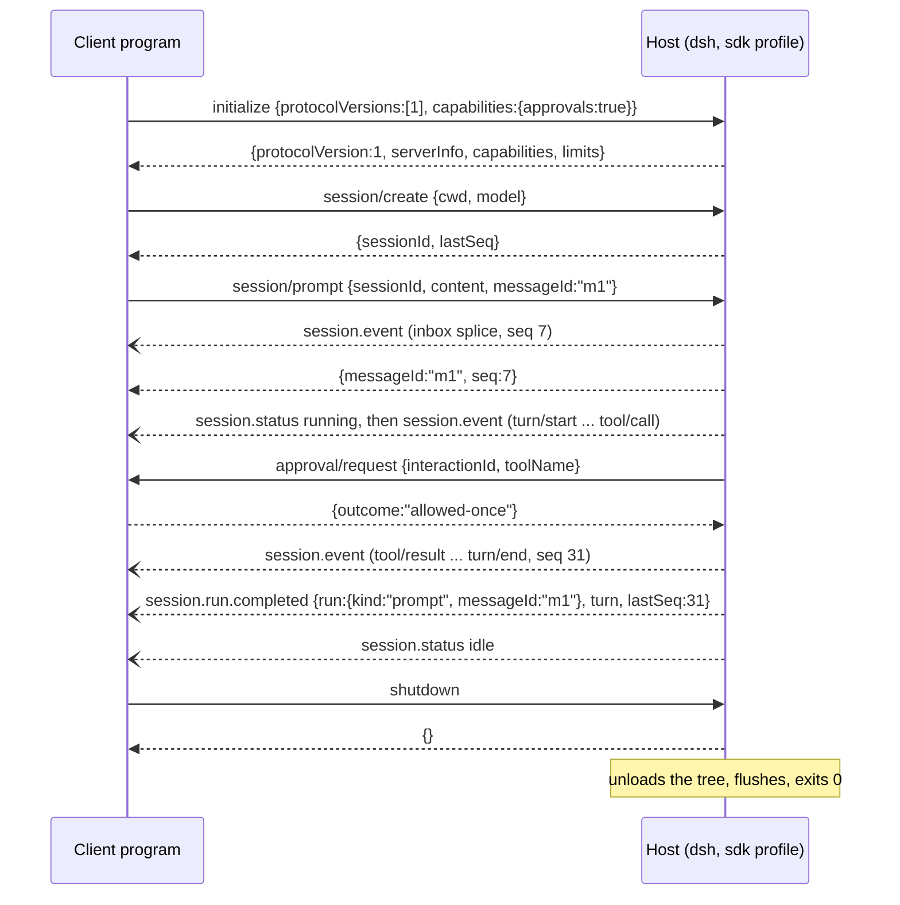

# SDK protocol, ACP server and typed remote calls: Go specification

> **Status: design, not built.** Upstream facts were read at the pinned commit recorded in
> [../README.md](../README.md) and are cited as `path:line` relative to the upstream root.
> Statements that are reasoning and not read from source open with "Inference". IDs in this
> document use the area key `SDK`. Nothing here has been built, run or tested.

| | |
|---|---|
| **Area key** | `SDK` (agent A20) |
| **Upstream packages** | 8: `packages/sdk` (protocol, server, client), `packages/acp` (acp), `packages/typert` (generator, loader, protocol, registry) |
| **Serves outcomes** | [DH-O-13](../design.md#dh-o-13) (owner); also [DH-O-3](../design.md#dh-o-3), [DH-O-7](../design.md#dh-o-7), [DH-O-14](../design.md#dh-o-14) |
| **Depends on areas** | [agent-loop.md](agent-loop.md) (A02), [core-session.md](core-session.md) (A01), [session-views.md](session-views.md) (A06), [tools.md](tools.md) (A03), [sandbox-ssh.md](sandbox-ssh.md) (A10), [execution.md](execution.md) (A09), [interaction-credentials.md](interaction-credentials.md) (A17: interactions, commands, permission presets, session grants), [subagent-team.md](subagent-team.md) (A12), [jobs-schedule-goal-plan.md](jobs-schedule-goal-plan.md) (A13), [mcp-lsp-web-connector.md](mcp-lsp-web-connector.md) (A15), [storage.md](storage.md) (A07: attachments), [llm.md](llm.md) (A04: model routes), [boot.md](boot.md) (A21: readiness, the stop request, the exit bound), [api.md](api.md) (A19: prompt admission), [util-test-support.md](util-test-support.md) (A23: `schema`), [app-cli.md](app-cli.md) (A24: launch form, statuses), [bundle-preset.md](bundle-preset.md) (A27: agent presets), [extensions.md](extensions.md) (A22: the plugin protocol, a user of the codec) |
| **Priority** | P0 for the codec, the protocol and the SDK server: the Python client, the plugin protocol and the tool endpoint all wait on them. P1 for the Go client and ACP. P2 for client tools and the TypeScript client |

## 1. Purpose

This area is how a program, not a person, drives the harness. A test rig, a data pipeline or an editor starts `dsh` as a child process and talks to it over the child's standard input and output: it creates or resumes a session, sends a prompt, watches what the agent does, answers the agent's approval requests and questions, cancels, reads history and shuts down. Two protocols serve that: the harness's own **SDK protocol**, which exposes everything a driver needs, and the **Agent Client Protocol (ACP)**, an open standard that tools written for other agents already speak. Without this area the only way in would be the browser. It also owns two shared pieces: the JSON-RPC codec that every line-delimited pipe in the harness uses, and the answer to what becomes of upstream's typed remote-call machinery (typert).

## 2. Vocabulary

| Term | What it is | Why it exists |
|---|---|---|
| **JSON-RPC 2.0** | A small standard for three message kinds as JSON objects: a *request* (`id` and `method`), a *response* (`id` with `result` or `error`) and a *notification* (`method` only, no answer). | The common base of the SDK protocol, ACP, MCP and the plugin protocol. |
| **Frame, NDJSON** | A frame is one JSON-RPC message on one line. NDJSON (newline-delimited JSON) is a stream of such lines. | The simplest framing over a pipe; a human can read a capture. |
| **Codec** | The package that reads and writes frames, matches responses to requests, runs handlers and enforces size and queue limits. | One implementation and one set of tests for every pipe. |
| **Carrier** | A component that connects an outside program to agents ([design §2](../design.md#2-vocabulary)); here the SDK server and the ACP server. | One agent contract serves a browser, a script and an editor. |
| **Connection** | One client attached to one host over one pipe pair. In this area the client started the host, so the connection lasts as long as the process. | It is the unit that owns sessions, pending requests and the right to answer. |
| **Host request** | A request the host sends *to* the client and waits on: "may I run this?", "which option?", "run your tool". | The protocol is bidirectional: an approval needs an answer from the embedding program. |
| **Capability flag** | A boolean or list exchanged in the handshake that says what one side can do (answer approvals, accept images). | Neither side calls a method the other did not offer. |
| **Run** | The work caused by one accepted input: for a prompt, the one turn that claimed it; for a command, the command and any model work it starts. | A driver wants "the result of what I sent", not a stream it must interpret. |
| **Watermark rule** | A response that names a position in a session's log is written only after every event up to that position. | Lets a client treat a response as "you have seen everything before this". |
| **Method table** | A Go value listing every protocol method: name, direction, kind, parameter type, result type, capability, version. | The single source for the schema file, the generated clients and the reference page. |
| **Protocol schema** | A checked-in JSON file derived from the method table and the Go message types. | What clients in other languages are generated from. |
| **ACP roles** | In ACP the *client* is the controller (an editor, a test runner, a parent agent) and the *agent* does the work. | The harness plays both: agent when it is driven, client when it delegates to another agent. |
| **Typert, type graph, face** | Upstream's "types at runtime" toolchain. A build step reads TypeScript types into a type graph and emits validators and call descriptors. A face is one of upstream's two separately compiled programs, host and browser. | TypeScript types vanish at run time, and upstream's browser client calls host methods across a process boundary. |

## 3. What upstream does

### 3.1 Packages

| Upstream unit | Package | Role | What it does |
|---|---|---|---|
| `UP-PKG-packages.sdk.protocol` | `@deepseek-ai/dsh-sdk-protocol` | definition | One line-delimited JSON-RPC transport class and the named request, result and notification types of the SDK protocol (`packages/sdk/protocol/README.md:12`). |
| `UP-PKG-packages.sdk.server` | `@deepseek-ai/dsh-sdk-jsonrpc-server` | provider (carrier) | Serves the protocol on the process's stdio, creates one agent per session id, forwards session and agent events as notifications, bridges approvals and questions to the client (`packages/sdk/server/README.md:28-30`, `:85`). |
| `UP-PKG-packages.sdk.client` | `@deepseek-ai/dsh-sdk-client` | consumer | The TypeScript client: starts the runtime as a child, a low-level `HarnessClient` and a high-level `run()` that computes a result from events (`packages/sdk/client/README.md:84`, `:111`). |
| `UP-PKG-packages.acp.acp` | `@deepseek-ai/dsh-acp` | provider (carrier) | An automation-only ACP v1 agent on stdio: persistent sessions, one prompt at a time, model options, client-supplied MCP servers, committed updates, cancel, one-shot permission requests (`packages/acp/acp/README.md:60-74`). |
| `UP-PKG-packages.typert.generator` | `@deepseek-ai/dsh-typert-generator` | other (build tool) | Analyses TypeScript projects into its own model and emits schema factories, declarations and catalog pages; runs only at build time (`packages/typert/generator/README.md:12`). |
| `UP-PKG-packages.typert.protocol` | `@deepseek-ai/dsh-typert-protocol` | definition | The `@Remote` markers, invocation descriptors, lookup and principal maps, and the one `RemoteError` class with `<domain>/<reason>` codes (`packages/typert/protocol/README.md:12`, `:71-73`). |
| `UP-PKG-packages.typert.registry` | `@deepseek-ai/dsh-typert-registry` | provider | `ctx.typert`: a runtime registry of generated reflection, lazy schema factories and invocation descriptors, registered atomically per fiber (`packages/typert/registry/README.md:12`, `:68`). |
| `UP-PKG-packages.typert.loader` | `@deepseek-ai/dsh-typert-loader` | consumer | Imports each mounted npm package's generated `./typert` export and registers it; a `packages` list covers nested plugins (`packages/typert/loader/README.md:12`, `:41`). |

### 3.2 Behaviour

**SDK protocol.** A client starts `dsh --profile sdk` and owns its pipes. Each line is one JSON-RPC message; a line that is not JSON is dropped without an answer, an unknown method answers `-32601`, and any handler failure answers `-32603` with the error text (`packages/sdk/protocol/src/transport.ts:211-213`, `:235`, `:242`). Frames are written without waiting for the pipe to drain and have no size limit (`transport.ts:267`). `initialize` is a process-wide handshake that fixes the working directory, provider and model for every session and waits for the plugin tree to settle (`packages/sdk/protocol/src/types.ts:18-33`; `packages/sdk/server/README.md:78`). A session is created the first time any method names an unknown id, including a working-directory read (`types.ts:72`, `:132`). `session/prompt` queues a user message and returns `{ messageId }`, a receipt for queueing and not a result (`packages/sdk/protocol/README.md:82`). `session/query` also recognises four slash commands (`packages/sdk/server/README.md:42`). The server then notifies `session.event` for every session in the runtime, unfiltered (`packages/sdk/server/src/server.ts:168-175`), plus `session.status`, `session.query.completed`, `subagent.started` and `subagent.finished` (`types.ts:196-209`). The wire has no version negotiation, no cancel and no close (`packages/sdk/protocol/README.md:142-143`).

**The reverse direction.** When the client opted in, the server sends `approval/request` and waits for `allowed-once`, `rejected` or `cancelled`; any other answer, a client error or a lost transport is the fail-closed outcome `unavailable` (`packages/sdk/server/src/server.ts:127-141`; `packages/sdk/server/README.md:30`). When the client advertised `capabilities.userQuestions`, the model's question tool is forwarded as `user-question/ask`; the server checks that the answer names every question id exactly once, and tells the client with a `user-question.cancelled` notification when it stops waiting (`packages/sdk/server/src/user-questions.ts:35-49`, `:61-77`). The approval bridge acts for agents the server created and their live in-process descendants; the question bridge acts for the root agents it created (`packages/sdk/server/README.md:30`, `:85`).

**The clients compute what the host knows.** The TypeScript client (and the Python one, [libs/python-sdk.md §2.2](../libs/python-sdk.md)) subscribes, sends the prompt, waits until the message id appears in an inbox event, collects events until the agent is idle, and calls the last assistant message in that interval the answer; the README says the interval may include other queued work (`packages/sdk/client/README.md:84`, `:150`). Scoping notifications to one session tree is also client-side (`:111`). Closing is a ladder: `shutdown` bounded at 1 s, then stdin end-of-file, terminate, kill (`:115`).

**ACP.** `dsh --profile acp` serves ACP v1 through the `@agentclientprotocol/sdk` library. `initialize` advertises only what is mounted (`packages/acp/acp/src/index.ts:184-189`). `session/new` validates the workspace and connects the client's MCP servers before the agent is published; a failure rolls the unpublished agent back (`packages/acp/acp/README.md:82`). A session accepts one prompt at a time, and a prompt settles only when the root agent, its descendants and the ordered update queue are all quiet (`:78`). Updates carry committed messages, thoughts, generic tool lifecycle, configuration and usage, never raw deltas (`:98`). A harness approval becomes `session/request_permission` with two one-shot options (`packages/acp/acp/src/index.ts:167-171`). Turn endings map to ACP stop reasons, with `error`, `blocked` and non-client aborts all reported as `end_turn` (`packages/acp/acp/src/codec.ts:14-34`).

**Typert.** A host method marked `@Remote` becomes callable from the browser under `ctx.remote.<namespace>` (`docs/api-gateway.md:62`). Because the two sides are separate TypeScript programs and types are erased, a generator builds a type graph per face and writes validators and descriptors as files into each package's `lib/` directory; a loader imports them from each npm package and a registry serves them at run time (`docs/api-gateway.md:108`; `packages/typert/generator/README.md:12`). The same model also produces the service and event catalog pages (`packages/typert/generator/README.md:108`). A proposed note wants one generated description per method to feed command-line help, argument parsing and MCP tool discovery as well (`.agents/notes/proposed/architecture/2026-09-20-unified-typert-remote-metadata.md:9`).

### 3.3 Failure, retry, rollback and cleanup upstream

- **Input ends or a write fails:** every pending request is rejected once (`transport.ts:201-205`); pending approvals and questions fail closed and late answers grant nothing (`packages/sdk/protocol/README.md:30`).
- **The client dies after a receipt:** agents stay live until the process exits, because the wire cannot close a session (`packages/sdk/server/README.md:218`). A local timeout stops only the local wait; nothing is retried and nothing rolled back (`packages/sdk/client/README.md:103`).
- **A stray log line on stdout** corrupts the channel; keeping loggers off stdout is left to whoever composes the tree (`packages/sdk/server/README.md:220`).
- **ACP disconnect, close and disposal** share one memoised teardown: stop new work, cancel, drain updates, dispose descendants child-first, flush, release the agent (`packages/acp/acp/README.md:118`). A content-addressed image written before a failed prompt admission is left in the store (`.agents/notes/implemented/simplification/2026-07-23-acp-automation-only-protocol.md:21`).
- **Typert:** a registration lands whole or not at all and is withdrawn with its fiber (`packages/typert/registry/README.md:68`); a stale or missing generated file is a build failure with its own guard ([libs/typescript.md §3](../libs/typescript.md)).

## 4. Upstream decisions dissected

| Upstream decision | What was decided and why | Verdict | Reason | Go decision |
|---|---|---|---|---|
| `UP-DEC-implemented.feature.2026-10-19-sdk-native-user-questions` | A client advertises a question callback; the server routes the question tool to it for the root agents it owns, validates a complete answer batch, cancels on stop, ignores late answers | **keep**, change the cancel mechanism | Without it the tool has no answerer. A separate request id existed only because the transport had no cancel | [DH-ADR-SDK-6](#dh-adr-sdk-6) |
| `UP-DEC-implemented.simplification.2026-07-23-acp-automation-only-protocol` | ACP carries automation controls and committed semantic facts, never presentation; one-shot permission stays as control flow between agents | **keep** | A third user interface must not grow beside the web UI; the scope is independent of language | [DH-ADR-SDK-9](#dh-adr-sdk-9) |
| `UP-DEC-implemented.architecture.2026-08-28-ctx-remote-failure-vocabulary` | One error class, a `<domain>/<reason>` code with typed details, declared once by its owner; unclassified failures fold to one internal code; discriminate by code | **keep**; drop the browser-only parts (`$host`, cross-realm markers) | Stable, greppable failures on every wire | [DH-ADR-SDK-1](#dh-adr-sdk-1) |
| `UP-DEC-implemented.architecture.2026-07-27-compiler-independent-typert-model` | Use the compiler only to extract; every emitter works from one canonical model and fails instead of degrading a type | **change** the mechanism, keep the principle | Go types exist at run time; the canonical model is the reflected schema | [DH-ADR-SDK-10](#dh-adr-sdk-10) |
| `UP-DEC-proposed.architecture.2026-09-20-unified-typert-remote-metadata` | Proposed: one static description per method feeds help, parsing, tool discovery and typed calls, offline | **adopt the goal** | The method table is that description for out-of-process clients | [DH-ADR-SDK-2](#dh-adr-sdk-2), [DH-ADR-SDK-10](#dh-adr-sdk-10) |
| Code: line-delimited JSON-RPC on stdio; the starter owns the process (`packages/sdk/protocol/README.md:34`) | No port, no credential | **keep** | Closing stdin is an unambiguous stop | [DH-ADR-SDK-1](#dh-adr-sdk-1) |
| Code: malformed lines dropped, errors as free text, no frame or queue bound (`transport.ts:211`, `:242`, `:267`) | Minimal transport | **change** | A client cannot tell a typo from a hang, and a slow reader grows host memory | [DH-ADR-SDK-1](#dh-adr-sdk-1), [DH-ADR-SDK-7](#dh-adr-sdk-7) |
| Code: a session is created by the first method that names an unknown id (`types.ts:72`, `:132`) | Fewer calls | **change** | A mistyped id silently becomes a new session; a read should not create | [DH-ADR-SDK-4](#dh-adr-sdk-4) |
| Code: one provider, model and directory for the whole process (`types.ts:18-33`) | One handshake | **change** | One host serves agents with different presets ([design §2](../design.md#2-vocabulary)); they become defaults with per-session overrides | [DH-ADR-SDK-4](#dh-adr-sdk-4) |
| README: a prompt returns a receipt; the result is an interval each client computes (`packages/sdk/client/README.md:150`) | The agent does not attribute a turn to a prompt | **change** | The Go log records which turn claimed which message ([DH-ADR-AGENT-3](agent-loop.md#dh-adr-agent-3)), so the host can report it | [DH-ADR-SDK-5](#dh-adr-sdk-5) |
| README: notifications for every session, filtered by each client (`server.ts:168`) | Simple server | **change** | Two clients repeat the same tree bookkeeping | [DH-ADR-SDK-5](#dh-adr-sdk-5) |
| README: bridges act only for exact owned root agents and live descendants; persisted lineage proves nothing (`packages/sdk/server/README.md:30`) | Ownership is a live fact | **keep** | Matches "one answerer owns an agent" ([design CF-11](../design.md#8-conflicts-and-gaps-between-the-foundation-recommendations)) | [DH-ADR-SDK-6](#dh-adr-sdk-6) |
| README: the only fallback mounts the DeepSeek adapter (`server.ts:238`) | Convenience | **drop** | A carrier must not mount a provider ([DH-O-8](../design.md#dh-o-8)) | [DH-ADR-SDK-4](#dh-adr-sdk-4) |
| README: ACP prompt settles at quiescence; capabilities are truthful; failed setup publishes nothing (`packages/acp/acp/README.md:78`, `:99`, `:82`) | An automation client needs "done means done" | **keep** | Required by [DH-ADR-WIRE-7](../upstream/wire-and-api.md#dh-adr-wire-7) | [DH-ADR-SDK-9](#dh-adr-sdk-9) |
| Code: `error`, `blocked` and non-client aborts all map to `end_turn` (`packages/acp/acp/src/codec.ts:24-30`) | ACP has no error stop reason | **change** for `error` | A failed turn reported as a normal end hides the failure; it becomes a JSON-RPC error on the prompt | [DH-ADR-SDK-9](#dh-adr-sdk-9) |
| Code: `@Remote` decorators, generated descriptors, lookup maps, a runtime registry | Typed calls from the browser client | **drop** | No browser application exists ([DH-ADR-3](../design.md#dh-adr-3), [DH-ADR-WIRE-1](../upstream/wire-and-api.md#dh-adr-wire-1)) | [DH-ADR-SDK-10](#dh-adr-sdk-10) |

## 5. Tech debt and its resolution

Thirty-one inventory units and two found by reading, grouped by cause. Each unit's own sentence is in its ledger row ([§11](#11-units-dispositioned-by-this-spec)).

| Group | Units | Cause | Answer in the Go design |
|---|---|---|---|
| **Missing protocol controls** | 6: `sdk.protocol.1`, `.2`; `sdk.server.1`, `.2`; `sdk.client.2`, `.3` | The wire had no version, cancel, close or per-input result, so clients killed the process to stop work and guessed at results | **Resolved.** Version negotiation ([DH-ADR-SDK-3](#dh-adr-sdk-3)); `session/cancel`, `session/close`, `$/cancel` ([DH-D-SDK-4](#dh-d-sdk-4)); the run result is the turn that claimed the input ([DH-ADR-SDK-5](#dh-adr-sdk-5)) |
| **Hazards of a stdio server** | 3: `sdk.server.3`, `.4`; `sdk.client.1` | Any in-process plugin can print to stdout; the server mounts one vendor's adapter; the client resolves an npm package | **Resolved.** One component owns stdout and redirects every other writer ([DH-ADR-SDK-11](#dh-adr-sdk-11)); the server mounts no adapter; every client takes one explicit path to one static binary ([DH-D-SDK-8](#dh-d-sdk-8)) |
| **A transport with no defences** (found) | 2: `UP-DEBT-found.A20.1`, `.2` | Silent drops, free-text errors, unbounded frames and queue; implicit session creation | **Resolved.** [DH-D-SDK-1](#dh-d-sdk-1), [DH-ADR-SDK-4](#dh-adr-sdk-4) |
| **Waits that live in one process** | 2: `sdk.protocol.3`, `sdk.client.4` | A pending question dies with the host; a callback that ignores cancellation keeps running | **Carried, on purpose.** A pending interaction is never restored after a restart ([design §5](../design.md#5-failure-retry-rollback-and-cleanup)): the interrupted turn is closed and the model may ask again. Go cannot stop a goroutine in the client program; the harm is bounded because the late answer is discarded and `Close` names handlers still running ([DH-ADR-SDK-6](#dh-adr-sdk-6), [DH-ADR-SDK-8](#dh-adr-sdk-8)) |
| **ACP automation scope** | 4: `acp.acp.1` to `.4` | Deliberate limits of an automation transport | `.1` **resolved**: additional directories become session write roots ([DH-ADR-SDK-9](#dh-adr-sdk-9)). `.2` to `.4` **carried, on purpose**: model input is text and raster images; what an MCP server offers beyond tools is area A15's; replay and interactive extensions stay outside ACP, and a client that needs the transcript reads `session/history` on the SDK protocol |
| **TypeScript type recovery** | 16: `typert.generator.1` to `.6`, `typert.loader.1` to `.4`, `typert.protocol.1`, `.2`, `typert.registry.1` to `.3`, and the marker at `cordis-catalog.ts:487` | Types are erased, host and browser compile separately, artifacts are generated files discovered through npm exports | 12 limits **not applicable**: no generator, no faces, no generated artifact, no decorator ([DH-ADR-SDK-10](#dh-adr-sdk-10)). 3 **resolved** where the design supplies what the limit lacked: the method table is ready before the first frame (`loader.4`), carries full metadata with no build step (`protocol.1`), and derived schemas are cached per type (`registry.3`). The marker is **not applicable**: the line is a regular expression that *reads* `@deprecated` tags, not a deprecation |

Totals for the 31 inventory units: 13 resolved, 5 carried, 13 not applicable.

## 6. Go design

### 6.1 Shape

**Three modules** (owner decision [DH-ADR-26](../design.md#dh-adr-26), which amends [DH-ADR-5](../design.md#dh-adr-5); the layout record is [DH-ADR-SDK-8](#dh-adr-sdk-8)). The repository holds `src/go` (cordis), `src/sdk` and `src/harness`. `src/sdk` (`github.com/smartpcr/agent-plugin/src/sdk`) imports the standard library only: not cordis, not the harness, no third-party module. A Go program that drives the harness imports `src/sdk` and nothing else.

| Import in `src/sdk` | Holds | Who imports it |
|---|---|---|
| `.../src/sdk/jsonrpc` | The codec: `Conn`, `Error`, framing, limits, the `rpc/*` reasons, a fake-peer test kit in `jsonrpc/jsonrpctest` | In `src/harness`: `wire/stdio`, `wire/sdkserver`, the plugin protocol host (`wire/plugin`, A22), the tool endpoint and the `dsh tool` client (A03, A24), the SSH helper stream (A10), the control endpoint (A18). Outside: Go drivers, and a plugin author who writes a plugin in Go |
| `.../src/sdk/protocol` | The SDK protocol: message structs, the method table `Methods`, `Version`, the `sdk/*` reasons, the embedded schema file | `wire/sdkserver` and `wire/protoschema` in `src/harness`; the client package; Go drivers |
| `.../src/sdk` (package `sdk`) | The Go client: `Start`, `Connect`, `Harness`, `Session`, `Handlers` | Go drivers; in `src/harness` only the subprocess subagent backend of A12 (through `Connect`) and the scenarios |

**What other surfaces reuse.** The plugin protocol reuses the codec, `jsonrpc.Error` and `$/cancel`; its own message types, method table and schema file are A22's in `src/harness/internal/wire/plugin`, published to plugin authors as a derived schema file, not as a Go package of `src/sdk`. The HTML routes of area A19 are not JSON-RPC and reuse one thing only: the `<domain>/<reason>` strings, which are plain constants declared by the package that owns each failure. The codec learns a reason without importing the harness: it writes `data.code` from any error that has a `Reason() string` method, which the harness's `herr` errors (A23) have.

**Versioning.** The three modules carry one version number and are tagged on one commit: `src/go/vX.Y.Z`, `src/sdk/vX.Y.Z` and `src/harness/vX.Y.Z` (the tag form Go requires for a module in a subdirectory). `src/harness/go.mod` requires `src/go` and `src/sdk` at exactly that version and has no `replace` line; a `go.work` file at the repository root joins the three for development and is switched off (`GOWORK=off`) in the release build. `src/go` and `src/sdk` do not require each other. The first shared version is the next minor above the highest tag any of the three has today. All three `go.mod` files state the one minimum Go version of the project, `go 1.26.0`. `DH-T-SDK-17` holds these rules.

| Package in `src/harness` | Holds | Imports |
|---|---|---|
| `internal/wire/stdio` | Component `wire.stdio`: the one owner of the process's stdin and stdout, and the stdout guard. It asks boot to stop the process and holds no exit timer | cordis, `sdk/jsonrpc`, `launch` (A21) |
| `internal/wire/sdkserver` | Component `wire.sdk`, the SDK carrier | `sdk/protocol`, `agent`, `session`, `session/query`, `workdir`, `tools`, area contracts of A17, A12, A07 |
| `internal/wire/protoschema` | Derives the schema document from `protocol.Methods` with `schema.Of`; the equality test; the reference page renderer | `schema` (A23), `sdk/protocol` |
| `internal/wire/acpwire` | The only importer of the ACP module: agent-role and client-role wrappers in harness types ([DH-ADR-ACPSDK-1](../libs/agentclientprotocol-sdk.md#dh-adr-acpsdk-1)) | `github.com/coder/acp-go-sdk` |
| `internal/wire/acpserver` | Component `wire.acp`, the ACP carrier | `acpwire`, the same spine contracts |

**Components.** The names follow the catalogue's rule ([boot.md §6.2](boot.md), `DH-ADR-BOOT-13`). `wire.stdio` injects `launch.AppKey` and provides `stdio.Key` (`Claim(owner) (io.Reader, io.Writer, error)`, granted once). `wire.sdk` and `wire.acp` each inject `stdio.Key`, `agent.Agents`, `session.Key`, `query.Key`, `workdir.Key` and the interaction service of A17; they provide no service, because nothing in the spine may know a carrier ([DH-ADR-ARCH-1](../upstream/architecture.md#dh-adr-arch-1)). A profile mounts exactly one of them, and both carrier entries are on that profile's required list.

**The codec.** Written against `io.Reader` and `io.Writer`, so the same code serves stdio, the tool endpoint's socket (area A03), the SSH helper's stream (area A10) and plugin pipes (area A22).

```go
// package jsonrpc
type Options struct {
    MaxFrameBytes, MaxQueuedBytes int; WriteStall time.Duration; MaxInFlight int
    Methods  map[string]Handler            // closed allow-list; anything else is rpc/method-not-found
    OnNotify func(method string, params json.RawMessage)
    Log      *slog.Logger
}
type Handler func(ctx context.Context, params json.RawMessage) (result any, err error)
func Serve(ctx context.Context, r io.Reader, w io.Writer, o Options) *Conn
func (c *Conn) Call(ctx context.Context, method string, params, result any) error // ctx cancel sends $/cancel
func (c *Conn) Notify(method string, params any) error   // enqueues; blocks while the queue is full
func (c *Conn) Barrier(ctx context.Context) error        // returns when frames queued so far are written
func (c *Conn) Done() <-chan struct{}; func (c *Conn) Err() error; func (c *Conn) Close() error
type Error struct { Code int; Message string; Reason string; Details json.RawMessage } // Reason = "<domain>/<reason>"
```

One reader goroutine parses lines. Responses and notifications are dispatched in arrival order by one goroutine; request handlers run concurrently, at most `MaxInFlight`. One writer goroutine owns the output, so frames are totally ordered. A frame with both `id` and `method` is always a request and can never settle a pending call ([DH-ADR-PYSDK-3](../libs/python-sdk.md#dh-adr-pysdk-3)). Batches are refused. The codec has no time limit of its own except the write stall; deadlines come from the caller's context (`DH-LIB-BIRPC-R5`, [libs/birpc.md](../libs/birpc.md)).

**The Go client.**

```go
// package sdk
func Start(ctx context.Context, o Options) (*Harness, error)   // os/exec child; Bin or $DSH_BIN, Home required; Options.TimeZone and CreateOptions.TimeZone are sent only when set
func Connect(ctx context.Context, t Transport, o Options) (*Harness, error) // caller-owned pipes and process
type Handlers struct {
    Approval func(ctx context.Context, r protocol.ApprovalRequest) protocol.ApprovalResult
    Question func(ctx context.Context, r protocol.QuestionRequest) (protocol.QuestionResult, error)
    Tools    []Tool                                             // DH-D-SDK-7
}
func (h *Harness) Create(ctx, CreateOptions) (*Session, error); Resume(ctx, id, ResumeOptions) (*Session, error)
func (h *Harness) List(ctx, ListOptions) (Page, error); Close(ctx) error; Done() <-chan struct{}; Err() error
func (s *Session) Run(ctx, Input) (RunResult, error)            // prompt or command; waits for run.completed
func (s *Session) Prompt(ctx, Input, ...PromptOption) (Receipt, error); Wait(ctx) error
func (s *Session) Cancel(ctx, CancelOptions) error; Close(ctx) error
func (s *Session) History(ctx, afterSeq int64, limit int) ([]Event, error)
func (s *Session) Events(buffer int) *Subscription             // bounded; overflow ends it with ErrSlowConsumer
```

`Connect` exists because inside the harness only area A09's `proc` package may start a process ([DH-D-EXEC-1](execution.md#dh-d-exec-1)): the subagent backend that runs a task in a fresh `dsh` (area A12) starts the child through `proc` and hands its pipes to `Connect`. Cancelling the context of a call stops the *wait* and tells the host with `$/cancel`; it never stops agent work. Stopping work is `Session.Cancel`, kept from upstream's rule that a local timeout must not silently abort an agent ([libs/python-sdk.md §4.2](../libs/python-sdk.md)).

### 6.2 Contracts

**SDK protocol, version 1: requests from the client.** Requests use `/`, notifications use `.`, as upstream. Every result that names a session obeys the watermark rule.

| Method | Parameters | Result | Notes |
|---|---|---|---|
| `initialize` | `protocolVersions[]`, `clientInfo{name, version}`, `timeZone?` (the user's IANA zone name for this connection's sessions; see "The user's time zone" below), `capabilities{approvals, questions, stream, tools[]}`, `defaults{cwd, model{provider, model, reasoningEffort?, maxOutputTokens?}, agentPreset?, permissionMode?}` | `protocolVersion`, `serverInfo{name, version}`, `capabilities{images, commands[], clientTools}`, `limits{maxFrameBytes, maxInlineBytes}` | Once per connection. Replies when boot reports the tree ready. Any other request first is `sdk/not-initialized` |
| `session/create` | `sessionId?`, `cwd?`, `model?`, `agentPreset?`, `permissionMode?`, `timeZone?` | `sessionId`, `cwd`, `lastSeq` | The only method that creates. The model route is validated by exact id; no fallback. `agentPreset` is an agent preset id checked with `agentpreset.Resolve` (A27); `permissionMode` names a permission preset (A17). The two are never called just "preset" on the wire |
| `session/resume` | `sessionId`, `permissionMode?`, `model?` | `sessionId`, `cwd`, `lastSeq`, `closedInterruptedTurn` | Takes the write lease; a session another process holds is `session/owned`; a subagent's session is `sdk/subagent-session`. Sends no input, replays nothing and restores no session grant. Idempotent for a session this connection already owns |
| `session/list` | `cwd?`, `cursor?`, `limit?` | `sessions[]`, `nextCursor?` | Stored root sessions, newest first, through `query.List` |
| `session/prompt` | `sessionId`, `content[]`, `delivery?` (`follow-up` default, or `steer`), `messageId?` | `messageId`, `seq` | A receipt. A message id is unique over the session's whole history ([agent-loop.md §6.2](agent-loop.md)): a repeated `messageId` appends nothing and the inbox returns `agent/duplicate-message` with the first receipt, which this method answers as the same result, also after the first message was claimed or the host restarted. A retry after a lost reply cannot double-submit |
| `session/query` | `sessionId`, `content[]` | `{kind: prompt, messageId, seq}` or `{kind: command, commandId, result}` | As `session/prompt`, but a recognised command (list in `capabilities.commands`) is executed by A17's command registry |
| `session/wait` | `sessionId` | `lastSeq` | Returns when the root is idle and managed descendants have finished |
| `session/cancel` | `sessionId`, `scope?` (`turn` default, or `step`), `inbox` (`keep` or `discard`, required) | `cancelled`, `lastSeq` | `Agent.Cancel` with cause `user`. Replies after the cancelled turn's `turn/end` |
| `session/close` | `sessionId` | `lastSeq` | Disposes the agent (teardown T1 to T8 of [agent-loop.md §6.3](agent-loop.md)); the session stays stored and resumable |
| `session/history` | `sessionId`, `afterSeq?`, `limit?` (500; at most 5,000), `types?[]` | `events[]`, `lastSeq`, `more` | Any stored session, live or not, with no lease, through `query.Events`. A page is cut early when it would exceed half a frame |
| `session/model/set` | `sessionId`, `model` | `model` | `Model().Select`; applies from the next step |
| `session/working-directory/get`, `/set` | `sessionId`, (`path`) | `cwd` | `workdir.Service`; never creates a session |
| `shutdown` | none | `{}` | Replied first; then the tree unloads and the process exits 0 |
| `$/cancel` (notification, both ways) | `id` | n/a | The receiver answers request `id` with `rpc/cancelled` |

**Requests from the host**, each sent only if its capability was advertised:

| Method | Parameters | Result | Notes |
|---|---|---|---|
| `approval/request` | `interactionId`, `sessionId`, `rootSessionId`, `toolName`, `callId?`, `origin`, `reason?` | `outcome` (`allowed-once`, `rejected`, `cancelled`) | One call only. Recommended default, not confirmed by the owner: an answer on the `sdk` or `acp` channel cannot create a session grant, because area A17 offers "allow for this session" on the `ui` and `cli` channels only ([interaction-credentials.md §6.2](interaction-credentials.md)); the request therefore lists no scopes and the answer names none. A session grant ([DH-ADR-16](../design.md#dh-adr-16)) is never copied in any case: it lives and dies with the one live session it was given to. A subagent's request arrives here only when this connection answers for its root session; with no answerer for the root it is denied |
| `question/ask` | `interactionId`, `sessionId`, `rootSessionId`, `questions[]` | `{answers[{id, selected[], custom?}]}` or `{dismissed: true}` | The answer must name every question id exactly once; a dismissal is never an approval |
| `tool/call` | `callId`, `sessionId`, `rootSessionId`, `name`, `arguments` | `content[]`, `isError?` | A tool the client declared ([DH-D-SDK-7](#dh-d-sdk-7)) |

**Notifications from the host.** Every one carries `sessionId`, `rootSessionId` and, for a child session, `parentSessionId`. Only sessions this connection created, resumed or had activated for it, and their live descendants, are reported.

| Notification | Fields | Meaning |
|---|---|---|
| `session.event` | `event{seq, time, type, version, ignorable, sources?, data}` | One committed log event. `data` is the committed payload, byte for byte; cold parts are never sent |
| `session.status` | `status` (`idle`, `running`) | Whole-agent transition; `idle` is written after the events of the turn that ended |
| `session.run.completed` | `run{kind, messageId or commandId}`, `turn?`, `finishReason`, `finalResponse`, `firstSeq`, `lastSeq` | The run result ([DH-ADR-SDK-5](#dh-adr-sdk-5)) |
| `session.stream` | `turn`, `step`, `attempt`, `kind` (`start`, `chunk`, `end`), `index`, `text?` | Opt-in live text of the attempt in flight. Transient: coalesced or dropped under pressure; never needed to rebuild the transcript |
| `session.closed` | `cause` | An owned session closed for a reason other than this client's `session/close` (lease lost, shutdown) |
| `subagent.started`, `subagent.finished` | child and parent ids; on finish `stopReason`, `lastAssistantMessage?` | Tree edges and child results, from area A12 |

**A typical exchange.** `C` is the client program, `H` the host it started.



**The user's time zone (debt entry U-K2-5).** An embedding program often runs the host in a container whose own zone is UTC, so "today" and a schedule created in the session would be wrong by hours. `initialize.timeZone` gives the user's zone for every session of the connection, and `session/create.timeZone` overrides it for one session. The host validates the name against its embedded zone data and refuses an unknown one with `rpc/invalid-params` naming the field; nothing is guessed. The carrier puts the zone into the client record of every message it sends for those sessions, which is where the clock context of area A14 reads the user's zone ([context-compaction-skill.md](context-compaction-skill.md), DH-D-CONTEXT-3); the clock context says "the user's time zone is unavailable" only when none was given; it never presents the host process's zone as the user's. The Go and Python clients expose it as an option and send nothing by default. The field is additive and optional inside protocol version 1. ACP has no such field, so a session driven over ACP keeps the limit: its clock context says "unavailable".

**Prompt content** is a list of blocks: `text`, an inline `image{data, mimeType, name?}` (raster types only, admitted into the attachment store of area A07 before the message is queued), and a `reference` to an attachment already stored. Inline bytes never reach the session log.

**Errors.** One table for every surface ([design §4.8](../design.md#48-wire-surfaces)). A protocol fault uses the JSON-RPC code; every application failure uses `-32000` and is told apart by `error.data.code`, never by message text.

| JSON-RPC code | `data.code` | When |
|---|---|---|
| `-32700` (null id) | `rpc/parse-error` | A line is not a JSON object. A line on stderr records it; the connection continues |
| `-32600` | `rpc/invalid-request` | Wrong envelope, or a batch |
| `-32601` | `rpc/method-not-found` | Not in the allow-list, or its capability was not advertised |
| `-32602` | `rpc/invalid-params` | Strict decoding failed; `data.details.issues[]` lists every path ([DH-LIB-ZOD](../libs/zod.md) R5) |
| `-32603` | `rpc/internal` | Unclassified failure; `data.details.ref` names the stderr log entry; no internal text crosses the wire |
| `-32800` | `rpc/cancelled` | The request was cancelled by `$/cancel` |
| `-32000` | `rpc/busy`, `rpc/frame-too-large` | Too many requests in flight; a line over `maxFrameBytes` (then the connection is closed) |
| `-32000` | `sdk/not-initialized`, `sdk/already-initialized`, `sdk/version-unsupported`, `sdk/session-not-owned`, `sdk/session-live`, `sdk/subagent-session`, `sdk/invalid-content`, `sdk/shutting-down` | This area's reasons. `sdk/version-unsupported` carries the host's supported versions |
| `-32000` | the owner's reason, unchanged | For example `session/not-found`, `session/owned`, `store/busy`, `agent/closing`, `approval/unavailable` |

**Ordering guarantees.** (1) Frames leave through one writer in one total order. (2) For one session, `session.event` arrives in `seq` order with no gap from the `lastSeq` returned by `session/create` or `session/resume`. (3) The watermark rule: a response or a `session.run.completed` carrying `lastSeq` or `seq` = *n* is written after `session.event` *n*. (4) `session.run.completed` precedes the `session.status idle` that follows its turn. (5) Nothing is promised between two sessions.

**The five requests of the Python client** ([libs/python-sdk.md §4.3](../libs/python-sdk.md)), answered:

| # | Request | Answer |
|---|---|---|
| 1 | The run result must cover commands | `session.run.completed.run.kind` is `prompt` or `command`; a goal command completes when the goal stops ([DH-ADR-SDK-5](#dh-adr-sdk-5)) |
| 2 | Scoped notifications must name the root | Every notification carries `sessionId`, `rootSessionId` and, for a child, `parentSessionId` |
| 3 | The full method set | The three tables above, including command input, resume with a permission mode, and working-directory get and set |
| 4 | The schema must list methods | The schema file holds the method table: name, direction, kind, parameter and result type, capability, first version ([DH-ADR-SDK-2](#dh-adr-sdk-2)) |
| 5 | A bounded host exit after its input closes, and the unset numbers | The host exits within boot's `ShutdownTimeout` (20 s, [boot.md §6.2](boot.md); [DH-ADR-SDK-11](#dh-adr-sdk-11)). Numbers: the `stdio.Config` row below. Recommended client budgets: 2 s for the `shutdown` reply, `ShutdownTimeout` plus 5 s for the exit, then terminate, 5 s, kill |

**Config.** Go structs with defaults as a Go value, decoded strictly. Inference: the numbers are proposals to be measured.

| Upstream unit | Go struct | Fields (default) |
|---|---|---|
| `UP-CFG-dsh-sdk-jsonrpc-server` | `sdkserver.Config` | `maxInFlight` (64), `historyPageMax` (5,000). `maxTokensAsSuccess` is not carried: the host reports the finish reason and the client decides |
| new | `stdio.Config` | `maxFrameBytes` (16 MiB; a load error if below the session `maxEventBytes` plus 64 KiB), `maxQueuedBytes` (32 MiB), `writeStall` (60 s). The exit bound is not here: it is the profile's `ShutdownTimeout` (A21) |
| `UP-CFG-dsh-acp` | `acpserver.Config` | `provider`, `model` (optional default route), `sessionListPageSize` (100; 1 to 1,000) |
| `UP-CFG-dsh-typert-loader` | none | Its one field lists npm packages whose generated export to import; nothing is generated or imported |

**Services.** `UP-SVC-typert` (`ctx.typert`) has no service key: its three jobs are done by `schema.Of` (schemas by reflection, cached per type; area A23), by `protocol.Methods` (invocation descriptors) and by each registry's own catalog output ([DH-ADR-TOOLCHAIN-10](../upstream/toolchain.md#dh-adr-toolchain-10)).

**Events, persisted data, model tools.** This area declares no cordis event and no persisted event type: a carrier reads `session.Committed` and the agent notices of [agent-loop.md §6.2](agent-loop.md). It exposes no tool of its own; client-declared tools are registered through `tools.Register` in the scope of the sessions that connection creates.

**ACP: what maps to what.** The harness plays the **agent role** in `wire.acp` and the **client role** through `acpwire.Connect`, which area A12's ACP subagent provider and the tests use.

| ACP | Harness |
|---|---|
| Connection | One owner peer; trust comes from who started the process |
| `initialize` | Protocol version 1. Image prompts only if the attachment store is mounted and the default route accepts images; HTTP MCP only if the MCP client is mounted; `additionalDirectories` only if the sandbox policy service is mounted |
| `authenticate` | Succeeds at once |
| `session/new {cwd, additionalDirectories, mcpServers}` | `Registry.Create` with a `Setup` that registers each extra directory through `policy.Resolver.GrantRoot` ([sandbox-ssh.md §6](sandbox-ssh.md)) and mounts each MCP server in the agent's scope (area A15). Any failure rolls back before the agent is published |
| `session/list`, `session/resume`, `session/close` | `query.List` (roots only), `Registry.Resume` (no replay; extra directories must be sent again, because a grant is never restored from history), the quiescent teardown |
| `session/set_config_option` | `Model().Select` for `model` and `reasoning_effort`; returns the full option state |
| `session/prompt` | One follow-up message. One prompt in flight per session; a second is refused. Settles at quiescence: root idle, descendants finished, update queue drained |
| `session/cancel`, `$/cancel_request` | `Agent.Cancel(user, {Turn, Discard})`; the prompt settles as `cancelled` after the turn has closed |
| `session/update` | A pure function of committed events: assistant message and thought blocks, `tool_call` and `tool_call_update`, `config_option_update`, `usage_update`, in `seq` order |
| `session/request_permission` | One interaction. Options `allow_once` and `reject_once` only. ACP's `allow_always` kind is not offered: an `acp` answer cannot create a session grant (A17's rule; recommended default, not confirmed by the owner), and nothing is ever stored across sessions. A cancelled outcome is `cancelled` |
| Stop reason | `completed` → `end_turn`; `max-tokens` → `max_tokens`; `budget` → `max_turn_requests`; `refusal` → `refusal`; abort by `session/cancel` → `cancelled`; `blocked` and other aborts → `end_turn`; `error` → a JSON-RPC error with `data.code`; an unknown kind is an error, never a success |

**What ACP cannot express**, and so is absent from that surface: steering while a prompt runs; slash commands (and therefore every human command of A17's registry, including the prompt templates of an MCP server, which become human commands under [DH-ADR-CONNECT-4](mcp-lsp-web-connector.md#dh-adr-connect-4): an ACP client cannot run one; text that starts with `/` is sent to the model as ordinary text; a program that needs a command uses `session/query` on the SDK protocol, debt entry U-K2-14), plan review, goals and user questions (a preset for the `acp` profile must not mount the question tool, area A27); history reads and replay (`session/load` is not advertised); fork and delete; live text deltas and retry attempts; the subagent tree (a child's work appears only as its parent's tool result); the log position `seq`, so a client cannot resume a stream; working-directory moves. `<domain>/<reason>` codes travel in `error.data`.

### 6.3 Ownership, failure, retry, rollback and cleanup

**Ownership and access.** The client program owns the host process it started. The `stdio` fiber owns the pipes. The carrier's fiber owns the handle of every agent it created or resumed, and therefore each session's write lease; `session/close` or the fiber's unload releases them. Reading history, listing sessions and looking at another session's events are access and take no lease. The harness home belongs to the user; no method deletes a session. A pending host request is owned by the interaction registry (A17), not by the wire: the wire is one way to answer it.

| Situation | What happens | Undone, and what stays uncertain |
|---|---|---|
| A line is not JSON, or is too long | `rpc/parse-error` with a null id and a stderr line; a line over the limit closes the connection | Nothing ran |
| `session/create` or ACP `session/new` fails half-way | The agent's `Setup` is rolled back by [agent-loop.md §6.3](agent-loop.md): scope, grants and MCP mounts are released before the error is returned | No session on disk. An image already stored stays as an unreferenced blob that retention collects |
| A prompt's reply is lost | The client resends with the same `messageId`; the inbox recognises the id and returns the first receipt, whether the first message is pending, claimed or discarded | At most one turn per message ([DH-O-3](../design.md#dh-o-3)) |
| The client answers a host request badly, late, or not at all | A malformed answer, an error reply or an answer after `$/cancel` is a refusal (`approval/unavailable`, a failed question). Nothing is granted | The turn continues with a denial |
| The client stops reading | Durable events are not queued in memory: each session's forwarder reads the log from its cursor and blocks on the writer, so the agent keeps running and the backlog stays in storage. If the pipe accepts no byte for `writeStall`, the client is treated as gone | Nothing is lost; a new connection reads `session/history` |
| The client disconnects (stdin ends) or dies | Stop reading; settle every pending host request as refused; call `launch.App.Stop(InputClosed, 0)`, on which boot unloads the tree, which cancels active turns with cause `disposed`, closes their brackets, flushes and releases leases; exit 0 | Sessions are durable and resumable; nothing continues detached. Session grants end. **Uncertain:** side effects of tools that were running |
| Teardown does not finish within `ShutdownTimeout` | Boot writes one diagnostic naming the cleanups still running and exits with status 124 ([boot.md §6.2](boot.md)) | Events not yet flushed are lost; the next writer closes the open turn. **Uncertain:** child processes on platforms where area A09 cannot bind them to the host's lifetime |
| The host is killed | Nothing runs | The client sees end-of-file. After a relaunch, `session/resume` closes the interrupted turn and reports `closedInterruptedTurn` |
| Another `dsh` holds the session ([DH-ADR-12](../design.md#dh-adr-12)) | `session/resume` fails with `session/owned`; `session/history` still works | Nothing |
| A due schedule activates a session in an SDK host (area A13) | The carrier is the owner; the client sees its events and may `session/resume` it once to share the handle. A permission override on a live session is `sdk/session-live` | Nothing |
| The ACP library changes behaviour in an upgrade | The recorded-frame test `DH-T-ACPSDK-5` fails; only `acpwire` changes | Nothing at run time |

Nothing in this area retries on the caller's behalf: a prompt cut off may already have changed files.

## 7. Decisions

<a id="dh-adr-sdk-1"></a>
### DH-ADR-SDK-1 One codec and one error table for every line-delimited JSON-RPC pipe
- **Decision.** `sdk/jsonrpc` is the only implementation of NDJSON JSON-RPC 2.0 in the product. It serves the SDK server, the Go client, the plugin protocol (A22), the tool endpoint (A03) and the SSH helper (A10). Methods are a closed allow-list; frames and the outbound queue are bounded; errors carry `data.code` from one `<domain>/<reason>` table whose reasons are declared as constants by the package that owns each failure. ACP and MCP keep the framing of their own libraries and share only the `stdio` writer and the error reasons.
- **Why.** [DH-ADR-WIRE-5](../upstream/wire-and-api.md#dh-adr-wire-5) and [-9](../upstream/wire-and-api.md#dh-adr-wire-9) require one codec; upstream's failure-vocabulary note shows one code table removes mapping code.
- **Tradeoff.** We own the codec and its tests (`golang.org/x/exp/jsonrpc2` has no tagged release). No binary frames: large data goes by reference.
- **Serves.** [DH-O-13](../design.md#dh-o-13). **Verified by.** `DH-T-SDK-1` to `DH-T-SDK-4`, `DH-T-BIRPC-1`.

<a id="dh-adr-sdk-2"></a>
### DH-ADR-SDK-2 The protocol is declared once: Go message types and a method table
- **Decision.** `protocol.Methods` lists every method with its direction, kind, parameter and result Go types, capability, first version and a one-line description. The server registers handlers against the table with a generic helper, and a test fails when a row has no handler or a handler has no row. `protoschema` derives one JSON document from the table (JSON Schema for each type plus the method list, version and error reasons) and a test holds the checked-in file `src/sdk/protocol/dsh-sdk-protocol.v1.json` equal to it. The Python module ([DH-D-PYSDK-2](../libs/python-sdk.md#dh-d-pysdk-2)), the TypeScript declarations and the reference page are generated from that file and from nothing else.
- **Why.** Upstream keeps the shapes twice by hand (`packages/sdk/protocol/README.md:152`). A schema of types alone would leave method names hand-written ([libs/python-sdk.md §4.3](../libs/python-sdk.md), item 4).
- **Tradeoff.** Protocol types must stay inside what `schema.Of` and the generators accept; anything else fails the test, not a user's run. The file is derived, so it follows [DH-ADR-SCHEMA-4](../libs/zod.md#dh-adr-schema-4): reflection is the source and the file is a checked snapshot.
- **Serves.** [DH-O-13](../design.md#dh-o-13), [DH-O-14](../design.md#dh-o-14). **Verified by.** `DH-T-SDK-5`, `DH-T-SDK-6`.

<a id="dh-adr-sdk-3"></a>
### DH-ADR-SDK-3 An integer protocol version, negotiated once, with additive change inside a version
- **Decision.** The client sends the versions it speaks; the host picks the highest it also serves and returns it, or fails with `sdk/version-unsupported` naming its versions. Inside one version only additions are allowed: an optional field, a method or notification behind a capability, an error reason. A client ignores unknown fields and unknown notifications; the host decodes requests strictly. Anything else is a new version. The host serves one version at first.
- **Why.** Upstream's handshake carries an unchecked string (`packages/sdk/protocol/README.md:142`).
- **Tradeoff.** A misspelt optional field in a request is an error, while an unknown field in a result is ignored: strictness is on the side that acts. Serving two versions at once is future work that the table's `since` column prepares.
- **Serves.** [DH-O-13](../design.md#dh-o-13). **Verified by.** `DH-T-SDK-7`.

<a id="dh-adr-sdk-4"></a>
### DH-ADR-SDK-4 Sessions are created, resumed and closed explicitly, and belong to the connection
- **Decision.** Only `session/create` creates. A method that names a session this connection has not created or resumed fails with `sdk/session-not-owned` (history and list excepted). Model, directory, preset and permission mode are per session, with defaults from `initialize`; the carrier mounts no model adapter. When the connection ends, its sessions are closed, not continued.
- **Why.** Implicit creation turns a typo into a session. Stdio means the client owns the process ([design §4.4](../design.md#44-process-model)), so work cannot outlive it; a program that wants detached work uses the web host.
- **Tradeoff.** One more call before the first prompt. A long task dies with its driver; that is stated, and the log makes it resumable.
- **Serves.** [DH-O-13](../design.md#dh-o-13), [DH-O-5](../design.md#dh-o-5). **Verified by.** `DH-T-SDK-8`, `DH-T-SDK-12`, [DH-E-SDK-2](#dh-e-sdk-2).

<a id="dh-adr-sdk-5"></a>
### DH-ADR-SDK-5 A run is the turn that claimed the input, and the host reports it
- **Decision.** For a prompt, the carrier follows the committed log: the claim event names the turn that took message *m* ([DH-ADR-AGENT-3](agent-loop.md#dh-adr-agent-3)), and when that turn's `turn/end` is committed the carrier sends `session.run.completed` with the turn, its reason, the text of the last assistant message inside the turn's bracket, and the bracket's first and last `seq`. A message discarded before a turn claims it completes with reason `discarded`. For a command, completion comes from A17's command registry and, for a goal, when the goal stops. Notifications are scoped on the host and carry the root and parent ids. Whole-tree quiescence is a separate question, answered by `session/wait`.
- **Why.** Answers items 1 and 2 of [libs/python-sdk.md §4.3](../libs/python-sdk.md) and removes upstream's "receipt to idle" interval, which could include unrelated work (`packages/sdk/client/README.md:191`).
- **Tradeoff.** Steering that arrives during the turn is part of that turn's answer: the unit is the turn, by definition. Work a subagent triggers in a later root turn is not in the run; a caller that wants it calls `session/wait`.
- **Serves.** [DH-O-13](../design.md#dh-o-13), [DH-O-3](../design.md#dh-o-3). **Verified by.** `DH-T-SDK-10`, `DH-T-SDK-11`, [DH-E-SDK-1](#dh-e-sdk-1).

<a id="dh-adr-sdk-6"></a>
### DH-ADR-SDK-6 Approvals, questions and client tools are host requests; withdrawal is `$/cancel`; every doubt is a refusal
- **Decision.** The carrier registers one answerer with the interaction registry for the agents its connection owns and their live descendants, and only for the kinds the client advertised. An interaction becomes one host request; the reply settles it once. The host withdraws by `$/cancel` on that request, so no second identity is needed; `interactionId` ties the request to the audit events A17 writes. A malformed answer, an error, a late answer, a lost connection and shutdown all settle as refused. A wire field never widens authority: an answer on this channel grants one call and cannot create a session grant (A17's rule; a recommended default, not confirmed by the owner). Where a grant exists it is the strict session grant of [DH-ADR-16](../design.md#dh-adr-16) as the owner confirmed it ([DH-ADR-33](../design.md#dh-adr-33)): it lives and dies with the one live session it was given to, and is not carried over a resume, to a fork or to a subagent.
- **Why.** [DH-ADR-WIRE-4](../upstream/wire-and-api.md#dh-adr-wire-4) and rule 1 of [design §6](../design.md#6-security-model). Upstream needed a separate request id only because its transport could not cancel.
- **Tradeoff.** The client must keep reading while it waits for a run. A pending question is not restored after a restart (`sdk.protocol.3`, carried).
- **Serves.** [DH-O-7](../design.md#dh-o-7), [DH-O-13](../design.md#dh-o-13). **Verified by.** `DH-T-SDK-13`, `DH-T-SDK-14`, [DH-E-SDK-1](#dh-e-sdk-1).

<a id="dh-adr-sdk-7"></a>
### DH-ADR-SDK-7 One writer, a log-tailing forwarder per session, and a stall deadline instead of an overflow kill
- **Decision.** The carrier does not push events from the commit listener into a queue. On `session.Committed` it only wakes that session's forwarder, which reads the log from its cursor in pages and blocks on the bounded writer. A handler that must honour the watermark rule waits until the forwarder's cursor has passed its position. Live `session.stream` frames are the only droppable class. A connection is ended when the pipe accepts nothing for `writeStall`, not when a client is merely slow.
- **Why.** Refines the "bounded queue, close on overflow" row of [DH-ADR-WIRE-5](../upstream/wire-and-api.md#dh-adr-wire-5): with the backlog in storage there is nothing to overflow, and an agent that writes faster than a pipe drains should not be killed for it. It reuses the tailing-reader delivery of [DH-ADR-SESSION-9](core-session.md#dh-adr-session-9).
- **Tradeoff.** A lagging client sees approvals late, because one queue keeps one order. Each forwarder re-reads events from storage.
- **Serves.** [DH-O-13](../design.md#dh-o-13), [DH-O-14](../design.md#dh-o-14). **Verified by.** `DH-T-SDK-9`, `DH-T-SDK-15`, [DH-E-SDK-2](#dh-e-sdk-2).

<a id="dh-adr-sdk-8"></a>
### DH-ADR-SDK-8 A third module, `src/sdk`, holds the codec, the protocol types and the Go client; the three modules are tagged together
- **Decision.** Decided by the repository owner ([DH-ADR-26](../design.md#dh-adr-26)): there are three Go modules, `src/go`, `src/sdk` and `src/harness`; `src/sdk` holds the JSON-RPC codec, the protocol types and the Go client package and uses the standard library only; a Go program that drives the harness imports `src/sdk` and nothing else; the three are versioned and tagged together. This record adds the layout, the import rules and the tag scheme of [§6.1](#61-shape). **Stability promise:** the shared version is `v0` until the first release the owner declares stable; from `v1` the exported API of `sdk` and `sdk/protocol` follows semantic versioning and a given version speaks exactly the protocol versions it lists. `sdk/jsonrpc` is exported because the harness and Go plugin authors need it, and carries a weaker promise: it may change in any minor release.
- **Why.** A Go program that drives a child process needs no SQLite driver, MCP library or cordis; importing a package from the harness module would put that module's requirements and Go version into the caller's build. One version number for three modules means "which `src/sdk` goes with this `dsh`" always has the answer "the same number", and a release is one commit that every tag names.
- **Tradeoff.** A change to one module releases all three, so `src/go` gets version numbers in which it did not change. Three tags per release and a workspace file for development. The codec is not in `internal/wire`, where [design §4.2](../design.md#42-go-module-layout) first placed it; the carriers stay there. `src/sdk` cannot use the harness's `schema` or `herr` packages, so the schema file is derived on the harness side and error reasons cross as strings. A handler that ignores its context cannot be stopped (`sdk.client.4`, carried).
- **Serves.** [DH-O-13](../design.md#dh-o-13). **Verified by.** `DH-T-SDK-16`, `DH-T-SDK-17`, [DH-E-SDK-1](#dh-e-sdk-1).

<a id="dh-adr-sdk-9"></a>
### DH-ADR-SDK-9 ACP stays automation-only, with the mapping of section 6.2
- **Decision.** Keep upstream's scope and its three properties: truthful capabilities, settlement at quiescence, nothing published by a failed setup. Change three things: a turn that ended in `error` fails the prompt instead of reporting `end_turn`; `budget` and `refusal` use their own ACP stop reasons; `additionalDirectories` is supported as session write roots. `session/load`, fork, delete, modes, commands, plans, terminals, client file operations and elicitation are not offered. The library is used only inside `acpwire`, which is handed the `stdio` writer so that the bounds of [DH-ADR-SDK-7](#dh-adr-sdk-7) apply to it. Scope boundary of this record (unit `acp.acp.2`): an ACP prompt carries text, resource links and raster images only, because those are the whole model-input vocabulary of the harness; audio, embedded resources of other types and other content blocks are refused, not converted, and a client that needs them uses the SDK protocol.
- **Why.** [DH-ADR-WIRE-7](../upstream/wire-and-api.md#dh-adr-wire-7) and upstream's note: presentation belongs to the web UI. An ACP client already chooses the workspace and authorises MCP commands, so naming extra directories gives it nothing it could not already do.
- **Tradeoff.** An editor that expects transcript restore or terminals is not served. Extra directories are not restored on resume and must be sent again.
- **Serves.** [DH-O-13](../design.md#dh-o-13), [DH-O-7](../design.md#dh-o-7). **Verified by.** `DH-T-SDK-18` to `DH-T-SDK-20`, `DH-T-ACPSDK-1` to `-5`, [DH-E-SDK-3](#dh-e-sdk-3), `DH-E-ACPSDK-1`.

<a id="dh-adr-sdk-10"></a>
### DH-ADR-SDK-10 Typert is not built; what is left of its job is the schema package and the method table
- **Decision.** None of the four typert packages has a Go counterpart, and there is no `typert` service. Typert did three jobs. (1) *Recover erased types as runtime schemas:* done by `schema.Of` on Go types ([DH-ADR-SCHEMA-4](../libs/zod.md#dh-adr-schema-4)). (2) *Describe and dispatch typed calls from the browser client:* gone with that client; a route handler calls a Go service and the compiler checks it ([DH-ADR-WIRE-1](../upstream/wire-and-api.md#dh-adr-wire-1)). (3) *Give out-of-process callers a described, versioned contract:* this remains, and lives in `sdk/protocol` (the method table and schema file) for SDK clients and in area A22's method table, built the same way, for plugins. The one failure class with `<domain>/<reason>` codes is kept in the codec.
- **Why.** Every typert limitation traces to type erasure, two compiled faces or generated artifacts found through npm exports ([upstream/wire-and-api.md §10](../upstream/wire-and-api.md)).
- **Tradeoff.** Other languages get a schema file and generated stubs, not a type graph. A Go type `schema.Of` cannot describe must be registered by hand or kept out of the protocol.
- **Serves.** [DH-O-13](../design.md#dh-o-13), [DH-O-16](../design.md#dh-o-16). **Verified by.** `DH-T-SDK-5`, `DH-T-TYPESCRIPT-1`.

<a id="dh-adr-sdk-11"></a>
### DH-ADR-SDK-11 Standard output belongs to exactly one stdio carrier, by construction
- **Decision.** `stdio.Claim` succeeds once per process. On the first claim the component keeps a private handle to the real standard output and points the process-wide `os.Stdout` at standard error, so a stray print from any compiled-in code lands on the diagnostic channel. Child processes never inherit the host's standard output, because the spawn helper builds each child's descriptors explicitly ([DH-D-EXEC-1](execution.md#dh-d-exec-1)). The component does not end the process itself: after end-of-file or `shutdown` it calls `launch.App.Stop(InputClosed, 0)`, after a stalled write `Stop(ClientStalled, 125)`; a termination signal is A24's and arrives at boot the same way. Boot unloads the tree and enforces the one exit bound, `ShutdownTimeout`, with status 124 ([boot.md](boot.md), `DH-ADR-BOOT-6`).
- **Why.** Upstream can only ask composers to keep loggers off stdout (`packages/sdk/server/README.md:220`). Item 5 of [libs/python-sdk.md §4.3](../libs/python-sdk.md) needs an exit bound that only the host can give; boot owns the tree, so the bound is boot's, and a second timer here could only disagree with it.
- **Tradeoff.** Code that writes to file descriptor 1 directly, bypassing `os.Stdout`, is not caught; the capture test is the check. A forced exit skips cleanups.
- **Serves.** [DH-O-13](../design.md#dh-o-13), [DH-O-14](../design.md#dh-o-14). **Verified by.** `DH-T-SDK-21`, `DH-T-SDK-22`, [DH-E-SDK-2](#dh-e-sdk-2).

## 8. Deliverables

Order: [DH-D-SDK-1](#dh-d-sdk-1) and [-2](#dh-d-sdk-2) first, because areas A03, A10 and A22 and the Python client wait on them; then [-3](#dh-d-sdk-3) to [-6](#dh-d-sdk-6), after which the `sdk` profile may be enabled; [-8](#dh-d-sdk-8), [-9](#dh-d-sdk-9) and [-10](#dh-d-sdk-10) follow; [-7](#dh-d-sdk-7) and [-11](#dh-d-sdk-11) are last. Priority does not weaken any "done when".

<a id="dh-d-sdk-1"></a>
### DH-D-SDK-1 A bounded JSON-RPC codec with one error table
- **Result and why it matters.** Any two ends of a pipe exchange requests, responses and notifications with defined limits and defined errors. Five surfaces depend on it.
- **How it is implemented.** The reader, dispatcher and writer goroutines of [§6.1](#61-shape); a pending-call table failed exactly once on close; `$/cancel` mapped to and from `context.Context`; strict envelope checks; a `Barrier` for callers that need "written". A one-shot mode (one request, one reply, then close) serves the tool endpoint.
- **Components and files.** Module `src/sdk`, package `jsonrpc`; a fake-peer test kit.
- **Depends on.** Nothing. Runtime: none.
- **Priority.** P0. **Outcome.** [DH-O-13](../design.md#dh-o-13). **Done when.** `DH-T-SDK-1`, `DH-T-SDK-2`, `DH-T-SDK-3` and `DH-T-SDK-4` pass under the race detector.

<a id="dh-d-sdk-2"></a>
### DH-D-SDK-2 The SDK protocol as Go types, a method table and a derived schema file
- **Result and why it matters.** One place says what the protocol is; the Python and TypeScript clients, the reference page and the server cannot drift from it.
- **How it is implemented.** Message structs with `json`, `jsonschema` and `dsh` tags; the `Methods` table; `protoschema.Document()` walks the table with `schema.Of` and writes a canonical JSON document; a test compares it with the checked-in file and prints the diff; a second test checks table and handlers match in both directions.
- **Components and files.** `sdk/protocol`; `internal/wire/protoschema`. **Depends on.** [DH-D-SDK-1](#dh-d-sdk-1), [DH-D-UTIL-1](util-test-support.md#dh-d-util-1) (the `schema` package, used on the harness side only). The document is printed by `dsh protocol schema`, a command this deliverable contributes; the command table of [DH-D-CLI-7](app-cli.md#dh-d-cli-7) consumes it.
- **Priority.** P0. **Outcome.** [DH-O-13](../design.md#dh-o-13), [DH-O-14](../design.md#dh-o-14). **Done when.** `DH-T-SDK-5`, `DH-T-SDK-6` and `DH-T-SDK-7` pass.

<a id="dh-d-sdk-3"></a>
### DH-D-SDK-3 One owner of stdin and stdout, with a bounded exit
- **Result and why it matters.** The protocol stream cannot be corrupted by a log line, and a host whose client has gone always exits.
- **How it is implemented.** [DH-ADR-SDK-11](#dh-adr-sdk-11): the single claim, the redirect of `os.Stdout`, a writer with the queue and stall limits that both the codec and `acpwire` use, and one stop request per ending (`InputClosed` with status 0, `ClientStalled` with 125) to boot's `launch.App.Stop`. The bound and the forced exit (124) are boot's.
- **Components and files.** `internal/wire/stdio`. **Depends on.** [DH-D-SDK-1](#dh-d-sdk-1), [DH-D-BOOT-2](boot.md#dh-d-boot-2) (`launch.App`), [DH-D-BOOT-5](boot.md#dh-d-boot-5) (the bounded shutdown and logging to standard error), [DH-D-CLI-3](app-cli.md#dh-d-cli-3) (statuses 0, 125 and 124), [DH-D-EXEC-2](execution.md#dh-d-exec-2) (children end with the host).
- **Priority.** P0. **Outcome.** [DH-O-13](../design.md#dh-o-13), [DH-O-14](../design.md#dh-o-14). **Done when.** `DH-T-SDK-21` and `DH-T-SDK-22` pass, and [DH-E-SDK-2](#dh-e-sdk-2) has passed.

<a id="dh-d-sdk-4"></a>
### DH-D-SDK-4 An SDK program can create, resume, prompt, cancel, close and read sessions
- **Result and why it matters.** The core of [DH-O-13](../design.md#dh-o-13) for SDK clients, including the methods upstream lacked.
- **How it is implemented.** Component `wire.sdk`. Each method is a thin call on a spine contract: `Registry.Create` and `Resume` with the carrier's fiber as owner, `Agent.Send` for prompts (the inbox admits a message id once), `Agent.Cancel`, `Handle.Dispose`, `query.Events` and `query.List`, `workdir.Service`. A connection table records owned sessions and children (from the `Creator` field of each new session's header). `initialize` waits for boot readiness. Inline images are admitted before the send.
- **Components and files.** `internal/wire/sdkserver`. **Depends on.** [DH-D-SDK-2](#dh-d-sdk-2), [DH-D-SDK-3](#dh-d-sdk-3), [DH-D-AGENT-1](agent-loop.md#dh-d-agent-1), [DH-D-SESSION-2](core-session.md#dh-d-session-2), [DH-D-VIEW-5](session-views.md#dh-d-view-5), [DH-D-VIEW-10](session-views.md#dh-d-view-10), [DH-D-AGENT-2](agent-loop.md#dh-d-agent-2) (`Send`, admitted once per message id), [DH-D-HUMAN-6](interaction-credentials.md#dh-d-human-6) (commands), [DH-D-HUMAN-4](interaction-credentials.md#dh-d-human-4) (permission presets), [DH-D-BUNDLE-4](bundle-preset.md#dh-d-bundle-4) (agent presets), [DH-D-STORAGE-4](storage.md#dh-d-storage-4) (image admission), [DH-D-SUBAGENT-1](subagent-team.md#dh-d-subagent-1) (the tree-quiescence wait and child-first drain), [DH-D-JOBS-5](jobs-schedule-goal-plan.md#dh-d-jobs-5) (the session-activation hook for schedules), [DH-D-LLM-4](llm.md#dh-d-llm-4) (exact-id route validation).
- **Priority.** P0. **Outcome.** [DH-O-13](../design.md#dh-o-13), [DH-O-5](../design.md#dh-o-5). **Done when.** `DH-T-SDK-8`, `DH-T-SDK-9`, `DH-T-SDK-12` and `DH-T-SDK-25` pass, and [DH-E-SDK-1](#dh-e-sdk-1) and [DH-E-SDK-2](#dh-e-sdk-2) have passed.

<a id="dh-d-sdk-5"></a>
### DH-D-SDK-5 The host reports run results and scoped, ordered notifications
- **Result and why it matters.** A client holds no product logic: it does not compute results, rebuild the session tree or pair command events.
- **How it is implemented.** The per-session forwarder of [DH-ADR-SDK-7](#dh-adr-sdk-7) is also the run tracker: it reads claim, `turn/end` and assistant events as they pass and emits `session.run.completed` at the right position. Status and stream notices come from the agent's live events and are held back to respect guarantee 4.
- **Components and files.** `internal/wire/sdkserver` (`forward.go`, `runs.go`). **Depends on.** [DH-D-SDK-4](#dh-d-sdk-4), [DH-D-AGENT-2](agent-loop.md#dh-d-agent-2) (the logged claim), [DH-D-AGENT-3](agent-loop.md#dh-d-agent-3) (the turn bracket), [DH-D-HUMAN-6](interaction-credentials.md#dh-d-human-6) (command completion), [DH-D-JOBS-8](jobs-schedule-goal-plan.md#dh-d-jobs-8) (a goal's stop signal).
- **Priority.** P0. **Outcome.** [DH-O-13](../design.md#dh-o-13), [DH-O-3](../design.md#dh-o-3). **Done when.** `DH-T-SDK-10`, `DH-T-SDK-11` and `DH-T-SDK-15` pass, and [DH-E-SDK-1](#dh-e-sdk-1) has passed.

<a id="dh-d-sdk-6"></a>
### DH-D-SDK-6 A client answers approvals and questions over the same connection
- **Result and why it matters.** An embedding program is a real answerer; with none, the answer is no ([DH-O-7](../design.md#dh-o-7)).
- **How it is implemented.** [DH-ADR-SDK-6](#dh-adr-sdk-6): one answerer registration per connection; request, validation, `$/cancel` on withdrawal; settle-as-refused on every abnormal path.
- **Components and files.** `internal/wire/sdkserver` (`answer.go`). **Depends on.** [DH-D-SDK-4](#dh-d-sdk-4), [DH-D-HUMAN-1](interaction-credentials.md#dh-d-human-1) (the interaction registry and its bound channel), [DH-D-HUMAN-2](interaction-credentials.md#dh-d-human-2) (the closed approval outcome), [DH-D-HUMAN-5](interaction-credentials.md#dh-d-human-5) (questions).
- **Priority.** P0. **Outcome.** [DH-O-13](../design.md#dh-o-13), [DH-O-7](../design.md#dh-o-7). **Done when.** `DH-T-SDK-13` and `DH-T-SDK-14` pass, and [DH-E-SDK-1](#dh-e-sdk-1) has passed.

<a id="dh-d-sdk-7"></a>
### DH-D-SDK-7 A client can offer its own functions to the model as tools
- **Result and why it matters.** The host side of [DH-D-PYSDK-5](../libs/python-sdk.md#dh-d-pysdk-5): a tool whose body runs in the client program. New scope, specified at the lowest priority and off in every shipped profile (a recommended default, not confirmed by the owner;[DH-ADR-PYSDK-8](../libs/python-sdk.md#dh-adr-pysdk-8)).
- **How it is implemented.** Declarations (name, description, JSON Schema) arrive in `initialize` and are checked by `schema.FromJSON` against the model-facing subset. For each session the connection creates, the carrier calls `tools.Register` in the agent's scope with a body that sends `tool/call` and waits. The call passes all eight pipeline stages before the request is sent; a lost connection settles it as `tools/outcome-unknown`.
- **Components and files.** `internal/wire/sdkserver` (`clienttools.go`). **Depends on.** [DH-D-SDK-6](#dh-d-sdk-6), [DH-D-TOOLS-1](tools.md#dh-d-tools-1).
- **Priority.** P2. **Outcome.** [DH-O-13](../design.md#dh-o-13), [DH-O-6](../design.md#dh-o-6). **Done when.** `DH-T-SDK-23` passes.

<a id="dh-d-sdk-8"></a>
### DH-D-SDK-8 A Go program drives the harness through a public client package
- **Result and why it matters.** Go programs, the harness's own subprocess subagent backend and this area's scenarios share one client.
- **How it is implemented.** The API of [§6.1](#61-shape) over the codec. `Start` resolves the binary from `Options.Bin` or `DSH_BIN` and nothing else, requires a home, launches as `dsh --home <dir> --profile sdk` ([app-cli.md §6.2.1](app-cli.md)) and runs the close ladder: `shutdown`, wait for exit up to the host's `ShutdownTimeout` plus a margin, terminate, kill. `Run` subscribes, sends and returns on the matching `session.run.completed`. Handlers run on their own goroutines with a context cancelled on withdrawal.
- **Components and files.** Module `src/sdk`, package `sdk`. **Depends on.** [DH-D-SDK-1](#dh-d-sdk-1), [DH-D-SDK-2](#dh-d-sdk-2). The launch form is [DH-D-CLI-2](app-cli.md#dh-d-cli-2)'s; the binary uses the home it is given and does not refuse the default one, so a client that wants isolation passes `--home`. Runtime: a `dsh` binary of the same version as the module.
- **Priority.** P1. **Outcome.** [DH-O-13](../design.md#dh-o-13). **Done when.** `DH-T-SDK-16` and `DH-T-SDK-17` pass, and [DH-E-SDK-1](#dh-e-sdk-1) has passed.

<a id="dh-d-sdk-9"></a>
### DH-D-SDK-9 An ACP client drives the harness, and the harness can drive an ACP agent
- **Result and why it matters.** Tools that already speak ACP work unchanged, and area A12 gets a client wrapper for delegation.
- **How it is implemented.** `acpwire` exposes the two interfaces sketched in [libs/agentclientprotocol-sdk.md §6](../libs/agentclientprotocol-sdk.md) in harness types and answers every unoffered method with "method not found". `wire.acp` implements the agent interface with the mapping of [§6.2](#62-contracts): a per-session record holding the handle, the prompt slot, an update forwarder (the same log-tailing reader) and one memoised close used by `session/close`, disconnect and unload.
- **Components and files.** `internal/wire/acpwire`, `internal/wire/acpserver`. **Depends on.** [DH-D-SDK-3](#dh-d-sdk-3), [DH-D-AGENT-1](agent-loop.md#dh-d-agent-1), [DH-D-SANDBOX-1](sandbox-ssh.md#dh-d-sandbox-1), `DH-LIB-ACPSDK`, [DH-D-CONNECT-2](mcp-lsp-web-connector.md#dh-d-connect-2) (mounting a client-supplied MCP server in an agent's scope), [DH-D-HUMAN-1](interaction-credentials.md#dh-d-human-1) and [DH-D-HUMAN-2](interaction-credentials.md#dh-d-human-2) (the registry and the closed outcome behind `session/request_permission`), [DH-D-SUBAGENT-1](subagent-team.md#dh-d-subagent-1) (the quiescence a prompt settles at), [DH-D-STORAGE-4](storage.md#dh-d-storage-4) (image prompts).
- **Priority.** P1. **Outcome.** [DH-O-13](../design.md#dh-o-13), [DH-O-7](../design.md#dh-o-7). **Done when.** `DH-T-SDK-18`, `DH-T-SDK-19` and `DH-T-SDK-20` pass, and [DH-E-SDK-3](#dh-e-sdk-3) has passed.

<a id="dh-d-sdk-10"></a>
### DH-D-SDK-10 A protocol reference page
- **Result and why it matters.** A reader gets the protocol (methods, types, errors, guarantees) without reading Go, on the documentation website ([DH-ADR-10](../design.md#dh-adr-10)).
- **How it is implemented.** `protoschema` renders the schema file to a Markdown reference page, and a test regenerates it and compares it with the checked-in copy.
- **Components and files.** `internal/wire/protoschema` (`doc.go`). **Depends on.** [DH-D-SDK-2](#dh-d-sdk-2).
- **Priority.** P1. **Outcome.** [DH-O-13](../design.md#dh-o-13), [DH-O-14](../design.md#dh-o-14). **Done when.** `DH-T-SDK-24` passes.

<a id="dh-d-sdk-11"></a>
### DH-D-SDK-11 A generated TypeScript client
- **Result and why it matters.** A TypeScript program, if one appears, drives the harness with typed calls generated from the same schema file, so it cannot drift from the protocol. It was the P2 part of [DH-D-SDK-10](#dh-d-sdk-10).
- **How it is implemented.** A Go generator writes TypeScript declarations and method stubs from the schema file around a small hand-written transport, as the Python generator does; a test regenerates them and compares with the checked-in copy.
- **Components and files.** `internal/wire/tsgen`, `src/harness/clients/typescript`. **Depends on.** [DH-D-SDK-2](#dh-d-sdk-2).
- **Priority.** P2. **Outcome.** [DH-O-13](../design.md#dh-o-13). **Done when.** `DH-T-SDK-26` passes.

## 9. Acceptance

### 9.1 Local tests

Unit and composition tests with in-memory pipes and fakes for the model, the store and the answerer, under the race detector. They are a different kind of evidence from the scenarios in [§9.2](#92-real-environment-scenarios).

| Test ID | Proves | What is asserted |
|---|---|---|
| `DH-T-SDK-1` | DH-D-SDK-1 | Framing: request, response and notification round-trip; a frame with `id` and `method` never settles a call; a batch, a wrong envelope and a non-JSON line each give the tabled error and the connection continues |
| `DH-T-SDK-2` | DH-D-SDK-1 | Limits: a line over `MaxFrameBytes` closes the connection after one error frame; over `MaxInFlight` is `rpc/busy`; a method outside the allow-list never reaches a handler; nothing is dispatched after close |
| `DH-T-SDK-3` | DH-D-SDK-1 | Cancellation and close: cancelling a caller's context sends `$/cancel` and returns; an incoming `$/cancel` ends the handler's context and answers `rpc/cancelled`; closing fails every pending call exactly once |
| `DH-T-SDK-4` | DH-D-SDK-1 | Ordering and stall: frames appear in enqueue order under concurrent writers; `Barrier` returns only after earlier frames are written; a writer that accepts nothing for `WriteStall` ends the connection with the stall error (virtual time) |
| `DH-T-SDK-5` | DH-D-SDK-2 | The derived document equals the checked-in schema file; every protocol type derives without error; the tree has no generated schema code |
| `DH-T-SDK-6` | DH-D-SDK-2 | Every table row has a handler of the row's types and every handler has a row; every `sdk/*` and `rpc/*` reason in the file is a declared constant |
| `DH-T-SDK-7` | DH-D-SDK-2 | Negotiation: highest common version chosen; none in common is `sdk/version-unsupported` with the host's list; a request before `initialize` and a second `initialize` are refused; an unknown request field is `rpc/invalid-params` with its path |
| `DH-T-SDK-8` | DH-D-SDK-4 | Explicit lifecycle: a prompt for an unknown or unowned id creates nothing; create with a bad route fails and leaves no session; resume of a held session is `session/owned`; a subagent session is refused; close releases the lease and a second resume succeeds |
| `DH-T-SDK-9` | DH-D-SDK-4 | Watermark: for prompt, cancel, close, wait and resume, the response is written after `session.event` for its `lastSeq`; events arrive in `seq` order with no gap or duplicate while turns run |
| `DH-T-SDK-10` | DH-D-SDK-5 | Run result: two queued prompts give two completions naming different turns; the text is the last assistant message inside the bracket; a steer during the turn belongs to it; a discarded message completes as `discarded`; work of a later turn is never included |
| `DH-T-SDK-11` | DH-D-SDK-5 | Commands and scope: a command completes by `commandId`, a goal only when it stops; a child session's notifications carry root and parent; sessions of another connection or process are not reported |
| `DH-T-SDK-12` | DH-D-SDK-4 | History and retry: paging by `afterSeq` returns every event once for a live and a stored session; a page never exceeds the frame limit; a resent `messageId` returns the first receipt and produces no second turn, while the first is pending, after it was claimed, and after the host was restarted |
| `DH-T-SDK-13` | DH-D-SDK-6 | Approvals: asked only when advertised and only for owned agents and live descendants; each of a malformed reply, an error, a reply after `$/cancel`, a closed pipe and shutdown settles as refused; an unoffered `grantScope` grants nothing |
| `DH-T-SDK-14` | DH-D-SDK-6 | Questions: a batch missing or repeating an id fails the question; a dismissal ends the tool call as cancelled, not approved; withdrawal sends `$/cancel` and a late answer changes nothing |
| `DH-T-SDK-15` | DH-D-SDK-5 | Slow client: with a reader that pauses, host memory for queued frames stays under `maxQueuedBytes` while the agent commits many events; stream frames are dropped first; after the reader resumes no durable event is missing |
| `DH-T-SDK-16` | DH-D-SDK-8 | Go client against a fake host: `Run` returns the host's result without inspecting events; a handler's context is cancelled on withdrawal and its late answer is not sent; a cancelled `Run` context sends no `session/cancel`; `Close` walks the ladder and reports handlers still running |
| `DH-T-SDK-17` | DH-D-SDK-8, DH-ADR-SDK-8 | Module boundary and release rules: `src/sdk/go.mod` has no requirement and no package of it imports the harness, cordis or a third-party module; `src/go` and `src/sdk` do not require each other; `src/harness/go.mod` requires both at the version of its own tag and has no `replace`; the release check finds the three tags `src/go/vX.Y.Z`, `src/sdk/vX.Y.Z` and `src/harness/vX.Y.Z` on one commit and builds with `GOWORK=off`. `Start` fails before any process starts without a home or a binary; a version mismatch closes the child |
| `DH-T-SDK-18` | DH-D-SDK-9 | ACP mapping with the wrappers joined by in-memory pipes: each row of the mapping table, including one prompt in flight, settlement only at quiescence, and the stop-reason table with `error` as a JSON-RPC error and an invented kind as an error |
| `DH-T-SDK-19` | DH-D-SDK-9 | Truthful capabilities for each combination of mounted components; a failing MCP server or an invalid extra directory in `session/new` leaves no agent, no grant and no session |
| `DH-T-SDK-20` | DH-D-SDK-9 | ACP teardown: `session/close`, disconnect and unload run the same close once, child-first; a permission request pending at disconnect is refused; other sessions on the connection are untouched |
| `DH-T-SDK-21` | DH-D-SDK-3 | Stdout: with every logger forced on and a component that prints, every captured stdout line of the `sdk` and `acp` profiles parses as a frame; a second claim fails at load |
| `DH-T-SDK-22` | DH-D-SDK-3 | Exit, with a fake `launch.App`: end-of-file and `shutdown` make one `Stop(InputClosed, 0)`, a stall makes `Stop(ClientStalled, 125)`, and the component starts no timer and calls no exit; through the real boot sequence a cleanup that never returns ends at `ShutdownTimeout` with status 124 and the diagnostic (virtual time) |
| `DH-T-SDK-23` | DH-D-SDK-7 | Client tools: a declared tool is visible only to that connection's sessions, passes validation, policy and approval before `tool/call` is sent, and settles as `tools/outcome-unknown` when the pipe closes mid-call; a schema outside the subset fails `initialize` |
| `DH-T-SDK-24` | DH-D-SDK-10 | The reference page is regenerated from the schema file and equals the checked-in copy; every method, type and error reason of the file appears on it |
| `DH-T-SDK-26` | DH-D-SDK-11 | The TypeScript declarations and stubs are regenerated from the schema file and equal the checked-in copies; a method added to the table without regenerating fails |
| `DH-T-SDK-25` | DH-D-SDK-4, DH-D-SDK-8 | Time zone (U-K2-5): `initialize.timeZone` reaches the clock context of every session of the connection; `session/create.timeZone` overrides it for one session; an unknown zone name is `rpc/invalid-params` naming the field and creates nothing; with no zone the clock context says "unavailable" and never the host process's zone; the Go client sends the field only when its option is set |

### 9.2 Real-environment scenarios

<a id="dh-e-sdk-1"></a>
#### DH-E-SDK-1 A Go program drives the built binary against a real model API
- **Proves.** DH-D-SDK-4, DH-D-SDK-5, DH-D-SDK-6, DH-D-SDK-8.
- **Given.** The built `dsh` binary; an empty temporary home and workspace with one file; a real provider and small model, key supplied at run time in the child's environment; the `sdk` profile with a policy that asks before writes; a test program built on `src/sdk` with approval and question handlers.
- **When.** The program starts the host with the process zone set to UTC and initialises with `timeZone: "Asia/Tokyo"`; creates a session; runs a prompt that needs a write and allows it; runs a second and rejects; prompts a long task and cancels it with `inbox: discard`; kills the host mid-turn; starts a new host on the same home; resumes; reads history from 0; closes.
- **Then.** The first model request in the log carries a clock context in the given zone, not UTC. Each run result names one turn and equals the last assistant message of that turn in history. The rejected write left the file unchanged and a refused result in the log. The cancel reply follows the `turn/end` event. After the kill the client reports end-of-file with the exit status; resume reports `closedInterruptedTurn`; history has no gap or duplicate `seq`. Stdout captures hold only frames. No `dsh` process remains.
- **Cleanup.** Remove the home and workspace. If a process remains, record its command line and keep the home.

<a id="dh-e-sdk-2"></a>
#### DH-E-SDK-2 A client that dies or stops reading never leaves a host behind
- **Proves.** DH-D-SDK-3, DH-D-SDK-4.
- **Given.** The built binary on Linux, macOS and Windows; a temporary home; the keyless replay provider of area A04 with a recording whose tool call runs a real long-lived child command; a driver program.
- **When.** Three runs, each started mid-turn: (a) the driver is killed without closing; (b) the driver closes stdin and waits; (c) the driver stops reading stdout while the agent keeps producing events.
- **Then.** In (a) and (b) the host exits within `ShutdownTimeout`, the child command is gone, and a new host resumes the session with its turn closed as aborted. In (c) the host's memory stays bounded, it exits with the stalled-client status after `writeStall`, and history read by a new host holds every committed event once.
- **Cleanup.** Kill by recorded process id anything left, remove the home; keep the home and the process list if the exit bound was missed.

<a id="dh-e-sdk-3"></a>
#### DH-E-SDK-3 An ACP client uses a real MCP server and an extra directory, then resumes
- **Proves.** DH-D-SDK-9.
- **Given.** The built binary with the `acp` profile and the real sandbox backend of the platform; a real model API; a real stdio MCP server offering one tool; a workspace and a second directory outside it; an ACP client built on `acpwire`'s client role.
- **When.** The client creates a session with the MCP server and the second directory; prompts for a write into the second directory through a shell command and allows the permission request; prompts for a call to the MCP tool; cancels a third prompt; closes; reconnects with a new host; lists; resumes without the directory; prompts for the same write.
- **Then.** The first write succeeded under the sandbox; the MCP tool's result is in an update; the cancelled prompt returned `cancelled` after its updates; the session is listed; after resume the write is refused because the grant was not restored; no MCP server process remains after close.
- **Cleanup.** Remove both directories and the home; record any leftover process.

Nothing here has been run. A scenario that is missing, skipped or blocked is open, not passed. `DH-E-ACPSDK-1` (an independent ACP client) and `DH-E-PYSDK-1` (the Python client) exercise the same carriers from their own specifications.

## 10. Open questions and limitations

1. **One clause is relied on and not yet confirmed in its owner's text:** A15 mounts a client-supplied MCP server in one agent's scope as an effect that fails atomically ([DH-D-SDK-9](#dh-d-sdk-9) cannot close until it is). The other clauses are now written by their owners: the answerer rules in [interaction-credentials.md §6.2](interaction-credentials.md) (rules 1 and 5), `subagent.Runtime.RootOf` and `WaitQuiet` with the `subagent.Started` and `Settled` notices, the activation hook of A13, `attachments.AdmitImages` (all or none), and `llm` routes that say whether they accept images.
2. **Whether a forced exit still ends child processes on every platform** is area A09's to prove ([DH-D-EXEC-2](execution.md#dh-d-exec-2)); the row "teardown does not finish" in [§6.3](#63-ownership-failure-retry-rollback-and-cleanup) stays uncertain until its scenario has run.
3. **Recommended defaults, not confirmed by the owner.** (a) Client-declared tools ([DH-D-SDK-7](#dh-d-sdk-7)) are new scope: specified at P2 and not enabled in any shipped profile. (b) ACP does not offer `session/load`. A replay is a pure function of the log and would be cheap, but it moves ACP toward a user interface; an editor that reopens a session continues it and reads history through the SDK protocol or the web UI. (c) An `sdk` or `acp` answer covers one call and cannot create a session grant.

**Limitations.** The numbers in [§6.2](#62-contracts) are unmeasured. One connection per host process: a second client needs a second host, and the lease decides who writes. A lagging client sees approvals late. `session.run.completed` is sent once and not replayed after a reconnect; a client that lost it reads the turn from history. The ACP library is pre-1.0 and was hours old when pinned ([libs/agentclientprotocol-sdk.md §7](../libs/agentclientprotocol-sdk.md)). The guarantee covers the stated contracts for the tested build and environments, not every client.

## 11. Units dispositioned by this spec

Ledger fragment: `trace/fragments/A20.jsonl`.

| Type | Count | Dispositions |
|---|---|---|
| `UP-PKG` | 8 | `sdk.protocol`, `sdk.server`, `acp.acp` ported; `sdk.client`, `typert.generator`, `typert.registry` replaced; `typert.protocol` merged; `typert.loader` not applicable |
| `UP-DEBT` | 31 assigned, 2 found | 15 resolved (13 assigned, 2 found), 5 carried, 13 not applicable |
| `UP-CFG` | 3 | `dsh-sdk-jsonrpc-server` replaced, `dsh-acp` ported, `dsh-typert-loader` not applicable |
| `UP-SVC` | 1 | `typert` replaced |
| `UP-DEC` | 5 | 3 ported, 2 replaced |

Go items declared: decisions `DH-ADR-SDK-1` to `-11`; deliverables `DH-D-SDK-1` to `-11`; local tests `DH-T-SDK-1` to `-26`; scenarios `DH-E-SDK-1` to `-3`.
