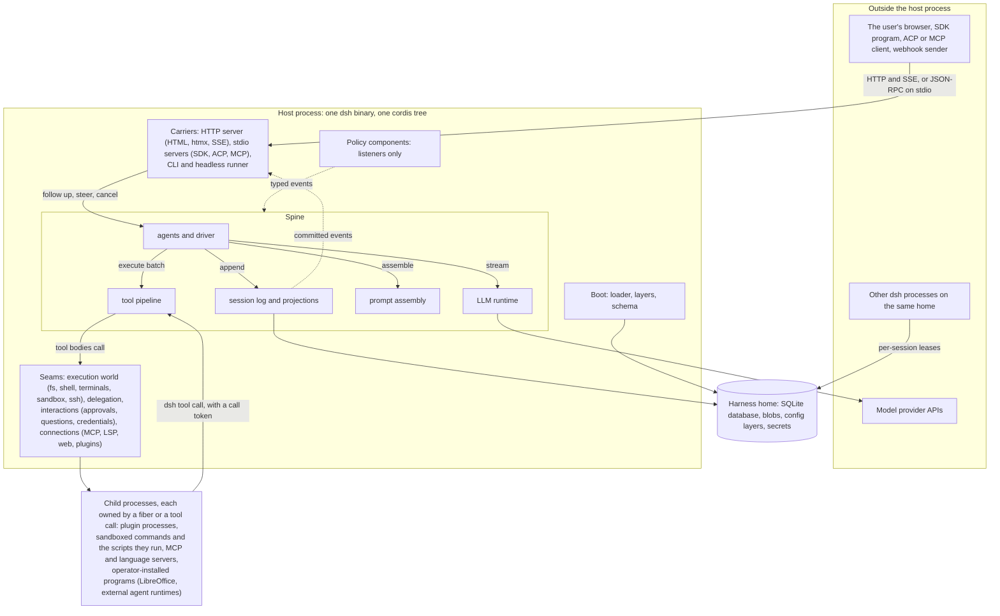

# deepseek-harness in Go: design

> **Status: design draft for owner review. No harness code exists; nothing is built,
> run or tested.** The implementation plan, [implementation-plan.md](implementation-plan.md),
> schedules every deliverable this design and the area specifications name; its stages
> are not started. Ten library specifications report observations from throwaway
> programs run during research; they are marked there as unverified research notes, to
> be measured by named tests ([§10](#10-limitations)). Upstream facts are read at commit
> `2e39e70` (recorded in [README.md](README.md)) and are taken from the foundation
> documents under [upstream/](upstream/) and [libs/](libs/), which hold the `path:line`
> evidence.
>
> **How these documents were written.** The work ran in waves. The **foundation
> documents** (`upstream/*.md`) describe upstream's architecture, persistence, wire
> protocol, security and toolchain and recommend Go decisions for them. The **library
> wave** wrote one specification per upstream dependency (`libs/*.md`). The **area
> wave** wrote one specification per area of the product (`areas/*.md`; each area has a
> short key such as `A07` or `C3`, listed in [§2, Area keys](#area-keys)). **Integration**
> reconciled them and wrote this document. Every item carries a stable ID and is
> recorded in the **ledger**, the machine-checked list of upstream units, their
> dispositions and the Go items that answer them ([traceability.md](traceability.md)).
> Decisions `DH-ADR-1` to `DH-ADR-40` are fixed by the repository owner
> ([§7.1](#71-decisions-fixed-by-the-owner)). `DH-ADR-7` to `-25` record the owner's
> answers of 2026-11-18 to the former open decisions `OD-n`
> ([§9](#9-owner-decisions-and-what-is-still-open)) and to the questions the library
> wave raised; `DH-ADR-26` to `-40` record the answers of 2026-11-19, given after the
> area specifications were integrated. They override any foundation, library or area
> text that says otherwise. Everything else is a recommendation until the owner adopts
> it: the 84 foundation decisions in [§7.2](#72-decision-register), the decisions of
> the area specifications under [areas/](areas/), and the recommended defaults listed
> in [§9.2](#92-recommended-defaults-applied-not-confirmed-by-the-owner), which the
> owner told the agents to apply and may overturn. A
> sentence that is this document's own reasoning opens with "Inference". IDs use the
> `DH` prefix. `CF-n` (a conflict between foundation recommendations, [§8](#8-conflicts-and-gaps-between-the-foundation-recommendations))
> and `OD-n` (a former open decision, now answered in [§9](#9-owner-decisions-and-what-is-still-open))
> are working labels, not ledger IDs. Outside §7.2 a short form such as `ARCH-2` means
> `DH-ADR-ARCH-2`; in sections 3 to 6 it links to the full record, and
> [§7.2](#72-decision-register) lists every one on a single line.

**Contents.** [1 Purpose](#1-purpose-and-audience) ·
[2 Vocabulary](#2-vocabulary) · [3 What we want to achieve](#3-what-we-want-to-achieve) ·
[4 Target architecture](#4-target-architecture) ·
[5 Failure and cleanup](#5-failure-retry-rollback-and-cleanup) ·
[6 Security model](#6-security-model) · [7 Global decisions](#7-global-decisions) ·
[8 Conflicts and gaps](#8-conflicts-and-gaps-between-the-foundation-recommendations) ·
[9 Owner decisions](#9-owner-decisions-and-what-is-still-open) ·
[10 Limitations](#10-limitations) ·
[11 Index](#11-index)

## 1. Purpose and audience

This document is the spine that every area specification builds on. It is for the
repository owner, who reviews and settles it; for the agents and engineers who write one
specification per area of the product; for reviewers; and for readers new to the system.
It fixes four things so that about forty specifications stay consistent: the shared
vocabulary ([§2](#2-vocabulary)), the outcomes every deliverable must serve
([§3.2](#32-outcomes)), the target architecture ([§4](#4-target-architecture)) and one
set of global decisions ([§7](#7-global-decisions)). Detail belongs to the 39 area
specifications under [areas/](areas/) and the library specifications indexed in
[libs/README.md](libs/README.md). Where this document summarises an area, the area
specification governs the detail and this document governs the vocabulary, the
outcomes and the owner's decisions.

**The product in one paragraph.** deepseek-harness (`dsh`) is an agent harness: a
program that takes a user message, asks a large language model (LLM) what to do, runs
the tools the model asks for, and repeats until the model has nothing more to do
([upstream/architecture.md](upstream/architecture.md) §1). The Go version is one binary
that runs as a command-line tool, a local web application shown in the user's own
browser, or a subprocess driven by another program. There is no desktop application
([DH-ADR-18](#dh-adr-18)). Everything in it is a cordis component whose lifetime is
owned: **cordis** is the component framework the harness is built on, already ported to
Go in this repository's `src/go`, in which every unit of code is started, owned and
stopped by a parent ([§2](#2-vocabulary)). Everything the model sees is written to an append-only session log first.
Everything the model does goes through one guarded tool pipeline and, when it spawns a
process, through an operating-system sandbox. Nothing is sent off the machine unless
the user opted in ([DH-ADR-9](#dh-adr-9)).

## 2. Vocabulary

**Framework terms** are inherited from the Go cordis port and defined in
[../architecture.md §2](../architecture.md#2-vocabulary): **context**, **tree**,
**component**, **fiber** (one live instance of a component), **effect** (a resource
paired with its cleanup), **service**, **inject**, **realm**, **intercept**, **loader
entry**. One naming rule matters here. Upstream says "plugin" for every unit of code. In
this design a compiled-in unit is always a **component**, and **plugin** means only a
separate plugin process ([DH-ADR-4](#dh-adr-4)).

| Term | What it is | Why it exists |
|---|---|---|
| **Harness home** | The directory holding one installation's database, blobs, configuration layers and secrets. | One place to back up, lock and clean. Several `dsh` processes may open it at once ([DH-ADR-12](#dh-adr-12)). |
| **Host** | A running `dsh` process: one cordis tree that holds the authoritative state of the sessions it has leased. | Every browser, SDK program and plugin is its client. |
| **Profile, bundle** | A profile is a named composition; five are built in (`web`, `headless`, `sdk`, `sdk-minimal`, `acp`). A bundle is a named set of entries embedded in the binary. | One binary runs as different products. |
| **Required entry, safe mode** | A required entry is one a profile cannot run without: it must be present, enabled and active, and no layer may remove or disable it. Safe mode is a launch that switches off plugin processes and optional bundles for that run. | Start-up has one rule for "is the product up", and a broken extension cannot stop the user from starting the product to remove it ([areas/boot.md](areas/boot.md)). |
| **Layer** | One ordered input to composition: a bundle, the profile patch, the home patch or a command-line overlay. It holds operations (`insert`, override by id, `merge`, `remove`). Exactly one layer is **writable**. | Users change the product without editing shipped files; a runtime edit has one home. |
| **Agent preset** | A set of entries that composes one agent's tools, prompt sections and skills. A *permission preset* (a sandbox mode plus an approval policy, area A17) is a different thing; neither is ever written as a bare "preset" on a flag, a wire field, a route or a label. | One host runs agents with different capability sets. |
| **Plugin process** | Third-party or model-written code in its own process, speaking the plugin protocol or the Model Context Protocol (MCP). It is installed from a local directory the operator placed ([DH-ADR-13](#dh-adr-13)). | Go cannot load code into a running process; a process is also where isolation is enforced. |
| **Manifest, capability grant** | A plugin declares the capabilities it wants (offer tools, read session events, call a named host service); the operator grants a subset. | The host denies every plugin call no grant covers. |
| **Session** | An append-only log of typed events plus a small header: the single source of truth. | Resume, fork, replay, the UI and telemetry read one record. |
| **Session event** | One immutable log entry: `seq` (position, from 0, no gaps), `time`, `type`, `data`, optional `ignorable`. | A fact that must survive a restart. |
| **Surface, log-only event** | The surface is the ordered list of events that become model messages; every other event is log-only. | Separates what the model sees from audit and state records. |
| **Derived history, request header** | History is computed from the surface, never stored twice. The header is a logged snapshot of the rest of a request (model, settings, tool schemas). | Every model request is a pure function of the log. |
| **Agent, agent handle** | The agent is the live object that drives one session. The handle adds the right to dispose it; only the creator holds it. | Who may tear an agent down differs from who may talk to it. |
| **Driver, inbox** | The driver is the loop that runs turns and steps for one agent. The inbox is the agent's pending input, taken at turn and step boundaries. | The driver is replaceable; input may arrive at any time. |
| **Step, turn, attempt** | A step is one model request plus the tool calls it causes. A turn is zero or more steps. An attempt is one call to a provider. | The units that are retried, cancelled and shown as "the agent answered". |
| **Scope, initiator** | What is registered through an agent's context is in that agent's scope: visible only to it and removed with it. The initiator is the agent on whose behalf code runs; it proves neither liveness nor permission. | One fact drives visibility and lifetime; shared services can attribute work. |
| **Projection** | A registered pure fold `apply(state, event)` that keeps current state (todo list, title, model history). A *message projection* is a pure rewrite of message content at request time. | Readers get state without replaying the log. |
| **Checkpoint** | Always qualified. A *durability checkpoint* is a flush at a chosen point. A *projection checkpoint* is stored fold state with the `seq` it covers. | A side effect needs a durable record first; long sessions must open quickly. |
| **Lease** | The right of one process to append to one session. | Two writers would corrupt the sequence, and several processes may share one home. |
| **Tool, tool pipeline** | A tool is a model-callable capability with a schema. The pipeline is the one fixed sequence every call passes (validate, policy listeners, guards, approval, run, shape the result), with one scheduler for a batch. There is no replaceable executor ([DH-ADR-TOOLS-2](areas/tools.md#dh-adr-tools-2)). | A pipeline that a composition could swap out is a pipeline a call could skip. |
| **Tool command line, call token** | The tool command line is the external Go command (for example `dsh tool call <name> --args ...`) through which a model-written script calls a tool. This is what programmatic tool calling (PTC) means in this design. A call token is the short-lived value that tells the host which session, turn and agent such a call belongs to; it carries no permission. | A script can loop over and filter tool results with no interpreter inside the harness, and every call still passes the guarded pipeline and is logged ([DH-ADR-8](#dh-adr-8)). |
| **Decision, guard** | A decision is the closed set of outcomes an interception may return (`allow`, `deny`, `ask`, ...). A guard is a final check that can only deny. | A listener's power is limited; listener order cannot undo a denial. |
| **Seam** | A swappable capability with three roles: a **contract** package (Go interface, service key, types, events), a **provider** that implements it, and a **consumer**, commonly a model-facing tool. A provider is the service itself (direct seam) or registers by name (registry seam). | Changing a provider must not change the tool the model was shown. |
| **Spine** | The services every composition boots ([§4.3](#43-spine-services)). | What seams and policy components attach to. |
| **Sandbox mode, policy, enforcement, exposure** | Mode is `read-only`, `workspace-write` or `danger-full-access`. Policy is the mode, write roots and network setting resolved for one call. Enforcement is the reported fact `full` or `partial`. Exposure names what a backend on this machine cannot deny a confined command: `secret-read`, `control-connect`, `delegated-execution`. | One vocabulary for every operating system, and no false reassurance ([areas/sandbox-ssh.md](areas/sandbox-ssh.md) §6.1). |
| **Approval, answerer, interaction** | An approval is a one-shot yes or no for one action. An answerer is a channel that can reach a person. An interaction is a pending approval or question in the host registry. | A person decides what a static rule cannot; with no answerer the answer is no. |
| **Session grant** | A user's standing yes for one named scope (one directory, one application, or for browser use one website) that lasts until the session ends. It is logged, listed and revocable. It is never copied: it does not survive a resume and does not pass to a fork or a subagent. Nothing is stored across sessions. | Spares the user the same prompt many times without a rule that outlives the work ([DH-ADR-16](#dh-adr-16), [DH-ADR-33](#dh-adr-33)). |
| **Launch token, browser session** | A launch token is a one-time value in the link the running host opens or prints. A browser session is what the token is exchanged for: a random id in a cookie, of which the host stores only a hash. There is no signing secret. | Nothing a program can read from disk, and nothing an interface returns, makes its holder the owner ([DH-ADR-28](#dh-adr-28)). |
| **Control endpoint, stop request** | The control endpoint is a local socket on which a second `dsh` command asks the running host for its status, asks it to stop, or asks it to show its sign-in link itself. A stop request is the one way a host is stopped, whoever asks. | One host per home and address can be reused and stopped without handing anyone a credential. |
| **Sender, off-switch** | A sender is a component that transmits something on the harness's own initiative (telemetry, analytics, session-log upload, an automatic update check, notice polling). The off-switch stops every sender at once. | "Nothing leaves the machine unless the user opts in" needs one list and one switch ([DH-ADR-9](#dh-adr-9), [DH-ADR-27](#dh-adr-27)). |
| **Credential reference** | The name of a secret; the value stays behind one store interface. | Configuration can name a secret without containing it. |
| **Peer, principal** | A peer is one admitted caller; its principal says who it is (`owner` or a non-owner kind). | Access is decided from the admitted connection, never from request data. |
| **Carrier** | A component that connects an outside peer to agents: HTTP server, SDK server, ACP server, headless runner. | One agent contract serves a browser, a script and an editor. |
| **Fragment, island** | A fragment is HTML the host renders and htmx swaps in. An island is a small self-contained JavaScript widget (the terminal, the rich-text composer). | The UI is server-rendered and shown in the user's browser ([DH-ADR-3](#dh-adr-3)). |

**Ownership, access and desired state are different things.**

- **Ownership** is who releases a resource. A fiber owns its effects: listeners,
  registrations, child fibers, child processes, a session's write lease. An agent's
  creator owns the agent through its handle. A live session owns its grants: they end
  with it and are never copied to another session. Unloading releases exactly what is
  owned.
- **Access** is who may use a resource. Injecting a service, looking up an agent by id,
  opening a read handle, holding a capability grant and passing an approval all give
  access. None transfers ownership. An approval widens access for one call only, and a
  session grant for one named scope until the session ends. A call token gives no
  access at all: it only says on whose behalf a call is made.
- **Desired state** is what configuration says should run. The loader reconciles the
  live tree with the composed layers and releases only the fibers it created.

Inference: the table applies these three ideas to the resource classes the foundation
documents describe.

| Resource class | Example | What cleanup may undo |
|---|---|---|
| Created | A plugin process, a temporary directory, a terminal the harness started, a call token, a session grant | Everything; the owning fiber, tool call or session releases it. |
| Previously owned | A session written by an earlier run of the host | Nothing automatically; it is reopened under a new lease and deleted only by an explicit operation. |
| Adopted | Access-control entries the Windows sandbox adds to the user's workspace | Only the entries the harness created; the directory stays the user's. |
| Shared | A Low integrity label on a directory, a remote MCP server, an SSH host, a harness home another `dsh` process has open, an operator-installed LibreOffice | Nothing another user of it still needs; the harness has access, not ownership. |
| Uncertain | A tool that was running when the host died; an MCP call cut off mid-flight | Nothing. The log records "outcome unknown" and the model is told to verify. |

**Abbreviations and technical terms** used from [§3](#3-what-we-want-to-achieve) on:

| Term | Meaning | Why it matters here |
|---|---|---|
| **SDK** | Software development kit: the client library another program uses to drive `dsh` as a subprocess (Go in `src/sdk`, plus Python and TypeScript bindings). | One of the three ways the product runs ([§4.8](#48-wire-surfaces)). |
| **ACP** | Agent Client Protocol: the JSON-RPC protocol through which code editors drive an agent. | Editors reach the harness through it ([§4.8](#48-wire-surfaces)). |
| **SSE** | Server-sent events: a one-way HTTP stream from server to browser. | The web UI receives live updates on it ([DH-ADR-3](#dh-adr-3)). |
| **htmx** | A small JavaScript library that lets HTML attributes ask the server for a fragment and swap it into the page. | The UI is server-rendered HTML; htmx is the only page-wide script ([DH-ADR-3](#dh-adr-3)). |
| **WAL** | Write-ahead log: SQLite's journal mode in which writes go to a side file first, so readers and one writer work at once. | Several `dsh` processes share one home ([§4.7](#47-storage)). |
| **cgo, pure Go** | cgo is Go's bridge to C code. A pure Go program uses none, so it cross-compiles with one command and needs no C compiler or system library. | The core binary must be pure Go ([DH-ADR-15](#dh-adr-15), [DH-O-14](#dh-o-14)). |
| **Seat** | A place in a registry where exactly one implementation registers itself. The **factory seat** of the agent registry is where the driver registers how agents are built ([areas/agent-loop.md](areas/agent-loop.md)). | The driver can be replaced without changing any caller ([§4.3](#43-spine-services)). |
| **Ledger** | The machine-checked list in `trace/` that gives every upstream unit a disposition (ported, replaced, merged, dropped, resolved, carried, not applicable) and links it to Go items. | It is how "nothing of upstream was forgotten" is checked ([DH-ADR-6](#dh-adr-6)). |
| **Area key, agent key** | The short label of an area specification (table below), or of the writing agent that produced a document. The ledger and the index use them. | They keep tables short; the table below turns each into a document. |

**Area keys.** Each area specification has a short key. `A` areas are the
host and core, `C` areas the web client, `X` areas the experimental features. There is no
`A26`.

| Key | Area | Document |
|---|---|---|
| A01 | Core session log and scoped registration | [areas/core-session.md](areas/core-session.md) |
| A02 | Agent interface, registry and the agent loop | [areas/agent-loop.md](areas/agent-loop.md) |
| A03 | Tool registry and execution pipeline, system prompt, guards, todo | [areas/tools.md](areas/tools.md) |
| A04 | Model providers and streaming | [areas/llm.md](areas/llm.md) |
| A05 | Session persistence: formats, migrations, JSONL and SQLite back ends | [areas/session-store.md](areas/session-store.md) |
| A06 | Session projections, titles, telemetry, statistics and session query | [areas/session-views.md](areas/session-views.md) |
| A07 | Non-session storage, attachments, output spill, workspace, settings | [areas/storage.md](areas/storage.md) |
| A08 | Filesystem seam, file tools and turn deliverables | [areas/filesystem.md](areas/filesystem.md) |
| A09 | Subprocesses, persistent terminals and shell tools | [areas/execution.md](areas/execution.md) |
| A10 | Process confinement (sandbox) and SSH remote execution | [areas/sandbox-ssh.md](areas/sandbox-ssh.md) |
| A11 | Programmatic tool calling and workflows | [areas/ptc-workflow.md](areas/ptc-workflow.md) |
| A12 | Subagents and agent teams | [areas/subagent-team.md](areas/subagent-team.md) |
| A13 | Background jobs, schedules, goals and plan mode | [areas/jobs-schedule-goal-plan.md](areas/jobs-schedule-goal-plan.md) |
| A14 | Request context, compaction and skills | [areas/context-compaction-skill.md](areas/context-compaction-skill.md) |
| A15 | MCP, language servers, web search and fetch, connectors | [areas/mcp-lsp-web-connector.md](areas/mcp-lsp-web-connector.md) |
| A16 | Office documents, browser use and computer use | [areas/document-browser-computer.md](areas/document-browser-computer.md) |
| A17 | Human interaction, approvals, credentials, account, identity, feedback | [areas/interaction-credentials.md](areas/interaction-credentials.md) |
| A18 | Web host services and telemetry | [areas/host-telemetry.md](areas/host-telemetry.md) |
| A19 | Remote API gateway and controllers | [areas/api.md](areas/api.md) |
| A20 | Out-of-process SDK, ACP server and the typed RPC contract | [areas/sdk-acp-typert.md](areas/sdk-acp-typert.md) |
| A21 | Application boot: profiles, launcher, reload, plugin manager | [areas/boot.md](areas/boot.md) |
| A22 | Live plugin inspection and model-written plugins | [areas/extensions.md](areas/extensions.md) |
| A23 | Shared utilities and test support | [areas/util-test-support.md](areas/util-test-support.md) |
| A24 | The `dsh` command-line application | [areas/app-cli.md](areas/app-cli.md) |
| A25 | The web application assembly, and what replaces the desktop application | [areas/app-web.md](areas/app-web.md) |
| A27 | Profile bundles and per-session agent presets | [areas/bundle-preset.md](areas/bundle-preset.md) |
| C1 | Web client core: connection, modules, resources, store, locale, shortcuts | [areas/ui-core.md](areas/ui-core.md) |
| C2 | Web client design system: primitives, theme, layout, renderer | [areas/ui-kit.md](areas/ui-kit.md) |
| C3 | Chat input: composer, attachments, references, commands, model choice | [areas/ui-chat.md](areas/ui-chat.md) |
| C4 | Conversation view: nodes, tool cards, questions, approvals, plan, goal | [areas/ui-conversation.md](areas/ui-conversation.md) |
| C5 | Work views: trajectory, subagents, workflow runs, jobs, teams, deliverables | [areas/ui-work.md](areas/ui-work.md) |
| C6 | Sidebars, workspace, sessions, directory pickers, document preview, terminal panel | [areas/ui-sidebar-workspace.md](areas/ui-sidebar-workspace.md) |
| C7 | Settings, plugin manager, accounts, permission presets, skills | [areas/ui-settings-plugins.md](areas/ui-settings-plugins.md) |
| X1 | Code-host (GitHub, GitLab) integration and worktrees | [areas/x-forge-worktree.md](areas/x-forge-worktree.md) |
| X2 | Live sharing and the in-browser worker runtime | [areas/x-liveshare-webworker.md](areas/x-liveshare-webworker.md) |
| X3 | Inspector, session inspector, timeline, statistics, session search, chat import | [areas/x-inspector-timeline.md](areas/x-inspector-timeline.md) |
| X4 | Computer-use and browser-use providers, voice input | [areas/x-cua-browser-voice.md](areas/x-cua-browser-voice.md) |
| X5 | Hooks, mods, auto review, webhooks, external-agent subagents, terminal tool | [areas/x-hooks-mods-terminal.md](areas/x-hooks-mods-terminal.md) |
| X6 | Action cards, recommendations, translation, session titles, other experiments | [areas/x-recommendations-misc.md](areas/x-recommendations-misc.md) |

Keys that are not areas appear only in the ledger: `F1` to `F8` wrote the foundation
documents, `D1` to `D4` the first-verdict tables of upstream decision notes, `L1` to
`L18` the library specifications, `I4` this document, `K1` and `K2` the two debt
registers and `Q1` to `Q3` the audits ([trace/clusters.json](trace/clusters.json)).

## 3. What we want to achieve

### 3.1 Problem

Upstream is a working product whose design is sound in principle and expensive in
mechanism. The foundation documents trace most of the expense to JavaScript, Node and
npm, not to the product: 391 npm packages because the loader mounts by package name
([upstream/architecture.md](upstream/architecture.md) §10); a vendored framework with 21
local patches ([libs/cordis.md](libs/cordis.md) §3); five schema systems joined by four
converters ([libs/zod.md](libs/zod.md) §3); 7,485 lines that only read old session
formats ([upstream/session-and-persistence.md](upstream/session-and-persistence.md)
§6.3); configuration that evaluates arbitrary JavaScript
([libs/cordis-loader.md](libs/cordis-loader.md) §3); plugins that run inside the host
with its full authority ([upstream/security.md](upstream/security.md) §2); and a build
that needs 51 verify scripts and 35 workflows
([upstream/toolchain.md](upstream/toolchain.md) §1). The goal is the same product with
those causes removed: one Go binary, the upstream principles kept, each mechanism
re-derived for Go ([DH-ADR-2](#dh-adr-2)).

### 3.2 Outcomes

Each outcome is observable behaviour of the finished product, and every deliverable
links to at least one. `DH-O-1` and `DH-O-2` are already used by the cordis and loader
specifications and keep their meaning. No ID was renumbered or removed when the owner's
decisions of 2026-11-18 were applied; `DH-O-6`, `-7`, `-9` to `-12` and `-14` were
reworded to match them. Inference: the "Areas" column is this document's mapping of
outcomes to the area keys of [§2](#area-keys) and to the foundation and library documents
by name; an area may serve further outcomes. The full list of deliverables and proofs per
outcome is in the ledger (`outcomes` field of each `go` row) and in the implementation
plan, [implementation-plan.md](implementation-plan.md) section 2.

| ID | Outcome (observable behaviour) | Areas |
|---|---|---|
| **DH-O-1** | **The harness is composed from cordis components whose lifetimes are owned.** When a component is disabled, reconfigured or loses a dependency, everything it acquired (listeners, registrations, agents, child processes) is released exactly once, and its dependents unload first. | [libs/cordis.md](libs/cordis.md), A21, A23 |
| **DH-O-2** | **A running harness is composed, inspected and changed from layered configuration.** An operator can preview the composed tree, see which layer supplied each value, and edit a layer so that only the affected entries restart. A bad edit is rejected with file, line and column, and the running tree is unchanged. | [libs/cordis-loader.md](libs/cordis-loader.md), [libs/cordis-plugins.md](libs/cordis-plugins.md), [libs/zod.md](libs/zod.md), A21, A27, A07 |
| **DH-O-3** | **Every turn has the same guarantees.** One accepted message is at most one turn. Turns and steps are bracketed in the log. Cancellation reaches every operation with a recorded cause. A failing extension ends the turn, never the loop, and no tool call is left unanswered in history. | A02, A14 |
| **DH-O-4** | **Model-visible means logged.** Every model request can be rebuilt from the session log alone and equals what was sent. Nothing reaches the model through a side channel. | A01, A02, A14 |
| **DH-O-5** | **Sessions are durable and recover honestly.** A flushed event survives a crash. A session can be resumed, forked, searched, exported and deleted. After a crash the interrupted turn is closed and the model is told which tool outcomes are unknown. | A01, A05, A06, A07 |
| **DH-O-6** | **Tools run through one guarded pipeline.** Arguments that do not match the tool's schema never reach the tool. Policy listeners, deny-only guards, approval, execution and result shaping run in one fixed order, for a model-proposed call, a direct caller and a script that uses the tool command line alike. Logged arguments are never rewritten and results are bounded. | A03, A11, A24, X5 |
| **DH-O-7** | **What the model does is confined, and widened only by an attributed approval or session grant.** A spawned command runs under the resolved sandbox policy or does not run. File tools cannot leave the write roots. An approval covers one call; a session grant covers one named scope until the session ends and can be listed and revoked. With nobody to ask, the answer is no. Secrets are not printed, logged or inherited by child processes. | A08, A09, A10, A17 |
| **DH-O-8** | **Model providers are swappable and failures are facts.** A provider is selected by exact id. One attempt settles as exactly one logged event. Retry is a bounded policy outside the adapter. No failure silently falls back across a trust or billing boundary. | A04 |
| **DH-O-9** | **Work can be delegated and scheduled with owned lifetimes.** Subagents (including external agent runtimes), teams, workflows, background jobs, schedules, goals and plan mode each have one owner, a recorded lineage and a result that settles only after cleanup. A workflow script that starts agents through the tool command line gets the same owner and lineage as a direct call. | A11, A12, A13, X5 |
| **DH-O-10** | **Capabilities are seams.** The filesystem, shell, terminals, remote hosts, MCP servers, language servers, web access, documents, browser use and computer use can each change provider without changing the tool schema the model sees. A capability whose only provider is software the operator installs (LibreOffice for office documents, an external MCP server for computer use) reports `unavailable` plainly where that software is missing; nothing is bundled or downloaded. | A07 to A10, A15, A16, X1, X4 |
| **DH-O-11** | **Plugins are supervised, least-privilege processes.** A third-party or model-written plugin is a local directory with a manifest. It runs in its own process, confined by the sandbox, and can do only what the operator granted. A crash or hang fails its pending calls and never the host. The harness downloads and updates no plugin. | A22, A21, A15 |
| **DH-O-12** | **The HTML user interface shows live session state in the user's browser.** A browser tab renders the transcript, tool cards, approvals, session grants and settings from host state, updates live, and after a disconnect or a host restart shows every event once and in order. The composer shows mentions and attachments as chips inside the text. A remote image in model output is fetched only after the user clicks it. | A18, A19, A25, C1 to C7, X2, X3, X6 |
| **DH-O-13** | **Other programs drive the harness through versioned protocols.** An SDK program (including the Python SDK), an ACP client, an MCP client, a webhook sender and the command line can each create, prompt, answer, cancel and resume sessions with defined errors. | A20, A24, A19, X5 |
| **DH-O-14** | **The harness is operable and observable.** It ships as one pure-Go binary per platform, published as GitHub release assets, with one launch command and no desktop artifact. Logs, telemetry, a fatal diagnostic and generated catalogs (tools, events, config, services, commands, persisted types) describe the running product, and anything that grows with history is bounded. Session-log upload, analytics and telemetry send nothing until the user opts in, and one switch turns all of them off. | A06, A17, A18, A24, A25, [upstream/toolchain.md](upstream/toolchain.md) |
| **DH-O-15** | **Quality is verifiable.** Five kinds of evidence are kept apart; a skipped real-environment scenario is never a pass; concurrency is checked by the race detector; rules are enforced from the first commit with no baseline of exceptions. | [upstream/toolchain.md](upstream/toolchain.md), A23 |
| **DH-O-16** | **Traceability is complete.** Every upstream unit has a disposition that links to this design, and every outcome links to deliverables and their proof. A tool checks it. | all; [trace/README.md](trace/README.md); the audits in [audit/](audit/) |

### 3.3 Scope and non-goals

In scope: all of upstream ([DH-ADR-1](#dh-adr-1)): the host runtime, the experimental
packages, the web client, the Python SDK, the documentation website
([DH-ADR-10](#dh-adr-10)) and what upstream's desktop application does. Each desktop
duty is ported to the web UI or the command line, or dropped by a recorded decision
([DH-ADR-18](#dh-adr-18)). Priority, not scope, decides order; the implementation plan
sets it. Three things are in scope but deferred by decision: the session import command
([DH-ADR-11](#dh-adr-11)), a plugin registry ([DH-ADR-13](#dh-adr-13)) and
cloud-platform model sign-ins ([DH-ADR-25](#dh-adr-25)).

Not goals, each by a decision. The owner's drops are recorded exceptions to
[DH-ADR-1](#dh-adr-1), and a ledger row for a dropped unit links to the record named.

- Compatibility with upstream formats, protocols, profiles, clients or fixtures
  ([DH-ADR-2](#dh-adr-2), [PERSISTENCE-5](upstream/session-and-persistence.md#dh-adr-persistence-5)).
- Loading code into the running host, or hot reload of code ([DH-ADR-4](#dh-adr-4),
  [LOADER-8](libs/cordis-plugins.md#dh-adr-loader-8)).
- A client-side application or client plugin runtime ([DH-ADR-3](#dh-adr-3)).
- A security boundary stronger than the one stated in [§6](#6-security-model).
- A desktop application, a webview shell, an embedded browser pane or embedded sign-in
  pages ([DH-ADR-18](#dh-adr-18)); the in-browser preview runtime
  ([DH-ADR-17](#dh-adr-17)).
- An embedded interpreter or JavaScript guest runtime for model-written programs
  ([DH-ADR-8](#dh-adr-8)); a native computer-use helper ([DH-ADR-19](#dh-adr-19));
  bundled office software ([DH-ADR-20](#dh-adr-20)).
- The vendor release publisher, the mandatory-update service and the Stagehand AI
  browser layer ([DH-ADR-24](#dh-adr-24)); bilingual documents and their pairing
  checks, governance automation and contributor agent skills ([DH-ADR-10](#dh-adr-10)).
- Plugin download, discovery or auto-update ([DH-ADR-13](#dh-adr-13)); approval rules
  stored across sessions ([DH-ADR-16](#dh-adr-16)); any data leaving the machine by
  default ([DH-ADR-9](#dh-adr-9)).
- A relay for live sharing, or a viewer who can do more than watch
  ([DH-ADR-37](#dh-adr-37)); writes to a code host from the harness's own UI
  ([DH-ADR-38](#dh-adr-38)); translation through unofficial public endpoints in the
  shipped bundle ([DH-ADR-36](#dh-adr-36)); a change to durable configuration made by
  the model ([DH-ADR-30](#dh-adr-30)).

### 3.4 How outcomes are proven

Evidence comes in five separate kinds ([TOOLCHAIN-1](upstream/toolchain.md#dh-adr-toolchain-1)): unit tests, composition tests
through the real loader, golden files, keyless replay of recorded sessions against the
built binary, and real-environment scenarios. A real environment here is a real model
API, operating-system sandbox, SSH host, browser, plugin process or operator-installed
program (LibreOffice, an external MCP server); this product has no remote lab. Scenarios are written as Given, When, Then, Cleanup in the area
specifications. A test with a fake is never counted as a scenario, and a scenario that
is skipped, blocked or failed stays open ([TOOLCHAIN-6](upstream/toolchain.md#dh-adr-toolchain-6), [SECURITY-11](upstream/security.md#dh-adr-security-11)).

## 4. Target architecture

### 4.1 The picture

Solid arrows are calls and dotted arrows are events. The direction is the important
property, kept from upstream: carriers and policy components know the spine, and the
spine knows none of them ([ARCH-1](upstream/architecture.md#dh-adr-arch-1)). One arrow enters the host from a child process: a
script calling a tool through the tool command line. It ends at the top of the tool
pipeline, never past it ([§4.4](#44-process-model)).

### 4.2 Go module layout

In plain terms: the code is split into three separately versioned libraries, one for the
component framework, one for programs that drive the harness, and one for the product
itself; inside the product, code is grouped by capability, one folder per family. A Go
**module** is a versioned unit of code with its own `go.mod` file listing what it
requires; a **package** is one folder of code inside a module; `go.work` is a file that
lets several modules on one machine be built together during development; a `replace`
line in `go.mod` points a requirement at a local copy instead of a published version.

There are three Go modules ([DH-ADR-26](#dh-adr-26), which amends
[DH-ADR-5](#dh-adr-5)), versioned and tagged together.

| Module | Holds | Imports | `go` line |
|---|---|---|---|
| `src/go` | The cordis port: packages `cordis`, `loader`, `timer`. Changed for the harness by the deliverables listed in [libs/cordis.md](libs/cordis.md) §6.1 ([DH-ADR-7](#dh-adr-7)) | Standard library only | 1.26.0 (1.24 today) |
| `src/sdk` | `jsonrpc` (the one line-delimited JSON-RPC codec), `protocol` (the SDK message types, the method table and the embedded schema file) and `sdk` (the Go client). A Go program that drives the harness imports this module and nothing else | Standard library only; neither cordis nor the harness | 1.26.0 |
| `src/harness` | The product: everything in the table below | Both modules above, at the version of its own tag, with no `replace`; third-party modules, each justified in a library specification | 1.26.0 |

`src/go` and `src/sdk` do not require each other. One version number gives three tags
on one commit (`src/go/vX.Y.Z`, `src/sdk/vX.Y.Z`, `src/harness/vX.Y.Z`). A root
`go.work` joins the modules for development and is off in the release build. All
three state one minimum Go version, `go 1.26.0`. It is the lowest line the harness
module can carry: ten of the modules the design chose declare it themselves (CF-4 in
[§8](#8-conflicts-and-gaps-between-the-foundation-recommendations) holds the
evidence; a `go` line is the oldest Go release a module promises to build with). The other two modules need less, and take the same line so that the project
has one floor to test ([areas/sdk-acp-typert.md](areas/sdk-acp-typert.md) §6.1,
`DH-T-SDK-17`).

Inside `src/harness`, components, not packages, are the unit of composition, and
packages follow capability families ([ARCH-9](upstream/architecture.md#dh-adr-arch-9)). Each area owns the final names inside its
family; its specification holds the package list. Every implementation package sits
under `internal/`, which Go forbids other modules to import. Some names in the table
are the areas' own: `yamlx` is the configuration file reader and `expr` the small
expression language of configuration ([§4.9](#49-configuration-model)).

| Package family (under `src/harness`) | Owns | Areas |
|---|---|---|
| `cmd/dsh` | `main` only | A24 |
| `internal/cli`, `internal/update` | The command line: `cmdline` (option specifications), `tree` (the command tree), `output`, `lifecycle` (the stop request), `hostclient` (the control endpoint's client), `headless`, `toolcmd` (`dsh tool call`, the client side of the tool command line); the update check and `dsh update` | A24 |
| `internal/boot` | `catalog`, `launch`, `yamlx`, `expr`, `profile`, `config`, `reload`, `plugins` (the plugin management surface), `agentpreset`: profiles, embedded bundles, layer files, the expression engine, the boot sequence and the one edit path for configuration | A21, A27 |
| `internal/schema` | The one description of data shapes: derive, validate, fingerprint | A23 (specified in [libs/zod.md](libs/zod.md)) |
| `internal/session` | Session log, event registry, scope, projections, the SQLite store, search, export | A01, A05, A06 |
| `internal/agent` | Agent contract and registry, the driver, the inbox | A02 |
| `internal/tools` | Tool registry, the guarded pipeline and its scheduler, the tool endpoint, call tokens and sub-call limits, prompt assembly, guards, todo | A03 |
| `internal/llm` | LLM runtime, provider adapters, retry policy. Its leaf package `internal/llm/vocab` holds the message vocabulary: `session` imports it, and `llm` imports `session`, so there is no cycle | A04 |
| `internal/world` | Filesystem, subprocess (the one place that starts a process), shell (`shellexec`), terminals, sandbox backends, SSH | A08, A09, A10 |
| `internal/program`, `internal/delegate` | Programmatic tool calling as a product mode (what the model is taught about the tool command line) and workflows; subagents, external agent runtimes, teams, jobs, schedules, goals, plan mode | A11, A12, A13 |
| `internal/context/...` | Request context, compaction, skills. `internal/context` is a parent directory only and holds no Go package, so nothing shadows the standard library's `context` | A14 |
| `internal/connect`, `internal/media` | MCP client (its one importer of the MCP SDK is `internal/connect/mcp/conn`), language servers, web, connectors; documents (LibreOffice as a child process), browser use, computer use (an external MCP provider) | A15, A16 |
| `internal/human` | Interaction registry, approvals, session grants, credentials, account, identity, feedback | A17 |
| `internal/storage` | Key-value tables, attachments, spill, workspace registry, settings | A07 |
| `internal/host` | The listener, authentication, the control endpoint, launch, the sharing gate and telemetry (A18); `web`, `access`, `stream`, `conversation`, `routes/*`, `userterm`, `wsfiles`, `wsconn` (A19) | A18, A19 |
| `internal/wire` | `stdio`, `sdkserver`, `acpwire`, `acpserver`, `protoschema`, `tsgen`, `plugin` (the plugin protocol host, inspection and the approved copy). The codec is not here: it is `src/sdk/jsonrpc` | A20, A22 |
| `internal/ui` | Templates, fragments, design system, islands, pages; the web equivalents of what upstream's desktop application did | A25, C1 to C7 |
| `internal/x/...` | Experimental capabilities, one sub-package per feature, as default-off entries | X1 to X6 |
| `internal/util`, `internal/testkit` | Shared leaf helpers (`herr`, `ident`, `homedir`, `mediatype`, `egress`, `watch`; area A08's `fsx`, `search`, `textdiff`) and the one test-support package | A23, A08 |
| `test/replay`, `test/scenario`, `test/bench` | Evidence layers that run the built binary behind build tags | [upstream/toolchain.md](upstream/toolchain.md), A23 |

Inside a family a seam is one contract package with providers and model-facing tools in
sub-packages, and an import-direction test fails if a consumer imports a provider
([ARCH-6](upstream/architecture.md#dh-adr-arch-6)). A host service and the tools that expose it to the model are separate
components, so an agent preset that does not mount the tools pays no prompt tokens for
them ([upstream/decisions-2.md](upstream/decisions-2.md), pattern 3). There is no
`internal/desktop` package ([DH-ADR-18](#dh-adr-18)). The tool command line has its
client in `internal/cli/toolcmd`, its endpoint in `internal/tools` (because it is an
entry into the pipeline) and what the model is taught in `internal/program`, as areas
A24, A03 and A11 specify.

### 4.3 Spine services

Kept from upstream as cordis components ([ARCH-1](upstream/architecture.md#dh-adr-arch-1)). Features attach to them as listeners
or providers; a change to the driver itself is a change to this section.

| Service | Owns | Decisions |
|---|---|---|
| Session store, persistence | The append-only log, the event type registry, the committed-event feed; durable storage, leases, flush | [PERSISTENCE-1](upstream/session-and-persistence.md#dh-adr-persistence-1) to [-4](upstream/session-and-persistence.md#dh-adr-persistence-4) |
| Projections | Registered folds, snapshots at one `seq`, checkpoints | [PERSISTENCE-7](upstream/session-and-persistence.md#dh-adr-persistence-7) |
| Agents, presets | The agent contract, the live registry, the factory seat, per-agent scope and composition | [ARCH-7](upstream/architecture.md#dh-adr-arch-7), [ARCH-8](upstream/architecture.md#dh-adr-arch-8) |
| Driver | Turns and steps for one agent | [ARCH-2](upstream/architecture.md#dh-adr-arch-2), [ARCH-3](upstream/architecture.md#dh-adr-arch-3) |
| Prompt assembly | Prompt sections, runtime context, the tool schemas of one step | [ARCH-10](upstream/architecture.md#dh-adr-arch-10) |
| Tools | The scoped registry, the one guarded pipeline with its batch scheduler, and every entry into it, including the tool endpoint | [ARCH-5](upstream/architecture.md#dh-adr-arch-5), [SCHEMA-2](libs/zod.md#dh-adr-schema-2), [DH-ADR-8](#dh-adr-8), [DH-ADR-TOOLS-2](areas/tools.md#dh-adr-tools-2) |
| LLM runtime | Message and stream vocabulary, the provider registry, failure normalisation | [ARCH-10](upstream/architecture.md#dh-adr-arch-10) |
| Interactions, commands | Pending approvals and questions, answered exactly once; the session grants in force; human commands that bypass the model | [WIRE-4](upstream/wire-and-api.md#dh-adr-wire-4), [SECURITY-5](upstream/security.md#dh-adr-security-5), [DH-ADR-16](#dh-adr-16), [DH-ADR-33](#dh-adr-33) |

### 4.4 Process model

| Process | What runs in it | Owned by | Talks to the host over |
|---|---|---|---|
| **Host** | The cordis tree: every compiled-in component. Several hosts may run on one harness home ([§4.7](#47-storage)) | The user, or the program that started it | n/a |
| **Plugin process** | Third-party or model-written code from a local plugin directory | The fiber of its loader entry; a plugin the model attached to its own session ([DH-ADR-30](#dh-adr-30)) is owned by a child fiber of the plugin host bound to that agent | Plugin protocol, or MCP for tool-only plugins ([WIRE-9](upstream/wire-and-api.md#dh-adr-wire-9), [WIRE-8](upstream/wire-and-api.md#dh-adr-wire-8)) |
| **Sandboxed command** | A shell command, terminal, helper or model-written script the model asked for | The fiber or tool call that started it | Pipes; launcher status on a separate descriptor ([SECURITY-3](upstream/security.md#dh-adr-security-3)) |
| **Tool command line** | `dsh tool call <name> --args ...`: a short-lived `dsh` process that a script inside a sandboxed command starts to call one tool ([DH-ADR-8](#dh-adr-8)) | The script that started it; it ends with the sandboxed command's process tree | The host's tool endpoint, described below |
| **A second `dsh` command** | `dsh web` again, `dsh status`, `dsh stop`: a short-lived process that talks to the host already running on the same home and address | The person who ran it | The control endpoint: a same-user local socket with three methods that returns no credential ([DH-ADR-28](#dh-adr-28)) |
| **MCP and language servers** | External tool and code-intelligence servers, among them the operator-installed server that provides computer use ([DH-ADR-19](#dh-adr-19)) | The fiber of the connection | MCP or LSP on stdio; MCP also over HTTP |
| **Operator-installed programs** | LibreOffice run headless for one office job ([DH-ADR-20](#dh-adr-20)); an external agent runtime ([DH-ADR-23](#dh-adr-23)) | The tool call or fiber that started it | Files and pipes; the runtime's own protocol |
| **Client program** | An SDK program, editor or MCP client that started `dsh` | Itself; it owns the host it started | JSON-RPC on the host's stdio ([WIRE-5](upstream/wire-and-api.md#dh-adr-wire-5)) |

Every child process is stopped the same way: revoke its authority, ask it to stop, close
its input, terminate, then kill, each after a bounded grace period; on Windows a job
object ends the whole tree ([WIRE-9](upstream/wire-and-api.md#dh-adr-wire-9); [upstream/decisions-2.md](upstream/decisions-2.md),
pattern 8). One spawn helper builds every child environment explicitly ([SECURITY-6](upstream/security.md#dh-adr-security-6)).

Two kinds of process that earlier drafts listed do not exist. There is **no desktop
shell**: the UI runs in the user's own browser, which the harness asks the operating
system to open and never owns ([DH-ADR-18](#dh-adr-18)). There is **no guest process
for model-written programs**: a program is an ordinary script in a sandboxed command,
run by the shell or by a language already on the machine ([DH-ADR-8](#dh-adr-8)).

**How a script reaches tools.** The owner decided three things: the command exists,
every call passes through the guarded tool pipeline, and every call is logged. Area A03
owns the mechanism ([DH-ADR-TOOLS-6](areas/tools.md#dh-adr-tools-6)); this is its
outline.

1. **Reaching the running host.** The host listens on a *tool endpoint*: a Unix domain
   socket, on every platform, in a private per-user runtime directory that is outside
   the harness home and outside every write root. When a tool that hosts scripts starts
   a sandboxed command for an agent, the spawn helper puts two variables into that
   command's environment, the socket path and a fresh call token, and nothing else
   about the host. `dsh tool call` reads both, sends the tool name and JSON arguments,
   prints the result as JSON, and exits non-zero with a `<domain>/<reason>` error.
   Because the address comes from the environment, the call returns to the host that
   started the script, also when several hosts share one home.
2. **Attribution to session, turn and agent.** In plain terms: every call a script makes
   is recorded as part of the tool call that started the script. The host mints the token for one outer
   tool call and keeps, in memory only, a table from token to session, agent, turn,
   step and outer call id. A nested call runs with that agent as initiator and is logged
   with the outer call as its parent, before the outer result. A command in a
   persistent shell (one shell kept open across many tool calls, so its environment
   cannot change per call) gets the token of the tool call whose command is running,
   through a file only that command can read, written for it and removed after it
   ([DH-ADR-EXEC-6](areas/execution.md#dh-adr-exec-6)). The
   token is deleted when the outer call settles, so a process left behind cannot call
   later.
3. **One exception: a registered job** ([DH-ADR-29](#dh-adr-29)). Only the `workflow`
   tool may hand its token to a background job that the user can see and stop in the
   jobs list. The job then owns the token; it dies when the job settles or is stopped.
   A shell command moved to the background never keeps a token.
4. **No token, no call.** A missing, unknown or deleted token is refused before the
   pipeline.
5. **Bounds.** Nesting depth, calls per outer call, pending calls, and argument and
   result size are bounded, and the outer result says which bound ended a run.
6. **Reachability from inside the sandbox.** Each backend must let the confined command
   open the endpoint's one directory while its network policy stays as resolved, and
   must still deny the control endpoint. The table in
   [areas/sandbox-ssh.md](areas/sandbox-ssh.md) §6.1 says, per backend, how that is
   done and what is unverified until run. Where a backend cannot, the command is
   `unavailable` there; the policy is never loosened to make it work.

Workflows (upstream: a JavaScript script that calls `agent()`, `parallel()` and
`pipeline()`) and upstream's computer-use program tool have no guest runtime to run in.
Area A11 restates workflows on the tool command line and records what it drops
([areas/ptc-workflow.md](areas/ptc-workflow.md)). What stops a script from skipping
approval is in [§6](#6-security-model).

### 4.5 Concurrency model

Upstream gets atomic stretches for free from one thread. Go runs agents in parallel, so
each guarantee has a named mechanism, checked by the race detector
([TOOLCHAIN-2](upstream/toolchain.md#dh-adr-toolchain-2)), a test mode that reports two
goroutines touching the same memory without a lock. In plain terms: each piece of state
has exactly one owner that changes it, and anything else asks that owner. A goroutine is
a lightweight thread of a Go program; `context.Context` is the value Go passes down a
call chain to carry cancellation and deadlines.

| Concern | Mechanism | Decision |
|---|---|---|
| Tree state | One lock per cordis tree; no user code under it | [AR-ADR-4](../architecture.md#ar-adr-4) |
| Turn and step state | One driver goroutine per agent owns it; the inbox is a locked structure with a wake signal | [ARCH-2](upstream/architecture.md#dh-adr-arch-2) |
| Appends | One append lock per session: assign `seq`, store, fold projections, queue for delivery. Feed listeners run outside the lock, in commit order, one deliverer per session | [ARCH-2](upstream/architecture.md#dh-adr-arch-2), [PERSISTENCE-7](upstream/session-and-persistence.md#dh-adr-persistence-7) |
| Commits | In each process, one writer goroutine per database commits pending batches from all of that process's sessions | [PERSISTENCE-4](upstream/session-and-persistence.md#dh-adr-persistence-4) |
| Several processes on one home | A per-session lease (a kernel file lock plus an epoch) decides the one writer; the database's own locking, with a bounded busy wait, serialises commits between processes | [DH-ADR-12](#dh-adr-12), [PERSISTENCE-4](upstream/session-and-persistence.md#dh-adr-persistence-4) |
| Tool calls | One cap, the `tools` component's `maxParallel`; two calls overlap only when the resource keys their tools declare for those arguments do not conflict; results are committed in the model's order. A nested call from the tool command line follows the same rule | [ARCH-2](upstream/architecture.md#dh-adr-arch-2), [DH-ADR-8](#dh-adr-8), [areas/tools.md](areas/tools.md) |
| Cancellation | Every operation takes a `context.Context` as its first argument, so a cancel reaches it; a turn derives from its agent, the agent from its fiber's lifetime; typed causes | [ARCH-3](upstream/architecture.md#dh-adr-arch-3), [CORDIS-3](libs/cordis.md#dh-adr-cordis-3) |
| Shared payloads | Values, read-only accessors or copies; never a shared mutable object | [ARCH-11](upstream/architecture.md#dh-adr-arch-11) |

### 4.6 Event model

Three domains, kept from upstream ([upstream/architecture.md](upstream/architecture.md)
§5). **Session events** are durable: they are the log. **Agent events** are live: work in
flight. **Capability events** are live: policy attached to a seam. A fact that must
survive a restart is a session event, and a state-carrying session event holds the whole
new value, never a delta ([upstream/decisions-1.md](upstream/decisions-1.md), pattern 3).
A user interface that wants a replayable transcript reads only committed session events.

In plain terms, the table says how the listeners of one event are called: all of them
regardless of errors, one after another until one fails, all at once, wrapped around each
other like layers that may stop the call, or in turn until one gives an answer. The last
column names the cordis function that does it; `AroundKey[Req, Res]` is a typed event key
whose request and result types differ.

| Dispatch form | Behaviour | Go mechanism |
|---|---|---|
| notify | Every listener runs; an error or panic is logged and contained | `Notify` ([DH-D-CORDIS-4](libs/cordis.md#dh-d-cordis-4)) |
| ordered | Listeners run in order; the first error stops the dispatch | `Emit` (exists) |
| parallel | All at once; failures are aggregated | `Parallel` (exists) |
| around | Middleware with `next`; returns one of a closed set of decisions | `AroundKey[Req, Res]`, a key with separate request and result types ([DH-D-CORDIS-7](libs/cordis.md#dh-d-cordis-7)) |
| bail | In order until one answers | `Bail` (exists) |

Each live event is a typed key declared by the package that owns it, and the key's type
states its form. Durable event types are registered at start-up with a payload struct
and a payload version; an unknown type is kept as raw JSON when `ignorable` and refuses
the session when not ([ARCH-4](upstream/architecture.md#dh-adr-arch-4), [PERSISTENCE-2](upstream/session-and-persistence.md#dh-adr-persistence-2)). An event about one agent is dispatched
through that agent's scope, so only global listeners and that agent's listeners see it
([ARCH-7](upstream/architecture.md#dh-adr-arch-7), [CORDIS-5](libs/cordis.md#dh-adr-cordis-5)). An agent's scope is a fiber under the scope component; the driver
owns it and is not its parent
([DH-ADR-SESSION-10](areas/core-session.md#dh-adr-session-10)).

### 4.7 Storage

| Data | Where | Decision |
|---|---|---|
| Sessions, events, projection checkpoints, search index | One SQLite database per harness home, in WAL mode, behind a narrow store interface, opened by every `dsh` process that uses the home. Checkpoints and index rows commit in the same transaction as their events | [PERSISTENCE-3](upstream/session-and-persistence.md#dh-adr-persistence-3), [-7](upstream/session-and-persistence.md#dh-adr-persistence-7), [-8](upstream/session-and-persistence.md#dh-adr-persistence-8); [DH-ADR-12](#dh-adr-12) |
| Machine state (workspace registry, schedules, browser sessions as hashes, the request table of [DH-ADR-40](#dh-adr-40)) | Tables in the same database, behind a typed API: disk, then memory, then a change notice. No table holds an approval rule or a grant: nothing about approvals is stored across sessions ([DH-ADR-16](#dh-adr-16)) | [PERSISTENCE-9](upstream/session-and-persistence.md#dh-adr-persistence-9) |
| Attachments and spilled output | Content-addressed files and plain files, stored before the event that references them, with reference-aware retention | [PERSISTENCE-9](upstream/session-and-persistence.md#dh-adr-persistence-9) |
| Configuration | Layer files a person can edit; runtime changes go to the one writable layer | [LOADER-4](libs/cordis-loader.md#dh-adr-loader-4) |
| Secrets | The operating-system keychain where one exists, an owner-only file otherwise | [SECURITY-6](upstream/security.md#dh-adr-security-6) |
| Portable copy of a session | A line-per-event export file, for backup, sharing and fixtures | [PERSISTENCE-12](upstream/session-and-persistence.md#dh-adr-persistence-12) |

Schema evolution is per event type: a payload version per row, converters on read, and a
test that fails when a persisted type changes without a recorded note ([PERSISTENCE-6](upstream/session-and-persistence.md#dh-adr-persistence-6)).
Upstream session files are not read by the store; a separate, deferred import command
converts upstream's current format one way ([DH-ADR-11](#dh-adr-11)).

**Several processes, one home ([DH-ADR-12](#dh-adr-12)).** A web host, a command-line
run and a host started by an SDK program may all open the same home. A session has at
most one writer: the process that holds its lease. The lease is a row with an epoch plus
a kernel file lock that the holder keeps while it is alive; nothing expires by time
(CF-10 in [§8](#8-conflicts-and-gaps-between-the-foundation-recommendations)). Any process may read any session. Taking over a session whose holder has died
bumps the epoch, and every append checks the epoch inside its transaction, so a stale
writer is refused. A process that finds the database locked waits a bounded time and
then gets one classified "busy" error ([libs/sqlite.md](libs/sqlite.md), requirement
R4). The home must be on a local filesystem that supports WAL. Sharing raised three
questions the foundation documents did not have to answer; the areas answered them.

- **Events another process committed.** A host follows another process's commits by
  polling the database's change counter
  ([DH-ADR-STORE-6](areas/session-store.md#dh-adr-store-6)).
- **Duties that must happen once per home** (retention, a layout migration) are taken
  under a duty lease (the same decision). A due schedule is not such a duty: each
  occurrence is claimed row by row, so whichever host is running fires it once
  ([DH-ADR-JOBS-7](areas/jobs-schedule-goal-plan.md#dh-adr-jobs-7)).
- **Cached machine state** is refreshed from the table's change notice
  ([DH-ADR-STORAGE-2](areas/storage.md#dh-adr-storage-2)).
- **A change to a session another process holds.** A process that does not hold a
  session's lease cannot append to it. For a log-only change (feedback, for example)
  it writes a row into a small request table in the home database, and the holder
  applies it ([DH-ADR-40](#dh-adr-40), register entry U-K1-5).

### 4.8 Wire surfaces

| Surface | Transport and protocol | Authentication | Decision |
|---|---|---|---|
| User interface | `net/http` resource routes returning HTML; one server-sent-events connection per tab; a WebSocket only for the terminal island | Source check and peer rule, then a session cookie from a one-time launch token (a random id; the host stores only its hash), then an access check. Every state-changing request and socket upgrade must be same-origin and carry the peer's form token; one `Content-Security-Policy` is written by one component | [WIRE-1](upstream/wire-and-api.md#dh-adr-wire-1), [-2](upstream/wire-and-api.md#dh-adr-wire-2), [-3](upstream/wire-and-api.md#dh-adr-wire-3), [-10](upstream/wire-and-api.md#dh-adr-wire-10); [DH-ADR-28](#dh-adr-28); [DH-ADR-API-9](areas/api.md#dh-adr-api-9) |
| SDK | Versioned, newline-delimited JSON-RPC 2.0 on stdio | None: trust comes from who started the process | [WIRE-5](upstream/wire-and-api.md#dh-adr-wire-5), [-6](upstream/wire-and-api.md#dh-adr-wire-6) |
| ACP | Agent Client Protocol v1 on stdio, automation only | None, as above | [WIRE-7](upstream/wire-and-api.md#dh-adr-wire-7) |
| MCP | Client (stdio child, Streamable HTTP) and server (stdio) | Environment, headers or OAuth as the server requires | [WIRE-8](upstream/wire-and-api.md#dh-adr-wire-8) |
| Plugin protocol | Bidirectional newline-delimited JSON-RPC 2.0 on the plugin's stdio | Capability grants checked on every inbound call | [WIRE-9](upstream/wire-and-api.md#dh-adr-wire-9), [SECURITY-4](upstream/security.md#dh-adr-security-4) |
| Webhooks | A signed POST on a listener that serves nothing else | Signature over the raw body, before parsing | [WIRE-12](upstream/wire-and-api.md#dh-adr-wire-12) |
| Tool command line | One request and one reply on a Unix domain socket private to the user, with three operations: `call`, `list` and `describe`. Only `call` executes anything | A call token that attributes and never authorises; the pipeline decides | [DH-ADR-8](#dh-adr-8); [DH-ADR-TOOLS-6](areas/tools.md#dh-adr-tools-6) |
| Control endpoint | Line-delimited JSON-RPC on a same-user local socket, with three methods: `host.status`, `host.stop`, `launch.open` | None is returned and none is needed: no method hands out a link, a cookie or a secret, and a peer inside a process tree the host started for the model is refused | [DH-ADR-28](#dh-adr-28); [DH-ADR-HOST-12](areas/host-telemetry.md#dh-adr-host-12) |

One codec package, `jsonrpc` in the module `src/sdk`, serves every stdio surface and
the control endpoint, and one `<domain>/<reason>` error table
serves every surface. UI routes carry no compatibility promise; a program drives the
harness through the SDK protocol or ACP. No surface is special to a desktop window: the
user interface has one kind of client, a browser on the HTTP path
([DH-ADR-18](#dh-adr-18)).

### 4.9 Configuration model

In plain terms: what runs is decided by a stack of configuration files read in a fixed
order, later ones overriding earlier ones; the result can be shown before anything
starts, a bad file is rejected with its position, and a change restarts only what it
touches.

Every process starts through the one `dsh` command and a named profile
([upstream/decisions-1.md](upstream/decisions-1.md), pattern 9). The tree is composed by
a pure function from ordered layers, so it can be previewed without starting anything,
and an ownership index records which layer supplied each field ([LOADER-4](libs/cordis-loader.md#dh-adr-loader-4)). Hand-written
layers are YAML and machine-written files are JSON, behind one codec seam ([LOADER-1](libs/cordis-loader.md#dh-adr-loader-1)). A
config value or a `disabled` switch may be a computed value instead of a fixed one,
written with the `!expr` tag: a side-effect-free read of the environment, launch data or
an injected service's data view ([LOADER-3](libs/cordis-loader.md#dh-adr-loader-3)). A
component's config is a Go struct and its defaults are a Go value; the JSON Schema, the
validator, the settings form and the catalog entry are derived from the type ([SCHEMA-1](libs/zod.md#dh-adr-schema-1),
[SCHEMA-3](libs/zod.md#dh-adr-schema-3)). Decoding is strict: an unknown key or a wrong type is a load error
([SECURITY-11](upstream/security.md#dh-adr-security-11)). Configuration reloads live; code never does ([LOADER-8](libs/cordis-plugins.md#dh-adr-loader-8)). A change is
checked as a whole before anything is applied, and every run-time change goes through
one edit path ([areas/boot.md](areas/boot.md), `DH-ADR-BOOT-7`, `DH-ADR-BOOT-14`). The
application, not the framework, lists which entries must load for start-up to succeed
(the required entries of [§2](#2-vocabulary)): each profile definition has a `Required` list (one shared spine list plus the profile's
carriers), and a required entry must be present, enabled and active. The model cannot
change durable configuration: its plugin tool attaches a plugin to its own session only
([DH-ADR-30](#dh-adr-30)).

## 5. Failure, retry, rollback and cleanup

The rows restate what the foundation decisions specify for the product as a whole
([ARCH-2](upstream/architecture.md#dh-adr-arch-2), [-3](upstream/architecture.md#dh-adr-arch-3);
[PERSISTENCE-4](upstream/session-and-persistence.md#dh-adr-persistence-4), [-6](upstream/session-and-persistence.md#dh-adr-persistence-6), [-9](upstream/session-and-persistence.md#dh-adr-persistence-9), [-10](upstream/session-and-persistence.md#dh-adr-persistence-10);
[SECURITY-1](upstream/security.md#dh-adr-security-1), [-2](upstream/security.md#dh-adr-security-2), [-5](upstream/security.md#dh-adr-security-5);
[WIRE-3](upstream/wire-and-api.md#dh-adr-wire-3), [-5](upstream/wire-and-api.md#dh-adr-wire-5), [-9](upstream/wire-and-api.md#dh-adr-wire-9);
[LOADER-4](libs/cordis-loader.md#dh-adr-loader-4);
[AR-ADR-7](../architecture.md#ar-adr-7), [AR-ADR-9](../architecture.md#ar-adr-9)) and
what the area specifications then fixed. The rows on the tool command line, session
grants, the control endpoint and operator-installed programs apply the owner's
decisions ([DH-ADR-8](#dh-adr-8), [-16](#dh-adr-16), [-19](#dh-adr-19),
[-20](#dh-adr-20), [-28](#dh-adr-28), [-29](#dh-adr-29)). Each area specification has
its own, fuller table.

| Situation | What happens | What is undone, and what stays uncertain |
|---|---|---|
| A component fails to load (bad config, error, panic) | Its fiber is `Failed` and stays failed until told to retry; siblings run. Boot policy decides whether a required entry failing stops start-up | Every effect of the failed load is released |
| An edited layer does not parse or validate | The layer is rejected as a whole; the running composition is kept; the diagnostic names file, line and column | Nothing changes. A reload is not a transaction across entries: one entry that then fails is reported on its own |
| A runtime config change cannot be saved | The edit stays in memory and `Flush` keeps returning the error | Nothing is lost silently; the caller knows the edit is unsaved |
| A model request fails | One `assistant/attempt` event records it. A retry policy may retry inside the same step, bounded; otherwise the turn ends | No message or tool side effect is committed for that attempt |
| A tool body fails, or the tool is unknown | A structured error result; the turn continues | **Uncertain:** the tool's own side effects |
| A listener fails | An interception listener ends the turn with the error, and the next turn starts clean. An observer of a committed fact is logged and contained | Nothing in the log is rolled back; open brackets are closed; a commit stands |
| A turn is cancelled | The context is cancelled with its cause, recorded on `turn/end`. Text already shown is kept as an interrupted message. Calls never dispatched get paired aborted results | The pipeline waits a bounded time for started work to settle, then detaches it and records `tools/outcome-unknown` ([DH-ADR-TOOLS-5](areas/tools.md#dh-adr-tools-5)). **Uncertain:** what a detached body still does |
| A flush fails | Fail closed: the model request or tool body that needed it does not run. Events stay buffered and the next flush retries | Nothing is dropped |
| The host dies mid-turn | On resume the lease holder appends closers: an error result per unanswered call (`not started` or `outcome unknown`), `step/end`, and `turn/end` as interrupted. The turn is closed, never continued | **Uncertain:** whether a recorded tool call took effect. The unsettled attempt's stream is lost |
| A second process or a stale writer appends | The append transaction checks the lease epoch and is refused. A dead holder's kernel lock is released by the operating system. A process that waits too long for the database gets one classified "busy" error | Nothing; the log stays contiguous |
| A script calls the tool command line with a missing, unknown or revoked call token | The call is refused before the pipeline with one error; the script sees a non-zero exit | Nothing ran. The refusal is a diagnostic, not a tool call in the log |
| The outer command ends or is cancelled while a nested call runs | The token is deleted and the nested call is cancelled with the outer call's cause; it is logged as settled before the outer result | **Uncertain:** the nested tool's own side effects |
| A background workflow job is stopped, or settles, while it holds a call token | The token is deleted before the job's settlement is logged; a later call from a process the job left behind is refused ([DH-ADR-29](#dh-adr-29)) | Nothing to undo. **Uncertain:** what the job's script did directly |
| A session ends, or its host stops, while session grants are in force | The grants end and the fact is logged. They are not restored when the session is resumed, and a fork or a subagent starts with none ([DH-ADR-16](#dh-adr-16)) | Nothing to undo; the next matching call asks again |
| A process the host started for the model connects to the control endpoint or the listener | Refused before any credential is read, where the operating system lets the host tell which process tree the peer is in ([DH-ADR-28](#dh-adr-28)) | Nothing ran. Where the peer rule is best effort, the residual risk of [§6](#6-security-model) applies |
| A process does not hold a session and wants to add a log-only record (feedback) | It writes a row to the request table; the holder appends the record and marks the row done. A row nobody applies expires and the user is told ([DH-ADR-40](#dh-adr-40); [areas/session-store.md](areas/session-store.md)) | **Uncertain** until the session-store specification's rule is proven: a holder that dies between reading a row and appending it must not lose the request or apply it twice |
| An operator-installed program is missing or fails (LibreOffice, the computer-use MCP server, an external agent runtime) | The tool reports `unavailable` or a structured error with the reason; nothing is downloaded and nothing falls back to another provider silently | **Uncertain:** what a program that failed part-way already wrote |
| The database is newer than the binary, or damaged | The store or session is refused with a message; nothing is read partially. A layout migration runs after an automatic backup | The backup is the rollback |
| The host dies between a blob write and its event | An unreferenced blob remains and retention collects it | Never a dangling reference |
| No sandbox backend works | The command does not run. `partial` enforcement is reported on the result | Nothing |
| Windows sandbox preparation fails half-way, or the host crashes | Partial grants are rolled back on failure. After a crash, entries remain until a cleanup command removes the ones the harness created | **Uncertain:** a shared Low integrity label is left in place and reported, not removed |
| An approval has no answerer, or the host shuts down with one pending | Denied. A late answer changes nothing and is reported as late | Pending prompts are not restored after a restart |
| A plugin process or MCP server crashes, hangs or drops a call | Pending calls fail with one error code; a call cut off mid-flight reports "outcome unknown". The owning fiber restarts the process under a budget. Its tools are removed as a set, and the change is logged | Calls are never replayed. **Uncertain:** what the plugin or server did before it failed |
| A browser disconnects or reads slowly | It reconnects with its last event id; reconnects are rate-limited. The host replays within a limit, otherwise sends `reset`. A slow reader is disconnected, never allowed to block a session. An event the renderer cannot draw becomes a placeholder for that `seq` and never ends the stream ([DH-ADR-API-10](areas/api.md#dh-adr-api-10)) | Transient notices sent while disconnected are lost; baselines are resent |
| An SDK client dies or stops reading | The host closes the transport and exits. Sessions are durable, so the client starts a new host and resumes | In-flight work ends with the process |
| The host shuts down | Every stop reaches one stop request. The tree unloads from the leaves; a provider outlives its dependents' cleanup. Each owner stops admitting work, settles accepted work, drains and releases. The final events are flushed within the one bound, `ShutdownTimeout` (20 seconds); when it is exceeded the stuck cleanups are printed and the exit status is 124 ([areas/boot.md](areas/boot.md); [DH-ADR-AGENT-8](areas/agent-loop.md#dh-adr-agent-8)) | Jobs and terminals end with the host. **Uncertain:** events not flushed when the bound was exceeded; the report says so |
| A cleanup fails or never returns | A failure is logged and the remaining cleanups run. A cleanup that never returns blocks its fiber's unload; a watchdog names the fiber and the effect and never force-releases it ([areas/boot.md](areas/boot.md), `DH-D-BOOT-8`; [DH-D-CORDIS-10](libs/cordis.md#dh-d-cordis-10)) | **Uncertain:** that resource may leak until the process restarts |

## 6. Security model

**The guarantee, stated as narrowly as upstream states it**
([upstream/security.md](upstream/security.md) §1): confinement limits where a spawned
command may write files; approvals gate a widening of that limit; neither hides the
user's readable files or credentials from a command that runs as the user, and the
network is restricted only where a backend can enforce the network policy. Upstream has
had no security audit, and neither has this design. The product says so in the same
words wherever a user meets the boundary, until an independent review of the released
binary is done ([DH-ADR-SECURITY-12](upstream/security.md#dh-adr-security-12), which
answers `UP-DEBT-found.Q3.1`).

| Actor | Trusted for | Control in the Go design | Decision |
|---|---|---|---|
| The user (owner) | Everything | Owner authority exists in two places only: a browser session made by exchanging a one-time launch token, and the stdio client that started the host. The running host shows the sign-in link itself, by opening the browser or printing it on its own terminal; no command and no endpoint returns it. The cookie is `HttpOnly`, `SameSite=Strict`, and its value is a random id of which the host keeps only a hash: there is no signing secret to steal. Every new browser sign-in is announced, with a "sign out everything" action. Loopback by default; no wildcard bind; a network listener without TLS is refused unless the operator sets an explicit insecure flag | [SECURITY-7](upstream/security.md#dh-adr-security-7), [WIRE-10](upstream/wire-and-api.md#dh-adr-wire-10), [DH-ADR-28](#dh-adr-28), [DH-ADR-HOST-12](areas/host-telemetry.md#dh-adr-host-12) |
| The model | Proposing tool calls | One policy resolver for shell tools, file tools, terminals and plugins; three file modes; escalation only by an approval for one call, with a reason, or by a session grant the user gave for one named scope. Authority comes from the operator and recorded sources, never from a tool schema field. Plan mode is enforced by default ([DH-ADR-34](#dh-adr-34)). The model cannot make a plugin or a setting durable ([DH-ADR-30](#dh-adr-30)) | [SECURITY-1](upstream/security.md#dh-adr-security-1), [SECURITY-5](upstream/security.md#dh-adr-security-5), [DH-ADR-16](#dh-adr-16), [DH-ADR-33](#dh-adr-33) |
| A process the host started for the model (a command, a script, an MCP server, a plugin), which runs as the same operating-system user as the host | Nothing beyond proposing tool calls through the tool endpoint | Four layers. (1) No interface hands owner authority to a caller. (2) Nothing readable on disk makes an owner; forging a browser session needs a write to the harness home, and every confined mode denies writes to the whole home. (3) The peer rule: the listener and the control endpoint refuse a local peer whose process is inside a tree the host started for the model. (4) Each sandbox backend denies what it can of reading `<home>/secrets`, connecting to `<home>/run` and asking a same-user service to run a program, and reports the rest as exposure. Layers 3 and 4 depend on the platform; the design does not rely on them | [DH-ADR-28](#dh-adr-28), [DH-ADR-HOST-12](areas/host-telemetry.md#dh-adr-host-12), [DH-ADR-SANDBOX-5](areas/sandbox-ssh.md#dh-adr-sandbox-5) |
| A model-written script using the tool command line | Proposing tool calls, exactly as the model | The call enters the guarded pipeline at its first stage; a call token attributes it to its session, turn and agent and carries no permission; of the endpoint's three operations only `call` executes anything. A token outlives its tool call only in a registered `workflow` job the user can see and stop | [DH-ADR-8](#dh-adr-8), [DH-ADR-29](#dh-adr-29) |
| An operator's hook (a command the operator configured to run on an event) | What the operator configured | It runs under the sandbox like any spawned command, unless the operator wrote `confine: none` for that hook source | [DH-ADR-31](#dh-adr-31) |
| Tool output and fetched content | Being data | No separate control: it reaches the model as text. The sandbox and approvals bound what the model can then do; the fetch tool refuses private and metadata addresses; a remote image in model output is not fetched until the user clicks it | [SECURITY-10](upstream/security.md#dh-adr-security-10), [DH-ADR-22](#dh-adr-22) |
| A spawned command | Writing inside the write roots | An operating-system backend per platform, started by the seam itself; the launcher is the harness binary and reports its status out of band; a scrubbed environment | [SECURITY-2](upstream/security.md#dh-adr-security-2), [-3](upstream/security.md#dh-adr-security-3), [-6](upstream/security.md#dh-adr-security-6) |
| File tools (inside the host) | Staying inside the write roots | Directory-rooted handles (`os.Root`) per write root | [SECURITY-9](upstream/security.md#dh-adr-security-9) |
| A plugin process | Nothing by default | Three trust levels: built-in, installed, model-authored. Installed means a local directory the operator placed; the harness downloads none. A manifest, operator grants, deny by default, its own state directory as its only write root. A plugin offers tools; it never calls a host service directly, and it can never answer an approval, create a session grant, switch a preset or read a secret value. The model may attach a plugin to its own session and nothing more | [SECURITY-4](upstream/security.md#dh-adr-security-4), [DH-ADR-13](#dh-adr-13), [DH-ADR-30](#dh-adr-30) |
| An external computer-use provider | What its tools do once a call is allowed | It is the only route to computer use: an MCP server the operator installed. Its tools pass the same pipeline and approvals as any MCP tool. The harness ships, signs and verifies no native helper | [DH-ADR-19](#dh-adr-19) |
| Vendors, analytics and telemetry endpoints | Nothing by default | Every kind of sender is a visible setting that is off until the user turns it on, among them session-log upload, analytics, telemetry, the automatic update check and the client version reported to a model vendor (the vendor sees the bare word `dsh` otherwise). One off-switch stops every sender. What the user asks for explicitly still runs and says where it connects first. Sending feedback shows what will be sent first | [DH-ADR-9](#dh-adr-9), [DH-ADR-27](#dh-adr-27), [DH-ADR-32](#dh-adr-32) |
| A remote client | What its principal's roles grant | `Host` allow-list and cross-origin rejection before any credential; every state-changing request and socket upgrade must be same-origin (not merely same-site: another port on `localhost` is same-site) and carry the peer's form token; every handler declares the resources it touches or cannot register; list handlers must apply a filter. A viewer of a shared session only watches ([DH-ADR-37](#dh-adr-37)) | [SECURITY-7](upstream/security.md#dh-adr-security-7), [SECURITY-8](upstream/security.md#dh-adr-security-8), [DH-ADR-API-9](areas/api.md#dh-adr-api-9) |
| Other local users | Nothing | Keychain or owner-only secret store; private temporary directories; the tool endpoint and the control endpoint are sockets in owner-only directories | [SECURITY-6](upstream/security.md#dh-adr-security-6) |

**Rules every area follows.**

1. **Fail closed.** No backend, no answerer, an unreadable authority store, a failed flush or a policy check that panics all mean "no".
2. **Enforce where the decision is made.** Hiding a tool from the prompt is not enforcement; denial is tested through the executor, and through the tool command line.
3. **Approvals are closed and attributed; standing consent is narrow.** `allowed-once` covers one call. A session grant covers one named scope, is logged with the granting principal and channel, can be listed and revoked, ends with the session and is never copied to a resumed session, a fork or a subagent. Nothing is stored across sessions ([DH-ADR-16](#dh-adr-16), [DH-ADR-33](#dh-adr-33)).
4. **Secrets are references in configuration and redacted values in code.** The secret type prints `[redacted]` in every text, JSON and log form.
5. **Every security control has two kinds of proof**: a deterministic fake at the boundary and a scenario on the real mechanism ([SECURITY-11](upstream/security.md#dh-adr-security-11)).
6. **No entry skips the pipeline.** A model-proposed call, a direct caller, a plugin and a script on the tool command line all enter at the same first stage.
7. **Nothing leaves the machine by default.** A component that sends data to a vendor or a collector on its own initiative is a sender: it is off until the user opts in, and obeys the one off-switch ([DH-ADR-9](#dh-adr-9), [DH-ADR-27](#dh-adr-27)).
8. **Owner authority is never handed to a caller and never readable from disk.** No endpoint returns a sign-in link, a cookie or a secret. A browser session is a hashed row. Making one needs a launch token, which only the running host shows, or a write to the harness home, which every confined mode denies ([DH-ADR-28](#dh-adr-28)).

**The tool command line is a new entry, not a new authority.** The owner decided that
every call made through it passes the guarded pipeline and is logged
([DH-ADR-8](#dh-adr-8)). The list below says what keeps a script from using it to skip
approval. Area A03 owns it ([DH-ADR-TOOLS-6](areas/tools.md#dh-adr-tools-6)) with A10
and A17, and each item has a test that drives the real command.

- **One door.** Of the endpoint's three operations, `list` and `describe` return what
  the prompt already says, and `call` hands the call to the pipeline's first stage. No
  flag, environment variable or token field selects a shorter path.
- **The token attributes; it never authorises.** Policy is resolved for the attributed
  agent exactly as for a call the model proposed, and the tool runs in the host under
  that policy, whatever sandbox the calling script is in. Whoever reads the token can
  do only what the model can already propose. It is redacted in logs, never written to
  the session log, and deleted when the outer call settles, or, for a registered
  `workflow` job, when the job settles or is stopped ([DH-ADR-29](#dh-adr-29)).
- **The outer approval does not cover inner calls.** Approving "run this script"
  approves the spawn. Each nested call that needs approval asks the agent's answerer,
  and with no answerer the answer is no. A session grant applies to a nested call as it
  does to a direct one: by scope, never by entry.
- **Nothing else is reachable.** The endpoint cannot answer an interaction, create or
  revoke a session grant, switch a preset, read a secret value or name another session.
  Only tools in the attributed agent's scope exist.

**Session grants** ([DH-ADR-16](#dh-adr-16), [DH-ADR-33](#dh-adr-33);
[DH-ADR-HUMAN-5](areas/interaction-credentials.md#dh-adr-human-5)). The user creates
one, as a choice on an approval prompt. Only an owner principal can, and the model, a
plugin and a script cannot. A grant names one scope: one directory, one application,
or, for browser use only, one website; a web fetch to a private address asks every
time. It is consulted at the approval stage only, after policy listeners and guards, so
a guard's denial still wins, and it never widens the sandbox beyond what the approval
it replaces would have allowed. It is never copied: it lives and dies with the one live
session it was given to, does not survive a resume, and does not pass to a fork or a
subagent. A subagent's request goes to whoever answers for the root session and is
denied if nobody does.

**Who is the owner, and what stops a command from becoming one**
([DH-ADR-28](#dh-adr-28)). Everything the host starts for the model runs as the same
operating-system user as the host, so file modes and "only this user can open the
socket" do not tell them apart. A process that became an owner could answer its own
approval. The design therefore does not rest on telling them apart. It rests on two
facts that hold even for a process that reaches every socket and reads every file the
user can: no interface gives owner authority to whoever asks, and nothing stored makes
an owner. The peer rule and the sandbox denials are added on top where the platform
allows, and their coverage is reported. The full record is
[DH-ADR-HOST-12](areas/host-telemetry.md#dh-adr-host-12).

**Residual risk, shown to the operator and not hidden.** The owner accepted these gaps
on condition that they are reported ([DH-ADR-28](#dh-adr-28)): `dsh sandbox status`,
the permissions page and each command's result say which of them exist on the running
machine.

- **Full access is full access.** Under `danger-full-access`, or where no backend works
  and the owner chose to run unconfined, a command has the user's whole authority. It
  can rewrite the harness home's database and configuration, read stored keys, drive
  the user's browser or desktop and, on some systems, attach to the host. Nothing is a
  boundary there; the preset's label says so.
- **The peer rule is best effort on some systems.** It is exact where the host can ask
  the operating system which process tree a peer belongs to (a Windows job object, a
  Linux control group, which the host requests once at start: [DH-ADR-40](#dh-adr-40)).
  On macOS, and on Linux where no control group is available, a command that learns a
  live link or cookie can use it.
- **A service that runs programs on request.** Where a backend cannot hide a same-user
  service (a session message bus, a service manager, a task scheduler), a confined
  command can ask it to act from outside the sandbox. The backend is then reported
  `partial`, with the exposure `delegated-execution`.
- **Synthetic input.** A command that can synthesise input in the user's desktop
  session can click an approval in the user's own browser. There is no pairing step
  and no second sign-in factor.
- **Reads are unconfined on every platform**, and Windows enforcement is always
  `partial`. A command can read whatever the user can read, including a file-based
  secret store where the backend cannot mask it (`secret-read`). macOS relies on a
  deprecated tool with no identified successor.
- **The sign-in link.** Anyone who obtains an unused launch link is the owner. It is
  shown once, by the host, on its own terminal or in its own hand-off to the browser;
  every sign-in is announced with a "sign out everything" action.
- **Standing consent.** Injected text can drive any allowed action, and while a session
  grant is in force it can act inside that scope without a prompt.
- **What is not logged call by call.** What a script does directly, as opposed to
  through the tool command line, is recorded only as the outer command's output.
- **Software the harness does not ship.** Computer use, office documents, external
  agent runtimes and speech recognition are only as trustworthy as software the
  operator installed; the harness does not verify it.

## 7. Global decisions

### 7.1 Decisions fixed by the owner

Decided by the repository owner on 2026-11-18 and 2026-11-19. Every specification
under [libs/](libs/) and [areas/](areas/) must be consistent with them. `DH-ADR-1` to
`-6` set the frame. `DH-ADR-7` to `-25` are the owner's answers of 2026-11-18 to the
former open decisions ([§9](#9-owner-decisions-and-what-is-still-open)) and to the
questions the library wave raised. `DH-ADR-26` to `-40` are the answers of 2026-11-19,
given through option prompts after the area specifications were integrated and the
carried tech debt was reviewed. All of them override any recommendation in a
foundation, library or area document that says otherwise. The owner's own words are
quoted where they were recorded. Where a record
says "the owner chose", no reason was recorded, and what follows is the tradeoff the
research described, not the owner's reasoning. "Verified by" names evidence that does
not exist yet.

#### DH-ADR-1 The Go design covers all of upstream

- **Decision.** The design covers the host runtime, the experimental packages, the web client, what upstream's desktop application does, and the Python SDK. Nothing is out of scope by default; a part may only be left out by a recorded decision.
- **Amended 2026-11-19.** The first text listed "the desktop application". No desktop application is built ([DH-ADR-18](#dh-adr-18)); what is in scope is each duty that application performs, which is ported to the web UI or the command line or dropped on record.
- **Why.** The goal is to replace the product, not a slice of it. A part that is silently skipped becomes a surprise later.
- **Tradeoff.** The largest possible scope. Priority (not scope) decides what is built first. The recorded exceptions are the owner's drops (DH-ADR-10, -17, -18, -19, -24, -36, -37, -38) and the scope boundaries the area specifications record; [§10](#10-limitations) says where they are listed.
- **Serves.** [DH-O-16](#dh-o-16). **Verified by.** The traceability check: every upstream unit has a disposition (rendered to `traceability.md`).

#### DH-ADR-2 Go-native redesign: upstream is the requirements source, not a contract

- **Decision.** Upstream behaviour, decisions and tech debt are the input. The Go design is free to change formats, protocols, package boundaries and mechanisms where Go makes something simpler or safer. It is not required to read upstream session files, load upstream `cordis.yml` profiles, or serve upstream's web client or SDKs.
- **Why.** A contract-compatible port would carry over choices that exist only because of JavaScript, Node and npm, including the tech debt this work is meant to remove.
- **Tradeoff.** Upstream's clients, recorded sessions and snapshot fixtures cannot be used as acceptance tests as they are. Acceptance tests are written for the Go design, and each upstream decision that is changed or dropped needs a stated reason.
- **Serves.** Every outcome. **Verified by.** Each upstream decision carries a keep, change or drop verdict with a reason in its area specification.

#### DH-ADR-3 The user interface is HTML rendered by the Go host

- **Decision.** The Go host renders HTML (Go templates such as `templ` or `html/template`), updates it with htmx, and streams live changes with server-sent events. JavaScript is used only as small self-contained "islands" where a browser widget cannot be avoided, such as the terminal and the rich-text composer ([DH-ADR-21](#dh-adr-21)). The UI is served to the user's own browser. There is no desktop application and no webview shell ([DH-ADR-18](#dh-adr-18)).
- **Amended 2026-11-18.** The first text of this decision put the same UI inside a Go shell that hosts the system webview (Wails). The owner removed the desktop application; that sentence no longer applies.
- **Why.** One UI codebase, almost all of it Go, with no separate client build, no client-side plugin runtime, no bundled browser engine and, since the amendment, no second artifact to build, sign and update.
- **Tradeoff.** Upstream's React client is not reused. Client-side features that depend on a JavaScript plugin runtime (client plugins, client hot reload) need a server-side equivalent or a recorded drop. Rich widgets still need some JavaScript. What upstream's desktop application did natively needs a web or command-line equivalent or a recorded drop.
- **Serves.** [DH-O-12](#dh-o-12). **Verified by.** The UI area specifications and the stack verification in [libs/go-ui-stack.md](libs/go-ui-stack.md).

#### DH-ADR-4 Plugins are built-in components plus separate plugin processes

- **Decision.** First-party capabilities are Go components compiled into the binary and composed from configuration by the Go cordis loader. Third-party plugins and plugins written by the model run as separate processes. They talk to the host over a JSON-RPC plugin protocol, and over the Model Context Protocol (MCP) where the plugin only offers tools. A cordis service owns each plugin process, so the process is started, supervised and stopped with the fiber that owns it.
- **Why.** Go cannot load arbitrary code into a running process the way Node loads an npm package. A process boundary also gives crash isolation and a place to apply the sandbox, and lets a plugin be written in any language.
- **Tradeoff.** A plugin process cannot reach into host internals; everything it needs must be in the protocol. In-process hot reload of plugin code is replaced by restarting the plugin process.
- **Serves.** [DH-O-1](#dh-o-1), [DH-O-11](#dh-o-11). **Verified by.** The boot, extensions and plugin-protocol specifications.

#### DH-ADR-5 Build on the existing Go cordis port, in a new Go module

- **Decision.** The harness is a new Go module, `src/harness` (`github.com/smartpcr/agent-plugin/src/harness`), that depends on the cordis port in [src/go](../../src/go/README.md). The cordis module keeps its rule of using the standard library only ([AR-ADR-15](../architecture.md#ar-adr-15)); third-party Go modules are allowed in the harness module, each one justified in a library specification.
- **Amended 2026-11-19 by [DH-ADR-26](#dh-adr-26).** There are three modules, not two: the JSON-RPC codec, the protocol types and the Go client are the module `src/sdk`.
- **Why.** The lifecycle model (contexts, fibers, effects, services) is already ported and tested. The harness needs dependencies the framework should not carry.
- **Tradeoff.** Gaps in the port (YAML config, includes, groups, hot reload) must be closed in `src/go` or deliberately replaced. Three modules must be versioned together, and a change to one releases all three.
- **Serves.** [DH-O-1](#dh-o-1), [DH-O-2](#dh-o-2). **Verified by.** The cordis gap analysis in [libs/cordis.md](libs/cordis.md) and [libs/cordis-loader.md](libs/cordis-loader.md).

#### DH-ADR-6 Traceability is checked by a tool

- **Decision.** Every upstream unit (package, dependency, decision, tech-debt item, tool, event, config schema, service, CLI command, persisted event) is enumerated from the upstream checkout and must carry a disposition that links to the Go design. A tool verifies it ([trace/README.md](trace/README.md)).
- **Why.** Upstream has 420 packages and directories and more than 3,500 units. Coverage of that size cannot be reviewed by reading.
- **Tradeoff.** The check proves that every unit was considered and linked, not that each judgement is right. An independent audit samples the rows for accuracy.
- **Serves.** [DH-O-16](#dh-o-16). **Verified by.** `tools/harness-trace verify`.

#### DH-ADR-7 The existing cordis port in `src/go` is changed, not wrapped

- **Decision.** The changes listed under CF-1 ([§8](#8-conflicts-and-gaps-between-the-foundation-recommendations)) go into the cordis module, in packages `cordis` and `loader`, using the standard library only. The harness neither wraps the port nor copies it. Answers OD-1. The owner accepted 19 changes; the complete list, with the three additions the area specifications then asked for, is in [libs/cordis.md](libs/cordis.md) §6.1.
- **Why.** The owner chose the option the cordis, loader and architecture documents recommended. The research described the alternative: wrapping rebuilds in Go the workarounds upstream carries as debt, and cannot fix the four unload defects (CF-1, row 1), which are in the port itself.
- **Tradeoff.** The port stops being a pure mirror of upstream cordis and reopens the "not ported" list of [AR-ADR-17](../architecture.md#ar-adr-17). Inference: it also touches the rule that every .NET test has a Go counterpart ([AR-ADR-2](../architecture.md#ar-adr-2)). Whether the .NET port follows was not asked and stays open ([§9](#9-owner-decisions-and-what-is-still-open)).
- **Serves.** [DH-O-1](#dh-o-1), [DH-O-2](#dh-o-2). **Verified by.** The `DH-T-CORDIS` and `DH-T-LOADER` tests in [libs/cordis.md](libs/cordis.md) and [libs/cordis-loader.md](libs/cordis-loader.md), with the port's existing tests still passing.

#### DH-ADR-8 Scripts call tools through an external Go command line; there is no embedded interpreter

- **Decision.** In the owner's words: "external go cmdline". Clarified: the harness ships an external Go command (for example `dsh tool call <name> --args ...`); the model writes ordinary shell scripts, or code in any language already on the machine, that invoke it; every call passes through the guarded tool pipeline and is logged; there is no embedded interpreter. The JavaScript guest runtime is not built. Answers OD-2.
- **Why.** The owner chose this over the options researched. The foundation documents recommended no engine, and [libs/ptc-guest-runtime.md](libs/ptc-guest-runtime.md) as first written recommended a JavaScript engine embedded in a child `dsh` process, while listing what was unmeasured: binary size, start-up time, and two candidate engines without a 1.0 release. Inference: a command line needs no engine in the binary and keeps the rule that every tool call is checked and logged.
- **Tradeoff.** That recommendation is overruled, and the decisions in that specification that assume a guest engine must be restated; area A11 owns the result. There is no generated in-process SDK; a script pays one process start per tool call; scripts depend on the shell and languages a machine has, which differ by platform. A script is an ordinary sandboxed command that runs as the user, so what it does directly is not logged call by call, unlike a guest with no authority of its own. Workflow scripts and the computer-use program tool need a new form. Upstream's prompt contract for programs is not reusable. How the command reaches the host and how a call is attributed are inference ([§4.4](#44-process-model), [§6](#6-security-model)).
- **Serves.** [DH-O-4](#dh-o-4), [DH-O-6](#dh-o-6), [DH-O-7](#dh-o-7), [DH-O-9](#dh-o-9). **Verified by.** Areas A03, A11 and A24: local tests of the endpoint, and one scenario per real sandbox backend in which a script calls a tool that needs approval, is denied with no answerer, and leaves a nested call in the log.

#### DH-ADR-9 Nothing leaves the machine unless the user opts in

- **Decision.** Session-log upload to the vendor is off by default. Session-log upload, analytics and telemetry are each a visible setting, each off until the user turns it on. One off-switch covers all of them. Sending feedback shows what will be sent before sending. Answers OD-3 and the owner's further decision "Data leaving the machine".
- **Why.** The owner chose "Off. Everything that leaves the machine is opt-in." The research found that upstream uploads the session log to the vendor by default ([upstream/decisions-1.md](upstream/decisions-1.md), row 97); that a feedback action uploads the whole session log up to that point; that desktop analytics is on with no user-facing control and attaches account and device identifiers for a signed-in user; and that upstream's disable variable does not cover analytics ([libs/opentelemetry.md](libs/opentelemetry.md)).
- **Amended 2026-11-19.** [DH-ADR-27](#dh-adr-27) says what the one off-switch stops: senders only. [DH-ADR-32](#dh-adr-32) says that the automatic update check and the client version reported to a model vendor both count as data leaving the machine. The area specifications name ten kinds of sender, each with its own setting: `session-upload`, `session-log-contribution`, `model-request-extras`, `feedback`, `analytics`, `telemetry`, `update-check`, `account-notices`, `translation` and `speech-audio` ([areas/host-telemetry.md](areas/host-telemetry.md)).
- **Tradeoff.** No parity with upstream's defaults: the vendor and this project receive nothing from a user who changes no setting. This settles the default that the library specification had left open. Inference: model requests to a provider the user configured are the product's function and are not what this decision switches off.
- **Scope boundary of this record.** Site marks (the small logos shown beside a link or a connector) come only from a fixed list compiled into the binary ([libs/simple-icons.md](libs/simple-icons.md)); no site icon is fetched from the network, so a site outside the list shows a generic mark. This answers `UP-DEBT-limit.packages.client.ui-primitives.3`.
- **Serves.** [DH-O-14](#dh-o-14), [DH-O-7](#dh-o-7). **Verified by.** Areas A06, A17 and A18: a test in which a fresh home sends nothing to a recording endpoint, a test that the one off-switch silences every sender, and a real-browser scenario in which the feedback form shows its payload before it is sent.

#### DH-ADR-10 The documentation website is kept; bilingual documents, governance automation and contributor skills are dropped

- **Decision.** Keep the documentation website. Drop the other three: bilingual documents and their pairing checks, governance automation, and contributor agent skills. Answers OD-4.
- **Why.** The owner chose it. It confirms three of the four drops recommended by TOOLCHAIN-15 and overrules the fourth. The research described what a missing website costs: Markdown read on the hosting site, with no search and no gate on diagram syntax.
- **Tradeoff.** A website is one more thing to build, check and host, and no document yet chooses its generator or its gate (a gap in [§8](#8-conflicts-and-gaps-between-the-foundation-recommendations)). Documents are in one language; localised UI copy is a separate matter owned by the UI areas. Repository process stays manual. The test-isolation rules in upstream's contributor skills are restated in the toolchain decisions. The three drops are recorded exceptions to [DH-ADR-1](#dh-adr-1).
- **Serves.** [DH-O-14](#dh-o-14), [DH-O-16](#dh-o-16). **Verified by.** The website build as a gate once it is specified; ledger rows for the three dropped groups link here.

#### DH-ADR-11 Upstream sessions are imported by a separate, deferred, one-way command

- **Decision.** A deferred import command: separate, one-way, for upstream's current session format only, outside the store's read path, scheduled after the core. Answers OD-5.
- **Why.** The owner chose the option PERSISTENCE-5 recommended. The research: without an importer, people who used upstream cannot open their history.
- **Tradeoff.** The project owns a translation that must refuse what it cannot map. Older upstream format generations are not read. Until the command is built there is no import at all. The store stays free of upstream formats ([DH-ADR-2](#dh-adr-2)).
- **Serves.** [DH-O-5](#dh-o-5). **Verified by.** Area A05: import tests on files written in upstream's current format, in which a file the command cannot map is refused whole and nothing is written.

#### DH-ADR-12 Several processes may share one harness home, with per-session leases

- **Decision.** Yes: several `dsh` processes may open one home, and a lease per session decides who writes it. Answers OD-6.
- **Why.** The owner chose it. Upstream lets its desktop application and a command-line run share data; here a web host, a command-line run and an SDK-started host do. The research stated that the lease design of PERSISTENCE-4 works for it.
- **Tradeoff.** The home needs a local filesystem that supports WAL; lease takeover becomes routine, not rare; a process can meet a "busy" database and must bound its wait ([libs/sqlite.md](libs/sqlite.md), measurement M6). Inference: sharing opens questions about cross-process event delivery, once-per-home duties and cached machine state ([§4.7](#47-storage)).
- **Serves.** [DH-O-5](#dh-o-5). **Verified by.** Area A05: a scenario with two real processes on one home in which a second writer is refused, a session is taken over after its holder is killed, and the log has no gap.

#### DH-ADR-13 Plugins are installed from local directories first

- **Decision.** The operator places a plugin directory with a manifest; the harness inspects it, asks for capability grants and runs it. No download, discovery or auto-update in this design; a registry may be added later behind the same manifest. Answers OD-7.
- **Why.** The owner chose "local directories first". The research: a local directory has no supply chain to secure, and a download channel brings integrity checks, mirrors and rollback with it.
- **Tradeoff.** No discovery and no updates: the operator replaces a directory by hand, and upstream's plugin market has no counterpart until a registry is designed. Kept from the research whatever the source: inspect before running, and a failed install always shows its diagnostic.
- **Serves.** [DH-O-11](#dh-o-11). **Verified by.** Areas A21 and A22: a scenario with a real plugin process loaded from a directory, in which grants are asked for and an ungranted call is denied.

#### DH-ADR-14 The coverage floor is 85% of statements per package

- **Decision.** 85% statement coverage per package, with no exemption list. Answers OD-8.
- **Why.** The owner chose the value the toolchain document recommended. The research: upstream requires 100% per file and carries exemption lists; a lower floor admits untested lines and a higher one invites exclusions.
- **Tradeoff.** Up to 15% of a package's statements may be untested, and the number does not say which. With no exemption list, a package that is hard to test must be restructured, not excused.
- **Serves.** [DH-O-15](#dh-o-15). **Verified by.** The coverage gate of TOOLCHAIN-7.

#### DH-ADR-15 The core `dsh` binary is pure Go

- **Decision.** The core `dsh` binary must be pure Go (no cgo) and cross-compiled. A non-core artifact may use cgo. With the desktop application and the native helper removed ([DH-ADR-18](#dh-adr-18), [DH-ADR-19](#dh-adr-19)), nothing in the current design needs cgo. Answers OD-9.
- **Why.** The owner chose it. The research: giving the rule up means giving up cross-compilation from one runner.
- **Tradeoff.** Every dependency of `dsh` must build with cgo off: the SQLite driver (provisional until measured, [§9](#9-owner-decisions-and-what-is-still-open)), the Landlock library, the pseudo-terminal and the keychain modules. Inference: if measurement rejects every pure-Go SQLite driver, that is a new question for the owner, not a quiet exception.
- **Serves.** [DH-O-14](#dh-o-14). **Verified by.** The release build of every target with `CGO_ENABLED=0`, and a gate that fails when a package in the binary's import graph uses cgo.

#### DH-ADR-16 Approvals are one-shot, plus session grants

- **Decision.** Each approval covers one call, except that the user may grant a named scope (one application, one directory) until the session ends. Grants are logged, listed and revocable, and never outlive the session. No rules are stored across sessions. Answers OD-10.
- **Why.** The owner chose a middle path between the two options researched: one-shot only, which SECURITY-5 recommended, and stored "always allow" rules. The research named the two costs being balanced: repeated prompts, against a standing grant the model can lean on.
- **Amended 2026-11-19.** The owner confirmed the strict rule, which this record had first stated as an inference: **a grant is never copied.** It lives and dies with the one live session it was given to. It does not survive a session resume, does not pass to a fork, and does not pass to a subagent; a subagent's request goes to whoever answers for the root session and is denied if nobody does. [DH-ADR-33](#dh-adr-33) adds what "one application" may be for browser use: one website.
- **Tradeoff.** It widens SECURITY-5, where `allowed-once` was the only grant. Inside a granted scope the model acts without a person seeing each call, and injected text can use a live grant; the limits are the named scope, the session's end and revocation. After a resume, in a fork and in a subagent the user is asked again.
- **Serves.** [DH-O-7](#dh-o-7). **Verified by.** Area A17: tests that a grant covers a matching call and no other, that revocation and session end stop it, and that nothing is read from a previous session; a real-browser scenario that lists and revokes a grant.

#### DH-ADR-17 The in-browser preview runtime is dropped

- **Decision.** Dropped. Answers OD-11.
- **Why.** The owner chose the first verdict of [upstream/decisions-2.md](upstream/decisions-2.md) (open question 1). The research: upstream can run its host inside a browser Web Worker because the host is JavaScript; the Go alternative is a WebAssembly build, a second build target with its own storage and sandbox answers.
- **Tradeoff.** An upstream feature is removed, and nothing runs without the host. A recorded exception to [DH-ADR-1](#dh-adr-1).
- **Serves.** [DH-O-16](#dh-o-16). **Verified by.** Area X2's ledger rows for the runtime are `dropped` and link here.

#### DH-ADR-18 There is no desktop application: web UI only

- **Decision.** In the owner's words: "only use web ui, port desktop to web". The product is the `dsh` binary plus the web UI in the user's browser. The Wails desktop shell is removed from the design. Each thing upstream's desktop application does (tray, auto-update, deep links, notifications, installers, single instance, the desktop host) gets a web or command-line equivalent, or is dropped by a recorded decision. The embedded browser pane and embedded sign-in pages are dropped: links and sign-in open in the system browser. This amends [DH-ADR-3](#dh-adr-3).
- **Why.** The owner's decision, quoted above. The research described what a shell would have cost: three rendering engines instead of one, cgo for the webview, a second artifact built on native runners, a second update path, and a shell version nobody had run ([libs/go-ui-stack.md](libs/go-ui-stack.md) as first written). It had already found no way to embed a browser pane in that shell.
- **Tradeoff.** No native window, tray, installer, native dialog or native notification. The rendering engine is whatever browser the user has. It overrules four earlier library recommendations, a Wails shell ([libs/go-ui-stack.md](libs/go-ui-stack.md)), a feature contract for that shell ([libs/electron.md](libs/electron.md)), a two-artifact release ([libs/electron-builder.md](libs/electron-builder.md)) and a desktop update path ([libs/electron-updater.md](libs/electron-updater.md)), and the foundation decision WIRE-11.
- **What each desktop duty becomes.** Area A25 holds the table with one disposition per duty ([areas/app-web.md](areas/app-web.md)), from the per-feature proposals in [libs/electron.md](libs/electron.md) and [libs/go-ui-stack.md](libs/go-ui-stack.md). In outline: the desktop host becomes the `dsh` host itself, which opens the system browser at its launch URL; tray and close-to-background become a host that runs until it is stopped from the command line or the UI; single instance becomes reuse: a second `dsh web` on the same home and address asks the running host to show its sign-in link itself and exits ([DH-ADR-28](#dh-adr-28); a recommended default, [§9.2](#92-recommended-defaults-applied-not-confirmed-by-the-owner)); a deep link becomes an ordinary loopback URL; notifications become browser notifications the user enables; installers become release archives; auto-update becomes the command-line update and an optional notice; native folder dialogs become a server-rendered directory picker.
- **Serves.** [DH-O-12](#dh-o-12), [DH-O-14](#dh-o-14). **Verified by.** Area A25: a table with one disposition per desktop duty, ledger rows for every desktop unit, and real-browser scenarios for the equivalents.

#### DH-ADR-19 Computer use comes only from an external MCP provider

- **Decision.** External MCP provider only. The Go project ships no native helper. Computer use works only when the operator installs an external MCP server that provides it.
- **Why.** The owner chose it over the native helper that [libs/cua-helper.md](libs/cua-helper.md) first recommended (its option H3), taking that document's option H4. The research listed H4's gains: no native code, and no signing beyond the main binary.
- **Tradeoff.** Computer use is absent until the operator installs a server. The research named the loss: no per-application grants from a first-party helper. The harness cannot check the signing chain of software it does not ship, so that document's rules for verifying a helper have nothing to apply to. Inference: a session grant that names one application ([DH-ADR-16](#dh-adr-16)) can be enforced only where a tool's arguments identify the application; area X4 confirms. A recorded exception to [DH-ADR-1](#dh-adr-1) for upstream's first-party providers.
- **Serves.** [DH-O-10](#dh-o-10), [DH-O-7](#dh-o-7). **Verified by.** Areas A16 and X4: a scenario against a real external computer-use MCP server, and a test that the tools report `unavailable` when none is installed.

#### DH-ADR-20 Office documents use an operator-installed LibreOffice, run headless as a child process

- **Decision.** An operator-installed LibreOffice run headless as a child process. No cgo, nothing bundled. The office tools work only where LibreOffice is installed.
- **Why.** The owner chose the direction [libs/deepseek-ai-libreoffice-kit.md](libs/deepseek-ai-libreoffice-kit.md) recommended (its decision `DH-ADR-LIBREOFFICEKIT-1`). The research: LibreOffice parses hostile documents with a large native code base, and a process boundary gives a kill switch, a place to apply the sandbox, and a pure-Go release.
- **Tradeoff.** A process start per conversion, so each job is slower and the result cache matters more. Two machines may render differently, so the engine version is reported. Without LibreOffice the office tools and previews report `unavailable`.
- **Serves.** [DH-O-10](#dh-o-10), [DH-O-7](#dh-o-7). **Verified by.** Area A16: a scenario against a real installed LibreOffice under the sandbox, and a test of the `unavailable` path.

#### DH-ADR-21 The message composer is a rich-text JavaScript island

- **Decision.** A rich-text JavaScript island, so that mentions and attachments appear as chips inside the text.
- **Amended 2026-11-19, after the audit.** The first text ended "as upstream". Upstream shows mentions as chips and uploads in a rail beside the editor, so only half of the decision is upstream's. The owner confirmed the whole: an upload is a chip kind like a mention, and its upload progress, retry and failure are shown inside the chip. A rail that an area specification had applied as a recommended default is withdrawn; a recommended default never overrides an owner decision.
- **Why.** The owner chose this over the plain textarea that [libs/lexical.md](libs/lexical.md) first recommended. The research stated what the textarea would lose: chips inside the text, and references that cannot be broken by deleting one character.
- **Tradeoff.** The research called this the largest script in the product: hand-written JavaScript with no type checker, a vendored editor library that must be verified, tests that are almost all browser scenarios, and no composer with scripts off. The owner chose the island, not a library: the library is proposed in the library specification and confirmed by area C3.
- **Serves.** [DH-O-12](#dh-o-12). **Verified by.** Area C3: real-browser scenarios for chips, paste, drop, input-method composition and undo.

#### DH-ADR-22 Remote images in model output load on a click

- **Decision.** Click to load. Nothing is fetched without a user action.
- **Why.** The owner chose it. The research: a remote image is a known way to leak data out of a conversation, so the content security policy in [libs/go-ui-stack.md](libs/go-ui-stack.md) blocks image addresses and, as first written, left "proxied or allowed per session" to the conversation area. This decision settles that question.
- **Tradeoff.** One click per image, and a click still sends a request to an address the model chose, so the placeholder must show the address. Inference: the mechanism must keep the content security policy, for example by having the host fetch the image after the click under the fetch tool's refusal of private addresses (SECURITY-10); area C4 decides.
- **Serves.** [DH-O-12](#dh-o-12), [DH-O-7](#dh-o-7). **Verified by.** Area C4: a real-browser scenario with a recording server that sees no request before the click.

#### DH-ADR-23 The OAR runtime bridge is kept

- **Decision.** Kept. The Go design must keep a path to the external agent runtimes upstream reaches through `oar`.
- **Why.** The owner overruled the drop that [libs/botiverse-oar.md](libs/botiverse-oar.md) first recommended. The research named what that drop would have cost: five runtimes upstream lists (`antigravity`, `grok`, `kimi`, `opencode`, `pi`) would have no dedicated path.
- **Tradeoff.** The research found that OAR is distributed as compiled JavaScript and that no Go module could be confirmed, so the bridge is own code or an operator-installed program. Inference: it cannot put Node into the core binary ([DH-ADR-15](#dh-adr-15)), and the host must own every child process it starts ([DH-ADR-4](#dh-adr-4)), which the research says OAR did not allow without fixes. Whether "kept" means the library itself or reaching its runtimes is not stated. The revised library specification proposes a Go provider that drives an operator-installed OAR as a child process the host owns; areas X5 and A12 confirm the path.
- **Serves.** [DH-O-9](#dh-o-9). **Verified by.** Area X5: a scenario against one real installed external runtime that starts, prompts, cancels and leaves no process behind.

#### DH-ADR-24 Three upstream features are dropped: the vendor release publisher, the mandatory-update service and the Stagehand AI browser layer

- **Decision.** (a) The vendor release publisher, which uploads to one cloud vendor's storage and CDN, is dropped; releases are published as GitHub release assets. (b) The mandatory-update service is dropped; ordinary optional update checks only. (c) The Stagehand AI browser layer is dropped; the harness's own model drives plain browser actions, all logged.
- **Why.** The owner confirmed three library recommendations: `DH-ADR-COS-1` in [libs/cos-nodejs-sdk-v5.md](libs/cos-nodejs-sdk-v5.md), `DH-ADR-ELECTRONUPDATER-4` in [libs/electron-updater.md](libs/electron-updater.md) and `DH-ADR-STAGEHAND-1` in [libs/browserbasehqstagehand.md](libs/browserbasehqstagehand.md). The research: (a) the publisher exists to feed one vendor's download domain; (b) the blocking update policy depends on a vendor service and gives the publisher a remote switch over a local tool; (c) the layer runs a second model whose prompts and answers are not in the session log, on a second billing boundary with no events, and that cancellation cannot interrupt.
- **Tradeoff.** (a) Distribution depends on one hosting service, and a user who cannot reach it needs a mirror someone operates. (b) Nothing can force an installation off a version with a known defect; the notice and the release notes are the only lever. (c) Weaker models act less reliably from a page description than through a purpose-built layer, and the description costs tokens in the main conversation, bounded by the pipeline's result limit. Three recorded exceptions to [DH-ADR-1](#dh-adr-1).
- **Serves.** [DH-O-14](#dh-o-14), [DH-O-4](#dh-o-4), [DH-O-10](#dh-o-10). **Verified by.** The release workflow's published assets and checksums; areas A16 and X4 show that every browser action is in the session log and no browser tool makes a model request of its own; ledger rows for the three features are `dropped` and link here.

#### DH-ADR-25 Cloud-platform model sign-ins are later components

- **Decision.** Later components. The first plan covers four model wire protocols with API-key authentication (OpenAI Chat Completions, OpenAI Responses, Anthropic Messages, Gemini API); the cloud sign-in variants (Bedrock, Vertex, Azure Entra, OAuth) are specified as later, lower-priority deliverables.
- **Why.** The owner chose it; it matches `DH-ADR-PIAI-3` in [libs/earendil-works-pi.md](libs/earendil-works-pi.md). The research: credential chains and request signing are security code that should come from the vendor, and a separate component keeps a vendor module out of a deployment that does not use it.
- **Tradeoff.** Until a component is built, its platform is reachable only through a key-authenticated endpoint of the same vendor. This is priority, not a drop: the variants stay in scope and keep their completion criteria ([DH-ADR-1](#dh-adr-1)).
- **Serves.** [DH-O-8](#dh-o-8). **Verified by.** Area A04: each variant is a deliverable with its own tests and real-provider scenario, scheduled after the four protocol drivers.

The fifteen records that follow were decided on 2026-11-19, after the area
specifications were integrated. The owner answered through option prompts and gave no
reasons, so each "Why" reports what the agents' research said about the option chosen.
Each record names the area decision that carries the detail.

#### DH-ADR-26 Three Go modules: `src/go`, `src/sdk` and `src/harness`

- **Decision.** Three modules: `src/go` (cordis), `src/sdk` (the JSON-RPC codec, the protocol types and the Go client package; standard library only) and `src/harness`. A Go program that drives the harness imports `src/sdk` and nothing else. The three are versioned and tagged together. Amends [DH-ADR-5](#dh-adr-5).
- **Why.** The owner chose it. The research: a Go program that drives the harness needs the codec, the message types and a client. If those lived inside the harness module they would be `internal` and unimportable, or public and tied to every third-party dependency of the product. A module that imports only the standard library can be required by anyone.
- **Tradeoff.** Three modules are released together, with three tags on one commit, and a change to one releases all. The codec may not import the harness, so it learns an error's `<domain>/<reason>` through a method on the error. All three state one minimum Go version ([§4.2](#42-go-module-layout)).
- **Serves.** [DH-O-13](#dh-o-13), [DH-O-1](#dh-o-1). **Verified by.** Area A20 ([areas/sdk-acp-typert.md](areas/sdk-acp-typert.md), `DH-ADR-SDK-8`): the test `DH-T-SDK-17`, which checks the import rules, the absence of a `replace` line and the single version.

#### DH-ADR-27 The one off-switch stops senders only

- **Decision.** The off-switch stops everything the harness would send on its own: telemetry, analytics, session-log upload, automatic update checks and notice polling. Things the user asks for explicitly still work: an explicit `dsh update` runs and names the address first; a live share the user created stays up; a code-host status read the user configured still runs. Amends [DH-ADR-9](#dh-adr-9).
- **Why.** The owner chose it. The research set out two readings. In the wider one the switch also refuses an explicit update and ends every share, which fails closed but makes one switch break things the user just asked for. In the one chosen, the switch means "the harness starts nothing by itself", which a user can predict.
- **Tradeoff.** With the switch set, traffic can still leave the machine when the user asks for it, so the switch is not a network kill switch; the settings page says so. It overrules two recommendations the agents had written into the area specifications: that the switch refuses `dsh update` and that it ends live shares.
- **Serves.** [DH-O-14](#dh-o-14), [DH-O-7](#dh-o-7). **Verified by.** Area A18 (the sharing gate and its list of kinds, [areas/host-telemetry.md](areas/host-telemetry.md)) and area A24 ([areas/app-cli.md](areas/app-cli.md), `DH-ADR-CLI-8`): a test that with the switch set no sender transmits to a recording endpoint, and that `dsh update` still runs and prints the address before it connects.

#### DH-ADR-28 Owner authority is never handed out; the remaining takeover gaps are accepted and reported

- **Decision.** (a) The running host shows the sign-in link itself: it opens the browser or prints the link in its own terminal; a second `dsh` command never receives the link. (b) The remaining takeover gaps are accepted and reported: `dsh sandbox status`, the permissions page and each command result say which gaps exist on this machine; every new browser sign-in is announced with a "sign out everything" action. There is no pairing step. Confirms [DH-ADR-HOST-12](areas/host-telemetry.md#dh-adr-host-12).
- **Why.** The owner chose it. The research found the problem: everything the host starts for the model runs as the same operating-system user as the host, so a command could ask a control interface for a sign-in link, or sign its own cookie from a stored secret, and so answer its own approval. With no interface that returns a credential and no stored secret, a process that reaches every socket and reads every file still holds nothing that makes it the owner.
- **Tradeoff.** A second terminal cannot get a link to paste elsewhere; the link appears where the host runs. The gaps that remain are real and are listed in [§6](#6-security-model): full-access mode, a best-effort peer rule on some systems, a same-user service that runs programs on request, and synthetic desktop input. The owner declined a pairing step, so a sign-in is one click on a link.
- **Serves.** [DH-O-7](#dh-o-7), [DH-O-12](#dh-o-12). **Verified by.** Area A18: `DH-T-HOST-11`, `DH-T-HOST-16`, `DH-T-HOST-31` and the scenarios `DH-E-HOST-7` to `-9`, in which a process started for the model tries the control endpoint and the listener on a real system; area A10's report of exposure per backend.

#### DH-ADR-29 A script keeps calling tools after its tool call only as a registered job

- **Decision.** Only a registered job. Only the `workflow` tool may hand its call token to a background job the user can see and stop in the jobs list; every tool call still passes policy, guards and approval; the token dies when the job settles or is stopped. Shell commands never get this.
- **Why.** The owner chose it. The research: a call token normally dies with the tool call that created it, which is what keeps a process left behind from calling tools later. A background workflow must keep calling tools after its starting call has returned. Tying the token to a job gives it an owner the user can see and stop.
- **Tradeoff.** Approval prompts from a job can arrive while the user looks at something else. A shell command moved to the background loses tool access when its call ends. One more owner of a token to test.
- **Serves.** [DH-O-6](#dh-o-6), [DH-O-9](#dh-o-9). **Verified by.** Area A03 ([DH-ADR-TOOLS-6](areas/tools.md#dh-adr-tools-6), item 7) and area A11 ([areas/ptc-workflow.md](areas/ptc-workflow.md)): a test over the tool catalogue that fails if any tool but `workflow` declares the job form, and a scenario in which a stopped job's script is refused.

#### DH-ADR-30 The model may attach a plugin to its own session, and nothing more

- **Decision.** Session attachment only. The `plugin_manager` tool has list, inspect, attach and detach. Making a plugin or a setting durable is an owner action in the command line or the plugins page.
- **Why.** The owner chose it. The research: a model that can change the profile can change what every later session runs, including sessions the user has not started yet, on the strength of one consent given in one conversation.
- **Tradeoff.** To keep a plugin the model wrote, the user runs `dsh plugin add` or uses the plugins page. The model can no longer switch an optional feature on; it names the feature and says where the owner does it.
- **Serves.** [DH-O-11](#dh-o-11), [DH-O-7](#dh-o-7). **Verified by.** Area A21 ([areas/boot.md](areas/boot.md), `DH-ADR-BOOT-10`): `DH-T-BOOT-21`, which shows the tool has no action that writes configuration, and the scenario `DH-E-BOOT-3`.

#### DH-ADR-31 An operator's hook is confined unless the operator writes `confine: none`

- **Decision.** Confined unless the operator writes `confine: none` for that hook source.
- **Why.** The owner chose it. The research: a hook is a command the operator configured to run on an event, and it receives text the model produced. Run outside the sandbox by default, it is a way around the sandbox that nobody chose.
- **Tradeoff.** A hook that needs the whole machine (a notifier, a formatter outside the workspace) needs one explicit line per hook source, and that line is visible in configuration.
- **Serves.** [DH-O-7](#dh-o-7). **Verified by.** Area X5 ([areas/x-hooks-mods-terminal.md](areas/x-hooks-mods-terminal.md), `DH-ADR-XHOOKS-2`): a test that a hook without the line runs under the resolved policy, and a real-sandbox scenario.

#### DH-ADR-32 The update check and the client version both count as data leaving the machine

- **Decision.** Both count as data leaving the machine; both are settings that are off until turned on. The vendor sees the bare word `dsh` unless the user turns the version on. Amends [DH-ADR-9](#dh-adr-9).
- **Why.** The owner chose the reading that fails closed, which this document had applied provisionally. The research: an update check tells the release host that this installation exists and when it runs; a version tells a model vendor which build the user has.
- **Tradeoff.** A fresh installation never learns of an update by itself; the user runs `dsh update --check` or turns the check on. A vendor's version gate may hide models from a client that reports no version.
- **Serves.** [DH-O-14](#dh-o-14). **Verified by.** Area A04 ([areas/llm.md](areas/llm.md), `DH-ADR-LLM-7`), area A24 (`DH-ADR-CLI-8`) and [libs/electron-updater.md](libs/electron-updater.md): a test in which a fresh home sends no update request and the model request carries `dsh` with no version.

#### DH-ADR-33 A session grant may name one website, for browser use only

- **Decision.** A grant may name one website for browser use only ("one application"). Web fetch to a private address asks every time. The strict rule stands: a grant is never copied (no resume, fork or subagent). Amends [DH-ADR-16](#dh-adr-16).
- **Why.** The owner chose it. The research: browser use asks per website because the user's logins are at stake there, and without a grant per website every action on a page asks again; a website in the session's browser is the nearest thing to "one application". A fetch to a private address is rarer and reaches into the user's own network, so it keeps a prompt per call.
- **Tradeoff.** Inside a granted website the model acts without a prompt per action until the session ends or the grant is revoked.
- **Serves.** [DH-O-7](#dh-o-7). **Verified by.** Area A17 ([DH-ADR-HUMAN-5](areas/interaction-credentials.md#dh-adr-human-5)) and area A16: tests that a grant for one website admits no other, that a web fetch to a private address asks although a grant exists, and that a grant is absent after a resume, in a fork and in a subagent.

#### DH-ADR-34 Plan mode is enforced by default

- **Decision.** Enforced by default, with a list of exempted tools; advice-only is a setting.
- **Why.** The owner chose it. The research: in plan mode the user is told that nothing changes yet. If the mode only advises the model, that sentence is a hope; enforced, a tool that would change something is refused unless it is on the list.
- **Tradeoff.** A plan step that must write an artifact fails unless its tool is exempted. Upstream's behaviour is available as the advice-only setting.
- **Serves.** [DH-O-9](#dh-o-9), [DH-O-7](#dh-o-7). **Verified by.** Area A13 ([areas/jobs-schedule-goal-plan.md](areas/jobs-schedule-goal-plan.md), `DH-ADR-JOBS-11`): a test that a writing tool is refused in plan mode through the pipeline and admitted when exempted.

#### DH-ADR-35 `apply_patch` is on by default

- **Decision.** On by default.
- **Why.** The owner chose it. The research: upstream's decision note says the tool ships on, from benchmark results, while its shipped configuration rows say off; the Go design had to pick one.
- **Tradeoff.** One more file-changing tool in the default prompt. It is fenced by the same write roots and approval as the other file tools.
- **Serves.** [DH-O-6](#dh-o-6), [DH-O-10](#dh-o-10). **Verified by.** Area A08 ([areas/filesystem.md](areas/filesystem.md), `DH-ADR-FS-6`): the default is a Go value, and the generated configuration catalogue shows it.

#### DH-ADR-36 Translation through unofficial public endpoints is specified but not shipped

- **Decision.** Specified, not in the shipped bundle. Translation works with the user's own model; an operator may add the web provider in a layer, where it is off by default and counts as a sender.
- **Why.** The owner chose it. The research: upstream offers two vendors' public translation endpoints that are unofficial and guarantee nothing, and using them sends conversation text to a company the user did not choose.
- **Tradeoff.** A user without a capable model has no translation unless an operator adds the provider. A recorded exception to [DH-ADR-1](#dh-adr-1) for the shipped bundle.
- **Serves.** [DH-O-14](#dh-o-14), [DH-O-10](#dh-o-10). **Verified by.** Area X6 ([areas/x-recommendations-misc.md](areas/x-recommendations-misc.md), `DH-ADR-XMISC-5`): a test that no shipped layer mounts the web provider and that, mounted, it sends nothing until its kind is turned on.

#### DH-ADR-37 Live sharing has no relay, and viewers only watch

- **Decision.** No relay, and viewers only watch.
- **Why.** The owner chose it. The research: upstream shares a session through a separately deployed relay service that authenticates viewers and carries their requests to the owner's host. Without it nothing passes through a third party, and no relay protocol, gateway process or relay sign-in is built. A viewer who could answer a question or an approval would be a remote hand on the owner's machine.
- **Tradeoff.** The owner must make the host reachable to the viewer; a viewer behind another network cannot join without that. A viewer tells the owner what to type. A recorded exception to [DH-ADR-1](#dh-adr-1) for the relay.
- **Serves.** [DH-O-12](#dh-o-12), [DH-O-7](#dh-o-7). **Verified by.** Area X2 ([areas/x-liveshare-webworker.md](areas/x-liveshare-webworker.md), `DH-ADR-XSHARE-2`, `-3`): tests that every state-changing route refuses a viewer, and scenarios in which a share ends on time and when stopped.

#### DH-ADR-38 The code-host UI shows status only

- **Decision.** Status only: cards with state, checks, review decision and mergeability, a link to the code host, and a worktree control. No host-side writes.
- **Why.** The owner chose it. The research: upstream's UI can create, merge and comment on pull requests through the host. Each such write needs the user's code-host credentials inside the harness and a second approval path. The agent can already make the change with its own `gh` or `glab` command, under the guarded pipeline, where it is logged.
- **Tradeoff.** A change to a pull request is made by the agent's command or on the code host's page, not by a button. A recorded exception to [DH-ADR-1](#dh-adr-1).
- **Serves.** [DH-O-10](#dh-o-10), [DH-O-12](#dh-o-12). **Verified by.** Area X1 ([areas/x-forge-worktree.md](areas/x-forge-worktree.md), `DH-ADR-XFORGE-1`, `-5`): a test that the forge component registers no route and no client call that writes.

#### DH-ADR-39 Chromium-family browsers are fully supported; current Firefox and Safari with a smaller automated set

- **Decision.** Chromium-family fully supported (every scenario); current Firefox and Safari supported with a smaller automated set (engine-sensitive scenarios). Releases since 2024; an older browser sees a banner naming the minimum.
- **Why.** The owner chose it. The research: with no desktop application the rendering engine is whatever browser the user has. The automatic browser tests drive Chromium through a pure-Go driver; Firefox and Safari need a second, weaker driver, and Safari needs a macOS machine. Running every scenario in all three engines would bring Node back onto the test runners.
- **Tradeoff.** A defect that shows only in Firefox or Safari, in a scenario not marked engine-sensitive, is found by a user. Until the second driver exists those runs are a written checklist recorded as `manual`, and the scenarios stay open.
- **Serves.** [DH-O-12](#dh-o-12), [DH-O-15](#dh-o-15). **Verified by.** [libs/playwright.md](libs/playwright.md) (`DH-ADR-PLAYWRIGHT-1`, `-2`), area C2 ([areas/ui-kit.md](areas/ui-kit.md), `DH-ADR-UIKIT-3`, `DH-E-UIKIT-5`) and the engine-sensitive scenarios of the UI areas.

#### DH-ADR-40 The tech debt left after the review is redesigned, not carried

- **Decision.** Three named resolutions. **U-K1-1:** ask the user service manager once at host start for a delegated scope, and fall back to process groups only when no user manager answers. **U-K1-3:** an optional `isolation: worktree` on a delegation target, off by default, Git repositories only, nothing merged automatically. **U-K1-5:** a small request table in the home database through which a process that does not hold a session hands a log-only change to the holder. Every other unresolved entry in the two debt registers gets its recommended redesign, and every scope boundary without a decision record gets one.
- **Why.** The owner had decided that every carried item is reviewed and sorted into a platform fact, a deliberate product boundary or something genuinely unresolved, and that only the last group stays as debt. The review sorted 413 carried items ([debt/carried-core.md](debt/carried-core.md), [debt/carried-host-ui-experimental.md](debt/carried-host-ui-experimental.md)) and left 26 unresolved entries. The research for the three named ones: on many Linux hosts a command's process tree is not owned by the operating system, so a detached child survives a cancel; subagents share one checkout, so a cancelled child's edits cannot be undone; and a change to a session that another `dsh` process holds is refused. Those were the figures when the owner decided. After the redesigns were carried into the area specifications, the registers record 110 platform limits, 271 scope boundaries each linked to a decision record, 26 units resolved, 3 not applicable and 3 unresolved units in one entry, and the ledger holds 384 rows `carried`; the debt audit then added 4 unresolved units of its own (`UP-DEBT-found.Q3.1`, `.Q3.2`, `.Q3.3`, `.Q3.8`), which the fix pass answered. Current figures are kept in one place, [README.md](README.md).
- **Tradeoff.** U-K1-1 adds one start-time dependency on a running user service manager. U-K1-3 makes the delegation area depend on the experimental worktree area, and effects outside the checkout still cannot be undone. U-K1-5 adds a table, a consumer in the lease holder and one new failure to describe. The other redesigns are scope the plan must schedule; the labels are in the registers.
- **Serves.** [DH-O-9](#dh-o-9), [DH-O-5](#dh-o-5), [DH-O-7](#dh-o-7), [DH-O-16](#dh-o-16). **Verified by.** The area specifications that carry each redesign, found by its register label: [areas/execution.md](areas/execution.md) (U-K1-1), [areas/subagent-team.md](areas/subagent-team.md) (U-K1-3), [areas/session-store.md](areas/session-store.md) (U-K1-5); and the registers' own sections 3, where an entry is closed only when a specification names its deliverable and proof.

### 7.2 Decision register

The 84 decisions recommended by the foundation documents, one line each (83 from the
foundation wave and `DH-ADR-SECURITY-12`, added after the audit). The linked
record holds the full decision, its reason, tradeoff, evidence and verification; where
this line and the record differ, the record governs. The "Serves" column was first this
document's mapping, because those documents were written before the outcomes existed;
since the audit the architecture, security and toolchain records carry the same outcomes
in their own "Serves" lines.
A row marked CF-n or OD-n is affected by a proposed resolution in §8 or by the owner
decision that [§9](#9-owner-decisions-and-what-is-still-open) maps from that `OD`
label. An "Owner decision" note under a table names a row that an owner decision in
§7.1 overrules or narrows; the owner decision prevails. On 2026-11-19 the linked
records were brought into line with §7.1 and with the area specifications, so a record
now says what the owner decided; the notes remain as a summary of what changed. The
link check of the traceability tool covers all 84 anchors.

**Runtime architecture** ([upstream/architecture.md](upstream/architecture.md))

| ID | Statement | Serves |
|---|---|---|
| [DH-ADR-ARCH-1](upstream/architecture.md#dh-adr-arch-1) | Keep the spine services and the rule that features attach as listeners or providers, never by editing the loop | O-1, O-3 |
| [DH-ADR-ARCH-2](upstream/architecture.md#dh-adr-arch-2) | One driver goroutine per agent; one append lock and one ordered deliverer per session; a bounded tool pool | O-3 |
| [DH-ADR-ARCH-3](upstream/architecture.md#dh-adr-arch-3) | Cancellation is a `context.Context` with a typed cause recorded on `turn/end` | O-3 |
| [DH-ADR-ARCH-4](upstream/architecture.md#dh-adr-arch-4) | Live events are typed keys declared by their owner; durable event types are registered; unknown types are kept as raw JSON | O-3, O-5 |
| [DH-ADR-ARCH-5](upstream/architecture.md#dh-adr-arch-5) | Four dispatch forms; interception returns closed decision types; a guard can only deny (CF-1, CF-12) | O-3, O-6 |
| [DH-ADR-ARCH-6](upstream/architecture.md#dh-adr-arch-6) | A seam is a Go interface, a typed service key and provider components, in a direct or a registry shape | O-10 |
| [DH-ADR-ARCH-7](upstream/architecture.md#dh-adr-arch-7) | An agent's scope is its own fiber plus an explicit scope key with a parent chain | O-1, O-9 |
| [DH-ADR-ARCH-8](upstream/architecture.md#dh-adr-arch-8) | The initiating agent travels in `context.Context`; boundaries still take it explicitly | O-3 |
| [DH-ADR-ARCH-9](upstream/architecture.md#dh-adr-arch-9) | Components are the unit of composition; Go packages follow capability families; an import test guards direction (CF-13) | O-1, O-2 |
| [DH-ADR-ARCH-10](upstream/architecture.md#dh-adr-arch-10) | A model request can only be constructed from the log | O-4 |
| [DH-ADR-ARCH-11](upstream/architecture.md#dh-adr-arch-11) | Immutability by ownership and copying, not by freezing (CF-2) | O-4, O-6 |
| [DH-ADR-ARCH-12](upstream/architecture.md#dh-adr-arch-12) | Reference catalogs are generated from the Go program; the upstream document tree is not copied (CF-8) | O-14, O-16 |

- **Owner decision, ARCH-12.** Narrowed by [DH-ADR-10](#dh-adr-10), which prevails: a documentation website is kept. Generating the reference catalogs is unaffected.

**Session log and storage** ([upstream/session-and-persistence.md](upstream/session-and-persistence.md))

| ID | Statement | Serves |
|---|---|---|
| [DH-ADR-PERSISTENCE-1](upstream/session-and-persistence.md#dh-adr-persistence-1) | Keep the append-only session log as the single source of truth | O-4, O-5 |
| [DH-ADR-PERSISTENCE-2](upstream/session-and-persistence.md#dh-adr-persistence-2) | A registered event vocabulary with a small envelope; plugin processes write only ignorable `plugin:` records | O-5, O-11 |
| [DH-ADR-PERSISTENCE-3](upstream/session-and-persistence.md#dh-adr-persistence-3) | One SQLite database per harness home is the live store, behind a narrow interface (CF-5, OD-6) | O-5 |
| [DH-ADR-PERSISTENCE-4](upstream/session-and-persistence.md#dh-adr-persistence-4) | Crash safety from transactions; durability from an explicit flush; a lease row with an epoch (CF-10) | O-5 |
| [DH-ADR-PERSISTENCE-5](upstream/session-and-persistence.md#dh-adr-persistence-5) | Do not read upstream format generations; no migration chain (OD-5) | O-5 |
| [DH-ADR-PERSISTENCE-6](upstream/session-and-persistence.md#dh-adr-persistence-6) | Evolve the schema per event type; a hash test guards persisted types (CF-9) | O-5 |
| [DH-ADR-PERSISTENCE-7](upstream/session-and-persistence.md#dh-adr-persistence-7) | Projections are registered pure folds whose checkpoints commit with their events | O-5, O-12 |
| [DH-ADR-PERSISTENCE-8](upstream/session-and-persistence.md#dh-adr-persistence-8) | Full-text search is SQLite FTS5 in the same database, written with the event | O-5 |
| [DH-ADR-PERSISTENCE-9](upstream/session-and-persistence.md#dh-adr-persistence-9) | Machine state in tables, blobs in files, user configuration in files; no storage hub | O-5, O-10 |
| [DH-ADR-PERSISTENCE-10](upstream/session-and-persistence.md#dh-adr-persistence-10) | The store never repairs meaning; the resuming writer closes an interrupted turn; deletion and retention are added | O-5 |
| [DH-ADR-PERSISTENCE-11](upstream/session-and-persistence.md#dh-adr-persistence-11) | Committed events are immutable by interface, not by a run-time freeze (CF-2) | O-4 |
| [DH-ADR-PERSISTENCE-12](upstream/session-and-persistence.md#dh-adr-persistence-12) | A line-per-event export format for portability, not for live storage | O-5, O-14 |

- **Owner decision, PERSISTENCE-3.** Narrowed by [DH-ADR-12](#dh-adr-12) and [DH-ADR-15](#dh-adr-15), which prevail: several processes open the one database, and its driver must be pure Go.
- **Owner decision, PERSISTENCE-5.** Narrowed by [DH-ADR-11](#dh-adr-11), which prevails: the store still reads no upstream format, and a separate, deferred command imports upstream's current one.

**Wire protocols** ([upstream/wire-and-api.md](upstream/wire-and-api.md))

| ID | Statement | Serves |
|---|---|---|
| [DH-ADR-WIRE-1](upstream/wire-and-api.md#dh-adr-wire-1) | The UI's HTTP surface is resource routes that return HTML; there is no RPC gateway | O-12 |
| [DH-ADR-WIRE-2](upstream/wire-and-api.md#dh-adr-wire-2) | One server-sent-events connection per tab; a WebSocket only where bytes flow up | O-12 |
| [DH-ADR-WIRE-3](upstream/wire-and-api.md#dh-adr-wire-3) | A session stream resumes by durable sequence number; other state restarts from a baseline | O-12 |
| [DH-ADR-WIRE-4](upstream/wire-and-api.md#dh-adr-wire-4) | One interaction registry; the UI, the SDK and ACP are three ways to answer it (CF-11) | O-7, O-13 |
| [DH-ADR-WIRE-5](upstream/wire-and-api.md#dh-adr-wire-5) | The SDK protocol is versioned NDJSON JSON-RPC 2.0 on stdio with cancel, close, history and scoped notifications | O-13 |
| [DH-ADR-WIRE-6](upstream/wire-and-api.md#dh-adr-wire-6) | Thin clients generated from one protocol schema; the Go binary ships in the Python wheel | O-13 |
| [DH-ADR-WIRE-7](upstream/wire-and-api.md#dh-adr-wire-7) | ACP stays automation-only on stdio, on a Go ACP library behind our own interface | O-13 |
| [DH-ADR-WIRE-8](upstream/wire-and-api.md#dh-adr-wire-8) | MCP uses the official Go SDK in both roles; the host owns the child process | O-10, O-13 |
| [DH-ADR-WIRE-9](upstream/wire-and-api.md#dh-adr-wire-9) | The plugin protocol is bidirectional NDJSON JSON-RPC 2.0 on the plugin's stdio | O-11 |
| [DH-ADR-WIRE-10](upstream/wire-and-api.md#dh-adr-wire-10) | Web authentication: source check, session cookie from a one-time launch token, access check; four route classes (CF-7) | O-7, O-12 |
| [DH-ADR-WIRE-11](upstream/wire-and-api.md#dh-adr-wire-11) | Withdrawn: there is no desktop shell, and the UI has one client path (CF-6) | O-12 |
| [DH-ADR-WIRE-12](upstream/wire-and-api.md#dh-adr-wire-12) | Webhooks: verify the raw body, answer 202, on a listener separate from the UI | O-13 |

- **Owner decision, WIRE-11.** Overruled by [DH-ADR-18](#dh-adr-18), which prevails: there is no desktop shell, so this decision has no subject. The browser's HTTP path it pointed to is the only UI path.
- **Owner decisions, WIRE-5, WIRE-9 and WIRE-10.** The one codec of WIRE-5 and WIRE-9 is the package `jsonrpc` of the module `src/sdk` ([DH-ADR-26](#dh-adr-26)). WIRE-10 is narrowed by [DH-ADR-28](#dh-adr-28): the cookie is a random id whose hash the host stores, with no signing secret, and the launch token is shown only by the running host and accepted once. A network listener without TLS is refused unless flagged (CF-7).
- **Area decision, WIRE-4.** The rule for several answerers is area A17's: one answerer per channel, and the carrier that creates or resumes an agent binds it to its own channel (CF-11).

**Safety and security** ([upstream/security.md](upstream/security.md))

| ID | Statement | Serves |
|---|---|---|
| [DH-ADR-SECURITY-1](upstream/security.md#dh-adr-security-1) | Keep the sandbox seam; it starts the confined process; one policy resolver for every enforcing capability | O-7 |
| [DH-ADR-SECURITY-2](upstream/security.md#dh-adr-security-2) | Backends: bubblewrap then Landlock, `sandbox-exec`, Windows restricted token; all probed at start | O-7 |
| [DH-ADR-SECURITY-3](upstream/security.md#dh-adr-security-3) | The launcher is the harness binary; launcher status travels out of band (CF-5) | O-7 |
| [DH-ADR-SECURITY-4](upstream/security.md#dh-adr-security-4) | A plugin process is untrusted and holds only granted capabilities; three trust levels | O-11 |
| [DH-ADR-SECURITY-5](upstream/security.md#dh-adr-security-5) | Approvals: closed outcomes, fail closed, attributed audit, one answerer per agent (CF-11, OD-10) | O-7 |
| [DH-ADR-SECURITY-6](upstream/security.md#dh-adr-security-6) | Secrets are references in configuration; values sit behind one store interface and a redacting type | O-7 |
| [DH-ADR-SECURITY-7](upstream/security.md#dh-adr-security-7) | Browser authentication for the HTML UI; refuse non-loopback without TLS; publish one canonical origin (CF-6, CF-7) | O-7, O-12 |
| [DH-ADR-SECURITY-8](upstream/security.md#dh-adr-security-8) | Peers, principals and mandatory access declarations on every remote handler | O-7, O-13 |
| [DH-ADR-SECURITY-9](upstream/security.md#dh-adr-security-9) | The filesystem fence uses directory-rooted handles (CF-4) | O-7 |
| [DH-ADR-SECURITY-10](upstream/security.md#dh-adr-security-10) | Network is a separate, explicit policy dimension; the fetch tool refuses private addresses | O-7 |
| [DH-ADR-SECURITY-11](upstream/security.md#dh-adr-security-11) | Controls are proven on the real entry path, and configuration decoding is strict | O-7, O-15 |
| [DH-ADR-SECURITY-12](upstream/security.md#dh-adr-security-12) | The harness is stated as unaudited until an independent security review (added after the audit, for `UP-DEBT-found.Q3.1`) | O-7, O-14 |

- **Owner decision, SECURITY-4.** Narrowed by [DH-ADR-13](#dh-adr-13), which prevails: an installed plugin is a local directory the operator placed; nothing is downloaded.
- **Owner decision, SECURITY-5.** Overruled in part by [DH-ADR-16](#dh-adr-16) and [DH-ADR-33](#dh-adr-33), which prevail: `allowed-once` is no longer the only grant; a session grant for one named scope is added and is never copied. The closed outcomes, fail-closed rule and attributed audit stand.
- **Owner decision, SECURITY-7.** Narrowed by [DH-ADR-18](#dh-adr-18) and [DH-ADR-28](#dh-adr-28), which prevail: its preference (e) for a webview's in-process handler has no subject; the cookie is not signed but looked up by hash; the launch token is one-time and shown only by the running host. Browser authentication stands.
- **Owner decision, SECURITY-4.** Narrowed further by [DH-ADR-30](#dh-adr-30): a plugin offers tools and calls no host service, and the model can attach a plugin to its own session only.

**Build, test and release** ([upstream/toolchain.md](upstream/toolchain.md))

| ID | Statement | Serves |
|---|---|---|
| [DH-ADR-TOOLCHAIN-1](upstream/toolchain.md#dh-adr-toolchain-1) | Five test layers, all run by `go test`; replay and scenario run the built binary | O-15 |
| [DH-ADR-TOOLCHAIN-2](upstream/toolchain.md#dh-adr-toolchain-2) | Race detector, shuffled order and virtual time by default (CF-4) | O-15 |
| [DH-ADR-TOOLCHAIN-3](upstream/toolchain.md#dh-adr-toolchain-3) | Native fuzzing at every trust boundary | O-15 |
| [DH-ADR-TOOLCHAIN-4](upstream/toolchain.md#dh-adr-toolchain-4) | Golden files with one update switch | O-15 |
| [DH-ADR-TOOLCHAIN-5](upstream/toolchain.md#dh-adr-toolchain-5) | Keep recorded-session replay, in the Go design's own formats | O-15 |
| [DH-ADR-TOOLCHAIN-6](upstream/toolchain.md#dh-adr-toolchain-6) | A skipped scenario is never a pass | O-15 |
| [DH-ADR-TOOLCHAIN-7](upstream/toolchain.md#dh-adr-toolchain-7) | Coverage across processes, one floor, no exemption list (OD-8) | O-15 |
| [DH-ADR-TOOLCHAIN-8](upstream/toolchain.md#dh-adr-toolchain-8) | Static checks from the first commit, with no baseline files | O-15 |
| [DH-ADR-TOOLCHAIN-9](upstream/toolchain.md#dh-adr-toolchain-9) | A gate is a Go test or one of a short fixed command list | O-15 |
| [DH-ADR-TOOLCHAIN-10](upstream/toolchain.md#dh-adr-toolchain-10) | Catalogs are generated from the running registries (CF-8) | O-14 |
| [DH-ADR-TOOLCHAIN-11](upstream/toolchain.md#dh-adr-toolchain-11) | One module graph, pinned tools, a reason on every pin | O-14, O-15 |
| [DH-ADR-TOOLCHAIN-12](upstream/toolchain.md#dh-adr-toolchain-12) | CI: keyless required jobs, a separate credentialed workflow | O-15 |
| [DH-ADR-TOOLCHAIN-13](upstream/toolchain.md#dh-adr-toolchain-13) | Release: one binary per platform from GoReleaser, plus a module tag (CF-5, OD-9) | O-14 |
| [DH-ADR-TOOLCHAIN-14](upstream/toolchain.md#dh-adr-toolchain-14) | Performance budgets as tests against the built binary | O-15 |
| [DH-ADR-TOOLCHAIN-15](upstream/toolchain.md#dh-adr-toolchain-15) | No documentation website, document pairing, governance automation or contributor skills (OD-4) | O-16 |

- **Owner decision, TOOLCHAIN-13.** Narrowed by [DH-ADR-15](#dh-adr-15), [DH-ADR-18](#dh-adr-18) and [DH-ADR-24](#dh-adr-24), which prevail: one pure-Go binary per platform, no desktop artifact, published as GitHub release assets.
- **Owner decision, TOOLCHAIN-15.** Overruled in part by [DH-ADR-10](#dh-adr-10), which prevails: the documentation website is kept. The other three drops stand.

**cordis core and cosmokit** ([libs/cordis.md](libs/cordis.md), [libs/cosmokit.md](libs/cosmokit.md))

| ID | Statement | Serves |
|---|---|---|
| [DH-ADR-CORDIS-1](libs/cordis.md#dh-adr-cordis-1) | The port stays on upstream `86f59e4` and adds the harness's lifecycle and config guarantees as its own features (OD-1) | O-1 |
| [DH-ADR-CORDIS-2](libs/cordis.md#dh-adr-cordis-2) | No proxy context: typed keys and an explicit owner | O-1 |
| [DH-ADR-CORDIS-3](libs/cordis.md#dh-adr-cordis-3) | Leaving is signalled by a cancelled `context.Context`, not by an event | O-1 |
| [DH-ADR-CORDIS-4](libs/cordis.md#dh-adr-cordis-4) | Two verbs: `Notify` contains failures, `Emit` stops on the first (CF-12) | O-1 |
| [DH-ADR-CORDIS-5](libs/cordis.md#dh-adr-cordis-5) | Scoped routing is a dispatcher feature; scope policy stays in the harness | O-1 |
| [DH-ADR-COSMOKIT-1](libs/cosmokit.md#dh-adr-cosmokit-1) | No utility package; the standard library; config equality stays plain (CF-3) | O-1 |

**Loader and companion plugins** ([libs/cordis-loader.md](libs/cordis-loader.md), [libs/cordis-plugins.md](libs/cordis-plugins.md))

| ID | Statement | Serves |
|---|---|---|
| [DH-ADR-LOADER-1](libs/cordis-loader.md#dh-adr-loader-1) | YAML for people, JSON for machines, behind a codec seam | O-2 |
| [DH-ADR-LOADER-2](libs/cordis-loader.md#dh-adr-loader-2) | A Go-native entry model: `children`, `inject` as names, `intercept`, no `:` in ids | O-2 |
| [DH-ADR-LOADER-3](libs/cordis-loader.md#dh-adr-loader-3) | Expressions are side-effect-free data reads in a restricted language (`!expr`) | O-2 |
| [DH-ADR-LOADER-4](libs/cordis-loader.md#dh-adr-loader-4) | Layers are first-class, with exactly one writable layer | O-2 |
| [DH-ADR-LOADER-5](libs/cordis-loader.md#dh-adr-loader-5) | Keep the snapshot three-way merge and refine it to fields | O-2 |
| [DH-ADR-LOADER-6](libs/cordis-loader.md#dh-adr-loader-6) | Not carried: inferring `disabled` from self-disposal, the exit hook, module import | O-2 |
| [DH-ADR-LOADER-7](libs/cordis-loader.md#dh-adr-loader-7) | In-place updates use the component's update hook (CF-3) | O-2 |
| [DH-ADR-LOADER-8](libs/cordis-plugins.md#dh-adr-loader-8) | Config reload stays; code reload becomes a restart | O-2 |
| [DH-ADR-LOADER-9](libs/cordis-plugins.md#dh-adr-loader-9) | Console logging is the cordis logger plus `log/slog`, never on a protocol's stdout | O-2, O-14 |
| [DH-ADR-LOADER-10](libs/cordis-plugins.md#dh-adr-loader-10) | Keep `src/go/timer` unchanged | O-2 |

**Schemas and validation** ([libs/zod.md](libs/zod.md), [libs/schemastery.md](libs/schemastery.md))

| ID | Statement | Serves |
|---|---|---|
| [DH-ADR-SCHEMA-1](libs/zod.md#dh-adr-schema-1) | The Go type is the only declaration of a data shape | O-2, O-6 |
| [DH-ADR-SCHEMA-2](libs/zod.md#dh-adr-schema-2) | JSON Schema is the one derived form, handled by one module behind the `schema` package | O-6, O-11 |
| [DH-ADR-SCHEMA-3](libs/zod.md#dh-adr-schema-3) | Defaults are a Go value; input is decoded on top of it | O-2 |
| [DH-ADR-SCHEMA-4](libs/zod.md#dh-adr-schema-4) | Reflection at start-up replaces build-time type-graph generation (CF-8, CF-9) | O-5, O-14 |
| [DH-ADR-SCHEMA-5](libs/schemastery.md#dh-adr-schema-5) | A live config field is a tag and an update callback, not a wrapper type (CF-3) | O-2 |

## 8. Conflicts and gaps between the foundation recommendations

Each item named where two foundation documents disagreed, overlapped or left something
unowned, and proposed a resolution. All thirteen conflicts are now settled; each row
says where. The gaps table below says which gaps are closed and which are still open.

**CF-1. Changes to the existing cordis port were proposed in four documents.**
**Settled: `src/go` is changed ([DH-ADR-7](#dh-adr-7)), and the one complete list is
[libs/cordis.md](libs/cordis.md) §6.1.** The table below is the list the owner
accepted, kept for the record with its final deliverable and priority. Rows 1 to 10
change package `cordis`; rows 11 to 19 change package `loader`; all keep the
standard-library rule. Three changes were added afterwards at the request of area
specifications, and one row was split: a cleanup observer
([DH-D-CORDIS-10](libs/cordis.md#dh-d-cordis-10), P1), read-only accessors for a
fiber's children and provided services
([DH-D-CORDIS-11](libs/cordis.md#dh-d-cordis-11), P2), a write guard on the layer
source ([DH-D-LOADER-13](libs/cordis-loader.md#dh-d-loader-13), P1), and
[DH-D-LOADER-14](libs/cordis-loader.md#dh-d-loader-14) (P2), the half of row 18 that
lets a group entry mount another file.

| # | Change to `src/go` | Proposed by | Deliverable | First stated | Final |
|---|---|---|---|---|---|
| 1 | Unload is complete, exclusive and final (four defects found by reading) | cordis | [DH-D-CORDIS-1](libs/cordis.md#dh-d-cordis-1) | P0 | P0, first |
| 2 | A cancellation context per loaded fiber (`Lifetime`) | cordis; needed by ARCH-3 | [DH-D-CORDIS-2](libs/cordis.md#dh-d-cordis-2) | P0 | P0 |
| 3 | Context values, filtered dispatch, global listeners | cordis; needed by ARCH-7 | [DH-D-CORDIS-3](libs/cordis.md#dh-d-cordis-3) | P0 | P0 |
| 4 | Contained notification (`Notify`) | cordis; needed by ARCH-5 | [DH-D-CORDIS-4](libs/cordis.md#dh-d-cordis-4) | P0 | P0 |
| 5 | Raw, effective and candidate config; the `OnConfig` hook | cordis; needed by row 13 | [DH-D-CORDIS-5](libs/cordis.md#dh-d-cordis-5) | P1 | P0, because row 13 depends on it |
| 6 | Lifecycle subscriptions owned by a fiber | cordis | [DH-D-CORDIS-6](libs/cordis.md#dh-d-cordis-6) | P2 | P2 |
| 7 | An around key with separate request and result types | architecture (ARCH-5) | [DH-D-CORDIS-7](libs/cordis.md#dh-d-cordis-7) | none | P0 |
| 8 | Strict config decoding: an unknown key is reported | schema (zod §7), security (SECURITY-11 c) | [DH-D-CORDIS-8](libs/cordis.md#dh-d-cordis-8) | none | P0, as a tree option |
| 9 | A tree created with the log exporters its creator chooses | loader companions (§7) | [DH-D-CORDIS-9](libs/cordis.md#dh-d-cordis-9) | none | P0, because the boot sequence depends on it |
| 10 | A volatile reference package | cosmokit | withdrawn | P1 | **not built** (CF-3; a recommended default, [§9.2](#92-recommended-defaults-applied-not-confirmed-by-the-owner)) |
| 11 | Codec seam and source positions | loader | [DH-D-LOADER-1](libs/cordis-loader.md#dh-d-loader-1) | P0 | P0 |
| 12 | Entry schema, `intercept`, full validation | loader | [DH-D-LOADER-3](libs/cordis-loader.md#dh-d-loader-3) | P0 | P0 |
| 13 | Expression seam | loader | [DH-D-LOADER-4](libs/cordis-loader.md#dh-d-loader-4) | P0 | P0, after row 5 |
| 14 | Layer composition and ownership index | loader | [DH-D-LOADER-6](libs/cordis-loader.md#dh-d-loader-6) | P0 | P0 |
| 15 | Layered source with write-back to one layer | loader | [DH-D-LOADER-7](libs/cordis-loader.md#dh-d-loader-7) | P0 | P0 |
| 16 | Mutation, lookup and lifecycle log API | loader | [DH-D-LOADER-8](libs/cordis-loader.md#dh-d-loader-8) | P1 | P1 |
| 17 | Per-field three-way merge | loader | [DH-D-LOADER-9](libs/cordis-loader.md#dh-d-loader-9) | P2 | P2 |
| 18 | A component can run a loader of its own, with no writable layer | loader | [DH-D-LOADER-10](libs/cordis-loader.md#dh-d-loader-10) | P2 | P0, because agent presets depend on it; the group-file half is DH-D-LOADER-14, P2 |
| 19 | Restart one entry; announce a settled reload | loader companions | [DH-D-LOADER-11](libs/cordis-plugins.md#dh-d-loader-11) | P1 | P1 |

Two things remain for whoever first edits `src/go`. Its README says a component's
schema runs under the tree lock (lines 229 to 231); the code calls it after unlocking
(`src/go/cordis/fiber.go:270-279`, `:779-784`), the design relies on the code, and the
README is to be corrected. And whether the .NET port follows these changes is still
open ([§9.3](#93-still-open)).

| ID | Where the documents differed | Resolution, and where it is settled |
|---|---|---|
| **CF-2** | **Immutability is decided twice.** ARCH-11 and PERSISTENCE-11 carry the same title and do not contradict each other. | **Settled.** One rule with two scopes: ARCH-11 governs payloads handed to listeners and tool arguments and results; PERSISTENCE-11 governs committed events, which area A01 makes immutable by encoding ([DH-ADR-SESSION-3](areas/core-session.md#dh-adr-session-3)). |
| **CF-3** | **Live config fields have three mechanisms.** LOADER-7 keeps only the update hook and ports no schema marking. SCHEMA-5 adds a `dsh:"live"` tag and has the loader ask the `schema` package, which a package in `src/go` cannot import. The cosmokit document proposes a typed reference in `src/go` (DH-D-COSMOKIT-1), as does [upstream/decisions-2.md](upstream/decisions-2.md), pattern 2. | **Settled** ([DH-ADR-LOADER-7](libs/cordis-loader.md#dh-adr-loader-7), [DH-ADR-SCHEMA-5](libs/schemastery.md#dh-adr-schema-5)). The update hook (`cordis.AcceptUpdate`) is the one mechanism. The `live` tag is metadata that the harness `schema` package turns into a helper a component calls inside its hook, and that the settings page shows; the loader does not consult it. No area showed a component whose in-flight work cannot use the hook, so the volatile reference type is not built and `DH-D-COSMOKIT-1` is withdrawn ([DH-ADR-COSMOKIT-2](libs/cosmokit.md#dh-adr-cosmokit-2); a recommended default). |
| **CF-4** | **Minimum Go version.** The cordis module declares `go 1.24`. `testing/synctest` (TOOLCHAIN-2), `http.CrossOriginProtection` (SECURITY-7) and the `Rename` and `RemoveAll` methods of `os.Root` (SECURITY-9) need more: all four symbols are listed in `api/go1.25.txt` of the installed Go 1.27.4 toolchain, read on 2026-11-18. | **Settled from facts: `go 1.26.0`,** stated in all three `go.mod` files ([§4.2](#42-go-module-layout)). The evidence is the table below this one. Nothing lower builds, and nothing the design uses needs more: the standard `uuid` package needs 1.27, but [libs/node-crypto-timers-perf-hooks.md](libs/node-crypto-timers-perf-hooks.md) uses a ten-line helper until the floor reaches 1.27 on other grounds. |
| **CF-5** | **Pure Go versus cgo.** TOOLCHAIN-13 assumes `CGO_ENABLED=0`. Pulling the other way: the SQLite driver, whose pure-Go candidate is unmeasured (PERSISTENCE-3); the Landlock library, whose helper compiles C when cgo is on (SECURITY-3); and the webview, pseudo-terminal and keychain choices the library wave has not verified. | **Closed by [DH-ADR-15](#dh-adr-15) and [DH-ADR-18](#dh-adr-18).** The `dsh` binary is pure Go and cross-compiled, and no dependency of it may require cgo. There is no desktop build, so the second, cgo-enabled artifact proposed here earlier is withdrawn; with the native computer-use helper also gone ([DH-ADR-19](#dh-adr-19)), nothing in the design needs cgo. The sandbox launch stage is proven in the one build mode. Still to verify with cgo off: the SQLite driver (provisional until measured), the Landlock library, the pseudo-terminal and the keychain modules. |
| **CF-6** | **How the desktop window reaches the host.** WIRE-11 uses the loopback listener and the token exchange, the same path as a browser. SECURITY-7 (e) prefers the webview's in-process handler, so that no socket needs authenticating. | **Closed by [DH-ADR-18](#dh-adr-18): there is no desktop window.** The browser reaches the host on the loopback listener with the token exchange (WIRE-10). WIRE-11 and SECURITY-7 (e) have nothing left to decide. |
| **CF-7** | **A network listener without TLS.** WIRE-10 warns and continues; SECURITY-7 (b) refuses unless the operator sets an explicit insecure flag. Browser authentication is specified in both documents. | **Settled,** and both records now say it: the stricter rule, which matches "fail closed and fail loud". A network listener without TLS is refused unless the operator sets an explicit insecure flag. The security document owns what must hold for browser and remote access (SECURITY-7, SECURITY-8); the wire document owns how the HTTP surface delivers it (WIRE-10); area A18 specifies the listener ([areas/host-telemetry.md](areas/host-telemetry.md)). |
| **CF-8** | **Where catalogs come from.** ARCH-12 says "generated from Go source"; TOOLCHAIN-10 says from the running registries with no static extraction; SCHEMA-4 derives schemas by reflection at start-up. | **Settled.** One mechanism, TOOLCHAIN-10: catalogs are generated from the running registries. ARCH-12 keeps its scope: which catalogs exist, and that upstream's document tree is not copied. |
| **CF-9** | **The persisted-type check is specified twice.** PERSISTENCE-6 (c) and SCHEMA-4 both hash a canonical form and compare it with a committed file. | **Settled.** The `schema` package supplies the fingerprint (area A23, `DH-D-UTIL-1`). The session store area owns the inventory file, the compatibility note and the recorded-row decode test ([areas/session-store.md](areas/session-store.md), `DH-ADR-STORE-5`). |
| **CF-10** | **Lease expiry.** [upstream/decisions-3.md](upstream/decisions-3.md), pattern 2, keeps upstream's rule that the kernel owns the write lock and nothing expires. PERSISTENCE-4 adds a lease row with an epoch and says expiry becomes safe. | **Settled** by [DH-ADR-STORE-4](areas/session-store.md#dh-adr-store-4), and the persistence document now says the same. No time-based expiry. A holder is alive while it holds its kernel file lock; a takeover bumps the epoch; every append checks the epoch in its transaction. [DH-ADR-12](#dh-adr-12) lets several processes share a home, so takeover is routine and this is the rule that keeps it safe. |
| **CF-11** | **Who answers an interaction.** WIRE-4 defines one registry and leaves the choice among several connected answerers open. SECURITY-5 (b) states a rule: answerers register per channel and exactly one may own an agent. | **Settled** by area A17 ([areas/interaction-credentials.md](areas/interaction-credentials.md) §6.2, "Who may answer"): SECURITY-5 (b) is the rule WIRE-4 asks for, for approvals and for user questions. A carrier registers one answerer per channel, and the carrier that creates or resumes an agent binds it to its own channel. |
| **CF-12** | **Names of the dispatch forms.** ARCH-5 names four forms; CORDIS-4 names two verbs; the cordis document maps upstream `serial` to `Bail`, the architecture document to "ordered". | **Settled.** The vocabulary in [§4.6](#46-event-model); the around form has its own key type ([DH-D-CORDIS-7](libs/cordis.md#dh-d-cordis-7)). The owner of each event chooses the form by what the event needs, not by its upstream mode. |
| **CF-13** | **Package placement.** The schema document places its package at `src/harness/schema`; the coverage floor applies to `src/harness/internal` (TOOLCHAIN-7); ARCH-9 asks for capability families. | **Settled.** The layout in [§4.2](#42-go-module-layout), with every implementation package under `internal/` (the schema package is `internal/schema`, the test support package `internal/testkit`). The public packages are the module `src/sdk` ([DH-ADR-26](#dh-adr-26)). |

**Evidence for CF-4.** Read on 2026-11-19 with `go mod download -json
<module>@<version>` and the `go` line of the downloaded `go.mod` (installed toolchain
`go1.27.4`, default proxy and checksum database). Only modules whose line is 1.25 or
higher are listed; every other chosen module declares 1.24 or lower
([libs/README.md](libs/README.md) lists them all).

| Module the design chose | Version | `go` line |
|---|---|---|
| `golang.org/x/net`, `golang.org/x/text`, `golang.org/x/sys`, `golang.org/x/sync`, `golang.org/x/image` | v0.63.0, v0.44.0, v0.50.0, v0.25.0, v0.48.0 | 1.26.0 |
| `modernc.org/sqlite` (and the `modernc.org/libc` it pins, v1.80.1) | v1.62.0 | 1.26.0 |
| `mvdan.cc/sh/v3` | v3.14.1 | 1.26.0 |
| `github.com/landlock-lsm/go-landlock` | v0.11.2 | 1.26.0 |
| `github.com/xuri/excelize/v2` | v2.11.1 | 1.26.0 |
| `github.com/gohugoio/hugo-goldmark-extensions/passthrough` | v0.6.0 | 1.26 |
| `github.com/danielgatis/go-headless-term` | v1.0.9 | 1.25.1 |
| `github.com/modelcontextprotocol/go-sdk`, `github.com/JohannesKaufmann/html-to-markdown/v2` | v1.8.0, v2.5.2 | 1.25.0 |
| `github.com/chromedp/chromedp`, `github.com/chromedp/cdproto`, `github.com/alecthomas/chroma/v2`, `github.com/klauspost/compress` | v0.24.0, v0.160.5, v2.27.0, v1.20.4 | 1.25 |

Tools do not raise the product's floor, because they are pinned in modules of their own
(TOOLCHAIN-11, TOOLCHAIN-15): the documentation-site generator, `gopls` and GoReleaser
declare 1.27, so CI builds with a 1.27 toolchain while the product's line is 1.26.0.
Limit of the evidence: only each module's own `go` line was read; the requirement
graph was not resolved, because this task may not create a `go.mod`. The first
`go mod tidy` of `src/harness` is the proof, and a higher line it produces is recorded
with its reason. One version is used for each module that several library rows name;
the only disagreement found, `golang.org/x/sys` v0.49.0 in one document, was corrected
to v0.50.0.

**Gaps: what was recommended but owned by nobody, and where each stands.**

| Gap | Raised in | Owner, and status |
|---|---|---|
| The plugin protocol's method set and capability names; the manifest format and the inspect-then-grant flow for a local plugin directory. How plugins are distributed is no longer a gap: [DH-ADR-13](#dh-adr-13) | WIRE-9, SECURITY-4, DH-ADR-13 | **Closed:** A22 ([areas/extensions.md](areas/extensions.md)), with the management surface in A21 ([areas/boot.md](areas/boot.md), `DH-ADR-BOOT-10`) |
| The tool command line: endpoint transport, call-token lifetime, limits, reachability from inside each sandbox backend, and what the model is taught | DH-ADR-8, [§4.4](#44-process-model) | **Closed as a design:** A03 ([DH-ADR-TOOLS-6](areas/tools.md#dh-adr-tools-6)), with A09, A10, A11 and A24. **Open as a fact:** reachability from inside each sandbox backend, and Unix sockets on Windows, are unverified until run |
| Workflow scripts and the computer-use program tool, now that there is no guest runtime | DH-ADR-8; [libs/ptc-guest-runtime.md](libs/ptc-guest-runtime.md) | **Closed:** A11 ([areas/ptc-workflow.md](areas/ptc-workflow.md)); the computer-use program tool is not built ([areas/x-cua-browser-voice.md](areas/x-cua-browser-voice.md)) |
| Session grants: how a scope is named and matched, the list and revoke views, and behaviour on resume, fork and subagents | DH-ADR-16 | **Closed:** A17 ([DH-ADR-HUMAN-5](areas/interaction-credentials.md#dh-adr-human-5)), with the owner's rule of 2026-11-19 and [DH-ADR-33](#dh-adr-33) |
| One disposition for each duty of upstream's desktop application (tray, auto-update, deep links, notifications, installers, single instance, the desktop host) | DH-ADR-18 | **Closed:** A25 ([areas/app-web.md](areas/app-web.md)) |
| The documentation website: generator, hosting and build gate | DH-ADR-10 | **Closed for the generator and the gate:** Hugo, in a module of its own ([DH-ADR-TOOLCHAIN-15](upstream/toolchain.md#dh-adr-toolchain-15)). **Open:** where the site is hosted |
| The path to external agent runtimes | DH-ADR-23 | **Closed as a design:** X5 ([areas/x-hooks-mods-terminal.md](areas/x-hooks-mods-terminal.md), `DH-ADR-XHOOKS-7`): an operator-installed OAR on Node, a recommended default ([§9.2](#92-recommended-defaults-applied-not-confirmed-by-the-owner)) |
| A home shared by several processes: events committed by another process, once-per-home duties, cached machine state | DH-ADR-12, [§4.7](#47-storage) | **Closed:** A05, A13 and A07 ([§4.7](#47-storage)); a change handed to the holder is [DH-ADR-40](#dh-adr-40) |
| Which senders the one off-switch covers, including the update check and what is reported to a vendor's model catalog | DH-ADR-9 | **Closed** by [DH-ADR-27](#dh-adr-27) and [DH-ADR-32](#dh-adr-32); the list of kinds is A18's |
| The SDK method set | WIRE-5 | **Closed:** A20 ([areas/sdk-acp-typert.md](areas/sdk-acp-typert.md)) |
| `DH-LIB` rows for modules that foundation agents verified (SQLite drivers, MCP and ACP libraries, WebSocket, keychain, Landlock, `x/sys`, Zstandard) | Persistence, wire and security open questions | **Closed:** every chosen module has a row; the index is [libs/README.md](libs/README.md) |
| One teardown order for an agent; a turn budget; whether shutdown waits for the final flush | Architecture open questions 3 and 4 | **Closed:** A02 ([areas/agent-loop.md](areas/agent-loop.md), `DH-ADR-AGENT-6`, `-7`, `-8`). The budget numbers are a recommended default |
| A watchdog that names an effect whose cleanup does not return | [libs/cordis.md](libs/cordis.md) §7 | **Closed:** A21 (`DH-D-BOOT-8`), fed by [DH-D-CORDIS-10](libs/cordis.md#dh-d-cordis-10) |
| The fatal diagnostic and crash report | [upstream/decisions-2.md](upstream/decisions-2.md), pattern 5 | **Closed:** A18 ([areas/host-telemetry.md](areas/host-telemetry.md), `DH-D-HOST-7`), with A24 |
| A third-party notices file at release; signing of the one binary (certificates and key custody are an organisational matter, [§9](#9-owner-decisions-and-what-is-still-open)); qualification of the command-line update. The desktop build's signing and update gaps are gone with the desktop build ([DH-ADR-18](#dh-adr-18)) | [upstream/decisions-4.md](upstream/decisions-4.md), open questions 4 and 6 | **Closed as a design:** the notices file and the advisory scan ([libs/build-test-toolchain.md](libs/build-test-toolchain.md)), signing ([libs/electron-builder.md](libs/electron-builder.md)), the update ([libs/electron-updater.md](libs/electron-updater.md), A24). **Open:** certificates and key custody ([§9.3](#93-still-open)) |
| Retention defaults; file permissions and encryption at rest for the one database | Persistence open questions 8 and 9 | **Closed:** A05 ([areas/session-store.md](areas/session-store.md), `DH-ADR-STORE-7`, `-8`): retention off by default, owner-only files, no encryption at rest |
| Which launch data and service data views expressions may read | [libs/cordis-loader.md](libs/cordis-loader.md) §7 | **Closed:** A21 ([areas/boot.md](areas/boot.md), `DH-ADR-BOOT-5`) |
| One recorded decision for upstream proposals the Go design does not take up | [upstream/decisions-3.md](upstream/decisions-3.md), open question 9 | **Closed per proposal:** each upstream proposal has a ledger row from the area that owns it. One example: the "Task Surface" (a declarative panel supplied by the model) is recorded as compatible future work with no deliverable ([areas/ui-core.md](areas/ui-core.md), `DH-ADR-UICORE-3`) |
| Scope boundaries that are deliberate but had no decision record (29 units in the core register, 16 in the other) | [debt/carried-core.md](debt/carried-core.md) §5.2, [debt/carried-host-ui-experimental.md](debt/carried-host-ui-experimental.md) §5.2 | **Being closed** by [DH-ADR-40](#dh-adr-40): each gets a sentence in the area decision the register names |
| Budget tests for session open, list, search, fork and continuation | [DH-ADR-TOOLCHAIN-14](upstream/toolchain.md#dh-adr-toolchain-14) | **Open:** the workloads are fixed; no area deliverable carries the tests yet (A05, A06, A02) |

## 9. Owner decisions and what is still open

This section used to hold eleven open decisions, `OD-1` to `OD-11`. The owner answered
all of them on 2026-11-18. The labels stay here because library specifications written
earlier refer to them, and links to this section's old name still land here. The
options that were weighed are summarised in each record's "Why" and "Tradeoff".

### 9.1 Decisions the owner has made

| Old label | The question | The owner's answer, in short | Record |
|---|---|---|---|
| **OD-1** | Change the existing cordis port in `src/go`, or wrap it? | Change `src/go`: the 19 changes of CF-1, standard library only | [DH-ADR-7](#dh-adr-7) |
| **OD-2** | What runs model-written programs without Node? | Nothing embedded: scripts call tools through an external Go command line | [DH-ADR-8](#dh-adr-8) |
| **OD-3** | Is session-log upload to the vendor on by default? | Off; everything that leaves the machine is opt-in | [DH-ADR-9](#dh-adr-9) |
| **OD-4** | Drop the documentation website, bilingual documents, governance automation and contributor skills? | Keep the website; drop the other three | [DH-ADR-10](#dh-adr-10) |
| **OD-5** | A one-way importer for upstream sessions? | A separate, deferred import command | [DH-ADR-11](#dh-adr-11) |
| **OD-6** | May several processes share one harness home? | Yes, with per-session leases | [DH-ADR-12](#dh-adr-12) |
| **OD-7** | How are plugins distributed and updated? | Local directories first; no download, discovery or auto-update | [DH-ADR-13](#dh-adr-13) |
| **OD-8** | The coverage floor | 85% of statements per package, no exemption list | [DH-ADR-14](#dh-adr-14) |
| **OD-9** | Is pure Go a hard rule? | Yes for the core `dsh` binary | [DH-ADR-15](#dh-adr-15) |
| **OD-10** | Remembered approvals | One-shot, plus session grants | [DH-ADR-16](#dh-adr-16) |
| **OD-11** | The in-browser preview runtime | Dropped | [DH-ADR-17](#dh-adr-17) |

The owner's further decisions had no `OD` label: no desktop application, no embedded
browser pane or sign-in pages ([DH-ADR-18](#dh-adr-18)); computer use
([DH-ADR-19](#dh-adr-19)); office documents ([DH-ADR-20](#dh-adr-20)); the message
composer ([DH-ADR-21](#dh-adr-21)); remote images ([DH-ADR-22](#dh-adr-22)); the OAR
runtime bridge ([DH-ADR-23](#dh-adr-23)); the vendor release publisher, the
mandatory-update service and the Stagehand layer ([DH-ADR-24](#dh-adr-24)); and
cloud-platform model sign-ins ([DH-ADR-25](#dh-adr-25)). Data leaving the machine is in
[DH-ADR-9](#dh-adr-9).

On 2026-11-19, after the area specifications were integrated and the carried tech debt
was reviewed, the owner answered fifteen more questions.

| The question | The owner's answer, in short | Record |
|---|---|---|
| How many Go modules? | Three: `src/go`, `src/sdk`, `src/harness` | [DH-ADR-26](#dh-adr-26) |
| What does the one off-switch stop? | Senders only; what the user asks for explicitly still runs | [DH-ADR-27](#dh-adr-27) |
| May a second `dsh` be given a sign-in link, and are the remaining takeover gaps accepted? | No: the running host shows the link itself. Yes: accepted and reported, with no pairing step | [DH-ADR-28](#dh-adr-28) |
| May a script keep calling tools after its tool call has returned? | Only as a registered `workflow` job | [DH-ADR-29](#dh-adr-29) |
| May the model change the profile through its plugin tool? | No: session attachment only | [DH-ADR-30](#dh-adr-30) |
| May an operator's hook run outside the sandbox? | Only where the operator writes `confine: none` | [DH-ADR-31](#dh-adr-31) |
| Do an update check and the client version count as data leaving the machine? | Yes, both; both are off until turned on | [DH-ADR-32](#dh-adr-32) |
| Is one website a scope a session grant may name? Is a grant ever copied? | Yes, for browser use only. Never: no resume, fork or subagent | [DH-ADR-33](#dh-adr-33), [DH-ADR-16](#dh-adr-16) |
| Is plan mode enforced, or only advised? | Enforced by default, with exempted tools | [DH-ADR-34](#dh-adr-34) |
| Is `apply_patch` on by default? | Yes | [DH-ADR-35](#dh-adr-35) |
| Ship translation through unofficial public endpoints? | Specified, not in the shipped bundle | [DH-ADR-36](#dh-adr-36) |
| Live sharing without a relay? May a viewer do more than watch? | No relay; viewers only watch | [DH-ADR-37](#dh-adr-37) |
| How far is the code-host UI reduced? | Status only, no host-side writes | [DH-ADR-38](#dh-adr-38) |
| Which browsers are supported? | Chromium-family fully; current Firefox and Safari with a smaller automated set | [DH-ADR-39](#dh-adr-39) |
| What happens to the tech debt left after the review? | Three named redesigns; every other unresolved entry gets its recommended redesign | [DH-ADR-40](#dh-adr-40) |

### 9.2 Recommended defaults applied, not confirmed by the owner

The agents raised more questions than the owner was asked. For all the others the
owner's instruction was: apply the recommended option, and list each here so that it
can be overturned later. Every row below is therefore a **recommended default, not
confirmed by the owner**. The first column says where the question was raised: `I1` to
`I5` are the integration agents' question files; `U-K1-n` and `U-K2-n` are entries of
the two debt registers ([debt/carried-core.md](debt/carried-core.md),
[debt/carried-host-ui-experimental.md](debt/carried-host-ui-experimental.md)); "core
§6.2" and "core §6.3" are sections of the first register, "host §5.2" and "host §5.3"
of the second; "spec" means the default was written in an area specification and
raised nowhere else. The rows that come from the registers apply the recommended
redesign or boundary, as [DH-ADR-40](#dh-adr-40) directs; the content of each is still
the agents' recommendation, so it is listed. The last column names the document that
holds the default; overturning a row means changing that document. A recommended
default never overrides an owner decision: where the two met, the decision was applied
and the row was removed (attachments, [DH-ADR-21](#dh-adr-21)).

| Raised in | The question, in a few words | The default applied | Held in |
|---|---|---|---|
| I1 Q2 | Does a fork remember which session it came from? | Yes: two header fields, for display only | [areas/core-session.md](areas/core-session.md) (`DH-ADR-SESSION-11`) |
| I1 Q3 | The turn budget numbers | 500 steps, 8 attempts per step, no time limit | [areas/agent-loop.md](areas/agent-loop.md) (`DH-ADR-AGENT-7`) |
| I1 Q6 | Which compatibility version does a Go build declare to the vendor's version gate? | None, until the vendor lists this client | [areas/llm.md](areas/llm.md) (`DH-D-LLM-5`) |
| I1 Q7 | Sign-in to another company's consumer subscription | A later, default-off component, per vendor whose terms permit it | [areas/llm.md](areas/llm.md) (`DH-D-LLM-10`) |
| I1 Q8 | Are the cloud sign-in components in the default binary? | No: behind a build tag | [areas/llm.md](areas/llm.md) (`DH-D-LLM-7` to `-10`) |
| I1 Q9 | "Where is my terminal" in the model's context | Kept at P2, off by default | [areas/context-compaction-skill.md](areas/context-compaction-skill.md) (`DH-ADR-CONTEXT-3`) |
| I1 Q9 | The text of the four Office skills | Rewritten; upstream's prose is not reused | [areas/context-compaction-skill.md](areas/context-compaction-skill.md) |
| I1 Q10 | Unmeasured starting values (spill budget, schedule wake cap, job and goal caps, subagent slots, tool defaults) | Accepted as starting values, to revisit when measured | [areas/storage.md](areas/storage.md), [areas/jobs-schedule-goal-plan.md](areas/jobs-schedule-goal-plan.md), [areas/subagent-team.md](areas/subagent-team.md), [areas/tools.md](areas/tools.md) |
| I2 Q3 | In full-access mode, may a command take over the harness itself? | Yes, and the preset's label says so | [areas/sandbox-ssh.md](areas/sandbox-ssh.md), [areas/interaction-credentials.md](areas/interaction-credentials.md) |
| I2 Q4 | Is a sandbox that cannot stop "ask a system service to run this" reported as partial? | Yes: `partial`, with the exposure `delegated-execution` | [areas/sandbox-ssh.md](areas/sandbox-ssh.md) (`DH-ADR-SANDBOX-5`) |
| I2 Q5 | May an SDK client create a session grant? | No: only a person in the UI or the terminal | [areas/interaction-credentials.md](areas/interaction-credentials.md) §6.2 |
| I2 Q8 (related) | Do vendor account requests carry the client version and language? | Only during a sign-in the user started, never on the harness's own initiative. Under [DH-ADR-32](#dh-adr-32) the version is a setting that is off until turned on; where the two meet, the owner's record governs and the vendor sees the bare word `dsh` | [areas/interaction-credentials.md](areas/interaction-credentials.md) §10, item 2 |
| I2 Q9 | The stream multiplexer's licence (SSH) | `yamux`, MPL-2.0; the MIT alternative is `smux` | [areas/sandbox-ssh.md](areas/sandbox-ssh.md) (`DH-ADR-SANDBOX-7`) |
| I2 Q11 | May a connector skill set be fetched from the network, pinned by digest? | No: from a local directory or archive only | [areas/mcp-lsp-web-connector.md](areas/mcp-lsp-web-connector.md) (`DH-ADR-CONNECT-10`) |
| I2 Q12 | Is a PDF rasteriser embedded in the binary? | No: page images need LibreOffice | [areas/document-browser-computer.md](areas/document-browser-computer.md) (`DH-D-MEDIA-3`) |
| I2 Q13 | Who operates a telemetry collector for this project? | Nobody is named; the exporter has no default destination | [areas/host-telemetry.md](areas/host-telemetry.md) |
| I3 Q1 | What does a second `dsh web` do on a home that already has a host? | It reuses the host on the same address; a second host starts only for a different address | [areas/app-cli.md](areas/app-cli.md) (`DH-ADR-CLI-4`) |
| I3 Q4 | What does safe mode switch off? | Plugin processes and optional bundles; operator-configured servers where their entry opts in | [areas/boot.md](areas/boot.md) (`DH-ADR-BOOT-12`) |
| I3 Q5 | Are tools declared by an SDK client in scope? | Specified at P2, off until accepted | [areas/sdk-acp-typert.md](areas/sdk-acp-typert.md) (`DH-D-SDK-7`), [libs/python-sdk.md](libs/python-sdk.md) (`DH-ADR-PYSDK-8`) |
| I3 Q6 | Does ACP offer `session/load` (replay of a stored transcript)? | No | [areas/sdk-acp-typert.md](areas/sdk-acp-typert.md) (`DH-ADR-SDK-9`) |
| I3 Q7 | An installable web app manifest? | Yes, without a service worker | [areas/app-web.md](areas/app-web.md) (`DH-ADR-WEBAPP-5`) |
| spec | Does the product install a per-user service that keeps the host running? | No; the documentation says how to run one | [areas/app-web.md](areas/app-web.md) §6.5, item 1, and §10, item 2 (b) |
| I3 Q8 | What happens when `dsh` is started by a double-click on Windows? | Nothing special; the documentation says to run `dsh web` from a terminal | [areas/app-cli.md](areas/app-cli.md) §10, [libs/commander.md](libs/commander.md) §6 |
| I4 Q2 | Is the volatile reference type built? | No; a live setting is delivered through the component's update hook | [libs/cosmokit.md](libs/cosmokit.md) (`DH-ADR-COSMOKIT-2`) |
| I5 Q2 | What is the product called on screen, and what is its mark? | `dsh` and a neutral mark | [areas/ui-kit.md](areas/ui-kit.md) (`DH-ADR-UIKIT-7`) |
| I5 Q8 | Claude Code mods are not built | Dropped; hooks and a plugin process cover their uses | [areas/x-hooks-mods-terminal.md](areas/x-hooks-mods-terminal.md) (`DH-ADR-XHOOKS-3`) |
| I5 Q10 | Action cards, personalised pages and the badge skill are not built | All three dropped | [areas/x-recommendations-misc.md](areas/x-recommendations-misc.md) (`DH-ADR-XMISC-1`, `-2`, `-7`) |
| I5 Q12 | Are Timeline reports on as soon as Timeline is enabled? | No: a second, visible switch | [areas/x-inspector-timeline.md](areas/x-inspector-timeline.md) (`DH-ADR-XINSPECT-5`) |
| I5 Q13 | Speech input: is a cloud endpoint a sender, and may the harness fetch a recogniser? | A sender, under the switch; no download | [areas/x-cua-browser-voice.md](areas/x-cua-browser-voice.md) (`DH-ADR-XCUA-4`), [libs/sherpa-onnx-node.md](libs/sherpa-onnx-node.md) |
| I5 Q14 | The OAR bridge needs Node on the operator's machine | Accepted: an operator-installed OAR | [areas/x-hooks-mods-terminal.md](areas/x-hooks-mods-terminal.md) (`DH-ADR-XHOOKS-7`), [libs/botiverse-oar.md](libs/botiverse-oar.md) |
| U-K1-2 | A script's process tree has no memory or processor limit | An optional limit on the tree owner | [areas/execution.md](areas/execution.md) |
| U-K1-4 | A child that runs as another program takes one task and no follow-up | The `dsh` runtime child becomes continuable; ACP children later | [areas/subagent-team.md](areas/subagent-team.md) (`DH-ADR-SUBAGENT-5`) |
| U-K1-6 | The language-server tool has four operations and no diagnostics | Add the read-only operations, at lower priority | [areas/mcp-lsp-web-connector.md](areas/mcp-lsp-web-connector.md) (`DH-ADR-CONNECT-7`) |
| U-K1-7, U-K2-14 | MCP prompt templates and resource subscriptions | Prompt templates become commands; subscriptions later | [areas/mcp-lsp-web-connector.md](areas/mcp-lsp-web-connector.md) |
| U-K1-8 | A fetched PDF is refused | It is saved and handed on as a file | [areas/mcp-lsp-web-connector.md](areas/mcp-lsp-web-connector.md) |
| U-K1-9 | Web search has no region, recency or site controls | Optional controls with declared support; `region` first | [areas/mcp-lsp-web-connector.md](areas/mcp-lsp-web-connector.md) |
| U-K1-10 | A `cd` in a persistent shell does not load the new directory's instruction files | The shell's end line carries the directory, which triggers the load | [areas/execution.md](areas/execution.md), [areas/context-compaction-skill.md](areas/context-compaction-skill.md) |
| U-K1-11 | One oversized event stops the session-log upload | An elision record is sent in its place, if the vendor endpoint accepts one | [areas/session-store.md](areas/session-store.md) (`DH-ADR-STORE-10`) |
| U-K1-12 | Three facts nobody has obtained (a listing field, the vendor's error codes, PowerShell 5.1 input encoding) | Each is closed by one scenario or one question to the vendor; until then the stated fallback applies | [areas/llm.md](areas/llm.md), [areas/interaction-credentials.md](areas/interaction-credentials.md), [areas/execution.md](areas/execution.md) |
| U-K2-1 | A huge directory is read whole before the listing is cut | The directory read takes a limit | [areas/filesystem.md](areas/filesystem.md), [areas/api.md](areas/api.md) (`DH-D-API-9`) |
| U-K2-2 | The system proxy setting is not read | The static system setting is read at launch, lowest precedence; an auto-configuration address is reported, never evaluated | [areas/util-test-support.md](areas/util-test-support.md) (`DH-ADR-UTIL-10`) |
| U-K2-3 | The outbound-traffic check does not look inside dependencies | An import-graph gate | [areas/util-test-support.md](areas/util-test-support.md) (`DH-T-UTIL-22`) |
| U-K2-4 | `dsh headless` is silent before the first token | Progress on the diagnostic stream; reasoning stays out of logs | [areas/app-cli.md](areas/app-cli.md) (`DH-ADR-CLI-3`) |
| U-K2-5 | An SDK session does not know the user's time zone | The client states it in the handshake | [areas/sdk-acp-typert.md](areas/sdk-acp-typert.md) |
| U-K2-6 | The team view has no message timeline | A read-only timeline; starting and renaming a member stay out of scope | [areas/ui-work.md](areas/ui-work.md) (`DH-ADR-UIWORK-5`) |
| U-K2-7 | The session panel covers the page on laptop widths | It docks down to a minimum transcript width | [areas/ui-sidebar-workspace.md](areas/ui-sidebar-workspace.md) (`DH-ADR-UISIDE-9`) |
| U-K2-8 | Program-set terminal colours are lost on re-attach | The screen snapshot carries them | [areas/execution.md](areas/execution.md) |
| U-K2-9 | No arrow-key movement in the session list | Added | [areas/ui-sidebar-workspace.md](areas/ui-sidebar-workspace.md) |
| U-K2-10 | Behaviour under a phone keyboard is unvalidated | Phones are best effort; desktop browsers are the supported devices | [areas/ui-kit.md](areas/ui-kit.md) (`DH-ADR-UIKIT-3`) |
| U-K2-11 | The provider picker shows internal identifiers | Each vendor entry has a display name | [areas/llm.md](areas/llm.md), [areas/ui-settings-plugins.md](areas/ui-settings-plugins.md) |
| U-K2-12 | A pull request created by a background command is not linked | Linked from the job's settlement record | [areas/x-forge-worktree.md](areas/x-forge-worktree.md), [areas/jobs-schedule-goal-plan.md](areas/jobs-schedule-goal-plan.md) |
| U-K2-13 | No new translation in a session nobody holds | A maintenance append of log-only events to a free session | [areas/core-session.md](areas/core-session.md), [areas/x-recommendations-misc.md](areas/x-recommendations-misc.md) |
| core §6.2 | Which subagent children may run where | A child cannot run on a remote machine | [areas/subagent-team.md](areas/subagent-team.md) (`DH-ADR-SUBAGENT-5`) |
| core §6.2 | Does audio reach the model? | No: the model vocabulary is text and raster images | [areas/llm.md](areas/llm.md) (`DH-ADR-LLM-1`) |
| core §6.2 | What the web tools offer | No hosted page-extraction service; the two web tools keep minimal arguments; HTML that cannot be converted safely becomes an omission marker | [areas/mcp-lsp-web-connector.md](areas/mcp-lsp-web-connector.md) (`DH-ADR-CONNECT-8`) |
| core §6.2 | What happens to a malformed MCP result, and to a probe of a server | A malformed result is refused; a probe is capped | [areas/mcp-lsp-web-connector.md](areas/mcp-lsp-web-connector.md) (`DH-ADR-CONNECT-4`, `DH-ADR-CONNECT-2`) |
| core §6.2 | Who owns a terminal, and what it reports | One owning agent; it starts only on request; it needs a pseudo-terminal; the bell is not reported | [areas/execution.md](areas/execution.md) (`DH-ADR-EXEC-9`) |
| core §6.2 | What the clock and terminal-location context report | No silent zone argument; ask on mixed zones; whole seconds; the first step only; the agent's own pane only; layout, not size | [areas/context-compaction-skill.md](areas/context-compaction-skill.md) (`DH-ADR-CONTEXT-11`) |
| core §6.2 | How the prune budgets are measured | In characters, not tokens | [areas/context-compaction-skill.md](areas/context-compaction-skill.md) (`DH-ADR-CONTEXT-6`) |
| core §6.2 | How far skill discovery reaches | One directory level; the office skills do not cover encrypted or macro-enabled files | [areas/context-compaction-skill.md](areas/context-compaction-skill.md) (`DH-ADR-CONTEXT-7`) |
| core §6.2 | Is the file-mention index bounded? | Yes | [areas/context-compaction-skill.md](areas/context-compaction-skill.md) (`DH-ADR-CONTEXT-9`) |
| core §6.2 | Is anything checkpointed inside a running model attempt? | No | [areas/session-store.md](areas/session-store.md) (`DH-ADR-STORE-3`) |
| core §6.2, spec | What an export holds, and what counts as a quote | Committed events only; a quote is a line carrying the quote mark, never guessed from wording | [areas/session-views.md](areas/session-views.md) (`DH-ADR-VIEW-9`) |
| core §6.2 | Where a draft answer to a question lives | In the browser tab, not on the host | [areas/interaction-credentials.md](areas/interaction-credentials.md) (`DH-ADR-HUMAN-1`), [areas/ui-conversation.md](areas/ui-conversation.md) (`DH-ADR-UICONV-7`) |
| core §6.2 | Does a feedback entry have a severity? | No | [areas/interaction-credentials.md](areas/interaction-credentials.md) (`DH-ADR-HUMAN-13`) |
| core §6.3 | Text tools refuse every encoding but UTF-8 | Kept as recorded | [areas/filesystem.md](areas/filesystem.md) (`DH-ADR-FS-11`) |
| core §6.3 | macOS applications are found in known directories only | Kept as recorded | [areas/host-telemetry.md](areas/host-telemetry.md) (`DH-ADR-HOST-9`) |
| core §6.3, host §5.3 | Jobs and terminals end with the host | Kept as recorded; no supervisor process | [areas/jobs-schedule-goal-plan.md](areas/jobs-schedule-goal-plan.md) (`DH-ADR-JOBS-1`), [areas/execution.md](areas/execution.md) (`DH-ADR-EXEC-2`) |
| core §6.3 | Codex and Claude Code children keep no session | Kept as recorded | [libs/openai-codex.md](libs/openai-codex.md), [libs/anthropic-ai-claude-agent-sdk.md](libs/anthropic-ai-claude-agent-sdk.md) |
| host §5.2 | How narrow the small helpers stay | A file's language and an export's name come from the name, never from content; only `~` and `~/` expand; the pick-list filter matches in order with no typing tolerance; the file-reference ranker is separate | [areas/util-test-support.md](areas/util-test-support.md) (`DH-ADR-UTIL-9`) |
| host §5.2 | Is the command-output frame a terminal emulator? | No: cursor addressing and screen switches are stripped; an interactive program belongs in the terminal island | [areas/ui-kit.md](areas/ui-kit.md) (`DH-ADR-UIKIT-3`) |
| host §5.2, spec | When is "Continue" offered after a failure? | After a fixed list of six failure codes, independent of a provider's retry settings; a new code joins by a change to the specification, not by configuration | [areas/api.md](areas/api.md) (`DH-ADR-API-3`) |
| host §5.2 | What the files view leaves out | Search inside file contents, an artifact filter, drag-and-drop and rename | [areas/ui-sidebar-workspace.md](areas/ui-sidebar-workspace.md) (`DH-ADR-UISIDE-6`) |
| host §5.2 | Who obtains the TLS certificate of a network listener? | The operator; the harness obtains and renews none | [areas/host-telemetry.md](areas/host-telemetry.md) (`DH-ADR-HOST-2`) |
| host §5.2 | Does the harness run repository-configured programs or fetch implicitly when it inspects a checkout? | No: Git filters are skipped and only the one named branch is fetched | [areas/x-forge-worktree.md](areas/x-forge-worktree.md) (`DH-ADR-XFORGE-6`) |
| host §5.2 | What a code-host status read does not cover | Changes outside the session are seen at the next trigger; a pull request whose head is in a fork is not found by branch; paid-tier fields are not read | [areas/x-forge-worktree.md](areas/x-forge-worktree.md) (`DH-ADR-XFORGE-9`) |
| host §5.2 | Does ralph have an evaluator? | No: the worker declares completion; the round bound and the person reading the result are the control | [areas/x-hooks-mods-terminal.md](areas/x-hooks-mods-terminal.md) (`DH-ADR-XHOOKS-6`) |
| host §5.3 | The external-runtime bridge runs outside the sandbox, and five of its runtimes are untested | Kept as recorded and stated to the operator | [areas/subagent-team.md](areas/subagent-team.md) (`DH-ADR-SUBAGENT-7`) |
| host §5.3 | Is the question tool offered when nobody can answer? | No: the tool declares a condition and is offered only while the agent's root has an answerer bound; a binding lost in mid-step still fails the call closed | [areas/interaction-credentials.md](areas/interaction-credentials.md) (`DH-ADR-HUMAN-7`) |
| spec | The vendor command-line plugins that upstream's connector services serve are not in the checkout | They get a contract and no first registrant | [areas/mcp-lsp-web-connector.md](areas/mcp-lsp-web-connector.md) §10, item (b) |

Questions the agents raised that the owner's table then decided are not repeated here:
they are in [§9.1](#91-decisions-the-owner-has-made). Two recommendations the agents
had applied were overruled by that table and were changed: the off-switch does not
refuse an explicit `dsh update` and does not end a live share
([DH-ADR-27](#dh-adr-27)).

### 9.3 Still open

Not asked of the owner, and not settled by any document:

- Whether the .NET cordis port follows the `src/go` changes ([DH-ADR-7](#dh-adr-7)).
  Today each change is listed in the Go port's README as "harness requirement, not
  upstream", and the new Go tests have no .NET counterpart
  ([libs/cordis.md](libs/cordis.md) §7). The recommendation, not applied because the
  .NET port is outside this design: port the four unload fixes of
  [DH-D-CORDIS-1](libs/cordis.md#dh-d-cordis-1) to .NET, because they are defects any
  user of either port meets, and leave the harness features Go-only until a .NET
  product needs them.
- Code-signing certificates and where signing keys are kept: an organisational matter.
- Python package names, and whether tools defined in Python are in scope. They are
  specified as new, low-priority scope that waits for acceptance
  ([libs/python-sdk.md](libs/python-sdk.md)).
- The SQLite driver choice, which is provisional until measured; a cgo driver is not
  available as a fallback ([libs/sqlite.md](libs/sqlite.md)).
- Where the documentation website is hosted, and who operates a telemetry collector.
- Facts that only a run can establish, each named where it matters: whether a confined
  command can reach the tool endpoint on each sandbox backend; whether the pseudo-terminal
  and keychain modules build without cgo; whether every supported browser accepts a
  hash source for an import map.

Settled since the last revision of this section: the minimum Go version is `go 1.26.0`
(CF-4); a session grant is never copied ([DH-ADR-16](#dh-adr-16)); the update check and
the client version count as data leaving the machine ([DH-ADR-32](#dh-adr-32));
[DH-ADR-1](#dh-adr-1) no longer lists a desktop application. "Kept" for the OAR bridge
is read as a path to the runtimes it reaches, through an operator-installed OAR
([DH-ADR-23](#dh-adr-23)); that reading is a recommended default in §9.2.

## 10. Limitations

- This is a design. No outcome is proven; every "Verified by" names evidence that does not exist yet.
- Upstream facts are second-hand here: they come from the foundation documents, which hold the citations. This document did not re-read upstream source.
- The decision register summarises. The linked records govern, and they are recommendations until the owner adopts them. Where an owner decision in [§7.1](#71-decisions-fixed-by-the-owner) differs from a foundation, library or area record, the owner decision prevails. The foundation and library documents were brought into line with §7.1 on 2026-11-19. One exception is stated in the documents themselves: the first-verdict tables of [upstream/decisions-1.md](upstream/decisions-1.md) to `-4` were not rewritten, and for a single upstream note the ledger row of the owning area governs.
- The owner's reasons are recorded only where the owner gave them. A "Why" that says "the owner chose" reports the research, not the owner's thinking. This holds for all of `DH-ADR-26` to `-40`.
- **Much of the design rests on defaults the owner has not confirmed.** [§9.2](#92-recommended-defaults-applied-not-confirmed-by-the-owner) lists them. Each was the recommended option of the agent that raised the question; the owner told the agents to apply them and may overturn any.
- **Tech debt.** Two reviews sorted every carried upstream debt item into three classes ([debt/carried-core.md](debt/carried-core.md), [debt/carried-host-ui-experimental.md](debt/carried-host-ui-experimental.md)): platform facts, documented as known limits; deliberate product boundaries, each linked to a decision record; and genuinely unresolved items. [DH-ADR-40](#dh-adr-40) turned the unresolved causes into redesigns, which the area specifications now carry. The ledger and the debt audit ([audit/q3-debt.md](audit/q3-debt.md)) give the current figures, kept in [README.md](README.md): of 1,999 debt units, 390 are carried (103 platform limits, 282 scope boundaries, 5 unresolved), and each of the 5 needs a vendor fact or a real-environment run. The true count is higher than 5: the resolved rows were sampled, not all re-read, and the debt audit's sample suggests that roughly 17 to 70 of them are resolved in name only. The count of **resolved** units includes both limits removed by a Go mechanism and limits that disappear because the feature that had them is not built; the second kind names the decision that drops the feature (for example [DH-ADR-XFORGE-5](areas/x-forge-worktree.md#dh-adr-xforge-5), [DH-ADR-BOOT-11](areas/boot.md#dh-adr-boot-11)).
- **Ten library specifications rest partly on unverified research notes.** During library research, throwaway programs were run outside this repository against candidate modules, against the project's rule; the programs were not kept. [libs/yaml.md](libs/yaml.md), [libs/commander.md](libs/commander.md), [libs/semver.md](libs/semver.md), [libs/picomatch.md](libs/picomatch.md), [libs/yarnpkgparsers.md](libs/yarnpkgparsers.md), [libs/ipaddr.js.md](libs/ipaddr.js.md), [libs/mime.md](libs/mime.md), [libs/node-net-builtins.md](libs/node-net-builtins.md), [libs/undici.md](libs/undici.md) and [libs/opentelemetry.md](libs/opentelemetry.md) mark each such observation as unverified and name the test that is to measure it. Until those tests pass, the module choices of those specifications (notably the YAML module, the command-line pair and the telemetry exporter) are provisional.
- The owner decided that the tool command line exists, that every call passes the guarded pipeline and that every call is logged. Its endpoint, call tokens and limits are area A03's design ([§4.4](#44-process-model), [§6](#6-security-model)), and whether the endpoint can be reached from inside each sandbox backend is unverified.
- **The owner boundary is only as strong as [§6](#6-security-model) says.** Two of its four layers depend on the platform and are unproven until run. Under full access, and in the gaps listed there, a command the model runs can act as the user. The owner accepted this on condition that it is reported.
- Several capabilities depend on software the operator installs: office documents (LibreOffice), computer use (an MCP server) and external agent runtimes. Where it is missing the capability is absent, and the harness does not verify that software.
- There is no desktop application. A native window, tray, installer, native dialog or native notification that area A25 cannot port to the web UI or the command line is dropped on record.
- Several choices rest on facts not yet established: the SQLite driver is provisional until measured, the `go 1.26.0` floor was read from each module's own `go.mod` and not from a resolved requirement graph, and the pseudo-terminal and keychain modules must be shown to build without cgo. Any of them may force a revision of [§4](#4-target-architecture).
- Firefox and Safari have a smaller automated set than Chromium-family browsers ([DH-ADR-39](#dh-adr-39)), and until the second test driver exists those runs are a manual checklist.
- The package layout in [§4.2](#42-go-module-layout) follows the area specifications as they stood on 2026-11-19; where it and an area specification differ, the area specification governs its own family.
- The security guarantee is narrow ([§6](#6-security-model)) and weaker on Windows, and the design gives up compatibility with upstream sessions, profiles and clients.
- The traceability tool checks that links resolve and that every unit was considered, not that a judgement is right.

## 11. Index

"Where designed" names the foundation documents and the area keys ([§2](#area-keys)) of
the area specifications that hold the deliverables. "Where proven" is filled by the area
specifications: each deliverable names its local tests (`DH-T`) and real-environment
scenarios (`DH-E`), and the implementation plan schedules them. Nothing listed has run.

Where to find things:

| What | Where |
|---|---|
| One specification per area of the product (39) | [areas/](areas/); the key of each (`A01`, `C3`, `X2`) is in [§2, Area keys](#area-keys) |
| Status, coverage, debt and audit figures in one place | [README.md](README.md) |
| The three audits of the finished documents | [audit/q1-consistency.md](audit/q1-consistency.md), [audit/q2-accuracy.md](audit/q2-accuracy.md), [audit/q3-debt.md](audit/q3-debt.md) |
| The schedule of every deliverable | [implementation-plan.md](implementation-plan.md) |
| Every library the design names: what it replaces, the Go choice, module, version and licence | [libs/README.md](libs/README.md) (152 rows) |
| The complete list of changes to the cordis port in `src/go` | [libs/cordis.md](libs/cordis.md) §6.1 |
| What upstream does, with `path:line` evidence, and the 84 foundation decisions | [upstream/](upstream/) |
| The carried tech-debt items, sorted into platform limits, scope boundaries and unresolved entries | [debt/carried-core.md](debt/carried-core.md), [debt/carried-host-ui-experimental.md](debt/carried-host-ui-experimental.md) |
| The ledger that links every upstream unit to this design, and its checker | [trace/README.md](trace/README.md), `tools/harness-trace verify` |
| The owner's decisions | [§7.1](#71-decisions-fixed-by-the-owner), summarised in [§9.1](#91-decisions-the-owner-has-made) |
| Defaults the owner may overturn | [§9.2](#92-recommended-defaults-applied-not-confirmed-by-the-owner) |

| Outcome | Decisions | Where designed | Where proven |
|---|---|---|---|
| [DH-O-1](#dh-o-1) | DH-ADR-4, -5, -7, -26; CORDIS-1 to -5; ARCH-1, -7, -9 | §4.2, §4.3; [libs/cordis.md](libs/cordis.md); areas A21, A23 | `DH-T-CORDIS-1` to `-16`; area specifications |
| [DH-O-2](#dh-o-2) | DH-ADR-5, -7, -30; LOADER-1 to -10; SCHEMA-1, -3, -5 | §4.9; [libs/cordis-loader.md](libs/cordis-loader.md), [libs/cordis-plugins.md](libs/cordis-plugins.md), [libs/zod.md](libs/zod.md); areas A21, A27 | `DH-T-LOADER-1` to `-16`, [DH-E-LOADER-1](libs/cordis-plugins.md#dh-e-loader-1) |
| [DH-O-3](#dh-o-3) | ARCH-1 to -5, -8 | §4.5, §4.6; area A02 | Area specifications |
| [DH-O-4](#dh-o-4) | DH-ADR-8, -24; ARCH-10, -11; PERSISTENCE-1, -11 | §4.3; areas A01, A02, A14 | Area specifications |
| [DH-O-5](#dh-o-5) | DH-ADR-11, -12, -40; PERSISTENCE-1 to -12; SCHEMA-4 | §4.7; areas A01, A05, A06, A07 | Area specifications; a scenario with two real processes on one home |
| [DH-O-6](#dh-o-6) | DH-ADR-8, -29, -35; ARCH-5, -11; SCHEMA-1, -2 | §4.3, §4.4; areas A03, A11, A24 | `DH-T-ZOD-3`, `-4`, `-11`; area specifications |
| [DH-O-7](#dh-o-7) | DH-ADR-8, -9, -16, -19, -20, -22, -27, -28, -30, -31, -33, -34; SECURITY-1 to -3, -5 to -12; WIRE-4, -10 | §6; areas A08, A09, A10, A17, A18 | Area specifications; one real-OS scenario per backend, including a script on the tool command line and a process that tries the control endpoint |
| [DH-O-8](#dh-o-8) | DH-ADR-25; ARCH-10 | §4.3; area A04 | Area specifications |
| [DH-O-9](#dh-o-9) | DH-ADR-8, -23, -29, -34, -40; ARCH-7 | §4.4; areas A11, A12, A13, X5 | Area specifications |
| [DH-O-10](#dh-o-10) | DH-ADR-19, -20, -24, -36, -38; ARCH-6; WIRE-8; PERSISTENCE-9 | §4.2; areas A07 to A10, A15, A16, X1, X4, X6 | Area specifications; scenarios against a real LibreOffice and a real computer-use MCP server |
| [DH-O-11](#dh-o-11) | DH-ADR-4, -13, -30; WIRE-9; SECURITY-4; PERSISTENCE-2 | §4.4, §6; areas A21, A22 | Area specifications |
| [DH-O-12](#dh-o-12) | DH-ADR-3, -18, -21, -22, -28, -37, -39; WIRE-1 to -3, -10; SECURITY-7; PERSISTENCE-7 | §4.8; areas A18, A19, A25, C1 to C7, X2 | Area specifications; real-browser scenarios, engine-sensitive ones also in Firefox and Safari |
| [DH-O-13](#dh-o-13) | DH-ADR-26; WIRE-4 to -8, -12; SECURITY-8 | §4.8; areas A20, A24 | Area specifications |
| [DH-O-14](#dh-o-14) | DH-ADR-9, -10, -15, -18, -24, -27, -32, -36; ARCH-12; TOOLCHAIN-10, -11, -13; LOADER-9; PERSISTENCE-12 | [upstream/toolchain.md](upstream/toolchain.md); areas A06, A17, A18, A24, A25 | `DH-T-TOOLCHAIN-10`, `-11`, [DH-E-TOOLCHAIN-2](upstream/toolchain.md#dh-e-toolchain-2) |
| [DH-O-15](#dh-o-15) | DH-ADR-14; TOOLCHAIN-1 to -9, -12, -14; SECURITY-11 | §3.4; [upstream/toolchain.md](upstream/toolchain.md); area A23 | `DH-T-TOOLCHAIN-1` to `-12`, [DH-E-TOOLCHAIN-1](upstream/toolchain.md#dh-e-toolchain-1) |
| [DH-O-16](#dh-o-16) | DH-ADR-1, -6, -10, -17; ARCH-12; TOOLCHAIN-15 | [trace/README.md](trace/README.md) | `tools/harness-trace verify`; [traceability.md](traceability.md) shows all 3,677 inventoried units with a disposition |
