# deepseek-harness in Go: implementation plan

> **Status: plan only. Nothing in this document has been built, run or tested.** The
> design is finished as documents ([design.md](design.md), the 39 area specifications
> under [areas/](areas/), the library specifications indexed in
> [libs/README.md](libs/README.md)). This plan puts their 395 deliverables and 246
> real-environment scenarios into 59 stages. Every checkbox below is open. A sentence
> that is this plan's own reasoning, and not read from a specification or the ledger,
> opens with "Inference".

**Contents.** [1 Purpose and vocabulary](#1-purpose-status-and-vocabulary) ·
[2 From outcomes to stages](#2-from-outcomes-to-stages) ·
[3 Delivery order](#3-delivery-order) ·
[4 Priorities and deferred scope](#4-priorities-and-deferred-scope) ·
[5 Stage index](#5-stage-index) · [6 The stages](#6-the-stages) ·
[7 Real-environment acceptance](#7-real-environment-acceptance) ·
[8 Known limits and remaining tech debt](#8-known-limits-and-remaining-tech-debt-by-stage) ·
[9 Decisions and facts that gate stages](#9-decisions-and-facts-that-gate-stages) ·
[10 Problems found while planning](#10-problems-found-while-planning)

## 1. Purpose, status and vocabulary

### 1.1 What this plan is for

The design says **what** the Go harness must do (part A: the sixteen outcomes
`DH-O-1` to `DH-O-16` in [design.md §3.2](design.md#32-outcomes)) and **what must be
built** (part B: the deliverables `DH-D-<KEY>-n`, each described in its area or library
specification). It also says **how each piece is proven** (part C: local tests `DH-T-`
and real-environment scenarios `DH-E-`). What the design does not say is the order of
work. This plan gives that order, so that a team can execute it and a reviewer can
check, stage by stage, what was built and what was proven.

The plan is for four readers. An **operator** finds when a feature may be switched on
and what the machine needs for it ([§3.3](#33-milestones-and-when-a-feature-may-be-enabled),
[§3.4](#34-three-kinds-of-dependency)). A **reviewer** finds what evidence closes each
stage ([§7.3](#73-the-evidence-record)). An **engineer** finds what to build next and
what it rests on ([§6](#6-the-stages)). A **reader new to the system** should start with
[design.md §1](design.md#1-purpose-and-audience) and [§2](design.md#2-vocabulary), then
read the vocabulary below.

The plan does not repeat the specifications. A step names a deliverable and links to
it; the result, the implementation approach, the components, the dependencies and the
"done when" line are in the specification behind the link. A scenario's Given, When,
Then and Cleanup are in its specification; this plan only says in which stage it runs.

### 1.2 Status

Five statuses are kept apart, for the whole project and for every stage.

| Status | Meaning | Today |
|---|---|---|
| Design | The specifications exist and the ledger verifies | Done, as documents |
| Implementation | Code for the stage's deliverables is merged | Not started |
| Test authoring | The stage's local tests and its scenarios are written and reviewed | Not started |
| Local passes | The stage's local tests pass under the gate runner | Not started |
| Real-environment acceptance | The stage's scenarios passed in their real environments | Not started |

### 1.3 Vocabulary

| Term | What it is | Why it exists |
|---|---|---|
| **Deliverable** | One unit of the Go design with an ID `DH-D-<KEY>-n`, a priority, dependencies and a proof. There are 395 | The unit that is scheduled, built and proven |
| **Stage** | A numbered group of work, `DH-S-n`, with one stated result, entry conditions and exit evidence. There are 59 | Small enough to review: at most 20 steps |
| **Step** | One checklist line of a stage. A step is one deliverable, or in a few named cases a small group of one area, a closing step or a batch of scenarios | The unit that is ticked. A step never hides a larger work package |
| **Build stage** | A stage whose steps build deliverables. It closes on code, local tests, one recorded manual check per step, and its scenarios written and reviewed | Lets work proceed without waiting for every real environment |
| **Acceptance stage** | A stage whose steps run, as a batch, the real-environment scenarios of the build stages paired with it | Real environments are slow and need credentials; batching them gives one report per milestone |
| **Local test** | A `DH-T-` test: unit, composition through the real loader, golden file, or keyless replay ([design.md §3.4](design.md#34-how-outcomes-are-proven)) | Fast evidence that needs no credential |
| **Real-environment scenario** | A `DH-E-` scenario, written as Given, When, Then, Cleanup, that runs against a real model API, a real operating-system sandbox, a real SSH host, a real browser, a real plugin process or a real external program | The only evidence that the product works outside a test double. This product has no lab |
| **Guarded scenario** | A scenario whose defect could delete something, restore over something or take ownership of something: deletion, rollback, rebuild, cleanup, undo, import, removal, replacing the program file, a write to a home another live `dsh` process uses, to a remote host, to the operating system's keychain or access-control lists, to the user's repository, or to a hosted service or code host. Also every scenario that its specification says runs in the build stage | It runs inside a build stage, on scratch data, and never waits for an acceptance batch. A feature is not enabled before its guarded scenarios have passed ([§7.4](#74-guarded-scenarios)) |
| **Manual check** | A person runs the built piece once and records what they saw. It is labelled `manual` | It catches what a test did not look for. It never ticks a scenario and never replaces one |
| **Ledger** | The machine-readable record in [trace/](trace/README.md): one row per upstream unit, deliverable, test, scenario and decision, with its links. `tools/harness-trace verify` checks it | This plan is built from its rows; a reviewer can repeat every count in it |
| **Gate runner** | The small program `tools/harness-gate` that runs the fixed list of checks (format, vet, analyzers, tests, coverage, cross-compile) one after another and names the one that failed ([DH-S-1](#dh-s-1)) | One command means "this commit passes", locally and in CI |
| **Test kit** | The one test-support package ([DH-D-UTIL-6](areas/util-test-support.md#dh-d-util-6)): real components composed with scripted boundaries (a fake model, an in-memory store, a scripted answerer) in virtual time | Every area tests against the same fakes, so a local test means the same thing everywhere |
| **Scenario helper** | The package that runs a real-environment scenario against the built binary, enforces its deadline, and writes its evidence record ([DH-D-UTIL-8](areas/util-test-support.md#dh-d-util-8)) | A scenario that skips or does not run is reported as open, never as passed |
| **Keyless replay** | Running a session recorded once against a real model again, without a key, against the built binary ([DH-D-UTIL-7](areas/util-test-support.md#dh-d-util-7)) | Most behaviour can be checked in CI with no credential; replay is local evidence, not a scenario |
| **Egress** | The one policy every outbound connection goes through: proxy, certificates, and the permit that says whether a kind of data may leave ([DH-D-UTIL-2](areas/util-test-support.md#dh-d-util-2)) | "Nothing leaves the machine unless the user opted in" needs one place where it is enforced |
| **Spill** | The private store for the full text of a tool result too large to give the model; the model sees a bounded head and a reference ([DH-D-STORAGE-5](areas/storage.md#dh-d-storage-5)) | Results stay bounded without losing output |
| **Evidence** | The record that closes a stage: source commit, build identity, environment, exact commands, run identifiers, results and cleanup proof ([§7.3](#73-the-evidence-record)) | "Passed" without a record cannot be reviewed |
| **Built** | A deliverable's code is merged, its local tests pass and its manual check is recorded | The status a build stage gives |
| **Done** | Built, every held-open dependency closed, and every scenario that proves it passed. A deliverable proven by local tests only is done when it is built | The status the ledger's "done when" line asks for. Built and done are never merged |
| **Pulled forward** | A deliverable scheduled in an earlier stage than its priority alone would place it, because a higher-priority deliverable depends on it. Its ledger priority is not changed | The honest answer to a priority inversion when the dependency is one self-contained piece |
| **Held open** | A deliverable that is built in its stage against the contract of a dependency that is delivered later. It is not done until a named **closing step** in the later stage passes. Each case has an ID `H-n` ([§10.3](#103-held-open-dependencies)) | The honest answer when pulling the dependency forward would pull a whole feature family with it, or when the ledger has a cycle |
| **Milestone** | A point at which something becomes usable, `M1` to `M5`, with an **enabling rule** that says what may be switched on for users | Separates "the code exists" from "an operator may rely on it" |

### 1.4 Rules that hold for every stage

1. **Entry.** A build stage may start when every stage it depends on is *built* (its
   exit evidence is recorded). It does not wait for an acceptance stage unless its
   entry line says so.
2. **A step is ticked** when the deliverable it names is built: the local tests named
   in the deliverable's "Done when" line pass under the gate runner of
   [DH-S-1](#dh-s-1), the coverage floor of 85% of statements holds for every package
   the step touched ([DH-ADR-14](design.md#dh-adr-14)), and the manual check is
   recorded. A held-open deliverable is ticked as built and stays on the open list of
   [§10.3](#103-held-open-dependencies) until its closing step.
3. **Manual checks.** Each stage has a "Manual checks" line. Where it names no check
   for a step, the check is: start the step's component in a composed tree with the
   test kit, exercise it once by hand, and record that the behaviour of the
   deliverable's "Result" line was seen. The record carries the commit and the word
   `manual`.
4. **Scenarios are authored in the build stage.** A build stage closes only when each
   scenario indexed to its paired acceptance stage is written against the scenario
   helper, reviewed, and listed in the acceptance workflow's required list. Writing a
   scenario is not running it.
5. **A build stage closes as "built".** Its deliverables become "done" in the paired
   acceptance stage, or, for a guarded scenario, inside the build stage itself.
6. **An acceptance stage closes** only when every scenario indexed to it passed. A
   missing, skipped, blocked or failed scenario leaves the stage open. It is never
   recorded as a pass, and no priority makes it optional.
7. **Scope of the guarantee.** A closed stage proves the stated contracts for the
   tested build, the tested inputs and the tested environments. It proves nothing
   about a platform, a browser or a provider that was not run.
8. **Where a scenario runs.** Each scenario is indexed once, by what it needs: every
   deliverable it proves (its ledger row's `proves`) and everything its Given and When
   use (a command, a page, a sandbox backend on a named system, an installed program).
   It runs in the earliest stage after which all of that exists: the first acceptance
   stage whose entry covers those build stages, or, for a guarded scenario, the first
   build stage after which all of it exists ([§7.5](#75-index-of-all-scenarios)).
9. **Enabling.** A feature is enabled for users only when the scenarios that prove it,
   and above all its guarded scenarios, have passed. A milestone is defined by stage
   closures only, and its enabling rule names what stays disabled because a scenario
   that proves it runs later ([§3.3](#33-milestones-and-when-a-feature-may-be-enabled)).

## 2. From outcomes to stages

This table is the link from part A to parts B and C. For each outcome of
[design.md §3.2](design.md#32-outcomes) it names the build stages that contain a
deliverable serving it, the acceptance stages that prove it in a real environment,
and the kinds of proof. "S 6" is short for stage `DH-S-6`; the stage where the
outcome first becomes real is linked, and every stage is linked from
[§5](#5-stage-index). The mapping is computed from the `outcomes` field of the 395
ledger rows and the stage each deliverable sits in. Every outcome also has local
tests in each of its build stages; the last column names what goes beyond them.

| Outcome | Deliverables | Build stages | Acceptance stages | Proof beyond local tests |
|---|---|---|---|---|
| [DH-O-1](design.md#dh-o-1) Owned lifetimes | 38 | first [DH-S-2](#dh-s-2); S 4, 5, 6, 10, 11, 14, 15, 20, 25, 27, 33, 34, 36, 38, 40, 42, 43, 49, 53, 54 | [DH-S-17](#dh-s-17), [DH-S-18](#dh-s-18), [DH-S-39](#dh-s-39) | Process trees killed on three systems; a plugin that hangs; a cleanup that never returns |
| [DH-O-2](design.md#dh-o-2) Layered configuration | 47 | first [DH-S-3](#dh-s-3); S 2, 4, 6, 10, 14, 16, 20, 23, 38, 43, 44, 49, 52, 56, 57 | [DH-S-17](#dh-s-17), [DH-S-48](#dh-s-48) | A running harness follows an edit; guarded: two processes edit one home |
| [DH-O-3](design.md#dh-o-3) Turn guarantees | 28 | first [DH-S-11](#dh-s-11); S 5, 7, 9, 10, 15, 16, 19, 21, 24, 25, 26, 30, 31, 54, 55 | [DH-S-17](#dh-s-17), [DH-S-32](#dh-s-32) | Real multi-step turns, cancellation and host kills against a real model |
| [DH-O-4](design.md#dh-o-4) Model-visible means logged | 50 | first [DH-S-5](#dh-s-5); S 4, 9 to 14, 16, 23 to 26, 29 to 31, 33, 43, 49, 53 to 57 | [DH-S-17](#dh-s-17), [DH-S-32](#dh-s-32) | Requests received by a real API equal requests rebuilt from the log; keyless replay |
| [DH-O-5](design.md#dh-o-5) Durable sessions, honest recovery | 57 | first [DH-S-7](#dh-s-7); S 4, 5, 8 to 11, 15, 16, 19, 21, 23, 24, 26, 28 to 31, 38, 42, 44, 49, 50, 54, 56 | [DH-S-17](#dh-s-17), [DH-S-32](#dh-s-32), [DH-S-48](#dh-s-48) | A host killed mid-turn; guarded: two real processes on one home, import, retention |
| [DH-O-6](design.md#dh-o-6) One guarded tool pipeline | 44 | first [DH-S-10](#dh-s-10); S 4, 6, 8, 11 to 13, 21, 23, 25 to 27, 29 to 31, 33, 34, 36, 52, 55 to 57 | [DH-S-17](#dh-s-17), [DH-S-32](#dh-s-32), [DH-S-39](#dh-s-39) | A sandboxed script that cannot skip approval; a looping script that is bounded |
| [DH-O-7](design.md#dh-o-7) Confinement, approvals, grants | 92 | first [DH-S-12](#dh-s-12), [DH-S-13](#dh-s-13); S 4, 5, 6, 10, 15, 16, 19, 21, 23 to 31, 33 to 37, 40 to 44, 50, 52 to 55, 57 | [DH-S-18](#dh-s-18), [DH-S-22](#dh-s-22), [DH-S-39](#dh-s-39), [DH-S-48](#dh-s-48), [DH-S-58](#dh-s-58) | One real-system scenario per sandbox backend; a command that tries to become the owner; approvals in two browsers; guarded: Windows grants and cleanup |
| [DH-O-8](design.md#dh-o-8) Swappable providers, failures as facts | 22 | first [DH-S-9](#dh-s-9); S 4, 5, 6, 11, 23, 25, 35, 41, 43, 51, 57 | [DH-S-17](#dh-s-17), [DH-S-32](#dh-s-32), [DH-S-39](#dh-s-39), [DH-S-58](#dh-s-58) | A bad key causes no retry and no fallback; the same turn on a second protocol; cloud sign-ins |
| [DH-O-9](design.md#dh-o-9) Delegation and scheduling with owners | 38 | first [DH-S-29](#dh-s-29); S 4, 5, 11, 14, 23, 26, 30, 31, 41, 44, 52, 54, 55 | [DH-S-32](#dh-s-32), [DH-S-48](#dh-s-48), [DH-S-58](#dh-s-58) | Children, schedules, goals and workflows across a host kill; guarded: a schedule delivered once by two processes |
| [DH-O-10](design.md#dh-o-10) Capabilities are seams | 56 | first [DH-S-12](#dh-s-12); S 4, 6, 8, 13, 24, 25, 27, 28, 33, 35, 36, 40, 42, 43, 49, 52 to 55, 57 | [DH-S-18](#dh-s-18), [DH-S-39](#dh-s-39), [DH-S-58](#dh-s-58) | A real LibreOffice, real MCP and language servers, a real computer-use provider; guarded: a real SSH host |
| [DH-O-11](design.md#dh-o-11) Supervised, least-privilege plugins | 22 | first [DH-S-34](#dh-s-34); S 5, 12, 13, 20, 33, 38, 43, 52 | [DH-S-39](#dh-s-39), [DH-S-58](#dh-s-58) | A real plugin from a local directory, confined; guarded: replace and remove |
| [DH-O-12](design.md#dh-o-12) Live HTML UI in the browser | 117 | first [DH-S-19](#dh-s-19) to [DH-S-21](#dh-s-21); S 4, 5, 7 to 10, 15, 16, 23, 24, 27, 40 to 45, 50, 51, 53 to 57 | [DH-S-22](#dh-s-22), [DH-S-48](#dh-s-48), [DH-S-58](#dh-s-58) | Real browsers; engine-sensitive scenarios also in Firefox and Safari; the keyless browser lane |
| [DH-O-13](design.md#dh-o-13) Driven through versioned protocols | 29 | first [DH-S-15](#dh-s-15), [DH-S-16](#dh-s-16); S 4, 5, 6, 8, 10, 25, 30, 37, 52, 55 | [DH-S-17](#dh-s-17), [DH-S-39](#dh-s-39), [DH-S-58](#dh-s-58) | A Go program, an ACP client and an installed Python wheel each drive the built binary |
| [DH-O-14](design.md#dh-o-14) Operable and observable | 91 | first [DH-S-1](#dh-s-1) (the toolchain deliverables); most build stages, and [DH-S-46](#dh-s-46), [DH-S-47](#dh-s-47) for the release, the website and the known limits | [DH-S-17](#dh-s-17), [DH-S-18](#dh-s-18), [DH-S-39](#dh-s-39), [DH-S-48](#dh-s-48), [DH-S-58](#dh-s-58) | A release rehearsal on every platform; nothing reaches the network by default; a signed binary on a clean machine |
| [DH-O-15](design.md#dh-o-15) Verifiable quality | 13 | first [DH-S-1](#dh-s-1) (the gate runner, test layers and CI); S 6, 14, 16, 20, 21, 45 | [DH-S-17](#dh-s-17), [DH-S-22](#dh-s-22), [DH-S-48](#dh-s-48) | A required scenario that cannot run fails the job; the browser lane fails when it should |
| [DH-O-16](design.md#dh-o-16) Complete traceability | 5 | S 16, 45, 46, 47, 57; the traceability check as a gate in [DH-S-1](#dh-s-1); this plan, and [DH-S-47](#dh-s-47), [DH-S-59](#dh-s-59) for the carried rows | [DH-S-48](#dh-s-48), [DH-S-58](#dh-s-58) | `tools/harness-trace verify`: every deliverable is in a stage, every carried row names its stage |

## 3. Delivery order

### 3.1 Direction of dependencies

Work flows in one direction, and each layer is closed before the next relies on it.

1. **The three modules** ([DH-ADR-26](design.md#dh-adr-26)). The changes to the
   existing cordis port in `src/go` come first ([DH-S-2](#dh-s-2), [DH-S-3](#dh-s-3)):
   they are standard library only and everything else is a cordis component. The codec
   in `src/sdk` comes next ([DH-S-4](#dh-s-4)), because the plugin protocol, the
   control endpoint and the tool endpoint all speak through it. `src/harness` follows.
   `src/go` and `src/sdk` do not import each other; `src/harness` imports both.
2. **Shared foundations inside `src/harness`.** Four things are used by almost every
   area and are built before any feature: the one description of data shapes (schema,
   [DH-D-UTIL-1](areas/util-test-support.md#dh-d-util-1)), configuration and boot
   ([DH-S-6](#dh-s-6)), the one outbound-connection policy (egress,
   [DH-D-UTIL-2](areas/util-test-support.md#dh-d-util-2)) and the session store
   ([DH-S-7](#dh-s-7)). The test kit
   ([DH-D-UTIL-6](areas/util-test-support.md#dh-d-util-6)) is built with them, because
   every later stage tests against it.
3. **The spine** ([design.md §4.3](design.md#43-spine-services)): session log, model
   runtime, tool pipeline, agent loop ([DH-S-5](#dh-s-5), [DH-S-9](#dh-s-9) to
   [DH-S-11](#dh-s-11)).
4. **The execution world**: working directory, filesystem seam, policy resolver,
   sandbox, shell ([DH-S-12](#dh-s-12), [DH-S-13](#dh-s-13)).
5. **Carriers**: presets, profiles, the listener, the command line and the SDK server
   ([DH-S-14](#dh-s-14) to [DH-S-16](#dh-s-16)), then the web UI ([DH-S-19](#dh-s-19)
   to [DH-S-21](#dh-s-21)). Carriers know the spine; the spine knows no carrier.
6. **Parity features** (P1) and **later scope** (P2) attach to the spine as listeners,
   providers and tools, so they can be built in any order their own dependencies allow.

```mermaid
flowchart LR
  subgraph F["Foundations (P0)"]
    S1["S1 gates"] --> S2["S2 cordis"] --> S3["S3 loader"] --> S4["S4 codec, leaf packages"]
    S4 --> S5["S5 session core"] --> S6["S6 boot, egress, test kit"]
    S6 --> S7["S7 store"] --> S8["S8 state, views"]
  end
  subgraph C["Core (P0)"]
    S9["S9 model"] --> S10["S10 tools, approvals"] --> S11["S11 agent loop"]
    S11 --> S12["S12 files, policy"] --> S13["S13 sandbox, shell"]
    S13 --> S14["S14 presets"] --> S15["S15 listener, SDK server"] --> S16["S16 launchers"]
  end
  subgraph U["Web UI (P0)"]
    S19["S19 routes, stream"] --> S20["S20 shell, design system"] --> S21["S21 chat, transcript"]
  end
  S8 --> S9
  S16 --> A1["S17, S18 acceptance: M2"]
  S16 --> S19
  S21 --> A2["S22 acceptance: M3"]
  A2 --> P1["S23 to S47: parity (P1)"] --> A3["S48 acceptance: M4"]
  A3 --> P2["S49 to S57: later scope (P2)"] --> A4["S58, S59: M5"]
```



### 3.2 Why the order inside the foundations looks unusual

Two stages are shaped by the ledger and not by taste.

- **[DH-S-5](#dh-s-5) comes before boot.** The test kit needs the model adapter
  interface, the in-memory store and the answerer contract
  ([DH-D-UTIL-6](areas/util-test-support.md#dh-d-util-6)), so the session core
  contracts are built first, with plain unit tests.
- **[DH-S-6](#dh-s-6) builds fourteen deliverables that depend on each other in a
  circle** (problem [C-1](#102-dependency-cycles)). They are built together in one
  stage, and the stage closes only when all of them are built.

### 3.3 Milestones and when a feature may be enabled

"Enabled" means an operator may switch the feature on for users. Before that, a
feature is used only by the project team, on scratch homes, from development or
pre-release builds. A milestone is defined only by stages that are closed; every
scenario it relies on is placed at or before those stages, and each enabling rule
names what stays disabled because a scenario that proves it runs later (rule 9 of
[§1.4](#14-rules-that-hold-for-every-stage)).

| Milestone | Reached when | What is usable | Enabling rule |
|---|---|---|---|
| <a id="m1"></a>**M1** A turn runs | [DH-S-11](#dh-s-11) is built | A Go test composes the real components and one prompt is answered by the real model API, with tool calls through the guarded pipeline | Nothing is enabled. There is no launcher and no sandbox yet. The run against the real API is a `manual` check, not a scenario |
| <a id="m2"></a>**M2** First prompt from the command line and the SDK | [DH-S-17](#dh-s-17) and [DH-S-18](#dh-s-18) are closed; the guarded scenarios of [DH-S-16](#dh-s-16) have passed | `dsh headless`, the SDK server on stdio and the Go client against a real model: sessions, tools, approvals, the turn guarantees, crash recovery, deletion, two processes on one home with takeover; bubblewrap and Landlock confinement on Linux | **Nothing is enabled for users.** Team pre-release only, on scratch homes, on Linux. Reasons: stopping is proven only by `DH-E-CLI-1` and `DH-E-CLI-2` ([DH-S-27](#dh-s-27)); no sandbox backend exists on macOS or Windows before [DH-S-27](#dh-s-27); configuration edited by two processes waits for `DH-E-BOOT-2` ([DH-S-21](#dh-s-21)). The `acp` and `sdk-minimal` profiles are P1 ([DH-S-37](#dh-s-37)). Builds are unsigned, from the rehearsal pipeline of [DH-S-1](#dh-s-1) |
| <a id="m3"></a>**M3** The web UI: a first working harness | [DH-S-22](#dh-s-22) is closed; the guarded scenarios of [DH-S-19](#dh-s-19) and [DH-S-21](#dh-s-21) have passed | `dsh web`: sign-in link, session list, chat, live transcript, tool cards, approvals and session grants in a real browser; configuration edited from several processes | **Nothing is enabled for users yet**; the team uses `dsh web` on Linux. Every deliverable the ledger marks P0 is built. Not done at M3, and so not enabled: the P0 deliverables held open ([§10.3](#103-held-open-dependencies)) and the 44 whose last scenario runs later ([§10.4](#104-scenarios-that-span-stages), S-1), among them stopping (`DH-E-CLI-1`, `-2`, [DH-S-27](#dh-s-27)) and every behaviour on macOS and Windows |
| <a id="m4"></a>**M4** Parity on the main paths: the first public release | [DH-S-48](#dh-s-48) is closed (which needs [DH-S-39](#dh-s-39), [DH-S-46](#dh-s-46) and [DH-S-47](#dh-s-47)) | More providers, compaction, skills, terminals, the macOS and Windows sandboxes, SSH, subagents, schedules, goals, plan mode, workflows, MCP, plugins, office documents, ACP, the Python SDK, the full UI, several processes on one home | **The first signed public release.** Each feature may be enabled on the platforms its scenarios passed on. Still disabled at M4, because a scenario that proves them runs later: vendor-account sign-in (`DH-E-HUMAN-4`, [DH-S-51](#dh-s-51)); the host-status page's update path (`DH-E-WEBAPP-3`, [DH-S-50](#dh-s-50)); the P1 deliverables held open ([§10.3](#103-held-open-dependencies)); the P1 parts proven only together with P2 work (`DH-E-HOST-3`, `DH-E-UISET-2`, `DH-E-HUMAN-5`, `DH-E-UIWORK-2`, [DH-S-58](#dh-s-58)). The P2 features (a model-attached plugin, `isolation: worktree`, `dsh update`) are not part of M4 |
| <a id="m5"></a>**M5** Later scope | [DH-S-58](#dh-s-58) and [DH-S-59](#dh-s-59) are closed | Cloud sign-ins, external agent runtimes, browser and computer use, worktrees, hooks, the inspector, live sharing, translation, the upstream session importer, `dsh update` | Every experimental capability stays a default-off entry ([design.md §4.2](design.md#42-go-module-layout)); an operator turns one on per installation. No scenario is placed after M5 |

A sender ([design.md §2](design.md#2-vocabulary)) is never enabled by a milestone. It
is off until the user turns it on ([DH-ADR-9](design.md#dh-adr-9)).

### 3.4 Three kinds of dependency

They are different things and the plan keeps them apart.

**Implementation dependencies** say what must be built first. They are the `deps` of
each ledger row, and each stage's "Entry" line states them as stages.

**Runtime prerequisites** say what must be present on the machine for a built feature
to work. A missing prerequisite makes the feature report `unavailable`; it never
blocks a build stage, but it does block the scenario that needs it.

Some prerequisites are operating-system mechanisms that confine a program; in plain
words: **bubblewrap** (`bwrap`) is a small Linux program that starts a command in its
own restricted view of the file system; **Landlock** is a Linux kernel feature by which
a process limits which paths it and its children may write; **Seatbelt** is macOS's
built-in sandbox, driven by the `sandbox-exec` tool; a **restricted token** is a
Windows access token with fewer rights than the user's, under which a confined command
runs. A **control group** is the Linux kernel's way of grouping processes so that the
whole group can be ended or limited at once; a **user service manager** (for example
`systemd --user`) is the per-user service that can create such a group on request,
and the group it grants is the **delegated scope**.

| Prerequisite | Needed by | First needed in |
|---|---|---|
| A model API key, supplied at run time | Every turn against a real model | [DH-S-11](#dh-s-11) (manual), [DH-S-17](#dh-s-17) |
| A local filesystem that supports SQLite's write-ahead log | The harness home | [DH-S-7](#dh-s-7) |
| Linux: bubblewrap, or a kernel with Landlock | Confined commands on Linux | [DH-S-13](#dh-s-13) |
| Linux: a user service manager that grants a delegated scope, or a writable control group | Exact ownership of a process tree, and the exact peer rule | [DH-S-6](#dh-s-6), [DH-S-15](#dh-s-15) |
| macOS: the system's Seatbelt tool. Windows: the right to create a restricted token | Confined commands on those systems | [DH-S-27](#dh-s-27) |
| A current browser ([DH-ADR-39](design.md#dh-adr-39)) | The web UI | [DH-S-20](#dh-s-20) |
| An operating-system keychain (otherwise an owner-only file is used) | Encrypted stored secrets | [DH-S-35](#dh-s-35) |
| Git | Changed files of a turn; worktrees | [DH-S-24](#dh-s-24), [DH-S-54](#dh-s-54) |
| An SSH host the operator controls | The remote world | [DH-S-28](#dh-s-28) |
| An operator-installed LibreOffice | Office tools and office previews | [DH-S-36](#dh-s-36) |
| Operator-installed MCP servers and language servers | MCP tools, code navigation, computer use | [DH-S-33](#dh-s-33), [DH-S-52](#dh-s-52), [DH-S-53](#dh-s-53) |
| A plugin directory the operator placed | Plugin processes | [DH-S-34](#dh-s-34) |
| Python and an installer for wheels | The Python SDK | [DH-S-37](#dh-s-37) |
| Installed Claude Code, Codex, an ACP agent, or OAR with Node | External agent runtimes | [DH-S-52](#dh-s-52), [DH-S-55](#dh-s-55) |
| An installed Chromium-family browser; a speech recognition program | Browser use; dictation | [DH-S-53](#dh-s-53) |
| The user's own `gh` or `glab` command line | Code-host status | [DH-S-54](#dh-s-54) |

**Operator lifecycle phases** say what an operator does with a release, and which
stage delivers the behaviour of each phase.

| Phase | What happens | Delivered by |
|---|---|---|
| Install | The operator downloads one binary for the platform from the GitHub release assets, or installs the Python wheel that carries it. Nothing else is installed | [DH-S-46](#dh-s-46), [DH-S-37](#dh-s-37) |
| First start | `dsh web` creates the harness home, checks its directories and permissions, starts one host, shows the sign-in link itself and leads an empty home to a first answer | [DH-S-6](#dh-s-6), [DH-S-15](#dh-s-15), [DH-S-16](#dh-s-16), [DH-S-45](#dh-s-45) |
| Upgrade | A newer binary opens the same home. A layout migration runs after an automatic backup; each persisted event type converts on read; open pages offer a reload. `dsh update` replaces the binary only when the user runs it | [DH-S-7](#dh-s-7), [DH-S-45](#dh-s-45), [DH-S-50](#dh-s-50) |
| Uninstall | Removing the binary leaves the harness home in place. A cleanup command removes what the Windows sandbox added to the user's directories. Deleting the home is the operator's own act | [DH-S-27](#dh-s-27), [DH-S-46](#dh-s-46) |

## 4. Priorities and deferred scope

| Priority | Meaning | Deliverables | Stages |
|---|---|---|---|
| **P0** | Needed for a first working harness: one prompt, tools, approvals, the Linux sandbox, the command line, the SDK and the web UI | 140 | [DH-S-1](#dh-s-1) to [DH-S-22](#dh-s-22) |
| **P1** | Needed for parity with upstream on the main paths | 170 | [DH-S-23](#dh-s-23) to [DH-S-48](#dh-s-48) |
| **P2** | Later: cloud sign-ins, experimental capabilities, the importer, the updater | 85 | [DH-S-49](#dh-s-49) to [DH-S-59](#dh-s-59) |

**Priority decides order. It never weakens a completion criterion.** A P2 stage closes
on the same evidence as a P0 stage: local tests, the coverage floor, a manual check per
step, and every scenario passed.

**A stage has the priority of the highest-priority deliverable it exists for.** A P0
stage may not depend on a P1 or P2 deliverable. The ledger breaks this rule on 60
dependency edges of 35 deliverables, and has three dependency cycles. The plan does
not hide them. It uses two
devices, defined in [§1.3](#13-vocabulary), and lists every use in
[§10](#10-problems-found-while-planning):

- 27 P1 deliverables are **pulled forward** into P0 stages, and 2 P2 deliverables into
  P1 stages. A step for one says "(P1, pulled forward)". The stage still closes on its
  full evidence.
- 20 dependencies are **held open** (`H-1` to `H-20`). The dependent is built in its
  own stage and is done only at a closing step in a later stage. Four P0 deliverables
  are therefore built but not done at M3 for this reason, and more because their
  scenario needs later work ([§10.4](#104-scenarios-that-span-stages), S-1); the
  milestone table says what that keeps disabled.

**Deferred by decision.** Three things are in scope and scheduled late on purpose: the
one-way importer for upstream sessions ([DH-ADR-11](design.md#dh-adr-11),
[DH-S-50](#dh-s-50)), cloud-platform model sign-ins
([DH-ADR-25](design.md#dh-adr-25), [DH-S-51](#dh-s-51)), and a plugin registry
([DH-ADR-13](design.md#dh-adr-13)), which has no deliverable and no stage: only local
plugin directories are built ([DH-S-34](#dh-s-34)).

**Not built.** What the owner dropped has no stage: a desktop application, an embedded
interpreter, bundled office software, a native computer-use helper, the vendor release
publisher, the mandatory-update service, the Stagehand layer, bilingual documents,
governance automation and contributor skills ([design.md §3.3](design.md#33-scope-and-non-goals)).

## 5. Stage index

There are 59 stages: 52 build stages and 7 acceptance stages. "Depends on" lists the
stages named in the stage's Entry line; a build stage needs them built, an acceptance
stage needs its build stages built and the earlier acceptance stage closed. The
priority column of a build stage shows, in brackets, deliverables of another ledger
priority that the stage contains.

| Stage | Title | Kind | Priority | Depends on | Steps |
|---|---|---|---|---|---|
| [DH-S-1](#dh-s-1) | Repository, three modules and quality gates | build | P0 | none | 9 |
| [DH-S-2](#dh-s-2) | cordis changes in `src/go` | build | P0 | 1 | 8 |
| [DH-S-3](#dh-s-3) | loader changes in `src/go` | build | P0 (3 P1) | 2 | 9 |
| [DH-S-4](#dh-s-4) | SDK codec, schema and leaf packages | build | P0 (1 P1) | 2, 3 | 14 |
| [DH-S-5](#dh-s-5) | Session core contracts | build | P0 | 4 | 13 |
| [DH-S-6](#dh-s-6) | Boot, launch foundations, egress, secrets and the test kit | build | P0 (3 P1) | 3, 4, 5 | 17 |
| [DH-S-7](#dh-s-7) | SQLite store, leases and recovery | build | P0 (2 P1) | 5, 6 | 6 |
| [DH-S-8](#dh-s-8) | Machine state, views and spill | build | P0 (3 P1) | 7 | 7 |
| [DH-S-9](#dh-s-9) | First model provider, retry, usage and titles | build | P0 (1 P1) | 6, 8 | 3 |
| [DH-S-10](#dh-s-10) | Tool pipeline, approvals and human commands | build | P0 (3 P1) | 6, 7, 8, 9 | 10 |
| [DH-S-11](#dh-s-11) | Agent loop (**M1**) | build | P0 (1 P1) | 9, 10 | 7 |
| [DH-S-12](#dh-s-12) | Working directory, filesystem seam, policy resolver and file tools | build | P0 (1 P1) | 8, 10, 11 | 5 |
| [DH-S-13](#dh-s-13) | Sandbox launch, Linux backends and shell tools | build | P0 | 6, 11, 12 | 8 |
| [DH-S-14](#dh-s-14) | Agent presets and bundles | build | P0 | 6, 11 | 5 |
| [DH-S-15](#dh-s-15) | Listener, sign-in, stdio and the SDK server | build | P0 | 6, 8, 11, 12, 14 | 8 |
| [DH-S-16](#dh-s-16) | Profiles, launchers and evidence runners | build | P0 (4 P1) | 12, 13, 14, 15 | 10 |
| [DH-S-17](#dh-s-17) | Acceptance: core loop, store, launchers and SDK against a real model | acceptance | P0 | 16 | 9 |
| [DH-S-18](#dh-s-18) | Acceptance: the execution world on real operating systems (**M2**) | acceptance | P0 | 16 | 11 |
| [DH-S-19](#dh-s-19) | Routes, access, the event stream and the conversation API | build | P0 (1 P1) | 8, 9, 11, 15, 16 | 7 |
| [DH-S-20](#dh-s-20) | UI shell and design system | build | P0 (4 P1) | 6, 14, 19 | 15 |
| [DH-S-21](#dh-s-21) | Chat, transcript, approvals, session list and the assembled web product | build | P0 | 10, 16, 19, 20 | 13 |
| [DH-S-22](#dh-s-22) | Acceptance: the web UI in real browsers (**M3**) | acceptance | P0 | 17, 21 | 12 |
| [DH-S-23](#dh-s-23) | Providers, sessions and views at parity | build | P1 | 16 | 17 |
| [DH-S-24](#dh-s-24) | File features, task list and loop reminders | build | P1 | 12, 13, 23 | 6 |
| [DH-S-25](#dh-s-25) | Context under pressure, and skills | build | P1 | 13, 14, 23, 24 | 8 |
| [DH-S-26](#dh-s-26) | Jobs registry and the tool command line | build | P1 | 8, 10, 16 | 6 |
| [DH-S-27](#dh-s-27) | Terminals, persistent shells, and the macOS and Windows sandboxes | build | P1 | 13, 21, 24, 26 | 9 |
| [DH-S-28](#dh-s-28) | The remote world over SSH | build | P1 | 27 | 3 |
| [DH-S-29](#dh-s-29) | Subagents and teams | build | P1 | 11, 14, 23 | 7 |
| [DH-S-30](#dh-s-30) | Schedules, goals and plan mode | build | P1 | 8, 26, 29 | 8 |
| [DH-S-31](#dh-s-31) | Workflows | build | P1 | 13, 26, 29 | 4 |
| [DH-S-32](#dh-s-32) | Acceptance: the core at parity | acceptance | P1 | 17, 18, 22, 23 to 26, 29 to 31 | 11 |
| [DH-S-33](#dh-s-33) | MCP servers and web access | build | P1 (1 P2) | 10, 13, 23 | 6 |
| [DH-S-34](#dh-s-34) | Plugin processes | build | P1 | 23, 25, 33 | 9 |
| [DH-S-35](#dh-s-35) | Keychain, vendor account and vendor services | build | P1 | 21, 23, 33, 34 | 7 |
| [DH-S-36](#dh-s-36) | Office documents | build | P1 | 13, 23, 25 | 5 |
| [DH-S-37](#dh-s-37) | Protocol clients: ACP, the Python SDK and the protocol reference | build | P1 | 15, 16, 26, 33 | 8 |
| [DH-S-38](#dh-s-38) | Operations: admin commands and the cleanup watchdog | build | P1 | 21, 28, 34 | 4 |
| [DH-S-39](#dh-s-39) | Acceptance: parity on real platforms and with external programs | acceptance | P1 | 22, 32, 27, 28, 33 to 38 | 20 |
| [DH-S-40](#dh-s-40) | UI services: jobs, settings, terminals, files and the remaining widgets | build | P1 | 19, 20, 26, 27 | 9 |
| [DH-S-41](#dh-s-41) | Chat and conversation at parity | build | P1 | 21, 24, 25, 30, 33, 35, 40 | 10 |
| [DH-S-42](#dh-s-42) | Sidebar, side panel, files, previews and terminals | build | P1 (1 P2) | 23, 36, 40, 41 | 8 |
| [DH-S-43](#dh-s-43) | Settings, providers, plugins, permissions and skills pages | build | P1 | 25, 33, 34, 40, 41, 42 | 9 |
| [DH-S-44](#dh-s-44) | Work views | build | P1 | 24, 29, 30, 31, 41, 42 | 8 |
| [DH-S-45](#dh-s-45) | The web product at parity | build | P1 | 21, 23, 43 | 5 |
| [DH-S-46](#dh-s-46) | Documentation website, signed release and the operator lifecycle | build | P1 | 39, 45 | 7 |
| [DH-S-47](#dh-s-47) | Known limits and scope boundaries of the core areas | build | P1 | 32, 39, 46 | 16 |
| [DH-S-48](#dh-s-48) | Acceptance: the UI at parity, and the release candidate (**M4**) | acceptance | P1 | 39, 46, 47 | 15 |
| [DH-S-49](#dh-s-49) | Later framework pieces and small tools | build | P2 | 48 | 15 |
| [DH-S-50](#dh-s-50) | Opt-in senders, uploads, the upstream importer and the updater | build | P2 | 48 | 9 |
| [DH-S-51](#dh-s-51) | Cloud-platform model sign-ins | build | P2 | 35, 43 | 6 |
| [DH-S-52](#dh-s-52) | External children, client tools, connectors, language servers and authored plugins | build | P2 | 25, 29, 31, 33, 34, 37, 51 | 14 |
| [DH-S-53](#dh-s-53) | Browser use, computer use and voice | build | P2 | 33, 41 | 7 |
| [DH-S-54](#dh-s-54) | Worktrees and code-host status | build | P2 | 13, 26, 41, 42, 52 | 8 |
| [DH-S-55](#dh-s-55) | Hooks, automatic review, webhooks, loops, OAR and agent terminals | build | P2 | 27, 29, 30, 42, 43, 52 | 8 |
| [DH-S-56](#dh-s-56) | Inspector, timeline, recall and chat import | build | P2 | 38, 44, 49, 50, 52 | 10 |
| [DH-S-57](#dh-s-57) | Live sharing, translation, recommendations and the remaining UI | build | P2 | 21, 23, 41, 42, 43 | 12 |
| [DH-S-58](#dh-s-58) | Acceptance: the later scope in real environments | acceptance | P2 | 48, 49 to 57 | 19 |
| [DH-S-59](#dh-s-59) | Known limits and scope boundaries of the host surface, UI and experimental areas (**M5**) | build | P2 | 58 | 15 |

Stages that do not depend on each other may run in parallel: for example
[DH-S-14](#dh-s-14) beside [DH-S-12](#dh-s-12) and [DH-S-13](#dh-s-13), or
[DH-S-26](#dh-s-26) beside [DH-S-23](#dh-s-23). The numbering is one valid order, not
the only one. No P2 build stage is a dependency of a P0 or P1 stage, and no P1 build
stage is a dependency of a P0 stage.

## 6. The stages

Each stage has the same parts: **Result** (what exists afterwards and why it matters),
**Entry** (stages that must be built, and external things that must exist),
**Sequence** (what is built first and why), **Steps**, **Manual checks**, **Scenarios**
(authored here; where they run) and **Exit evidence**. The evidence record itself is
defined once in [§7.3](#73-the-evidence-record). Where a stage's Scenarios line and the
index of [§7.5](#75-index-of-all-scenarios) differ, the index governs: it is the one
placement, made by rule 8 of [§1.4](#14-rules-that-hold-for-every-stage). In a step, "(P1, pulled forward)" and
"(held open: H-n)" are the devices of [§1.3](#13-vocabulary).

<a id="dh-s-1"></a>
### DH-S-1: Repository, three modules and quality gates

**Kind and priority.** Build, P0. Paired acceptance stage: [DH-S-18](#dh-s-18).

**Result.** The repository holds three Go modules that build together, and every later
commit passes the same gates on Linux, macOS and Windows. It matters because the
design's quality rules apply "from the first commit with no baseline of exceptions"
([DH-O-15](design.md#dh-o-15)); a gate added later would need a list of exceptions.

**Entry.** No earlier stage. External: the Go 1.26 toolchain; CI runners for the three
operating systems.

**Sequence.** The modules first, because every gate runs on them. Then the gate
runner, then the gates it calls, then CI, which only calls the runner. The release
rehearsal is last: it needs something to compile. The toolchain specification now
gives this work deliverable IDs ([DH-D-TOOLCHAIN-1](upstream/toolchain.md#dh-d-toolchain-1)
to `-5`), so each step names its deliverable and the decision behind it; the steps of
one deliverable that are listed separately are parts of it that are checked
separately. The traceability check `tools/harness-trace verify` already exists in
this repository ([DH-ADR-6](design.md#dh-adr-6)) and becomes one of the gates.

**Steps.**

- [x] **1.1** [DH-D-TOOLCHAIN-1](upstream/toolchain.md#dh-d-toolchain-1) Three modules, one workspace, reasoned pins: raise the `go` line of `src/go` to 1.26.0, create `src/sdk` and `src/harness`, add a root `go.work` that the release build ignores ([DH-ADR-26](design.md#dh-adr-26), [DH-ADR-TOOLCHAIN-11](upstream/toolchain.md#dh-adr-toolchain-11); `DH-T-TOOLCHAIN-11`, `DH-T-SDK-17`).
- [x] **1.2** [DH-D-TOOLCHAIN-2](upstream/toolchain.md#dh-d-toolchain-2) The gate runner `tools/harness-gate`: a fixed, sequential list of gates that names the one that failed, `tools/harness-trace verify` among them ([DH-ADR-TOOLCHAIN-9](upstream/toolchain.md#dh-adr-toolchain-9); `DH-T-TOOLCHAIN-9`).
- [x] **1.3** Part of [DH-D-TOOLCHAIN-2](upstream/toolchain.md#dh-d-toolchain-2): unit tests run with the race detector, in shuffled order and in virtual time by default ([DH-ADR-TOOLCHAIN-2](upstream/toolchain.md#dh-adr-toolchain-2); `DH-T-TOOLCHAIN-2`).
- [x] **1.4** Part of [DH-D-TOOLCHAIN-2](upstream/toolchain.md#dh-d-toolchain-2): static checks and the project's own analyzers, with no baseline file ([DH-ADR-TOOLCHAIN-8](upstream/toolchain.md#dh-adr-toolchain-8); `DH-T-TOOLCHAIN-8`).
- [x] **1.5** Part of [DH-D-TOOLCHAIN-2](upstream/toolchain.md#dh-d-toolchain-2): coverage merged across processes, with the 85% floor per package and no exemption list ([DH-ADR-TOOLCHAIN-7](upstream/toolchain.md#dh-adr-toolchain-7), [DH-ADR-14](design.md#dh-adr-14); `DH-T-TOOLCHAIN-7`).
- [x] **1.6** [DH-D-TOOLCHAIN-3](upstream/toolchain.md#dh-d-toolchain-3) Test layers: the golden-file helper with one update switch, the fuzz-target convention for every parser of untrusted bytes, and the build tags of replay and scenario tests ([DH-ADR-TOOLCHAIN-1](upstream/toolchain.md#dh-adr-toolchain-1), [DH-ADR-TOOLCHAIN-3](upstream/toolchain.md#dh-adr-toolchain-3), [DH-ADR-TOOLCHAIN-4](upstream/toolchain.md#dh-adr-toolchain-4); `DH-T-TOOLCHAIN-4`).
- [x] **1.7** Part of [DH-D-TOOLCHAIN-2](upstream/toolchain.md#dh-d-toolchain-2): performance budgets written as tests that ignore environment overrides ([DH-ADR-TOOLCHAIN-14](upstream/toolchain.md#dh-adr-toolchain-14); `DH-T-TOOLCHAIN-12`).
- [x] **1.8** [DH-D-TOOLCHAIN-4](upstream/toolchain.md#dh-d-toolchain-4) CI: a keyless `harness` job on three operating systems that runs the gate runner, and a separate credentialed workflow whose preflight fails when a secret or a required scenario is missing ([DH-ADR-TOOLCHAIN-12](upstream/toolchain.md#dh-adr-toolchain-12), [DH-ADR-TOOLCHAIN-6](upstream/toolchain.md#dh-adr-toolchain-6)).
- [x] **1.9** [DH-D-TOOLCHAIN-5](upstream/toolchain.md#dh-d-toolchain-5) The release rehearsal: one pure-Go binary per platform, cross-compiled, nothing published ([DH-ADR-TOOLCHAIN-13](upstream/toolchain.md#dh-adr-toolchain-13), [DH-ADR-15](design.md#dh-adr-15)).

**Manual checks.** Seed one violation per gate (a data race, an unformatted file, a
package under the floor) and record that the runner names it; `manual`.

**Scenarios.** Authored when their subjects exist: [DH-E-TOOLCHAIN-2](upstream/toolchain.md#dh-e-toolchain-2)
runs in [DH-S-18](#dh-s-18), [DH-E-TOOLCHAIN-1](upstream/toolchain.md#dh-e-toolchain-1)
in [DH-S-17](#dh-s-17). The tests `DH-T-TOOLCHAIN-1`, `-3`, `-5` and `-6` need
the replay and scenario helpers and pass in [DH-S-16](#dh-s-16); `-10` and `-13` pass
in [DH-S-46](#dh-s-46).

**Exit evidence.** The evidence record of [§7.3](#73-the-evidence-record) with the
gate runner's output on three operating systems and the seeded-violation checks.

**Decision log (pointer, M1).** For the M1 story, the gate lanes and this stage's evidence follow the decisions logged in [the M1 decision log](../stories/harness-DSH-M1/decisions.md) (`platforms-windows-wsl`); this section's text is unchanged (DC-2).

**Toolchain scope (pointer, M1).** For the M1 story, "gate runner's output on three operating systems" above is read with the DC-3 override notes in [toolchain.md](upstream/toolchain.md#dh-d-toolchain-4) (two systems, Windows native and Linux under WSL), and the narrowed gate list, rehearsal and replay job are listed in the "Toolchain scope decisions" table of [the DH-S-1 evidence record](../stories/harness-DSH-M1/evidence/DH-S-1.md#toolchain-scope-decisions); this section's text is unchanged (DC-2).

<a id="dh-s-2"></a>
### DH-S-2: cordis changes in `src/go`

**Kind and priority.** Build, P0. Paired acceptance stage: [DH-S-17](#dh-s-17).

**Result.** The cordis port gives the guarantees the harness is built on: unload is
complete and final, every fiber has a cancellation context, dispatch can be scoped to
one agent, a listener cannot veto a fact, config decoding is strict. It matters
because every later component assumes them ([DH-O-1](design.md#dh-o-1)); the owner
chose to change the port, not wrap it ([DH-ADR-7](design.md#dh-adr-7)).

**Entry.** [DH-S-1](#dh-s-1). External: none; the module stays standard library only.

**Sequence.** The list and its order are [libs/cordis.md §6.1 and §6.2](libs/cordis.md).
Unload first, because the cancellation context is cancelled by it. Context values
before contained notification and the around key, which both dispatch through them.
The three P1 and P2 changes of this package wait for [DH-S-38](#dh-s-38) and
[DH-S-49](#dh-s-49); nothing in P0 needs them.

**Steps.**

- [x] **2.1** [DH-D-CORDIS-1](libs/cordis.md#dh-d-cordis-1) Unload is complete, exclusive and final.
- [x] **2.2** [DH-D-CORDIS-2](libs/cordis.md#dh-d-cordis-2) A cancellation context for every loaded fiber.
- [x] **2.3** [DH-D-CORDIS-3](libs/cordis.md#dh-d-cordis-3) Context values and scoped dispatch.
- [x] **2.4** [DH-D-CORDIS-4](libs/cordis.md#dh-d-cordis-4) Contained notification (`Notify`).
- [x] **2.5** [DH-D-CORDIS-7](libs/cordis.md#dh-d-cordis-7) An around key with separate request and result types.
- [x] **2.6** [DH-D-CORDIS-5](libs/cordis.md#dh-d-cordis-5) Raw, effective and candidate config, with a config hook.
- [x] **2.7** [DH-D-CORDIS-8](libs/cordis.md#dh-d-cordis-8) Strict config decoding.
- [x] **2.8** [DH-D-CORDIS-9](libs/cordis.md#dh-d-cordis-9) A tree is created with the log exporters its creator chooses.

**Manual checks.** Run the port's existing example with each change and record that
its output is unchanged except where the change says so; `manual`.

**Scenarios.** None of its own. These changes are proven in real environments through
the stages that use them.

**Exit evidence.** The evidence record, with the `DH-T-CORDIS-` tests named in the
eight deliverables passing under the race detector, and the port's existing tests
still passing.

<a id="dh-s-3"></a>
### DH-S-3: loader changes in `src/go`

**Kind and priority.** Build, P0. Paired acceptance stage: [DH-S-17](#dh-s-17).

**Result.** The loader can compose a tree from ordered layers, say which layer
supplied each value, report a bad entry with file, line and column, write an edit back
to one layer and restart one entry. It matters because the whole product is composed
this way ([DH-O-2](design.md#dh-o-2)).

**Entry.** [DH-S-2](#dh-s-2) (the expression seam needs
[DH-D-CORDIS-5](libs/cordis.md#dh-d-cordis-5)). External: none.

**Sequence.** The codec seam first: positions are needed by every diagnostic. Then
the entry schema, then composition, then the layered source that writes back. The
three P1 changes are built here because P0 work depends on them: validated reload
([DH-D-BOOT-7](areas/boot.md#dh-d-boot-7)) needs all three, and the UI's contribution
points need the settled-reload announcement.

**Steps.**

- [x] **3.1** [DH-D-LOADER-1](libs/cordis-loader.md#dh-d-loader-1) Codec seam and source positions.
- [x] **3.2** [DH-D-LOADER-3](libs/cordis-loader.md#dh-d-loader-3) Entry schema and full validation.
- [x] **3.3** [DH-D-LOADER-4](libs/cordis-loader.md#dh-d-loader-4) Expression seam in the loader.
- [x] **3.4** [DH-D-LOADER-6](libs/cordis-loader.md#dh-d-loader-6) Layer composition and ownership index.
- [x] **3.5** [DH-D-LOADER-7](libs/cordis-loader.md#dh-d-loader-7) Layered source with write-back to one layer.
- [x] **3.6** [DH-D-LOADER-10](libs/cordis-loader.md#dh-d-loader-10) A component can run a loader of its own under its context.
- [x] **3.7** [DH-D-LOADER-8](libs/cordis-loader.md#dh-d-loader-8) Mutation, lookup and lifecycle log API (P1, pulled forward).
- [x] **3.8** [DH-D-LOADER-11](libs/cordis-plugins.md#dh-d-loader-11) Restart one entry, and announce a settled reload (P1, pulled forward).
- [x] **3.9** [DH-D-LOADER-13](libs/cordis-loader.md#dh-d-loader-13) A write guard on the layer source (P1, pulled forward).

**Manual checks.** Compose two small layer files by hand, break one, and record the
diagnostic's file, line and column; `manual`.

**Scenarios.** Authored in [DH-S-6](#dh-s-6), where a harness first follows an edit:
[DH-E-LOADER-1](libs/cordis-plugins.md#dh-e-loader-1).

**Exit evidence.** The evidence record, with the `DH-T-LOADER-` tests named in the
nine deliverables passing.

<a id="dh-s-4"></a>
### DH-S-4: SDK codec, schema and leaf packages

**Kind and priority.** Build, P0. Paired acceptance stage: [DH-S-18](#dh-s-18).

**Result.** The packages that import nothing of the product exist: the JSON-RPC codec
in `src/sdk`, the one description of data shapes, the model vocabulary, file
primitives, diff, search, the file watcher, the YAML dialect, the expression engine,
the logging component and the component catalog. It matters because every area
imports some of them and none of them may import an area.

**Entry.** [DH-S-2](#dh-s-2), [DH-S-3](#dh-s-3). External: the third-party modules
named in the library specifications resolve at `go 1.26.0`
([§9.3](#93-facts-that-only-a-run-can-establish), fact F-1).

**Sequence.** The codec first: it is the whole of `src/sdk` that the harness needs
now, and it has no dependency. Schema next, because the protocol types, the event
vocabulary and the catalog are described with it. The rest are independent leaves and
may be built in parallel. The file watcher is P1 in the ledger and built here because
three P0 deliverables depend on it.

**Steps.**

- [x] **4.1** [DH-D-SDK-1](areas/sdk-acp-typert.md#dh-d-sdk-1) A bounded JSON-RPC codec with one error table (`src/sdk`).
- [x] **4.2** [DH-D-UTIL-1](areas/util-test-support.md#dh-d-util-1) One package describes, checks and fingerprints every data shape.
- [x] **4.3** [DH-D-SDK-2](areas/sdk-acp-typert.md#dh-d-sdk-2) The SDK protocol as Go types, a method table and a derived schema file.
- [x] **4.4** [DH-D-UTIL-4](areas/util-test-support.md#dh-d-util-4) Globs, versions, instants and recurrence rules each have one meaning.
- [x] **4.5** [DH-D-LLM-11](areas/llm.md#dh-d-llm-11) The model vocabulary is a leaf package.
- [x] **4.6** [DH-D-FS-1](areas/filesystem.md#dh-d-fs-1) `fsx`: replacing, creating, locking and identifying files.
- [x] **4.7** [DH-D-FS-2](areas/filesystem.md#dh-d-fs-2) `textdiff`: line diffs for display and the model's patch format.
- [x] **4.8** [DH-D-FS-3](areas/filesystem.md#dh-d-fs-3) `search`: content search and file listing in process.
- [x] **4.9** [DH-D-UTIL-3](areas/util-test-support.md#dh-d-util-3) A component is told when a file or directory changed (P1, pulled forward).
- [x] **4.10** [DH-D-LOADER-2](libs/cordis-loader.md#dh-d-loader-2) YAML codec in the harness module.
- [x] **4.11** [DH-D-BOOT-4](areas/boot.md#dh-d-boot-4) `yamlx`: one YAML dialect, with edits that keep comments.
- [x] **4.12** [DH-D-LOADER-5](libs/cordis-loader.md#dh-d-loader-5) Expression engine in the harness module.
- [x] **4.13** [DH-D-LOADER-12](libs/cordis-plugins.md#dh-d-loader-12) Logging component for the harness.
- [x] **4.14** [DH-D-BOOT-1](areas/boot.md#dh-d-boot-1) A build knows its components by name, and says so.

**Manual checks.** For the watcher, save a file from a real editor on each operating
system and record one notice per save; for search, run it on a real repository and
compare the ignored set with what Git reports; both `manual`.

**Scenarios.** Authored here, run in [DH-S-18](#dh-s-18): the file, search and watcher
scenarios that [§7.5](#75-index-of-all-scenarios) indexes to this stage.

**Exit evidence.** The evidence record, with an import-direction test showing that
`src/sdk` imports neither cordis nor the harness.

<a id="dh-s-5"></a>
### DH-S-5: Session core contracts

**Kind and priority.** Build, P0. Paired acceptance stage: [DH-S-17](#dh-s-17).

**Result.** The contracts of the spine exist and work in memory: the typed event
vocabulary, a live session that accepts events in order, history computed from the
log, balanced brackets, the store contract with its in-memory reference, the model
runtime, the agent contract, the interaction registry and the fold registry. It
matters because "model-visible means logged" ([DH-O-4](design.md#dh-o-4)) is decided
here, before any storage or provider can blur it.

**Entry.** [DH-S-4](#dh-s-4). External: none.

**Sequence.** The event vocabulary first. Then the store contract, because a live
session is tested against its in-memory provider. History and the rebuildable request
next, because the model runtime's request type comes from them. The agent contract
follows, and the interaction registry last, since it addresses agents. This stage is
tested with plain unit tests: the test kit is built in [DH-S-6](#dh-s-6) from these
contracts ([§3.2](#32-why-the-order-inside-the-foundations-looks-unusual)).

**Steps.**

- [x] **5.1** [DH-D-SESSION-1](areas/core-session.md#dh-d-session-1) A typed, versioned event vocabulary.
- [x] **5.2** [DH-D-SESSION-8](areas/core-session.md#dh-d-session-8) Per-agent and per-preset registrations with one owner.
- [x] **5.3** [DH-D-STORE-1](areas/session-store.md#dh-d-store-1) A store contract with a conformance suite and an in-memory reference.
- [x] **5.4** [DH-D-STORE-5](areas/session-store.md#dh-d-store-5) Each event type evolves by itself; a persisted type cannot change unnoticed.
- [x] **5.5** [DH-D-SESSION-2](areas/core-session.md#dh-d-session-2) A live session that accepts events in order and delivers them once.
- [x] **5.6** [DH-D-SESSION-3](areas/core-session.md#dh-d-session-3) Model history, the request header and the tool history are computed from the log.
- [x] **5.7** [DH-D-SESSION-4](areas/core-session.md#dh-d-session-4) A model request can only come from the log and can be rebuilt from it.
- [x] **5.8** [DH-D-SESSION-5](areas/core-session.md#dh-d-session-5) Brackets always balance: checked on append, closed on failure.
- [x] **5.9** [DH-D-LLM-1](areas/llm.md#dh-d-llm-1) One vocabulary and one runtime for every model call.
- [x] **5.10** [DH-D-AGENT-1](areas/agent-loop.md#dh-d-agent-1) Any component can find, address and own agents through one contract.
- [x] **5.11** [DH-D-AGENT-4](areas/agent-loop.md#dh-d-agent-4) Extensions steer a turn through three typed points.
- [x] **5.12** [DH-D-HUMAN-1](areas/interaction-credentials.md#dh-d-human-1) A pending approval or question lives in one registry.
- [x] **5.13** [DH-D-VIEW-1](areas/session-views.md#dh-d-view-1) Folds are registered once and read at one cut.

**Manual checks.** Append a short hand-written event sequence to an in-memory session
and record that the rebuilt request equals the expected one; `manual`.

**Scenarios.** Authored in [DH-S-11](#dh-s-11) and [DH-S-16](#dh-s-16), when a real
model can be called: the session scenarios run in [DH-S-17](#dh-s-17).

**Exit evidence.** The evidence record, with the store conformance suite passing
against the in-memory reference and the persisted-type note test in place.

<a id="dh-s-6"></a>
### DH-S-6: Boot, launch foundations, egress, secrets and the test kit

**Kind and priority.** Build, P0. Paired acceptance stage: [DH-S-18](#dh-s-18).

**Result.** A `dsh` process can resolve its home, compose its tree from profiles and
layers, boot, report a fatal error once, shut down within a bound, start a child
program in one place, send nothing without a permit, name a secret without holding
it, and accept a validated configuration edit. The test kit lets every later stage
test real components against scripted boundaries. It matters because these are the
shared foundations of [§3.1](#31-direction-of-dependencies); a feature built before
them would have to invent its own.

**Entry.** [DH-S-3](#dh-s-3), [DH-S-4](#dh-s-4), [DH-S-5](#dh-s-5). External on
Linux: a user service manager or a writable control group, for exact ownership of a
process tree (register entry U-K1-1, [DH-ADR-40](design.md#dh-adr-40)); without one
the fallback is process groups, and that is reported.

**Sequence.** Fourteen of these deliverables depend on each other in a circle
(problem [C-1](#102-dependency-cycles)), so the stage builds them contract first and
closes only when all are built. The order is: leaf helpers and the one spawn package;
launch facts and the home layout; the secret-reference store; the command tree and
the output contract; the fatal path, then the boot sequence that uses it; preview,
validated reload and the settings edit path (P1, pulled forward: the preset registry
and the egress permit depend on them); the off-switch and the egress policy; last the
test kit, which then replaces the hand-written fakes of the earlier steps. Inside the
circle, an earlier step is written against the interface of a later one and its local
tests that need the real thing pass only when the later step lands.

**Steps.**

- [x] **6.1** [DH-D-UTIL-5](areas/util-test-support.md#dh-d-util-5) Leaf packages: errors, identifiers, the home location, media types.
- [x] **6.2** [DH-D-EXEC-1](areas/execution.md#dh-d-exec-1) One package starts every program, from an argument list.
- [x] **6.3** [DH-D-EXEC-2](areas/execution.md#dh-d-exec-2) A whole process tree is stopped and awaited on every system.
- [x] **6.4** [DH-D-BOOT-2](areas/boot.md#dh-d-boot-2) Launch facts, the launch environment and the expression scope.
- [x] **6.5** [DH-D-STORAGE-2](areas/storage.md#dh-d-storage-2) The storage directories exist, are private, and are checked at start.
- [x] **6.6** [DH-D-HUMAN-7](areas/interaction-credentials.md#dh-d-human-7) Configuration names a secret; the value sits behind one store.
- [x] **6.7** [DH-D-BOOT-3](areas/boot.md#dh-d-boot-3) Profiles, embedded bundles and the layer stack.
- [x] **6.8** [DH-D-CLI-1](areas/app-cli.md#dh-d-cli-1) One command tree: grammar, help, usage errors and a generated reference.
- [x] **6.9** [DH-D-CLI-3](areas/app-cli.md#dh-d-cli-3) Every command prints and exits by one contract.
- [x] **6.10** [DH-D-HOST-7](areas/host-telemetry.md#dh-d-host-7) A host that cannot continue says why once and leaves a report.
- [x] **6.11** [DH-D-BOOT-5](areas/boot.md#dh-d-boot-5) The boot sequence, the audit, readiness, the fatal path and shutdown.
- [x] **6.12** [DH-D-BOOT-6](areas/boot.md#dh-d-boot-6) The composed tree can be previewed, explained and checked without starting it (P1, pulled forward; held open: H-21, its `dsh config` commands wait for the admin tree of [DH-S-16](#dh-s-16)).
- [x] **6.13** [DH-D-BOOT-7](areas/boot.md#dh-d-boot-7) Validated reload and one edit path, safe across processes (P1, pulled forward).
- [x] **6.14** [DH-D-STORAGE-8](areas/storage.md#dh-d-storage-8) Live settings are edited through one path, and a bad edit changes nothing (P1, pulled forward).
- [x] **6.15** [DH-D-HOST-4](areas/host-telemetry.md#dh-d-host-4) Nothing leaves the machine by default; each kind has a visible setting and one off-switch.
- [x] **6.16** [DH-D-UTIL-2](areas/util-test-support.md#dh-d-util-2) Every outbound connection follows one policy.
- [x] **6.17** [DH-D-UTIL-6](areas/util-test-support.md#dh-d-util-6) The test kit: real components against scripted boundaries, in virtual time.

**Manual checks.** Boot a tree with a broken required entry and record the single
fatal message and the report file; start a child that ignores termination and record
that the tree is gone within the bound, on each operating system; edit a layer file
badly and record that the running tree is unchanged; all `manual`.

**Held open (pointer, M1).** For the M1 story, steps 6.2, 6.3, 6.6, 6.7, 6.15, 6.16 and 6.17 stay ticked as built with their cut-short parts held open as H-24 to H-32 (decisions M1-D-BOOT-1 (b) and M1-D-BOOT-2 (b) in [the M1 decision log](../stories/harness-DSH-M1/decisions.md); the list is in [the DH-S-6 evidence record](../stories/harness-DSH-M1/evidence/DH-S-6.md#held-open)), and the usage-error status is 64 (M1-D-BOOT-3 (A)). This section's text is unchanged (DC-2).

**Scenarios.** Authored here. The Linux process-tree and crash-report scenarios run
in [DH-S-18](#dh-s-18); `DH-E-BOOT-1` requests the UI's first page and runs in
[DH-S-22](#dh-s-22); the egress scenario `DH-E-UTIL-1` also fetches a page and starts
an MCP server, so it runs in [DH-S-39](#dh-s-39). [DH-E-BOOT-2](areas/boot.md#dh-e-boot-2)
is guarded (two processes edit one home); it runs two `dsh web` hosts and changes a
value through the `dsh config` command, which runs in the admin tree of
[DH-D-CLI-9](areas/app-cli.md#dh-d-cli-9), so it runs in step 21.13.

**Exit evidence.** The evidence record, with all seventeen deliverables built at one
commit, and the list of local tests that were waiting on a later step of the circle,
each shown passing at that commit.

<a id="dh-s-7"></a>
### DH-S-7: SQLite store, leases and recovery

**Kind and priority.** Build, P0. Paired acceptance stage: [DH-S-17](#dh-s-17).

**Result.** Sessions are durable in one database per harness home. One process at a
time may append to a session, a dead holder's session can be taken over safely, a
crash is recovered honestly, and a session can be exported to one file and imported
back. It matters because [DH-O-5](design.md#dh-o-5) rests on it and several processes
may share a home ([DH-ADR-12](design.md#dh-adr-12)).

**Entry.** [DH-S-5](#dh-s-5), [DH-S-6](#dh-s-6). External: a local filesystem that
supports the write-ahead log. The driver choice is provisional until measured
([§9.3](#93-facts-that-only-a-run-can-establish), fact F-2): measure it in step 7.1,
before anything else is built on it.

**Sequence.** The database first, behind the contract of [DH-S-5](#dh-s-5), and it
must pass the same conformance suite as the in-memory reference. Leases next, because
recovery appends closers and only a lease holder may append. Following another
process's commits and deleting sessions are P1 in the ledger and built here: the UI's
event stream and the spill store depend on them.

**Steps.**

- [x] **7.1** [DH-D-STORE-2](areas/session-store.md#dh-d-store-2) The SQLite store: one database per home, atomic appends, a flush barrier.
- [x] **7.2** [DH-D-STORE-3](areas/session-store.md#dh-d-store-3) One writer per session across processes, with safe takeover.
- [x] **7.3** [DH-D-STORE-4](areas/session-store.md#dh-d-store-4) Durability checkpoints, honest crash recovery and a bounded shutdown.
- [x] **7.4** [DH-D-STORE-7](areas/session-store.md#dh-d-store-7) A session can be exported to one readable file and imported back.
- [x] **7.5** [DH-D-STORE-8](areas/session-store.md#dh-d-store-8) A process can follow a session another process writes; once-per-home duties (P1, pulled forward).
- [x] **7.6** [DH-D-STORE-6](areas/session-store.md#dh-d-store-6) Sessions can be deleted, old ones retired, and the store checked and repaired (P1, pulled forward).

**Manual checks.** Kill a test program between an append and its flush and record
what the reopened store holds; open one database from two test programs and record
the refused second writer; export a session, import it into an empty home and compare;
all `manual`. Import and delete are checked on a scratch home only.

**Scenarios.** Authored here. The guarded ones need a launcher and the admin tree
(`dsh session delete`, `dsh store check`), so they run in step 16.8:
[DH-E-STORE-1](areas/session-store.md#dh-e-store-1) (a second writer refused, a dead
holder taken over), [DH-E-STORE-2](areas/session-store.md#dh-e-store-2) (crash
recovery, then deletion; its specification requires the build stage) and
[DH-E-STORE-6](areas/session-store.md#dh-e-store-6) (a deleted session leaves nothing;
an interrupted deletion finishes). The request-table scenario `DH-E-STORE-5` files a
feedback entry and runs in step 35.7. Until step 16.8 passes, the store is used on
scratch homes only.

**Exit evidence.** The evidence record, with the conformance suite passing against
SQLite, the driver measurement, and the crash-injection tests of
[DH-D-STORE-4](areas/session-store.md#dh-d-store-4).

**Held open (pointer, M1).** For the M1 story, the `DH-T-STORE-18` budgets of step 7.1 are provisional from their first measured run and held open as H-34, pinned at step 16.7 (decision M1-D-STORE-B (a) in [the M1 decision log](../stories/harness-DSH-M1/decisions.md); the entry is in [the DH-S-7 evidence record](../stories/harness-DSH-M1/evidence/DH-S-7.md#held-open)). This section's text is unchanged (DC-2).

<a id="dh-s-8"></a>
### DH-S-8: Machine state, views and spill

**Kind and priority.** Build, P0. Paired acceptance stage: [DH-S-17](#dh-s-17).

**Result.** State that is not a session (the workspace registry, settings tables)
survives restarts in typed tables; stored views are never ahead of the log; sessions
can be listed and followed; a large tool result is saved privately and can be read
back; attachments are kept durably. It matters because the tool pipeline bounds its
results with the spill store and every carrier lists sessions through these views.

**Entry.** [DH-S-7](#dh-s-7). External: none.

**Sequence.** The typed tables first, since the workspace registry is one of them.
Stored fold state next, then the built-in views that the listing reads. The spill
store and attachments are independent of the views and close the stage. Three steps
(8.3, 8.4, 8.7) are P1 in the ledger and pulled forward: session listing depends on
the built-in views and on the workspace registry, and human commands and the
conversation API depend on attachments.

**Steps.**

- [x] **8.1** [DH-D-STORAGE-1](areas/storage.md#dh-d-storage-1) Program state survives restarts in one typed store.
- [x] **8.2** [DH-D-VIEW-2](areas/session-views.md#dh-d-view-2) Stored state is never ahead of the log, and a changed fold rebuilds it.
- [ ] **8.3** [DH-D-VIEW-3](areas/session-views.md#dh-d-view-3) The built-in views: list summary, turn index, statistics, event index (P1, pulled forward).
- [ ] **8.4** [DH-D-STORAGE-7](areas/storage.md#dh-d-storage-7) Projects group sessions, and a hidden session never keeps working (P1, pulled forward).
- [ ] **8.5** [DH-D-VIEW-5](areas/session-views.md#dh-d-view-5) Sessions can be listed, observed, traced and followed across forks.
- [x] **8.6** [DH-D-STORAGE-5](areas/storage.md#dh-d-storage-5) The full text of a large result is saved privately and can be read back.
- [x] **8.7** [DH-D-STORAGE-3](areas/storage.md#dh-d-storage-3) Attached images and files are kept durably and read back verified (P1, pulled forward).

**Manual checks.** Change a fold's version and record that its stored state is
rebuilt on open; write a five-megabyte result and record the bounded head and the
recoverable rest; both `manual`.

**Scenarios.** Authored here. Each runs where [§7.5](#75-index-of-all-scenarios)
places it: the spill scenario `DH-E-STORAGE-3` needs the macOS and Windows backends
and runs in [DH-S-39](#dh-s-39); two guarded ones run in later build stages because
they need what those stages build: [DH-E-STORAGE-1](areas/storage.md#dh-e-storage-1)
(two processes share machine state; it adds a workspace through the HTTP surface) in
[DH-S-19](#dh-s-19), and [DH-E-STORAGE-2](areas/storage.md#dh-e-storage-2) (it also
proves retention) in [DH-S-23](#dh-s-23).

**Exit evidence.** The evidence record, with the refold-equals-stored test for every
built-in view.

**Held open (pointer, M1).** For the M1 story, step 8.7's draft record is held open as H-33, closing at step 21.2 (decision M1-D-STORE-D (b)), and the `DH-T-VIEW-25` budgets of step 8.5 are provisional and held open as H-35, pinned at step 16.7, with the test's search and `TreeMessages` clauses moved to [DH-D-VIEW-6](areas/session-views.md#dh-d-view-6) at [DH-S-23](#dh-s-23) (decision M1-D-STORE-B (a)); both decisions are in [the M1 decision log](../stories/harness-DSH-M1/decisions.md) and the entries are in [the DH-S-8 evidence record](../stories/harness-DSH-M1/evidence/DH-S-8.md#held-open). This section's text is unchanged (DC-2).

<a id="dh-s-9"></a>
### DH-S-9: First model provider, retry, usage and titles

**Kind and priority.** Build, P0. Paired acceptance stage: [DH-S-17](#dh-s-17).

**Result.** One real provider answers a request through the runtime of
[DH-S-5](#dh-s-5); one attempt settles as exactly one logged event; retry is a
bounded policy outside the adapter; token usage is read from the log. It matters
because "failures are facts"
([DH-O-8](design.md#dh-o-8)) is decided by the first adapter, and later adapters copy
it.

**Entry.** [DH-S-6](#dh-s-6) (egress, secret references), [DH-S-8](#dh-s-8).
External: a model API key for the manual check, supplied at run time.

**Sequence.** The provider first, against recorded responses, then against the real
API by hand. Retry next, since it wraps an attempt. Usage is P1 in the ledger and
pulled forward: the result budget of [DH-S-10](#dh-s-10) needs the token estimate.
Titles ([DH-D-VIEW-4](areas/session-views.md#dh-d-view-4)) now also depend on the
replay runner, so they are built in [DH-S-16](#dh-s-16).

**Steps.**

- [ ] **9.1** [DH-D-LLM-2](areas/llm.md#dh-d-llm-2) The first working provider: shared transport, the Messages driver and key authentication.
- [ ] **9.2** [DH-D-LLM-3](areas/llm.md#dh-d-llm-3) Bounded retry, and buffered one-shot calls.
- [ ] **9.3** [DH-D-LLM-6](areas/llm.md#dh-d-llm-6) Token usage and context occupancy from the log (P1, pulled forward).

**Manual checks.** One streamed request to the real API with a good key and one with
a bad key; record one attempt event each and no retry on the bad key; `manual`.

**Scenarios.** Authored here, run in [DH-S-17](#dh-s-17).

**Exit evidence.** The evidence record, with the request captured at the fake
transport equal to the request rebuilt from the log.

**Decision log (pointer, M1).** For the M1 story, this stage's manual check and closure follow the decisions logged in [the M1 decision log](../stories/harness-DSH-M1/decisions.md) (`models-signed-in-claude-copilot`); this section's text is unchanged (DC-2).

<a id="dh-s-10"></a>
### DH-S-10: Tool pipeline, approvals and human commands

**Kind and priority.** Build, P0. Paired acceptance stage: [DH-S-17](#dh-s-17).

**Result.** A tool is declared once, registered in a scope and called only through
the one guarded pipeline: validate, policy listeners, guards, approval, run, shape
the result. An approval returns one closed outcome with an audit record; a user can
grant one named scope for the session; no result larger than the budget reaches a
model. It matters because every later tool, script and plugin enters here
([DH-O-6](design.md#dh-o-6), [DH-O-7](design.md#dh-o-7)).

**Entry.** [DH-S-6](#dh-s-6) (test kit), [DH-S-7](#dh-s-7) (checkpoints),
[DH-S-8](#dh-s-8) (spill, attachments), [DH-S-9](#dh-s-9) (token estimate).
External: none.

**Sequence.** The registry and prompt assembly first, then approvals, because the
pipeline's approval stage calls them. The pipeline next, then deadlines and the
result budget, which wrap it. The inbox follows: questions and human commands deliver
through it. Four P1 deliverables are pulled forward: questions, human commands and
session grants are dependencies of the SDK server, the launchers and the approval
card.

**Steps.**

- [x] **10.1** [DH-D-TOOLS-1](areas/tools.md#dh-d-tools-1) A tool is declared once and registered in a scope.
- [x] **10.2** [DH-D-TOOLS-5](areas/tools.md#dh-d-tools-5) The system prompt and tool list of each step are assembled deterministically.
- [x] **10.3** [DH-D-HUMAN-2](areas/interaction-credentials.md#dh-d-human-2) An approval returns one closed outcome and leaves an attributed audit record.
- [x] **10.4** [DH-D-TOOLS-2](areas/tools.md#dh-d-tools-2) Every tool call passes one guarded pipeline.
- [x] **10.5** [DH-D-TOOLS-3](areas/tools.md#dh-d-tools-3) Tool calls have enforced deadlines and never hold a turn.
- [x] **10.6** [DH-D-STORAGE-6](areas/storage.md#dh-d-storage-6) No tool result larger than the budget reaches a model.
- [x] **10.7** [DH-D-AGENT-2](areas/agent-loop.md#dh-d-agent-2) Input can be sent at any time, is durable at once, and runs at most once.
- [x] **10.8** [DH-D-HUMAN-5](areas/interaction-credentials.md#dh-d-human-5) The model can ask the user a question, wait or move on (P1, pulled forward).
- [x] **10.9** [DH-D-HUMAN-6](areas/interaction-credentials.md#dh-d-human-6) A person runs a command against an agent from any client (P1, pulled forward).
- [x] **10.10** [DH-D-HUMAN-3](areas/interaction-credentials.md#dh-d-human-3) A user can grant one directory or one application for the session, see and revoke it (P1, pulled forward).

**Manual checks.** Call a test tool with arguments that break its schema and record
that the body never ran; request an approval with no answerer and record the denial;
give a grant, end the session, resume it and record that the grant is gone; all
`manual`.

**Scenarios.** Authored here. `DH-E-TOOLS-1` runs in [DH-S-17](#dh-s-17);
`DH-E-TOOLS-3` stops a command on every system and runs in [DH-S-39](#dh-s-39);
`DH-E-HUMAN-6` answers in a browser and runs in [DH-S-22](#dh-s-22). The browser
scenarios of approvals and grants are authored in [DH-S-21](#dh-s-21) and run in
[DH-S-22](#dh-s-22) and [DH-S-39](#dh-s-39).

**Exit evidence.** The evidence record, with the test that denial is enforced through
the executor and not by hiding the tool from the prompt.

<a id="dh-s-11"></a>
### DH-S-11: Agent loop

**Kind and priority.** Build, P0. Paired acceptance stage: [DH-S-17](#dh-s-17).
Milestone [M1](#m1) is reached when this stage is built.

**Result.** An agent runs turns and steps: every turn and step is bracketed, bounded
and closed on every path; a turn or a step can be stopped with a recorded cause;
agents are created, resumed and torn down as one transaction; context reaches the
model through one logged pipeline. It matters because [DH-O-3](design.md#dh-o-3) is
this stage.

**Entry.** [DH-S-9](#dh-s-9), [DH-S-10](#dh-s-10). External: a model API key for the
manual check. The turn budget numbers are a default the owner has not confirmed
([§9.1](#91-defaults-the-owner-has-not-confirmed)).

**Sequence.** Model selection and the fixed tool set of a step first: the driver
needs both to make one request. Then the driver, then cancellation, then the
lifecycle transaction, which must shut down what the driver started. The delegation
seam is P1 in the ledger and pulled forward as one self-contained piece: the SDK
server waits on it for a quiet tree. The context pipeline closes the stage.

**Steps.**

- [x] **11.1** [DH-D-AGENT-7](areas/agent-loop.md#dh-d-agent-7) Each step uses one logged model selection.
- [x] **11.2** [DH-D-AGENT-10](areas/agent-loop.md#dh-d-agent-10) A step's tools are fixed once, and its calls run in a bounded, ordered batch.
- [ ] **11.3** [DH-D-AGENT-3](areas/agent-loop.md#dh-d-agent-3) Every turn and step is bracketed, bounded and closed on every path.
- [ ] **11.4** [DH-D-AGENT-5](areas/agent-loop.md#dh-d-agent-5) A turn or a single step can be stopped, and the log says why.
- [x] **11.5** [DH-D-AGENT-6](areas/agent-loop.md#dh-d-agent-6) Agents are created, resumed and torn down as one transaction.
- [x] **11.6** [DH-D-SUBAGENT-1](areas/subagent-team.md#dh-d-subagent-1) Any component can delegate through one seam, and every child has one owner (P1, pulled forward).
- [ ] **11.7** [DH-D-CONTEXT-1](areas/context-compaction-skill.md#dh-d-context-1) Context reaches the model through one logged, ordered pipeline.

**Manual checks.** From a Go test that composes the real components, send one prompt
to the real model API with one test tool, and record the bracketed log and the
rebuilt request; cancel a second run mid-stream and record the cause on `turn/end`;
both `manual`. This is milestone M1 and it is not a scenario.

**Scenarios.** Authored here, run in [DH-S-17](#dh-s-17).

**Exit evidence.** The evidence record, with the property test that no tool call is
left unanswered in history on any exit path.

**Decision log (pointer, M1).** For the M1 story, the M1 manual check, the definition of done and this stage's closure follow the decisions logged in [the M1 decision log](../stories/harness-DSH-M1/decisions.md) (`models-signed-in-claude-copilot`, `platforms-windows-wsl`); this section's text is unchanged (DC-2).

<a id="dh-s-12"></a>
### DH-S-12: Working directory, filesystem seam, policy resolver and file tools

**Kind and priority.** Build, P0. Paired acceptance stage: [DH-S-18](#dh-s-18).

**Result.** Every tool of a session works in the same directory; file access goes
through one fenced seam that cannot leave the write roots; one resolver turns a
permission choice into the policy for a call; the six file tools exist. It matters
because [DH-O-7](design.md#dh-o-7) needs one place where "may this call write here"
is answered.

**Entry.** [DH-S-10](#dh-s-10), [DH-S-11](#dh-s-11), [DH-S-8](#dh-s-8). External:
none. Two defaults are unconfirmed: `apply_patch` on by default is decided
([DH-ADR-35](design.md#dh-adr-35)); the label of full access is a default
([§9.1](#91-defaults-the-owner-has-not-confirmed)).

**Sequence.** The first three deliverables depend on each other in a circle (problem
[C-3](#102-dependency-cycles)): the working directory uses the filesystem seam, the
seam asks the resolver, the resolver reads the working directory. They are built
together, contract first, and ticked together. The permission choice is P1 in the
ledger and pulled forward: the SDK server offers it. The file tools come last.

**Steps.**

- [ ] **12.1** [DH-D-VIEW-10](areas/session-views.md#dh-d-view-10) Every tool of a session works in the same directory, and only the host moves it.
- [ ] **12.2** [DH-D-FS-4](areas/filesystem.md#dh-d-fs-4) The filesystem seam: contract, fenced local provider, operation service.
- [ ] **12.3** [DH-D-SANDBOX-1](areas/sandbox-ssh.md#dh-d-sandbox-1) One policy resolver for every enforcing capability.
- [ ] **12.4** [DH-D-HUMAN-4](areas/interaction-credentials.md#dh-d-human-4) One Permissions choice sets sandbox mode and approval policy together (P1, pulled forward).
- [ ] **12.5** [DH-D-FS-6](areas/filesystem.md#dh-d-fs-6) The six core tools: read, write, edit, apply_patch, glob, grep.

**Manual checks.** Ask the write tool for a path outside the roots through a symbolic
link and record the denial; swap a directory for a link during a write and record
that the fence held; both `manual`, on a scratch directory. **Debt-audit item for
this stage** (not carried as unresolved after the re-sweep): `UP-DEBT-found.Q3.2` (new policy text can make a model give up
before its first tool call; no scenario runs a real model against a task that is
denied first and can then be escalated). It closes when
[areas/sandbox-ssh.md](areas/sandbox-ssh.md) adds that scenario and it passes.

**Scenarios.** Authored here, run in [DH-S-18](#dh-s-18).
[DH-E-FS-3](areas/filesystem.md#dh-e-fs-3) is guarded (two processes and an outside
editor change one file) and runs in [DH-S-16](#dh-s-16).

**Exit evidence.** The evidence record, with the three circle members built at one
commit.

<a id="dh-s-13"></a>
### DH-S-13: Sandbox launch, Linux backends and shell tools

**Kind and priority.** Build, P0. Paired acceptance stage: [DH-S-18](#dh-s-18).

**Result.** A command for an agent starts under its resolved policy or does not
start. On Linux it is confined by bubblewrap, or by Landlock where bubblewrap is
absent, and enforcement is reported as `full` or `partial`. The one-shot `bash` and
`pwsh` tools exist, and the agent follows the workspace's instruction files. It
matters because this is the first point at which model-chosen commands run.

**Entry.** [DH-S-12](#dh-s-12), [DH-S-6](#dh-s-6), [DH-S-11](#dh-s-11). External:
Linux hosts with bubblewrap, with Landlock only, and with neither; an old kernel.

**Sequence.** The launch stage first: the launcher is the harness binary itself and
reports its status out of band. Then the seam that probes and selects a backend, then
the Linux backends. Output capture and the executors follow, then the tools. The
instruction files come last because they are read through the fenced seam and loaded
after a shell command.

**Steps.**

- [ ] **13.1** [DH-D-SANDBOX-2](areas/sandbox-ssh.md#dh-d-sandbox-2) The sandbox launch stage.
- [ ] **13.2** [DH-D-EXEC-4](areas/execution.md#dh-d-exec-4) A command for an agent starts under its launch plan or does not start.
- [ ] **13.3** [DH-D-SANDBOX-3](areas/sandbox-ssh.md#dh-d-sandbox-3) The sandbox seam: probe, select, prepare, confirm, report.
- [ ] **13.4** [DH-D-SANDBOX-4](areas/sandbox-ssh.md#dh-d-sandbox-4) Linux backends: bubblewrap, then Landlock.
- [ ] **13.5** [DH-D-EXEC-3](areas/execution.md#dh-d-exec-3) Output is captured within fixed limits and the rest is recoverable.
- [ ] **13.6** [DH-D-EXEC-8](areas/execution.md#dh-d-exec-8) Bash and PowerShell executors with a managed environment.
- [ ] **13.7** [DH-D-EXEC-9](areas/execution.md#dh-d-exec-9) One-shot `bash` and `pwsh` tools.
- [ ] **13.8** [DH-D-CONTEXT-2](areas/context-compaction-skill.md#dh-d-context-2) The agent follows the workspace's and the user's instruction files.

**Manual checks.** On a Linux host, run a confined command that writes outside its
roots and record the denial and the reported enforcement; remove both backends and
record that the command did not run; both `manual`.

**Scenarios.** Authored here. The Landlock scenarios and `DH-E-SANDBOX-1` (Linux,
with `dsh sandbox status`) run in [DH-S-18](#dh-s-18); the confinement scenarios that
cover every backend (`DH-E-SANDBOX-2`, `DH-E-EXEC-8`) and the Windows shell scenario
`DH-E-EXEC-7` run in [DH-S-39](#dh-s-39). **Unresolved tech debt owned by this stage:**
`UP-DEBT-limit.packages.shell.pwsh-local.7` (non-ASCII standard input under Windows
PowerShell 5.1, register entry U-K1-12). It closes when
[DH-E-EXEC-7](areas/execution.md#dh-e-exec-7) records the measurement in
[DH-S-39](#dh-s-39) and step 13.6 sets the code page or the limit is documented.
Debt-audit item, not carried as unresolved after the re-sweep: `UP-DEBT-found.Q3.1`
(the software is unaudited, and its sandbox and approvals are not a guarantee of
isolation); it is stated in the known limits and by `dsh sandbox status`.

**Exit evidence.** The evidence record, with the fake-backend tests of every security
control; the real mechanism is proven only in [DH-S-18](#dh-s-18).

<a id="dh-s-14"></a>
### DH-S-14: Agent presets and bundles

**Kind and priority.** Build, P0. Paired acceptance stage: [DH-S-17](#dh-s-17).

**Result.** The binary carries its profile definitions and bundles; an agent preset
composes one agent's tools, prompt sections and skills; a coverage check fails when a
shipped component is in no bundle and on no optional list. It matters because one
binary must run as different products ([DH-O-2](design.md#dh-o-2)).

**Entry.** [DH-S-6](#dh-s-6) (validated reload), [DH-S-11](#dh-s-11) (agent
lifecycle). External: none.

**Sequence.** The content of the profiles and the host-plane layers first, as data.
Then the preset registry, which runs a loader of its own per preset, then the shipped
presets. The coverage check is last: it needs the full membership.

**Steps.**

- [ ] **14.1** [DH-D-BUNDLE-1](areas/bundle-preset.md#dh-d-bundle-1) The content of the five profile definitions and the bundle membership.
- [ ] **14.2** [DH-D-BUNDLE-2](areas/bundle-preset.md#dh-d-bundle-2) The host-plane layers admin, core and base.
- [ ] **14.3** [DH-D-BUNDLE-4](areas/bundle-preset.md#dh-d-bundle-4) The preset registry: declarations, revisions, leases, selection.
- [ ] **14.4** [DH-D-BUNDLE-5](areas/bundle-preset.md#dh-d-bundle-5) The shipped presets and the persona component.
- [ ] **14.5** [DH-D-BUNDLE-6](areas/bundle-preset.md#dh-d-bundle-6) The coverage check and the optional list.

**Manual checks.** Preview the composed tree of each profile and record which layer
supplied three chosen values; edit a preset while a test session runs and record
that the session keeps its revision; both `manual`.

**Scenarios.** Authored in [DH-S-16](#dh-s-16), when the profiles can be launched.
They need more than the launchers: `DH-E-BUNDLE-3` starts all five profiles, `acp`
with a real ACP client, and runs in [DH-S-39](#dh-s-39); `DH-E-BUNDLE-1` and `-2`
choose a preset in the browser and edit it in the settings page, and `DH-E-BUNDLE-4`
runs the release archive, so these three run in [DH-S-48](#dh-s-48). The deliverables
of this stage are built at M2 and done at M4 (problem [S-1](#104-scenarios-that-span-stages)).

**Exit evidence.** The evidence record, with the coverage check passing on the
components that exist so far and its optional list reviewed.

<a id="dh-s-15"></a>
### DH-S-15: Listener, sign-in, stdio and the SDK server

**Kind and priority.** Build, P0. Paired acceptance stage: [DH-S-17](#dh-s-17).

**Result.** A host listens on one address, admits a browser only through a one-time
launch token, shows the sign-in link itself, and is reused by a second `dsh`. A
client program drives sessions over JSON-RPC on stdio: create, resume, prompt,
cancel, close, read, and answer approvals and questions. It matters because these are
the two places owner authority exists ([DH-ADR-28](design.md#dh-adr-28)) and the
first versioned protocol ([DH-O-13](design.md#dh-o-13)).

**Entry.** [DH-S-6](#dh-s-6), [DH-S-8](#dh-s-8), [DH-S-11](#dh-s-11),
[DH-S-12](#dh-s-12), [DH-S-14](#dh-s-14). External: none.

**Sequence.** The listener, then admission, then launch and the control endpoint,
which reuse the admission store. Route registration follows. On the stdio side: the
one owner of stdin and stdout, then the session methods, then results and
notifications, then answers. **Two deliverables are held open.**
[DH-D-SDK-4](areas/sdk-acp-typert.md#dh-d-sdk-4) is built without three things it
names: the schedule activation hook (H-1), validation against more than one provider
route (H-2) and inline image admission (H-3).
[DH-D-SDK-5](areas/sdk-acp-typert.md#dh-d-sdk-5) is built without a goal's stop
signal (H-4).

**Steps.**

- [ ] **15.1** [DH-D-HOST-1](areas/host-telemetry.md#dh-d-host-1) The listener: one address, optional TLS, admission-gated mounts, embedded assets.
- [ ] **15.2** [DH-D-HOST-2](areas/host-telemetry.md#dh-d-host-2) A browser is admitted by source, then by a cookie from a launch token.
- [ ] **15.3** [DH-D-HOST-3](areas/host-telemetry.md#dh-d-host-3) Running `dsh` shows the UI, and running it again reuses the host.
- [ ] **15.4** [DH-D-API-1](areas/api.md#dh-d-api-1) Every UI route is a declared effect that leaves with its component.
- [ ] **15.5** [DH-D-SDK-3](areas/sdk-acp-typert.md#dh-d-sdk-3) One owner of stdin and stdout, with a bounded exit.
- [ ] **15.6** [DH-D-SDK-4](areas/sdk-acp-typert.md#dh-d-sdk-4) An SDK program can create, resume, prompt, cancel, close and read sessions (held open: H-1, H-2, H-3).
- [ ] **15.7** [DH-D-SDK-5](areas/sdk-acp-typert.md#dh-d-sdk-5) The host reports run results and scoped, ordered notifications (held open: H-4).
- [ ] **15.8** [DH-D-SDK-6](areas/sdk-acp-typert.md#dh-d-sdk-6) A client answers approvals and questions over the same connection.

**Manual checks.** Start a listener and record that a request without the cookie,
from another origin, and from a process the host started for the model are each
refused; drive one session by hand over stdio with typed JSON lines; both `manual`.

**Scenarios.** Authored here. `DH-E-SDK-1` runs in [DH-S-17](#dh-s-17); `DH-E-SDK-2`
runs a real child command on macOS and Windows and runs in [DH-S-39](#dh-s-39). The
browser sign-in and owner-takeover scenarios need a page and a sandbox on each
system; [§7.5](#75-index-of-all-scenarios) indexes them to [DH-S-22](#dh-s-22) and
[DH-S-39](#dh-s-39).

**Exit evidence.** The evidence record, with the list of SDK methods that are
complete and the three that wait for H-1 to H-4.

<a id="dh-s-16"></a>
### DH-S-16: Profiles, launchers and evidence runners

**Kind and priority.** Build, P0. Paired acceptance stage: [DH-S-17](#dh-s-17).

**Result.** `dsh headless` answers a prompt, `dsh sdk` serves a client, stopping is
one bounded path, a second launch finds the running host, and a crash is explained at
the next start. A Go program drives the binary through the public client package.
Recorded sessions replay without a key, and a run states which evidence it holds. It
matters because this is the first binary a person can use, and the first on which a
real-environment scenario can run.

**Entry.** [DH-S-12](#dh-s-12) to [DH-S-15](#dh-s-15). External: a model API key for
the manual check.

**Sequence.** The mode layers and the five profiles first: a launcher starts a
profile. Then the admin tree, in which every offline command runs and through which a
model key is stored before the first launch; then the launchers, then stopping and
the second launch. The Go client, replay and the scenario helper are P1 in the ledger
and pulled forward: scenario [DH-E-SDK-1](areas/sdk-acp-typert.md#dh-e-sdk-1) drives
the binary with the client, and the browser lane of [DH-S-21](#dh-s-21) depends on
replay and the scenario helper. **One deliverable is held open:**
[DH-D-UTIL-7](areas/util-test-support.md#dh-d-util-7) replays sessions without
children until the lineage records exist (H-10). The guarded scenarios of the
foundation stages that need nothing later run here, because this is the first stage
with a launcher, the admin tree and two real `dsh` processes. Admin commands are
contributed by the deliverable that owns their operation and run in this admin tree
from the stage that builds that deliverable on ([DH-D-CLI-7](areas/app-cli.md#dh-d-cli-7)
is the table that checks the whole surface).

**Steps.**

- [ ] **16.1** [DH-D-BUNDLE-3](areas/bundle-preset.md#dh-d-bundle-3) The mode layers and the five profiles.
- [ ] **16.2** [DH-D-CLI-9](areas/app-cli.md#dh-d-cli-9) An offline command runs in the admin tree beside a live host, and a secret can be stored from the start (`dsh secret set`).
- [ ] **16.3** [DH-D-CLI-2](areas/app-cli.md#dh-d-cli-2) The profile launchers start a host, a one-shot run or a stdio server.
- [ ] **16.4** [DH-D-CLI-4](areas/app-cli.md#dh-d-cli-4) Stopping is one path with a bound, from Ctrl-C, a signal or end of input.
- [ ] **16.5** [DH-D-CLI-5](areas/app-cli.md#dh-d-cli-5) A second launch finds the host, and a crash is explained at the next start.
- [ ] **16.6** [DH-D-SDK-8](areas/sdk-acp-typert.md#dh-d-sdk-8) A Go program drives the harness through a public client package in `src/sdk` (P1, pulled forward).
- [ ] **16.7** Two evidence runners of one area, built together: [DH-D-UTIL-8](areas/util-test-support.md#dh-d-util-8) a run states which evidence it holds, and a required scenario that skips fails; [DH-D-UTIL-7](areas/util-test-support.md#dh-d-util-7) a recorded session replays against the built binary without a key (both P1, pulled forward; UTIL-7 held open: H-10).
- [ ] **16.8** Guarded scenarios, on scratch homes on Linux, macOS and Windows: [DH-E-FS-3](areas/filesystem.md#dh-e-fs-3) (two `dsh` processes and an outside editor change one file), [DH-E-STORE-1](areas/session-store.md#dh-e-store-1) (two headless hosts on one home: a second writer is refused, a killed holder's session is taken over; its specification requires the build stage; proves [DH-D-STORE-2](areas/session-store.md#dh-d-store-2) and [DH-D-STORE-3](areas/session-store.md#dh-d-store-3)), [DH-E-STORE-2](areas/session-store.md#dh-e-store-2) (a host killed mid-turn under the Linux sandbox resumes with the turn closed; then the session is deleted; proves [DH-D-STORE-4](areas/session-store.md#dh-d-store-4) and [DH-D-STORE-6](areas/session-store.md#dh-d-store-6)) and [DH-E-STORE-6](areas/session-store.md#dh-e-store-6) (a deleted session leaves nothing behind; an interrupted deletion finishes).
- [ ] **16.9** [DH-D-VIEW-4](areas/session-views.md#dh-d-view-4) Sessions have titles, and the model call that writes one is in the log (P1, pulled forward: the conversation API of [DH-S-19](#dh-s-19) needs titles); it uses the replay runner of step 16.7.
- [ ] **16.10** Close H-21: [DH-D-BOOT-6](areas/boot.md#dh-d-boot-6) offers its preview through `dsh config show` and `dsh config validate` in the admin tree of step 16.2; its tests that waited for the admin tree pass.

**Manual checks.** One `dsh headless` prompt against the real API with an approval
answered on the terminal, the key stored by `dsh secret set`; Ctrl-C during a tool
call; a second `dsh` beside a running host; all `manual`.

**Scenarios.** Authored here. `DH-E-CLI-1` and `-2` are guarded by their
specification ("a stop can lose work") and need the web UI and the macOS and Windows
backends, so they run in step 27.8. The guarded scenarios of step 16.8 run here; this
stage does not close until they pass.

**Exit evidence.** The evidence record, with `DH-T-TOOLCHAIN-1`, `-3`, `-5` and `-6`
passing, the cleanup evidence of step 16.8 (the scratch homes and the file compared
before and after; the deleted sessions' rows, blobs and spill files shown gone; the
log read from the database with `seq` 0 to n and no gap), and the open list H-1 to
H-4 and H-10.

**Decision log (pointer, M1).** For the M1 story, step 16.8's "on Linux, macOS and Windows" reads Windows and Linux (WSL); macOS removed from M1 by OWNER-1 (decision `platforms-windows-wsl` in [the M1 decision log](../stories/harness-DSH-M1/decisions.md); macOS has no return stage yet, `macos-return-stage`); gap-closure plan step 15.3.6. This section's text is unchanged (DC-2).

<a id="dh-s-17"></a>
### DH-S-17: Acceptance of the core loop, store, launchers and SDK against a real model

**Kind and priority.** Acceptance, P0. Pairs with build stages [DH-S-2](#dh-s-2),
[DH-S-3](#dh-s-3), [DH-S-5](#dh-s-5), [DH-S-7](#dh-s-7) to [DH-S-11](#dh-s-11) and
[DH-S-14](#dh-s-14) to [DH-S-16](#dh-s-16).

**Result.** The built `dsh` binary is shown, against a real model API on Linux, to
keep the turn guarantees, to send exactly what the log says, to recover honestly from
a kill, and to be driven by `dsh headless` and by an SDK program. It matters because
this is the first real evidence for [DH-O-3](design.md#dh-o-3) to
[DH-O-6](design.md#dh-o-6), [DH-O-8](design.md#dh-o-8) and
[DH-O-13](design.md#dh-o-13).

**Entry.** [DH-S-16](#dh-s-16) built, with its guarded scenario passed. External:
environments E1 (model API) and E2 on Linux ([§7.1](#71-the-environments)); a key
supplied at run time.

**Sequence.** The keyless replay step first, so that a wrong build is found before a
credential is spent. Then the single-process scenarios, then the ones that kill a
host, which are the slowest to diagnose. Every scenario here needs only what
[DH-S-16](#dh-s-16) and its entry stages built, and runs on Linux; the scenarios that
were once placed here and need a page, a macOS or Windows backend, an admin command
or a later feature run where [§7.5](#75-index-of-all-scenarios) now places them.

**Steps.**

- [ ] **17.1** Record against the real model, then replay without a key: [DH-E-TOOLCHAIN-1](upstream/toolchain.md#dh-e-toolchain-1).
- [ ] **17.2** Session: `DH-E-SESSION-1`, `DH-E-SESSION-2`.
- [ ] **17.3** Agent loop: `DH-E-AGENT-1` to `DH-E-AGENT-4`.
- [ ] **17.4** Model: `DH-E-LLM-1`, `DH-E-LLM-3`.
- [ ] **17.5** Tools: `DH-E-TOOLS-1`.
- [ ] **17.6** Titles: `DH-E-VIEW-1`.
- [ ] **17.7** Configuration follows an edit: `DH-E-LOADER-1`.
- [ ] **17.8** SDK: `DH-E-SDK-1`.
- [ ] **17.9** The policy text does not stop a real model from trying, and escalating, a denied task (platform texts read from the resolver): `DH-E-SANDBOX-7`. It is the scenario that `UP-DEBT-found.Q3.2` asks for.

**Manual checks.** None count here. An acceptance step is ticked only by its
scenarios.

**Scenarios.** The 14 scenarios named in the steps; their specification links are in
[§7.5](#75-index-of-all-scenarios).

**Exit evidence.** The evidence record for every scenario: binary identity, provider
and model id, run identifiers, the session export of each run, and the comparison
"request received equals request rebuilt". Milestone [M2](#m2) needs this stage and
[DH-S-18](#dh-s-18).

<a id="dh-s-18"></a>
### DH-S-18: Acceptance of the execution world on real operating systems

**Kind and priority.** Acceptance, P0. Pairs with build stages [DH-S-1](#dh-s-1),
[DH-S-4](#dh-s-4), [DH-S-6](#dh-s-6), [DH-S-12](#dh-s-12) and [DH-S-13](#dh-s-13).

**Result.** On real machines the binary is shown to own and end process trees on
Linux, to confine commands with Landlock or refuse to run them, to keep the file fence
on Linux, macOS and Windows, to watch and search real file systems, to leave a
readable crash report on each system, and to report enforcement with
`dsh sandbox status` on Linux. It matters because [DH-O-7](design.md#dh-o-7) and
[DH-O-10](design.md#dh-o-10) are claims about real operating systems. What this stage
cannot yet show (the macOS and Windows backends, process trees and shells on macOS
and Windows, the owner boundary under network denial) runs in [DH-S-39](#dh-s-39).

**Entry.** [DH-S-16](#dh-s-16) built. External: environment E2 on the variants the
steps name ([§7.1](#71-the-environments)), a logging proxy, virtual machines that can
be powered off, a network share.

**Sequence.** The release rehearsal first, because every other step runs its
binaries. Then process trees, then the launch stage, then files. The power-off
scenario is last: it destroys and rebuilds its virtual machines.

**Steps.**

- [ ] **18.1** Release rehearsal: [DH-E-TOOLCHAIN-2](upstream/toolchain.md#dh-e-toolchain-2).
- [ ] **18.2** Crash report on each system: `DH-E-HOST-4`.
- [ ] **18.3** Process trees on Linux, locally and over an SSH login: `DH-E-EXEC-1`, `DH-E-EXEC-10`.
- [ ] **18.4** The Landlock launch stage, and Linux confinement with `dsh sandbox status` on three Linux machines: `DH-E-NATIVESYSTEM-1` to `DH-E-NATIVESYSTEM-4`, `DH-E-SANDBOX-1`.
- [ ] **18.5** File fence and file tools: `DH-E-FS-1`, `DH-E-FS-2`.
- [ ] **18.6** Working directory: `DH-E-VIEW-5`.
- [ ] **18.7** Search: `DH-E-RIPGREP-1`, `DH-E-RIPGREP-2`.
- [ ] **18.8** File watching: `DH-E-CHOKIDAR-1`, `DH-E-CHOKIDAR-2`.
- [ ] **18.9** Instruction files: `DH-E-CONTEXT-2`.
- [ ] **18.10** Private storage: `DH-E-STORAGE-6`.
- [ ] **18.11** Durable replace under power loss: `DH-E-NODEFS-1`.

**Manual checks.** None count here.

**Scenarios.** The 19 scenarios named in the steps.

**Exit evidence.** The evidence record per scenario and per operating-system variant,
with the reported enforcement (`full` or `partial`, and each exposure) copied from
the run. A variant that was not available leaves its scenario open. Milestone
[M2](#m2) is reached when this stage and [DH-S-17](#dh-s-17) are closed.

<a id="dh-s-19"></a>
### DH-S-19: Routes, access, the event stream and the conversation API

**Kind and priority.** Build, P0. Paired acceptance stage: [DH-S-22](#dh-s-22).

**Result.** The host answers a browser in one way (pages, fragments, forms, errors),
decides access for every route and stream, keeps an open page live with every event
once and in order, and lets a person start, read, prompt, steer, cancel, continue and
fork a conversation. It matters because the UI stages only draw what these routes
return ([DH-O-12](design.md#dh-o-12)).

**Entry.** [DH-S-15](#dh-s-15), [DH-S-16](#dh-s-16) (the launchers, for the guarded
scenarios), [DH-S-11](#dh-s-11), [DH-S-8](#dh-s-8), [DH-S-9](#dh-s-9). External: a
real model API key for step 19.7.

**Sequence.** The response helpers and the access check first; no handler may
register without declaring what it touches. The event stream next, then the
conversation routes on top of it. The directory chooser and the project routes are
needed by the P0 session list; the project routes are P1 in the ledger and pulled
forward. **One deliverable is held open.** [DH-D-API-5](areas/api.md#dh-d-api-5) is
built with one provider's models and without the skill catalogue (H-5, H-6). One
guarded scenario of an earlier stage runs last, because the HTTP routes built here
are the first way it can add a workspace and archive a session.

**Steps.**

- [ ] **19.1** [DH-D-API-2](areas/api.md#dh-d-api-2) One way to answer: pages, fragments, forms and errors.
- [ ] **19.2** [DH-D-API-3](areas/api.md#dh-d-api-3) Access is decided for every route and every stream.
- [ ] **19.3** [DH-D-API-4](areas/api.md#dh-d-api-4) An open page shows every event once and in order, and stays live.
- [ ] **19.4** [DH-D-API-5](areas/api.md#dh-d-api-5) A person can start, read, prompt, steer, cancel, continue and fork a conversation (held open: H-5, H-6).
- [ ] **19.5** [DH-D-HOST-8](areas/host-telemetry.md#dh-d-host-8) The owner chooses a directory of the host machine from the browser.
- [ ] **19.6** [DH-D-API-6](areas/api.md#dh-d-api-6) A person can organise projects and pick a directory in the browser (P1, pulled forward).
- [ ] **19.7** Guarded scenario, on a scratch home on Linux: [DH-E-STORAGE-1](areas/storage.md#dh-e-storage-1) (a web host and a command-line run share machine state; archive and unarchive; proves [DH-D-STORAGE-1](areas/storage.md#dh-d-storage-1) and [DH-D-STORAGE-7](areas/storage.md#dh-d-storage-7)).

**Manual checks.** With a command-line HTTP client and a valid cookie, open the event
stream, drop the connection, reconnect with the last event id and record that no
event is missing or repeated; send a state-changing request without the form token
and record the refusal; both `manual`.

**Scenarios.** Authored here and in [DH-S-21](#dh-s-21); run in [DH-S-22](#dh-s-22),
except `DH-E-API-5`, which disables the jobs routes of [DH-S-40](#dh-s-40) and runs in
[DH-S-48](#dh-s-48), and the guarded scenario of step 19.7, which runs here.

**Exit evidence.** The evidence record, with the test that a handler which declares
no resource cannot register, and the cleanup evidence of step 19.7 (the scratch home
listed before and after; both processes' views of the workspace registry).

<a id="dh-s-20"></a>
### DH-S-20: UI shell and design system

**Kind and priority.** Build, P0. Paired acceptance stage: [DH-S-22](#dh-s-22).

**Result.** Every page is one complete document in one shell, in English or Chinese,
built from one library of typed partials and one stylesheet. A feature can contribute
UI to a place it does not own and its UI leaves with it. A page stays connected and
says what state it is in. Dialogs, menus and tabs work from the keyboard. It matters
because the seven UI areas would otherwise each invent a shell.

**Entry.** [DH-S-19](#dh-s-19), [DH-S-14](#dh-s-14), [DH-S-6](#dh-s-6). External:
current browsers per [DH-ADR-39](design.md#dh-adr-39). The product name and mark are
a default the owner has not confirmed ([§9.1](#91-defaults-the-owner-has-not-confirmed)).

**Sequence.** Language and the shell first. The connection state next, since
contribution points and islands update through it. Then the inventory and the
contribution points, then stored preferences and the keyboard layer. The partial
library and the stylesheet follow, then the widgets and the layout that use both.
The gallery with its golden files is last and pins everything before it. Five P1
deliverables are pulled forward because P0 widgets and pages depend on them.
**One is held open:** the inventory is built for compiled-in components, and its
plugin rows wait for plugin processes (H-9).

**Steps.**

- [ ] **20.1** [DH-D-UICORE-7](areas/ui-core.md#dh-d-uicore-7) The UI speaks English and Chinese, chosen per request.
- [ ] **20.2** [DH-D-UICORE-1](areas/ui-core.md#dh-d-uicore-1) Every page is one complete document in one shell.
- [ ] **20.3** [DH-D-UICORE-3](areas/ui-core.md#dh-d-uicore-3) An open page stays connected, says what state it is in, and loses nothing.
- [ ] **20.4** [DH-D-UICORE-4](areas/ui-core.md#dh-d-uicore-4) A component can ship a browser widget that loads only when shown.
- [ ] **20.5** [DH-D-HOST-10](areas/host-telemetry.md#dh-d-host-10) The host reports what is composed in it (P1, pulled forward; held open: H-9).
- [ ] **20.6** [DH-D-UICORE-2](areas/ui-core.md#dh-d-uicore-2) A feature contributes UI to a place it does not own, and its UI leaves with it.
- [ ] **20.7** [DH-D-UICORE-5](areas/ui-core.md#dh-d-uicore-5) Collapsed panels, pane sizes, scroll positions and unsent text survive (P1, pulled forward).
- [ ] **20.8** [DH-D-UICORE-6](areas/ui-core.md#dh-d-uicore-6) The UI can be driven from the keyboard, with shortcuts a person can change (P1, pulled forward).
- [ ] **20.9** [DH-D-UIKIT-1](areas/ui-kit.md#dh-d-uikit-1) Every page is built from one library of typed partials.
- [ ] **20.10** [DH-D-UIKIT-2](areas/ui-kit.md#dh-d-uikit-2) One stylesheet with tokens, layers and scales.
- [ ] **20.11** [DH-D-UIKIT-3](areas/ui-kit.md#dh-d-uikit-3) A person chooses light or dark, text sizes and fonts (P1, pulled forward; held open: H-22, its controls in the General settings section wait for [DH-S-43](#dh-s-43)).
- [ ] **20.12** [DH-D-UIKIT-4](areas/ui-kit.md#dh-d-uikit-4) Dialogs, menus, tabs, tooltips and pick lists work from the keyboard.
- [ ] **20.13** [DH-D-UIKIT-5](areas/ui-kit.md#dh-d-uikit-5) The page's regions keep a readable centre at every width.
- [ ] **20.14** [DH-D-UIKIT-9](areas/ui-kit.md#dh-d-uikit-9) Icons come from recorded sprite files, and the product shows its own name and mark.
- [ ] **20.15** [DH-D-UIKIT-10](areas/ui-kit.md#dh-d-uikit-10) A gallery page and golden files show and pin every partial.

**Manual checks.** Open the gallery in a Chromium-family browser, Firefox and Safari;
operate each widget by keyboard alone; switch language and scheme; record what was
seen per browser; `manual`. The Firefox and Safari runs stay a manual checklist until
the second test driver exists ([design.md §10](design.md#10-limitations)).

**Scenarios.** Authored here; run in [DH-S-22](#dh-s-22), and in [DH-S-48](#dh-s-48)
where a scenario also proves a P1 part of the shell.

**Exit evidence.** The evidence record, with the golden files of every partial and
the check that the one `Content-Security-Policy` is written by one component.

<a id="dh-s-21"></a>
### DH-S-21: Chat, transcript, approvals, session list and the assembled web product

**Kind and priority.** Build, P0. Paired acceptance stage: [DH-S-22](#dh-s-22).

**Result.** `dsh web` starts one assembled product. A person sees every workspace and
session, writes a message, watches the reply being written, reads each tool call as a
card with an honest state, and answers approvals and questions inline, with session
grants offered and listed. Hostile model output is inert. A real browser drives the
real product without a key in CI. It matters because this is the first product a
person can use without a terminal.

**Entry.** [DH-S-19](#dh-s-19), [DH-S-20](#dh-s-20), [DH-S-16](#dh-s-16),
[DH-S-10](#dh-s-10). External: a Chromium-family browser for the automated lane.

**Sequence.** Safe rendering first: nothing from a model or a tool is drawn before
it. Then the composer and the reading view, then the transcript, streaming and tool
cards, then approvals. The session list and the directory chooser follow. The
embedded assets and the assembled product come last, then the keyless browser lane
that exercises all of it. **One deliverable is held open:** the transcript draws
sent user text as plain escaped text until the user-text view with chips exists
(H-8).

**Steps.**

- [ ] **21.1** [DH-D-UICONV-2](areas/ui-conversation.md#dh-d-uiconv-2) Model and tool text is rendered as safe HTML.
- [ ] **21.2** [DH-D-UICHAT-1](areas/ui-chat.md#dh-d-uichat-1) A person can write a message in a plain form, send it and see it waiting.
- [ ] **21.3** [DH-D-UICHAT-6](areas/ui-chat.md#dh-d-uichat-6) The chat reads well: answers stay visible, work folds.
- [ ] **21.4** [DH-D-UICONV-1](areas/ui-conversation.md#dh-d-uiconv-1) A session's log is shown as a transcript of nodes (held open: H-8).
- [ ] **21.5** [DH-D-UICONV-3](areas/ui-conversation.md#dh-d-uiconv-3) A reply is visible while it is written and settles without a flicker.
- [ ] **21.6** [DH-D-UICONV-4](areas/ui-conversation.md#dh-d-uiconv-4) Every tool call is a card with an honest state and bounded output.
- [ ] **21.7** [DH-D-UICONV-6](areas/ui-conversation.md#dh-d-uiconv-6) A person answers approvals and questions inline from any tab, and grants a scope.
- [ ] **21.8** [DH-D-UISIDE-1](areas/ui-sidebar-workspace.md#dh-d-uiside-1) A person sees every workspace and session, live, and can start a new session.
- [ ] **21.9** [DH-D-UISIDE-8](areas/ui-sidebar-workspace.md#dh-d-uiside-8) A person can choose a directory of the host machine and add it as a workspace.
- [ ] **21.10** [DH-D-WEBAPP-2](areas/app-web.md#dh-d-webapp-2) The binary carries every file a page loads, and nothing a page does not.
- [ ] **21.11** [DH-D-WEBAPP-1](areas/app-web.md#dh-d-webapp-1) `dsh web` starts one assembled product, and a missing part is visible.
- [ ] **21.12** [DH-D-WEBAPP-6](areas/app-web.md#dh-d-webapp-6) A real browser drives the real product without a key.
- [ ] **21.13** Guarded scenarios, on scratch homes: [DH-E-HUMAN-2](areas/interaction-credentials.md#dh-e-human-2) (an SDK host and a second `dsh web` host on one home; only the creator answers; with nobody, the answer is no; guarded because a second live process on the home attempts a state change) and [DH-E-BOOT-2](areas/boot.md#dh-e-boot-2) (two `dsh web` processes and a headless one on one home do not lose or half-apply an edit made through `dsh config`; proves [DH-D-BOOT-7](areas/boot.md#dh-d-boot-7)).

**Manual checks.** In a real browser against the real model: send a prompt, approve
one tool call, reject one, grant a directory for the session, reload mid-stream, and
record what the page showed; paste a script tag as a prompt and record that it is
inert; both `manual`.

**Scenarios.** Authored here and run in [DH-S-22](#dh-s-22), including the browser
scenarios of approvals, grants and sign-in that earlier stages could not run; the
guarded scenario of step 21.13 runs here. Scenarios that also need the plan document,
the macOS and Windows backends or the tool command line run later
(`DH-E-UICONV-2` in [DH-S-48](#dh-s-48), `DH-E-UICONV-4` in [DH-S-39](#dh-s-39),
`DH-E-UICONV-5` in [DH-S-32](#dh-s-32)).

**Exit evidence.** The evidence record, with the keyless browser lane passing on a
clean runner, the cleanup evidence of step 21.13, and the open list published for
[M3](#m3): H-1 to H-6 and H-8 to H-12 that are still open at that point.

<a id="dh-s-22"></a>
### DH-S-22: Acceptance of the web UI in real browsers

**Kind and priority.** Acceptance, P0. Pairs with build stages [DH-S-19](#dh-s-19)
to [DH-S-21](#dh-s-21), and runs the browser scenarios of [DH-S-10](#dh-s-10) and
[DH-S-15](#dh-s-15).

**Result.** In real browsers the page shows every event once and in order across a
network cut, a parked tab and a host restart; sign-in works only by the stated path;
a launch that cannot serve fails loudly; approvals and grants behave the same from
two tabs; a question answered late becomes a user message. It matters because
[DH-O-12](design.md#dh-o-12) is a claim about a browser, and a rendered-HTML test
cannot make it.

**Entry.** [DH-S-21](#dh-s-21) built, with its guarded scenario passed;
[DH-S-17](#dh-s-17) closed. External:
environments E1 and E5 ([§7.1](#71-the-environments)): Chromium-family for every
scenario, Firefox and Safari for the engine-sensitive set of
[DH-ADR-39](design.md#dh-adr-39); a second machine on the network.

**Sequence.** The keyless lane first. Then sign-in and admission, since every other
scenario signs in. Then the stream, the transcript, approvals. The cross-engine set
is last.

**Steps.**

- [ ] **22.1** The keyless browser lane on a clean runner: `DH-E-WEBAPP-5`.
- [ ] **22.2** Sign-in, reuse of the host and admission from another machine: `DH-E-HOST-1`, `DH-E-HOST-2`, `DH-E-API-2`.
- [ ] **22.3** A launch that cannot serve fails loudly, on Windows and Linux: `DH-E-BOOT-1`.
- [ ] **22.4** The event stream: `DH-E-API-1`, `DH-E-GOUISTACK-1`, `DH-E-GOUISTACK-2`.
- [ ] **22.5** A feature appears and disappears in an open page: `DH-E-UICORE-1`.
- [ ] **22.6** Reconnecting pages, islands and the keyboard: `DH-E-UICORE-2`, `DH-E-UICORE-3`.
- [ ] **22.7** Widgets and appearance: `DH-E-UIKIT-1`, `DH-E-UIKIT-2`.
- [ ] **22.8** Transcript and streaming: `DH-E-UICONV-1`, `DH-E-UICHAT-5`.
- [ ] **22.9** Approvals and grants: `DH-E-HUMAN-1`.
- [ ] **22.10** A timed question answered after a restart; a directory granted for the session, listed, revoked and gone after a restart: `DH-E-HUMAN-6`, `DH-E-HUMAN-7`.
- [ ] **22.11** The `web`, `headless` and `sdk` profiles send nothing but model requests: `DH-E-BUNDLE-3`.
- [ ] **22.12** Firefox and Safari: `DH-E-UIKIT-5`, and the engine-sensitive scenarios of steps 22.4 and 22.6 repeated in both.

**Manual checks.** None count here. Until the second test driver exists, the Firefox
and Safari runs of step 22.12 are executed from a written checklist and recorded as
`manual`; they then leave step 22.12 open.

**Scenarios.** The 20 scenarios named in the steps.

**Exit evidence.** The evidence record per scenario and per browser: browser name and
version, the page's console and policy-violation log, and the session export.
Milestone [M3](#m3) is reached when this stage is closed.

<a id="dh-s-23"></a>
### DH-S-23: Providers, sessions and views at parity

**Kind and priority.** Build, P1. Paired acceptance stage: [DH-S-32](#dh-s-32).

**Result.** Any key-authenticated provider on four wire protocols can be used; an
untrusted image is checked and stored in one safe form; a session can be forked at
any event, searched in full text, archived and listed by the model; a process that
does not hold a session can hand its holder a log-only change; unreferenced data is
removed. It matters because these are the session and model features an upstream
user expects on the main path.

**Entry.** [DH-S-16](#dh-s-16) built (specifically [DH-S-7](#dh-s-7) to
[DH-S-9](#dh-s-9), [DH-S-11](#dh-s-11), [DH-S-14](#dh-s-14)). External: keys for a
second provider, supplied at run time.

**Sequence.** The three further drivers and the route table first; image admission
needs the model catalogue's image limits. The session features are independent of
them: message projections, fork, then the request table and the log-only handoff
that uses it. Search, model-facing listing and export follow, and retention last,
because it deletes and must know every kind of reference. The closing step then
finishes the SDK server's and the conversation API's provider parts. Three utility
deliverables that the utility area split out as P1 close the stage; they depend only
on the egress policy and the time libraries of [DH-S-6](#dh-s-6).

**Steps.**

- [ ] **23.1** [DH-D-LLM-4](areas/llm.md#dh-d-llm-4) Any key-authenticated provider: three more drivers, keyed routes, the catalogue.
- [ ] **23.2** [DH-D-STORAGE-4](areas/storage.md#dh-d-storage-4) An untrusted image is checked within fixed limits and stored in one safe form.
- [ ] **23.3** [DH-D-AGENT-8](areas/agent-loop.md#dh-d-agent-8) A fresh agent has a default model, and a saved default survives.
- [ ] **23.4** [DH-D-AGENT-9](areas/agent-loop.md#dh-d-agent-9) An operator declares standing agents in configuration.
- [ ] **23.5** [DH-D-SESSION-6](areas/core-session.md#dh-d-session-6) Features change what the model is shown through pure, versioned message projections.
- [ ] **23.6** [DH-D-SESSION-7](areas/core-session.md#dh-d-session-7) Any stored session can be forked at any event, with its lineage recorded.
- [ ] **23.7** [DH-D-STORE-11](areas/session-store.md#dh-d-store-11) A process that does not hold a session can hand its holder a log-only change.
- [ ] **23.8** [DH-D-SESSION-9](areas/core-session.md#dh-d-session-9) A log-only change can be recorded on a session this process does not drive.
- [ ] **23.9** [DH-D-VIEW-6](areas/session-views.md#dh-d-view-6) Full-text search finds text in any script, in every process.
- [ ] **23.10** [DH-D-VIEW-7](areas/session-views.md#dh-d-view-7) The model can list workspaces and sessions, bounded and scoped.
- [ ] **23.11** [DH-D-VIEW-8](areas/session-views.md#dh-d-view-8) A session can be taken away as an archive or a transcript.
- [ ] **23.12** [DH-D-STORAGE-9](areas/storage.md#dh-d-storage-9) Disk use is bounded: unreferenced and expired data is removed.
- [ ] **23.13** Close H-2, H-3 and H-5: [DH-D-SDK-4](areas/sdk-acp-typert.md#dh-d-sdk-4) validates a route by exact id and admits inline images; [DH-D-API-5](areas/api.md#dh-d-api-5) serves the model catalogue. Their local tests that waited for this stage pass.
- [ ] **23.14** Guarded scenario, on a scratch home: [DH-E-STORAGE-2](areas/storage.md#dh-e-storage-2) (an attachment survives a crash, a restart and collection; a forked parent is deleted).
- [ ] **23.15** [DH-D-UTIL-9](areas/util-test-support.md#dh-d-util-9) A proxy set only in the operating system's settings is used (register entry U-K2-2).
- [ ] **23.16** [DH-D-UTIL-10](areas/util-test-support.md#dh-d-util-10) Every package in the binary that can open a connection is accounted for (register entry U-K2-3).
- [ ] **23.17** [DH-D-UTIL-11](areas/util-test-support.md#dh-d-util-11) Instants and recurrence rules each have one meaning.

**Manual checks.** Run one turn on each added protocol by hand; fork a session at a
middle event and record the lineage fields; let retention run on a scratch home with
one referenced and one unreferenced attachment and record which was removed; all
`manual`.

**Scenarios.** Authored here, run in [DH-S-32](#dh-s-32) unless
[§7.5](#75-index-of-all-scenarios) says otherwise; the guarded one runs in step 23.14.
Register entry U-K1-5 ([DH-ADR-40](design.md#dh-adr-40)) is delivered by steps 23.7
and 23.8; its guarded scenario `DH-E-STORE-1` files the request through the feedback
component and runs in [DH-S-35](#dh-s-35).

**Exit evidence.** The evidence record, with the before-and-after listing of the
scratch home used in step 23.14, and H-2, H-3 and H-5 struck from the open list.

<a id="dh-s-24"></a>
### DH-S-24: File features, task list and loop reminders

**Kind and priority.** Build, P1. Paired acceptance stage: [DH-S-32](#dh-s-32).

**Result.** A file must be read before it is edited where the policy says so; the
model can read an image; the files a turn changed are recorded durably; a file can
be presented to the user; a repeating agent is reminded and can be stopped; the model
keeps a visible task list. It matters because these are the everyday tools around
the six core ones.

**Entry.** [DH-S-23](#dh-s-23), [DH-S-12](#dh-s-12), [DH-S-13](#dh-s-13). External:
Git on the machine, for the changed-files record.

**Sequence.** Read-before-edit first, since mentions in [DH-S-25](#dh-s-25) read its
observations. The image tool and presentation next. The changed-files record is last
of the file work: it runs Git as a child program in a private directory and must
never touch the user's repository. Its guarded scenario `DH-E-FS-4` also runs a shell
command on macOS and Windows, so it runs in [DH-S-27](#dh-s-27), the first build
stage with those backends; until it passes, the changed-files record is not enabled.

**Steps.**

- [ ] **24.1** [DH-D-FS-5](areas/filesystem.md#dh-d-fs-5) Read-before-edit: logged observations and the optional policy.
- [ ] **24.2** [DH-D-FS-7](areas/filesystem.md#dh-d-fs-7) `read_image`.
- [ ] **24.3** [DH-D-FS-10](areas/filesystem.md#dh-d-fs-10) `present` and the file-reference guidance.
- [ ] **24.4** [DH-D-FS-9](areas/filesystem.md#dh-d-fs-9) Changed files of a turn, recorded durably.
- [ ] **24.5** [DH-D-TOOLS-7](areas/tools.md#dh-d-tools-7) A repeating agent is reminded, and can be stopped.
- [ ] **24.6** [DH-D-TOOLS-8](areas/tools.md#dh-d-tools-8) The model keeps a visible task list.

**Manual checks.** In a scratch repository with uncommitted work on Linux, run a turn
that edits two files and record that `git status` and the index are byte-identical
before and after apart from the two edits; `manual`.

**Scenarios.** Authored here; [DH-E-FS-4](areas/filesystem.md#dh-e-fs-4) runs in step
27.8; the browser review of changed files is authored in [DH-S-44](#dh-s-44).

**Exit evidence.** The evidence record, with the repository comparison of the manual
check.

<a id="dh-s-25"></a>
### DH-S-25: Context under pressure, and skills

**Kind and priority.** Build, P1. Paired acceptance stage: [DH-S-32](#dh-s-32).

**Result.** A long session keeps working: history is summarised under pressure,
oversized tool output and old images are reduced without a model call, and a person
can compact on demand. A user can point at a file or another session. Skills from the
project, the user and the binary are found, merged, listed in a catalogue and loaded
with a tool. It matters because without it a session ends at the context limit.

**Entry.** [DH-S-23](#dh-s-23), [DH-S-24](#dh-s-24), [DH-S-13](#dh-s-13),
[DH-S-14](#dh-s-14). External: none. Two defaults are unconfirmed: the terminal
location section stays off by default, and the text of the Office skills is rewritten
([§9.1](#91-defaults-the-owner-has-not-confirmed)).

**Sequence.** The small context sources first (time, mentions). Compaction next,
then the pruning that needs no model call, then the command that triggers compaction
by hand. Skills last. **The skills deliverable is held open twice:** it is part of a
dependency circle with the office tools and the plugin tool host (problem
[C-2](#102-dependency-cycles)). It is built here for project, user and built-in
skills; the Office skill text waits for the office tools (H-11) and plugin-provided
skills wait for plugin processes (H-12).

**Steps.**

- [ ] **25.1** [DH-D-CONTEXT-3](areas/context-compaction-skill.md#dh-d-context-3) The model knows the time, and optionally where its terminal is.
- [ ] **25.2** [DH-D-CONTEXT-4](areas/context-compaction-skill.md#dh-d-context-4) A user can point at a file or at another session.
- [ ] **25.3** [DH-D-CONTEXT-5](areas/context-compaction-skill.md#dh-d-context-5) History is summarised under pressure, once, and the session continues.
- [ ] **25.4** [DH-D-CONTEXT-6](areas/context-compaction-skill.md#dh-d-context-6) Oversized tool output and old images are reduced without a model call.
- [ ] **25.5** [DH-D-CONTEXT-7](areas/context-compaction-skill.md#dh-d-context-7) A person can compact a session on demand.
- [ ] **25.6** [DH-D-CONTEXT-8](areas/context-compaction-skill.md#dh-d-context-8) Skills from the project, the user and the binary are found and merged (held open: H-11, H-12).
- [ ] **25.7** [DH-D-CONTEXT-9](areas/context-compaction-skill.md#dh-d-context-9) The model discovers skills in a catalogue and loads one with a tool.
- [ ] **25.8** Close H-6: [DH-D-API-5](areas/api.md#dh-d-api-5) serves the skill catalogue; its waiting local tests pass. With H-5 closed in [DH-S-23](#dh-s-23), this deliverable has no open dependency left.

**Manual checks.** Drive a session past the threshold with a small test limit and
record the summary event and that the next request is rebuilt from the log; place a
skill in a project and record that it is listed and loaded; both `manual`.

**Scenarios.** Authored here, run in [DH-S-32](#dh-s-32). Register entry U-K1-10 (a
`cd` in a persistent shell loads the new directory's instruction files) is delivered
across this stage and [DH-S-27](#dh-s-27).

**Exit evidence.** The evidence record, with H-6 struck and H-11, H-12 added to the
open list.

<a id="dh-s-26"></a>
### DH-S-26: Jobs registry and the tool command line

**Kind and priority.** Build, P1. Paired acceptance stage: [DH-S-32](#dh-s-32).

**Result.** Long-running work is registered, bounded and observable through one
registry, and leaves a start and an end in its session's log. A script inside a
sandboxed command calls tools with `dsh tool call`, through the tool endpoint, checked
and logged like any other call. Script-calling mode is a preset switch. It matters
because this is the owner's answer to "what runs model-written programs"
([DH-ADR-8](design.md#dh-adr-8)), and it must not become a way round approval.

**Entry.** [DH-S-16](#dh-s-16), [DH-S-10](#dh-s-10), [DH-S-8](#dh-s-8). External:
none. Whether a confined command can reach the tool endpoint on each backend is a
fact only a run establishes ([§9.3](#93-facts-that-only-a-run-can-establish), fact
F-4).

**Sequence.** The jobs registry first, because the one job that may own a call token
is registered in it ([DH-ADR-29](design.md#dh-adr-29)). Then the endpoint and call
tokens, then the command that is its client, then the prompt contract that teaches
the model to use it.

**Steps.**

- [ ] **26.1** [DH-D-JOBS-1](areas/jobs-schedule-goal-plan.md#dh-d-jobs-1) Long-running work is registered, bounded and observable through one registry.
- [ ] **26.2** [DH-D-JOBS-2](areas/jobs-schedule-goal-plan.md#dh-d-jobs-2) Every job leaves a start and an end in its session's log, also across a crash.
- [ ] **26.3** [DH-D-JOBS-3](areas/jobs-schedule-goal-plan.md#dh-d-jobs-3) The model reads, lists and stops its jobs and is told when one finishes.
- [ ] **26.4** [DH-D-TOOLS-4](areas/tools.md#dh-d-tools-4) A script calls tools through the tool endpoint, checked and logged like any call.
- [ ] **26.5** [DH-D-CLI-6](areas/app-cli.md#dh-d-cli-6) A script calls, lists and describes tools with `dsh tool`.
- [ ] **26.6** [DH-D-PTC-1](areas/ptc-workflow.md#dh-d-ptc-1) Script-calling mode: a preset switch and a generated prompt contract.

**Manual checks.** From a confined shell command on Linux, call a tool that needs
approval and record that the approval was asked and that a missing token is refused
before the pipeline; `manual`.

**Scenarios.** Authored here, run in [DH-S-32](#dh-s-32); the every-backend scenario
runs in [DH-S-39](#dh-s-39).

**Exit evidence.** The evidence record, with the test that drives the real command
for each item of the "one door" list in [design.md §6](design.md#6-security-model).

<a id="dh-s-27"></a>
### DH-S-27: Terminals, persistent shells, and the macOS and Windows sandboxes

**Kind and priority.** Build, P1. Paired acceptance stage: [DH-S-39](#dh-s-39).

**Result.** Pseudo-terminals work on three operating systems from the one binary; a
host-side screen can be re-attached; persistent `bash` and `pwsh` tools keep state.
Commands are confined on macOS by Seatbelt and on Windows by a restricted token with
journalled grants. Network denial, protection of the harness home and the tool
endpoint are stated per backend. It matters because until this stage macOS and
Windows users can run commands only under full access.

**Entry.** [DH-S-26](#dh-s-26), [DH-S-13](#dh-s-13), and for the guarded scenarios
of step 27.8 [DH-S-21](#dh-s-21) (the web product) and [DH-S-24](#dh-s-24) (the
changed-files record). External: macOS and Windows machines. Facts only a run
establishes: the pseudo-terminal module builds without cgo (F-3); the endpoint is
reachable inside each backend (F-4).

**Sequence.** Pseudo-terminals and the screen first, then terminal sessions, then
the persistent tools. The two backends are independent of the terminals and of each
other. The Windows backend adds access-control entries to the user's own directories
and must remove exactly those: its guarded scenario `DH-E-SANDBOX-4` (driven through
`dsh sandbox prepare`, which runs in the admin tree of [DH-S-16](#dh-s-16)) runs
here. The per-backend rules come last, when all backends exist. Four guarded
scenarios of earlier stages run here too, because this is the first stage in which a
shell command runs confined on all three systems.

**Steps.**

- [ ] **27.1** [DH-D-EXEC-5](areas/execution.md#dh-d-exec-5) Pseudo-terminals on Linux, macOS and Windows from the product binary.
- [ ] **27.2** [DH-D-EXEC-6](areas/execution.md#dh-d-exec-6) A host-side screen that answers programs, yields text and restores a browser view.
- [ ] **27.3** [DH-D-EXEC-7](areas/execution.md#dh-d-exec-7) Owner-scoped terminal sessions with a persistent shell backend.
- [ ] **27.4** [DH-D-EXEC-10](areas/execution.md#dh-d-exec-10) Persistent `bash` and `pwsh` tools.
- [ ] **27.5** [DH-D-SANDBOX-5](areas/sandbox-ssh.md#dh-d-sandbox-5) macOS backend: Seatbelt.
- [ ] **27.6** [DH-D-SANDBOX-6](areas/sandbox-ssh.md#dh-d-sandbox-6) Windows backend: restricted token, journalled grants, consent, cleanup.
- [ ] **27.7** [DH-D-SANDBOX-7](areas/sandbox-ssh.md#dh-d-sandbox-7) Network denial, home protection and the tool endpoint inside each backend.
- [ ] **27.8** Guarded scenarios on Linux, macOS and Windows, on scratch homes and scratch repositories: [DH-E-FS-4](areas/filesystem.md#dh-e-fs-4) (turn changes with real Git leave the user's repository untouched; proves [DH-D-FS-9](areas/filesystem.md#dh-d-fs-9)) and [DH-E-CLI-1](areas/app-cli.md#dh-e-cli-1) (one launch command, a second launch, Ctrl-C and a crash; its specification requires it in the build stage because a stop can lose work; proves [DH-D-CLI-2](areas/app-cli.md#dh-d-cli-2), [DH-D-CLI-4](areas/app-cli.md#dh-d-cli-4), [DH-D-CLI-5](areas/app-cli.md#dh-d-cli-5)), [DH-E-CLI-2](areas/app-cli.md#dh-e-cli-2) (a headless run on Linux and Windows with a key stored by `dsh secret set`, approval on a terminal, Ctrl-C mid-turn; also required in the build stage), [DH-E-VIEW-2](areas/session-views.md#dh-e-view-2) (after a kill on three systems every view equals a refold; `dsh store rebuild` restores over stored state; proves [DH-D-VIEW-1](areas/session-views.md#dh-d-view-1) to `-3`).
- [ ] **27.9** Guarded scenario, on a scratch Windows account: [DH-E-SANDBOX-4](areas/sandbox-ssh.md#dh-e-sandbox-4) (roots, consent, journal, cleanup of access-control entries on the user's directories; proves [DH-D-SANDBOX-6](areas/sandbox-ssh.md#dh-d-sandbox-6)).

**Manual checks.** On Windows, list the access-control entries of a scratch workspace
before preparation, after it, after a simulated crash and after the cleanup command;
record that only journalled entries were added and all were removed, and that the
shared Low integrity label was reported and left; `manual`.

**Scenarios.** Authored here, run in [DH-S-39](#dh-s-39), except steps 27.8 and 27.9.
Register entries U-K1-10 and U-K2-8 are delivered here. **Unresolved tech debt owned
by this stage** (register entry U-K1-15): `UP-DEBT-limit.packages.shell.bash-sandbox.2`
and `UP-DEBT-limit.packages.sandbox.sandbox.3` (a denied file operation inside a
confined command is inferred from its error text). They close when `DH-E-SANDBOX-1`,
`-4` and `-3` show, per backend, whether a typed denial report exists.

**Exit evidence.** The evidence record, with the reported exposure per backend, the
`.git` hash listings of step 27.8 before and after, the process list after each stop
of `DH-E-CLI-1` and `-2`, and the access-control listing of step 27.9 before
preparation, after a simulated crash and after cleanup.

<a id="dh-s-28"></a>
### DH-S-28: The remote world over SSH

**Kind and priority.** Build, P1. Paired acceptance stage: [DH-S-39](#dh-s-39).

**Result.** A session's filesystem, processes, terminals and sandbox can be on a
remote host, reached over one SSH connection to a helper that `dsh ssh install`
places there. It matters because [DH-O-10](design.md#dh-o-10) says a capability can
change provider without changing the tool the model sees; this is the hardest
provider.

**Entry.** [DH-S-27](#dh-s-27). External: an SSH host the team controls, with a
scratch account. The stream multiplexer's licence is a default the owner has not
confirmed ([§9.1](#91-defaults-the-owner-has-not-confirmed)).

**Sequence.** The connection and the helper first, then the remote providers of the
seams. Everything here writes to a remote host, so the stage's scenarios are guarded
and run in it; `dsh ssh install` runs in the admin tree of [DH-S-16](#dh-s-16).

**Steps.**

- [ ] **28.1** [DH-D-SANDBOX-8](areas/sandbox-ssh.md#dh-d-sandbox-8) The SSH connection, the helper mode and `dsh ssh install`.
- [ ] **28.2** [DH-D-SANDBOX-9](areas/sandbox-ssh.md#dh-d-sandbox-9) The remote world: filesystem, processes, terminals and sandbox over the connection.
- [ ] **28.3** Guarded scenarios, against the scratch account: [DH-E-SANDBOX-6](areas/sandbox-ssh.md#dh-e-sandbox-6) (trust, install, loss and receipts), [DH-E-FS-5](areas/filesystem.md#dh-e-fs-5) (the file tools on the remote host) and [DH-E-STORAGE-4](areas/storage.md#dh-e-storage-4) (a spilled result is retrievable).

**Manual checks.** Install the helper on the scratch account, cut the connection
during a write, and record what the receipt says and what is on the remote disk;
`manual`.

**Scenarios.** All three run in step 28.3.

**Exit evidence.** The evidence record, with a listing of the scratch account's home
before installation and after removal of the helper.

<a id="dh-s-29"></a>
### DH-S-29: Subagents and teams

**Kind and priority.** Build, P1. Paired acceptance stage: [DH-S-32](#dh-s-32).

**Result.** The root session's log says which child ran, for whom and how it ended,
also after a crash. Fan-out, recursion and total work are bounded. A child runs in
this process, fresh or with the conversation, under its own permission choice.
Agents in a tree can message, wait for, interrupt and list each other and share a
task board. It matters for [DH-O-9](design.md#dh-o-9): every delegated piece of work
has one owner and a result that settles only after cleanup.

**Entry.** [DH-S-23](#dh-s-23) (fork), [DH-S-11](#dh-s-11) (the delegation seam),
[DH-S-14](#dh-s-14). External: Git, for an isolated child.

**Sequence.** The lineage records first; every other step writes them. Limits next.
Then in-process children, messaging, the delegation tools and the task board. An
isolated child works in its own worktree and nothing is merged automatically
(register entry U-K1-3, [DH-ADR-40](design.md#dh-adr-40)). Its guarded scenario
`DH-E-SUBAGENT-7` needs the worktree entry of [DH-S-54](#dh-s-54) and an installed
Codex target of [DH-S-52](#dh-s-52), so it runs in step 54.7; the isolation option
is not enabled before then (problem [S-5](#104-scenarios-that-span-stages)). The
closing step lets replay read lineage.

**Steps.**

- [ ] **29.1** [DH-D-SUBAGENT-2](areas/subagent-team.md#dh-d-subagent-2) The root's log says what ran, for whom and how it ended.
- [ ] **29.2** [DH-D-SUBAGENT-3](areas/subagent-team.md#dh-d-subagent-3) Fan-out, recursion and total work are bounded.
- [ ] **29.3** [DH-D-SUBAGENT-4](areas/subagent-team.md#dh-d-subagent-4) A child can run in this process, fresh or with the conversation.
- [ ] **29.4** [DH-D-SUBAGENT-5](areas/subagent-team.md#dh-d-subagent-5) Agents in a tree can message, wait for, interrupt and list each other.
- [ ] **29.5** [DH-D-SUBAGENT-6](areas/subagent-team.md#dh-d-subagent-6) The model, and a script, can delegate with one tool per target.
- [ ] **29.6** [DH-D-SUBAGENT-9](areas/subagent-team.md#dh-d-subagent-9) A tree can share a durable task board.
- [ ] **29.7** Close H-10: [DH-D-UTIL-7](areas/util-test-support.md#dh-d-util-7) replays a recorded session that has children.

**Manual checks.** Delegate once by hand, kill the host while the child runs, resume
and record what the root's log says about the child; give the root a session grant
and record that the child's request still asks; both `manual`.

**Scenarios.** Authored here. `DH-E-SUBAGENT-1`, `-3` and `-6` run in
[DH-S-32](#dh-s-32); `DH-E-SUBAGENT-2` uses an SDK-child provider of
[DH-S-52](#dh-s-52) and runs in [DH-S-58](#dh-s-58); `DH-E-SUBAGENT-7` runs in step
54.7.

**Exit evidence.** The evidence record, with H-10 struck from the open list.

<a id="dh-s-30"></a>
### DH-S-30: Schedules, goals and plan mode

**Kind and priority.** Build, P1. Paired acceptance stage: [DH-S-32](#dh-s-32).

**Result.** Schedules are stored durably and a due one is delivered once, by one
process, also when several share a home. A session remembers one goal and an armed
goal keeps working round by round until a recorded reason stops it. In plan mode the
agent can read but not change, and leaves only through a reviewed plan
([DH-ADR-34](design.md#dh-adr-34)). It matters for [DH-O-9](design.md#dh-o-9).

**Entry.** [DH-S-29](#dh-s-29), [DH-S-26](#dh-s-26), [DH-S-8](#dh-s-8). External:
none. The schedule, job and goal caps are unmeasured starting values
([§9.1](#91-defaults-the-owner-has-not-confirmed)).

**Sequence.** Schedule storage and time rules first, then delivery, which claims each
occurrence row by row, then the model's schedule tools. Goals next. Plan mode last:
it is a guard on the pipeline and uses questions and human commands. Delivery writes
to a home that other processes share, so its scenario is guarded. The closing step
finishes the SDK server.

**Steps.**

- [ ] **30.1** [DH-D-JOBS-4](areas/jobs-schedule-goal-plan.md#dh-d-jobs-4) Schedules are stored durably and their times are computed by stated rules.
- [ ] **30.2** [DH-D-JOBS-5](areas/jobs-schedule-goal-plan.md#dh-d-jobs-5) A due schedule is delivered once, by one process.
- [ ] **30.3** [DH-D-JOBS-6](areas/jobs-schedule-goal-plan.md#dh-d-jobs-6) The model manages schedules for its own session under an enforced authority.
- [ ] **30.4** [DH-D-JOBS-7](areas/jobs-schedule-goal-plan.md#dh-d-jobs-7) A session remembers one goal, and people and the model change it.
- [ ] **30.5** [DH-D-JOBS-8](areas/jobs-schedule-goal-plan.md#dh-d-jobs-8) An armed goal keeps working round by round and stops for a recorded reason.
- [ ] **30.6** [DH-D-JOBS-9](areas/jobs-schedule-goal-plan.md#dh-d-jobs-9) In plan mode the agent can read but not change, and leaves only through a plan.
- [ ] **30.7** Close H-1 and H-4: [DH-D-SDK-4](areas/sdk-acp-typert.md#dh-d-sdk-4) activates a session for a due schedule; [DH-D-SDK-5](areas/sdk-acp-typert.md#dh-d-sdk-5) reports a goal's stop. With H-2 and H-3 closed in [DH-S-23](#dh-s-23), both have no open dependency left.
- [ ] **30.8** Guarded scenario, on a scratch home: [DH-E-JOBS-2](areas/jobs-schedule-goal-plan.md#dh-e-jobs-2) (two real processes deliver a due schedule once).

**Manual checks.** Create a schedule, stop the host past its due time, start two
hosts and record one delivery; in plan mode ask for a file write and record the
denial through the executor; both `manual`.

**Scenarios.** Authored here, run in [DH-S-32](#dh-s-32), except step 30.8; the
browser plan review is authored in [DH-S-41](#dh-s-41).

**Exit evidence.** The evidence record, with H-1 and H-4 struck from the open list.

<a id="dh-s-31"></a>
### DH-S-31: Workflows

**Kind and priority.** Build, P1. Paired acceptance stage: [DH-S-32](#dh-s-32).

**Result.** A workflow runs as one supervised, sandboxed script that starts subagents
through the tool command line. A run has a durable record, live narration and an
honest end, and its members have the run's owner and lineage. It matters because
upstream's workflows ran in a guest runtime that the Go design does not have
([DH-ADR-8](design.md#dh-adr-8)).

**Entry.** [DH-S-26](#dh-s-26), [DH-S-29](#dh-s-29), [DH-S-13](#dh-s-13). External:
none.

**Sequence.** The supervised process first, then its record and projection, then the
tool that starts a run, then members. The background form is P2 and waits for
[DH-S-52](#dh-s-52).

**Steps.**

- [ ] **31.1** [DH-D-PTC-2](areas/ptc-workflow.md#dh-d-ptc-2) A workflow runs as one supervised, sandboxed process.
- [ ] **31.2** [DH-D-PTC-3](areas/ptc-workflow.md#dh-d-ptc-3) A run has a durable record, a projection, live narration and an honest end.
- [ ] **31.3** [DH-D-PTC-4](areas/ptc-workflow.md#dh-d-ptc-4) The model starts a workflow with the `workflow` tool and gets one bounded result.
- [ ] **31.4** [DH-D-PTC-5](areas/ptc-workflow.md#dh-d-ptc-5) A script starts subagents as members with the run's owner and lineage.

**Manual checks.** Run a two-member workflow by hand, cancel it mid-run and record
that no process and no call token survives; `manual`.

**Scenarios.** Authored here, run in [DH-S-32](#dh-s-32); the every-backend scenario
runs in [DH-S-39](#dh-s-39).

**Exit evidence.** The evidence record, with the budget and cancellation tests of a
run.

<a id="dh-s-32"></a>
### DH-S-32: Acceptance of the core at parity

**Kind and priority.** Acceptance, P1. Pairs with build stages [DH-S-23](#dh-s-23)
to [DH-S-26](#dh-s-26) and [DH-S-29](#dh-s-29) to [DH-S-31](#dh-s-31).

**Result.** Against real model APIs and real processes on Linux: a second protocol
works; long conversations are summarised and continue; skills load inside the
sandbox; a model-written script loops over tools; tool cards tell the truth for a
script that calls a tool; schedules and goals keep their owners; subagents and a
workflow are logged with their lineage. What needs the macOS and Windows backends
(jobs, the every-backend tool-command-line scenarios, workflow cancel and kill) runs
in [DH-S-39](#dh-s-39).

**Entry.** The paired build stages built, their guarded scenarios passed;
[DH-S-17](#dh-s-17), [DH-S-18](#dh-s-18) and [DH-S-22](#dh-s-22) closed. External:
environments E1 and E2 on Linux, and E5 for two steps ([§7.1](#71-the-environments)).

**Sequence.** Provider scenarios first: every later step needs a working model.
Then single-session features, then delegation, then the scenarios that kill a host.

**Steps.**

- [ ] **32.1** Providers: `DH-E-LLM-2`, `DH-E-LLM-4`.
- [ ] **32.2** Sessions across processes, read only: `DH-E-VIEW-3`.
- [ ] **32.3** Context: `DH-E-CONTEXT-1`, `DH-E-CONTEXT-3`, `DH-E-CONTEXT-4`; and a proxy set only in the system settings, on Windows and macOS: `DH-E-UTIL-4`.
- [ ] **32.4** Skills: `DH-E-CONTEXT-5`.
- [ ] **32.5** Script-calling mode: `DH-E-PTC-5`.
- [ ] **32.6** Tool cards in a real browser, including a script that calls a tool: `DH-E-UICONV-5`.
- [ ] **32.7** Schedules: `DH-E-JOBS-3`.
- [ ] **32.8** Goals: `DH-E-JOBS-4`.
- [ ] **32.9** Subagents, and stopping and killing the host with children running: `DH-E-SUBAGENT-1`, `DH-E-SUBAGENT-2`, `DH-E-SUBAGENT-6`.
- [ ] **32.10** A child's approval in a real browser: `DH-E-SUBAGENT-3`.
- [ ] **32.11** Workflows: `DH-E-PTC-1`.

**Manual checks.** None count here.

**Scenarios.** The 17 scenarios named in the steps.

**Exit evidence.** The evidence record per scenario, with the session exports of
every root and child session.

<a id="dh-s-33"></a>
### DH-S-33: MCP servers and web access

**Kind and priority.** Build, P1. Paired acceptance stage: [DH-S-39](#dh-s-39).

**Result.** MCP servers are started, confined, supervised, restarted and stopped by
one fleet, and their tools, instructions and resources reach the model through the
guarded pipeline. `web_search` and `web_fetch` stay the same whatever backend
answers, and a fetch cannot reach a forbidden address. It matters for
[DH-O-10](design.md#dh-o-10) and [DH-O-11](design.md#dh-o-11).

**Entry.** [DH-S-23](#dh-s-23), [DH-S-13](#dh-s-13), [DH-S-10](#dh-s-10). External:
real MCP servers to test against; a proxy.

**Sequence.** The one package that speaks MCP first, then the fleet, then on-demand
tool disclosure, then the bridge into the tool registry. Disclosure on demand is P2
in the ledger and pulled forward: the bridge depends on it. The web seam and its
fetch guard are independent and close the stage.

**Steps.**

- [ ] **33.1** [DH-D-CONNECT-1](areas/mcp-lsp-web-connector.md#dh-d-connect-1) One package speaks MCP, over pipes the host owns or over HTTP.
- [ ] **33.2** [DH-D-CONNECT-2](areas/mcp-lsp-web-connector.md#dh-d-connect-2) Servers are started, confined, supervised, restarted and stopped by one fleet.
- [ ] **33.3** [DH-D-TOOLS-6](areas/tools.md#dh-d-tools-6) Tools can be disclosed on demand (P2, pulled forward).
- [ ] **33.4** [DH-D-CONNECT-3](areas/mcp-lsp-web-connector.md#dh-d-connect-3) A server's tools, instructions and resources reach the model through the pipeline.
- [ ] **33.5** [DH-D-CONNECT-6](areas/mcp-lsp-web-connector.md#dh-d-connect-6) `web_search` and `web_fetch` stay the same whatever backend answers.
- [ ] **33.6** [DH-D-CONNECT-7](areas/mcp-lsp-web-connector.md#dh-d-connect-7) A fetch cannot reach a forbidden address or follow a hostile redirect.

**Manual checks.** Start a real stdio server, kill it mid-call and record the
"outcome unknown" result and the restart; fetch a link that redirects to a metadata
address and record the refusal; both `manual`.

**Scenarios.** Authored here, run in [DH-S-39](#dh-s-39), except `DH-E-CONNECT-2`
(it also confines a language server, [DH-S-52](#dh-s-52); it runs in
[DH-S-58](#dh-s-58)) and `DH-E-CONNECT-3` (guarded, step 52.14). Register entries
U-K1-7, U-K1-8 and U-K1-9 are delivered here.

**Exit evidence.** The evidence record, with the import-direction test showing one
importer of the MCP module.

<a id="dh-s-34"></a>
### DH-S-34: Plugin processes

**Kind and priority.** Build, P1. Paired acceptance stage: [DH-S-39](#dh-s-39).

**Result.** A plugin directory the operator placed is read, checked, digested and
copied before anything runs. A plugin runs confined in its own process, can do only
what was granted, is restarted within a budget, and never takes the host with it.
Plugins are listed, inspected, added, switched, restarted and removed through one
surface. It matters for [DH-O-11](design.md#dh-o-11).

**Entry.** [DH-S-33](#dh-s-33) (tool-only plugins run in the MCP fleet),
[DH-S-25](#dh-s-25) (skills), [DH-S-23](#dh-s-23) (retention). External: a
conforming test plugin; none is downloaded ([DH-ADR-13](design.md#dh-adr-13)).

**Sequence.** Inspection and the approved copy first: nothing may run from the
directory the operator can still edit. The protocol and its conformance kit next,
then the capability gate, then the supervised process, then the tool host. The
management surface is last; attaching a model-written plugin to a session is now
its own P2 deliverable ([DH-D-BOOT-10](areas/boot.md#dh-d-boot-10), [DH-S-52](#dh-s-52)).
The closing step finishes the inventory and plugin-provided skills. Removing a plugin
deletes its approved copy and its state directory, so its scenarios are guarded: the
command-line one, `DH-E-BOOT-3`, runs here in step 34.9 through the `dsh plugin`
commands of the admin tree; the page one, `DH-E-UISET-4`, runs in step 43.9.

**Steps.**

- [ ] **34.1** [DH-D-EXT-1](areas/extensions.md#dh-d-ext-1) A plugin directory is read, checked, digested and copied before anything runs.
- [ ] **34.2** [DH-D-EXT-2](areas/extensions.md#dh-d-ext-2) The plugin protocol, version 1, with a conformance kit.
- [ ] **34.3** [DH-D-EXT-3](areas/extensions.md#dh-d-ext-3) A plugin can do only what was granted.
- [ ] **34.4** [DH-D-EXT-4](areas/extensions.md#dh-d-ext-4) A plugin process is started confined, watched and restarted within a budget.
- [ ] **34.5** [DH-D-EXT-5](areas/extensions.md#dh-d-ext-5) A plugin's tools, nested calls, event subscriptions, records and skills.
- [ ] **34.6** [DH-D-EXT-6](areas/extensions.md#dh-d-ext-6) A tool-only plugin that speaks MCP runs as an entry of the MCP fleet.
- [ ] **34.7** [DH-D-BOOT-9](areas/boot.md#dh-d-boot-9) Plugins are listed, inspected, added, switched, restarted and removed.
- [ ] **34.8** Close H-9 and H-12: [DH-D-HOST-10](areas/host-telemetry.md#dh-d-host-10) lists plugin processes; [DH-D-CONTEXT-8](areas/context-compaction-skill.md#dh-d-context-8) merges plugin-provided skills (H-11 stays open until [DH-S-36](#dh-s-36)).
- [ ] **34.9** Guarded scenario, with a scratch plugin directory and home: [DH-E-BOOT-3](areas/boot.md#dh-e-boot-3) (inspected, granted, run, replaced, removed with `--purge`, and started in safe mode).

**Manual checks.** Edit the operator's directory after approval and record that the
running plugin did not change; make the plugin hang and record that pending calls
fail and the host stays responsive; both `manual`.

**Scenarios.** Authored here, run in [DH-S-39](#dh-s-39), except `DH-E-HOST-6` (it
uses the plugins page; [DH-S-48](#dh-s-48)), `DH-E-BOOT-3` (step 34.9) and
`DH-E-EXT-3` (step 52.14).

**Exit evidence.** The evidence record, with the listing of the harness home's
plugin directories before and after step 34.9, and H-9 and H-12 struck.

<a id="dh-s-35"></a>
### DH-S-35: Keychain, vendor account and vendor services

**Kind and priority.** Build, P1. Paired acceptance stage: [DH-S-39](#dh-s-39).

**Result.** Stored secrets are encrypted under a key in the operating-system
keychain. A user can sign in to the vendor account. The vendor provider is at parity
(listing, version gate, images, the account route) and the vendor's search and fetch
services are providers behind the web seam. One exporter sends telemetry only for a
user who opted in. Feedback is saved locally and nothing is sent until the user has
seen it. It matters for [DH-O-14](design.md#dh-o-14): every one of these is a sender
or holds a credential.

**Entry.** [DH-S-34](#dh-s-34) (plugin manifests), [DH-S-33](#dh-s-33),
[DH-S-23](#dh-s-23), and [DH-S-21](#dh-s-21) for the guarded scenarios of step 35.7
(a web host and a sign-in page). External: a vendor account; a recording collector. Facts only a
run establishes: the keychain module builds without cgo (F-3). Unconfirmed defaults:
no compatibility version is declared to the vendor's gate; the exporter has no
default destination ([§9.1](#91-defaults-the-owner-has-not-confirmed)).

**Sequence.** The keychain first, then sign-in, which stores a credential in it.
Then the vendor provider and the vendor web services. The exporter and feedback are
independent. **One deliverable is held open:** feedback is built without attaching a
session upload (H-15).

**Steps.**

- [ ] **35.1** [DH-D-HUMAN-8](areas/interaction-credentials.md#dh-d-human-8) Stored secrets are encrypted under a key in the operating-system keychain.
- [ ] **35.2** [DH-D-HUMAN-9](areas/interaction-credentials.md#dh-d-human-9) A user can sign in to the vendor account, and an installation has an identity.
- [ ] **35.3** [DH-D-LLM-5](areas/llm.md#dh-d-llm-5) The vendor provider at parity: listing and gate, images, the account route.
- [ ] **35.4** [DH-D-CONNECT-8](areas/mcp-lsp-web-connector.md#dh-d-connect-8) The vendor's search and fetch services are providers behind the seam.
- [ ] **35.5** [DH-D-HOST-5](areas/host-telemetry.md#dh-d-host-5) One exporter sends OpenTelemetry log records, bounded by bytes.
- [ ] **35.6** [DH-D-HUMAN-10](areas/interaction-credentials.md#dh-d-human-10) Feedback is saved locally, and nothing is sent until the user has seen it (held open: H-15).
- [ ] **35.7** Guarded scenarios. On scratch homes on Windows, Linux and macOS: [DH-E-STORE-5](areas/session-store.md#dh-e-store-5) (a process that does not hold a session follows it and hands its holder a log-only change, a feedback entry, applied once; it closes [DH-D-STORE-8](areas/session-store.md#dh-d-store-8) and [DH-D-STORE-11](areas/session-store.md#dh-d-store-11)) and [DH-E-HUMAN-3](areas/interaction-credentials.md#dh-e-human-3) (a key stored with `dsh secret set` sits behind a real keychain and reaches neither a child process nor a log; guarded because it writes and removes an item in the user's keychain; proves [DH-D-HUMAN-8](areas/interaction-credentials.md#dh-d-human-8)). With the vendor's test account: [DH-E-LLM-6](areas/llm.md#dh-e-llm-6) (the account route, an image, and sign-out during a tool; guarded because a sign-in grant left at the vendor if cleanup fails is a live credential).

**Manual checks.** With every sender off, run a turn behind the recording proxy and
record that only the model request left; turn the exporter on, then use the
off-switch, and record what the collector received; `manual`.

**Scenarios.** Authored here. Step 35.7 runs here; `DH-E-HOST-11` (the exporter
against a real collector) runs in [DH-S-39](#dh-s-39); `DH-E-HUMAN-4` opens the account panel of
[DH-S-51](#dh-s-51) and runs there; `DH-E-LLM-5` opens the model picker and runs in
[DH-S-48](#dh-s-48); `DH-E-CONNECT-6` runs in [DH-S-39](#dh-s-39). **Unresolved tech
debt owned by this stage:** `UP-DEBT-limit.packages.llm.llm-deepseek-account.4`
(reasoning effort levels are not read from the vendor's listing) and
`UP-DEBT-marker.packages/account/deepseek-account/src/protocol.ts:245` (no wording
per vendor business code), both under register entry U-K1-12: step 35.3 must keep one
real listing in [DH-E-LLM-5](areas/llm.md#dh-e-llm-5) and step 35.2 must obtain the
vendor's code list; neither has a deliverable or a test yet (problem
[G-4](#105-other-gaps)). Debt-audit item, not carried as unresolved after the
re-sweep: `UP-DEBT-found.Q3.8` (an answer from the vendor's search can
carry no structured sources): step 35.4 must say what a search returns then, and
`DH-E-CONNECT-6` must assert it, before the row can close.

**Exit evidence.** The evidence record, with the proxy capture of the manual check,
the cleanup evidence of step 35.7 (session logs from both processes; the keychain
listing before and after; the vendor's list of active sign-ins after sign-out), and a statement of what was learned about
the two unresolved rows and the debt-audit item.

<a id="dh-s-36"></a>
### DH-S-36: Office documents

**Kind and priority.** Build, P1. Paired acceptance stage: [DH-S-39](#dh-s-39).

**Result.** The three office tools work where the operator installed LibreOffice:
the engine is discovered, started headless under confinement, bounded, and killed
when a document hangs it. Where it is missing the tools report `unavailable`.
Nothing is bundled or downloaded ([DH-ADR-20](design.md#dh-adr-20)).

**Entry.** [DH-S-25](#dh-s-25), [DH-S-23](#dh-s-23), [DH-S-13](#dh-s-13). External:
an installed LibreOffice at or above the minimum version, on each platform.

**Sequence.** The service that bounds, shares and caches operations first, then the
engine, then page images, then the tools. The closing step adds the Office skill text
that names those tools.

**Steps.**

- [ ] **36.1** [DH-D-MEDIA-1](areas/document-browser-computer.md#dh-d-media-1) The office service: bounded, shared, cached document operations.
- [ ] **36.2** [DH-D-MEDIA-2](areas/document-browser-computer.md#dh-d-media-2) The LibreOffice engine: discovered, started headless under confinement.
- [ ] **36.3** [DH-D-MEDIA-3](areas/document-browser-computer.md#dh-d-media-3) Page images within fixed limits.
- [ ] **36.4** [DH-D-MEDIA-4](areas/document-browser-computer.md#dh-d-media-4) The three office tools.
- [ ] **36.5** Close H-11: [DH-D-CONTEXT-8](areas/context-compaction-skill.md#dh-d-context-8) ships the Office skills. With H-12 closed in [DH-S-34](#dh-s-34), the circle of problem [C-2](#102-dependency-cycles) is complete.

**Manual checks.** Convert one document by hand on each platform; rename the
LibreOffice program and record the `unavailable` result; both `manual`.

**Scenarios.** Authored here, run in [DH-S-39](#dh-s-39).

**Exit evidence.** The evidence record, with the LibreOffice version of each run and
H-11 struck.

<a id="dh-s-37"></a>
### DH-S-37: Protocol clients: ACP, the Python SDK and the protocol reference

**Kind and priority.** Build, P1. Paired acceptance stage: [DH-S-39](#dh-s-39).

**Result.** An ACP client drives the harness and the harness can drive an ACP agent.
A pure-Python client starts, drives and stops the harness, with wire types generated
from the protocol schema and platform wheels that carry the Go binary. A protocol
reference page and a TypeScript client are generated. It matters for
[DH-O-13](design.md#dh-o-13).

**Entry.** [DH-S-33](#dh-s-33), [DH-S-15](#dh-s-15), [DH-S-16](#dh-s-16),
[DH-S-26](#dh-s-26) (script-calling mode, for the script preset). External: an ACP
client; Python with a wheel installer. Open: the Python package names
([§9.2](#92-what-is-still-open)).

**Sequence.** ACP first, since the `acp` profile waits for it. Generated artefacts
next: they come from the schema file of [DH-S-4](#dh-s-4). Then the Python client,
the wheels (which also need the release rehearsal of [DH-S-1](#dh-s-1)) and the check
of the installed binary. The two P1 presets and the `acp` and `sdk-minimal` profiles
close the stage; the `sdk` profile is in P0 [DH-D-BUNDLE-3](areas/bundle-preset.md#dh-d-bundle-3).

**Steps.**

- [ ] **37.1** [DH-D-SDK-9](areas/sdk-acp-typert.md#dh-d-sdk-9) An ACP client drives the harness, and the harness can drive an ACP agent.
- [ ] **37.2** [DH-D-SDK-10](areas/sdk-acp-typert.md#dh-d-sdk-10) A protocol reference page and a generated TypeScript client.
- [ ] **37.3** [DH-D-PYSDK-2](libs/python-sdk.md#dh-d-pysdk-2) Python wire types and method stubs generated from the protocol schema.
- [ ] **37.4** [DH-D-PYSDK-1](libs/python-sdk.md#dh-d-pysdk-1) A pure-Python client that starts, drives and stops the harness.
- [ ] **37.5** [DH-D-PYSDK-3](libs/python-sdk.md#dh-d-pysdk-3) Platform wheels that carry the Go binary, written by a Go tool.
- [ ] **37.6** [DH-D-PYSDK-4](libs/python-sdk.md#dh-d-pysdk-4) The installed binary is found, checked and runnable as `dsh`.
- [ ] **37.7** [DH-D-BUNDLE-9](areas/bundle-preset.md#dh-d-bundle-9) The script and minimal presets.
- [ ] **37.8** [DH-D-BUNDLE-8](areas/bundle-preset.md#dh-d-bundle-8) The mode layers and profiles `acp` and `sdk-minimal`. The `acp` and `sdk-minimal` profiles may be enabled after `DH-E-BUNDLE-5` passes in [DH-S-39](#dh-s-39).

**Manual checks.** Drive one session from an independent ACP client and one from a
Python prompt; record the transcript of each; `manual`.

**Scenarios.** Authored here, run in [DH-S-39](#dh-s-39).

**Exit evidence.** The evidence record, with the generated files compared against
the committed ones.

<a id="dh-s-38"></a>
### DH-S-38: Operations: admin commands and the cleanup watchdog

**Kind and priority.** Build, P1. Paired acceptance stage: [DH-S-39](#dh-s-39).

**Result.** Admin commands (sessions, configuration, plugins, sandbox status,
secrets) work on a home with or without a running host. A cleanup that does not
return is named by a watchdog and the process still ends. It matters for
[DH-O-14](design.md#dh-o-14): an operator must be able to inspect and repair a home
from a terminal.

**Entry.** [DH-S-34](#dh-s-34), [DH-S-28](#dh-s-28), and [DH-S-21](#dh-s-21) for
the web host of the guarded scenario. External: none beyond a scratch home.

**Sequence.** The cleanup observer in `src/go` first, then the watchdog that reads
it. The command table last: it checks the whole admin surface that the owners of
the commands contributed in their own stages, in the admin tree of
[DH-S-16](#dh-s-16). The upstream import command is contributed by
[DH-D-STORE-10](areas/session-store.md#dh-d-store-10) at its own priority. Admin
commands delete, rebuild and repair on a home a live host may share, so their
scenario is guarded.

**Steps.**

- [ ] **38.1** [DH-D-CORDIS-10](libs/cordis.md#dh-d-cordis-10) A cleanup observer on a tree (`src/go`).
- [ ] **38.2** [DH-D-BOOT-8](areas/boot.md#dh-d-boot-8) A watchdog names a cleanup that does not return.
- [ ] **38.3** [DH-D-CLI-7](areas/app-cli.md#dh-d-cli-7) Admin commands work on a home with or without a running host, and the published command surface equals what the binary contains.
- [ ] **38.4** Guarded scenario on a shared scratch home: [DH-E-CLI-4](areas/app-cli.md#dh-e-cli-4) (admin commands, among them deletion, beside a live host).

**Manual checks.** Run each admin command once against a scratch home with a live
host and once without, and record the output and exit status; `manual`.

**Scenarios.** Authored here; [DH-E-BOOT-4](areas/boot.md#dh-e-boot-4) runs in
[DH-S-39](#dh-s-39); step 38.4 runs here.

**Exit evidence.** The evidence record, with the scratch home compared before and
after step 38.4 and the live host's log.

<a id="dh-s-39"></a>
### DH-S-39: Acceptance of parity on real platforms and with external programs

**Kind and priority.** Acceptance, P1. Pairs with build stages [DH-S-27](#dh-s-27),
[DH-S-28](#dh-s-28) and [DH-S-33](#dh-s-33) to [DH-S-38](#dh-s-38).

**Result.** On real Linux, macOS and Windows machines commands are confined, or do
not run when no backend works, and cannot make themselves the owner; process trees,
shells, tool deadlines, the tool command line, spill, jobs and workflows behave on
all three systems; real MCP servers, a real plugin, a real LibreOffice, a real ACP
client and an installed Python wheel each work through the same tools and protocols;
a required scenario that cannot run fails the job.

**Entry.** The paired build stages built, their guarded scenarios passed (steps
27.8, 27.9, 28.3, 34.9, 35.7, 38.4); [DH-S-22](#dh-s-22) and [DH-S-32](#dh-s-32) closed.
External: environments E1 to E7 ([§7.1](#71-the-environments)).

**Sequence.** The evidence rule first, then sandboxes: most later steps run confined
children. Then process trees and shells, then the tool and delegation scenarios,
then external programs, then protocol clients.

**Steps.**

- [ ] **39.1** A required scenario that cannot run fails the job: `DH-E-UTIL-2` (it lists `DH-E-UTIL-1`, which runs in step 39.15).
- [ ] **39.2** Confinement on macOS, and no backend on any system: `DH-E-SANDBOX-2`, `DH-E-SANDBOX-3`; and the telemetry exporter against a real collector, stopped by the switch: `DH-E-HOST-11`.
- [ ] **39.3** Network denial, home protection and confined commands on every backend: `DH-E-SANDBOX-5`, `DH-E-EXEC-8`.
- [ ] **39.4** Owner boundary on three systems: `DH-E-HOST-7`, `DH-E-HOST-8`, `DH-E-HOST-9`.
- [ ] **39.5** Process trees and shells on macOS and Windows: `DH-E-EXEC-2`, `DH-E-EXEC-3`, `DH-E-EXEC-7` (its PowerShell 5.1 measurement decides the unresolved row of [DH-S-13](#dh-s-13)).
- [ ] **39.6** Persistent shells: `DH-E-EXEC-4`, `DH-E-EXEC-5`, `DH-E-EXEC-6`.
- [ ] **39.7** Tool deadlines and the tool command line on every backend: `DH-E-TOOLS-2`, `DH-E-TOOLS-3`, `DH-E-TOOLS-4`, `DH-E-CLI-3`.
- [ ] **39.8** A five-megabyte output bounded on three systems: `DH-E-STORAGE-3`.
- [ ] **39.9** Background jobs across a host kill: `DH-E-JOBS-1`.
- [ ] **39.10** Workflows on every backend, cancel, budget and host kill: `DH-E-PTC-2`, `DH-E-PTC-3`, `DH-E-PTC-4`.
- [ ] **39.11** Two browsers answer one approval on three systems: `DH-E-UICONV-4`.
- [ ] **39.12** A client that dies or stops reading: `DH-E-SDK-2`.
- [ ] **39.13** The cleanup watchdog: `DH-E-BOOT-4`.
- [ ] **39.14** The `acp` and `sdk-minimal` profiles send nothing but model requests, and the minimal profile is confined: `DH-E-BUNDLE-5`.
- [ ] **39.15** All traffic through a real TLS-intercepting proxy: `DH-E-UTIL-1`.
- [ ] **39.16** MCP servers and web access: `DH-E-CONNECT-1`, `DH-E-CONNECT-5`, `DH-E-CONNECT-6`, `DH-E-CONNECT-7`.
- [ ] **39.17** Plugins: `DH-E-EXT-1`, `DH-E-EXT-2`, `DH-E-EXT-4`.
- [ ] **39.18** Office documents: `DH-E-MEDIA-1`, `DH-E-MEDIA-2`, `DH-E-MEDIA-3`.
- [ ] **39.19** ACP: `DH-E-SDK-3`, `DH-E-ACPSDK-1`.
- [ ] **39.20** Python SDK: `DH-E-PYSDK-1`, `DH-E-PYSDK-2`, `DH-E-PYSDK-3`.

**Manual checks.** None count here.

**Scenarios.** The 44 scenarios named in the steps.

**Exit evidence.** The evidence record per scenario and platform, with the version of
every external program used and the reported enforcement of every confined run.

<a id="dh-s-40"></a>
### DH-S-40: UI services: jobs, settings, terminals, files and the remaining widgets

**Kind and priority.** Build, P1. Paired acceptance stage: [DH-S-48](#dh-s-48).

**Result.** The host serves what the parity pages need: routes to watch and stop
jobs and to edit settings and credentials, terminals that survive a reload, file
browsing and preview, file upload, the split side panel, context menus and the
shortcut editor.

**Entry.** [DH-S-26](#dh-s-26), [DH-S-27](#dh-s-27), [DH-S-19](#dh-s-19),
[DH-S-20](#dh-s-20). External: none.

**Sequence.** Routes first, then upload, which the composer needs, then the three
widgets, which need only the widget base of [DH-S-20](#dh-s-20).

**Steps.**

- [ ] **40.1** [DH-D-API-7](areas/api.md#dh-d-api-7) A person can watch and stop background jobs, and edit settings and credentials.
- [ ] **40.2** [DH-D-API-8](areas/api.md#dh-d-api-8) A person has terminals in the browser that survive a reload and are cleaned up.
- [ ] **40.3** [DH-D-API-9](areas/api.md#dh-d-api-9) A person can browse, preview, search and download the files a session works on.
- [ ] **40.4** [DH-D-UICORE-8](areas/ui-core.md#dh-d-uicore-8) A person can add files and images to a message by picking, dropping or pasting.
- [ ] **40.5** [DH-D-UIKIT-6](areas/ui-kit.md#dh-d-uikit-6) The side panel holds tabs in one or two panes.
- [ ] **40.6** [DH-D-UIKIT-7](areas/ui-kit.md#dh-d-uikit-7) A right-click or the menu key shows the actions every loaded feature offers.
- [ ] **40.7** [DH-D-UIKIT-8](areas/ui-kit.md#dh-d-uikit-8) A person can look up every shortcut and change one on their device.
- [ ] **40.8** [DH-D-UTIL-12](areas/util-test-support.md#dh-d-util-12) Pick lists filter one way, and a tool card reads arguments while they arrive.
- [ ] **40.9** [DH-D-API-10](areas/api.md#dh-d-api-10) A non-owner principal sees only what a policy grants, and a revocation reaches open pages.

**Manual checks.** Open a terminal route with a command-line WebSocket client, reload
and record the restored screen; list a directory of many thousand entries and record
the bounded reply (register entry U-K2-1); both `manual`.

**Scenarios.** Authored here, run in [DH-S-48](#dh-s-48).

**Exit evidence.** The evidence record, with the route declarations of every new
handler.

<a id="dh-s-41"></a>
### DH-S-41: Chat and conversation at parity

**Kind and priority.** Build, P1. Paired acceptance stage: [DH-S-48](#dh-s-48).

**Result.** The composer is a rich-text island with chips for mentions; typing a
slash or an at-sign completes commands, files and sessions; a draft and its
attachments survive a reload; credentials in sent text are masked; a person chooses
the model and effort, rates an answer, and controls plan mode, the goal and the task
list from the page; a remote image loads only after a click; long sessions stay
usable.

**Entry.** [DH-S-40](#dh-s-40), [DH-S-25](#dh-s-25), [DH-S-30](#dh-s-30),
[DH-S-33](#dh-s-33), [DH-S-35](#dh-s-35), [DH-S-24](#dh-s-24), [DH-S-21](#dh-s-21).
External: current browsers. A fact only a run establishes: every supported browser
accepts a hash source for an import map (F-5). An owner decision of 2026-11-19, made
after the audit: attachments are chips inside the text, like mentions, with their
upload progress, retry and failure inside the chip ([DH-ADR-21](design.md#dh-adr-21));
the rail that was applied as a recommended default is withdrawn.

**Sequence.** The island first, with the plain form of [DH-S-21](#dh-s-21) kept as
its fallback. Completion next, then the user-text view that draws what completion
inserted, then drafts. The pickers, feedback and the conversation controls are
independent. The closing step gives the transcript its user-text view.

**Steps.**

- [ ] **41.1** [DH-D-UICHAT-2](areas/ui-chat.md#dh-d-uichat-2) The composer is a rich-text island: chips in the text, undo, input methods.
- [ ] **41.2** [DH-D-UICHAT-3](areas/ui-chat.md#dh-d-uichat-3) Typing a slash or an at-sign completes commands, files and sessions.
- [ ] **41.3** [DH-D-UICHAT-5](areas/ui-chat.md#dh-d-uichat-5) Sent user text shows mentions as chips and credentials masked.
- [ ] **41.4** [DH-D-UICHAT-4](areas/ui-chat.md#dh-d-uichat-4) A draft and its attachments survive a reload and a host restart.
- [ ] **41.5** [DH-D-UICHAT-7](areas/ui-chat.md#dh-d-uichat-7) A person chooses the model and reasoning effort from the composer.
- [ ] **41.6** [DH-D-UICHAT-8](areas/ui-chat.md#dh-d-uichat-8) A person rates an answer or leaves a remark, and decides what happens to it.
- [ ] **41.7** [DH-D-UICONV-5](areas/ui-conversation.md#dh-d-uiconv-5) A remote image in model output loads only after a click.
- [ ] **41.8** [DH-D-UICONV-7](areas/ui-conversation.md#dh-d-uiconv-7) Plan mode, plan review, the goal and the task list are visible and controllable.
- [ ] **41.9** [DH-D-UICONV-8](areas/ui-conversation.md#dh-d-uiconv-8) Long sessions stay usable: closed work is fetched on demand.
- [ ] **41.10** Close H-8: [DH-D-UICONV-1](areas/ui-conversation.md#dh-d-uiconv-1) draws sent user text through the user-text view.

**Manual checks.** Type with an input method editor in each supported browser and
record the composed text; paste a credential and record that every place the page
shows it is masked; `manual`.

**Scenarios.** Authored here, run in [DH-S-48](#dh-s-48). **Debt-audit item for this
stage** (not carried as unresolved after the re-sweep): `UP-DEBT-found.Q3.3` (upstream's model-picker test is switched off for
WebKit because the engine crashed; it is not said whether the Go picker of step 41.5
is in the Safari set). It closes when [areas/ui-chat.md](areas/ui-chat.md) marks the
picker engine-sensitive, or states why it is not, and the scenario that covers it
passes in Safari in [DH-S-48](#dh-s-48).

**Exit evidence.** The evidence record, with the island's golden files and H-8
struck.

<a id="dh-s-42"></a>
### DH-S-42: Sidebar, side panel, files, previews and terminals

**Kind and priority.** Build, P1. Paired acceptance stage: [DH-S-48](#dh-s-48).

**Result.** A person can find, rename, fork, pin, reorder, archive and delete
sessions; rows show who is waiting and what is running; features open tabs beside
the conversation; files are browsed, searched and previewed; terminals fit and
reconnect; session facts and entry choices have one place each.

**Entry.** [DH-S-40](#dh-s-40), [DH-S-41](#dh-s-41), [DH-S-36](#dh-s-36),
[DH-S-23](#dh-s-23). External: none.

**Sequence.** Session actions and row indicators first. Then the side panel, which
the file, preview and terminal tabs all open in. The session panel is P2 in the
ledger and pulled forward, because three P1 work views place their content in its
regions; **it is held open** for its "open in" action, which needs a P2 host
deliverable (H-20).

**Steps.**

- [ ] **42.1** [DH-D-UISIDE-2](areas/ui-sidebar-workspace.md#dh-d-uiside-2) A person can find, rename, fork, pin, reorder, archive and delete sessions.
- [ ] **42.2** [DH-D-UISIDE-3](areas/ui-sidebar-workspace.md#dh-d-uiside-3) Rows show who is waiting, what is running and what is unread.
- [ ] **42.3** [DH-D-UISIDE-4](areas/ui-sidebar-workspace.md#dh-d-uiside-4) A side panel where features open tabs beside the conversation.
- [ ] **42.4** [DH-D-UISIDE-5](areas/ui-sidebar-workspace.md#dh-d-uiside-5) A person can browse and search the files of a session's workspace.
- [ ] **42.5** [DH-D-UISIDE-6](areas/ui-sidebar-workspace.md#dh-d-uiside-6) A person can preview text, Markdown, images, PDF, spreadsheets and office files.
- [ ] **42.6** [DH-D-UISIDE-7](areas/ui-sidebar-workspace.md#dh-d-uiside-7) A person has terminals beside the conversation that fit and reconnect.
- [ ] **42.7** [DH-D-UISIDE-9](areas/ui-sidebar-workspace.md#dh-d-uiside-9) Session facts, open-in and entry choices have one place each (P2, pulled forward; held open: H-20).
- [ ] **42.8** Guarded scenarios, on scratch homes: [DH-E-UISIDE-1](areas/ui-sidebar-workspace.md#dh-e-uiside-1) (two tabs and a second `dsh` process on one home; archive, undo and delete) and [DH-E-UIKIT-4](areas/ui-kit.md#dh-e-uikit-4) (a context menu left open while the session is deleted from another tab).

**Manual checks.** Delete a session from the page on a scratch home and record what
left the disk; preview a hostile HTML file and record that it cannot leave its
frame; both `manual`.

**Scenarios.** Authored here, run in [DH-S-48](#dh-s-48), except step 42.8 and
`DH-E-UISIDE-4` ("open in", [DH-S-58](#dh-s-58)). Register entries U-K2-7 and U-K2-9
are delivered here.

**Exit evidence.** The evidence record, with the scratch homes compared before and
after step 42.8, and H-20 on the open list.

<a id="dh-s-43"></a>
### DH-S-43: Settings, providers, plugins, permissions and skills pages

**Kind and priority.** Build, P1. Paired acceptance stage: [DH-S-48](#dh-s-48).

**Result.** Any component's live settings can be edited in the browser and a bad
edit changes nothing. One page shows every kind of data that can leave the machine,
each with its switch and the one off-switch. A person adds a provider and stores its
key, adds a plugin from a local directory after reading what it asks for, sees MCP
servers, chooses how much the agent may do, and sees which skills a session has.

**Entry.** [DH-S-40](#dh-s-40) to [DH-S-42](#dh-s-42), [DH-S-34](#dh-s-34),
[DH-S-33](#dh-s-33), [DH-S-25](#dh-s-25). External: none.

**Sequence.** The generic settings form first; every other page is a section of it.
Then the sections in any order. **One deliverable is held open:** the connections
page is built without account linking for protected MCP servers and without
connectors, which are P2 (H-16, H-17). Four scenarios are guarded: two settings
edits from a second process write one shared home, the plugins page removes a
plugin, and the provider page deletes a stored key.

**Steps.**

- [ ] **43.1** [DH-D-UISET-1](areas/ui-settings-plugins.md#dh-d-uiset-1) Any component's live settings can be edited in the browser.
- [ ] **43.2** [DH-D-UISET-2](areas/ui-settings-plugins.md#dh-d-uiset-2) The General section holds the everyday preferences; with it H-22 closes: [DH-D-UIKIT-3](areas/ui-kit.md#dh-d-uikit-3) shows its appearance controls there.
- [ ] **43.3** [DH-D-UISET-3](areas/ui-settings-plugins.md#dh-d-uiset-3) One page shows every kind of data that can leave the machine.
- [ ] **43.4** [DH-D-UISET-4](areas/ui-settings-plugins.md#dh-d-uiset-4) A person adds a model provider, stores its key and edits its models.
- [ ] **43.5** [DH-D-UISET-6](areas/ui-settings-plugins.md#dh-d-uiset-6) A person adds a plugin from a local directory after reading what it asks for.
- [ ] **43.6** [DH-D-UISET-7](areas/ui-settings-plugins.md#dh-d-uiset-7) A person sees MCP servers, links connector accounts and chooses web providers (held open: H-16, H-17).
- [ ] **43.7** [DH-D-UISET-8](areas/ui-settings-plugins.md#dh-d-uiset-8) A person chooses how much the agent may do, for this session and for new ones.
- [ ] **43.8** [DH-D-UISET-9](areas/ui-settings-plugins.md#dh-d-uiset-9) A person sees which skills a session has and where each comes from.
- [ ] **43.9** Guarded scenarios, on scratch homes: [DH-E-UISET-1](areas/ui-settings-plugins.md#dh-e-uiset-1) (a live setting edited from two browsers and a second process), [DH-E-STORAGE-5](areas/storage.md#dh-e-storage-5) (a settings edit in a real browser beside a second `dsh` process; a bad edit changes nothing; proves [DH-D-STORAGE-8](areas/storage.md#dh-d-storage-8)), [DH-E-UISET-4](areas/ui-settings-plugins.md#dh-e-uiset-4) (a plugin directory granted in part, changed, approved again and removed) and [DH-E-UISET-3](areas/ui-settings-plugins.md#dh-e-uiset-3) (a provider added with a real key; its route removed with "also delete the stored key").

**Manual checks.** Store a provider key through the page and search the page source,
the responses and the logs for it; switch the permission preset and record that the
session's grants were revoked; both `manual`.

**Scenarios.** Authored here, run in [DH-S-48](#dh-s-48), except step 43.9,
`DH-E-UISET-2` (it turns on analytics and session-log upload, which are built in
[DH-S-50](#dh-s-50); it runs in [DH-S-58](#dh-s-58)) and `DH-E-UISET-5` (step 52.14).

**Exit evidence.** The evidence record, with the layer files and the secret store of
the scratch homes before and after step 43.9, and H-16, H-17 on the open list.

<a id="dh-s-44"></a>
### DH-S-44: Work views

**Kind and priority.** Build, P1. Paired acceptance stage: [DH-S-48](#dh-s-48).

**Result.** A person can read the step-by-step record of a turn, see the tree of
subagents and how each ended, follow a team's task board, a workflow run and
background jobs, review the files a turn changed, manage schedules, and choose the
agent preset of a new session.

**Entry.** [DH-S-41](#dh-s-41), [DH-S-42](#dh-s-42), [DH-S-29](#dh-s-29) to
[DH-S-31](#dh-s-31), [DH-S-24](#dh-s-24). External: none.

**Sequence.** The trajectory first; the others are independent views over
deliverables of the core stages. **One deliverable is held open:** the workflow view
is built without the job id of a background run, which is P2 (H-18).

**Steps.**

- [ ] **44.1** [DH-D-UIWORK-1](areas/ui-work.md#dh-d-uiwork-1) A person can read, page, search and link into the step-by-step record of a turn.
- [ ] **44.2** [DH-D-UIWORK-4](areas/ui-work.md#dh-d-uiwork-4) A person sees the tree of subagents with how each run ended.
- [ ] **44.3** [DH-D-UIWORK-5](areas/ui-work.md#dh-d-uiwork-5) A team's task board is visible beside the conversation.
- [ ] **44.4** [DH-D-UIWORK-6](areas/ui-work.md#dh-d-uiwork-6) A workflow run is a node in the conversation with its members and its end (held open: H-18).
- [ ] **44.5** [DH-D-UIWORK-7](areas/ui-work.md#dh-d-uiwork-7) Background jobs are listed with their output, and a person can stop one.
- [ ] **44.6** [DH-D-UIWORK-8](areas/ui-work.md#dh-d-uiwork-8) The files a turn changed or presented are listed, compared and previewed.
- [ ] **44.7** [DH-D-UIWORK-9](areas/ui-work.md#dh-d-uiwork-9) A person creates, edits, pauses, runs and deletes schedules.
- [ ] **44.8** [DH-D-UIWORK-10](areas/ui-work.md#dh-d-uiwork-10) A person chooses the agent preset of a new session.

**Manual checks.** Stop a subagent and a background job from the page and record
what the root's log says; `manual`. Register entry U-K2-6 (a read-only team
timeline) is delivered in step 44.3.

**Scenarios.** Authored here, run in [DH-S-48](#dh-s-48), except `DH-E-UIWORK-2`,
which also stops a background workflow ([DH-D-PTC-6](areas/ptc-workflow.md#dh-d-ptc-6),
[DH-S-52](#dh-s-52)) and runs in [DH-S-58](#dh-s-58).

**Exit evidence.** The evidence record, with H-18 on the open list.

<a id="dh-s-45"></a>
### DH-S-45: The web product at parity

**Kind and priority.** Build, P1. Paired acceptance stage: [DH-S-48](#dh-s-48).

**Result.** A first-time user is taken from an empty home to a first answer. The UI
can have a window of its own and ask for attention. The page tells the truth about
the host: status, stop, and a host that went away. The web product's speed is a
gate. Every duty of upstream's desktop application has a checked answer
([DH-ADR-18](design.md#dh-adr-18)).

**Entry.** [DH-S-21](#dh-s-21), [DH-S-23](#dh-s-23), [DH-S-43](#dh-s-43). External:
the reference runner for the speed budgets. An unconfirmed default: an installable
web app manifest without a service worker ([§9.1](#91-defaults-the-owner-has-not-confirmed)).

**Sequence.** First run, then the installable window and attention requests, then
the host-status page. The speed gate needs the finished pages. The desktop-duty
checklist is last: it is checked against everything before it. The update notice is
now its own P2 deliverable ([DH-D-WEBAPP-10](areas/app-web.md#dh-d-webapp-10),
[DH-S-50](#dh-s-50)).

**Steps.**

- [ ] **45.1** [DH-D-WEBAPP-3](areas/app-web.md#dh-d-webapp-3) A first-time user is taken from an empty home to a first answer.
- [ ] **45.2** [DH-D-WEBAPP-4](areas/app-web.md#dh-d-webapp-4) The UI can have a window of its own and can ask for attention.
- [ ] **45.3** [DH-D-WEBAPP-5](areas/app-web.md#dh-d-webapp-5) The page tells the truth about the host: status, stop, and a host that went away.
- [ ] **45.4** [DH-D-WEBAPP-7](areas/app-web.md#dh-d-webapp-7) The web product's speed is a gate.
- [ ] **45.5** [DH-D-WEBAPP-8](areas/app-web.md#dh-d-webapp-8) Every desktop duty has a checked answer, and the user guide says what changed.

**Manual checks.** On a machine with an empty home, follow the first-run path to a
first answer and record each page; `manual`.

**Scenarios.** Authored here, run in [DH-S-48](#dh-s-48), except `DH-E-WEBAPP-3`:
it runs `dsh update`, which replaces the program file, so it is guarded and runs in
step 50.9 with the update command it needs.

**Exit evidence.** The evidence record, with the budget numbers measured on the
reference runner.

<a id="dh-s-46"></a>
### DH-S-46: Documentation website, signed release and the operator lifecycle

**Kind and priority.** Build, P1. Paired acceptance stage: [DH-S-48](#dh-s-48).

**Result.** A release candidate exists as an operator would receive it: one signed
binary per platform as GitHub release assets, three module tags on one commit,
generated catalogs that describe the product, a documentation website built from
`docs/`, and an operator guide for install, first start, upgrade and uninstall. It
matters because [DH-O-14](design.md#dh-o-14) is about what an operator holds, not
what a developer built.

**Entry.** [DH-S-45](#dh-s-45) built; [DH-S-39](#dh-s-39) closed. External, and
**still open** ([§9.2](#92-what-is-still-open)): code-signing certificates and where
the keys are kept; where the website is hosted. Without them steps 46.5 and 46.6
cannot be ticked and the stage stays open.

**Sequence.** Catalogs first, since the website publishes them. Then the website and
the guide. Then the release workflow, then signing. The uninstall scenario removes a
program from a machine and must leave the harness home: it is guarded and runs here.
The toolchain and signing work now has deliverable IDs; each step names its
deliverable and the decision behind it.

**Steps.**

- [ ] **46.1** [DH-D-TOOLCHAIN-7](upstream/toolchain.md#dh-d-toolchain-7) Generated catalogs of tools, events, configuration, services, commands and persisted types, equal to the committed files ([DH-ADR-TOOLCHAIN-10](upstream/toolchain.md#dh-adr-toolchain-10); `DH-T-TOOLCHAIN-10`).
- [ ] **46.2** [DH-D-TOOLCHAIN-8](upstream/toolchain.md#dh-d-toolchain-8) The documentation website, built from `docs/` with a Go-only tool ([DH-ADR-TOOLCHAIN-15](upstream/toolchain.md#dh-adr-toolchain-15), [DH-ADR-10](design.md#dh-adr-10); `DH-T-TOOLCHAIN-13`).
- [ ] **46.3** [DH-D-TOOLCHAIN-9](upstream/toolchain.md#dh-d-toolchain-9) The operator guide and safety page: install, first start, upgrade, uninstall, the runtime prerequisites of [§3.4](#34-three-kinds-of-dependency), and what replaced each desktop duty.
- [ ] **46.4** [DH-D-TOOLCHAIN-6](upstream/toolchain.md#dh-d-toolchain-6) The published release: one binary per platform and architecture with checksums, the three module tags on one commit, licence notices and the vulnerability check, as GitHub release assets ([DH-ADR-TOOLCHAIN-13](upstream/toolchain.md#dh-adr-toolchain-13), [DH-ADR-26](design.md#dh-adr-26), [DH-ADR-24](design.md#dh-adr-24)).
- [ ] **46.5** [DH-D-ELECTRONBUILDER-1](libs/electron-builder.md#dh-d-electronbuilder-1) Signed and notarised release binaries: macOS signing and notarisation of the one binary ([DH-ADR-ELECTRONBUILDER-2](libs/electron-builder.md#dh-adr-electronbuilder-2)).
- [ ] **46.6** Part of [DH-D-ELECTRONBUILDER-1](libs/electron-builder.md#dh-d-electronbuilder-1): Windows signing of `dsh.exe` ([DH-ADR-ELECTRONBUILDER-3](libs/electron-builder.md#dh-adr-electronbuilder-3)).
- [ ] **46.7** Guarded scenario, on a scratch Windows machine: [DH-E-ELECTRONBUILDER-2](libs/electron-builder.md#dh-e-electronbuilder-2) (the signed binary runs for a standard user, and removing it leaves the harness home).

**Manual checks.** Follow the operator guide on a clean machine of each platform,
word for word, from download to first answer and to uninstall; record every place
the guide was wrong; `manual`.

**Scenarios.** [DH-E-ELECTRONBUILDER-1](libs/electron-builder.md#dh-e-electronbuilder-1)
runs in [DH-S-48](#dh-s-48); step 46.7 runs here.

**Exit evidence.** The evidence record, with the checksums of the candidate's
assets, the signing identities used, and the listing of the harness home before and
after step 46.7.

<a id="dh-s-47"></a>
### DH-S-47: Known limits and scope boundaries of the core areas

**Kind and priority.** Build, P1. No scenarios of its own; its documents are checked
in [DH-S-48](#dh-s-48) with the release candidate.

**Result.** Every platform limit and every deliberate scope boundary that the debt
review found in the core areas ([debt/carried-core.md](debt/carried-core.md), §5 and
§6) is written down for operators in the known-limits pages of the documentation
website, with the decision that states it, and is visible in the product wherever
the product has a place to show it (a status command, a tool result, a settings
entry). It matters because a limit an operator discovers by accident is a defect; a
limit the product states is a contract. This stage owns 178 carried ledger rows: 45
platform limits and 133 scope boundaries (the per-area counts in the steps are those
of the first review; the exit-evidence table lists every unit ID as the ledger holds
it).

**Entry.** [DH-S-46](#dh-s-46) built (the website the pages go into);
[DH-S-32](#dh-s-32) and [DH-S-39](#dh-s-39) closed, so that each limit is
described as the built product behaves. External: none.

**Sequence.** One step per area, in the order the areas were built. For each: copy
the register's rows into the known-limits page; for each row whose limit the product
can show, add or confirm the text on that surface and a local test that asserts it.
Nothing here changes behaviour. A row that turns out to be wrong is sent back to its
area specification, not edited here.

**Steps.**

- [ ] **47.1** Tools ([areas/tools.md](areas/tools.md), 6 rows): for example a tool body that ignores cancellation is listed as detached and its result says "outcome unknown".
- [ ] **47.2** Model providers ([areas/llm.md](areas/llm.md), 3 rows).
- [ ] **47.3** Session store ([areas/session-store.md](areas/session-store.md), 5 rows).
- [ ] **47.4** Session views ([areas/session-views.md](areas/session-views.md), 4 rows).
- [ ] **47.5** Filesystem ([areas/filesystem.md](areas/filesystem.md), 8 rows): for example the text tools refuse every encoding but UTF-8 and say so.
- [ ] **47.6** Execution ([areas/execution.md](areas/execution.md), 21 rows): for example jobs and terminals end with the host.
- [ ] **47.7** Sandbox and SSH ([areas/sandbox-ssh.md](areas/sandbox-ssh.md), 12 rows): `dsh sandbox status` reports `partial` and each exposure on the running machine.
- [ ] **47.8** Script calling and workflows ([areas/ptc-workflow.md](areas/ptc-workflow.md), 8 rows).
- [ ] **47.9** Subagents and teams ([areas/subagent-team.md](areas/subagent-team.md), 26 rows).
- [ ] **47.10** Jobs, schedules, goals and plan mode ([areas/jobs-schedule-goal-plan.md](areas/jobs-schedule-goal-plan.md), 13 rows).
- [ ] **47.11** Context, compaction and skills ([areas/context-compaction-skill.md](areas/context-compaction-skill.md), 30 rows).
- [ ] **47.12** MCP, language servers, web and connectors ([areas/mcp-lsp-web-connector.md](areas/mcp-lsp-web-connector.md), 17 rows).
- [ ] **47.13** Documents, browser use and computer use ([areas/document-browser-computer.md](areas/document-browser-computer.md), 3 rows): each tool reports `unavailable` with the missing program's name.
- [ ] **47.14** Interactions and credentials ([areas/interaction-credentials.md](areas/interaction-credentials.md), 16 rows): the permissions page names the gaps of [design.md §6](design.md#6-security-model) that exist on this machine.
- [ ] **47.15** Host and telemetry ([areas/host-telemetry.md](areas/host-telemetry.md), 3 rows).
- [ ] **47.16** [DH-D-TOOLCHAIN-10](upstream/toolchain.md#dh-d-toolchain-10) The known-limits pages are generated into the documentation website, and every row of `trace/fragments/K1.jsonl` whose stage is this one is found on a page by its unit ID. Step 59.15 runs the same deliverable again for the second register.

**Manual checks.** For each step, read the page beside the product on one machine
and record one limit that was observed as written; `manual`.

**Scenarios.** None. The five rows of this register that are still unresolved are
not here: they belong to the build stages of their areas, [DH-S-13](#dh-s-13),
[DH-S-27](#dh-s-27) and [DH-S-35](#dh-s-35).

**Exit evidence.** The evidence record, with a table of the 178 unit IDs against the
page and, where there is one, the product surface and the test that asserts its text.

<a id="dh-s-48"></a>
### DH-S-48: Acceptance of the UI at parity, and of the release candidate

**Kind and priority.** Acceptance, P1. Pairs with build stages [DH-S-40](#dh-s-40)
to [DH-S-46](#dh-s-46), and runs the browser scenarios of earlier P1 stages.

**Result.** In real browsers, on the signed release candidate: the composer island,
attachments, previews, terminals, settings, the sharing page and the work views
behave as specified, hostile files stay inside their preview, and a first-time user
reaches a first answer. Milestone [M4](#m4) is reached when this stage is closed.

**Entry.** [DH-S-46](#dh-s-46) and [DH-S-47](#dh-s-47) built, with the guarded
scenarios of [DH-S-42](#dh-s-42), [DH-S-43](#dh-s-43) and [DH-S-46](#dh-s-46) passed;
[DH-S-39](#dh-s-39) closed. External: environments E1, E2, E5 and E7
([§7.1](#71-the-environments)); a clean macOS machine; a clean Windows machine with
no Go and no zone database; the reference runner.

**Sequence.** The release candidate first: every other step runs it. Then first run,
then the page policy, then the features area by area. Speed budgets last, on the
reference runner, when nothing else is using it.

**Steps.**

- [ ] **48.1** The release candidate on a clean machine: `DH-E-ELECTRONBUILDER-1`; the release archive on every platform agrees with its own layers: `DH-E-BUNDLE-4`; zone rules on a machine with no zone database: `DH-E-UTIL-3`, `DH-E-JOBS-6`.
- [ ] **48.2** First run and host status: `DH-E-WEBAPP-1`, `DH-E-WEBAPP-2`.
- [ ] **48.3** The UI's own window, attention and the system browser: `DH-E-WEBAPP-4`, `DH-E-GOUISTACK-4`.
- [ ] **48.4** The page policy with hostile content, including the plan document and the terminal island: `DH-E-UICONV-2`, `DH-E-GOUISTACK-3`.
- [ ] **48.5** Shell and widgets: `DH-E-UICORE-4`, `DH-E-UIKIT-3`.
- [ ] **48.6** The composer island: `DH-E-UICHAT-1`, `DH-E-LEXICAL-1`.
- [ ] **48.7** Chat: `DH-E-UICHAT-2`, `DH-E-UICHAT-3`, `DH-E-UICHAT-4`.
- [ ] **48.8** Conversation controls: `DH-E-UICONV-3`, `DH-E-UICONV-6`, `DH-E-JOBS-5`.
- [ ] **48.9** Presets in the browser: `DH-E-BUNDLE-1`, `DH-E-BUNDLE-2`.
- [ ] **48.10** Search, archive and transcript; the model picker and data leaving the machine: `DH-E-VIEW-6`, `DH-E-LLM-5`.
- [ ] **48.11** Files and previews: `DH-E-UISIDE-2`, `DH-E-UISIDE-5`, `DH-E-API-4`.
- [ ] **48.12** Terminals, and routes that leave with their feature: `DH-E-UISIDE-3`, `DH-E-API-3`, `DH-E-EXEC-9`, `DH-E-API-5`.
- [ ] **48.13** Settings, skills and the plugins page: `DH-E-UISET-6`, `DH-E-HOST-6`.
- [ ] **48.14** Work views: `DH-E-UIWORK-1`, `DH-E-UIWORK-3`, `DH-E-UIWORK-4`, `DH-E-UIWORK-5`, `DH-E-FS-6`.
- [ ] **48.15** Speed budgets: `DH-E-WEBAPP-6`, `DH-E-UICONV-7`.

**Manual checks.** None count here. Firefox and Safari runs follow the rule of
[DH-S-22](#dh-s-22).

**Scenarios.** The 40 scenarios named in the steps.

**Exit evidence.** The evidence record per scenario and browser, against the
checksums of the candidate from [DH-S-46](#dh-s-46). When this stage closes, the
candidate is published as the first public release.

<a id="dh-s-49"></a>
### DH-S-49: Later framework pieces and small tools

**Kind and priority.** Build, P2. Paired acceptance stage: [DH-S-58](#dh-s-58).

**Result.** The remaining changes to `src/go` are made (lifecycle subscriptions owned
by a fiber, read-only accessors for the inspector, a three-way merge per field, a
group entry that mounts another file), and the small later pieces exist: the
string-replace editor, reading back what compaction replaced, setting aside a lost or
damaged image, remote file watching, the terminal-location context, mention search in
message bodies, MCP prompt templates as commands, model-backed vendor search, a
worksheet range as an image, a generated TypeScript client, and plugin events owned by
the plugin's fiber. Most were split out of P1 deliverables as their P2 parts.

**Entry.** [DH-S-48](#dh-s-48) closed ([DH-S-23](#dh-s-23), [DH-S-25](#dh-s-25),
[DH-S-28](#dh-s-28), [DH-S-34](#dh-s-34), [DH-S-35](#dh-s-35), [DH-S-36](#dh-s-36)
and [DH-S-37](#dh-s-37) are what it builds on). External: none for the build.

**Sequence.** The `src/go` changes first, as one tagged change to that module. The
other steps are independent of each other.

**Steps.**

- [ ] **49.1** [DH-D-CORDIS-6](libs/cordis.md#dh-d-cordis-6) Lifecycle subscriptions owned by a fiber.
- [ ] **49.2** [DH-D-CORDIS-11](libs/cordis.md#dh-d-cordis-11) Read-only accessors for a fiber's children and provided services.
- [ ] **49.3** [DH-D-LOADER-9](libs/cordis-loader.md#dh-d-loader-9) Per-field three-way merge.
- [ ] **49.4** [DH-D-LOADER-14](libs/cordis-loader.md#dh-d-loader-14) A group entry can mount another file as its children.
- [ ] **49.5** [DH-D-FS-8](areas/filesystem.md#dh-d-fs-8) `str_replace_editor`.
- [ ] **49.6** [DH-D-CONTEXT-10](areas/context-compaction-skill.md#dh-d-context-10) The model can read back what compaction replaced.
- [ ] **49.7** [DH-D-STORAGE-10](areas/storage.md#dh-d-storage-10) A lost or damaged image is set aside instead of ending the session.
- [ ] **49.8** [DH-D-SANDBOX-10](areas/sandbox-ssh.md#dh-d-sandbox-10) Remote file watching over the helper.
- [ ] **49.9** [DH-D-CONTEXT-11](areas/context-compaction-skill.md#dh-d-context-11) The model can be told where its terminal is.
- [ ] **49.10** [DH-D-CONTEXT-12](areas/context-compaction-skill.md#dh-d-context-12) A session can be mentioned by words of its messages.
- [ ] **49.11** [DH-D-CONNECT-10](areas/mcp-lsp-web-connector.md#dh-d-connect-10) A server's prompt templates are human commands (register entries U-K1-7, U-K2-14).
- [ ] **49.12** [DH-D-CONNECT-11](areas/mcp-lsp-web-connector.md#dh-d-connect-11) Search through the vendor's model-backed search tool, with an honest answer when there is no source (`UP-DEBT-found.Q3.8`).
- [ ] **49.13** [DH-D-MEDIA-7](areas/document-browser-computer.md#dh-d-media-7) A worksheet area as an image.
- [ ] **49.14** [DH-D-SDK-11](areas/sdk-acp-typert.md#dh-d-sdk-11) A generated TypeScript client.
- [ ] **49.15** [DH-D-EXT-9](areas/extensions.md#dh-d-ext-9) A plugin's event subscriptions, records and skills belong to its fiber.

**Manual checks.** Delete an attachment file under a scratch home and record that the
session continues with a placeholder; `manual`.

**Scenarios.** Authored here: `DH-E-CONTEXT-6` (terminal location inside a real tmux
pane), `DH-E-CONNECT-8` (model-backed search, sourced or not) and `DH-E-MEDIA-6` (a
worksheet range through a real LibreOffice) run in [DH-S-58](#dh-s-58). The other
deliverables are proven by local tests.

**Exit evidence.** The evidence record, with the existing tests of `src/go` still
passing after the four changes.

<a id="dh-s-50"></a>
### DH-S-50: Opt-in senders, uploads, the upstream importer and the updater

**Kind and priority.** Build, P2. Paired acceptance stage: [DH-S-58](#dh-s-58).

**Result.** Product and operational events can be reported by a user who opted in. A
session is uploaded only after the user confirmed exactly what is sent. A separate
one-way command imports upstream sessions. `dsh update` replaces the binary when the
user runs it, and an optional check only notifies. A local owner opens a workspace
directory in an editor, terminal or file manager.

**Entry.** [DH-S-48](#dh-s-48) closed. External: the vendor's upload endpoint and an
opted-in test account; sessions written by a real upstream release; a published
release to update from. Open: where update metadata is hosted follows the release
hosting of [DH-S-46](#dh-s-46).

**Sequence.** Each step is independent. Everything here either sends data off the
machine, writes into the session store from a foreign format, or replaces the
running program's file, so four scenarios are guarded and run in this stage. The
closing step finishes four held-open P1 and P2 deliverables.

**Steps.**

- [ ] **50.1** [DH-D-HOST-6](areas/host-telemetry.md#dh-d-host-6) Other areas report product and operational events through two typed channels.
- [ ] **50.2** [DH-D-UICORE-9](areas/ui-core.md#dh-d-uicore-9) Usage of the shell can be counted, by a user who opted in.
- [ ] **50.3** [DH-D-VIEW-9](areas/session-views.md#dh-d-view-9) A session is uploaded only after the user confirmed exactly what is sent.
- [ ] **50.4** [DH-D-STORE-9](areas/session-store.md#dh-d-store-9) Session-log upload to the vendor, only for a user who opted in.
- [ ] **50.5** [DH-D-STORE-10](areas/session-store.md#dh-d-store-10) A deferred one-way command imports upstream format 4 sessions.
- [ ] **50.6** [DH-D-HOST-9](areas/host-telemetry.md#dh-d-host-9) A local owner opens a workspace directory in an editor, terminal or file manager.
- [ ] **50.7** [DH-D-CLI-8](areas/app-cli.md#dh-d-cli-8) `dsh update` replaces the binary, and an optional check only notifies; then [DH-D-WEBAPP-10](areas/app-web.md#dh-d-webapp-10) the page says that an update exists and that a restart is pending (the P2 part split from WEBAPP-5).
- [ ] **50.8** Close H-15 and H-20: [DH-D-HUMAN-10](areas/interaction-credentials.md#dh-d-human-10) can attach a confirmed upload; [DH-D-UISIDE-9](areas/ui-sidebar-workspace.md#dh-d-uiside-9) gains "open in".
- [ ] **50.9** Guarded scenarios: [DH-E-STORE-3](areas/session-store.md#dh-e-store-3) (upstream sessions imported into a scratch home), [DH-E-STORE-4](areas/session-store.md#dh-e-store-4) and [DH-E-VIEW-4](areas/session-views.md#dh-e-view-4) (nothing uploaded before consent; a confirmed upload, with the test account), [DH-E-ELECTRONUPDATER-2](libs/electron-updater.md#dh-e-electronupdater-2) (the binary replaced on three operating systems, a running host left alone), [DH-E-WEBAPP-3](areas/app-web.md#dh-e-webapp-3) (a second device follows a session; `dsh update` replaces the program and old pages offer a reload; proves [DH-D-WEBAPP-5](areas/app-web.md#dh-d-webapp-5) and [DH-D-WEBAPP-1](areas/app-web.md#dh-d-webapp-1)).

**Manual checks.** With the sender off, attempt each upload and record that nothing
left the machine; run `dsh update` beside a running host and record that the host
kept its old program until restarted; both `manual`.

**Scenarios.** Authored here; the non-guarded ones run in [DH-S-58](#dh-s-58).
Register entry U-K1-11 (an oversized event does not stop the upload) is delivered in
step 50.4.

**Exit evidence.** The evidence record, with the proxy capture before and after
consent, the scratch home before and after import, the checksums of the binary
before and after update, and H-15, H-20 struck.

<a id="dh-s-51"></a>
### DH-S-51: Cloud-platform model sign-ins

**Kind and priority.** Build, P2. Paired acceptance stage: [DH-S-58](#dh-s-58).

**Result.** Four later provider components exist behind a build tag: Bedrock with
the AWS credential chain, Vertex with Google application-default credentials, Azure
with Microsoft Entra ID tokens, and an OAuth sign-in with a stored refreshable grant.
A person signs in to the vendor account from the settings page
([DH-ADR-25](design.md#dh-adr-25)).

**Entry.** [DH-S-35](#dh-s-35), [DH-S-43](#dh-s-43). External: real cloud accounts.
Unconfirmed defaults: the components are behind a build tag and not in the default
binary; sign-in to another company's consumer subscription is per vendor whose terms
permit it ([§9.1](#91-defaults-the-owner-has-not-confirmed)).

**Sequence.** The four components are independent; each adds one credential source
to the transport of [DH-S-23](#dh-s-23). The account panel is last.

**Steps.**

- [ ] **51.1** [DH-D-LLM-7](areas/llm.md#dh-d-llm-7) Bedrock provider component.
- [ ] **51.2** [DH-D-LLM-8](areas/llm.md#dh-d-llm-8) Vertex provider component.
- [ ] **51.3** [DH-D-LLM-9](areas/llm.md#dh-d-llm-9) Azure provider component.
- [ ] **51.4** [DH-D-LLM-10](areas/llm.md#dh-d-llm-10) OAuth sign-in provider component with a stored refreshable grant.
- [ ] **51.5** [DH-D-UISET-5](areas/ui-settings-plugins.md#dh-d-uiset-5) A person signs in to the vendor account, sees profile and balance, signs out.
- [ ] **51.6** Guarded scenarios, with test accounts: [DH-E-HUMAN-4](areas/interaction-credentials.md#dh-e-human-4) (vendor sign-in through the system browser, the account panel, sign-out during a turn; proves [DH-D-HUMAN-9](areas/interaction-credentials.md#dh-d-human-9) and [DH-D-HUMAN-8](areas/interaction-credentials.md#dh-d-human-8)) and [DH-E-LLM-10](areas/llm.md#dh-e-llm-10) (an OAuth sign-in, a turn and a sign-out at a real issuer). Guarded because a grant left at the vendor or issuer if cleanup fails is a live credential.

**Manual checks.** One turn per component with real credentials; record that no
credential appears in a log or a page; `manual`.

**Scenarios.** Authored here, run in [DH-S-58](#dh-s-58), except step 51.6.

**Exit evidence.** The evidence record, with proof that the default binary does not
contain the four components, and the list of active sign-ins at the vendor and the
issuer after step 51.6.

<a id="dh-s-52"></a>
### DH-S-52: External children, client tools, connectors, language servers and authored plugins

**Kind and priority.** Build, P2. Paired acceptance stage: [DH-S-58](#dh-s-58).

**Result.** A child can be another process: a `dsh` runtime, any ACP agent, Claude
Code or Codex as the user installed them. An SDK client, also in Python, can offer
its own functions as tools. A person links an account on a protected MCP server and
turns on a connector. The model navigates code through language servers. The model
can write a plugin and have it attached to its own session, and nothing more
([DH-ADR-30](design.md#dh-adr-30)). A workflow can run in the background as an owned
job ([DH-ADR-29](design.md#dh-adr-29)).

**Entry.** [DH-S-29](#dh-s-29), [DH-S-31](#dh-s-31), [DH-S-33](#dh-s-33),
[DH-S-34](#dh-s-34), [DH-S-37](#dh-s-37), [DH-S-25](#dh-s-25), and
[DH-S-51](#dh-s-51) for the guarded scenario `DH-E-UISET-5`. External: installed
Claude Code, Codex, an ACP agent, language servers, a hosted MCP service. Unconfirmed
defaults: client-declared tools are off until accepted; a connector's skill set comes
from a local directory only ([§9.1](#91-defaults-the-owner-has-not-confirmed)).

**Sequence.** Process children first, then the two installed runtimes on top of
them. Client tools, connectors, language servers and authored plugins are
independent. The background workflow is last: it hands a call token to a registered
job. The closing step finishes three held-open P1 deliverables.

**Steps.**

- [ ] **52.1** [DH-D-SUBAGENT-7](areas/subagent-team.md#dh-d-subagent-7) A child can be another process: a `dsh` runtime or any ACP agent.
- [ ] **52.2** [DH-D-SUBAGENT-8](areas/subagent-team.md#dh-d-subagent-8) A child can be Claude Code or Codex as the user installed them.
- [ ] **52.3** [DH-D-SDK-7](areas/sdk-acp-typert.md#dh-d-sdk-7) A client can offer its own functions to the model as tools.
- [ ] **52.4** [DH-D-PYSDK-5](libs/python-sdk.md#dh-d-pysdk-5) A Python function can be offered to the model as a tool.
- [ ] **52.5** [DH-D-CONNECT-4](areas/mcp-lsp-web-connector.md#dh-d-connect-4) A person links, re-links and unlinks an account on a protected MCP server.
- [ ] **52.6** [DH-D-CONNECT-9](areas/mcp-lsp-web-connector.md#dh-d-connect-9) A user turns on a connector and links its account.
- [ ] **52.7** [DH-D-CONNECT-5](areas/mcp-lsp-web-connector.md#dh-d-connect-5) The model navigates code through language servers the host owns.
- [ ] **52.8** [DH-D-EXT-7](areas/extensions.md#dh-d-ext-7) The model can write a plugin and have it attached to its own session.
- [ ] **52.9** [DH-D-EXT-8](areas/extensions.md#dh-d-ext-8) The model and the operator can inspect the composed harness and its plugins.
- [ ] **52.10** [DH-D-PTC-6](areas/ptc-workflow.md#dh-d-ptc-6) A workflow can run in the background as an owned job.
- [ ] **52.11** [DH-D-BOOT-10](areas/boot.md#dh-d-boot-10) An agent attaches a plugin to its own session, and to nothing else (the model-facing `plugin_manager` tool, [DH-ADR-30](design.md#dh-adr-30)).
- [ ] **52.12** [DH-D-BUNDLE-10](areas/bundle-preset.md#dh-d-bundle-10) The creator preset.
- [ ] **52.13** Close H-16, H-17 and H-18: [DH-D-UISET-7](areas/ui-settings-plugins.md#dh-d-uiset-7) links accounts and connectors; [DH-D-UIWORK-6](areas/ui-work.md#dh-d-uiwork-6) shows a background run's job.
- [ ] **52.14** Guarded scenarios. With scratch plugin directories and homes: [DH-E-BOOT-5](areas/boot.md#dh-e-boot-5) (an agent attaches a plugin to its own session after an owner consents in a real browser, and the profile does not change; proves [DH-D-BOOT-10](areas/boot.md#dh-d-boot-10)) and [DH-E-EXT-3](areas/extensions.md#dh-e-ext-3) (the model writes a plugin and an owner consents; an approved copy is made and dropped). With test accounts at hosted services: [DH-E-CONNECT-3](areas/mcp-lsp-web-connector.md#dh-e-connect-3) (an authorisation created at a hosted MCP service and revoked) and [DH-E-UISET-5](areas/ui-settings-plugins.md#dh-e-uiset-5) (vendor and MCP accounts linked and signed out from the page).

**Manual checks.** Delegate one task to each installed runtime and record what the
root's log says; stop a background workflow from the jobs list and record that a
later call with its token is refused; both `manual`.

**Scenarios.** Authored here, run in [DH-S-58](#dh-s-58), except step 52.14.
Register entries U-K1-4 and U-K1-6 are delivered in steps 52.1 and 52.7.

**Exit evidence.** The evidence record, with the version of each external runtime,
the home's plugin directories before and after step 52.14, the authorisations listed
by each hosted service after it, and H-16, H-17, H-18 struck.

<a id="dh-s-53"></a>
### DH-S-53: Browser use, computer use and voice

**Kind and priority.** Build, P2. Paired acceptance stage: [DH-S-58](#dh-s-58).

**Result.** Browser use works with the `dsh` binary and an installed Chromium-family
browser, or with a Node browser server an operator swaps in. Computer use works only
when the operator installed an external MCP provider, and says exactly what is
missing otherwise ([DH-ADR-19](design.md#dh-adr-19)). A user dictates into the
composer and decides what is sent. All are default-off entries.

**Entry.** [DH-S-33](#dh-s-33), [DH-S-41](#dh-s-41). External: an installed Chrome;
a computer-use MCP server on a logged-in desktop; a speech recognition program.
Unconfirmed default: a cloud speech endpoint is a sender, and the harness fetches no
recogniser ([§9.1](#91-defaults-the-owner-has-not-confirmed)).

**Sequence.** The two seams first, then their providers, then dictation, host side
before the composer control.

**Steps.**

- [ ] **53.1** [DH-D-MEDIA-5](areas/document-browser-computer.md#dh-d-media-5) The browser-use seam: one catalogue, one provider slot, one isolated browser.
- [ ] **53.2** [DH-D-MEDIA-6](areas/document-browser-computer.md#dh-d-media-6) The computer-use seam: one catalogue, the provider profile.
- [ ] **53.3** [DH-D-XCUA-1](areas/x-cua-browser-voice.md#dh-d-xcua-1) Computer use works when an operator installs Cua Driver.
- [ ] **53.4** [DH-D-XCUA-2](areas/x-cua-browser-voice.md#dh-d-xcua-2) Browser use works with nothing but the `dsh` binary and an installed Chrome.
- [ ] **53.5** [DH-D-XCUA-3](areas/x-cua-browser-voice.md#dh-d-xcua-3) An operator with Node can swap in Playwright MCP or Chrome DevTools MCP.
- [ ] **53.6** [DH-D-XCUA-4](areas/x-cua-browser-voice.md#dh-d-xcua-4) The host turns one recording into text through a provider the user chose.
- [ ] **53.7** [DH-D-XCUA-5](areas/x-cua-browser-voice.md#dh-d-xcua-5) A user dictates into the composer and decides what is sent.

**Manual checks.** Drive a signed-in site once and record the approval and the
website grant; kill the host and record that no browser process survives; `manual`.

**Scenarios.** Authored here, run in [DH-S-58](#dh-s-58).

**Exit evidence.** The evidence record, with the process list after each run.

<a id="dh-s-54"></a>
### DH-S-54: Worktrees and code-host status

**Kind and priority.** Build, P2. Paired acceptance stage: [DH-S-58](#dh-s-58).

**Result.** A session can move into its own checkout and branch, and back; a
worktree is cleaned up when its session goes away, and a crash leaves a state that
can be repaired. Change-request status is read through one provider-neutral registry
with GitHub and GitLab providers that run the user's own command-line tools. The UI
shows status only: no write to a code host ([DH-ADR-38](design.md#dh-adr-38)).

**Entry.** [DH-S-13](#dh-s-13), [DH-S-26](#dh-s-26), [DH-S-52](#dh-s-52),
[DH-S-42](#dh-s-42), [DH-S-41](#dh-s-41). External: Git; `gh` and `glab` signed in
by the tester; scratch repositories.

**Sequence.** Entering and leaving a worktree first, then cleanup, which must delete
only what the harness created. Status reading is independent. The UI is last.
Creating and removing worktrees takes ownership of directories and branches in the
user's repository, so three scenarios are guarded and run here.

**Steps.**

- [ ] **54.1** [DH-D-XFORGE-1](areas/x-forge-worktree.md#dh-d-xforge-1) A session can move into its own checkout and branch, and back.
- [ ] **54.2** [DH-D-XFORGE-2](areas/x-forge-worktree.md#dh-d-xforge-2) A worktree is cleaned up when its session goes away.
- [ ] **54.3** [DH-D-XFORGE-3](areas/x-forge-worktree.md#dh-d-xforge-3) Change-request status is read through one provider-neutral registry.
- [ ] **54.4** [DH-D-XFORGE-4](areas/x-forge-worktree.md#dh-d-xforge-4) GitHub and GitLab status providers that run the user's own command-line tools.
- [ ] **54.5** [DH-D-XFORGE-5](areas/x-forge-worktree.md#dh-d-xforge-5) A session lists the change requests it works on, across resume and fork.
- [ ] **54.6** [DH-D-XFORGE-6](areas/x-forge-worktree.md#dh-d-xforge-6) The user sees checkout and change-request status beside the conversation.
- [ ] **54.8** [DH-D-SUBAGENT-10](areas/subagent-team.md#dh-d-subagent-10) A delegation target can isolate its child in its own Git branch and checkout (`isolation: worktree`, register entry U-K1-3); built after step 54.2, proven by `DH-E-SUBAGENT-7` in step 54.7.
- [ ] **54.7** Guarded scenarios, in scratch repositories: [DH-E-XFORGE-1](areas/x-forge-worktree.md#dh-e-xforge-1), [DH-E-XFORGE-2](areas/x-forge-worktree.md#dh-e-xforge-2) (cleanup on archive and delete, and a host killed mid-operation), [DH-E-XFORGE-4](areas/x-forge-worktree.md#dh-e-xforge-4) (a failed attempt from a real browser) and [DH-E-SUBAGENT-7](areas/subagent-team.md#dh-e-subagent-7) (an isolated child on its own branch, local and through Codex; a cancelled one leaves the user's tree untouched; proves [DH-D-SUBAGENT-6](areas/subagent-team.md#dh-d-subagent-6)). On test repositories at github.com and gitlab.com: [DH-E-XFORGE-3](areas/x-forge-worktree.md#dh-e-xforge-3) (the agent opens a pull request and a merge request; status appears; guarded because it writes to a code host).

**Manual checks.** Create a worktree with uncommitted work in it, delete the session
and record what the harness refused to remove; `manual`.

**Scenarios.** Authored here; all five run in step 54.7. Register entry U-K2-12 is
delivered in step 54.5.

**Exit evidence.** The evidence record, with `git worktree list` and the branch list
of each scratch repository before and after step 54.7, and the pull and merge
requests closed and their branches deleted at the code hosts.

<a id="dh-s-55"></a>
### DH-S-55: Hooks, automatic review, webhooks, loops, OAR and agent terminals

**Kind and priority.** Build, P2. Paired acceptance stage: [DH-S-58](#dh-s-58).

**Result.** An operator's hook command runs under one protocol, for a bounded time,
confined unless the operator wrote `confine: none`
([DH-ADR-31](design.md#dh-adr-31)); existing Claude Code and Codex hook files fire at
nine points. An "auto" permission choice has a model review every tool call. A
verified outside event, such as a signed GitHub delivery, starts an ordinary session.
A person can ask for a bounded loop of fresh agents. A task can be delegated to an
OAR runtime the operator installed ([DH-ADR-23](design.md#dh-adr-23)). The model has
tools for terminals a person can watch and take over.

**Entry.** [DH-S-29](#dh-s-29), [DH-S-30](#dh-s-30), [DH-S-52](#dh-s-52),
[DH-S-43](#dh-s-43), [DH-S-42](#dh-s-42), [DH-S-27](#dh-s-27). External: OAR with
Node and one installed runtime; a GitHub repository that can send deliveries.
Unconfirmed defaults: Claude Code mods are not built; the OAR bridge needs Node on
the operator's machine ([§9.1](#91-defaults-the-owner-has-not-confirmed)).

**Sequence.** The hook runner first; the hook files, the webhook rules and the GitHub
listener build on it. Automatic review, loops, OAR and agent terminals are
independent.

**Steps.**

- [ ] **55.1** [DH-D-XHOOKS-1](areas/x-hooks-mods-terminal.md#dh-d-xhooks-1) A hook command runs under one protocol, for a bounded time.
- [ ] **55.2** [DH-D-XHOOKS-2](areas/x-hooks-mods-terminal.md#dh-d-xhooks-2) Existing Claude Code and Codex hook files fire at nine points.
- [ ] **55.3** [DH-D-XHOOKS-3](areas/x-hooks-mods-terminal.md#dh-d-xhooks-3) An auto permission choice has a model review every tool call.
- [ ] **55.4** [DH-D-XHOOKS-4](areas/x-hooks-mods-terminal.md#dh-d-xhooks-4) A verified outside event starts an ordinary session by a configured rule.
- [ ] **55.5** [DH-D-XHOOKS-5](areas/x-hooks-mods-terminal.md#dh-d-xhooks-5) A signed GitHub delivery is accepted on a listener that serves nothing else.
- [ ] **55.6** [DH-D-XHOOKS-6](areas/x-hooks-mods-terminal.md#dh-d-xhooks-6) A person can ask for a bounded loop of fresh agents on one objective.
- [ ] **55.7** [DH-D-XHOOKS-7](areas/x-hooks-mods-terminal.md#dh-d-xhooks-7) A task can be delegated to an OAR runtime the operator installed.
- [ ] **55.8** [DH-D-XHOOKS-8](areas/x-hooks-mods-terminal.md#dh-d-xhooks-8) The model has six tools for terminals a person can watch and take over.

**Manual checks.** Send a delivery with a wrong signature and record the refusal
before parsing; write `confine: none` for one hook source and record that only that
source runs unconfined; both `manual`.

**Scenarios.** Authored here, run in [DH-S-58](#dh-s-58).

**Exit evidence.** The evidence record, with the hook audit events of the manual
check.

<a id="dh-s-56"></a>
### DH-S-56: Inspector, timeline, recall and chat import

**Kind and priority.** Build, P2. Paired acceptance stage: [DH-S-58](#dh-s-58).

**Result.** A developer sees the live component tree and recent outbound HTTP, and
the owner of a local host can take a profile. Any session can be read event by
event, with its time and tokens broken down. The agent keeps a weighted task tree and
timed reports. The model can search earlier sessions of its workspace. Conversations
exported from the vendor's chat website become sessions.

**Entry.** [DH-S-49](#dh-s-49), [DH-S-50](#dh-s-50), [DH-S-52](#dh-s-52),
[DH-S-38](#dh-s-38), [DH-S-44](#dh-s-44). External: a real export from the vendor's
chat website. Unconfirmed default: timeline reports have their own visible switch
([§9.1](#91-defaults-the-owner-has-not-confirmed)).

**Sequence.** The inspector, then profiles. The event reader and the two P2 work
views that share its data. Then the task tree and its reports, then recall. The chat
import writes sessions into a home from a foreign format: its scenario is guarded.

**Steps.**

- [ ] **56.1** [DH-D-XINSPECT-1](areas/x-inspector-timeline.md#dh-d-xinspect-1) A developer sees the live component tree and recent outbound HTTP.
- [ ] **56.2** [DH-D-XINSPECT-2](areas/x-inspector-timeline.md#dh-d-xinspect-2) The owner of a local host can take a CPU, memory or scheduler profile.
- [ ] **56.3** [DH-D-XINSPECT-3](areas/x-inspector-timeline.md#dh-d-xinspect-3) Any session can be read event by event, with time and tokens broken down.
- [ ] **56.4** [DH-D-UIWORK-2](areas/ui-work.md#dh-d-uiwork-2) The time and token cost of a session is visible at a glance.
- [ ] **56.5** [DH-D-UIWORK-3](areas/ui-work.md#dh-d-uiwork-3) The typed value a tool returned can be inspected while its session is live.
- [ ] **56.6** [DH-D-XINSPECT-4](areas/x-inspector-timeline.md#dh-d-xinspect-4) The agent keeps a weighted task tree that a person can follow.
- [ ] **56.7** [DH-D-XINSPECT-5](areas/x-inspector-timeline.md#dh-d-xinspect-5) Timed reports summarise the work at several intervals.
- [ ] **56.8** [DH-D-XINSPECT-6](areas/x-inspector-timeline.md#dh-d-xinspect-6) The model can search and read earlier sessions of its workspace.
- [ ] **56.9** [DH-D-XINSPECT-7](areas/x-inspector-timeline.md#dh-d-xinspect-7) Conversations exported from the vendor's chat website become sessions.
- [ ] **56.10** Guarded scenario, on a scratch home: [DH-E-XINSPECT-4](areas/x-inspector-timeline.md#dh-e-xinspect-4) (a real export imported twice).

**Manual checks.** Open the HTTP capture after a turn and record that every
credential is masked; `manual`.

**Scenarios.** Authored here, run in [DH-S-58](#dh-s-58), except step 56.10.

**Exit evidence.** The evidence record, with the session list of the scratch home
before and after each import.

<a id="dh-s-57"></a>
### DH-S-57: Live sharing, translation, recommendations and the remaining UI

**Kind and priority.** Build, P2. Paired acceptance stage: [DH-S-58](#dh-s-58).

**Result.** An owner lets one invited browser watch one session, read-only, with no
relay ([DH-ADR-37](design.md#dh-adr-37)). Text is translated through a seam with the
user's own model; web translation is specified and not in the shipped bundle
([DH-ADR-36](design.md#dh-adr-36)). A title can follow the whole conversation. The
model can name an optional feature and only an owner can switch it on. Images open in
a viewer, and a setting that needs a restart can be changed in the browser.

**Entry.** [DH-S-21](#dh-s-21), [DH-S-23](#dh-s-23), [DH-S-43](#dh-s-43),
[DH-S-42](#dh-s-42), [DH-S-41](#dh-s-41). External: a second person's browser on
another machine. Unconfirmed defaults: action cards, personalised pages and the
badge skill are dropped ([§9.1](#91-defaults-the-owner-has-not-confirmed)).

**Sequence.** Sharing first, since it adds a non-owner principal and must be checked
against every route. Translation next, seam before provider before UI. The two
optional bundles are last: they switch on what this stage built.

**Steps.**

- [ ] **57.1** [DH-D-XSHARE-1](areas/x-liveshare-webworker.md#dh-d-xshare-1) An owner lets one invited browser watch one session, read-only.
- [ ] **57.2** [DH-D-XSHARE-2](areas/x-liveshare-webworker.md#dh-d-xshare-2) A share is always visible to the owner, ends on time, and can be stopped.
- [ ] **57.3** [DH-D-XSHARE-3](areas/x-liveshare-webworker.md#dh-d-xshare-3) A viewer's page shows the transcript and nothing else.
- [ ] **57.4** [DH-D-XMISC-1](areas/x-recommendations-misc.md#dh-d-xmisc-1) Text is translated through a seam, and every request and result is in the log.
- [ ] **57.5** [DH-D-XMISC-2](areas/x-recommendations-misc.md#dh-d-xmisc-2) Web translation sends one paragraph to one chosen endpoint, and only when chosen.
- [ ] **57.6** [DH-D-XMISC-3](areas/x-recommendations-misc.md#dh-d-xmisc-3) A reader switches a reasoning block between original and translation.
- [ ] **57.7** [DH-D-XMISC-4](areas/x-recommendations-misc.md#dh-d-xmisc-4) A session's title can follow the whole conversation.
- [ ] **57.8** [DH-D-XMISC-5](areas/x-recommendations-misc.md#dh-d-xmisc-5) The model can name the optional feature that answers a wish.
- [ ] **57.9** [DH-D-XMISC-6](areas/x-recommendations-misc.md#dh-d-xmisc-6) Two optional bundles switch the features on, and a stock installation sends nothing.
- [ ] **57.10** [DH-D-UICHAT-9](areas/ui-chat.md#dh-d-uichat-9) Images open in a viewer, and files can be downloaded, copied and dragged out.
- [ ] **57.11** [DH-D-UISET-10](areas/ui-settings-plugins.md#dh-d-uiset-10) A setting that needs a restart can be changed in the browser after a preview.
- [ ] **57.12** [DH-D-UICORE-10](areas/ui-core.md#dh-d-uicore-10) The UI also speaks upstream's six further languages.

**Manual checks.** As a viewer, request every state-changing route by hand and record
each refusal; `manual`. Register entry U-K2-13 is delivered in step 57.4.

**Scenarios.** Authored here, run in [DH-S-58](#dh-s-58).

**Exit evidence.** The evidence record, with the access-check table for the viewer
principal.

<a id="dh-s-58"></a>
### DH-S-58: Acceptance of the later scope in real environments

**Kind and priority.** Acceptance, P2. Pairs with build stages [DH-S-49](#dh-s-49)
to [DH-S-57](#dh-s-57).

**Result.** Each later capability is shown against the real thing it depends on:
real cloud accounts, real installed agent runtimes, a real browser under the
harness's control, a real computer-use provider, a real webhook delivery, a second
person's browser; and the P1 scenarios that also exercise P2 work (sending with
consent, stopping a background workflow, an SDK child) pass here.

**Entry.** The paired build stages built, their guarded scenarios passed (steps
50.9, 51.6, 52.14, 54.7, 56.10); [DH-S-48](#dh-s-48) closed. External: all
environments of [§7.1](#71-the-environments). Each needs software or an account the
team must obtain; a scenario whose environment is not obtained stays open and keeps
its feature disabled.

**Sequence.** By environment, so that each external account or program is set up
once: cloud accounts and senders, then installed runtimes, then desktop automation,
then code hosts, then the two-person scenarios.

**Steps.**

- [ ] **58.1** Cloud sign-ins: `DH-E-LLM-7`, `DH-E-LLM-8`, `DH-E-LLM-9`.
- [ ] **58.2** Senders, uploads after consent and the update check: `DH-E-HOST-3`, `DH-E-UISET-2`, `DH-E-HUMAN-5`, `DH-E-ELECTRONUPDATER-1`.
- [ ] **58.3** Choosing a directory, "open in", and taking a file out of the page: `DH-E-HOST-5`, `DH-E-UISIDE-4`, `DH-E-UICHAT-6`.
- [ ] **58.4** Confined servers and language servers: `DH-E-CONNECT-2`, `DH-E-CONNECT-4`.
- [ ] **58.5** A background workflow, observed and stopped from the page: `DH-E-PTC-6`, `DH-E-UIWORK-2`.
- [ ] **58.6** A tool defined in Python: `DH-E-PYSDK-4`.
- [ ] **58.7** External children: `DH-E-SUBAGENT-4`, `DH-E-SUBAGENT-5`, `DH-E-ACPSDK-2`, `DH-E-CLAUDEAGENTSDK-1`, `DH-E-CODEX-1`.
- [ ] **58.8** OAR: `DH-E-OAR-1`, `DH-E-XHOOKS-4`.
- [ ] **58.9** Browser use: `DH-E-MEDIA-4`, `DH-E-XCUA-2`, `DH-E-XCUA-3`.
- [ ] **58.10** Computer use: `DH-E-MEDIA-5`, `DH-E-XCUA-1`.
- [ ] **58.11** Dictation: `DH-E-XCUA-4`.
- [ ] **58.12** Hooks and automatic review: `DH-E-XHOOKS-1`, `DH-E-XHOOKS-2`.
- [ ] **58.13** A real GitHub delivery: `DH-E-XHOOKS-3`.
- [ ] **58.14** Agent terminals: `DH-E-XHOOKS-5`.
- [ ] **58.15** Inspector, timeline and recall: `DH-E-XINSPECT-1`, `DH-E-XINSPECT-2`, `DH-E-XINSPECT-3`.
- [ ] **58.16** Live sharing: `DH-E-XSHARE-1`, `DH-E-XSHARE-2`.
- [ ] **58.17** Translation, titles and recommendations: `DH-E-XMISC-1` to `DH-E-XMISC-4`.
- [ ] **58.18** Opening a workspace in an application, at the machine and away from it; analytics sends exactly the declared catalog: `DH-E-HOST-10`, `DH-E-HOST-12`.
- [ ] **58.19** Terminal location inside a real tmux pane; model-backed search, sourced or not; a worksheet range as an image through a real LibreOffice: `DH-E-CONTEXT-6`, `DH-E-CONNECT-8`, `DH-E-MEDIA-6`.

**Manual checks.** None count here.

**Scenarios.** The 46 scenarios named in the steps.

**Exit evidence.** The evidence record per scenario, with the version of every
external program and the account class used (never the credential).

<a id="dh-s-59"></a>
### DH-S-59: Known limits and scope boundaries of the host surface, UI and experimental areas

**Kind and priority.** Build, P2. No scenarios of its own. Milestone [M5](#m5) is
reached when this stage and [DH-S-58](#dh-s-58) are closed.

**Result.** Every platform limit and every deliberate scope boundary that the debt
review found in the host surface, the user interface and the experimental areas
([debt/carried-host-ui-experimental.md](debt/carried-host-ui-experimental.md), §4 and
§5) is written down for operators in the known-limits pages, with the decision that
states it, and is visible in the product where there is a place to show it. This
stage owns 207 carried ledger rows: 58 platform limits and 149 scope boundaries (the
per-area counts in the steps are those of the first review; the exit-evidence table
lists every unit ID as the ledger holds it).

**Entry.** [DH-S-58](#dh-s-58) closed. The pages for the host and UI areas (steps
59.1 to 59.9) are drafted for the release of [DH-S-46](#dh-s-46) and published with
it as drafts; they are ticked here, when the experimental areas they refer to exist.
External: none.

**Sequence.** As in [DH-S-47](#dh-s-47): one step per area or small group of areas,
host first, then UI, then experimental. Nothing here changes behaviour.

**Steps.**

- [ ] **59.1** Utilities and test support ([areas/util-test-support.md](areas/util-test-support.md), 16 rows): for example a proxy auto-configuration address is reported and never evaluated.
- [ ] **59.2** Boot, extensions and the web application ([areas/boot.md](areas/boot.md), [areas/extensions.md](areas/extensions.md), [areas/app-web.md](areas/app-web.md), 5 rows).
- [ ] **59.3** Bundles and presets ([areas/bundle-preset.md](areas/bundle-preset.md), 18 rows).
- [ ] **59.4** HTTP interface ([areas/api.md](areas/api.md), 11 rows).
- [ ] **59.5** SDK and ACP ([areas/sdk-acp-typert.md](areas/sdk-acp-typert.md), 5 rows).
- [ ] **59.6** UI shell and design system ([areas/ui-core.md](areas/ui-core.md), [areas/ui-kit.md](areas/ui-kit.md), 11 rows): an older browser sees a banner naming the minimum ([DH-ADR-39](design.md#dh-adr-39)).
- [ ] **59.7** Chat and conversation ([areas/ui-chat.md](areas/ui-chat.md), [areas/ui-conversation.md](areas/ui-conversation.md), 8 rows).
- [ ] **59.8** Sidebar and workspace ([areas/ui-sidebar-workspace.md](areas/ui-sidebar-workspace.md), 19 rows).
- [ ] **59.9** Settings and work views ([areas/ui-settings-plugins.md](areas/ui-settings-plugins.md), [areas/ui-work.md](areas/ui-work.md), 10 rows).
- [ ] **59.10** Computer use, browser use and voice ([areas/x-cua-browser-voice.md](areas/x-cua-browser-voice.md), 30 rows): each provider says what is missing on this machine.
- [ ] **59.11** Worktrees and code-host status ([areas/x-forge-worktree.md](areas/x-forge-worktree.md), 21 rows).
- [ ] **59.12** Hooks, automatic review, webhooks, OAR and agent terminals ([areas/x-hooks-mods-terminal.md](areas/x-hooks-mods-terminal.md), 35 rows): the OAR bridge states that it runs outside the sandbox.
- [ ] **59.13** Inspector, timeline and live sharing ([areas/x-inspector-timeline.md](areas/x-inspector-timeline.md), [areas/x-liveshare-webworker.md](areas/x-liveshare-webworker.md), 8 rows).
- [ ] **59.14** Translation and recommendations ([areas/x-recommendations-misc.md](areas/x-recommendations-misc.md), 9 rows).
- [ ] **59.15** Second run of [DH-D-TOOLCHAIN-10](upstream/toolchain.md#dh-d-toolchain-10): the known-limits pages are regenerated into the documentation website, and every row of `trace/fragments/K2.jsonl` is found on a page by its unit ID. With it the deliverable is done.

**Manual checks.** As in [DH-S-47](#dh-s-47): one observed limit per step; `manual`.

**Scenarios.** None.

**Exit evidence.** The evidence record, with a table of the 207 unit IDs against the
page and, where there is one, the product surface and the test that asserts its text.

## 7. Real-environment acceptance

This product has no lab. Its real environments are ordinary machines, accounts and
programs. This section says how each is found and reached, what is supplied at run
time, in what order a run proceeds, what is recorded, and how the baseline is
restored. The scenarios themselves are written in the specifications as Given, When,
Then, Cleanup; [§7.5](#75-index-of-all-scenarios) places every one of them in a
stage.

**What is not real-environment evidence.** A local test with a fake, a compiled
binary, a request that was merely accepted, a rendered page that no browser loaded,
and a manual check are each useful and each recorded. None of them ticks a scenario.

### 7.1 The environments

| ID | Environment | How it is found and reached | Supplied at run time, never stored in the repository | Restoring the baseline | Stages |
|---|---|---|---|---|---|
| E1 | A real model API | The provider route is named in the scenario's configuration layer. The run starts from the credentialed CI workflow, or from a tester's shell | The API key, as an environment variable of the job; the model id | The scratch harness home is deleted. Nothing is left at the provider but usage | 17, 19, 21, 22, 27, 32, 35, 38, 39, 43, 48, 50 to 52, 54, 56, 58 |
| E2 | Real operating-system machines: Linux with bubblewrap, with Landlock only, with neither, on an old kernel, on a musl system, with and without a user service manager or writable control group; macOS; Windows | Hosted CI runners where the variant exists. Otherwise a virtual machine the team keeps, which the controller reaches over SSH; the controller may run on a developer machine | The built binary and its checksum; the list of required scenario IDs | The virtual machine's snapshot is restored, or the scratch user and its home are removed. On Windows the sandbox cleanup command is run and the access-control listing compared | 16, 18, 19, 27, 32, 35, 38, 39, 48, 54 |
| E3 | A real SSH host | A host the team controls with a scratch account, named by address in the job's inputs | Host address, user and private key | The helper is removed and the account's home is compared with its listing from before the run | 38 |
| E4 | Real external programs: LibreOffice, MCP servers, language servers, a plugin directory | Installed on the test machine by the tester before the run; the scenario's preflight finds each by the same discovery the product uses and records its version | Paths only where discovery is being tested | The scratch harness home and the plugin's state directory are deleted; installed programs stay | 39, 43, 52, 58 |
| E5 | Real browsers: Chromium-family for every scenario, current Firefox and Safari for the engine-sensitive set ([DH-ADR-39](design.md#dh-adr-39)); a second machine on the network | An automated driver starts each browser against the URL the running host shows. Firefox and Safari runs are a manual checklist until the second driver exists | The launch link, read from the host's own terminal by the scenario | A fresh browser profile per run, deleted afterwards | 21, 22, 27, 32, 35, 39, 42, 43, 48, 50 to 52, 54, 56, 58 |
| E6 | Accounts and credential stores: a vendor account, an operating-system keychain, cloud accounts, a recording collector, a TLS-intercepting proxy | Test accounts owned by the team; the collector and proxy are started by the scenario on the test machine | Account credentials and tokens; the proxy's certificate is created per run | Sign-out, removal of the keychain entry the run created, deletion of the scratch home | 18, 35, 38, 39, 50 to 52, 58 |
| E7 | Clients and clean machines: an independent ACP client, Python with a wheel installer, a clean machine per platform | Clean virtual machines from a snapshot; the release candidate's assets are downloaded as a user would | Nothing secret | The snapshot is restored | 39, 46, 48 |
| E8 | Other parties' software: installed Claude Code, Codex, OAR with Node, a computer-use MCP server on a logged-in desktop, an installed Chrome, `gh` and `glab`, a GitHub repository that sends deliveries, the vendor's chat export | Installed and signed in by the tester on a dedicated machine; scratch repositories on the code hosts | The tester's own sign-ins; a webhook secret created per run | Scratch repositories, branches and worktrees are deleted; the desktop session is logged out | 50, 52, 54, 56, 58 |

### 7.2 How a run proceeds

1. **Identify the build.** The run records the source commit and the binary's
   checksum and embedded version. A scenario never builds its own binary: it starts
   the built `dsh` ([DH-ADR-TOOLCHAIN-1](upstream/toolchain.md#dh-adr-toolchain-1)).
2. **Preflight.** The job fails, before any scenario starts, when a credential is
   missing, an environment variant is absent or an external program is not found.
   The required list is the environment variable `DSH_REQUIRE_SCENARIOS`
   ([DH-ADR-TOOLCHAIN-6](upstream/toolchain.md#dh-adr-toolchain-6)): a listed
   scenario that skips or does not run fails the job.
3. **Run.** Scenarios run through `go test` behind the scenario build tag, in
   `test/scenario`, with the scenario helper of
   [DH-D-UTIL-8](areas/util-test-support.md#dh-d-util-8). Each scenario creates its
   own scratch harness home and never touches the tester's. The command line, from
   the repository root on the machine of the environment (the controller may be a
   developer machine that reaches it over SSH):

   ```
   DSH_BIN=<path to the built dsh> \
   DSH_REQUIRE_SCENARIOS=<comma-separated scenario IDs> \
   DSH_SCENARIO_REPORT=<path of the report file> \
   go test -tags scenario -run '<Go test name pattern of the IDs>' \
     -timeout <job limit> -count=1 ./test/scenario/...
   ```

   Parameters supplied at run time, by environment: E1 the provider's key variable
   (for example `DEEPSEEK_API_KEY`) and the route id; E3 the host address, user and
   key file; E5 the browser channel and profile directory; E6 the test account's
   credentials and the proxy or collector address; E8 nothing but the tester's own
   sign-ins already on the machine. Inference: the variable names `DSH_BIN` and
   `DSH_SCENARIO_REPORT` and the flag set are this plan's proposal; the scenario
   helper fixes them when it is built in [DH-S-16](#dh-s-16), and this section is
   then corrected to match. `-count=1` keeps a cached result from passing for a run.
4. **Time limits.** Every scenario has a deadline and the job has one. A scenario
   that reaches its deadline has failed; it has not skipped. Starting values, to be
   corrected from the first recorded runs (Inference: not measured):

   | Environment | Per scenario | Per job |
   |---|---|---|
   | E1 model API, E6 accounts | 15 minutes | 2 hours |
   | E2 operating systems, E3 SSH host | 20 minutes, including a snapshot restore | 3 hours per variant |
   | E4 external programs | 15 minutes | 2 hours |
   | E5 browsers | 10 minutes per browser | 2 hours per browser |
   | E7 clean machines, E8 other parties' software | 30 minutes, including installation | 4 hours |

   A scenario's own Given or When may name a shorter bound (a two-second tool
   timeout, a two-minute share); those are part of the scenario, not of the job.
5. **Report.** The helper writes one record per scenario
   ([§7.3](#73-the-evidence-record)) and the job publishes them as one report per
   acceptance stage.
6. **Cleanup and recovery.** Each scenario runs its own Cleanup. If cleanup fails,
   the run keeps the scratch home, the host's fatal report, the process list and the
   session exports, marks the scenario failed, and restores the baseline by the
   environment's own means (the last column but one of the table above).

Credentialed runs happen on a schedule, on pushes to the main branch and on manual
dispatch, never on a pull request from a fork
([DH-ADR-TOOLCHAIN-12](upstream/toolchain.md#dh-adr-toolchain-12)).

### 7.3 The evidence record

Every stage closes on a record with these fields. A build stage fills the first six
for its local tests and manual checks; an acceptance stage, and every guarded
scenario, fills all of them.

| Field | Content |
|---|---|
| Source and build identity | Commit of each of the three modules (one commit, three tags), Go version, the binary's checksum and embedded version |
| Environment and fixture | Environment ID from [§7.1](#71-the-environments), operating system and version, sandbox backend and reported enforcement, browser and version, versions of external programs, the fixture or recorded session used |
| Exact tests and commands | The gate runner's output; the `go test` command lines; the value of `DSH_REQUIRE_SCENARIOS` |
| Run identifiers | CI run id and job id, scenario IDs, session ids, and for calls to a provider the request ids the provider returned |
| Results | Pass or fail per test and per scenario; for a failure, the diagnostic. "Skipped", "blocked" and "not run" are recorded as such and count as open |
| Manual checks | What was done, what was seen, by whom, at which commit, marked `manual` |
| Cleanup evidence | The before-and-after comparison the stage names (a home listing, a repository state, an access-control listing, a process list), or what was retained because cleanup failed |
| Open items | Held-open deliverables (`H-n`) of the stage, deliverables built but not done because their scenario runs later, and any scenario left open with the reason |

**Local-lane template (pointer, M1).** For the M1 story, a gate run on a local lane (Windows native or Linux under WSL) fills "Run identifiers" with a run-record id and the record's SHA-256 in place of a CI run id, in the template of [the M1 evidence runbook](../stories/harness-DSH-M1/evidence/README.md#the-run-record), which also holds the per-step manual-check register; decisions `local-run-record-format` and `platforms-windows-wsl` in [the M1 decision log](../stories/harness-DSH-M1/decisions.md). This section's text is unchanged (DC-2).

### 7.4 Guarded scenarios

A guarded scenario is one whose defect could delete something, restore over
something or take ownership of something ([§1.3](#13-vocabulary) lists the kinds).
It does not wait for an acceptance batch: it runs inside a build stage, on scratch
data and test accounts only, and that build stage cannot close without it. A feature
is not enabled before its guarded scenarios pass.

**How the list was made.** Every scenario's When was read for deletion, removal,
rebuild, revocation, uninstall, cleanup, import, undo and replacement, and its Given
for a second live process on one home, a remote host, the keychain, access-control
lists, the user's repository, a hosted service or code host, and the program file.
Three scenarios are guarded because their specifications say so: `DH-E-CLI-1` and
`-2` ("a stop can lose work") and `DH-E-STORE-2` ("deletion removes data"); the
specification of `DH-E-STORE-1` also requires the build stage. Not guarded: a
scenario that resumes a session after a kill merely uses the takeover that
`DH-E-STORE-1` and `DH-E-STORE-2` prove; a scenario in which the test itself, not the
product, deletes a file; a grant or capability the scenario created and revokes in
the same scratch home. **46 scenarios are guarded; the first version of this plan had
25.** 18 existing scenarios were added on review: `DH-E-CLI-1`, `-2`, `DH-E-STORE-2`,
`DH-E-HUMAN-2`, `-3`, `-4`, `DH-E-STORAGE-5`, `DH-E-VIEW-2`, `DH-E-UISIDE-1`,
`DH-E-UIKIT-4`, `DH-E-UISET-3`, `-5`, `DH-E-EXT-3`, `DH-E-CONNECT-3`, `DH-E-LLM-6`,
`-10`, `DH-E-WEBAPP-3` and `DH-E-XFORGE-3`; and three new scenarios of the audit fixes
are guarded: `DH-E-STORE-5`, `DH-E-STORE-6` and `DH-E-BOOT-5`. None was removed. Every
scenario that a specification now marks as guarded (`DH-E-CLI-1`, `-2`, `-4`,
`DH-E-BOOT-2`, `-3`, `DH-E-ELECTRONUPDATER-2`, `DH-E-STORE-1`, `-6`) is in the list.

**Where each runs.** In the first build stage after which everything it needs exists
(rule 8 of [§1.4](#14-rules-that-hold-for-every-stage)). That is often later than the
stage that builds the deliverable it proves, because the scenario also drives a
command, a page or a backend built later (problem [G-2](#105-other-gaps)). The
deliverable is then built in its own stage and done in the stage named here.

| Scenario | Runs in | What a defect could damage | Cleanup evidence |
|---|---|---|---|
| `DH-E-FS-3`, `DH-E-STORE-1`, `DH-E-STORE-2`, `DH-E-STORE-6` | [DH-S-16](#dh-s-16), step 16.8 | A user's file written by two processes and an editor; a session taken over from a dead holder; sessions deleted after a crash or mid-deletion | Scratch homes and file compared; deleted sessions' rows, blobs and spill shown gone; `seq` with no gap |
| `DH-E-STORAGE-1` | [DH-S-19](#dh-s-19), step 19.7 | Machine state written by two processes | The home listed; both processes' views of the registry |
| `DH-E-HUMAN-2`, `DH-E-BOOT-2` | [DH-S-21](#dh-s-21), step 21.13 | An approval answered by the wrong process on a shared home; an edit lost or half-applied by two processes | Session logs of both hosts; layer files compared |
| `DH-E-STORAGE-2` | [DH-S-23](#dh-s-23), step 23.14 | Attachments deleted by retention; a forked parent deleted | Listing of the blob directory |
| `DH-E-FS-4`, `DH-E-CLI-1`, `DH-E-CLI-2`, `DH-E-VIEW-2` | [DH-S-27](#dh-s-27), step 27.8 | The user's Git repository and index; work lost at a stop; stored state rebuilt over | `.git` hash listings; process list after each stop; views compared with a refold |
| `DH-E-SANDBOX-4` | [DH-S-27](#dh-s-27), step 27.9 | Access-control entries on the user's directories | Access-control listing before, after a crash and after cleanup |
| `DH-E-SANDBOX-6`, `DH-E-FS-5`, `DH-E-STORAGE-4` | [DH-S-28](#dh-s-28), step 28.3 | Files on a remote host | Remote home listing before and after |
| `DH-E-JOBS-2` | [DH-S-30](#dh-s-30), step 30.8 | A schedule fired twice, or lost, on a shared home | Schedule rows and both session logs |
| `DH-E-BOOT-3` | [DH-S-34](#dh-s-34), step 34.9 | A plugin's approved copy and state directory | Listing of the home's plugin directories |
| `DH-E-STORE-5`, `DH-E-HUMAN-3`, `DH-E-LLM-6` | [DH-S-35](#dh-s-35), step 35.7 | A log-only request applied twice or lost on a shared home; the user's keychain; a sign-in left at the vendor | Session logs from both processes; keychain listing; the vendor's list of sign-ins |
| `DH-E-CLI-4` | [DH-S-38](#dh-s-38), step 38.4 | Sessions deleted or repaired beside a live host | Scratch home compared; the live host's log |
| `DH-E-UISIDE-1`, `DH-E-UIKIT-4` | [DH-S-42](#dh-s-42), step 42.8 | Sessions archived, restored and deleted from two tabs and a second process | Scratch homes compared |
| `DH-E-UISET-1`, `DH-E-STORAGE-5`, `DH-E-UISET-4`, `DH-E-UISET-3` | [DH-S-43](#dh-s-43), step 43.9 | The writable configuration layer shared with a second process; a plugin removed; a stored key deleted | Layer files and secret store compared |
| `DH-E-ELECTRONBUILDER-2` | [DH-S-46](#dh-s-46), step 46.7 | The harness home on uninstall | Home listing before and after removal |
| `DH-E-STORE-3`, `DH-E-STORE-4`, `DH-E-VIEW-4`, `DH-E-ELECTRONUPDATER-2`, `DH-E-WEBAPP-3` | [DH-S-50](#dh-s-50), step 50.9 | Sessions written from a foreign format; data sent to a vendor's service; the program file replaced | Home compared; proxy capture before consent; binary checksums |
| `DH-E-HUMAN-4`, `DH-E-LLM-10` | [DH-S-51](#dh-s-51), step 51.6 | A sign-in grant left at the vendor or an issuer | The account's list of sign-ins |
| `DH-E-BOOT-5`, `DH-E-EXT-3`, `DH-E-CONNECT-3`, `DH-E-UISET-5` | [DH-S-52](#dh-s-52), step 52.14 | A plugin attached to a session and its approved copy; an authorisation at a hosted service | Listing of the home's plugin directories; the services' lists of authorisations |
| `DH-E-XFORGE-1`, `DH-E-XFORGE-2`, `DH-E-XFORGE-4`, `DH-E-SUBAGENT-7`, `DH-E-XFORGE-3` | [DH-S-54](#dh-s-54), step 54.7 | Worktrees and branches in the user's repository; pull and merge requests at a code host | `git worktree list` and branch lists; requests closed and branches deleted at the code hosts |
| `DH-E-XINSPECT-4` | [DH-S-56](#dh-s-56), step 56.10 | Sessions written from a foreign export, twice | Session list of the scratch home |

### 7.5 Index of all scenarios

All 246 scenarios, by the stage in which each runs. **The rule** (rule 8 of
[§1.4](#14-rules-that-hold-for-every-stage)): for each scenario, the Given and When of
its specification and the `proves` list of its ledger row were read, and the scenario
was placed in the earliest stage after which every deliverable it proves and
everything its Given and When use exists: a command (the admin commands exist from
[DH-S-38](#dh-s-38)), a page (from [DH-S-21](#dh-s-21) on, each page in the stage that
builds it), a sandbox backend on a named system (Linux from [DH-S-13](#dh-s-13), macOS
and Windows from [DH-S-27](#dh-s-27)), a release artifact ([DH-S-46](#dh-s-46)), an
installed program. A non-guarded scenario goes to the first acceptance stage whose
entry covers those stages; a guarded one to the first build stage after which all of
it exists. A scenario that proves library requirements (`DH-LIB-...-R`) is placed by
the deliverables that use the library. The first version of this plan placed
scenarios by their titles; in this revision **60 of those 235 scenarios moved**, and
the 11 scenarios the areas added in their audit fixes were placed by the same rule
(246 in all). No scenario needs
anything built after the stage it is placed in, and no milestone relies on a scenario
placed after it ([§10.4](#104-scenarios-that-span-stages)). The counts add up to 246.

| Stage | Count | Scenarios |
|---|---|---|
| [DH-S-16](#dh-s-16) (guarded) | 4 | [DH-E-FS-3](areas/filesystem.md#dh-e-fs-3), [DH-E-STORE-1](areas/session-store.md#dh-e-store-1), [DH-E-STORE-2](areas/session-store.md#dh-e-store-2), [DH-E-STORE-6](areas/session-store.md#dh-e-store-6) |
| [DH-S-17](#dh-s-17) | 14 | [DH-E-AGENT-1](areas/agent-loop.md#dh-e-agent-1), [DH-E-AGENT-2](areas/agent-loop.md#dh-e-agent-2), [DH-E-AGENT-3](areas/agent-loop.md#dh-e-agent-3), [DH-E-AGENT-4](areas/agent-loop.md#dh-e-agent-4), [DH-E-LLM-1](areas/llm.md#dh-e-llm-1), [DH-E-LLM-3](areas/llm.md#dh-e-llm-3), [DH-E-LOADER-1](libs/cordis-plugins.md#dh-e-loader-1), [DH-E-SANDBOX-7](areas/sandbox-ssh.md#dh-e-sandbox-7), [DH-E-SDK-1](areas/sdk-acp-typert.md#dh-e-sdk-1), [DH-E-SESSION-1](areas/core-session.md#dh-e-session-1), [DH-E-SESSION-2](areas/core-session.md#dh-e-session-2), [DH-E-TOOLCHAIN-1](upstream/toolchain.md#dh-e-toolchain-1), [DH-E-TOOLS-1](areas/tools.md#dh-e-tools-1), [DH-E-VIEW-1](areas/session-views.md#dh-e-view-1) |
| [DH-S-18](#dh-s-18) | 19 | [DH-E-CHOKIDAR-1](libs/chokidar.md), [DH-E-CHOKIDAR-2](libs/chokidar.md), [DH-E-CONTEXT-2](areas/context-compaction-skill.md#dh-e-context-2), [DH-E-EXEC-1](areas/execution.md#dh-e-exec-1), [DH-E-EXEC-10](areas/execution.md#dh-e-exec-10), [DH-E-FS-1](areas/filesystem.md#dh-e-fs-1), [DH-E-FS-2](areas/filesystem.md#dh-e-fs-2), [DH-E-HOST-4](areas/host-telemetry.md#dh-e-host-4), [DH-E-NATIVESYSTEM-1](libs/node-addon-system.md#dh-e-nativesystem-1), [DH-E-NATIVESYSTEM-2](libs/node-addon-system.md#dh-e-nativesystem-2), [DH-E-NATIVESYSTEM-3](libs/node-addon-system.md#dh-e-nativesystem-3), [DH-E-NATIVESYSTEM-4](libs/node-addon-system.md#dh-e-nativesystem-4), [DH-E-NODEFS-1](libs/node-fs-path-os-zlib.md), [DH-E-RIPGREP-1](libs/vscode-ripgrep.md), [DH-E-RIPGREP-2](libs/vscode-ripgrep.md), [DH-E-SANDBOX-1](areas/sandbox-ssh.md#dh-e-sandbox-1), [DH-E-STORAGE-6](areas/storage.md#dh-e-storage-6), [DH-E-TOOLCHAIN-2](upstream/toolchain.md#dh-e-toolchain-2), [DH-E-VIEW-5](areas/session-views.md#dh-e-view-5) |
| [DH-S-19](#dh-s-19) (guarded) | 1 | [DH-E-STORAGE-1](areas/storage.md#dh-e-storage-1) |
| [DH-S-21](#dh-s-21) (guarded) | 2 | [DH-E-BOOT-2](areas/boot.md#dh-e-boot-2), [DH-E-HUMAN-2](areas/interaction-credentials.md#dh-e-human-2) |
| [DH-S-22](#dh-s-22) | 20 | [DH-E-API-1](areas/api.md#dh-e-api-1), [DH-E-API-2](areas/api.md#dh-e-api-2), [DH-E-BOOT-1](areas/boot.md#dh-e-boot-1), [DH-E-BUNDLE-3](areas/bundle-preset.md#dh-e-bundle-3), [DH-E-GOUISTACK-1](libs/go-ui-stack.md#dh-e-gouistack-1), [DH-E-GOUISTACK-2](libs/go-ui-stack.md#dh-e-gouistack-2), [DH-E-HOST-1](areas/host-telemetry.md#dh-e-host-1), [DH-E-HOST-2](areas/host-telemetry.md#dh-e-host-2), [DH-E-HUMAN-1](areas/interaction-credentials.md#dh-e-human-1), [DH-E-HUMAN-6](areas/interaction-credentials.md#dh-e-human-6), [DH-E-HUMAN-7](areas/interaction-credentials.md#dh-e-human-7), [DH-E-UICHAT-5](areas/ui-chat.md#dh-e-uichat-5), [DH-E-UICONV-1](areas/ui-conversation.md#dh-e-uiconv-1), [DH-E-UICORE-1](areas/ui-core.md#dh-e-uicore-1), [DH-E-UICORE-2](areas/ui-core.md#dh-e-uicore-2), [DH-E-UICORE-3](areas/ui-core.md#dh-e-uicore-3), [DH-E-UIKIT-1](areas/ui-kit.md#dh-e-uikit-1), [DH-E-UIKIT-2](areas/ui-kit.md#dh-e-uikit-2), [DH-E-UIKIT-5](areas/ui-kit.md#dh-e-uikit-5), [DH-E-WEBAPP-5](areas/app-web.md#dh-e-webapp-5) |
| [DH-S-23](#dh-s-23) (guarded) | 1 | [DH-E-STORAGE-2](areas/storage.md#dh-e-storage-2) |
| [DH-S-27](#dh-s-27) (guarded) | 5 | [DH-E-CLI-1](areas/app-cli.md#dh-e-cli-1), [DH-E-CLI-2](areas/app-cli.md#dh-e-cli-2), [DH-E-FS-4](areas/filesystem.md#dh-e-fs-4), [DH-E-SANDBOX-4](areas/sandbox-ssh.md#dh-e-sandbox-4), [DH-E-VIEW-2](areas/session-views.md#dh-e-view-2) |
| [DH-S-28](#dh-s-28) (guarded) | 3 | [DH-E-FS-5](areas/filesystem.md#dh-e-fs-5), [DH-E-SANDBOX-6](areas/sandbox-ssh.md#dh-e-sandbox-6), [DH-E-STORAGE-4](areas/storage.md#dh-e-storage-4) |
| [DH-S-30](#dh-s-30) (guarded) | 1 | [DH-E-JOBS-2](areas/jobs-schedule-goal-plan.md#dh-e-jobs-2) |
| [DH-S-32](#dh-s-32) | 17 | [DH-E-CONTEXT-1](areas/context-compaction-skill.md#dh-e-context-1), [DH-E-CONTEXT-3](areas/context-compaction-skill.md#dh-e-context-3), [DH-E-CONTEXT-4](areas/context-compaction-skill.md#dh-e-context-4), [DH-E-CONTEXT-5](areas/context-compaction-skill.md#dh-e-context-5), [DH-E-JOBS-3](areas/jobs-schedule-goal-plan.md#dh-e-jobs-3), [DH-E-JOBS-4](areas/jobs-schedule-goal-plan.md#dh-e-jobs-4), [DH-E-LLM-2](areas/llm.md#dh-e-llm-2), [DH-E-LLM-4](areas/llm.md#dh-e-llm-4), [DH-E-PTC-1](areas/ptc-workflow.md#dh-e-ptc-1), [DH-E-PTC-5](areas/ptc-workflow.md#dh-e-ptc-5), [DH-E-SUBAGENT-1](areas/subagent-team.md#dh-e-subagent-1), [DH-E-SUBAGENT-2](areas/subagent-team.md#dh-e-subagent-2), [DH-E-SUBAGENT-3](areas/subagent-team.md#dh-e-subagent-3), [DH-E-SUBAGENT-6](areas/subagent-team.md#dh-e-subagent-6), [DH-E-UICONV-5](areas/ui-conversation.md#dh-e-uiconv-5), [DH-E-UTIL-4](areas/util-test-support.md#dh-e-util-4), [DH-E-VIEW-3](areas/session-views.md#dh-e-view-3) |
| [DH-S-34](#dh-s-34) (guarded) | 1 | [DH-E-BOOT-3](areas/boot.md#dh-e-boot-3) |
| [DH-S-35](#dh-s-35) (guarded) | 3 | [DH-E-HUMAN-3](areas/interaction-credentials.md#dh-e-human-3), [DH-E-LLM-6](areas/llm.md#dh-e-llm-6), [DH-E-STORE-5](areas/session-store.md#dh-e-store-5) |
| [DH-S-38](#dh-s-38) (guarded) | 1 | [DH-E-CLI-4](areas/app-cli.md#dh-e-cli-4) |
| [DH-S-39](#dh-s-39) | 44 | [DH-E-ACPSDK-1](libs/agentclientprotocol-sdk.md#dh-e-acpsdk-1), [DH-E-BOOT-4](areas/boot.md#dh-e-boot-4), [DH-E-BUNDLE-5](areas/bundle-preset.md#dh-e-bundle-5), [DH-E-CLI-3](areas/app-cli.md#dh-e-cli-3), [DH-E-CONNECT-1](areas/mcp-lsp-web-connector.md#dh-e-connect-1), [DH-E-CONNECT-5](areas/mcp-lsp-web-connector.md#dh-e-connect-5), [DH-E-CONNECT-6](areas/mcp-lsp-web-connector.md#dh-e-connect-6), [DH-E-CONNECT-7](areas/mcp-lsp-web-connector.md#dh-e-connect-7), [DH-E-EXEC-2](areas/execution.md#dh-e-exec-2), [DH-E-EXEC-3](areas/execution.md#dh-e-exec-3), [DH-E-EXEC-4](areas/execution.md#dh-e-exec-4), [DH-E-EXEC-5](areas/execution.md#dh-e-exec-5), [DH-E-EXEC-6](areas/execution.md#dh-e-exec-6), [DH-E-EXEC-7](areas/execution.md#dh-e-exec-7), [DH-E-EXEC-8](areas/execution.md#dh-e-exec-8), [DH-E-EXT-1](areas/extensions.md#dh-e-ext-1), [DH-E-EXT-2](areas/extensions.md#dh-e-ext-2), [DH-E-EXT-4](areas/extensions.md#dh-e-ext-4), [DH-E-HOST-11](areas/host-telemetry.md#dh-e-host-11), [DH-E-HOST-7](areas/host-telemetry.md#dh-e-host-7), [DH-E-HOST-8](areas/host-telemetry.md#dh-e-host-8), [DH-E-HOST-9](areas/host-telemetry.md#dh-e-host-9), [DH-E-JOBS-1](areas/jobs-schedule-goal-plan.md#dh-e-jobs-1), [DH-E-MEDIA-1](areas/document-browser-computer.md#dh-e-media-1), [DH-E-MEDIA-2](areas/document-browser-computer.md#dh-e-media-2), [DH-E-MEDIA-3](areas/document-browser-computer.md#dh-e-media-3), [DH-E-PTC-2](areas/ptc-workflow.md#dh-e-ptc-2), [DH-E-PTC-3](areas/ptc-workflow.md#dh-e-ptc-3), [DH-E-PTC-4](areas/ptc-workflow.md#dh-e-ptc-4), [DH-E-PYSDK-1](libs/python-sdk.md#dh-e-pysdk-1), [DH-E-PYSDK-2](libs/python-sdk.md#dh-e-pysdk-2), [DH-E-PYSDK-3](libs/python-sdk.md#dh-e-pysdk-3), [DH-E-SANDBOX-2](areas/sandbox-ssh.md#dh-e-sandbox-2), [DH-E-SANDBOX-3](areas/sandbox-ssh.md#dh-e-sandbox-3), [DH-E-SANDBOX-5](areas/sandbox-ssh.md#dh-e-sandbox-5), [DH-E-SDK-2](areas/sdk-acp-typert.md#dh-e-sdk-2), [DH-E-SDK-3](areas/sdk-acp-typert.md#dh-e-sdk-3), [DH-E-STORAGE-3](areas/storage.md#dh-e-storage-3), [DH-E-TOOLS-2](areas/tools.md#dh-e-tools-2), [DH-E-TOOLS-3](areas/tools.md#dh-e-tools-3), [DH-E-TOOLS-4](areas/tools.md#dh-e-tools-4), [DH-E-UICONV-4](areas/ui-conversation.md#dh-e-uiconv-4), [DH-E-UTIL-1](areas/util-test-support.md#dh-e-util-1), [DH-E-UTIL-2](areas/util-test-support.md#dh-e-util-2) |
| [DH-S-42](#dh-s-42) (guarded) | 2 | [DH-E-UIKIT-4](areas/ui-kit.md#dh-e-uikit-4), [DH-E-UISIDE-1](areas/ui-sidebar-workspace.md#dh-e-uiside-1) |
| [DH-S-43](#dh-s-43) (guarded) | 4 | [DH-E-STORAGE-5](areas/storage.md#dh-e-storage-5), [DH-E-UISET-1](areas/ui-settings-plugins.md#dh-e-uiset-1), [DH-E-UISET-3](areas/ui-settings-plugins.md#dh-e-uiset-3), [DH-E-UISET-4](areas/ui-settings-plugins.md#dh-e-uiset-4) |
| [DH-S-46](#dh-s-46) (guarded) | 1 | [DH-E-ELECTRONBUILDER-2](libs/electron-builder.md#dh-e-electronbuilder-2) |
| [DH-S-48](#dh-s-48) | 40 | [DH-E-API-3](areas/api.md#dh-e-api-3), [DH-E-API-4](areas/api.md#dh-e-api-4), [DH-E-API-5](areas/api.md#dh-e-api-5), [DH-E-BUNDLE-1](areas/bundle-preset.md#dh-e-bundle-1), [DH-E-BUNDLE-2](areas/bundle-preset.md#dh-e-bundle-2), [DH-E-BUNDLE-4](areas/bundle-preset.md#dh-e-bundle-4), [DH-E-ELECTRONBUILDER-1](libs/electron-builder.md#dh-e-electronbuilder-1), [DH-E-EXEC-9](areas/execution.md#dh-e-exec-9), [DH-E-FS-6](areas/filesystem.md#dh-e-fs-6), [DH-E-GOUISTACK-3](libs/go-ui-stack.md#dh-e-gouistack-3), [DH-E-GOUISTACK-4](libs/go-ui-stack.md#dh-e-gouistack-4), [DH-E-HOST-6](areas/host-telemetry.md#dh-e-host-6), [DH-E-JOBS-5](areas/jobs-schedule-goal-plan.md#dh-e-jobs-5), [DH-E-JOBS-6](areas/jobs-schedule-goal-plan.md#dh-e-jobs-6), [DH-E-LEXICAL-1](libs/lexical.md#dh-e-lexical-1), [DH-E-LLM-5](areas/llm.md#dh-e-llm-5), [DH-E-UICHAT-1](areas/ui-chat.md#dh-e-uichat-1), [DH-E-UICHAT-2](areas/ui-chat.md#dh-e-uichat-2), [DH-E-UICHAT-3](areas/ui-chat.md#dh-e-uichat-3), [DH-E-UICHAT-4](areas/ui-chat.md#dh-e-uichat-4), [DH-E-UICONV-2](areas/ui-conversation.md#dh-e-uiconv-2), [DH-E-UICONV-3](areas/ui-conversation.md#dh-e-uiconv-3), [DH-E-UICONV-6](areas/ui-conversation.md#dh-e-uiconv-6), [DH-E-UICONV-7](areas/ui-conversation.md#dh-e-uiconv-7), [DH-E-UICORE-4](areas/ui-core.md#dh-e-uicore-4), [DH-E-UIKIT-3](areas/ui-kit.md#dh-e-uikit-3), [DH-E-UISET-6](areas/ui-settings-plugins.md#dh-e-uiset-6), [DH-E-UISIDE-2](areas/ui-sidebar-workspace.md#dh-e-uiside-2), [DH-E-UISIDE-3](areas/ui-sidebar-workspace.md#dh-e-uiside-3), [DH-E-UISIDE-5](areas/ui-sidebar-workspace.md#dh-e-uiside-5), [DH-E-UIWORK-1](areas/ui-work.md#dh-e-uiwork-1), [DH-E-UIWORK-3](areas/ui-work.md#dh-e-uiwork-3), [DH-E-UIWORK-4](areas/ui-work.md#dh-e-uiwork-4), [DH-E-UIWORK-5](areas/ui-work.md#dh-e-uiwork-5), [DH-E-UTIL-3](areas/util-test-support.md#dh-e-util-3), [DH-E-VIEW-6](areas/session-views.md#dh-e-view-6), [DH-E-WEBAPP-1](areas/app-web.md#dh-e-webapp-1), [DH-E-WEBAPP-2](areas/app-web.md#dh-e-webapp-2), [DH-E-WEBAPP-4](areas/app-web.md#dh-e-webapp-4), [DH-E-WEBAPP-6](areas/app-web.md#dh-e-webapp-6) |
| [DH-S-50](#dh-s-50) (guarded) | 5 | [DH-E-ELECTRONUPDATER-2](libs/electron-updater.md#dh-e-electronupdater-2), [DH-E-STORE-3](areas/session-store.md#dh-e-store-3), [DH-E-STORE-4](areas/session-store.md#dh-e-store-4), [DH-E-VIEW-4](areas/session-views.md#dh-e-view-4), [DH-E-WEBAPP-3](areas/app-web.md#dh-e-webapp-3) |
| [DH-S-51](#dh-s-51) (guarded) | 2 | [DH-E-HUMAN-4](areas/interaction-credentials.md#dh-e-human-4), [DH-E-LLM-10](areas/llm.md#dh-e-llm-10) |
| [DH-S-52](#dh-s-52) (guarded) | 4 | [DH-E-BOOT-5](areas/boot.md#dh-e-boot-5), [DH-E-CONNECT-3](areas/mcp-lsp-web-connector.md#dh-e-connect-3), [DH-E-EXT-3](areas/extensions.md#dh-e-ext-3), [DH-E-UISET-5](areas/ui-settings-plugins.md#dh-e-uiset-5) |
| [DH-S-54](#dh-s-54) (guarded) | 5 | [DH-E-SUBAGENT-7](areas/subagent-team.md#dh-e-subagent-7), [DH-E-XFORGE-1](areas/x-forge-worktree.md#dh-e-xforge-1), [DH-E-XFORGE-2](areas/x-forge-worktree.md#dh-e-xforge-2), [DH-E-XFORGE-3](areas/x-forge-worktree.md#dh-e-xforge-3), [DH-E-XFORGE-4](areas/x-forge-worktree.md#dh-e-xforge-4) |
| [DH-S-56](#dh-s-56) (guarded) | 1 | [DH-E-XINSPECT-4](areas/x-inspector-timeline.md#dh-e-xinspect-4) |
| [DH-S-58](#dh-s-58) | 46 | [DH-E-ACPSDK-2](libs/agentclientprotocol-sdk.md#dh-e-acpsdk-2), [DH-E-CLAUDEAGENTSDK-1](libs/anthropic-ai-claude-agent-sdk.md#dh-e-claudeagentsdk-1), [DH-E-CODEX-1](libs/openai-codex.md#dh-e-codex-1), [DH-E-CONNECT-2](areas/mcp-lsp-web-connector.md#dh-e-connect-2), [DH-E-CONNECT-4](areas/mcp-lsp-web-connector.md#dh-e-connect-4), [DH-E-CONNECT-8](areas/mcp-lsp-web-connector.md#dh-e-connect-8), [DH-E-CONTEXT-6](areas/context-compaction-skill.md#dh-e-context-6), [DH-E-ELECTRONUPDATER-1](libs/electron-updater.md#dh-e-electronupdater-1), [DH-E-HOST-3](areas/host-telemetry.md#dh-e-host-3), [DH-E-HOST-5](areas/host-telemetry.md#dh-e-host-5), [DH-E-HOST-10](areas/host-telemetry.md#dh-e-host-10), [DH-E-HOST-12](areas/host-telemetry.md#dh-e-host-12), [DH-E-HUMAN-5](areas/interaction-credentials.md#dh-e-human-5), [DH-E-LLM-7](areas/llm.md#dh-e-llm-7), [DH-E-LLM-8](areas/llm.md#dh-e-llm-8), [DH-E-LLM-9](areas/llm.md#dh-e-llm-9), [DH-E-MEDIA-4](areas/document-browser-computer.md#dh-e-media-4), [DH-E-MEDIA-5](areas/document-browser-computer.md#dh-e-media-5), [DH-E-MEDIA-6](areas/document-browser-computer.md#dh-e-media-6), [DH-E-OAR-1](libs/botiverse-oar.md#dh-e-oar-1), [DH-E-PTC-6](areas/ptc-workflow.md#dh-e-ptc-6), [DH-E-PYSDK-4](libs/python-sdk.md#dh-e-pysdk-4), [DH-E-SUBAGENT-4](areas/subagent-team.md#dh-e-subagent-4), [DH-E-SUBAGENT-5](areas/subagent-team.md#dh-e-subagent-5), [DH-E-UICHAT-6](areas/ui-chat.md#dh-e-uichat-6), [DH-E-UISET-2](areas/ui-settings-plugins.md#dh-e-uiset-2), [DH-E-UISIDE-4](areas/ui-sidebar-workspace.md#dh-e-uiside-4), [DH-E-UIWORK-2](areas/ui-work.md#dh-e-uiwork-2), [DH-E-XCUA-1](areas/x-cua-browser-voice.md#dh-e-xcua-1), [DH-E-XCUA-2](areas/x-cua-browser-voice.md#dh-e-xcua-2), [DH-E-XCUA-3](areas/x-cua-browser-voice.md#dh-e-xcua-3), [DH-E-XCUA-4](areas/x-cua-browser-voice.md#dh-e-xcua-4), [DH-E-XHOOKS-1](areas/x-hooks-mods-terminal.md#dh-e-xhooks-1), [DH-E-XHOOKS-2](areas/x-hooks-mods-terminal.md#dh-e-xhooks-2), [DH-E-XHOOKS-3](areas/x-hooks-mods-terminal.md#dh-e-xhooks-3), [DH-E-XHOOKS-4](areas/x-hooks-mods-terminal.md#dh-e-xhooks-4), [DH-E-XHOOKS-5](areas/x-hooks-mods-terminal.md#dh-e-xhooks-5), [DH-E-XINSPECT-1](areas/x-inspector-timeline.md#dh-e-xinspect-1), [DH-E-XINSPECT-2](areas/x-inspector-timeline.md#dh-e-xinspect-2), [DH-E-XINSPECT-3](areas/x-inspector-timeline.md#dh-e-xinspect-3), [DH-E-XMISC-1](areas/x-recommendations-misc.md#dh-e-xmisc-1), [DH-E-XMISC-2](areas/x-recommendations-misc.md#dh-e-xmisc-2), [DH-E-XMISC-3](areas/x-recommendations-misc.md#dh-e-xmisc-3), [DH-E-XMISC-4](areas/x-recommendations-misc.md#dh-e-xmisc-4), [DH-E-XSHARE-1](areas/x-liveshare-webworker.md#dh-e-xshare-1), [DH-E-XSHARE-2](areas/x-liveshare-webworker.md#dh-e-xshare-2) |

## 8. Known limits and remaining tech debt by stage

The area agents marked 413 upstream debt items as carried. Two reviews sorted them
([debt/carried-core.md](debt/carried-core.md),
[debt/carried-host-ui-experimental.md](debt/carried-host-ui-experimental.md)). After
the owner's decision [DH-ADR-40](design.md#dh-adr-40) and the reviewers' last pass,
29 are no longer debt (26 resolved by the design, 3 not applicable) and 384 rows
remain `carried`. After the debt audit and the reviewers' final re-sweep, **390
ledger rows are `carried`: 103 platform limits, 282 scope boundaries and 5
unresolved**. Each names the stage that owns it; the reviewers set those stages from
this plan's stage list.

Three classes must not be confused:

- A **platform limit** is a fact of an operating system, the Go runtime, a browser or
  another party's program. The design cannot remove it; it can only state it.
- A **scope boundary** is something the product deliberately does not do, by a
  recorded decision.
- An **unresolved** row is a weakness nobody has yet designed away. Only this class
  is debt in the ordinary sense.

| Class | Rows | Owning stage | What "owned" means |
|---|---|---|---|
| Platform limits, core areas | 45 | [DH-S-47](#dh-s-47) | Documented for operators; shown by the product where it has a surface; a local test asserts the text |
| Scope boundaries, core areas (one of them from the debt audit, `trace/fragments/Q3.jsonl`) | 133 | [DH-S-47](#dh-s-47) | The same, with the decision that states the boundary |
| Platform limits, host surface, UI and experimental areas | 58 | [DH-S-59](#dh-s-59) | As above |
| Scope boundaries, host surface, UI and experimental areas | 149 | [DH-S-59](#dh-s-59) | As above |
| Unresolved: `UP-DEBT-limit.packages.shell.pwsh-local.7` (non-ASCII standard input under Windows PowerShell 5.1; U-K1-12) | 1 | [DH-S-13](#dh-s-13) | The build stage of the execution area. Closed by the measurement in `DH-E-EXEC-7` ([DH-S-39](#dh-s-39)), then either a fix in the executor or reclassification as a platform limit |
| Unresolved: `UP-DEBT-limit.packages.shell.bash-sandbox.2` and `UP-DEBT-limit.packages.sandbox.sandbox.3` (a denied file operation inside a confined command is inferred from its error text, shown only as a hint; U-K1-15) | 2 | [DH-S-27](#dh-s-27) | The build stage of the macOS and Windows backends. Closed per backend by `DH-E-SANDBOX-1` ([DH-S-18](#dh-s-18)), `DH-E-SANDBOX-4` (step 27.9) and `DH-E-SANDBOX-3` ([DH-S-39](#dh-s-39)): each shows whether the backend gives a typed denial report, and the rows become platform limits or the backend reports the denial |
| Unresolved: `UP-DEBT-limit.packages.llm.llm-deepseek-account.4` (reasoning effort levels are not read from the vendor's listing; U-K1-12) | 1 | [DH-S-35](#dh-s-35) | The build stage of the vendor provider. Needs one real listing kept by `DH-E-LLM-5`, then a tolerant read |
| Unresolved: `UP-DEBT-marker.packages/account/deepseek-account/src/protocol.ts:245` (no wording per vendor business code; U-K1-12) | 1 | [DH-S-35](#dh-s-35) | The build stage of the vendor account. Needs the vendor's list of codes |

Three unresolved rows sit under register entry [U-K1-12](debt/carried-core.md)
("three facts nobody has obtained yet") and two under U-K1-15 (a fact that depends on
sandbox scenarios that have not run). None blocks a milestone: each has a stated
fallback. Each stays open until its fact is obtained or its scenarios pass; the three
of U-K1-12 have no deliverable or local test of their own (problem
[G-4](#105-other-gaps)). The debt audit's units `UP-DEBT-found.Q3.1`, `.2`, `.3` and
`.8` are no longer carried as unresolved after the re-sweep; the stage notes in
[DH-S-12](#dh-s-12), [DH-S-13](#dh-s-13), [DH-S-35](#dh-s-35) and [DH-S-41](#dh-s-41)
say what each needs, and their scenarios (`DH-E-SANDBOX-7`, `DH-E-CONNECT-8`) are
scheduled.

**Register entries that became redesigns.** [DH-ADR-40](design.md#dh-adr-40) turned
the other unresolved register entries into redesigns inside existing deliverables.
Inference: the table places each by the area document that
[design.md §9.2](design.md#92-recommended-defaults-applied-not-confirmed-by-the-owner)
names for it; the area specification governs the detail.

| Register entry | Redesign, in a few words | Stage |
|---|---|---|
| U-K1-1 | The host asks the user service manager once for a delegated scope; process groups are the fallback | [DH-S-6](#dh-s-6); proven by `DH-E-EXEC-10` in [DH-S-18](#dh-s-18) |
| U-K1-2 | An optional memory limit and process-count limit on a script's process tree (no processor meter) | [DH-S-6](#dh-s-6) (the tree owner), used by [DH-S-31](#dh-s-31) |
| U-K1-3 | An optional isolated worktree for a delegation target; nothing merged automatically | [DH-S-29](#dh-s-29) |
| U-K1-4, U-K1-6 | A continuable `dsh` runtime child; read-only language-server operations | [DH-S-52](#dh-s-52) |
| U-K1-5 | A request table through which a process hands a log-only change to a session's holder | [DH-S-23](#dh-s-23) |
| U-K1-7, U-K2-14, U-K1-8, U-K1-9 | MCP prompt templates become commands; a fetched PDF is saved; optional search controls | [DH-S-33](#dh-s-33) |
| U-K1-10 | A `cd` in a persistent shell loads the new directory's instruction files | [DH-S-25](#dh-s-25), [DH-S-27](#dh-s-27) |
| U-K1-11 | An elision record replaces an oversized event in the upload | [DH-S-50](#dh-s-50) |
| U-K2-1 | A directory read takes a limit | [DH-S-40](#dh-s-40) |
| U-K2-2, U-K2-3 | The system proxy setting is read; an import-graph gate on outbound traffic | [DH-S-6](#dh-s-6) |
| U-K2-4 | `dsh headless` shows progress on the diagnostic stream | [DH-S-16](#dh-s-16) |
| U-K2-5 | The SDK client states its time zone in the handshake | [DH-S-15](#dh-s-15) |
| U-K2-6 | A read-only message timeline in the team view | [DH-S-44](#dh-s-44) |
| U-K2-7, U-K2-9 | The session panel docks; arrow-key movement in the session list | [DH-S-42](#dh-s-42) |
| U-K2-8 | The terminal screen snapshot carries program-set colours | [DH-S-27](#dh-s-27) |
| U-K2-10 | Phones are best effort; desktop browsers are the supported devices | [DH-S-20](#dh-s-20) |
| U-K2-11 | Each provider has a display name | [DH-S-23](#dh-s-23), [DH-S-43](#dh-s-43) |
| U-K2-12 | A pull request created by a background command is linked from the job's record | [DH-S-54](#dh-s-54) |
| U-K2-13 | A translation can be appended to a session nobody holds | [DH-S-57](#dh-s-57) |

**Limits the plan itself adds.** Until [DH-S-27](#dh-s-27) there is no sandbox
backend on macOS or Windows; until [DH-S-35](#dh-s-35) secrets are in an owner-only
file and not behind a keychain; Firefox and Safari runs are a manual checklist until
the second test driver exists. Each is stated at its milestone in
[§3.3](#33-milestones-and-when-a-feature-may-be-enabled).

## 9. Decisions and facts that gate stages

A stage may be built on a default the owner has not confirmed, but the owner should
know which stage makes the default expensive to change. This section names that
stage for each one. "Confirm before" means: before the stage starts, the owner
either confirms the default or changes the document that holds it.

### 9.1 Defaults the owner has not confirmed

From [design.md §9.2](design.md#92-recommended-defaults-applied-not-confirmed-by-the-owner).
Each row is a recommended default the agents applied. The document that holds it is
named there.

| Default (raised in) | Confirm before |
|---|---|
| The volatile reference type is not built (I4 Q2) | [DH-S-2](#dh-s-2) |
| Safe mode switches off plugin processes and optional bundles (I3 Q4) | [DH-S-6](#dh-s-6) |
| Unmeasured starting values: spill budget, tool defaults (I1 Q10) | [DH-S-8](#dh-s-8), [DH-S-10](#dh-s-10) |
| The turn budget: 500 steps, 8 attempts per step, no time limit (I1 Q3) | [DH-S-11](#dh-s-11) |
| In full-access mode a command may take over the harness, and the label says so (I2 Q3) | [DH-S-12](#dh-s-12) |
| A sandbox that cannot stop delegated execution is reported `partial` (I2 Q4) | [DH-S-13](#dh-s-13) |
| An SDK client may not create a session grant (I2 Q5); the SDK client states its time zone (U-K2-5) | [DH-S-15](#dh-s-15) |
| A second `dsh web` reuses the host on the same address (I3 Q1); nothing special on a double-click on Windows (I3 Q8); `dsh headless` progress (U-K2-4) | [DH-S-16](#dh-s-16) |
| The product is called `dsh` on screen, with a neutral mark (I5 Q2); phones are best effort (U-K2-10) | [DH-S-20](#dh-s-20) |
| A fork remembers its origin in two header fields (I1 Q2); provider display names (U-K2-11) | [DH-S-23](#dh-s-23) |
| Text tools refuse every encoding but UTF-8 (core §6.3) | [DH-S-12](#dh-s-12) |
| The terminal-location context stays at P2 and off; the Office skill text is rewritten (I1 Q9) | [DH-S-25](#dh-s-25), [DH-S-36](#dh-s-36) |
| Jobs and terminals end with the host; no supervisor process (core §6.3, host §5.3) | [DH-S-26](#dh-s-26), [DH-S-27](#dh-s-27) |
| The stream multiplexer for SSH is `yamux`, MPL-2.0 (I2 Q9) | [DH-S-28](#dh-s-28) |
| Subagent slots; a child cannot run on a remote machine (I1 Q10, core §6.2) | [DH-S-29](#dh-s-29) |
| Schedule wake cap, job and goal caps (I1 Q10) | [DH-S-30](#dh-s-30) |
| MCP prompt templates become commands, subscriptions later; a fetched PDF is saved; search controls are optional (U-K1-7, U-K1-8, U-K1-9); the two web tools keep minimal arguments (core §6.2); vendor command-line plugins get a contract and no first registrant (connector specification, not yet in design.md §9.2) | [DH-S-33](#dh-s-33) |
| No compatibility version is declared to the vendor's gate (I1 Q6); the telemetry exporter has no default destination (I2 Q13); vendor account requests carry the client version and language during a sign-in the user started, to be reconciled with [DH-ADR-32](design.md#dh-adr-32) (interaction specification, related to I2 Q8) | [DH-S-35](#dh-s-35) |
| The six failure codes that allow a continuation are fixed, not configurable (API specification) | [DH-S-19](#dh-s-19) |
| Export carries committed events only, and the quote recogniser has the stated limits (session-views specification) | [DH-S-23](#dh-s-23) |
| The product installs no per-user service (web-application specification) | [DH-S-45](#dh-s-45) |
| No PDF rasteriser is embedded: page images need LibreOffice (I2 Q12) | [DH-S-36](#dh-s-36) |
| ACP offers no `session/load` (I3 Q6) | [DH-S-37](#dh-s-37) |
| A half-typed answer stays in the browser (host §5.3). (Attachments: no longer a default. The owner decided on 2026-11-19 that attachments are chips inside the text, [DH-ADR-21](design.md#dh-adr-21).) | [DH-S-41](#dh-s-41) |
| The session panel docks (U-K2-7); arrow keys in the session list (U-K2-9) | [DH-S-42](#dh-s-42) |
| A read-only team timeline; starting and renaming a member stay out of scope (U-K2-6) | [DH-S-44](#dh-s-44) |
| An installable web app manifest without a service worker (I3 Q7) | [DH-S-45](#dh-s-45) |
| An elision record for an oversized event, if the vendor's endpoint accepts one (U-K1-11) | [DH-S-50](#dh-s-50) |
| Cloud sign-ins behind a build tag (I1 Q8); consumer-subscription sign-in only where a vendor's terms permit (I1 Q7) | [DH-S-51](#dh-s-51) |
| Client-declared tools off until accepted (I3 Q5); a connector's skill set from a local directory only (I2 Q11); a continuable `dsh` child, ACP children later (U-K1-4); Codex and Claude Code children keep no session (core §5.3) | [DH-S-52](#dh-s-52) |
| A cloud speech endpoint is a sender; no recogniser is downloaded (I5 Q13) | [DH-S-53](#dh-s-53) |
| A pull request from a background command is linked from the job's record (U-K2-12) | [DH-S-54](#dh-s-54) |
| Claude Code mods are not built (I5 Q8); the OAR bridge needs Node and runs outside the sandbox (I5 Q14, host §5.3) | [DH-S-55](#dh-s-55) |
| Timeline reports have a second, visible switch (I5 Q12) | [DH-S-56](#dh-s-56) |
| Action cards, personalised pages and the badge skill are dropped (I5 Q10); a translation appended to a free session (U-K2-13) | [DH-S-57](#dh-s-57) |
| The remaining scope boundaries of both registers that gained a sentence or a small decision (core §6.2, host §5.2); one row per decision when [design.md §9.2](design.md#92-recommended-defaults-applied-not-confirmed-by-the-owner) replaces its catch-all rows | [DH-S-47](#dh-s-47), [DH-S-59](#dh-s-59), where each is published as a known limit |

### 9.2 What is still open

From [design.md §9.3](design.md#93-still-open). These are not defaults: nobody has
decided them.

| Open matter | Blocks | What happens if it stays open |
|---|---|---|
| Whether the .NET cordis port follows the `src/go` changes | Nothing in this plan | The Go port's README lists each change as a harness requirement; the two ports diverge from [DH-S-2](#dh-s-2) on |
| Code-signing certificates and where signing keys are kept | Steps 46.5 and 46.6 of [DH-S-46](#dh-s-46), and so milestone [M4](#m4) | The release candidate cannot be signed; the stage stays open |
| Where the documentation website is hosted | Publication in [DH-S-46](#dh-s-46) | The site builds (step 46.2) and is not published |
| Who operates a telemetry collector | Nothing: the exporter has no default destination | Telemetry works only for an operator who names a destination ([DH-S-35](#dh-s-35)) |
| Python package names, and whether tools defined in Python are in scope | [DH-S-37](#dh-s-37) (names), step 52.4 of [DH-S-52](#dh-s-52) (scope) | The wheels cannot be published under a name; `DH-D-PYSDK-5` is built only if accepted |
| The SQLite driver, provisional until measured | [DH-S-7](#dh-s-7) | See fact F-2 below |

### 9.3 Facts that only a run can establish

The specifications mark these as "Inference" or as open facts. No document can settle
them; the stage named here is the first that runs the thing. Until then the stated
fallback applies. Inference: this list holds the facts named in
[design.md §9.3 and §10](design.md#10-limitations) and in register entry U-K1-12;
each specification's "Open questions" section may hold more, and they are read at the
entry of the stage that builds the specification's deliverables.

| Fact | What must be learned | First stage that learns it | If the answer is bad |
|---|---|---|---|
| F-1 | That the chosen third-party modules resolve together at `go 1.26.0` (the floor was read from each module's own `go.mod`, not from a resolved graph) | [DH-S-1](#dh-s-1), [DH-S-4](#dh-s-4) | The `go` line of the three modules rises, or a module choice changes; [design.md §4.2](design.md#42-go-module-layout) is revised |
| F-2 | That the provisional pure-Go SQLite driver meets the store's requirements under several processes | Step 7.1 of [DH-S-7](#dh-s-7) | The other pure-Go driver is taken; a cgo driver is not available ([DH-ADR-15](design.md#dh-adr-15)) |
| F-3 | That the pseudo-terminal and keychain modules build without cgo on every target | [DH-S-27](#dh-s-27), [DH-S-35](#dh-s-35) | A different module, or an own implementation behind the same seam |
| F-4 | That a confined command can open the tool endpoint, and cannot open the control endpoint, on each sandbox backend | [DH-S-26](#dh-s-26) (Linux), [DH-S-27](#dh-s-27) (macOS, Windows); proven by `DH-E-SANDBOX-5` in [DH-S-39](#dh-s-39) | The tool command line is `unavailable` on that backend; the policy is never loosened |
| F-5 | That every supported browser accepts a hash source for an import map | [DH-S-20](#dh-s-20) | The page policy for islands is redesigned in [areas/ui-core.md](areas/ui-core.md) |
| F-6 | How far the peer rule and the sandbox denials reach on each platform (layers 3 and 4 of [design.md §6](design.md#6-security-model)) | [DH-S-18](#dh-s-18) (Linux), [DH-S-39](#dh-s-39) (macOS, Windows) | The gap is reported by `dsh sandbox status`; the design does not rely on these layers |
| F-7 | Whether non-ASCII standard input survives Windows PowerShell 5.1 with a UTF-8 input code page | `DH-E-EXEC-7` in [DH-S-18](#dh-s-18) | Recorded as a platform limit of that edition |
| F-8 | The shape of the effort field in the vendor's model listing, and the vendor's list of business codes | [DH-S-35](#dh-s-35), [DH-S-39](#dh-s-39) | The embedded catalogue and the generic message stay |
| F-9 | Whether the vendor's upload endpoint accepts an elision record | [DH-S-50](#dh-s-50) | The upload stops at the oversized event, as upstream, and says so |
| F-10 | Which of the runtimes reached through OAR work (five are untested) | [DH-S-55](#dh-s-55), [DH-S-58](#dh-s-58) | The untested ones are listed as such in the known limits ([DH-S-59](#dh-s-59)) |

## 10. Problems found while planning

The plan was built from the ledger rows as they are. Where the ledger contradicts the
planning rules, the plan schedules conservatively and records the contradiction here,
so that the specifications can be corrected. No deliverable was impossible to
schedule. Every ID below is a `DH-D-` deliverable unless it says otherwise; the prefix
is left out of the tables.

### 10.1 Priority inversions

A deliverable depends on one of lower priority: 48 edges from P0 to P1 and 8 from P1
to P2, on 32 dependents, as the ledger stands after the audit fixes (the first
version of this plan counted 60 edges; the areas' splits removed four: CLI-2 on SDK-9,
BOOT-9 on EXT-7, CLI-7 on STORE-10 and WEBAPP-5 on CLI-8). "Pulled forward to S n" means the dependency is built in
that stage, earlier than its priority; "held open" means the dependent is built
without it and closed later ([§10.3](#103-held-open-dependencies)).

| Dependent | Depends on | How the plan handles it |
|---|---|---|
| API-4 (P0) | STORE-8 (P1) | Pulled forward to S 7 |
| API-5 (P0) | STORE-6, VIEW-3, VIEW-4, STORAGE-3 (P1) | Pulled forward to S 7, S 8, S 16, S 8 |
| API-5 (P0) | LLM-4, CONTEXT-9 (P1) | Held open: H-5, H-6 |
| BUNDLE-4 (P0) | BOOT-7 (P1) | Pulled forward to S 6, with its own P1 dependencies LOADER-8, LOADER-11, LOADER-13 (S 3) |
| CLI-2 (P0) | HUMAN-3, HUMAN-6 (P1) | Pulled forward to S 10 |
| CONTEXT-2, FS-4, HUMAN-7 (P0) | UTIL-3 (P1) | Pulled forward to S 4 |
| HOST-4 (P0) | STORAGE-8 (P1) | Pulled forward to S 6, with its own P1 dependency BOOT-6, which is held open for its commands (H-21) |
| SDK-4 (P0) | HUMAN-6, HUMAN-4, SUBAGENT-1 (P1) | Pulled forward to S 10, S 12, S 11 |
| SDK-4 (P0) | JOBS-5, LLM-4, STORAGE-4 (P1) | Held open: H-1, H-2, H-3 |
| SDK-5 (P0) | HUMAN-6 (P1) | Pulled forward to S 10 |
| SDK-5 (P0) | JOBS-8 (P1) | Held open: H-4 |
| SDK-6 (P0) | HUMAN-5 (P1) | Pulled forward to S 10 |
| STORAGE-5 (P0) | STORE-6 (P1) | Pulled forward to S 7 |
| STORAGE-6 (P0) | LLM-6 (P1) | Pulled forward to S 9 |
| UICHAT-1, UICHAT-6, UISIDE-1, UIKIT-5, UICONV-6 (P0) | UICORE-5 (P1) | Pulled forward to S 20 |
| UICHAT-6, UISIDE-1, VIEW-5 (P0) | VIEW-3 (P1) | Pulled forward to S 8 |
| UICONV-1 (P0) | UICHAT-5 (P1) | Held open: H-8 |
| UICONV-6 (P0) | HUMAN-3, HUMAN-5, UICORE-6 (P1) | Pulled forward to S 10, S 10, S 20 |
| UICORE-2 (P0) | LOADER-11, HOST-10 (P1) | Pulled forward to S 3 and S 20; HOST-10 is itself held open (H-9) |
| UIKIT-4 (P0) | UICORE-6 (P1) | Pulled forward to S 20 |
| UIKIT-5 (P0) | UIKIT-3 (P1) | Pulled forward to S 20; UIKIT-3 is itself held open for its settings controls (H-22) |
| UISIDE-1, UISIDE-8, VIEW-5 (P0) | STORAGE-7 (P1) | Pulled forward to S 8 |
| UISIDE-8 (P0) | API-6 (P1) | Pulled forward to S 19 |
| WEBAPP-1 (P0) | HOST-10 (P1) | Pulled forward to S 20 |
| WEBAPP-6 (P0) | UTIL-7, UTIL-8 (P1) | Pulled forward to S 16; UTIL-7 is itself held open (H-10) |
| CONNECT-3 (P1) | TOOLS-6 (P2) | Pulled forward to S 33 |
| HUMAN-10 (P1) | VIEW-9 (P2) | Held open: H-15 |
| UISET-7 (P1) | CONNECT-4, CONNECT-9 (P2) | Held open: H-16, H-17 |
| UIWORK-4, UIWORK-5, UIWORK-7 (P1) | UISIDE-9 (P2) | Pulled forward to S 42; UISIDE-9 is itself held open (H-20) |
| UIWORK-6 (P1) | PTC-6 (P2) | Held open: H-18 |

**Pulled forward, in full.** Twenty-seven P1 deliverables are built in P0 stages:
LOADER-8, LOADER-11, LOADER-13, UTIL-3, BOOT-6, BOOT-7, STORAGE-8, STORE-8, STORE-6,
VIEW-3, STORAGE-7, STORAGE-3, LLM-6, VIEW-4, HUMAN-5, HUMAN-6, HUMAN-3, SUBAGENT-1,
HUMAN-4, SDK-8, UTIL-8, UTIL-7, API-6, HOST-10, UICORE-5, UICORE-6, UIKIT-3. Two P2
deliverables are built in P1 stages: TOOLS-6 and UISIDE-9. SDK-8 has no inverted
edge in the ledger: it is pulled forward because scenario `DH-E-SDK-1`, the proof of
three P0 deliverables, drives the binary with it.

**Why not pull everything forward.** The dependencies of all P0 deliverables, followed
to the end, reach 55 P1 deliverables, among them the plugin host, the MCP fleet, the
office tools, schedules and goals. Inference: a first working harness that waits for
LibreOffice support is not what P0 means, so the plan pulls forward only a dependency
whose own dependencies are already P0 or pulled forward, and holds the rest open.

**Recommended correction.** For each row, the specification's owner should either
raise the dependency's priority, lower the dependent's, or split the dependent so
that the part needing the dependency has its own ID and priority. The "held open"
rows are the ones where a split is the natural fix.

### 10.2 Dependency cycles

| ID | Members | The circle, as the specifications state it | How the plan handles it |
|---|---|---|---|
| C-1 | BOOT-2, BOOT-5, BOOT-7, CLI-1, CLI-3, EXEC-1, HOST-4, HOST-7, HUMAN-7, STORAGE-2, STORAGE-8, UTIL-2, UTIL-5, UTIL-6 (fourteen) | Launch facts need the home location (UTIL-5), which needs the spawn package (EXEC-1), which needs the test kit (UTIL-6), which needs egress (UTIL-2), which needs launch facts (BOOT-2) and the permit (HOST-4), which needs the settings path (STORAGE-8), which needs validated reload (BOOT-7), which needs the boot sequence (BOOT-5). Also: BOOT-5 and HOST-7 need each other; BOOT-2 needs the secret-name predicate (HUMAN-7), which needs the home layout (STORAGE-2), which needs BOOT-2; HOST-7 needs the exit codes (CLI-3), which needs the command tree (CLI-1), which needs BOOT-2 | All fourteen are built in one stage, [DH-S-6](#dh-s-6), contract first, and the stage closes only when all are built. No member is used by another stage before that |
| C-2 | CONTEXT-8, CONTEXT-9, MEDIA-4, EXT-5 | Skills (CONTEXT-8) name the office tools (MEDIA-4) and accept plugin-provided skills (EXT-5); the office tools need a logged skill load (CONTEXT-9), which needs CONTEXT-8; the plugin tool host registers a skill provider with CONTEXT-8 | Cut at the two edges out of CONTEXT-8, which is held open (H-11, H-12). Skills are built in [DH-S-25](#dh-s-25), plugins in [DH-S-34](#dh-s-34), office tools in [DH-S-36](#dh-s-36). One stage for all four would make skills wait for LibreOffice and for plugin processes |
| C-3 | FS-4, SANDBOX-1, VIEW-10 | The filesystem seam asks the policy resolver; the resolver reads the session's working directory; the working directory is stored through the filesystem seam | All three are built in one stage, [DH-S-12](#dh-s-12), and ticked together |

**Recommended correction.** In C-1 most edges are to a small part of the target (a
predicate, an error table, a path). Moving those parts into leaf deliverables, or
stating the dependency on the contract only, would remove the circle. The dependency
of the spawn package on the test kit (EXEC-1 on UTIL-6) is a test-time dependency
recorded as a build dependency.

### 10.3 Held-open dependencies

Eighteen edges point from a deliverable to one that is built in a later stage. The
dependent is ticked as built in its own stage and is done only at the closing step.
Until then the part that waits is not enabled. Four entries of the first version are
withdrawn because the areas split the dependent (H-7, H-13, H-14, H-19; their IDs are
not reused), and two are new (H-21, H-22).

| ID | Built in | Deliverable | Waits for | The part that waits | Closing step | Kind |
|---|---|---|---|---|---|---|
| H-1 | S 15 | SDK-4 (P0) | JOBS-5 | The session-activation hook for schedules | 30.7 | Inversion |
| H-2 | S 15 | SDK-4 (P0) | LLM-4 | Exact-id route validation beyond one provider | 23.13 | Inversion |
| H-3 | S 15 | SDK-4 (P0) | STORAGE-4 | Admission of inline images | 23.13 | Inversion |
| H-4 | S 15 | SDK-5 (P0) | JOBS-8 | A goal's stop signal in run results | 30.7 | Inversion |
| H-5 | S 19 | API-5 (P0) | LLM-4 | The model catalogue | 23.13 | Inversion |
| H-6 | S 19 | API-5 (P0) | CONTEXT-9 | The skill catalogue | 25.8 | Inversion |
| H-7 | | | | Withdrawn: the `acp` profile is now part of P1 BUNDLE-8 ([DH-S-37](#dh-s-37)); CLI-2 no longer depends on SDK-9 | | |
| H-8 | S 21 | UICONV-1 (P0) | UICHAT-5 | The user-text view with chips and masked credentials | 41.10 | Inversion |
| H-9 | S 20 | HOST-10 (P1, pulled forward) | EXT-4 | Plugin rows of the inventory | 34.8 | Cut of a pull-forward |
| H-10 | S 16 | UTIL-7 (P1, pulled forward) | SUBAGENT-2 | Replay of a session that has children | 29.7 | Cut of a pull-forward |
| H-11 | S 25 | CONTEXT-8 (P1) | MEDIA-4 | The Office skill text | 36.5 | Cycle C-2 |
| H-12 | S 25 | CONTEXT-8 (P1) | EXT-5 | Plugin-provided skills | 34.8 | Cycle C-2 |
| H-13 | | | | Withdrawn: attaching is now P2 BOOT-10 ([DH-S-52](#dh-s-52)) | | |
| H-14 | | | | Withdrawn: the import command is contributed by STORE-10 itself ([DH-S-50](#dh-s-50)) | | |
| H-15 | S 35 | HUMAN-10 (P1) | VIEW-9 | Attaching a confirmed session upload to feedback | 50.8 | Inversion |
| H-16 | S 43 | UISET-7 (P1) | CONNECT-4 | Account linking for a protected MCP server | 52.13 | Inversion |
| H-17 | S 43 | UISET-7 (P1) | CONNECT-9 | Connectors | 52.13 | Inversion |
| H-18 | S 44 | UIWORK-6 (P1) | PTC-6 | The job of a background run | 52.13 | Inversion |
| H-19 | | | | Withdrawn: the update notice is now P2 WEBAPP-10 ([DH-S-50](#dh-s-50)) | | |
| H-20 | S 42 | UISIDE-9 (P2, pulled forward) | HOST-9 | "Open in" | 50.8 | Cut of a pull-forward |
| H-21 | S 6 | BOOT-6 (P1, pulled forward) | CLI-9 | `dsh config show` and `dsh config validate` in the admin tree | 16.10 | Cut of a pull-forward (cycle C-1) |
| H-22 | S 20 | UIKIT-3 (P1, pulled forward) | UISET-2 | The appearance controls in the General settings section | 43.2 | Cut of a pull-forward |

A check that can be repeated: for every `deps` edge of the ledger, the dependency's
stage is not later than the dependent's, except these eighteen. VIEW-4 also gained a
dependency on UTIL-7; it was moved from [DH-S-9](#dh-s-9) to [DH-S-16](#dh-s-16)
instead of being held open.

**What is open at each milestone.** At [M2](#m2): H-1 to H-4, H-10, H-21 closed (step
16.10). At [M3](#m3): also H-5, H-6, H-8, H-9, H-22; four P0 deliverables (SDK-4,
SDK-5, API-5, UICONV-1) are built and not done for this reason. At [M4](#m4): H-15
to H-18 and H-20, all on deliverables that wait for P2 work; three P1 deliverables
(HUMAN-10, UISET-7, UIWORK-6) and the pulled-forward P2 deliverable UISIDE-9 are
built and not done. At [M5](#m5): none.

**Held open (pointer, M1).** For the M1 story, decisions M1-D-BOOT-1 (b) and M1-D-BOOT-2 (b) in [the M1 decision log](../stories/harness-DSH-M1/decisions.md) hold open the cut-short parts of steps 6.2, 6.3, 6.6, 6.7, 6.15, 6.16 and 6.17 and the test `DH-T-HOST-17` as H-24 to H-32. Each entry, with the part that waits and its closing step (gap-closure plan stages 19.3 to 19.5, and impl.md 16.7 for `DH-T-HOST-17`), is in the "Held open" list of [the DH-S-6 evidence record](../stories/harness-DSH-M1/evidence/DH-S-6.md#held-open). This section's text and table are unchanged (DC-2).

**Held open (pointer, M1, store).** For the M1 story, decisions M1-D-STORE-D (b) and M1-D-STORE-B (a) in [the M1 decision log](../stories/harness-DSH-M1/decisions.md) hold open three more parts as H-33 to H-35: H-33, the draft record of step 8.7 ([DH-D-STORAGE-3](areas/storage.md#dh-d-storage-3)), closing at step 21.2, the composer step of [DH-S-21](#dh-s-21) (gap-closure plan step 15.3.9); H-34, the budgets of `DH-T-STORE-18` (step 7.1), and H-35, the budgets of `DH-T-VIEW-25` (step 8.5), both provisional from their first measured run and pinned at step 16.7 (gap-closure plan steps 15.1.5 and 15.3.2; not H-10). `DH-T-VIEW-25`'s search and `TreeMessages` clauses belong to [DH-D-VIEW-6](areas/session-views.md#dh-d-view-6) at [DH-S-23](#dh-s-23). Each entry, with the part that waits and its closing step, is in the "Held open" list of [the DH-S-7 evidence record](../stories/harness-DSH-M1/evidence/DH-S-7.md#held-open) (H-34) or [the DH-S-8 evidence record](../stories/harness-DSH-M1/evidence/DH-S-8.md#held-open) (H-33, H-35). This section's text and table are unchanged (DC-2).

### 10.4 Scenarios that span stages

| ID | Problem | Scenarios and deliverables | How the plan handles it |
|---|---|---|---|
| S-1 | A P0 deliverable is built by M3 but a scenario that proves it needs later work (a macOS or Windows backend, a P1 page, a release artifact, an operator-installed program), so the deliverable is done only after M3 | 44 P0 deliverables, among them TOOLS-3, EXEC-1, -2, -4, -8, -9, SANDBOX-2, -3, HOST-2, -3, SDK-3, -4, UTIL-2, BOOT-5, STORAGE-5, -6 (done at [DH-S-39](#dh-s-39)); VIEW-1, CLI-2, -4, -5, FS-4 (at [DH-S-27](#dh-s-27), [DH-S-28](#dh-s-28)); VIEW-2, -5, CONTEXT-1, -2, UICONV-4 (at [DH-S-32](#dh-s-32)); UISIDE-1 (at [DH-S-42](#dh-s-42)); LLM-2, API-1, WEBAPP-1, -2, BUNDLE-3 to -6, UICORE-7, UIKIT-5, UICHAT-1, UICONV-2, -3, -6 (at [DH-S-48](#dh-s-48)); HOST-4, HOST-8, UISIDE-8 (at [DH-S-58](#dh-s-58)) | No partial runs: the first version's "recorded partial runs" are withdrawn, because a part-run proves nothing a reviewer can rely on. Each of these deliverables is built at M3 and done when its last scenario passes, and the milestone table says what stays disabled ([§3.3](#33-milestones-and-when-a-feature-may-be-enabled)). Splitting such a scenario by platform or priority in its specification would let the P0 part close at M2 or M3 |
| S-2 | A scenario needs something its ledger row does not name in `proves` | Examples: a page (`DH-E-HOST-1`, `-2`, `DH-E-HUMAN-1`, `-2`, `DH-E-BOOT-1`); the macOS or Windows backend (`DH-E-EXEC-2`, `-3`, `-7`, `DH-E-TOOLS-3`, `DH-E-STORAGE-3`, `DH-E-SDK-2`, `DH-E-CLI-1`, `-2`); the jobs routes (`DH-E-API-5`); the plan document (`DH-E-UICONV-2`); a release artifact (`DH-E-BUNDLE-4`, `DH-E-UTIL-3`, `DH-E-JOBS-6`); an MCP server and a fetch (`DH-E-UTIL-1`); the settings page (`DH-E-HOST-6`, `DH-E-BUNDLE-2`); "open in" (`DH-E-UISIDE-4`); the Go client (`DH-E-SDK-1`) | Each was placed by reading its Given and When (rule 8 of [§1.4](#14-rules-that-hold-for-every-stage)); problem [G-9](#105-other-gaps) asks for a `needs` field so that the tool can check it |
| S-3 | A scenario proves library requirements (`DH-LIB-...-R`) and no deliverable | `DH-E-ACPSDK-1`, `-2`; `DH-E-CHOKIDAR-1`, `-2`; `DH-E-CLAUDEAGENTSDK-1`; `DH-E-CODEX-1`; `DH-E-ELECTRONBUILDER-1`, `-2`; `DH-E-ELECTRONUPDATER-1`, `-2`; `DH-E-GOUISTACK-1` to `-4`; `DH-E-LEXICAL-1`; `DH-E-NATIVESYSTEM-1` to `-4`; `DH-E-NODEFS-1`; `DH-E-OAR-1`; `DH-E-RIPGREP-1`, `-2`; `DH-E-TOOLCHAIN-1`, `-2` | Indexed with the deliverable that uses the library: SDK-9, SUBAGENT-7 and SUBAGENT-8, UTIL-3, CLI-8 and WEBAPP-5, UICORE-3 and the islands, UICHAT-2, SANDBOX-2 and SANDBOX-4, FS-1, XHOOKS-7, FS-3, UTIL-7, and the release steps |
| S-4 | A scenario's last deliverable is later than its natural stage | `DH-E-UICHAT-6` proves UICHAT-8 (P1) and UICHAT-9 (P2); `DH-E-CONNECT-2` proves CONNECT-2 (P1) and CONNECT-5 (P2); `DH-E-HOST-3` proves HOST-4 (P0), HOST-5 (P1) and HOST-6 (P2); `DH-E-UISIDE-1` proves UISIDE-1 to UISIDE-3 and UISIDE-9 | Indexed by the rule to the later stage; the first three run in S 58. Splitting each scenario by priority would let the earlier part close earlier |
| S-5 | Scenarios that made stages wait for each other in the first version (audit finding Q1-1) | `DH-E-SUBAGENT-7` (indexed to S 29, needed S 52 and S 54) and `DH-E-BOOT-3` (indexed to S 34, needed S 52 through its attach step), while S 52 needed S 29 and S 34 | Resolved. `DH-E-SUBAGENT-7` now proves the P2 option `DH-D-SUBAGENT-10` and runs in step 54.7; `DH-E-BOOT-3` lost its attach step (now `DH-E-BOOT-5`, step 52.14) and runs in step 34.9. Every stage's entry now names only lower-numbered stages, so the numbering is an execution order and the stage graph has no cycle |
| S-6 | A milestone relied on a scenario placed after it (audit finding Q1-2) | M2 enabled several processes on one home before the takeover scenario `DH-E-STORE-1` passed | Resolved. `DH-E-STORE-1` now runs in step 16.8, before M2; the milestones are defined by closed stages only, and no feature is enabled for users before M4, when every guarded scenario of the features it enables has passed ([§3.3](#33-milestones-and-when-a-feature-may-be-enabled)) |

### 10.5 Other gaps

| ID | Gap | Effect on the plan |
|---|---|---|
| G-1 | (Closed by the audit fixes.) The toolchain, release, signing, website, operator guide and known-limits work had decisions but no deliverable ID | The toolchain and signing specifications now declare `DH-D-TOOLCHAIN-1` to `-10` and `DH-D-ELECTRONBUILDER-1`; [DH-S-1](#dh-s-1), [DH-S-46](#dh-s-46), [DH-S-47](#dh-s-47) and [DH-S-59](#dh-s-59) name them, and the verifier checks that they are scheduled. The traceability tool itself is existing repository code and runs as a gate (step 1.2) |
| G-2 | A guarded scenario often cannot run in the build stage of the deliverable it proves, because it also drives a launcher, a page, a backend or a command built later | Each runs in the first build stage after which all of it exists ([§7.4](#74-guarded-scenarios)); the deliverable is built in its stage and done in that later one, and the feature is not enabled before. For example `DH-E-STORE-1`, `-2` and `-6` prove the store of [DH-S-7](#dh-s-7) and run in [DH-S-16](#dh-s-16), the first stage with a launcher and the admin tree |
| G-3 | Sandbox backends for macOS (SANDBOX-5) and Windows (SANDBOX-6) are P1, while confined commands are P0 | At M2 and M3 a confined command does not run on macOS or Windows. The owner should confirm that a first working harness may be Linux-only for confined work, or raise the two deliverables |
| G-4 | The three unresolved debt rows have no deliverable and no local test; two also lack a scenario step that obtains the fact | They are named in [DH-S-13](#dh-s-13) and [DH-S-35](#dh-s-35) and can close only when the area specifications add the missing step |
| G-5 | Forty-two P0 deliverables are proven by local tests only (for example the cordis and loader changes, the schema package, the test kit) | Accepted by the ledger rule (one test or one scenario). For these, "done" is reached in the build stage; they are exercised in real environments only through the stages that use them |
| G-6 | The specifications mark some scenarios as guarded in their completion lines, not in the ledger | The plan's list of 46 ([§7.4](#74-guarded-scenarios)) includes every scenario a specification marks, and 38 more by the plan's reading of the scenario text. A `guarded` field in the scenario's ledger row would make the list checkable |
| G-7 | The known-limits pages have a deliverable ID ([DH-D-TOOLCHAIN-10](upstream/toolchain.md#dh-d-toolchain-10)) but no test ID | Their exit evidence is a table of unit IDs against pages and surfaces. The verifier checks only that each carried row names a stage |
| G-8 | Five scenarios are written in their library specification without an anchor: `DH-E-CHOKIDAR-1`, `DH-E-CHOKIDAR-2`, `DH-E-NODEFS-1`, `DH-E-RIPGREP-1`, `DH-E-RIPGREP-2` | [§7.5](#75-index-of-all-scenarios) links them to the document, not to the scenario. Adding the five anchors fixes it |
| G-9 | What a scenario needs is written in its Given and When, not in the ledger, so the verifier cannot check that a scenario runs after what it uses (audit finding Q1-1) | The plan re-placed every scenario by reading its Given and When ([§7.5](#75-index-of-all-scenarios)). A `needs` field on scenario rows, listing deliverables beyond `proves`, would let `tools/harness-trace verify` check the order |
| G-10 | Some deliverables still carry parts of another priority in their prose (audit finding Q1-4); the areas split most of them during the audit fixes, which removed four inversions and four held-open edges | The plan schedules by the ledger's one priority per deliverable. A part of another priority written only in prose is not scheduled separately; where the plan found one, the area split it (for example `DH-D-CLI-9` from `DH-D-CLI-7`, `DH-D-BOOT-10` from `DH-D-BOOT-9`) |
