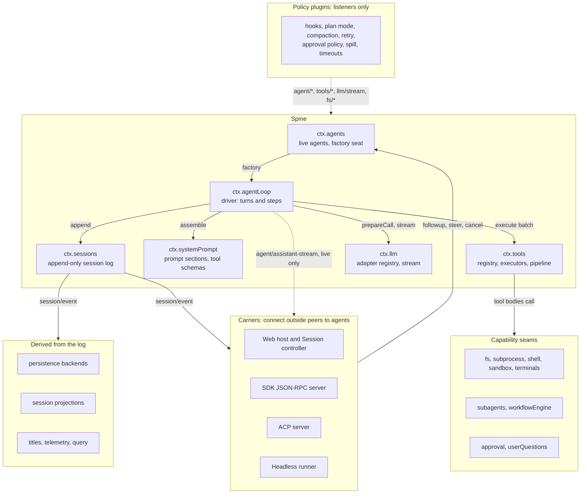

# deepseek-harness runtime architecture, dissected

> **Status: design input, nothing built.** This document describes upstream
> deepseek-harness (`dsh`) as read at commit `2e39e70`, and recommends decisions for the Go
> redesign. Upstream facts are cited as `path:line` relative to the upstream root. Paths
> that start with `src/go/` are in this repository. A sentence that opens with
> "Inference" is this document's reasoning, not something read from source.

## 1. Purpose and how to read this

Upstream is an agent harness: a program that takes a user message, asks a large language
model (LLM) what to do, runs the tools the model asks for, and repeats until the model has
nothing more to do. It is written in TypeScript on the cordis plugin framework, and every
part of it, including the loop that drives the model, is a plugin
(`docs/architecture.md:9`).

This document is the first reference for everyone designing the Go version. Sections 2 to
8 say what is there: vocabulary, component map, one turn, events, seams, extension points,
failure and cleanup. Sections 9 and 10 separate principle from accident: the rules
upstream enforces, and what exists only because of JavaScript, Node or npm. Section 11
gives recommendations `DH-ADR-ARCH-1` to `DH-ADR-ARCH-12`; they bind nothing until adopted
in [../design.md](../design.md). Read sections 2 and 3 first. Area specifications own the
detail of each subsystem; this document owns the shape that connects them.

## 2. Vocabulary

Terms are grouped so that each one is defined before another uses it.

**Framework (cordis)**

| Term | What it is | Why it exists |
|---|---|---|
| **Plugin** | A unit of code mounted into the running program: a function with `apply(ctx)`, or a `Service` class (`docs/cordis-primer.md:9`). | It is the only unit of composition. Nothing is added by editing a core. |
| **Context** (`ctx`) | The handle a plugin receives. It is "a repository of services" and the place registrations are made (`docs/cordis-primer.md:10`). | It records who registered what, so the framework can undo it. |
| **Service** | An object published on the context under a stable key, such as `ctx.tools` (`docs/cordis-primer.md:10`). | Plugins find each other by key, not by importing each other's code. |
| **Inject** | A plugin's declared list of required services. The plugin waits until they exist (`docs/cordis-primer.md:11`). | Load order follows from needs, not from a hand-written boot sequence. |
| **Fiber** | The running instance of one mounted plugin. It owns that plugin's registrations. | It is the unit that loads, reloads and unloads. |
| **Effect** | A registration that returns its own undo function (`docs/cordis-primer.md:13`). | Unload and reload remove exactly what was added. |
| **Realm** (`isolate`) | A private namespace for one service key, so two instances can coexist. | One session can get its own instance of a service (`docs/architecture.md:152`). |
| **Dispatch mode** | How an event calls its listeners: `emit`, `waterfall`, `parallel`, `serial` or `bail` (`docs/cordis-primer.md:19-25`). | The mode is part of the event's public contract (`docs/cordis-primer.md:27`). |
| **Waterfall** | Around-middleware. Each listener receives the arguments and `next()`; it may call `next()` to delegate or return without it to decide alone (`docs/cordis-primer.md:31`). | It lets a plugin intercept and change a decision without the dispatcher knowing the plugin. |

**Composition**

| Term | What it is | Why it exists |
|---|---|---|
| **Profile** | A named composition stored in the harness home. It lists bundles, holds installed out-of-tree plugins and the user's patch file. `web`, `headless`, `sdk`, `sdk-minimal` and `acp` ship (`docs/architecture.md:17`). | One binary runs as different products. |
| **Bundle** | A distributable set of config rows plus the code they mount (`docs/architecture.md:19`). `dsh-base` is the shared first layer (`docs/architecture.md:23`). | A product layer can be installed and still be patched by layers above it. |
| **Patch** | A config layer that replaces a row by id, or inserts rows (`docs/architecture.md:25`). | Users change the tree without forking a bundle. |
| **Preset** | A declared set of plugins that composes one agent's tools, prompt sections and skills (`packages/preset/agent-preset-registry/README.md:12`). | One process can run agents with different capability sets. |

**Runtime**

| Term | What it is | Why it exists |
|---|---|---|
| **Session** | An append-only log of typed events. It is the single source of truth; model history is derived from it, not stored beside it (`docs/subsystems/core.md:417`). | Resume, fork, replay, UI and telemetry all read one record. |
| **Session event** | One log entry with a monotonic `seq`, a `time`, a `type` and a `data` payload (`docs/subsystems/core.md:417`). | A fact that must survive a reload (`docs/architecture.md:71`). |
| **Surface** | The model-visible part of the log: the nodes that `deriveMessages()` turns into model history. The system prompt is a surface node too (`docs/subsystems/system-prompt.md:46`). | It separates what the model sees from log-only records. |
| **Agent** | The live object that drives one session: its inbox, status, model choice and scoped context (`docs/subsystems/core.md:61-75`). Agent and session share one id. | It is the API every UI, hook and orchestrator programs against. |
| **Agent handle** | An agent plus `dispose()`. Only the creator holds it (`docs/subsystems/core.md:30-46`). | Ownership (who may tear down) is separate from access (`ctx.agents.get(id)`). |
| **Driver** (the loop) | The code that runs turns and steps for one agent. `dsh-agent-loop` is the one shipped implementation (`packages/core/agent-loop/README.md:89`). | It is replaceable because plugins depend on the `Agent` contract, not on it. |
| **Inbox** | An agent's pending input, in two lists: `nextTurn` and `nextStep` (`packages/core/agent/src/runtime-types.ts:75-79`). | Input can arrive at any time; the driver takes it at defined boundaries. |
| **Follow-up / steer / inject** | Three ways to deliver input: a new turn that wakes the driver; input for the nearest step; context that waits without waking (`packages/core/agent/src/runtime-types.ts:247-271`). | They give callers control over when the model sees input. |
| **Step** | One model request plus the tool calls it causes (`docs/architecture.md:83`). | The smallest unit that can be retried or rejected. |
| **Turn** | Zero or more steps: it opens before input is claimed and closes when nothing is owed (`docs/architecture.md:83`). | It is the unit the user experiences as "the agent answered". |
| **Round, exchange** | A round is an outer policy iteration that contains a turn, such as a goal round. An exchange is the run of turns from one human input to the next (`docs/glossary.md:39-40`). | Policies and the chat view need units larger than a turn. |
| **Decision** | The typed value an interception waterfall returns, for example `reject` or `enter` (`docs/subsystems/tools.md:541`). | A listener's power is limited to the listed outcomes. |
| **Guard** | A final pre-dispatch check on a tool call that can only deny (`docs/subsystems/tools.md:458`). | Listener order cannot turn a denial back into permission. |
| **Tool executor** | The plugin that receives the model's whole batch of tool calls and owns parsing, scheduling and logging (`docs/subsystems/tools.md:285-308`). The native executor calls tools directly. In PTC mode the model writes a program that calls tools through one `run_code` tool (`packages/core/tool-executor-ptc/README.md:12`). | The way calls are run is itself replaceable. |
| **Scope** | The unit of per-agent registration. A contribution is global or owned by one scope key (`docs/glossary.md:13-14`). | Agents in one process need different tools and prompts. |
| **Agent context** (`agent.ctx`) | A context tagged with the agent's scope. What is registered through it is visible only to that agent and removed with it (`docs/glossary.md:15`). | One fact drives both visibility and lifetime. |
| **Setup window** | The point in creation where the creator registers into the new agent's scope, before the agent is published (`docs/glossary.md:20`). | The first prompt already sees the agent's own tools. |
| **Shadowing, restriction** | A scoped tool or prompt section replaces its global twin for that scope. A restriction filters the global tool set for one scope (`docs/glossary.md:18-19`). | Per-agent personas and reduced tool sets without separate registries. |
| **Lineage** | Parent and child facts carried as data, such as `parentSession` and delegation depth (`docs/glossary.md:21`). | Subagent trees are described without changing visibility rules. |
| **Initiator** | The agent on whose behalf the current code is running, carried ambiently (`docs/subsystems/core.md:375`). | Shared services can attribute work without an extra parameter. |
| **Activation** | Used twice. A subagent activation is one started child or external task with its lifecycle (`docs/capability-seams.md:807`). A goal activation is process-local permission to continue a goal (`docs/glossary.md:27`). | Both are live permissions that are deliberately not replayed from the log. |
| **Projection** | Used twice. A session projection folds committed events into current state such as todos (`packages/session/session-projection/README.md:12`). A message projection is a pure rewrite of message content at request time (`docs/architecture.md:130`). | Clients get state without replaying the log; plugins change model input without unlogged writes. |
| **Human command** | A slash command run by a UI through `ctx.commands` without a model message (`docs/glossary.md:31`). | People need direct control that does not cost a model turn. |
| **Carrier** | A plugin that connects an outside peer to agents: the web server, the SDK server, the ACP server, the headless runner. Upstream says "carrier" (`docs/architecture.md:132`) and "protocol driver" (`docs/cookbook/extension-cookbook.md:66`). | The same agent API serves a browser, a script and another program. |

**Capability seams**

| Term | What it is | Why it exists |
|---|---|---|
| **Seam** | A swappable capability with three roles (`docs/glossary.md:9`). | Changing one provider changes the whole product (`docs/architecture.md:140`). |
| **Service Definition** | The role that owns the `ctx` key and the vocabulary types. Upstream requires a class, "never a TypeScript `interface`" (`docs/glossary.md:9`). | It is the only thing other packages may depend on. |
| **Service Provider** | An implementation, for example `dsh-bash-local` (`docs/glossary.md:9`). | Local, sandboxed and remote variants coexist. |
| **Consumer** | A user of the service, commonly a model-facing tool such as `dsh-tool-bash` (`docs/glossary.md:9`). | The model-facing contract stays stable while providers change. |
| **Spine** | The services every composition boots (section 3). | They are what a seam or policy plugin attaches to. |

One inconsistency to know: the glossary calls scope "two levels, flat"
(`docs/glossary.md:13`), but the source has a parent chain between scope keys
(`packages/core/scope/src/index.ts:33-39`) which the preset registry uses to place an agent
under its preset (`packages/preset/agent-preset-registry/src/index.ts:281`). Inference: the
glossary predates the chain; trust the source.

## 3. The picture

Solid arrows are direct calls. Dotted arrows are events. The important property is the
direction: carriers and policy plugins know the spine, and the spine knows none of them.

**Spine services**

| Service | `ctx` key | Owning package | Owns | Source |
|---|---|---|---|---|
| Session store | `ctx.sessions` | `packages/core/session` | The append-only log and the `session/*` feed | `docs/architecture.md:59` |
| Prompt assembly | `ctx.systemPrompt` | `packages/core/system-prompt` | Prompt sections, runtime context, tool schemas for one step | `docs/architecture.md:60` |
| Tools | `ctx.tools` | `packages/core/tools` | The scoped tool registry, executor selection and the guarded pipeline | `docs/architecture.md:61` |
| Agents | `ctx.agents` | `packages/core/agent` | The `Agent` contract, the live registry, the factory seat, `agent/*` events | `docs/architecture.md:62` |
| Loop | `ctx.agentLoop` | `packages/core/agent-loop` | The default driver that implements `Agent` | `docs/architecture.md:63` |
| Scope | none (library) | `packages/core/scope` | The per-agent registration primitive | `docs/architecture.md:64` |
| LLM runtime | `ctx.llm` | `packages/llm/llm` | Message and stream vocabulary, the adapter registry | `docs/architecture.md:65` |

**Services the spine leans on**

| Service | `ctx` key | Owning package | Role | Source |
|---|---|---|---|---|
| Persistence | `ctx.sessionPersistence` | `packages/session/session-persistence` | Makes the log durable; the loop acquires write handles | `docs/capability-seams.md:756` |
| Projections | `ctx.sessionProjections` | `packages/session/session-projection` | Folds committed events into state; holds the inbox and turn-boundary state | `docs/capability-seams.md:783` |
| Presets | `ctx.agentPresets` | `packages/preset/agent-preset-registry` | Binds an agent to a scoped composition | `docs/capability-seams.md:781` |
| Approval | `ctx.approval` | `packages/interaction/user-approval` | Resolves a tool pipeline `ask` | `docs/capability-seams.md:802` |
| Commands | `ctx.commands` | `packages/interaction/commands` | Human commands that bypass the model | `docs/capability-seams.md:782` |

The generated service catalogue lists 120 `ctx` keys: 64 `core`, 36 `seam`, 19 `service`
and 1 `bundle` (`docs/capability-seams.md:706-825`). The 391 packages sit in 55 groups
under `packages/` (`packages/README.md:29-85`).

## 4. Turn flow

One turn, from a user message to idle. **Durable** means appended to the session log. **Live**
means process-local and gone after a restart. Sources: `docs/architecture.md:85-106`,
`docs/agent-lifecycle.md:19-82`, `packages/core/agent-loop/README.md:122`.

1. **Deliver.** A carrier calls `agent.followup(message)`. The inbox change is committed as
   `agent/inbox/spliced` (durable) and announced as `agent/inbox/inserted` (live)
   (`packages/core/agent-loop/README.md:71`).
2. **Wake.** The driver starts; `agent/status` reports `running` (live).
3. **Open the turn.** `turn/start` (durable). The driver claims pending next-step input plus one
   queued prompt: another `agent/inbox/spliced` (durable), one `agent/inbox/claimed` per message
   (live).
4. **Propose a step.** The driver captures the model selection, calls `ctx.tools.resolve()` once
   to fix the step's tool set (`docs/subsystems/tools.md:182`), and runs the
   `system-prompt/assemble` waterfall (live).
5. **Admit or reject.** The `agent/pre-step` waterfall (live) returns `reject` or
   `enter(messages)`. On reject, or an empty first batch, the turn closes with no step; the
   claimed messages stay removed (`packages/core/agent/src/runtime-types.ts:319-323`).
6. **Open the step.** `step/start` (durable).
7. **Bind the model call.** The deprecated `agent/request` waterfall (live), then
   `ctx.llm.prepareCall()`. Cancellation during either commits nothing
   (`docs/agent-lifecycle.md:38`).
8. **Admit input.** In one synchronous stretch the driver appends `system/message` changes, one
   `user/message` per entered message, and `request/header` and `request/context` when the call
   envelope changed (all durable) (`docs/agent-lifecycle.md:39-42`).
9. **Build the request.** History is derived from the log with `deriveMessages()` and frozen.
   The request is the header's config, the derived messages and the header's tools; it has no
   separate system field (`packages/core/agent-loop/README.md:122`).
10. **Stream.** The call passes the `llm/stream` waterfall (live) to the adapter. Chunks are
    published as `agent/assistant-stream` frames: `start`, `chunk`*, `end` (live).
11. **Settle the attempt.** Success appends `assistant/message` (durable), which embeds the exact
    stream. A failed, retried or cancelled attempt appends `assistant/attempt` (durable, not
    model history). Only then is the `end` frame sent (`docs/architecture.md:108`, `:126`).
12. **Recover, if failed.** `agent/request-error` (live waterfall). If a listener returns `retry`,
    the loop repeats steps 7 to 11 inside the same step without repeating assembly,
    `agent/pre-step` or user admission (`docs/agent-lifecycle.md:52`).
13. **Run tools.** The whole raw batch goes to `ctx.tools.execute()`. Per call: `tool/call`
    (durable); then, all live, the `tools/pre-execute` waterfall, guards, approval when the
    decision is `ask`, the `tools/execute` waterfall around the tool body, the
    `tools/post-execute` waterfall and the `tools/result` notification; then `tool/result`
    (durable) in the model's order (`docs/tool-execution-pipeline.md:6`). Parallel-safe calls
    overlap in a bounded pool, 10 by default; exclusive calls form barriers
    (`packages/core/tools/src/batch.ts:2-4`, `packages/core/agent-loop/README.md:55`).
14. **Close the step.** `step/end` (durable). The step's tool set is disposed.
15. **Continue or stop.** If tools owe another request, or next-step input arrived, the driver
    claims it and returns to step 4. Otherwise `agent/turn-stopping` runs (live, serial); a
    listener that objects steers, which causes another step
    (`packages/core/agent/src/runtime-types.ts:402-411`).
16. **Close the turn.** `turn/end` (durable, with its reason). `agent/status` reports `idle` (live).

Two consequences for a redesign. A UI that wants a replayable transcript reads only
`session/event`; `agent/*` is for live coordination (`docs/agent-lifecycle.md:91`). And there is
no built-in turn budget: a turn continues as long as tools or steering keep it open
(`packages/core/agent-loop/README.md:238`).

## 5. Events

### Three domains

| Domain | Names | Lifetime | Use it when | Source |
|---|---|---|---|---|
| **Session events** | `turn/*`, `step/*`, `user/message`, `assistant/message`, `tool/call`, plugin-owned types | Durable, replayed | The fact must survive a reload | `docs/architecture.md:71` |
| **Agent events** | `agent/*` | Live | Observing or intercepting work in flight | `docs/architecture.md:72` |
| **Capability events** | `tools/*`, `fs/*`, `llm/*`, `approval/*` and others | Live | Attaching policy or adapters to a seam without importing the loop | `docs/architecture.md:73` |

Durable events are not dispatched by name. They are payloads of the single live feed
`session/event`, sent after the append commits (`packages/core/session/src/index.ts:66-79`).

### Dispatch modes

| Mode | Awaited | Order | Returns a value | Count upstream |
|---|---|---|---|---|
| `emit` | no | registration order | no | 66 |
| `waterfall` | no (the chain itself may be async) | outermost first | yes | 22 |
| `parallel` | yes | all at once | no | 9 |
| `serial` | yes | registration order | yes | 2 |
| `bail` | no | until one answers | yes | 1 |

Definitions are from `docs/cordis-primer.md:19-25`; counts are from the generated matrix
(`docs/event-producer-consumer.md:13-112`). A sixth form exists in practice: owners that
need per-listener error containment call `events.dispatch` to enumerate listeners and
call them one by one (`vendor/cordis/src/events.ts:180-185`). Events about one agent are
dispatched with a scope carrier, so a listener registered on `agent.ctx` receives only its
own agent's events (`docs/glossary.md:16-17`); the "scope-filtered dispatch" marker
appears 53 times in package source.

### The events that matter most

| Event | Mode | Dispatched by | Typical listeners | What a listener can change | Source |
|---|---|---|---|---|---|
| `session/event` | emit | session store, after commit | persistence, projections, carriers, telemetry (36 packages) | Nothing. Failures are logged and contained | `packages/core/session/src/index.ts:66-79` |
| `session/created` | emit | session store | controllers, projections | A synchronous throw vetoes creation | `packages/core/session/src/index.ts:45-56` |
| `session/flush` | parallel | session store | persistence backends | Nothing; all are awaited as a durability checkpoint | `packages/core/session/src/index.ts:80-87` |
| `agent/created` | serial | agent registry | hooks, goals, agent teams, permission presets | Per-agent setup; a throw fails creation | `packages/core/agent/src/runtime-types.ts:278-291` |
| `agent/status` | emit | loop | carriers, goal driver | Nothing | `packages/core/agent/src/runtime-types.ts:301-310` |
| `agent/pre-step` | waterfall | loop | compaction, hooks, plan mode, instructions (19 packages) | Reject the step, or replace the messages that enter it | `packages/core/agent/src/runtime-types.ts:339-351` |
| `agent/request-error` | waterfall | loop | `llm-retry`, compaction | Return `retry` after repairing state | `packages/core/agent/src/runtime-types.ts:375-390` |
| `agent/assistant-stream` | emit | loop | headless runner, session controller only | Nothing; live frames | `docs/event-producer-consumer.md:15` |
| `agent/turn-stopping` | serial | loop | hooks, workspace changes | Steer to force another step | `packages/core/agent/src/runtime-types.ts:401-418` |
| `system-prompt/assemble` | waterfall | prompt service | working directory, browser runtime | Replace the whole assembly | `docs/cookbook/extension-cookbook.md:145` |
| `llm/stream` | waterfall | LLM runtime | replay, checkpoint policy, titles | Short-circuit or reroute before adapter lookup | `docs/subsystems/llm-streaming.md:871` |
| `tools/pre-execute` | waterfall | tools | hooks, auto review, jobs | `allow`, `deny`, `cancel` or `ask`; never rewrite arguments | `docs/subsystems/tools.md:553-558` |
| `tools/execute` | waterfall | tools | timeout policy, checkpoint policy | Wrap the dispatch; replace the cancellation signal | `docs/subsystems/tools.md:444-453` |
| `tools/post-execute` | waterfall | tools | spill policy, hooks, reminders | Accept, replace content or value, block, add context | `docs/subsystems/tools.md:566-570` |
| `tools/result` | emit | tools | subagent, timeline, presenters | Nothing; the outcome is frozen | `docs/subsystems/tools.md:574` |
| `approval/request` | waterfall | approval service | web server, ACP, remotes | Answer the request; absence denies | `docs/capability-seams.md:802` |
| `fs/write-intent`, `fs/edit-intent`, `fs/delete-intent` | waterfall | file tools | observation policy, workspace changes | Gate a file mutation | `docs/event-producer-consumer.md:52-55` |

`agent/request` is declared (`packages/core/agent/src/runtime-types.ts:374`) but is marked
deprecated and appears in the generated matrix under undeclared strings
(`docs/event-producer-consumer.md:120`). Inference: do not carry it into Go.

## 6. Capability seams

All 36 services that the generated catalogue classifies as `seam`, grouped by family.
"Line" is the row in `docs/capability-seams.md`. Package names omit the `dsh-` prefix.

| Family | `ctx` key | Service Definition | Providers | Consumers | Line |
|---|---|---|---|---|---|
| Model | `llm` | `llm` | `llm-deepseek`, `llm-pi-ai`, `llm-replay` | `agent-loop`, `compaction-basic` | 734 |
| Model | `deepseekLlmApiExtensions` | `deepseek-llm-api-extensions` | `session-log-deepseek`, `plugin-package-inventory-deepseek` | `llm-deepseek` | 736 |
| Model | `compaction` | `compaction` | `compaction-basic` | `compaction-basic` | 806 |
| Execution world | `fs` | `fs` | `fs-local`, `fs-sandbox`, `fs-ssh` | `tool-fs` | 805 |
| Execution world | `subprocess` | `subprocess` | `subprocess-local`, `subprocess-ssh` | `bash-local`, `bash-sandbox`, `terminal-bash`, `lsp-stdio`, three subagent backends | 796 |
| Execution world | `shell` | `shell` | `bash-local`, `bash-sandbox`, `pwsh-local` | `tool-bash`, `tool-pwsh`, hook bridges | 797 |
| Execution world | `terminals` | `terminal` | `terminal-bash`, `terminal-panel` | `tool-terminal` | 799 |
| Execution world | `sandbox` | `sandbox` | `sandbox-local`, `sandbox-ssh` | `bash-sandbox`, `terminal-bash`, `api-terminal-controller` | 800 |
| Execution world | `ptcRuntime` | `ptc-runtime` | `ptc-runtime-node` | `tool-executor-ptc`, `workflow-ptc` | 804 |
| Execution world | `jobs` | `jobs` | `jobs-local` | `tool-bash`, `tool-pwsh`, `tool-terminal`, `tool-jobs`, `api-job-controller` | 812 |
| Execution world | `lsp` | `lsp` | `lsp-stdio` | `tool-lsp` | 822 |
| Execution world | `workingDirectory` | `working-directory` | `working-directory` | `tool-fs`, `tool-bash`, `subagent`, `sandbox-policy` and nine more | 725 |
| Execution world | `worktrees` | `experimental-worktree` | `experimental-worktree` | `experimental-tool-worktree` | 724 |
| Session data | `sessionPersistence` | `session-persistence` | `session-persistence-jsonl` | `agent-loop`, `session-query`, `tool-bash`, hook bridges | 756 |
| Session data | `sessionQuery` | `session-query` | `session-query-sqlite` | `session-reference`, `tool-session-query` | 773 |
| Session data | `sessionTitle` | `session-title` | two LLM title providers | none (output is a log event) | 776 |
| Session data | `sessionTelemetry` | `session-telemetry` | `session-telemetry-otel` | none (output leaves the process) | 767 |
| Session data | `storage` | `storage` | `storage-json`, `storage-sqlite` | `storage-domain` | 768 |
| Session data | `attachments` | `attachment` | `attachment-local` | `api-session-controller`, `tool-fs`, LLM adapters | 732 |
| Session data | `spillStore` | `spill` | `spill-local` | `spill-policy` | 814 |
| Human | `approval` | `user-approval` | listeners on `approval/request` | `tools`, `tool-bash`, `acp` | 802 |
| Human | `userQuestions` | `user-questions` | UI front ends | `tool-ask-user` | 779 |
| Human | `directoryPicker` | `host-directory-picker` | native, browse | `api-workspace-controller` | 815 |
| Human | `connection.authentication` | `client-connection` | token, desktop | `client-connection` | 720 |
| Human | `speechToText` | `experimental-speech-to-text` | `sensevoice` | `experimental-api-speech-to-text` | 808 |
| Credentials | `credentials` | `credentials` | `credentials-local` | `api-settings-controller`, `deepseek-auth`, `llm-pi-ai` | 760 |
| Credentials | `authorization` | `authorization` | flows registered by plugins | `llm-pi-ai` | 763 |
| Delegation | `subagents` | `subagent` | spawn and fork in process, ACP, Codex, Claude Code, dsh SDK | `tool-subagent`, `tool-subagent-control`, `tool-ralph` | 807 |
| Delegation | `workflowEngine` | `workflow` | `workflow-ptc` | `tool-workflow`, `tool-ralph` | 820 |
| Knowledge | `skills` | `skill` | `skill-filesystem`, `skill-office`, `skill-badge`, `sandbox-windows-acl` | `tool-skill` | 785 |
| Knowledge | `fileReferences` | `file-reference` | `file-reference-local` | `api-session-controller` | 774 |
| Knowledge | `web` | `web` | `web-search-deepseek`, `web-deepseek-api`, `web-fetch-http` | `tool-web` | 813 |
| Knowledge | `mcpResources` | `mcp-resources` | `mcp-client` | `mcp-resources` | 726 |
| Devices | `browserUse` | `browser-use` | three experimental providers | the same providers | 727 |
| Devices | `computerUse` | `computer-use` | two experimental providers | the same providers | 728 |
| Devices | `forge` | `experimental-forge` | GitHub, GitLab | `experimental-forge-session`, `experimental-client-ui-forge` | 721 |

Three shapes hide behind the one word. Inference from the table:

- **Single provider per context.** One implementation is the service: `shell`, `sandbox`,
  `sessionPersistence`, `workflowEngine` ("one engine per context ... with no
  named-provider registry", `docs/capability-seams.md:820`).
- **Named-provider registry.** The definition is a concrete registry and providers
  register by name: `llm`, `web`, `subagents`, `storage`, `skills`, `lsp`.
- **Listener-answered.** The definition dispatches a waterfall and listeners answer:
  `approval`, with absence failing closed (`docs/capability-seams.md:802`).

The execution-world family shares one "world": pointing the filesystem and subprocess
providers at a remote host moves Bash, the terminal and LSP with them
(`docs/architecture.md:140`).

## 7. Extension points

Upstream's rule: new behaviour attaches to a documented extension point, and a change to the
loop itself is a change to the architecture map (`docs/architecture.md:146`).

| Goal | Mechanism | Source |
|---|---|---|
| Add a model provider | Register an adapter on `ctx.llm` | `docs/architecture.md:150` |
| Add a model-facing capability | Register a tool on `ctx.tools`; its schema joins prompt assembly | `docs/architecture.md:151` |
| Give one session a different capability set | Compose an agent preset; a service row there needs an `isolate` realm | `docs/architecture.md:152` |
| Swap how a capability is carried out | Register another provider on its seam (`ctx.shell`, `ctx.fs`, `ctx.sandbox`) | `docs/architecture.md:153-159` |
| Intercept a request, a tool call or a turn | Listen on the `agent/*` or `tools/*` waterfall | `docs/architecture.md:160` |
| Add model-facing context | `agent.inject()`, or a prompt section or runtime context | `docs/architecture.md:161` |
| Add a human command | Register on `ctx.commands` | `docs/architecture.md:155` |
| Add durable state | Add a session event type and fold it with a projection | `docs/architecture.md:164` |
| Add a UI or a protocol | Drive `ctx.agents`; render from `session/event` | `docs/architecture.md:162` |
| Scope a registration to one agent | Register through `agent.ctx` | `docs/architecture.md:169` |
| Store sessions elsewhere | Implement `SessionPersistence` | `docs/architecture.md:168` |

Tool policy has layers, chosen by what the plugin must do
(`docs/cookbook/extension-cookbook.md:33`): `tools/pre-execute` for reorderable policy;
`ctx.tools.guard()` for a final denial nothing can undo; `tools/execute` to wrap the dispatch
(timeouts, retries, metrics); `tools/post-execute` to transform a result; `tools/result` to
observe the final outcome. Upstream backs its "microkernel" claim with a table mapping each
product feature (hooks, `/goal`, compaction, plan mode, permissions, subagents, MCP, skills,
scheduling, the UI) to a listener or registration, none of which modifies the loop
(`docs/cookbook/extension-cookbook.md:143-175`).

## 8. Lifecycle, failure, cancellation and cleanup

**Boot.** The plugin tree is composed from ordered layers applied to an empty list: the
profile's bundles, the profile patch, the home patch, then `--patch` overlays
(`docs/architecture.md:25`).

**Creating an agent is one transaction.** In order: build the agent and its scoped context
around the acquired session; store history and enter the session store; complete
`session/created`; run the creator's setup and its commit; enter the agent registry; await the
serial `agent/created` listeners; release queued input. A failure in setup, commit or a
listener, or disposal of the owner, rolls back the prepared resources. Not undone: restored
inbox input and events already stored are kept, and announcements already delivered receive
matching disposal notifications (`packages/core/agent-loop/README.md:112`).

**Ownership and access.** The caller's context owns the handle and so the agent's lifetime
(`docs/subsystems/core.md:51`). The loop plugin is a second, structural owner: unloading it
drains every agent it made (`docs/subsystems/core.md:32-34`). Agents declared in config are
owned by the loop's fiber (`docs/subsystems/core.md:40-41`). Everyone else has access through
`ctx.agents.get(id)` but cannot tear the agent down.

**Teardown order.** Stop and drain the driver, unwind the scope, close the session's write path,
detach the agent, then detach the session (`packages/core/agent-loop/README.md:112`). The
`AgentHandle` comment gives another order, with the scope unwound last
(`docs/subsystems/core.md:35-36`). Inference: the comment is stale, because `agent/disposed` is
documented as firing after the scope unwinds
(`packages/core/agent/src/runtime-types.ts:293-295`). The Go design must state one order.

**Failure, by kind.**

| What fails | What upstream does | What is left uncertain | Source |
|---|---|---|---|
| The model request | Append `assistant/attempt`, offer the failure to `agent/request-error`. Without a `retry` it ends the turn | Nothing: no surface message or tool side effect is committed for that attempt | `docs/subsystems/llm-streaming.md:300` |
| A tool body, or an unknown tool | Becomes a structured error result; the turn continues | The tool's own side effects | `docs/subsystems/tools.md:574` |
| Middleware or another extension | The throw closes the turn: "plugin failure ends the turn, not the loop" | Nothing in the log; the next turn starts clean | `packages/core/agent-loop/README.md:132` |
| A step, with tool calls unanswered | Each gets an error result: `TOOL_OUTCOME_UNKNOWN` if the call was recorded, `TOOL_NOT_STARTED` if not. Nothing is retried automatically | Whether a recorded call took effect; the model is told to check | `packages/core/agent-loop/README.md:134` |
| An observer of `session/event` or `tools/result` | Logged and contained; the committed append stands | Nothing | `packages/core/session/src/index.ts:67-69` |
| The process, mid-stream | No durable record of the unfinished attempt. Resume repairs an interrupted tail with ordinary events | Text the user saw but the log does not hold | `docs/architecture.md:126`, `packages/core/agent-loop/README.md:118` |
| Root shutdown with an active agent | The final `turn/end` can be in memory but not persisted | Whether the last turn is closed on disk | `packages/core/agent-loop/README.md:234` |

**Retry.** One adapter call is one provider attempt; adapters disable library retries
(`docs/subsystems/llm-streaming.md:301`). Retry is a listener (`dsh-llm-retry`) on
`agent/request-error`, using a policy captured when the adapter was registered, so a later
change cannot alter an in-flight failure (`docs/subsystems/llm-streaming.md:310`).

**Cancellation.** `agent.cancel(cause, { keepInbox })` aborts the active turn and, unless
`keepInbox` is set, clears pending input; the first cause wins
(`packages/core/agent/src/runtime-types.ts:205-213`). Causes are `user`, `parent`, `hook` and
`disposed`, and the cause is recorded on `turn/end` (`docs/subsystems/core.md:362-369`).
Cancellation is cooperative. A cancelled stream keeps the text already delivered as an
`interrupted` assistant message, so the next request contains what the user saw. Tool calls that
never started receive a synthetic `tool/call` and an `ABORTED_BEFORE_DISPATCH` result, so history
stays paired (`packages/core/agent-loop/README.md:122`, `:132`). An executor must never settle
while started work is still running (`docs/subsystems/tools.md:300`).

**Cleanup.** Every registration is an effect, so unloading a plugin or disposing an agent's scope
removes its tools, prompt sections and listeners (`docs/cordis-primer.md:45`). A registry
contribution must prove its removal in a test (`packages/AGENTS.md:20`).

## 9. Rules upstream enforces

| Rule | What it says | What it protects | Source | Go verdict |
|---|---|---|---|---|
| Model-visible means logged | Every model request must be reconstructable from the log | Replay, fork, audit, cache-stable prefixes | `docs/architecture.md:130` | Keep (DH-ADR-ARCH-10) |
| Registrations are effects | Every registration has a disposer | Reload and teardown without leaks | `docs/architecture.md:11` | Keep |
| Plugins, not loop changes | Behaviour attaches to an extension point | A small, stable driver | `docs/architecture.md:146` | Keep (DH-ADR-ARCH-1) |
| Depend on definitions, never providers | Extension plugins import the Service Definition only | Providers stay swappable | `packages/README.md:101` | Keep, checked on imports (DH-ADR-ARCH-9) |
| A seam has all three roles | One role alone is not a seam; design for all current consumers | No speculative interfaces | `docs/architecture.md:138`, `packages/AGENTS.md:10` | Keep |
| Enforce where the decision is made | Hiding a tool from the prompt is not enforcement; test denial through the executor | No bypass by a direct caller | `packages/AGENTS.md:16` | Keep |
| Logged arguments are never rewritten | Pre-execute cannot change arguments | History, audit, UI and execution agree | `docs/subsystems/tools.md:572` | Keep |
| Guards are monotonic | A guard can only deny | Order-independent safety policy | `docs/subsystems/tools.md:458` | Keep (DH-ADR-ARCH-5) |
| Publish at the commit point | Notify and update derived state only after success | No observer sees a state that is later rolled back | `packages/AGENTS.md:17` | Keep |
| Shared state has an owner | No module-level cache, singleton or global | Teardown, tests, several trees in one process | `packages/AGENTS.md:13` | Keep; Go package-level variables are the same hazard |
| One operation, one lifecycle controller | Readiness, cancellation and disposal are one object | No half-cancelled operations | `packages/AGENTS.md:9` | Keep (DH-ADR-ARCH-3) |
| Mode is contract | An event's dispatch mode is declared and checked against call sites | Listeners know whether they are awaited | `docs/cordis-primer.md:27` | Keep; the type carries it (DH-ADR-ARCH-4) |
| Scoped dispatch | An event about one agent is dispatched with that agent's carrier | Per-agent listeners do not see other agents | `docs/glossary.md:17` | Keep (DH-ADR-ARCH-7) |
| Initiator is not authority | Ambient presence proves neither liveness nor permission | No privilege from call context | `docs/subsystems/core.md:375` | Keep (DH-ADR-ARCH-8) |
| Bounds apply to the whole result | Limits are enforced where the complete value is known | No oversized output through wrappers | `packages/AGENTS.md:19` | Keep |
| Real-composition tests | A product-visible plugin needs a test booted through the loader | Wiring errors that unit tests miss | `packages/AGENTS.md:7` | Keep |

## 10. What exists only because of JavaScript, Node or npm

Each row is a mechanism the Go design should not copy as it is. The last column says what
takes its place, or which area owns the answer.

| Mechanism | Evidence | Why upstream needs it | In Go |
|---|---|---|---|
| Proxy-based `ctx.<name>` access | `vendor/cordis/src/context.ts:76`; "the property proxy is topology-sensitive" (`packages/AGENTS.md:6`) | Property syntax for services | Already replaced by explicit typed keys (`src/go/README.md:42`) |
| Declaration merging for events, `Agent`, `AssembleContext`, slot and lookup maps | `packages/core/agent/src/runtime-types.ts:18-25`, `:190-191`, `:275-276` | Lets a package add members to another package's type | Not available. See DH-ADR-ARCH-4 |
| `…Map` to derived union | `docs/subsystems/core.md:433-463` | Open sum types that plugins extend | Registered types behind an interface |
| Branded string ids | `docs/subsystems/core.md:467-471` | TypeScript strings are interchangeable | Native: `type SessionID string` |
| Service Definition must be a class | `docs/glossary.md:9` | A TypeScript `interface` has no runtime value to key on | A Go interface is a runtime type. See DH-ADR-ARCH-6 |
| `Symbol` tags and `WeakMap` identity tables | `packages/core/scope/src/index.ts:18`, `:30`, `:39` | Hidden per-object state without owning the object | Explicit tables owned by a service |
| `AsyncLocalStorage` initiator | `packages/core/agent/src/index.ts:263-264` | Ambient per-call state across `await` | No goroutine-local storage; use `context.Context` (DH-ADR-ARCH-8) |
| `AbortSignal`, and a copied cancel cause because Node's fetch writes a stack onto it | `packages/core/agent-loop/README.md:130` | Cancellation is a mutable shared object | `context.Context` with a cause (DH-ADR-ARCH-3) |
| Deep-freezing requests, arguments and results | `packages/core/agent-loop/README.md:97`, `docs/subsystems/tools.md:429-434` | Plugins share mutable object references | Cannot freeze; copy and hide (DH-ADR-ARCH-11) |
| Lossless-JSON materialisation checks | `docs/subsystems/tools.md:537-539` | A JavaScript value may hold `undefined`, functions or cycles | Typed structs and raw JSON; encode once |
| Single-threaded "synchronous" guarantees | `docs/agent-lifecycle.md:39`, `packages/core/agent-loop/README.md:71`, `packages/core/session/src/index.ts:46-50` | Run-to-completion makes a stretch of code atomic for free | Atomicity must be explicit (DH-ADR-ARCH-2) |
| `emit` versus `serial` | `docs/cordis-primer.md:21-24` | Whether returned promises are awaited | A blocking call has no such distinction (DH-ADR-ARCH-5) |
| Worker threads | `packages/boot/plugin-market/src/parse-thread.ts:2`, `packages/session/session-persistence-jsonl/src/migration-verifier.ts:4`, `packages/boot/app-boot/src/profile-resolution/resolver.ts:7` | Keep CPU work off the one event loop | Goroutines; no separate mechanism |
| `node:vm` program evaluation | `packages/ptc-runtime/ptc-runtime-node/src/evaluators/vm-script.ts:3`, `packages/extensions/cordis-host-runner/src/sandbox.ts:14` | The model writes JavaScript that runs in the host | Needs a different substrate; owned by the PTC and extensions areas |
| One npm package per plugin | 391 packages in 55 groups; `packages/README.md:12` | The loader mounts by package name; export shape matters (`packages/AGENTS.md:5`) | Components, not packages (DH-ADR-ARCH-9) |
| `dsh` field in `package.json`, pnpm installs | `docs/architecture.md:21`, `docs/architecture.md:51` | Bundles and plugins are npm artifacts | Built-in components plus plugin processes (DH-ADR-4) |
| Host and client halves in one package | `packages/client/ui-session-status/package.json:40-41`; 75 packages under `packages/client` | The browser runs the same plugin system and language | Replaced by server-rendered HTML (DH-ADR-3) |
| Typert, slots, client module graph | `docs/capability-seams.md:753-754`, `docs/subsystems/slots.md:5`, `docs/capability-seams.md:819` | Typed remote calls and UI composition across the split | Go function calls and templates |
| Hot module replacement | `packages/boot/hmr/README.md:12`, `docs/cookbook/extension-cookbook.md:175` | Reload plugin source in a live process | Config reload stays; code reload is a process restart (DH-ADR-4) |
| `!!js` expressions in config | `docs/cordis-primer.md:39` | Config can evaluate JavaScript against the context | Owned by the loader specification; not available as is |
| Runtime config schema objects | `packages/core/agent-loop/src/index.ts:294-295` | Types vanish at runtime | Structs with `Validate()` (`src/go/README.md:56`) |
| Electron shell, Python wheel that ships Node | `docs/architecture.md:47`, `docs/architecture.md:53` | Node must be present to run anything | One Go binary (DH-ADR-3) |

## 11. Recommendations for the Go design

Everything in this section is this document's reasoning. Each item is a recommendation to the
lead designer and takes effect only when adopted in [../design.md](../design.md). "Verified by"
names the evidence that would show the decision holds; nothing has been built or run.

### DH-ADR-ARCH-1 Keep the spine and the "attach, do not edit" shape

- **Decision.** Keep the spine services as cordis components, with the driver registered behind
  the agent factory seat. Keep the three event domains and the rule that features attach as
  listeners or providers.
- **Why.** It is principle, not accident: every feature in upstream's feature map attaches
  without touching the loop.
- **Tradeoff.** Indirection: a reader must follow events to see what a turn does. Section 4 and a
  generated event catalogue (DH-ADR-ARCH-12) pay that down.
- **Upstream evidence.** `docs/architecture.md:9-11`, `:146`; `docs/cookbook/extension-cookbook.md:143`.
- **Serves.** [DH-O-1](../design.md#dh-o-1), [DH-O-3](../design.md#dh-o-3).
- **Verified by.** A composition test that replaces the driver and serves `ctx.agents` consumers unchanged.

### DH-ADR-ARCH-2 One driver goroutine per agent; atomic appends per session

- **Decision.** Each agent has one driver goroutine that alone owns turn and step state. The
  inbox is a lock-protected structure with a wake signal, so delivering input never waits for
  the driver. Each session has one append lock: an append assigns `seq`, stores the event, folds
  registered projections and queues the event for delivery. Feed listeners are called outside
  the lock, in commit order, by one deliverer per session. A step's admission (step 8 of
  section 4) is one batch append. A step's tool calls run on goroutines bounded by the
  configured limit, with exclusive barriers; the driver commits results in the model's order.
- **Why.** Upstream gets atomic stretches for free from one thread ("synchronous admission"; a
  projection that reflects a splice when `append()` returns). Go runs agents in parallel, so
  each guarantee needs a named mechanism.
- **Tradeoff.** Locks and ordering rules to maintain; data races become possible. No user code
  runs under a lock, as in the Go cordis port (`src/go/README.md:222-231`). A slow feed listener
  delays later deliveries for its own session only.
- **Upstream evidence.** `packages/core/agent-loop/README.md:71`, `:122`; `docs/agent-lifecycle.md:39`; `packages/core/tools/src/batch.ts:2-6`; `packages/core/session/src/index.ts:70-72`.
- **Serves.** [DH-O-3](../design.md#dh-o-3).
- **Verified by.** Race-detector tests for concurrent delivery, cancel and append; a test that a projection read after an append includes it.

### DH-ADR-ARCH-3 Cancellation is a `context.Context` with a typed cause

- **Decision.** Every cancellable operation takes a `context.Context`. A turn's context derives
  from the agent's, which derives from its owning fiber. Cancel causes (`user`, `parent`, `hook`,
  `disposed`) are a Go error type set through the standard library's cancel-with-cause; the
  driver records the cause on `turn/end`.
- **Why.** It replaces `AbortSignal`, signal fusion and the copy that keeps a transport stack out
  of the log. "First cause wins" is the standard library's behaviour.
- **Tradeoff.** A `tools/execute` wrapper can narrow the context it passes on but cannot give a
  tool one that outlives the caller's. That is also upstream's rule.
- **Upstream evidence.** `packages/core/agent/src/runtime-types.ts:205-213`; `docs/subsystems/core.md:362-369`; `docs/subsystems/tools.md:446-453`; `packages/core/agent-loop/README.md:130`.
- **Serves.** [DH-O-3](../design.md#dh-o-3).
- **Verified by.** Tests that each cause reaches `turn/end` and undispatched calls get paired aborted results.

### DH-ADR-ARCH-4 Events are typed keys declared by their owner; durable types are registered

- **Decision.** Each live event is a package-level typed key with a payload struct, in the
  package that owns it; no shared `Events` type exists. Durable session event types are
  registered in a table mapping the type string to a Go type and decoder; an unregistered type
  read from a log is kept as raw JSON, not dropped. Fields that upstream merges into another
  package's type become explicit fields or typed attachments owned by the contributor.
- **Why.** Go has no declaration merging. Typed keys already exist in the port
  (`src/go/README.md:64`), and the key's type states the dispatch mode.
- **Tradeoff.** No single file lists every event, so the catalogue is generated. The table is a
  runtime check where upstream had a compile-time union.
- **Upstream evidence.** `packages/core/agent/src/runtime-types.ts:18-25`, `:275-276`; `docs/subsystems/core.md:433-463`; `docs/cordis-primer.md:27`.
- **Serves.** [DH-O-3](../design.md#dh-o-3), [DH-O-5](../design.md#dh-o-5).
- **Verified by.** A test that every registered durable type round-trips and an unknown type survives a read and rewrite unchanged.

### DH-ADR-ARCH-5 Four dispatch forms; interception returns closed decision types

- **Decision.** Use four forms: **notify** (ordered; each listener's error and panic contained and
  logged), **ordered** (blocking, first error stops; covers upstream `serial`), **parallel**, and
  **around** (middleware with `next`, taking a request type and returning a different result
  type). `bail` stays for its one use. An around event returns a closed set of decisions: a Go
  interface with an unexported marker method and one struct per outcome. Keep the tool policy
  layers and the rule that a guard has no allow result.
- **Why.** A Go listener call blocks, so `emit` and `serial` differ only in error handling.
  Upstream waterfalls take a payload and return a decision, but the port's `WaterfallKey[A]`
  threads one type (`src/go/cordis/events.go:210-232`), its `Emit` stops at the first error
  (`src/go/cordis/events.go:121-133`) and listener panics propagate (`src/go/README.md:242-244`).
  An observer of a committed fact must not be able to fail the commit. Closed decisions limit a
  listener's power; deny-only guards make safety independent of listener order.
- **Tradeoff.** Either the cordis port gains a two-type around key and a contained notify, or the
  harness wraps the existing keys. Adding an outcome is a change to the owning package.
- **Upstream evidence.** `vendor/cordis/src/events.ts:180-185`, `:250-265`; `packages/core/session/src/index.ts:67-69`; `docs/subsystems/tools.md:458`, `:541-574`.
- **Serves.** [DH-O-3](../design.md#dh-o-3), [DH-O-6](../design.md#dh-o-6).
- **Verified by.** Tests that a failing observer does not fail an append, that skipping `next` short-circuits, and that a guard denial survives any listener order.

### DH-ADR-ARCH-6 A seam is a Go interface, a typed service key and provider components

- **Decision.** The Service Definition becomes a contract package: a Go interface, its
  `ServiceKey`, its vocabulary types and its events. Each area specification states one of two
  shapes: a **direct seam**, where the provider component provides the interface itself, or a
  **registry seam**, where a registry service is provided and providers register by name as
  effects. Listener-answered seams such as approval use an around event behind a small service.
  Keep the three-role rule: no contract package without a provider and a consumer.
- **Why.** Upstream forbids a TypeScript `interface` as the definition because it has no runtime
  value. A Go interface is a runtime type, so a single-provider seam needs no wrapper class.
- **Tradeoff.** Two shapes to choose between. Realms (`Isolate`) remain the way to give one
  composition its own provider.
- **Upstream evidence.** `docs/glossary.md:9`; `docs/capability-seams.md:797`, `:802`, `:820`; `packages/README.md:101`; `packages/AGENTS.md:10`.
- **Serves.** [DH-O-10](../design.md#dh-o-10).
- **Verified by.** A composition test per seam that swaps the provider under an unchanged consumer.

### DH-ADR-ARCH-7 An agent's scope is its own fiber plus an explicit scope key

- **Decision.** Each agent gets a child fiber of the loop component. `agent.Ctx()` is that fiber's
  context, so what is registered through it unwinds when the agent is disposed. Visibility is
  explicit: scoped registries file entries under a scope key, and an event about one agent is
  dispatched with that key so that only global listeners and listeners on that scope chain are
  called. Keep the key-level parent chain (preset, then agent), shadowing and restrictions.
  Per-agent service instances keep using realms.
- **Why.** Lifetime maps directly onto the port. Visibility does not: the port has no context tag
  and no listener filter (`src/go/cordis/events.go:55-59`), which upstream gets from `ctx.extend`
  and `Context.filter`.
- **Tradeoff.** Either add context-carried values and filtered dispatch to the cordis port
  (preferred: both are upstream cordis features) or keep a scope table in a harness service.
  Upstream's limit remains: a service that is not scope-aware stays global.
- **Upstream evidence.** `packages/core/scope/src/index.ts:137-147`, `:170-185`; `packages/core/agent-loop/src/agent.ts:148`; `packages/core/scope/README.md:60`, `:98`; `vendor/cordis/src/events.ts:168-170`.
- **Serves.** [DH-O-1](../design.md#dh-o-1), [DH-O-9](../design.md#dh-o-9).
- **Verified by.** Tests that a tool registered through one agent's context is invisible to and refused for another agent, and gone after disposal.

### DH-ADR-ARCH-8 The initiating agent travels in `context.Context`

- **Decision.** The driver puts the initiating agent in the `context.Context` it passes down;
  code that needs it reads it there. Interfaces at lifecycle, log, authority, process and wire
  boundaries still take the agent or session as an explicit parameter.
- **Why.** Go has no goroutine-local storage, and `context.Context` is the language's carrier for
  request-scoped values. It also removes the drain bookkeeping upstream needs for ambient scopes.
- **Tradeoff.** A goroutine started without the context loses attribution, which upstream wants
  anyway for shared timers and pumps (`withoutInitiator`).
- **Upstream evidence.** `packages/core/agent/src/index.ts:263-264`, `:357-375`; `packages/AGENTS.md:8`; `docs/subsystems/core.md:375`.
- **Serves.** [DH-O-3](../design.md#dh-o-3).
- **Verified by.** A test that a tool body sees its agent and a shared background worker sees none.

### DH-ADR-ARCH-9 Components are the unit of composition; Go packages follow capability families

- **Decision.** A config row names a component, not a package. Go packages are coarser than
  upstream's npm packages: one contract package per seam, with providers and model-facing tools
  in sub-packages only where dependencies, build constraints or import rules differ. Bundles
  become named sets of config rows embedded in the binary; profiles stay layered config. A test
  reads the import graph and fails if a consumer package imports a provider package.
- **Why.** Upstream has one npm package per plugin because the loader mounts by package name. Go
  links one binary, so that granularity buys nothing and costs 391 directories. What must
  survive is the dependency direction and the operator's ability to swap or disable one row.
- **Tradeoff.** Larger packages give less mechanical isolation than npm exports; `internal/`
  directories and the import test replace it. Third-party code goes to plugin processes (DH-ADR-4).
- **Upstream evidence.** `packages/README.md:12`, `:101`; `packages/AGENTS.md:5`, `:25`; `docs/architecture.md:19-25`.
- **Serves.** [DH-O-1](../design.md#dh-o-1), [DH-O-2](../design.md#dh-o-2).
- **Verified by.** The import-direction test; a dump of the composed tree showing every upstream row mapped to a component or dropped by a recorded decision.

### DH-ADR-ARCH-10 "Model-visible means logged" is enforced by construction

- **Decision.** A model request can only be built from the log: the request type is constructed
  by the session package from derived history and the logged header. Plugins change model input
  with new session events or registered pure message projections. Live stream frames stay
  non-durable, and the durable settlement is appended before the final frame is sent.
- **Why.** The rule makes resume, fork, replay and prefix caching work. Upstream enforces it by
  convention and review; a constructor boundary makes a violation a compile error.
- **Tradeoff.** No shortcut for "add a field to this one request". A hard process loss still loses
  the unfinished attempt's stream, as upstream.
- **Upstream evidence.** `docs/architecture.md:126-130`; `packages/core/agent-loop/README.md:122`; `docs/subsystems/core.md:417`.
- **Serves.** [DH-O-4](../design.md#dh-o-4).
- **Verified by.** A test that rebuilds every request of a recorded session from its log and compares it with what was sent.

### DH-ADR-ARCH-11 Immutability by ownership and copying, not by freezing

- **Decision.** Values handed to listeners are value types, types with unexported fields and
  read-only accessors, or copies made at the boundary. Tool arguments are held as raw JSON and
  decoded by the tool. A result's durable form is encoded once, before the final notification.
- **Why.** Upstream deep-freezes because plugins share mutable references and a value may not be
  JSON. Go cannot freeze, and with parallel listeners a shared mutable payload is a data race.
- **Tradeoff.** Copies cost allocation; the size bounds upstream already applies to results keep
  that cost bounded.
- **Upstream evidence.** `packages/core/agent-loop/README.md:97`; `docs/subsystems/tools.md:429-434`, `:456`, `:537-539`.
- **Serves.** [DH-O-4](../design.md#dh-o-4), [DH-O-6](../design.md#dh-o-6).
- **Verified by.** Race-detector tests that mutate a received payload while another listener reads it.

### DH-ADR-ARCH-12 Reference documentation is generated from Go source; the upstream tree is not copied

- **Decision.** The Go project keeps hand-written design documents under `docs/harness` and
  generates the reference catalogues (tools, events, config, services, commands, persisted event
  types) from Go source, with a freshness check. Upstream's `docs` tree (1,268 files) is input,
  not something to port: its subsystem pages feed the area specifications; its upgrade guides
  (558 files) and persistence change records (235 files) describe upstream's release and format
  history; its 398 Chinese translations and its doc-tooling scripts are not carried.
- **Why.** Upstream treats documents as checked build outputs, which is why this project could
  enumerate upstream's tools, events and services mechanically
  ([../trace/README.md](../trace/README.md)). The Go project needs the same property. DH-ADR-2
  already drops compatibility with upstream's formats, so their history does not apply.
- **Tradeoff.** The generators must be written; there is no bilingual documentation unless a
  later decision adds it.
- **Upstream evidence.** `docs/capability-seams.md:1-2`, `:827`; `docs/event-producer-consumer.md:133`; `docs/subsystems/README.md:79`.
- **Serves.** [DH-O-14](../design.md#dh-o-14), [DH-O-16](../design.md#dh-o-16).
- **Verified by.** A freshness check that fails when a generated catalogue differs from the source; the traceability tool (DH-ADR-6).

## 12. Open questions

1. **Cordis port additions.** DH-ADR-ARCH-5 and DH-ADR-ARCH-7 are simplest if the port in `src/go`
   gains a two-type around key, a contained notify, context-carried values and filtered
   dispatch. The cordis library specification owns that choice.
2. **PTC and model-written plugins.** Upstream evaluates model-written JavaScript in `node:vm`.
   What runs such programs in Go belongs to the PTC runtime and extensions areas; this document
   assumes only that it sits behind the `ptcRuntime` seam.
3. **Teardown order.** Upstream documents two orders (section 8). The core agent area should fix
   one and say which notifications fire at each point.
4. **Root shutdown and turn budget.** Upstream can lose the final `turn/end` on root shutdown and
   has no turn budget (sections 4 and 8). The session and core agent areas should decide whether
   shutdown waits for a flush and whether the driver has a default bound.
5. **Config expressions.** Upstream config can hold `!!js` expressions. The loader specification
   should say what, if anything, replaces them.
