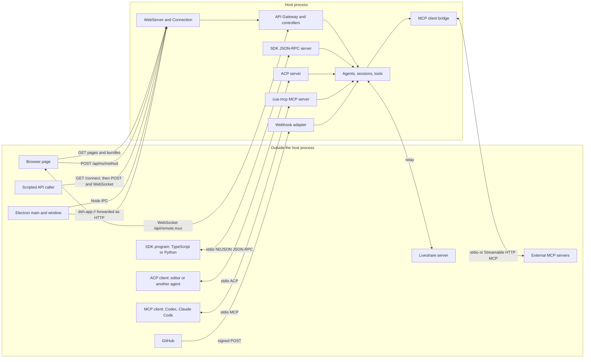
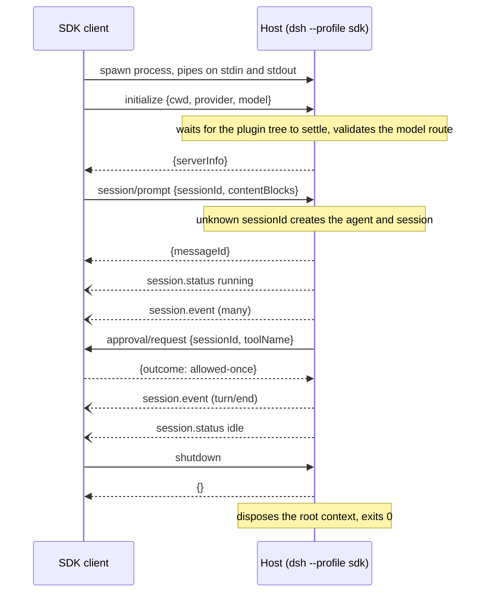

# Upstream wire protocols and API boundaries

> **Status: design input, nothing built.** Upstream facts are read at commit `2e39e70`
> and cited as `path:line` relative to the upstream root. A sentence that opens with
> "Inference" is reasoning, not something read from source. Owner: agent F6, ID key `WIRE`.

## 1. Purpose

deepseek-harness (`dsh`) is one host process that many other programs talk to: a browser
page, SDK programs, editors and other agents, external tool servers, a desktop shell and
GitHub. Each conversation crosses a process boundary, so each needs a transport, a
message format, a rule for who may speak, and a rule for what happens when the
connection breaks.

This document describes every such boundary as upstream built it, judges each choice, and
recommends the Go equivalents (`DH-ADR-WIRE-1` to `DH-ADR-WIRE-12`). The lead designer and
the area agents read it before they design the Go wire protocols. It defines no
deliverables; the area specifications that own the code do that. Out of scope: calls to
model provider APIs and the content of session events, except where a wire carries them.

## 2. Vocabulary

| Term | What it is | Why it exists |
|---|---|---|
| Host | The Node process that runs agents, tools and persistence. | It holds all authoritative state; everything else is a client of it. |
| Client | The React application in the browser, itself a cordis plugin tree. | Upstream renders the UI in the browser, so the browser needs its own runtime. |
| WebServer | The HTTP or TLS listener with a route table (`docs/subsystems/web-server.md:5`). | One owner for listening, route matching and admission. |
| Connection | The layer that carries calls between Client and Host: request correlation, the `/api` route, trust checks, reconnection (`packages/client/connection/README.md:12`). | Separates "how bytes move" from "what a call means", so the carrier can be replaced. |
| Carrier | One concrete way Connection moves messages: HTTP POST, a WebSocket, or an in-process function call. | Tests and the desktop shell use a different carrier from the browser without changing callers. |
| BFF (backend for frontend) | The `packages/api` layer: gateway, remotes and the controllers. | Gives the UI an API shaped for screens instead of exposing internal services directly. |
| Remote | A host service method marked `@Remote`, callable from the Client as `ctx.remote.<namespace>.<method>` (`docs/api-gateway.md:9`). | An explicit allowlist: unmarked methods cannot be called from the browser. |
| Controller | A BFF package that owns one screen-facing domain (session, workspace, terminal, jobs, settings). | Keeps mutation ordering and stream production on the host. |
| Gateway | The dispatcher that validates a Remote call, checks access, resolves objects and invokes the method (`packages/api/gateway/README.md:27`). | One place for validation and access control instead of one per method. |
| Typert | Upstream's own "types at runtime" toolchain: a build step reads TypeScript types and emits validators and call descriptors (`packages/typert/generator/README.md:12`). | TypeScript types vanish at runtime; the host still has to validate what a browser sends. |
| Type graph | The model Typert builds from the TypeScript compiler's view of all host types (`packages/typert/generator/README.md:63`). | The source from which validators and client typings are generated. |
| Invocation descriptor | The generated record for one Remote: namespace, method, named wire fields, codecs. | Host and Client agree on a call shape without sharing code. |
| Lookup | A rule that turns a wire id into a live host object, for example `agentId` into an `Agent` (`docs/api-gateway.md:11`). | Live objects cannot cross the wire; ids can. |
| Stream | A Remote that yields many items; one logical stream among many on one WebSocket (`docs/api-gateway.md:60`). | Live data (session events, terminal output) without one socket per feature. |
| Uplink | Items the Client sends into an open stream (`packages/api/gateway/README.md:45`). | Terminal keystrokes and similar client-to-host flows. |
| Session follow | The stream that carries one session's durable events: a snapshot first, then each new event (`packages/api/session-controller/src/types.ts:551`). | The transcript on screen must track the session log. |
| Generation | One established Client-to-Host connection epoch; a new one starts after every reconnect (`packages/client/connection/README.md:60`). | Lets every consumer know "the world may have changed, re-read your baseline". |
| Forwarded event | A host cordis event on an allowlist that is re-emitted in the Client (`packages/api/remotes/README.md:43`). | Lets browser plugins react to host events and answer host questions. |
| Peer and principal | A Peer is one admitted caller; its principal says who it is (`owner` or a non-owner kind) (`packages/client/connection/README.md:51`). | Access decisions need an identity that does not come from request arguments. |
| Remote access | The policy service that decides what a non-owner principal may call or receive (`packages/api/remote-access/README.md:12`). | Session sharing: a viewer must not get the owner's powers. |
| Boot injection | Data the host writes into `index.html` before the Client starts, such as `window.__DSH_BOOT__` (`docs/subsystems/client-modules.md:11`). | The Client needs its plugin list and access snapshot before it can make a call. |
| JSON-RPC 2.0 | A small standard for requests, responses and notifications as JSON objects. | Shared base of the SDK protocol, ACP and MCP. |
| NDJSON | Newline-delimited JSON: one JSON message per line. | The simplest framing over a pipe. |
| SDK protocol | Upstream's own JSON-RPC method set for programs that drive a host subprocess (`packages/sdk/protocol/README.md:12`). | Automation without a GUI. |
| ACP (Agent Client Protocol) | An open JSON-RPC protocol between an editor or controller and an agent (`packages/acp/acp/README.md:12`). | Lets tools that already speak ACP drive the harness. |
| MCP (Model Context Protocol) | An open JSON-RPC protocol through which a server offers tools and resources to an agent. | Lets the model use third-party tools, and lets other agents use harness tools. |

## 3. Map of boundaries

| ID | Outside party | Host side | Transport | Protocol | Authentication | Streaming |
|---|---|---|---|---|---|---|
| B1 | Browser, page load | WebServer, static front end, client modules | HTTP GET | Static shell, boot injection, plugin bundles under `/plugins` | Cookie for the index; assets anonymous but source-checked | None |
| B2 | Browser, unary call | Connection, Gateway | HTTP `POST /api/<ns>/<method>` | Connection RPC envelope with named `args`; multipart when a result holds bytes | Cookie plus Host and Origin checks | None |
| B3 | Browser, streams | Gateway | WebSocket `/api/remote.mux` | Multiplexed logical streams (`open`, `item`, `end`, `cancel`, `error`) | Cookie at upgrade | Both directions |
| B4 | Browser, forwarded events | Gateway, remotes | `$events` stream on B3, replies by `POST` on B2 | `ready`, `emit`, `waterfall`, `cancel` frames | Owner Peer with `interactions: answer` | Host to client; answers by HTTP |
| B5 | Browser, files | Feature-owned exact routes | HTTP GET, HEAD, POST | Raw bodies (uploads, session-log download) | Owner only | Upload body |
| B6 | Scripted or native API caller | Token plugin, then B2 and B3 | `GET /connect?token=` then as B2 and B3 | Same as B2 and B3 | Launch token exchanged for a per-caller cookie | Both directions |
| B7 | TypeScript or Python SDK program | SDK JSON-RPC server | stdin and stdout of a child process | NDJSON JSON-RPC 2.0, upstream method set | None; the parent owns the child | Host to client notifications; host to client requests |
| B8 | ACP client (editor, test runner, another harness) | ACP server | stdin and stdout | ACP v1 (NDJSON JSON-RPC) | `authenticate` succeeds at once | `session/update` notifications |
| B9 | External MCP server | MCP client bridge | Child process stdio, or Streamable HTTP | MCP (2026-07-28, older revisions as fallback) | Environment, headers or OAuth | Tool-list change notices |
| B10 | MCP client (Codex, Claude Code) | `cua-mcp` profile | stdin and stdout | MCP server | None; consent by elicitation | None |
| B11 | Electron main process | Desktop host entry | Node child-process IPC | Typed messages (`starting`, `desktop-auth`, `ready`, ...) | Per-launch random credential | Both directions |
| B12 | Electron window | WebServer through Electron's request forwarding | `dsh-app://` mapped to HTTP and WebSocket | Same as B2 to B5 | `dsh-desktop-session` cookie attached by Electron | Same as B3 |
| B13 | GitHub | Webhook adapter | HTTP POST on an exact route | Signed provider JSON | Signature over the raw body | None; answers 202 |
| B14 | Liveshare server and its viewers | LiveShare bundle (opt-in) | Outbound from the owner host | Relay protocol; viewer calls re-dispatched as Remotes | Owner credential; viewer asserted by the server | Viewer streams polled |
| B15 | OAuth authorization server (browser redirect) | MCP client OAuth | HTTP GET on the WebServer | Authorization-code callback | State and PKCE, checked by the flow owner | None |

The layering inside the browser boundary is `remotes -> gateway -> connection -> webserver`
(`docs/api-gateway.md:166`). The SDK, ACP and MCP servers are separate front ends beside
it; each is selected by a profile (`--profile sdk`, `--profile acp`, `--profile cua-mcp`)
and none of them uses the Gateway.

## 4. Browser to host

### 4.1 Page load and boot injection

The browser asks for `/`. The static front end owns the WebServer's single fallback route,
requires an authenticated Peer for the index and serves other assets without credentials
(`packages/host/frontend-static/README.md:12`). Before the index is sent, the WebServer
emits `webserver/index-inject` and every subscriber adds rows for the Peer the page speaks
for (`docs/subsystems/web-server.md:120`). Two rows matter to the wire:

- `window.__DSH_BOOT__`, the graph of client plugins to load, with a revision per bundle
  (`docs/subsystems/client-modules.md:74`). Bundles are then fetched as "combo" scripts
  from `/plugins/??<a>/client.js,<b>/client.js&rev=<rev>` (`docs/subsystems/client-modules.md:106`).
- `__DSH_REMOTE_ACCESS__`, the access snapshot for that Peer, so the page can hide what
  the host would refuse (`packages/api/remote-access/README.md:48`).

A page without a valid boot manifest cannot start (`docs/subsystems/client-modules.md:11`).

### 4.2 Unary calls

A Client call `ctx.remote.goals.create(agentId, {...})` becomes
`POST /api/goals/create` with a body that holds only a named `args` object
(`docs/api-gateway.md:126`). The reply is an envelope
`{ type: 'server-response', rpcId, result }` where `result` is `{ ok: true, value }` or
`{ ok: false, error: { code, message, details } }` (`packages/client/connection/src/rpc-schema.ts:10`,
`:43`). A result that contains bytes is sent as multipart: one JSON part with `null`
placeholders and an attachment table, then one part per byte value
(`packages/client/connection/README.md:32`).

The Gateway handles each call in a fixed order (`packages/api/gateway/README.md:33`):

1. Refuse a disposed Peer (`gateway/peer-disposed`).
2. Check that the endpoint exists and the argument fields match the descriptor exactly.
3. Validate the argument values against the generated types (`gateway/input-invalid`).
4. For a non-owner Peer, work out which resources the call touches and ask Remote access;
   a refusal is `remote-access/denied` and happens before any session is activated.
5. Resolve lookups (an `agentId` may cold-resume a session here, `docs/api-gateway.md:132`).
6. Invoke the service method, passing the cancellation signal last.

Errors are one class, `RemoteError`, with a code of the form `<domain>/<reason>`; anything
unclassified becomes `gateway/internal` with empty details
(`docs/cookbook/adding-a-remote-api.md:53`, `packages/api/gateway/README.md:89`). On the
Client a call never throws for a transport problem: it resolves to
`{ ok: false, error }` (`packages/api/gateway/README.md:62`).

Request bodies are buffered in memory up to 300 MiB by default
(`packages/client/connection/src/http-bridge.ts:15`); routes that opt in receive a
backpressured stream instead (`packages/client/connection/README.md:82`).

### 4.3 Streams

The Client opens one WebSocket to `/api/remote.mux` when its plugin starts and keeps it
open while idle (`packages/api/gateway/README.md:41`). Many independent logical streams
share it. Messages are JSON text frames (`packages/api/gateway/src/stream-protocol.ts:235`):

| Direction | Frame | Meaning |
|---|---|---|
| Client to host | `open { streamId, endpoint, payload }` | Start a stream Remote. |
| Client to host | `item { streamId, value? }` | One uplink item. |
| Client to host | `end { streamId }` | Half-close the uplink. |
| Client to host | `cancel { streamId }` | Stop the stream. |
| Host to client | `item { streamId, value? }` | One downlink item. |
| Host to client | `error { streamId, error: { code, message, details } }` | Terminal failure. |
| Host to client | `end { streamId }` | Normal completion. |

The WebSocket route is registered only after the application reports ready, so a
restarting host cannot accept streams while controllers are still starting
(`packages/api/gateway/README.md:43`).

### 4.4 Forwarded events and human interactions

One reserved stream, `$events`, carries host cordis events that are on an allowlist
(`packages/api/remotes/README.md:43`). Its first item is
`{ type: 'ready', clientId, host: { home } }`; after that come `emit` frames (one-way
notifications), `waterfall` frames (a question the Client must answer, with an `eventId`)
and `cancel` frames (`packages/api/gateway/src/stream-protocol.ts:33`). The Client answers
a waterfall with a normal unary call to `$events/result` carrying `next`, `result` or
`rejected` (`packages/api/gateway/src/stream-protocol.ts:88`).

This is how approvals and user questions reach a person: the host's event waits, the
browser plugin that owns the dialog answers. Only owner Peers receive waterfalls
(`packages/api/gateway/README.md:51`).

### 4.5 Generations, reconnection and resume

The `$events` stream is also the heartbeat of the whole connection. A generation exists
only after the `ready` item arrives, and the host attaches all its listeners before it
sends `ready`, so no event can fall between "baseline read" and "live updates"
(`packages/client/connection/README.md:60`). When the stream ends or fails, the generation
is invalid. The Client retries with 50 to 100 percent jitter under caps of 500 ms, 1 s,
2 s, 4 s, 8 s and then 10 s for ever; a handshake logs a warning after 3 s and is aborted
after 15 s (`packages/client/connection/README.md:62`,
`packages/client/connection/src/recovery-config.ts:26`). The browser's `offline` event
suspends retries; `online` restarts them (`packages/client/connection/README.md:64`).

What is restored after a reconnect depends on the kind of data
(`docs/subsystems/web-client.md:83`):

| Data | On reconnect | Evidence |
|---|---|---|
| Durable session events | The follow stream reopens and its first frame is a full snapshot: header, tail page of records, `cursor`, projections. The Client replaces its window and repairs any later gap with a page read. The follow request carries no resume cursor. | `packages/api/session-controller/src/types.ts:484`, `:551`; `packages/api/gateway/README.md:66` |
| In-flight assistant text | Sent as cursorless frames. The snapshot carries the active attempt's `startedAfterSeq`, `nextIndex` and the text so far, so a reconnecting page can redraw the partial message. | `packages/api/session-controller/src/types.ts:493` |
| Snapshot-plus-delta state (session control, workspaces, read state) | A complete baseline, then deltas; the baseline replaces the old value. | `docs/subsystems/web-client.md:86` |
| One-way notifications | Not replayed. | `packages/api/remotes/README.md:79` |
| Pending questions (waterfalls) | Replayed with the same event id while still pending. | `packages/api/gateway/README.md:92` |

The opening page is sized by turns, not bytes: at least 50 user and assistant messages
across at least two turns, capped at 500 (`packages/api/session-controller/README.md:77`).
A prompt carries a request id; a retry of the same id is accepted once
(`packages/api/session-controller/README.md:32`).

### 4.6 Authentication, request trust and remote access

Three separate checks apply, in this order.

**Source check (is this request from a place we trust?).** Before any credential is read,
the `Host` header must be loopback, the bind address, or a configured trusted host; an
`Origin` header must name the same authority; and `Sec-Fetch-Site: cross-site` is refused.
A failure is 403 even on anonymous assets. This defends against DNS rebinding and
cross-site requests, not against a wrong identity
(`packages/client/connection/README.md:49`,
`packages/client/connection/src/api-request-trust.ts:143`). The listener cannot bind every
interface at once: the unspecified address is rejected at load
(`docs/subsystems/web-server.md:114`).

**Credential check (who is this?).** `dsh web` prints a URL that carries a launch token.
`GET /?token=...` answers 303 with a signed cookie and redirects to `./`
(`packages/host/authentication-token/README.md:36`). The cookie is named `dsh-auth-` plus a
hash of the authority, is `HttpOnly; SameSite=Strict`, lasts 30 days by default, and its
signing secret lives in the credential store
(`packages/host/authentication-token/src/browser-auth.ts:19`, `:118`, `:139`;
`packages/host/authentication-token/README.md:32`, `:40`). All browser cookies map to one
shared owner Peer. A scripted caller uses `GET /connect?token=...&interactions=answer|none`
and receives its own Peer and cookie; it may hold one stream socket, and closing that
socket revokes the cookie (`packages/client/connection/README.md:53`). Authentication
providers are pluggable; the desktop shell registers a second one (section 8.1).

Every route declares `anonymous`, `required` (the default) or `deny`
(`docs/subsystems/web-server.md:53`). With no provider able to decide, a `required` route
answers 503, never "allowed".

**Access check (may this principal do this?).** The owner is never checked. A non-owner
principal is allowed only when a registered policy grants a role that lists the action on
every resource the call touches (`packages/api/remote-access/README.md:27`, `:38`). Routes
outside the Gateway are simply refused to non-owners with 403
(`packages/api/remote-access/README.md:86`).

## 5. SDK protocol

### 5.1 Framing

One JSON-RPC 2.0 message per `\n`-terminated line, UTF-8, over byte streams the caller
owns. A frame with `id` and `method` is a request, `id` alone is a response, `method` alone
is a notification (`packages/sdk/protocol/README.md:34`). Request ids are strings such as
`req_<32 hex>` (`packages/sdk/protocol/src/transport.ts:128`). Lines that are not valid
JSON are dropped without an answer (`packages/sdk/protocol/src/transport.ts:211`). An
unknown method answers `-32601`; any handler failure answers `-32603` with the error
message as text (`packages/sdk/protocol/src/transport.ts:235`, `:242`). Stdout carries only
protocol frames; diagnostics go to stderr (`packages/sdk/server/README.md:72`).

### 5.2 Methods and notifications

Source: `packages/sdk/protocol/README.md:40` and `packages/sdk/protocol/src/types.ts`.

| Direction | Method | Purpose and result |
|---|---|---|
| Client to host | `initialize` | Process-wide handshake: `cwd`, `provider`, `model`, optional `reasoningEffort`, `maxTokens`, `approvalRequests`, `capabilities.userQuestions`. Returns `serverInfo { name, version }`. |
| Client to host | `session/prompt` | Queue content blocks as one user message. Returns `{ messageId }`, a receipt for queueing, not a model result. |
| Client to host | `session/query` | As `session/prompt`, but a recognised slash command (`/compact`, `/permission`, `/plan`, `/goal`) is executed. Returns `{ kind: 'prompt', messageId }` or `{ kind: 'command', execution }`. |
| Client to host | `session/resume` | Restore a persisted session, optionally with a permission preset. Sends no input. |
| Client to host | `session/wait` | Return when the session and its managed child agents are idle. |
| Client to host | `session/working-directory/get`, `.../set` | Read or change the session's working directory. |
| Client to host | `shutdown` | Dispose the runtime, then exit 0. |
| Host to client (request) | `approval/request` | Ask the client to allow one operation; only if `approvalRequests` was set. Result `allowed-once`, `rejected` or `cancelled`. |
| Host to client (request) | `user-question/ask` | Ask the client the model's question; only if `capabilities.userQuestions` was set. |
| Host to client (notification) | `user-question.cancelled` | The host stopped waiting for an answer. |
| Host to client (notification) | `session.event` | One session-log event, for every session in the runtime, unfiltered. |
| Host to client (notification) | `session.status` | A whole-agent `running` or `idle` transition. |
| Host to client (notification) | `session.query.completed` | A command query finished, with `finalResponse` and `finishReason`. |
| Host to client (notification) | `subagent.started`, `subagent.finished` | A child session was created or an in-process child run ended. |

### 5.3 Session lifecycle over the wire

Points a reader must know:

- `initialize` is the readiness gate. Requests are dispatched concurrently, so a prompt
  sent before `initialize` completes is rejected (`packages/sdk/server/README.md:78`).
- A session is created on first use of its id and lives until the process exits; the wire
  has no close or cancel (`packages/sdk/server/README.md:218`).
- There is no per-prompt result. The SDKs compute one on the client: subscribe, send the
  prompt, wait until the message id shows up in a durable inbox receipt, then collect
  events until the agent is idle; `finalResponse` is the last assistant message in that
  interval (`packages/sdk/client/README.md:150`). The interval can include other queued
  work, so the answer is not strictly "the reply to this prompt"
  (`packages/sdk/client/README.md:191`).
- The host notifies for every session; scoping to one session and its children is done by
  each SDK from `subagent.started` edges (`packages/sdk/client/README.md:111`).
- Notifications committed before a `session/wait` completes are written before its response
  (`packages/sdk/protocol/README.md:63`).
- A pending approval or question fails closed when the client disconnects or the host
  shuts down; a late answer cannot grant anything (`packages/sdk/protocol/README.md:30`).

### 5.4 How the SDKs launch and talk to the host

| | TypeScript SDK | Python SDK |
|---|---|---|
| Runtime it starts | The same-version `@deepseek-ai/dsh` npm package, or a `dshBin` path (`packages/sdk/client/README.md:12`) | The `dsh` binary from the `deepseek-harness-runtime-bin` wheel, with `--profile sdk` (`python/sdk/README.md:5`, `python/sdk/src/deepseek_harness/client.py:625`) |
| Start | Lazy, on first use; handshake bounded at 10 s (`packages/sdk/client/README.md:84`) | `subprocess.Popen`, text mode, line buffered; handshake bounded at 30 s (`python/sdk/src/deepseek_harness/client.py:89`, `python/sdk/README.md:51`) |
| Home directory | Explicit `dshHome` | Explicit `dsh_home`; never discovers `~/.dsh` (`python/sdk/README.md:33`) |
| Protocol types | Imported from `dsh-sdk-protocol` | Mirrored by hand, not imported (`packages/sdk/protocol/README.md:152`) |
| Callbacks | `onRequest`, `onUserQuestion` with an abort signal | A reader thread plus one thread per question callback (`python/sdk/README.md:140`) |
| Close | `shutdown` (1 s), then stdin EOF, SIGTERM, SIGKILL until the process has exited (`packages/sdk/client/README.md:115`) | The same ladder (`python/sdk/src/deepseek_harness/client.py:103`) |

The harness also uses this protocol on itself: the `subagent-dsh-sdk` backend runs each
delegated task in a fresh harness subprocess (`packages/subagent/subagent-dsh-sdk/README.md:12`).

## 6. ACP

`dsh --profile acp` serves ACP v1 on stdio using the `@agentclientprotocol/sdk` package,
version 1.4.0 (`packages/acp/acp/package.json:35`, `packages/acp/acp/src/index.ts:374`).
It is deliberately automation-only: it carries standard semantic updates and nothing
specific to the harness UI (`packages/acp/acp/README.md:32`).

| Offers (`packages/acp/acp/README.md:62`) | Limits (`packages/acp/acp/README.md:82`, `:174`) |
|---|---|
| `initialize` advertising only what is mounted; `authenticate` succeeds at once | No `session/load` and no transcript replay on resume |
| `session/new` with a workspace and stdio or HTTP MCP servers supplied by the client | No session delete or fork; one workspace per session |
| `session/list`, `session/resume`, `session/close` over persisted sessions | No modes, commands, plans, terminals or client file operations |
| `session/set_config_option` for model and reasoning effort | No elicitation; MCP tools only, no MCP resources or prompts |
| `session/prompt`, one at a time per session, with text, resource links and raster images | No audio or embedded context (`packages/acp/acp/src/index.ts:188`) |
| `session/cancel` and `$/cancel_request` | No SSE or ACP-transport MCP servers |
| `session/update` notifications and `session/request_permission` | |

Three properties are worth keeping. A prompt settles only after the root agent, its child
agents and the ordered update queue are all quiet (`packages/acp/acp/README.md:78`).
`initialize` never advertises a capability that is not mounted
(`packages/acp/acp/README.md:99`). And if connecting a client-supplied MCP server fails, the
unpublished agent is rolled back (`packages/acp/acp/README.md:82`). The harness is also an
ACP *client*: `subagent-acp` starts any ACP agent in a subprocess and answers its
permission prompts by policy (`packages/subagent/subagent-acp/README.md:12`).

## 7. MCP

### 7.1 The host as MCP client

Each configured server is one `mcp-client` instance with a local name. Transports are a
child process on stdio, or Streamable HTTP (`packages/mcp/mcp-client/README.md:57`). The
official SDK picks protocol revision 2026-07-28 and falls back to older ones
(`packages/mcp/mcp-client/README.md:28`).

- **Naming.** Tools appear to the model as `mcp__<serverName>__<tool>`. The name comes
  from local configuration, never from what the server says about itself, so session
  history and permission rules survive restarts (`packages/mcp/mcp-client/README.md:86`,
  `:139`).
- **Atomic tool sets.** A re-sync replaces the whole set or nothing: a failed fetch keeps
  the previous tools, a naming conflict rolls the attempt back
  (`packages/mcp/mcp-client/README.md:142`).
- **Child environment.** A stdio child starts from a scrubbed copy of the host
  environment (names matching `KEY`, `PASSWORD`, `SECRET`, `TOKEN` and all `DSH_*` are
  dropped), then the configured `env` is merged on top
  (`packages/mcp/mcp-client/README.md:187`).
- **Secrets.** `${credential:REF}` templates are resolved at runtime and every resolved
  value is redacted from diagnostics (`packages/mcp/mcp-client/README.md:114`, `:118`).
- **OAuth.** Connections use only saved grants; an explicit flow opens a browser and
  receives the callback on the host's own web server (boundary B15,
  `packages/mcp/mcp-client/README.md:125`).
- **Fleet.** `mcp-manager` runs one instance per enabled entry and adds, rebuilds or
  removes them live (`packages/mcp/mcp-manager/README.md:12`).

### 7.2 The host as MCP server

Upstream serves MCP in exactly one place: the experimental `cua-mcp` profile exposes three
Computer Use tools to one MCP client over stdio, with no model of its own
(`packages/experimental/cua-mcp/README.md:12`, `packages/experimental/cua-mcp/src/index.ts:97`).
Consent is either granted without a person or forwarded to the client as an MCP
elicitation. There is no general "expose harness tools over MCP" feature.

## 8. Desktop channel, webhooks and other inbound boundaries

### 8.1 Desktop

The desktop application is an Electron shell around the whole web application. The host
runs as a Node child of Electron, and two channels connect them
(`apps/desktop/README.md:40`).

**Parent to host: Node IPC.** A private message channel carries lifecycle and native
integration.

| Message | Direction | Purpose | Evidence |
|---|---|---|---|
| `starting` | Host to parent | The child is up and ready for its credential. | `apps/desktop-host/src/index.ts:24` |
| `desktop-auth` | Parent to host | A fresh random credential for this host process. | `apps/desktop-host/src/authentication.ts:51` |
| `ready` | Host to parent | The host URL and the boot injections for the owner Peer; sent once. | `apps/desktop-host/src/index.ts:168` |
| `shutdown`, `shutdown-complete` | Both | Orderly stop. | `apps/desktop-host/src/index.ts:79`, `:87` |
| `quit-inspection`, `update-tasks` | Request and reply | "What would quitting interrupt?" | `apps/desktop-host/src/index.ts:113`, `:135` |
| `file-drag-*`, `platform-session`, `plugin-operation`, `fatal` | Mostly host to parent | Native drag, account state, diagnostics. | `apps/desktop-host/src/index.ts:103`, `:153`, `:157`, `:178` |

**Window to host: forwarded HTTP.** The window loads `dsh-app://app/`; Electron forwards
those requests to the host's loopback listener on an OS-assigned port and attaches the
credential as a `dsh-desktop-session` cookie. The page itself never sees the credential
(`apps/desktop/README.md:40`, `:42`;
`packages/host/authentication-desktop/README.md:34`). From there the window uses the same
protocol as a browser.

### 8.2 Webhooks

A provider adapter registers one exact HTTP route, verifies the signature over the
untouched request body before parsing it, hands the delivery to the webhook runtime and
answers 202 at once (`docs/subsystems/webhook.md:35`). Rules are trusted code that may
return one request to create a session. The runtime keeps no queue, no retry, no
de-duplication and no completion state: a repeated delivery can create a repeated session
(`docs/subsystems/webhook.md:23`). The guide mounts this route on a second, isolated
WebServer so that exposing the webhook does not expose the browser API
(`docs/subsystems/webhook.md:37`).

### 8.3 LiveShare and the OAuth callback

LiveShare (opt-in) lets a viewer reach a shared session through a separate Liveshare
server. The owner host reads each viewer request and dispatches it as that viewer's own
Peer, so the ordinary access check applies (`docs/subsystems/liveshare.md:5`). The OAuth
callback is the one inbound request that is legitimately cross-site; because the source
check refuses every cross-site request, the callback is handled by a listener that runs
*before* route admission and exists only during an authorization attempt
(`packages/mcp/mcp-client/README.md:125`).

## 9. Failure, reconnection, ordering, backpressure and cancellation

| Boundary | Failure detection | Reconnection and resume | Ordering | Backpressure | Cancellation |
|---|---|---|---|---|---|
| Unary call (B2) | HTTP error or closed socket; folded into `{ ok: false }` (`packages/api/gateway/README.md:62`) | None; the caller retries. Prompts de-duplicate by request id. | One request, one response. | Bodies buffered up to 300 MiB unless the route streams. | Client disconnect aborts the handler's signal (`packages/client/connection/README.md:55`). |
| Streams (B3) | Host pings every 2 s; a socket silent for two intervals is terminated (`packages/api/gateway/README.md:41`, `packages/api/gateway/src/index.ts:148`) | Connection owns the retry schedule; each logical stream reopens itself and owns its own resume rule (`packages/api/gateway/README.md:92`). | Items of all streams share one write queue in production order. | Downlink: when unwritten bytes pass 1 MiB every stream pauses reading its source. Uplink: 256 KiB per stream, overflow fails that stream (`gateway/uplink-overflow`); the Gateway issues no credits (`packages/api/gateway/README.md:98`). | `cancel` frame; Peer disposal ends its streams with `gateway/cancelled`. |
| Forwarded events (B4) | Stream end invalidates the generation. | Notifications are lost; pending waterfalls are replayed with the same id. | Listener registration order. | One queue per client stream. | `cancel` frame for a waterfall; late replies are dropped. |
| SDK (B7) | Input end, write error, process exit; pending requests are rejected (`packages/sdk/protocol/src/transport.ts:197`). | None on the wire. The client starts a new process and calls `session/resume`; old events are not re-sent (`packages/sdk/protocol/README.md:71`). | Notifications before the response they precede. | None declared. Frames are written without waiting for the pipe to drain (`packages/sdk/protocol/src/transport.ts:266`). | None for work (`packages/sdk/protocol/README.md:143`); a client can only stop waiting or kill the process. |
| ACP (B8) | Client disconnect runs the same teardown as `session/close` (`packages/acp/acp/README.md:118`). | `session/resume` restores state without replay. | Updates serialized per session. | Update chain per session. | `session/cancel` waits for the cancelled activity and its queued output (`packages/acp/acp/README.md:78`). |
| MCP client (B9) | Transport close; per-call timeout 60 s. | Backoff from 500 ms doubling to 30 s, 10 attempts per outage; then tools are removed until reload (`packages/mcp/mcp-client/README.md:104`). After a closed connection or timeout the outcome of an in-flight call is unknown (`packages/mcp/mcp-client/README.md:183`). | Syncs serialized through one queue. | Owned by the MCP SDK. | Abort signal per call. |
| Desktop IPC (B11) | Parent disconnect: the host exits with status 0 (`apps/desktop/README.md:42`). | None; a new host process gets a new credential. | Message order of the channel. | None declared. | `shutdown` message. |
| Webhook (B13) | Not applicable after the 202. | The provider may redeliver; nothing de-duplicates. | None across deliveries. | None; each rule runs independently. | Rule unload aborts and drains its callbacks (`docs/subsystems/webhook.md:21`). |

Half-way failures that leave something uncertain: an MCP call cut off mid-flight (the
remote side effect may or may not have happened); an SDK prompt whose client died after
the receipt (agents stay live until the process exits, `packages/sdk/server/README.md:218`);
a webhook session
created after a failed prompt admission (the host tries to detach and dispose, and an
auto-created workspace is left in place, `docs/subsystems/webhook.md:31`).

## 10. What exists only because of JavaScript, Node or the React client

| Upstream mechanism | Why it exists | Go situation |
|---|---|---|
| Typert generator, type graph, generated `typert.host.js` and `typert.remote-client.*` files (`docs/api-gateway.md:108`) | TypeScript types are erased at runtime, and host and browser are separate builds. | Go types exist at runtime and the UI is rendered by the host. Not needed. |
| Split TypeScript "faces", two bundling passes, `DSH_BUILD_FACE` (`docs/api-gateway.md:102`) | Host and Client code must never enter one compiler program. | One Go module, one build. Not needed. |
| SRC fallback: weaker validation when the host runs from source (`docs/api-gateway.md:136`) | The compiler plugin does not run under `tsx`. | No source-versus-built difference in Go. Not needed. |
| `@Remote` decorators, declaration merging for error codes and lookups | The way TypeScript extends a shared interface from many packages. | Handlers are registered functions; error codes are Go constants. |
| Client module graph, `window.__DSH_BOOT__`, combo scripts, source-map composition, per-bundle revisions (`docs/subsystems/client-modules.md:90`) | The browser loads a plugin tree at runtime. | DH-ADR-3: no client plugin runtime. Islands are static files. |
| Client models that mirror host state, `RemoteJournalStream`, gap repair, echo placement (`docs/subsystems/web-client.md:40`) | The browser holds state and must reconcile it with the host. | The host holds the state and sends rendered HTML. Resume moves to the server. |
| Client resources (`dsh-resource://` addresses and providers, `docs/subsystems/client-resources.md:11`) | Lets a React component read live data by address without importing its owner. | A fragment URL plays this role. |
| Injected access snapshot and access hooks (`packages/api/remote-access/README.md:62`) | The browser must guess what the host would refuse in order to hide it. | The host renders only what the principal may see. The check itself stays. |
| Forwarded events and waterfalls answered in the browser (section 4.4) | The dialog logic lives in a browser plugin. | The host renders the form and receives a POST. |
| `RemoteResult` folding and the generation `ready` handshake | Uniform error and reconnect handling for many independent JavaScript consumers. | The browser's own `EventSource` reconnects; htmx handles error responses. |
| Multipart framing for byte fields in JSON results (`packages/client/connection/README.md:32`) | JSON-RPC results cannot hold bytes. | A download is a plain HTTP response. |
| Electron parent and Node child with IPC, `dsh-app://` request forwarding, preload bridges | Electron's process model. | There is no desktop application ([DH-ADR-18](../design.md#dh-adr-18)); the user's browser on the HTTP path is the only UI client. |
| "Keep stdout loggers out of the tree" for SDK, ACP and MCP stdio (`packages/sdk/server/README.md:220`) | Any in-process plugin can call `console.log`. | External plugins are separate processes; the host owns its own stdout. Enforceable by construction. |
| Node and pnpm inside the Python runtime wheel (`python/sdk/README.md:117`) | The runtime is a Node program and plugins are npm packages. | One static Go binary. |
| Compressing only frames of 1,024 characters or more by hand (`packages/api/gateway/README.md:96`) | The `ws` library ignores its own threshold option. | Not applicable. |

## 11. Recommendations for the Go design

### 11.1 Upstream decisions judged

| Upstream decision | Verdict | Reason | Go decision |
|---|---|---|---|
| A typed RPC gateway between UI and host | Drop | It serves a browser application that no longer exists. | DH-ADR-WIRE-1 |
| Route table with exact, prefix and one fallback owner; duplicates are errors; auth is `required` unless stated | Keep | Fails loudly at composition time and fails closed at request time. | DH-ADR-WIRE-1, DH-ADR-WIRE-10 |
| Listeners attached before the baseline is read | Keep | Removes the gap between snapshot and live updates. | DH-ADR-WIRE-3 |
| Three recovery classes: durable journal, baseline-plus-delta, unreplayed notice | Keep | Each kind of data has a different honest answer after a disconnect. | DH-ADR-WIRE-3 |
| Follow reopens with a full snapshot and no cursor | Change | The server can resume from a sequence number; less data, works across host restart. | DH-ADR-WIRE-3 |
| One multiplexed WebSocket for all streams, with hand-built heartbeats and limits | Change | SSE covers host-to-browser; a WebSocket is kept only where bytes flow up. | DH-ADR-WIRE-2 |
| Questions answered through forwarded waterfalls | Change | One host-side registry with several answer transports. | DH-ADR-WIRE-4 |
| One error class plus a `<domain>/<reason>` code table | Keep | Stable, greppable failures across every boundary. | DH-ADR-WIRE-5, DH-ADR-WIRE-9 |
| NDJSON JSON-RPC for the SDK | Keep | Simple, debuggable, same framing as ACP and MCP stdio. | DH-ADR-WIRE-5 |
| SDK without version negotiation, cancel, close, or per-prompt result | Change | These are stated limitations, not goals (`packages/sdk/protocol/README.md:142`). | DH-ADR-WIRE-5 |
| Python types mirrored by hand | Change | Two hand-kept copies drift. | DH-ADR-WIRE-6 |
| ACP as an automation-only standard surface | Keep | Truthful capabilities and quiescent settlement are the right contract. | DH-ADR-WIRE-7 |
| Local server name as the MCP tool namespace; atomic tool-set swap | Keep | Names are a persisted contract. | DH-ADR-WIRE-8 |
| Source check before credentials; no wildcard bind; signed `HttpOnly` cookie from a launch token | Keep | Defends a local web server against rebinding and cross-site requests. | DH-ADR-WIRE-10 |
| OAuth callback handled before route admission | Change | A named route class is clearer than a hook that bypasses admission. | DH-ADR-WIRE-10 |
| Electron IPC channel and credential hand-off | Drop | No desktop application, so no second process to talk to. | [DH-ADR-18](../design.md#dh-adr-18); DH-ADR-WIRE-11 (withdrawn) |
| Webhook: verify raw body, answer 202, keep no state, separate listener | Keep | Small, and the isolation is a real security property. | DH-ADR-WIRE-12 |

### 11.2 Decisions

#### DH-ADR-WIRE-1 The UI's HTTP surface is resource routes that return HTML; there is no RPC gateway

- **Decision.** The Go host serves the UI from one `net/http` server whose routes are
  named by what the user sees, not by service methods. A `GET` returns a full page, or
  only a fragment when htmx asks for one. A `POST`, `PUT` or `DELETE` is a form action
  that returns the fragments to swap. Downloads are ordinary responses; uploads are
  `multipart/form-data` bodies streamed to storage under a size limit. Typert, the
  Gateway, invocation descriptors, `ctx.remote`, boot injection and the plugin bundle
  route are not ported. Illustrative shape (final names belong to the UI area specs):
  `GET /sessions/{id}`, `GET /sessions/{id}/history?before={seq}`,
  `POST /sessions/{id}/prompt`, `POST /sessions/{id}/cancel`, `POST /interactions/{id}`,
  `GET /events`, `GET /assets/...`.
- **Why.** Everything upstream puts between "a React component wants data" and "a host
  service method runs" exists because the two sides are separate programs (section 10).
  With DH-ADR-3 a handler calls the Go service directly and the compiler checks the types.
- **Kept from upstream.** One owner per route and a start-up error on a duplicate
  (`docs/subsystems/web-server.md:120`); a handler receives the admitted principal and
  never reads it from request data (`docs/defensive-patterns/remote-and-api.md:53`); a
  request id on the prompt form so that a retried submit is accepted once.
- **Tradeoff.** There is no typed browser API for third parties. A program that drives
  the harness uses the SDK protocol (DH-ADR-WIRE-5) or ACP; UI routes carry no
  compatibility promise.
- **Serves.** DH-ADR-3.
- **Verified by.** Local: handler tests per route with a fake principal, and a test that
  two owners for one pattern fail at start-up. Real environment: browser scenarios owned
  by the UI areas.

#### DH-ADR-WIRE-2 Live updates use one server-sent-events connection per tab; a WebSocket is used only where bytes flow up

- **Decision.** Each browser tab holds one `EventSource` on `GET /events`, optionally
  scoped to the session on screen (`?session={id}`). The host writes named events:
  `shell` (session list, status, counters), `session` (one rendered durable event),
  `live` (the in-flight assistant text), `interaction` (a pending approval or question)
  and `reset`. Everything the browser sends goes by ordinary HTTP requests. The one
  exception is an island that must stream bytes upward at keystroke rate, such as the
  terminal: it gets its own WebSocket route, one socket per terminal.
- **Why.** Almost all upstream stream traffic is host to browser. SSE is plain HTTP, the
  browser reconnects by itself, and DH-ADR-3 already chose it. Inference: one connection
  per tab is needed because browsers cap HTTP/1.1 connections per origin at about six, so
  several streams per tab would starve ordinary requests; the UI stack verification
  should confirm this.
- **Kept from upstream.** A heartbeat so that idle intermediaries see traffic and dead
  peers are noticed (`packages/api/gateway/README.md:41`); the live route accepts
  connections only after the application is ready (`packages/api/gateway/README.md:43`);
  bounded terminal input (`packages/api/terminal-controller/README.md:41`).
- **Tradeoff.** SSE is text only and one-way. Changing the session on screen reopens the
  connection. HTTP server shutdown does not end an open SSE response, so every stream
  handler must also watch the lifetime of the component that owns it; upstream hit the
  same problem and force-closes connections on disposal
  (`docs/subsystems/web-server.md:122`).
- **Serves.** DH-ADR-3.
- **Verified by.** Local: a handler returns when its owner's context ends and when the
  client goes away. Real environment: a real browser with two tabs on one session, both
  updating while other requests are served.

#### DH-ADR-WIRE-3 A session stream resumes by durable sequence number; everything else restarts from a baseline

- **Decision.** Three classes of data, as upstream, with the resume logic moved to the
  host:
  1. **Durable session events.** Each `session` event carries an SSE `id` of
     `<sessionId>:<seq>`, where `seq` is the session log sequence. On reconnect the
     browser sends `Last-Event-ID`. If it names the same session and the gap is within a
     configured replay limit, the host renders and sends the missed events. Otherwise it
     sends `reset`, and the page re-fetches the transcript region. Because `seq` is
     durable, resume also works after a host restart.
  2. **Baseline-plus-delta state** (`shell`, `interaction`). No `id`. Every connection
     starts with a complete baseline, which includes all pending interactions.
  3. **Transient frames** (`live`). No `id`, so they never move the cursor. On connect the
     host sends the current partial assistant message once, then deltas.
- **Ordering rule.** For each connection the host subscribes to the live source first,
  then reads the log from the cursor, then releases buffered live events with a `seq`
  above the last one sent. This is upstream's "listeners before `ready`" rule
  (`packages/client/connection/README.md:60`).
- **Backpressure.** Each connection has a bounded outbound buffer and a write deadline.
  `live` frames are coalesced (the latest text wins). If durable events overflow the
  buffer the host closes the connection; the browser reconnects and resumes from its last
  id. A slow browser therefore costs a reconnect, and can never block a session or grow
  host memory without bound.
- **Why.** Upstream reopens with a whole snapshot and repairs gaps in the browser
  (section 4.5) because its client owns a copy of the journal. With no client model, the
  cursor is one header the browser already sends.
- **Tradeoff.** The host renders events again on resume, so rendering must be a pure
  function of the durable event. One-way notices sent while disconnected are lost, as
  upstream; anything that matters must be in a baseline.
- **Serves.** DH-ADR-3.
- **Verified by.** Local: replay within the limit, `reset` beyond it, a mismatched session
  id, no duplicate or missing `seq` when events commit during catch-up, overflow closing
  the stream. Real environment: Given a browser on a running session; When the network is
  cut and restored, and separately when the host restarts; Then the transcript shows
  every event once, in order, and the partial message continues; Cleanup: close the
  session.

#### DH-ADR-WIRE-4 One interaction registry; the UI, the SDK and ACP are three ways to answer it

- **Decision.** An approval or a user question is a pending item in a host-side registry
  with an id, an owner session and a cancellation signal. It is answered exactly once.
  The UI renders it as a form (pushed as an `interaction` event, included in every
  baseline) and answers by `POST /interactions/{id}`. The SDK answers by replying to
  `approval/request` or `user-question/ask`. ACP answers `session/request_permission`.
  An answer for an item that is settled, cancelled or unknown changes nothing and is
  reported as such. Shutdown and transport loss settle pending items as refused.
- **Why.** Upstream has three mechanisms for one thing: forwarded waterfalls for the
  browser (section 4.4), a bridge for the SDK and another for ACP. All three already
  agree on the rules that matter: one-shot, fail closed, late answers ignored
  (`packages/sdk/protocol/README.md:30`). One registry states them once.
- **Tradeoff.** When more than one answerer is connected, the one for a session must be
  chosen deterministically. Upstream's rule is that the SDK answers only for agents it
  created (`packages/sdk/server/README.md:30`). The Go rule is the one
  [DH-ADR-SECURITY-5](security.md#dh-adr-security-5) (b) states and area A17 specifies:
  a carrier registers one answerer per channel, and the carrier that creates or resumes
  an agent binds that agent to its own channel, so exactly one answerer may answer for
  an agent ([../areas/interaction-credentials.md](../areas/interaction-credentials.md)
  §6).
- **Serves.** DH-ADR-3, DH-ADR-4.
- **Verified by.** Local: answer-once, answer-after-cancel, answer-after-shutdown and
  two-answerer tests against the registry. Real environment: one scenario per transport,
  in the owning areas.

#### DH-ADR-WIRE-5 The SDK protocol is versioned NDJSON JSON-RPC 2.0 on stdio, with cancel, close, history and scoped notifications

- **Decision.** Keep upstream's framing and method families. Change the following.

  | Change | Upstream today | Go protocol |
  |---|---|---|
  | Version | None; `serverInfo.version` is not checked (`packages/sdk/protocol/README.md:142`) | `initialize` carries an integer `protocolVersion` and capability flags both ways; a mismatch is a defined error. |
  | Stop work | None (`packages/sdk/protocol/README.md:143`) | `session/cancel` and `session/close`; `$/cancel` for an in-flight request. |
  | Read history | None; old events are not re-sent after resume | `session/history { sessionId, afterSeq, limit }`. |
  | Notification scope | Every session in the runtime, filtered by each SDK | Only sessions the client created or resumed, and their descendants. |
  | Run result | Computed separately in each SDK | The host sends `session.run.completed { sessionId, messageId, finalResponse, finishReason }`; `session/prompt` still returns only a receipt. |
  | Errors | `-32603` with free text | JSON-RPC code plus `error.data.code` from one `<domain>/<reason>` table. |
  | Malformed input | Dropped silently | `-32700` with a null id, and a line on stderr. |
  | Frame size | Unbounded | A stated maximum line length; larger payloads go by attachment reference. |
  | Slow reader | Inference: frames queue in host memory, because writes do not wait for the pipe to drain (`packages/sdk/protocol/src/transport.ts:266`) | A bounded outbound queue; on overflow the host closes the transport and exits non-zero. Sessions are durable, so the client relaunches and resumes. |

  The codec is one small Go package on the standard library (`bufio`, `encoding/json`),
  written against `io.Reader` and `io.Writer` so that a local socket transport can be
  added later without changing methods. All frames leave through one writer, so "a
  notification committed before a response is written before it" holds by construction.
- **Why.** Each row removes a limitation upstream documents as debt
  (`packages/sdk/server/README.md:218`, `packages/sdk/client/README.md:189`). Stdio stays
  because it gives the client ownership of the host process: no port, no credential, and
  closing stdin is an unambiguous stop signal.
- **Tradeoff.** `session.run.completed` inherits upstream's caveat: when other input
  overlaps, "the reply to this prompt" is not well defined
  (`packages/sdk/client/README.md:191`). The protocol is not compatible with upstream's
  SDKs (DH-ADR-2). Our own codec means owning its tests; `golang.org/x/exp/jsonrpc2`
  exists but has no tagged release.
- **Serves.** DH-ADR-2, DH-ADR-4.
- **Verified by.** Local: codec tests over a pipe pair (oversized line, malformed line,
  concurrent requests, cancel, ordering, slow reader). Real environment: Given the built
  binary and a real model API key; When a client starts it, initializes, prompts, answers
  an approval, cancels a second prompt, kills and relaunches the host and reads history;
  Then each step gives the documented result and no orphan process remains; Cleanup:
  remove the temporary home directory.

#### DH-ADR-WIRE-6 Python and TypeScript consumers get thin clients generated from one protocol schema, and the Go binary ships in the Python wheel

- **Decision.** The SDK protocol is described once, in a checked-in machine-readable
  schema that a Go test holds equal to the Go message types. The Python client's models
  are generated from that schema. The Python package stays a thin, pure-Python
  subprocess client: it starts the `dsh` binary with the SDK command, speaks DH-ADR-WIRE-5
  and keeps upstream's close ladder (shutdown request, stdin EOF, terminate, kill). The
  binary is delivered in a per-platform wheel, as upstream does. A TypeScript client is
  built the same way if and when a consumer needs it.
- **Why.** Upstream keeps two copies of the wire types by hand and says so
  (`packages/sdk/protocol/README.md:152`). A static Go binary also removes Node and pnpm
  from the wheel (`python/sdk/README.md:117`). Kept rules: an explicit home directory,
  never the user's default one (`python/sdk/README.md:33`); a timeout on the handshake
  only; a timeout never cancels host work (`python/sdk/README.md:74`).
- **Tradeoff.** A Python package and its release pipeline remain. Embedding the host in
  Python through a C library was not chosen: it would tie the host's lifetime and crashes
  to the caller's process and remove the stdin-EOF stop signal.
- **Serves.** DH-ADR-1 (the Python SDK is in scope).
- **Verified by.** Local: the schema equality test and generated-model round trips. Real
  environment: the DH-ADR-WIRE-5 scenario driven from the Python client on each
  supported operating system.

#### DH-ADR-WIRE-7 ACP stays an automation-only agent on stdio, built on a Go ACP library behind our own interface

- **Decision.** Serve ACP v1 on stdio with the same surface and the same limits as
  section 6, using `github.com/coder/acp-go-sdk` for framing and message types, wrapped
  behind a harness interface. Permission prompts go through the interaction registry
  (DH-ADR-WIRE-4). The same library's client side serves the "delegate to an external ACP
  agent" backend. The three upstream properties are requirements: capabilities are
  advertised only when mounted, a prompt settles only at quiescence, and a failed session
  setup leaves nothing published.
- **Why.** ACP is an external standard; implementing its message set by hand would be
  pure cost. Upstream made the same choice with the TypeScript library
  (`packages/acp/acp/package.json:35`).
- **Tradeoff.** The library is at v0.20.0 and ships a migration note for that release, so
  its API can still change; the wrapper interface keeps that change in one package. If
  the library proves unsuitable, ACP's stdio framing is the same NDJSON JSON-RPC as
  DH-ADR-WIRE-5 and the fallback is our own codec plus hand-written message types.
- **Serves.** DH-ADR-1, DH-ADR-4.
- **Verified by.** Local: a conformance test of our agent against the library's own
  client over a pipe pair. Real environment: Given the built binary; When an independent
  ACP client creates a session, prompts, receives updates, answers a permission request,
  cancels, closes, and resumes after a restart; Then each call behaves as section 6
  states; Cleanup: remove the temporary home.

#### DH-ADR-WIRE-8 MCP uses the official Go SDK in both roles; the host owns the child process

- **Decision.** Use `github.com/modelcontextprotocol/go-sdk` as MCP client (stdio child
  process and Streamable HTTP) and as MCP server (stdio). Keep upstream's contracts: the
  `mcp__<serverName>__<tool>` name built from local configuration, whole-set-or-nothing
  tool updates, the reconnect budget, `${credential:REF}` templates with redaction, and
  "outcome unknown" as an explicit result of a call cut off mid-flight. Change one thing:
  the harness constructs the child process itself (scrubbed environment, working
  directory, sandbox, process group) and hands it to the SDK, so that a cordis service
  owns the process and stops it with its fiber. MCP serving is designed as a general
  command that exposes a chosen tool set, with Computer Use as its first user.
- **Why.** The Go SDK implements revision 2026-07-28, the one upstream selects, and
  several older revisions. Upstream lets its SDK spawn the child and can
  only share the scrub rule with it (`packages/mcp/mcp-client/README.md:187`); DH-ADR-4
  requires the host to own plugin processes.
- **Tradeoff.** The module brings transitive dependencies (JWT, OAuth2, a JSON Schema
  package, a JSON encoder). Tool-only plugins use MCP; plugins that need more use
  DH-ADR-WIRE-9. The stdio server must never write anything else to stdout; upstream
  found its SDK doing so in one fallback path (`packages/mcp/mcp-client/README.md:183`),
  so this needs a test, not an assumption.
- **Serves.** DH-ADR-4.
- **Verified by.** Local: client tests against the SDK's in-memory transport, and a test
  that captures stdout of the serving command and requires every line to be a protocol
  frame. Real environment: a real stdio MCP server (list, call, crash, automatic
  reconnect) and a real MCP client connected to the harness server.

#### DH-ADR-WIRE-9 The plugin protocol is bidirectional NDJSON JSON-RPC 2.0 on the plugin's stdin and stdout

- **Decision.** A plugin process is started by the host with pipes. Both sides send
  requests and notifications as one JSON-RPC 2.0 message per line, using the same codec
  package as DH-ADR-WIRE-5.

  | Aspect | Rule |
  |---|---|
  | Handshake | The host sends `initialize` with a protocol version and its capabilities; the plugin answers with its own. No other request is valid first. A plugin that does not answer in time is stopped. |
  | Logs | Stderr is the plugin's log channel; the host labels and forwards it. Stdout is protocol only. |
  | Cancellation | A `$/cancel` notification naming the request id. The receiver answers the request with a "cancelled" error. Host-side, this is the Go context of the call. |
  | Large or binary data | Not inline. Messages carry a reference (file path or attachment id) under a stated maximum line length. |
  | Backpressure | The pipe gives natural pushback; the host adds a bounded outbound queue per plugin and treats sustained overflow as a hung plugin. |
  | Liveness | A `ping` request with a deadline. |
  | Stop | `shutdown` request, then close stdin, then terminate, then kill, each after a grace period. On Windows the process tree is ended through a job object. |
  | Crash | The owning service fails its pending calls with one error code, and restarts the process under a budget; calls are never replayed automatically. |
  | Errors | The same `<domain>/<reason>` table as the SDK protocol. |

- **Why.** NDJSON JSON-RPC is already what MCP stdio, ACP and the upstream SDK use, so
  one codec and one mental model cover every stdio boundary. That codec is the package
  `sdk/jsonrpc` of the module `src/sdk` (standard library only; the three modules
  `src/go`, `src/sdk` and `src/harness` are the owner's decision of 2026-11-19). It
  reads an error's `<domain>/<reason>` through a `Reason() string` method on the error,
  so it never imports the harness. Stdio needs no port and no
  credential, and the process is owned by whoever holds its pipes, which is exactly the
  ownership DH-ADR-4 asks for. Header-framed JSON-RPC (as the Language Server Protocol
  uses) was not chosen: it would be a second framing for no gain.
- **Tradeoff.** No raw binary frames. A plugin cannot be attached to from a second host.
  The method set (what a plugin may ask the host for) is the real design work and is not
  decided here.
- **Serves.** DH-ADR-4.
- **Verified by.** Local: the codec tests of DH-ADR-WIRE-5 plus a fake plugin that hangs,
  floods, crashes mid-call and ignores shutdown. Real environment: a real plugin process
  in a second language, started under the real operating-system sandbox.

#### DH-ADR-WIRE-10 Web authentication keeps upstream's model: source check, then a session cookie from a launch token, then an access check

- **Decision.**
  1. **Listener.** Loopback by default; one concrete address when configured; the
     unspecified address is rejected at start-up. TLS is optional on loopback. A
     listener on any other address without TLS is refused at start-up unless the
     operator sets an explicit insecure flag
     ([DH-ADR-SECURITY-7](security.md#dh-adr-security-7) (b), which governs). When TLS
     is configured, a bad certificate is a start-up failure, never a silent fall back to
     HTTP (`docs/subsystems/web-server.md:120`).
  2. **Source check, before any credential.** The `Host` header must be on an allowlist
     (loopback, bind address, configured hosts). This is harness code; it is what stops
     DNS rebinding. Cross-origin requests are refused: the standard library's
     `http.CrossOriginProtection` covers state-changing methods, and the harness also
     refuses `Sec-Fetch-Site: cross-site` on reads of every non-callback route, as
     upstream does (`packages/client/connection/README.md:49`).
  3. **Credential.** The start-up URL carries a one-time launch token; `GET /?token=`
     exchanges it for a session cookie, `HttpOnly`, `SameSite=Strict`, `Secure` under
     TLS, named per authority so that two hosts on one machine do not share it
     (`apps/desktop/README.md:40` records why: cookies ignore ports). The cookie's value
     is a random id; the host stores only its hash and looks a request's cookie up by
     that hash. There is no signing secret. The first text of this decision signed the
     cookie with a stored host secret, as upstream does; a command that runs as the same
     user could read such a secret and sign its own owner cookie, so the owner's
     decision removed it ([DH-ADR-28](../design.md#dh-adr-28);
     [DH-ADR-HOST-12](../areas/host-telemetry.md#dh-adr-host-12)). A state-changing
     request must also be same-origin and carry the peer's form token
     ([DH-ADR-API-9](../areas/api.md#dh-adr-api-9)).
  4. **Route classes.** `required` (default), `anonymous` (static assets; still
     source-checked), `callback` (cross-site allowed; the route verifies its own proof,
     for OAuth redirects and webhooks) and `deny`. With no working credential provider a
     `required` route answers 503.
  5. **Access.** Every handler receives a principal. The owner is allowed. A non-owner is
     allowed only when a policy grants the route's declared action on the resource the
     request names. Routes declare this from the first day, even though only sharing
     needs it, because upstream's routes outside the check had to be blanket-refused
     (`packages/api/remote-access/README.md:86`).
  6. **Stdio protocols** (SDK, ACP, MCP server, plugins) have no authentication. Trust
     comes from who started the process.
- **Why.** A local web server is reachable by every web page the user visits; the source
  check and the cookie attributes are what make that safe, and they are independent of
  the UI technology. Cookie authentication with form posts makes cross-site request
  forgery a first-order concern, which is why the cross-origin check is mandatory rather
  than left to `SameSite` alone.
- **Tradeoff.** Over plain HTTP on a network address the cookie travels unencrypted, as
  upstream warns (`packages/client/connection/README.md:83`). The Go host does more
  than warn: it refuses to start such a listener without the explicit insecure flag,
  and with the flag it says so at start-up. The first text of this decision only
  warned; the stricter rule of the security document replaced it, because "fail closed
  and fail loud" is the rule everywhere else. The launch token appears once in a URL
  and is accepted once. Only the running host shows a link, on its own terminal or by
  opening the browser; a second `dsh web` asks it to do so and never receives the link
  ([../areas/host-telemetry.md](../areas/host-telemetry.md)).
- **Serves.** DH-ADR-3.
- **Verified by.** Local: table tests of the source check (hosts, origins, fetch-site
  values), cookie forgery and expiry, each route class, and a non-owner request to every
  registered route. Real environment: a real browser reaching the host by a rebound host
  name and from a cross-site page, both refused.

#### DH-ADR-WIRE-11 Withdrawn: there is no desktop shell, and the UI has one client path

- **Status.** Withdrawn on 2026-11-18. The owner decided that there is no desktop
  application ([DH-ADR-18](../design.md#dh-adr-18)), so this decision has no subject.
  The ID is kept so that links to it still resolve; it is not reused.
- **What it said.** A Go webview shell and the host would be one process, the Electron
  IPC messages of section 8.1 would become Go calls on host services, and the shell's
  window would load the UI from the loopback listener with the same launch-token
  exchange as a browser.
- **What stands.** Its one lasting finding: the path from the UI to the host is the
  loopback HTTP listener with the launch-token exchange of
  [DH-ADR-WIRE-10](#dh-adr-wire-10), and nothing else. With no shell that is the only
  path, not one of two. There is no JavaScript-to-Go bridge and no in-process asset
  handler.
- **What the Electron IPC messages become.** Verdict on section 8.1: **drop** the
  channel. Each duty it carried (quit inspection, update tasks, account state, native
  dialogs, file drag, the fatal report) gets a web or command-line equivalent or a
  recorded drop in area A25's table of desktop duties
  ([../areas/app-web.md](../areas/app-web.md)).
- **Serves.** Nothing directly; see [DH-ADR-18](../design.md#dh-adr-18).
- **Verified by.** Area A25's real-browser scenarios for the equivalents.

#### DH-ADR-WIRE-12 Webhooks keep upstream's ingress contract on a listener separate from the UI

- **Decision.** A webhook adapter registers one `callback`-class route on a listener that
  serves nothing else. It reads the body under a size limit, verifies the provider's
  signature over the raw bytes before parsing, hands the delivery to the runtime and
  answers 202. The runtime stays fire-and-forget.
- **Why.** The separate listener means that opening a port to the internet for GitHub
  does not open the UI (`docs/subsystems/webhook.md:37`). Verifying before parsing means
  unauthenticated input never reaches a JSON parser's less-tested paths.
- **Tradeoff.** Duplicate deliveries can create duplicate sessions
  (`docs/subsystems/webhook.md:23`). Whether to add de-duplication by delivery id is a
  feature question for the webhook area, not a wire question.
- **Serves.** DH-ADR-1.
- **Verified by.** Local: bad signature, oversized body and wrong content type are
  refused before dispatch. Real environment: a real GitHub delivery to a deployed host.

### 11.3 Go modules checked

Checked on 2026-11-18 with `go list -m -json <module>@latest`, then
`go mod download -json` and reading the licence file in the module cache (Go 1.27.4).
These are recommendations; the library specifications own the final choice and its
ledger row.

| Module | Version | Licence file says | Used for | Note |
|---|---|---|---|---|
| `github.com/modelcontextprotocol/go-sdk` | v1.8.0 (2026-09-04) | Apache-2.0 for new code; MIT for earlier contributions not yet relicensed | DH-ADR-WIRE-8 | Has stdio, command, Streamable HTTP client and server and in-memory transports; latest protocol constant is `2026-07-28`. |
| `github.com/coder/acp-go-sdk` | v0.20.0 (2026-11-18) | Apache-2.0 | DH-ADR-WIRE-7 | Agent-side and client-side connections over `io.Reader` and `io.Writer`; protocol version 1; no dependencies in `go.mod`; pre-1.0. |
| `github.com/coder/websocket` | v1.8.15 (2026-06-15) | ISC-style permission notice | Terminal island in DH-ADR-WIRE-2 | No dependencies in `go.mod`. Chosen by [../libs/ws.md](../libs/ws.md) (`DH-LIB-WS`). |
| Standard library | Go 1.27.4 | Not a module; licence not re-read | Everything else | `net/http` routing and `CrossOriginProtection`, `http.ResponseController`, `http.MaxBytesReader`, `bufio`, `encoding/json`, `crypto/hmac`. |
| `golang.org/x/exp/jsonrpc2` | pseudo-version only | Not read | Not recommended | Exists, but has no tagged release. |

## 12. Open questions

1. **Outcome IDs.** Settled: [../design.md](../design.md) §7.2 maps each decision of
   this document to the outcomes it serves.
2. **Who owns the SDK method set and the plugin method set.** Settled: area A20 owns
   the SDK method table ([../areas/sdk-acp-typert.md](../areas/sdk-acp-typert.md)) and
   area A22 the plugin protocol's methods and capability names
   ([../areas/extensions.md](../areas/extensions.md)). This document fixes transport,
   framing and lifecycle.
3. **Webview and streaming.** Closed: there is no webview shell
   ([DH-ADR-18](../design.md#dh-adr-18)).
4. **`Last-Event-ID` through the htmx SSE extension.** Inference: the browser's
   `EventSource` sends it on automatic reconnect. Needs a real-browser check, including
   after a server-initiated close.
5. **Replay limit and frame size numbers.** DH-ADR-WIRE-3 and DH-ADR-WIRE-5 name limits
   without values; the session and SDK areas should set them from measured event sizes.
6. **LiveShare.** Settled by area X2: sharing has no relay
   ([DH-ADR-XSHARE-2](../areas/x-liveshare-webworker.md#dh-adr-xshare-2)). A viewer is
   a browser that reaches the owner's host directly on its HTTP surface, as a non-owner
   principal, so no relay framing exists. Whether sharing without a relay is acceptable
   is that area's question for the owner.
7. **Attach to a running host.** Upstream SDK clients always start their own host. A
   local-socket transport for DH-ADR-WIRE-5 would allow an SDK program to attach to a
   host that is already running (for example the one serving the web UI). It is new
   scope and is not recommended for the first stage.
8. **Library rows.** Settled: the modules in 11.3 have rows in their library
   specifications: `DH-LIB-MCP` ([../libs/modelcontextprotocol.md](../libs/modelcontextprotocol.md)),
   `DH-LIB-ACPSDK` ([../libs/agentclientprotocol-sdk.md](../libs/agentclientprotocol-sdk.md))
   and `DH-LIB-WS` ([../libs/ws.md](../libs/ws.md)).
