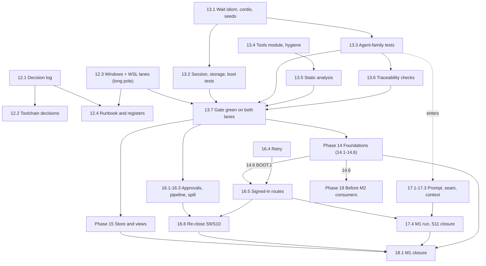

# About this plan

## Purpose

Milestone M1 of the `dsh` story is impl.md stages DH-S-1 to DH-S-11. Its definition of done is tech-spec.md sec. 2.3. All 40 stages of `implementation-plan.md` (Phases 1-11) have merged code at commit `37a524a`, but a verification pass found gaps: a red repository gate, deliverables built narrower than their specs, tests that do not exist or carry no `DH-T` ID, evidence records that cannot be audited, and two owner decisions (OWNER-1 and OWNER-2) that the documents do not yet reflect.

`gap-analysis.md` is the "A" of this work: it registers each gap (`M1-G-<PREFIX>-<n>`) and each decision the owner must take (`M1-D-<PREFIX>-<n>`). This plan is the "B": it says how each gap is closed. Every step names the gap IDs it closes, every test scenario names the steps it proves (the "C"), and the appendix maps every gap to exactly one closing step. The plan continues the story plan as Phases 12 to 19, in the same format, so it can later be appended to `implementation-plan.md`.

Two owner decisions of 2026-11-22 are already applied throughout:

- **OWNER-1 (platforms).** The Linux gate lane runs under WSL on the Windows development host. macOS is removed from M1 scope by owner decision; a macOS row is written "out of scope (OWNER-1)", never as a pass and never as a skip. "Gate green" means Windows (native) plus Linux (WSL).
- **OWNER-2 (models).** DeepSeek and the DeepSeek API key are no longer required. Real-model checks use only Claude and GitHub Copilot, through the user's own signed-in session, with no API key.

Paths are relative to the repository root. Code paths under `internal/` mean `src/harness/internal/`.

## Statuses

Four statuses are kept separate. One never implies another.

- **design** -- the step or scenario is written in this plan. Nothing is claimed about code.
- **built** -- impl.md sec. 1.3: the code is merged, the `DH-T` tests named in the deliverable's Done-when line pass under the gate runner, coverage holds, and the step's manual check is recorded. A step is ticked `[x]` only when it is built.
- **done** -- built, and every remote scenario (`DH-E-*`) that proves the deliverable has passed. In M1, only deliverables proven by local tests alone can be done. `DH-E` scenarios are authored and reviewed in M1, but run in the paired acceptance stages (DH-S-17, DH-S-18), so their boxes stay open here.
- **manual** -- a person ran a check at a recorded commit and wrote down what they saw. A manual record supports "built" (impl.md sec. 1.4 rule 3). It never ticks a `Test Scenarios` box.

**Scope of the guarantee.** The evidence this plan produces proves the stated contracts for the tested commit, inputs and the two lanes (Windows native and Linux under WSL on the development host). It does not prove macOS, untested inputs or the `DH-E` scenarios that run later.

## Priority meaning

- **P0** -- blocks M1 closure (Stage 18.1).
- **P1** -- must land before a named M2 stage. A P1 item sits in Phases 12-18 only when it shares files with P0 work or a P0 stage depends on it (for example 16.4 retry, which 16.5 needs). Otherwise it is in Phase 19.
- **P2** -- clean-up that no M1 or near M2 consumer needs. It stays in the stage whose files it touches.

A stage closes only when all of its steps, of every priority, are built. The owner may move a P1 or P2 step out of an M1 stage by a decision-log entry; it then moves to Phase 19 with its step text and gap IDs unchanged. Priority orders work. It never weakens a step's completion criteria.

## Rules

1. **At most 20 steps per stage.** Gate triage that grows past that opens a sub-stage (for example 13.7b), with its own result and exit evidence.
2. **The gate stays green after Phase 13.** From the exit of Stage 13.7 onward, a stage closes only when `harness-gate` passes on both lanes (Windows native, Linux under WSL) at that stage's closing commit, recorded with the evidence header of Stage 12.3. Phase 12 and Stages 13.1-13.6 close on their own scoped evidence.
3. **Manual is never a scenario.** A manual check is labelled `manual`, names its commit and operator, and never ticks a scenario box.
4. **Destructive behaviour is proven in its own build stage.** Anything that can delete, take over or restore over data -- a layout migration and its backup (15.1), a lease takeover or prune (15.2), a process tree being stopped or killed (14.6, 19.3, 19.4), a secret reaching a child or a log (14.6, 19.5) -- has its scenarios run in the stage that builds it, never deferred to an acceptance batch.
5. **Each code stage tags its own tests** with the `//dsh:test` directive defined in step 13.6.1. Stage 13.6 builds the checker; Stage 18.1 turns it into a gate.
6. **One golden regeneration per persisted format change**, in the stage that changes the format, in this order: 14.4.1 (durations as text), 15.1.2 (store layout), 16.1.2 (approval events v2), 17.1.10 (`request/header` v2). A later stage that touches the same golden rebases and regenerates it in its own step.

# Delivery order

**What starts first, and why.**
- **WSL provisioning (step 12.3.1).** No WSL distribution is installed on the host (`wsl.exe -l -v`), and the Linux half of "gate green" cannot run without one. It needs only an operator, no code, so it starts on day one.
- **The owner decisions.** Most stages wait on at least one `M1-D-*` answer (see the next section). The decision log (12.1) and the toolchain records (12.2) are paperwork and start at once, in parallel with provisioning.

**What can run in parallel.**
- In Phase 13: 13.2 and 13.3 after 13.1 (disjoint test files); 13.4 and 13.5 alongside them (they live in `tools/harness-gate`); 13.6's authoring alongside all of them, with its gate wiring after 13.3.
- After the Phase 13 exit: FND (14.1-14.5), BOOT.1 (14.6), STORE (15.1-15.3) and PIPE (16.1-16.3) touch different packages and run in parallel. Phase 17 may start its code after 13.3 (it edits the same driver and subagent test files that 13.3 repairs), but its stages close only once the gate is green (Rule 2).
- Three stages edit `internal/agent/driver/step.go`: 15.1.7, 16.4.1 and 17.1.2-17.1.8. They merge in that order; whichever lands later rebases. `internal/agent/f2_test.go` is edited by 16.4.2 and then 17.1.9.

**The critical path to M1 closure.** 12.3.1 (WSL) and the decisions -> 13.1 -> 13.3 -> 13.7 (gate green) -> 14.6 (secrets never reach a child) and 16.4 (retry) -> 16.5 (signed-in routes and the DH-S-9 check) -> 17.4 (M1 run, with 17.1-17.3 joining) -> 18.1. STORE (15.1-15.3, 28 steps) is the largest parallel branch and joins at 18.1; if it slips, it becomes the path.

# Decisions that gate stages

The full question, options and reasoning of each decision are in `gap-analysis.md`. This table says which stage waits and what the plan assumes if the owner accepts the recommendation.

| Decision | Stage(s) waiting | Default the plan assumes |
|---|---|---|
| M1-D-GATE-24 | 13.1 (13.2, 13.3 use it) | A: strict `nosleep`; synctest or explicit signals; one named test-kit poll helper for real processes; a cleanup must unblock and join |
| M1-D-GATE-18 | 13.7.5 | A: a ruleset on `main` requires the kept harness lanes, switched on only once the gate is green |
| M1-D-GATE-21, M1-D-TOOL-5 | 12.3.7 | Same question: CI keeps hosted ubuntu and windows `harness` lanes as regression signals; macOS removed |
| M1-D-GATE-23 | 13.5.8 | The stage map builds the missing gates now (13.4, 13.5); the M1 gate list is recorded under DC-3 |
| M1-D-GATE-25 | 13.5.7 | A: vet the `e2e` layer, done in 13.5 together with M1-G-TOOL-17 |
| M1-D-TOOL-1 (and -1b) | 13.5.5, 13.5.6 | (a) govulncheck is an M1 gate; 1b: no advisory-first staticcheck |
| M1-D-TOOL-2 | 13.4.1 | (a) `tools/harness-gate/go.mod` is the tools module |
| M1-D-TOOL-3 | 19.1.1 | (b) GoReleaser snapshot at 19.1, before DH-S-18; D-TOOLCHAIN-5 "built in part" |
| M1-D-TOOL-4 | 13.4.2 | (A) `src/go/test/e2e` becomes a nested test-only module |
| M1-D-TOOL-6 | 19.2.1 | (a) credentialed scenarios run locally on the development host |
| M1-D-FND-1 | 14.3.3 | (a) keep the SDK deriver; add a harness drift test |
| M1-D-FND-2 | 14.4.6 | (a) build `DecodeForm` and `Project` now |
| M1-D-FND-3 | 14.5.6 | (a) accept both small deviations; amend the spec lines |
| M1-D-BOOT-1 | 14.6.11, 19.3-19.5 | (b) hold open: cut parts become held-open entries closing in their consuming stages |
| M1-D-BOOT-2 | 14.6.11 | (b) DH-T-HOST-17 held open, closing at impl.md 16.7 |
| M1-D-BOOT-3 | 14.6.9 | (A) usage-error status 64 |
| M1-D-STORE-A | 15.1.4 | (a) amend the spec: no backlog bound while appends are synchronous |
| M1-D-STORE-B | 15.1.5, 15.3.2 | (a) provisional budgets now, pinned at impl.md 16.7 |
| M1-D-STORE-C | 15.3.10 | (a) built-in views stay checkpoint documents; revisit at DH-S-23 |
| M1-D-STORE-D | 15.3.9 | (b) the draft record is held open, closing at DH-S-21 |
| M1-D-PIPE-1 | 16.1.2 | A: the area spec's five approval outcomes, default timeout 0, peer in the record |
| M1-D-PIPE-2 | 16.4.1 | A: the policy returns `Retry{After}`; the driver waits |
| M1-D-PIPE-3 | 16.5 | A: drive the user's installed official clients (Claude Code CLI, Copilot CLI) as child processes |
| M1-D-PIPE-4, M1-D-CLOSE-3 | 16.5.2, 17.4, 18.1.6 | Same question: A, a boundary guarantee; SP-1 holds at the client-invocation boundary |
| M1-D-PIPE-5 | 16.5.7, 13.7.2 | A: keep the DeepSeek provider as keyless and fake-tested |
| M1-D-LOOP-1 | 17.1.8 | A: the claim writes only the splice; user messages are admitted at point 8 |
| M1-D-LOOP-2 | 17.4.7 | A: pin 100 ms as the M1 budget, plus a held-open entry closing at impl.md 16.7 |
| M1-D-LOOP-3 | 17.2.5, 17.2.6 | B: DH-T-SUBAGENT-4, -14 and the time-limit and interrupt legs of -3 move to DH-S-29 |
| M1-D-LOOP-4 | 17.3.1 | A: build the compaction hook only, with a fake compactor test |
| M1-D-LOOP-5 | 17.4.8 | The owner confirms 500 / 8 / none in writing |
| M1-D-LOOP-6 | 17.4.3, 18.1.6 | A: Claude must pass; Copilot is recorded either way |
| M1-D-CLOSE-1 | 18.1.8 | B: keep the ticks, record `m1-provisional-ticks`, re-verify all 103 at the closure commit |
| M1-D-CLOSE-2 | 12.4.3, 18.1.5 | A: a scripted probe run and watched by a named person counts as a manual check |
| M1-D-CLOSE-4 | 16.5.8, 17.4.4, 18.1.1 | A: re-author all 13 DeepSeek-bound scenario files before M1 closes |

**Points the lead must settle (fragments disagree).**
- **macOS return stage.** The fragments name DH-S-16 entry (CLOSE), DH-S-18 entry (GATE, FND) and DH-S-27 (TOOL, BOOT). Step 12.1.3 records "return stage: to be named by the owner" until one is chosen.
- **M1-D-GATE-23 against M1-D-TOOL-1.** GATE recommends recording the narrowing and adding the gates later; TOOL recommends building staticcheck, govulncheck and site exceptions now. The stage map places TOOL.2 and TOOL.3 in Phase 13, so the plan builds them now. The gate list then grows from 8 to 12 gates (`modules`, `staticcheck`, `vulncheck`, `self` added); "all 8" in the map is read as "every gate in the runner's list".
- **M1-D-GATE-25 timing.** GATE recommends vetting `e2e` after M1; TOOL builds it in TOOL.3. The plan does it in 13.5.7 with the e2e fixes, so vet stays green.
- **impl.md edits.** GATE and TOOL amend impl.md DH-S-1 and the toolchain ADRs; CLOSE keeps impl.md as the baseline (DC-2) with pointer lines. The plan writes pointer lines in impl.md (12.1.8) and DC-3 override notes in `toolchain.md` (12.2.2); an impl.md text change needs the owner's sign-off under DC-2.
- **Run-record id and path.** GATE uses `<lane>-<sha7>-<UTC yyyymmddThhmmZ>` under `evidence/gate-runs/`, CLOSE `<yyyymmdd>-<lane>-<sha7>` under `evidence/runs/`, TOOL the file's SHA-256. The plan uses `<lane>-<sha7>-<UTC yyyymmddThhmmZ>` under `evidence/runs/`, with the file's SHA-256 beside it (12.4.2).
- **Toolchain selection on the lanes.** CLOSE sets `GOTOOLCHAIN=local`; TOOL has the gate run children with `GOTOOLCHAIN=go<floor>`. The plan installs go1.26.0 on WSL, sets `GOTOOLCHAIN=go1.26.0` on Windows (whose default is go1.27.4), and has the gate fail setup when `go version` is not the floor (12.3.4).
- **Known-false ticks under M1-D-CLOSE-1 B.** CLOSE keeps unverified ticks; PIPE and LOOP untick 10.3, 10.4, 10.6 and 11.6, which are known not to be built. The plan reads B as covering unverified ticks only, so known-false ticks are unticked (16.6.1, 17.4.6).
- **H-10.** STORE (M1-D-STORE-B) and the story plan cite H-10 for the provisional budgets; LOOP shows H-10 is the replay of a session with children. The plan creates new held-open entries instead (15.3.8, 17.4.7).
- **Tool calls on a client route.** M1-D-PIPE-4 A may need a harness-hosted MCP bridge so that a client's tool call enters the guarded pipeline. No fragment sizes it; step 16.5.2 decides whether it is needed and 16.5.3 builds it if so.

**Settled by the lead (2026-11-22).** The working defaults above are adopted for these points:
- the gate list (12 gates, built in 13.4 and 13.5, with the `e2e` vet in 13.5.7);
- the run-record id and path;
- the toolchain on the lanes;
- the known-false ticks (unticked);
- H-10 (new held-open entries instead);
- the DeepSeek-bound scenarios (re-authored before M1 closes);
- the required routes (Claude must pass, Copilot recorded; see 18.1.6).

The CI-matrix gap M1-G-GATE-21 is raised to P0, to match M1-G-TOOL-13. Two points stay for the owner: the macOS return stage, and any edit to impl.md's own text under DC-2. Step 16.5.2 settles the MCP bridge and any Phase 19 helpers that 16.5 needs.

**Owner answers (2026-11-22).** Step 12.1 records these four answers in `decisions.md`:
- **Model route (M1-D-PIPE-3, -4; M1-D-CLOSE-3):** option A. dsh drives the user's installed official `claude` and Copilot CLIs as child processes and never reads a token. SP-1 is narrowed to the client-invocation boundary, and tool calls stay in the guarded pipeline.
- **macOS return stage:** not planned yet. macOS is recorded in step 12.1.3 as an open scope removal with no return stage, and it is never a pass.
- **Ticks made under the red gate (M1-D-CLOSE-1):** option B. They are kept, labelled `m1-provisional-ticks`, and all 103 are re-verified at the closure commit (18.1.8). Ticks known to be false are unticked now (16.6.1, 17.4.6).
- **impl.md edits (DC-2):** pointer lines only. impl.md's text is not changed; 12.1.8 adds pointer lines to the decision log.

# Phase 12: Decisions, Local Lanes and Records

## Dependencies
- _none -- start phase_

This phase starts first. It writes down every decision M1 depends on, restates the definition of done under OWNER-1 and OWNER-2, provisions the two local lanes, and gives operators one runbook. Apart from the lane tooling of 12.3, it changes no product code.

## Stage 12.1: Decision Log and Document Reconciliation

**Result.** One file, `docs/stories/harness-DSH-M1/decisions.md`, lists every owner or operator decision that shapes M1: its name and date, the question and the choice, what it narrows, and where it is cited. The tech-spec, the plan and every evidence record point to it. The documents agree on the step count (103), on H-21, and on the restated definition of done: gate green on Windows (native) and Linux (WSL), M1 recorded on a signed-in route, macOS out of scope.

**Entry dependencies.** None. It must merge before 12.4 and 18.1.

**Priority.** P0.

### Implementation Steps
- [x] 12.1.1 (M1-G-CLOSE-10): create `docs/stories/harness-DSH-M1/decisions.md` with the columns name, date, decided by, question, choice, narrows, cited in, status (`in force`, `superseded`, `open`). Seed it with the ten named decisions and their links: `m1-operator-run`, `dh-s-11-closure-path`, `context-package-name`, `dh-s-9-closure-path`, `dh-s-9-scenario-review`, `inherited-vet-gate-failure`, `dsh-s8-closure-waits-stage-8-2`, `spill-addressing`, `defer-gc-lock-blob-refs`, and the open `dsh-story-slice`.
- [x] 12.1.2 (M1-G-CLOSE-10): name and record the five unnamed decisions: `step-8-1-settings-meaning`, `turn-budget-defaults-s11` (left `open` until M1-D-LOOP-5 is answered), `agent-28-staged-acceptance`, `archtest-llm-edges-exception` (`llm/retry` -> `agent`, `llm/meter` -> `views`), and `built-through-may-skip-s8` with status `superseded` by the index rule of `DH-S-10.md:78-91`.
- [x] 12.1.3 (M1-G-CLOSE-10): record OWNER-1 as `platforms-windows-wsl`, including the scope change: macOS leaves M1, is never recorded as a pass or a skip, and returns as a gate lane at a stage the owner names (candidates: DH-S-16 entry, DH-S-18 entry, DH-S-27). The macOS rows of `evidence/DH-S-1.md` and `DH-S-6.md` are labelled historical.
- [x] 12.1.4 (M1-G-CLOSE-10): record OWNER-2 as `models-signed-in-claude-copilot`: no DeepSeek requirement, no API key, real-model checks only on signed-in Claude and Copilot. Add `open` entries for M1-D-CLOSE-3, M1-D-CLOSE-4 and M1-D-PIPE-3 to -5.
- [x] 12.1.5 (M1-G-CLOSE-4): add `retro-entry-order-s8-s11`, the owner's acknowledgement that DH-S-9 was started before DH-S-8 was built and DH-S-10 and DH-S-11 before DH-S-9 (impl.md sec. 1.4 rule 1). Add M1-D-CLOSE-1 and M1-D-CLOSE-2 as rows, `open` until answered.
- [x] 12.1.6 (M1-G-CLOSE-10): add the section "Narrowings reported by other clusters", with one row per `M1-D-*` decision of `gap-analysis.md` (GATE, TOOL, FND, BOOT, STORE, PIPE, LOOP), each `open` until the owner answers, linking the gap IDs it governs.
- [x] 12.1.7 (M1-G-CLOSE-11, items 1, 3 and 5): change "106 steps" to "103 steps (99 deliverables)" in tech-spec R-01, `architecture.md:805`, the story plan Stage 11.4 and `DH-S-11.md:142`; replace the Stage 11.3 status notes with "built when local tests pass; done when DH-E-AGENT-3 / DH-E-SUBAGENT-2 pass"; add DH-E-EXEC-10 and DH-E-STORAGE-6 to the Phase 6 row of the `e2e-scenarios.md` schedule.
- [x] 12.1.8 (M1-G-CLOSE-12, M1-G-GATE-19): amend tech-spec sec. 2.2 items 5 and 7, sec. 2.3, QG-4, QG-10, EV-6, EN-3, EN-6 (gcc under WSL), the sec. 5.5 default-route row, A-2, A-3, R-06, R-10 and R-11, each citing `platforms-windows-wsl` or `models-signed-in-claude-copilot`. Sec. 2.3 then reads "passes on Windows (native) and Linux (WSL)". Amend story plan Stage 1.4 (`:71`, `:85`) the same way. impl.md stays the baseline (DC-2): add one pointer line to `decisions.md` under its DH-S-1, DH-S-9 and DH-S-11 sections.
- [x] 12.1.9 (M1-G-CLOSE-12): draft amendments to M2-DEC-1 ("M1 closed under the definition of done in `decisions.md`"), M2-EN-1, M2-R-01 and M2-A-1 in `docs/stories/harness-DSH-M2/tech-spec.md`, for the M2 owner to confirm.
- [x] 12.1.10 (M1-G-CLOSE-11, item 4): in `evidence/DH-S-6.md` "Held open", write "H-21 closing step: impl.md 16.10 (`dsh config show`, `dsh config validate`)".

### Dependencies
- _none -- start stage_

### Test Scenarios
- [x] Scenario: Every cited decision is logged -- Given the M1 story documents and the M2 tech-spec, When the backticked names beside the word "decision" are listed and compared with `decisions.md`, Then each name appears there exactly once with a status [proof: in-process; deps: none -- text search; steps: 12.1.1-12.1.6]
- [x] Scenario: The restated definition of done holds no withdrawn requirement -- Given the edited tech-spec, When it is searched for `macOS`, `three CI`, `DEEPSEEK` and `API key`, Then every hit cites a decision or is labelled historical [proof: in-process; deps: none; steps: 12.1.8, 12.1.9]
- [x] Scenario: The step count agrees -- Given the edited documents, When they are searched for `106`, Then no hit counts M1 steps [proof: in-process; deps: none; steps: 12.1.7]

### Exit evidence
`docs/stories/harness-DSH-M1/decisions.md`, and one line in each of `evidence/DH-S-6.md`, `DH-S-9.md` and `DH-S-11.md` naming the decisions that govern it, with the merge commit.

## Stage 12.2: Recorded Toolchain Decisions and Re-baselined Scope

**Result.** Every point where the M1 toolchain differs from `docs/harness/upstream/toolchain.md` becomes a decision a reviewer can read, with its return stage: the narrowed gate list, the coverage scope, the rehearsal, the orphan replay job, and the platform override. No code changes.

**Entry dependencies.** 12.1.3 (the platform decision exists to cite). The owner answers to M1-D-TOOL-1 to -6 are recorded as they arrive; rows stay `open` until then.

**Priority.** P0.

### Implementation Steps
- [x] 12.2.1 (M1-G-TOOL-11, M1-G-GATE-26): add a "Toolchain scope decisions" table to story plan Phase 1 and to `evidence/DH-S-1.md`, one row per narrowed item: what was built, what the spec asks for, the decision ID and the return stage. Rows: the 8-gate list against ADR-TOOLCHAIN-8/-9 (M1-D-GATE-23, M1-D-TOOL-1), the module-hygiene rule (13.4), the site-exception mechanism (13.5), the rehearsal "built in part" (M1-D-TOOL-3), and the coverage floor kept stricter than DH-ADR-TOOLCHAIN-7 (it floors `main` packages too; DC-3 record, rule kept).
- [x] 12.2.2 (M1-G-TOOL-12): add DC-3 override notes to DH-ADR-TOOLCHAIN-6, DH-ADR-TOOLCHAIN-12 and DH-D-TOOLCHAIN-4 in `toolchain.md` ("No platform lane can be switched off without a failing job" is overridden for macOS by `platforms-windows-wsl`), restate DH-E-TOOLCHAIN-2 as two executed systems, and add a pointer line under impl.md DH-S-1 Exit evidence (12.1.8 rule).
- [x] 12.2.3 (M1-G-TOOL-9): propose an impl.md DH-S-16 step beside 16.7: a `replay` gate plus the `harness-replay` job or local lane, with Done-when DH-T-TOOLCHAIN-5. It is an impl.md change under DC-2, so the owner signs it; until then it is an `open` row in `decisions.md`.
- [x] 12.2.4 (M1-G-TOOL-6 record part, M1-G-TOOL-18): record that the import rules are met by the archtest Go tests (`internal/archtest/rules.go`, allowed by ADR-TOOLCHAIN-9), that the HTTP-client rule belongs to DH-D-UTIL-8 / DH-T-UTIL-22 at DH-S-16, and that goldens run inside the `test` gate. Add the missing Stage 1.2 record (commit `e13abf3`, the seeded checks) to `evidence/DH-S-1.md`, labelled `manual`, from the existing rows.

### Dependencies
- phase-decisions-local-lanes-and-records/stage-decision-log-and-document-reconciliation

### Test Scenarios
- [x] Scenario: Ledger still verifies -- Given the amended documents, When `tools/harness-trace verify` runs, Then it exits 0 and every new decision ID resolves [proof: service:go-toolchain; deps: harness-trace; steps: 12.2.1-12.2.4]

### Exit evidence
`evidence/DH-S-1.md`: the decision table, the macOS scope-change line, and the new Stage 1.2 record.

## Stage 12.3: Windows and WSL Gate Lanes, CI Matrix and Preflight

**Result.** One documented command proves a commit on Windows (native) and on Linux under WSL. Each run checks its environment first, then writes an evidence file with a header (commit, clean tree, system, toolchain, compiler) and the full gate output, so a run can be reviewed without a CI run ID. CI drops macOS, and the scenario preflight no longer asks for a DeepSeek key. This stage merges fragments GATE.4 and TOOL.4; their duplicate steps are combined, and their document and record steps moved to the stages noted in the coverage appendix.

**Entry dependencies.** None for 12.3.1 and 12.3.2 (operator provisioning; start at once). M1-D-GATE-21 / M1-D-TOOL-5 for 12.3.7. The gate is expected to stay red at `vet` until 13.3; that is not a failure of this stage.

**Priority.** P0.

### Implementation Steps
- [x] 12.3.1 (M1-G-GATE-20, M1-G-TOOL-12): provision the WSL lane (operator, `manual`):
  - `wsl --install -d Ubuntu-24.04` under WSL2, with a non-root default user (root bypasses the permission tests in `storage/home/private_unix_test.go` and `loosen_unix_test.go`);
  - Go 1.26.0 exactly, from the go.dev `linux/amd64` tarball into `/usr/local/go`, first on `PATH`; `appendWindowsPath=false` in `/etc/wsl.conf` so the Windows `go.exe` can never be picked up;
  - `build-essential` (gcc, for `-race` with `CGO_ENABLED=1`) and git; `GOCACHE`, `GOMODCACHE` and `TMPDIR` on ext4;
  - optional `systemd=true` in `/etc/wsl.conf` (it enables the Linux user-scope path; without it the process-group fallback is reported, EN-5); raise the WSL memory limit if the coverage gate is killed.
- [x] 12.3.2 (M1-G-TOOL-12): provision the Windows native lane: the floor toolchain selected with `GOTOOLCHAIN=go1.26.0` (the host default is go1.27.4) and MSYS2 UCRT64 `gcc` on `PATH`, as in `.github/workflows/ci.yml:146-156`.
- [x] 12.3.3 (M1-G-GATE-20, M1-G-TOOL-12): write `tools/harness-gate/README.md` sec. Lanes, which records both provisionings and the WSL clone rule: `git clone /mnt/e/work/github/ai/agent-plugin ~/src/agent-plugin` then `git -C ~/src/agent-plugin checkout <sha>`, never a run on `/mnt/e`. The reasons: DrvFs/9P reports 0777 and ignores `chmod` (breaking the privacy tests and marking the tree `vcs.modified`), `flock`, rename and inotify are unreliable there, git's "dubious ownership" check breaks VCS stamping, and the budget gate fails on its speed. `.gitattributes` already forces `eol=lf`; do not set `core.autocrlf`. Run `wsl --shutdown` before a budget run to reset clock drift.
- [x] 12.3.4 (M1-G-TOOL-14): the gate reads the floor from `src/harness/go.mod`, prints the toolchain it used, and fails setup (exit 2) when `go version` is not the floor, naming both versions. Tests: tag DH-T-TOOLCHAIN-9 (setup error).
- [x] 12.3.5 (M1-G-TOOL-12, M1-G-TOOL-18): add `harness-gate --evidence <file>`. It writes the header: the commit (`git rev-parse HEAD`), a clean-tree check (`git status --porcelain` empty, or exit 2 naming the dirty paths), `GOOS`/`GOARCH`, `go version`, `go env CC` with `--version`, the host OS build, and on Linux `WSL_DISTRO_NAME`, `/etc/os-release` PRETTY_NAME and `uname -r`, plus start and end UTC times. It sets `CI=1` for children, so goldens refuse `-update` on local lanes (`testkit/golden/golden.go:55`), tees the full output, and ends with the exit status and the file's SHA-256. Tests: in-process header assertions tagged DH-T-TOOLCHAIN-9.
- [x] 12.3.6 (M1-G-GATE-20): add `tools/harness-gate/lanes/wsl.sh` and `lanes/win.ps1`. Each runs preflight checks and stops naming the first one not met: the checkout filesystem is ext4, never 9p or drvfs (`stat -f -c %T .`); `id -u` is not 0; `go version` is the floor; `go env CC` resolves; the tree is clean with `core.autocrlf=false`; `TMPDIR` is on ext4. Each then runs `GOWORK=off go -C tools/harness-gate run . --root ../.. --evidence <file>`, and the WSL script also runs `rehearse`. The run-record id and path follow 12.4.2.
- [x] 12.3.7 (M1-G-GATE-21, M1-G-TOOL-13): per M1-D-GATE-21 / M1-D-TOOL-5, set the `ci.yml` `harness` matrix and the `harness-scenarios.yml` `scenarios` matrix to `[ubuntu-latest, windows-latest]`, drop macOS from `harness-manual-checks.yml:37`, update the `ci.yml` header comment (hosted lanes are regression signals; the evidence of record is the local lanes), and rename `TestHarnessJobRunsTheGateOnThreeSystems` to `...OnTwoSystems` with its assertion at `scenarios_test.go:241`. Tests: DH-T-TOOLCHAIN-9 (the CI list equals the runner's list).
- [x] 12.3.8 (M1-G-TOOL-15): remove `SecretEnv = "DSH_DEEPSEEK_API_KEY"` and the key check from `tools/harness-gate/acceptance/scenarios.go:272`; remove the variable from `harness-scenarios.yml:61,87`, `README.md:55` and `main.go:24`; update `acceptance_test.go:216-219`, `scenarios_test.go:157-165,260` and the godog feature `ci_and_release_rehearsal.feature:11-19`. The preflight keeps its index and required-list checks and gains an empty credential hook that 19.2 fills. Tests: DH-T-TOOLCHAIN-6 (preflight half).
- [x] 12.3.9 (M1-G-GATE-20): run both lane scripts at the stage commit (`manual`). Each is expected to stop at `vet`; the record proves the lanes work end to end and gives the first triage input for 13.7. It is not closure evidence.

### Dependencies
- phase-decisions-local-lanes-and-records/stage-decision-log-and-document-reconciliation (for the decision names cited in the README and the CI comment only; provisioning does not wait)

### Test Scenarios
- [x] Scenario: WSL preflight refuses a /mnt checkout -- Given the repository opened at `/mnt/e/...` in the WSL distribution, When `lanes/wsl.sh` runs, Then it exits non-zero naming "checkout on 9p" before any gate runs [proof: service:filesystem; deps: WSL distribution; steps: 12.3.6]
- [x] Scenario: Dirty tree refuses evidence -- Given a scratch git repository with an uncommitted file, When `harness-gate --evidence out.txt` runs, Then it exits 2 naming the dirty path and writes no PASS line [proof: service:os-process; deps: git, filesystem; steps: 12.3.5]
- [x] Scenario: Off-floor toolchain fails setup -- Given a `go` whose version is not the floor, When the gate starts, Then it exits 2 naming both versions [proof: service:go-toolchain; deps: go; steps: 12.3.4]
- [x] Scenario: Matrix equals the decision -- Given `ci.yml` and `harness-scenarios.yml`, When they are parsed, Then the harness matrices equal the decided list and the rehearsal step is on the Linux lane [proof: in-process; deps: none; steps: 12.3.7]
- [x] Scenario: Preflight passes with no key -- Given an environment with no model variables and an empty required list, When preflight runs, Then it passes; with `DSH_REQUIRE_SCENARIOS=DH-E-FAKE-9` it fails naming the ID [proof: in-process; deps: none; steps: 12.3.8]

### Exit evidence
`evidence/DH-S-1.md`, section "Local lanes": the provisioning facts of both lanes (distribution, kernel, Go, gcc, filesystem types, whether systemd is on), the decision IDs (OWNER-1, M1-D-GATE-21, M1-D-TOOL-5), the two `manual` first-run records of 12.3.9, and links to the README and the changed workflows.

## Stage 12.4: Local-Lane Runbook, Evidence Template and Manual-Check Register

**Result.** `docs/stories/harness-DSH-M1/evidence/README.md` tells an operator how to run the gate on each lane, how to run each manual check, and how to record both. Every evidence record carries the same fields, and each `DH-S-n.md` gains a per-step manual-check table, to be filled in at the closure commit. The runbook points to 12.3's README and lane scripts rather than repeating them.

**Entry dependencies.** 12.1 (OWNER-1, OWNER-2, M1-D-CLOSE-2 and -3 recorded); 12.3.6 (the lane scripts exist).

**Priority.** P0.

### Implementation Steps
- [x] 12.4.1 (M1-G-CLOSE-13): write `evidence/README.md` sec. Lanes: link `tools/harness-gate/README.md` sec. Lanes and the two scripts of 12.3.6, then list the verification lines an operator must see before trusting a run: `go env GOOS GOARCH` prints `linux amd64` in WSL; `df -T .` shows ext4; `git status --porcelain` is empty; `go env CC` and `gcc --version`; whether `systemctl --user` exists (if not, the U-K1-1 fallback is in use and is reported, EN-5). Without gcc the gate prints `race: no C compiler` (EN-6).
- [x] 12.4.2 (M1-G-CLOSE-13, M1-G-GATE-22): the evidence template. In place of a CI run id, each local-lane run records: the run-record id `<lane>-<sha7>-<UTC yyyymmddThhmmZ>`, the operator, the full commit SHA and the empty `git status --porcelain`; for WSL `/etc/os-release` PRETTY_NAME, `uname -r` and `wsl.exe --version`, for Windows `cmd /c ver`; `go version`, `CC`, gcc version, `CGO_ENABLED`, `TMPDIR`, `id -u`, the checkout filesystem type; start and end times; the per-gate PASS lines and the coverage table; the log at `evidence/runs/<run id>.txt` (ASCII, DC-6) with its SHA-256 and exit status; any CI run ids as supplementary. The macOS row reads "out of scope (`platforms-windows-wsl`)", never a pass or a skip. Add the template to impl.md sec. 7.3 by a pointer line.
- [x] 12.4.3 (M1-G-CLOSE-6): add a "Manual checks" register to every `DH-S-n.md`, one row per impl.md step: the named check (or the rule-3 default), the procedure (a test-kit composition or a probe, per M1-D-CLOSE-2), the operator, the commit, what was seen, and `manual`. Pre-fill the procedures; leave commit and result blank.
- [x] 12.4.4 (M1-G-CLOSE-6, M1-G-CLOSE-12): re-target the DH-S-9 and DH-S-11 procedures to the Claude and Copilot signed-in routes, per M1-D-CLOSE-3. "Bad key" becomes "signed-out or expired session": one `llm/sign-in-required` (or `llm/auth`) settlement, no retry, no fallback. The probe code belongs to 16.5 and 17.4; the register links those steps.
- [x] 12.4.5 (M1-G-CLOSE-6): re-target the DH-S-4 checks to the in-scope systems. Watcher: a real editor on Windows, vim on WSL ext4, and a Windows editor on `/mnt/e` (polled, because 9p is probed as remote). Search: `search.List` against `git ls-files --cached --others --exclude-standard`, on both lanes. Step 14.5.5 runs them.
- [x] 12.4.6 (M1-G-CLOSE-5): add the eight impl.md sec. 7.3 headings to each `DH-S-n.md`, plus the line `Closure status: open|closed at <sha>`.
- [x] 12.4.7 (M1-G-CLOSE-13): dry-run the runbook on the fresh WSL distribution at the stage merge commit (`manual`, "not closure evidence"): every verification line prints its stated value and a gate log is produced.

### Dependencies
- phase-decisions-local-lanes-and-records/stage-decision-log-and-document-reconciliation
- phase-decisions-local-lanes-and-records/stage-windows-and-wsl-gate-lanes-ci-matrix-and-preflight

### Test Scenarios
- [x] Scenario: The template is complete -- Given the eleven `DH-S-n.md` records, When they are searched for the eight sec. 7.3 headings, the "Manual checks" register and the closure-status line, Then all are present in every file [proof: in-process; deps: none; steps: 12.4.3, 12.4.6]
- [x] Scenario: No record claims a macOS pass -- Given the eleven records and `evidence/README.md`, When they are searched for macOS rows, Then each reads "out of scope" or "historical" [proof: in-process; deps: none; steps: 12.4.2]

### Exit evidence
`evidence/README.md`, and the `manual` dry-run record of 12.4.7, labelled "not closure evidence".

### Cross-Stage Dependencies
- _none -- start phase_

# Phase 13: Gate Green

## Dependencies
- phase-decisions-local-lanes-and-records

`tools/harness-gate` is the one command that decides "this commit passes" (QG-1). It has been red since PR #16: it stops at `vet` on 81 unique test-code findings (53 goroutines or listeners with no joining `t.Cleanup`, 24 `time.Sleep` calls in tests, 4 fuzz targets without `seeds_test.go`), so the later gates have not run on any code written after DH-S-1. This phase fixes those findings with four patterns, brings the runner up to its spec, adds the traceability checks, and then triages every later gate until both lanes pass. The fix patterns are:

- **P-C** -- register the release right after the start: `t.Cleanup(func(){ unblock(); <-done })`, where `unblock` closes a gate, cancels a context or disposes a root, and `done` is the goroutine's own exit signal.
- **P-V** -- run the test in a `testing/synctest` bubble: `synctest.Wait()` replaces a settle sleep, and `<-time.After(d)` inside the bubble is virtual.
- **P-S** -- replace polling with an explicit signal: a channel, a test hook, or a process `done` channel.
- **P-F** -- move `f.Add` seeds into `seeds_test.go` as a Go slice.

An analyzer is never silenced: where it is wrong, the analyzer is fixed with an `analysistest` fixture (QG-2).

## Stage 13.1: Wait Idiom, Analyzer Fix, cordis and Fuzz Seeds

**Result.** The wait and release idiom is decided and written down, and the one analyzer false positive is fixed in the analyzer. `src/go` vets clean, and the four parser packages keep their seeds in `seeds_test.go`. This clears 28 of the 81 findings.

**Entry dependencies.** M1-D-GATE-24 answered. No other stage.

**Priority.** P0.

### Implementation Steps
- [ ] 13.1.1 (M1-G-GATE-24): apply M1-D-GATE-24. Write the idiom into `tools/harness-gate/README.md`: P-C, P-V and P-S; "no `<-time.After` settle outside a bubble"; "a cleanup must unblock and join". Add the one named test-kit poll helper for waits on a real child process or another process's log (for example `internal/testkit/procwait.Until(ctx, t, fact)`), with a unit test. Under option B only, extend `analyzers/nosleep.go` to allow `time.Sleep` inside a `synctest.Test` closure, with `analysistest` cases. Tests: tag DH-T-TOOLCHAIN-8.
- [ ] 13.1.2 (M1-G-GATE-5): in `tools/harness-gate/analyzers/cleanup.go` `assignedIdents`, record a selector left-hand side (`x.F = net.Listen(...)`) under its root identifier, so that `t.Cleanup(x.Close)` releases it. Add fixture `testdata/src/cleanup/field.go` with one released case and one unreleased case marked `// want`. Tests: tag DH-T-TOOLCHAIN-8.
- [ ] 13.1.3 (M1-G-GATE-2): P-C in `src/go/cordis/config_test.go` (`:137,151,164,455,456`) and `tree_internal_test.go` (`:25,68`): each goroutine signals `done`, and the cleanup unblocks it, then joins. The existing DH-T-CORDIS tags stay.
- [ ] 13.1.4 (M1-G-GATE-3): P-C for the 15 goroutine sites in `src/go/cordis/unload_test.go`: the cleanup closes each test's gate, then waits for each done channel. Move the test holding `:500` into `synctest.Test` and replace `time.Sleep(settle)` with `synctest.Wait()`. Keeps `DH-T-CORDIS-5..14`.
- [ ] 13.1.5 (M1-G-GATE-4): P-F in `internal/util/{caltime,glob,recur,version}`: add `seeds_test.go` with a `var parseSeeds = []string{...}` and `func addParseSeeds(f *testing.F)`; each `Fuzz*` calls the helper, and the inline `f.Add` calls are deleted (otherwise `fuzzcheck` reports "f.Add outside seeds_test.go").

### Dependencies
- phase-decisions-local-lanes-and-records/stage-decision-log-and-document-reconciliation (the idiom decision is logged there)

### Test Scenarios
- [ ] Scenario: Field-assigned listener is released -- Given fixture `cleanup/field.go` with `cs.Server = httptest.NewServer(...)` and `t.Cleanup(cs.Close)`, When `analysistest.Run` loads it, Then there is no diagnostic; with the cleanup removed there is exactly one `listener started ... (QG-5)` [proof: service:go-toolchain; deps: committed testdata; steps: 13.1.2]
- [ ] Scenario: src/go vets clean and is order-independent -- Given the cordis edits, When `go vet -vettool=<harness-gate>` runs in `src/go` with both tag sets and `go -C src/go test -race -shuffle=on -count=3 ./cordis/` runs, Then vet exits 0 and every run passes [proof: service:go-toolchain; deps: go-toolchain, gcc for -race; steps: 13.1.1, 13.1.3, 13.1.4]
- [ ] Scenario: Seeds compiled in -- Given the four packages, When `fuzzcheck` and `go test -run Fuzz ./internal/util/...` run, Then there is no QG-6 diagnostic and every seed executes with no file read [proof: in-process; deps: none; steps: 13.1.5]

### Exit evidence
`evidence/DH-S-1.md`, new section "M1 gate repair": the decided idiom, the analyzer fixture names, the `src/go` vet output (`manual`, with the commit). `evidence/DH-S-2.md` and `DH-S-4.md` each get one line naming the repaired test files.

## Stage 13.2: Session, Storage, Util, Boot and llm Tests

**Result.** Every finding outside the agent family is fixed (26 findings). Goroutines are joined on every exit path, timing waits block on signals or virtual time, and `src/harness` vets clean apart from 13.3's files.

**Entry dependencies.** 13.1 (the idiom and the poll helper).

**Priority.** P0.

### Implementation Steps
- [ ] 13.2.1 (M1-G-GATE-6): P-C at `session/scope/scope_test.go:142`, `session/event/event_test.go:380`, `session/session_test.go:191`, `session/views/views_test.go:86`, `util/fsx/replace_test.go:431` (the cleanup unlocks, then drains `got`) and `util/watch/watchtest/manual_test.go:218`.
- [ ] 13.2.2 (M1-G-GATE-7): in `session/query/visibility_test.go`, wrap the ordering test in `synctest.Test` and replace the sleeps at `:297` and `:303` with a virtual `<-time.After(2*time.Millisecond)`; replace the poll at `:333` with a buffered `appended` channel the writer sends on. If the SQLite store is not bubble-safe, use P-S for all three.
- [ ] 13.2.3 (M1-G-GATE-8): add hooks to `session/store/sqlite/export_test.go`: `WriteHeldSignal(s) <-chan struct{}` and a busy-wait-entered signal fed from the busy handler through an unexported test seam. Rewrite `shutdown_test.go:37-44` on them, with P-C at `:37`. In `storage/blob/gclock_test.go` use P-C at `:37,61` and replace the `eventually` helper (`:122`) with a signal from the lock.
- [ ] 13.2.4 (M1-G-GATE-9): P-C at `boot/audit_test.go:70,91` and `boot_test.go:98,434`; in the `boot_test.go:632` cleanup, call `clk.BlockUntil(n, timeout)` (`testkit/clock.Manual`) before each `Advance` instead of sleeping.
- [ ] 13.2.5 (M1-G-GATE-10): P-C at `storage/workspace/archive_test.go:338,497`, `llm/runtime_test.go:506,551,621` and `human/human_test.go:199`.

### Dependencies
- phase-gate-green/stage-wait-idiom-analyzer-fix-cordis-and-fuzz-seeds

### Test Scenarios
- [ ] Scenario: Close during busy wait is really during the wait -- Given the busy-wait-entered hook, When `Store.Close` is called after the signal, Then the close returns within its bound and the append returns `store/busy`, over `-count=20 -race` [proof: service:sqlite; deps: sqlite embedded, `t.TempDir()`; steps: 13.2.3]
- [ ] Scenario: Group vets clean and is order-independent -- When vet with both tag sets and `go test -race -shuffle=on -count=3` run over the packages of 13.2.1-13.2.5, Then no diagnostic comes from those files and every run passes [proof: service:go-toolchain; deps: go-toolchain, gcc; steps: 13.2.1, 13.2.2, 13.2.4, 13.2.5]

### Exit evidence
`evidence/DH-S-1.md` "M1 gate repair": the package list and commands (`manual`). `evidence/DH-S-5.md`, `DH-S-6.md`, `DH-S-7.md` and `DH-S-8.md` each get one line naming the repaired test files.

## Stage 13.3: Agent, Delegate, Tools and Scenario-Layer Tests

**Result.** The agent-family findings are fixed (27 findings) and `vet` passes on the whole repository. The scripted model gains a blocking "N requests seen" wait, so the driver and subagent tests no longer poll. Phase 17 may start editing these files once this stage has merged.

**Entry dependencies.** 13.1. Phase 17 code that edits `agent/driver/*_test.go` or `delegate/subagent/subagent_test.go` waits for this stage.

**Priority.** P0.

### Implementation Steps
- [ ] 13.3.1 (M1-G-GATE-12): add `(*Transcript).WaitRequests(ctx, n) error` and a "prefix served" signal to `internal/testkit/model`, with their own unit test. Rewrite `agent/driver/driver_test.go:447` and `lifecycle_test.go:142,255,302,321` on them. Wrap `lifecycle_test.go:559` (the "no request without a wake" negative wait) in `synctest.Test` with `synctest.Wait()`, or use a driver-idle hook if the store blocks the bubble. P-C at `lifecycle_test.go:215,253,268,471,474` and `retry_test.go:278`. The `DH-T-AGENT-*` tags stay.
- [ ] 13.3.2 (M1-G-GATE-13): in `delegate/subagent/subagent_test.go`, delete the copied `waitRequests` (`:93`) and use `WaitRequests`; use the prefix signal at `:117` and a refusal channel at `:354`; P-C at `:230,233`. (This also covers the sleep-removal step of fragment LOOP.2, which is therefore not repeated in 17.2.)
- [ ] 13.3.3 (M1-G-GATE-11): in `agent/agent_test.go`, P-C at `:285,291`, and at `:288` wait on an owner-unload-entered signal instead of the 100 ms sleep. In `tools/core/schedule_test.go`, run the cases in `synctest.Test` and make the tool bodies wait `<-time.After(d)` (virtual). Keeps `DH-T-AGENT-26`.
- [ ] 13.3.4 (M1-G-GATE-14): in `internal/testkit/scenarios`, add a cleanup to `storeStep` that joins the shell goroutine (`store_two_process_scenario_test.go:37`); wait on `running.done` (`realenv_test.go:96`) with a `storeStepTimeout` select at `two_process:179` and `crash_recovery:106`; replace the polls at `crash_recovery:98,149` with the 13.1.1 poll helper. Vet only: these scenarios are authored, not run (EV-4).
- [ ] 13.3.5 (M1-G-GATE-27): append "superseded by M1 gate repair (Phase 13)" to the `inherited-vet-gate-failure` record at `evidence/DH-S-9.md:110-121`, and add to `evidence/DH-S-11.md` the line naming the repaired agent, delegate and scenario files, so the debt added after DH-S-9 is stated.

### Dependencies
- phase-gate-green/stage-wait-idiom-analyzer-fix-cordis-and-fuzz-seeds
- phase-gate-green/stage-session-storage-util-boot-and-llm-tests (must have merged before the "Repository vet is green" scenario runs)

### Test Scenarios
- [ ] Scenario: WaitRequests blocks without polling -- Given a scripted model, When `WaitRequests(ctx, 2)` is called before any request and two requests then arrive, Then it returns nil after the second; with a cancelled context it returns the context error [proof: in-process; deps: none; steps: 13.3.1]
- [ ] Scenario: Repository vet is green -- When `harness-gate` runs on the Windows lane at the stage commit, Then its output contains `PASS vet` and names the next failing gate, if any [proof: service:go-toolchain; deps: go-toolchain, MSYS2 gcc; steps: 13.3.1-13.3.4]

### Exit evidence
`evidence/DH-S-1.md` "M1 gate repair": the Windows gate output (`manual`, with the commit), showing `PASS vet` and the next failing gate, the first triage input for 13.7. `evidence/DH-S-11.md`: the line of 13.3.5.

## Stage 13.4: Tools Module and Module Hygiene

**Result.** The linters have pinned versions in one tools module. An untidy, unverified or unexplained module requirement fails the gate, and `src/go` is standard-library only again. The gate runs its own tests, so the module and analyzer rules cannot regress unseen.

**Entry dependencies.** 12.2 (M1-D-TOOL-2 and M1-D-TOOL-4 answered and recorded). It can run alongside 13.1-13.3, because it edits `tools/harness-gate` and module files only.

**Priority.** P0.

### Implementation Steps
- [ ] 13.4.1 (M1-G-TOOL-5): under M1-D-TOOL-2 (a), add `tool honnef.co/go/tools/cmd/staticcheck` (v0.8.2) and `tool golang.org/x/vuln/cmd/govulncheck` (v1.10.0) to `tools/harness-gate/go.mod`, each with a reason comment; amend DH-D-TOOLCHAIN-1 "Components" in `toolchain.md` to name that file. Tests: DH-T-TOOLCHAIN-11 (pins resolve).
- [ ] 13.4.2 (M1-G-TOOL-10): under M1-D-TOOL-4 (A), move `src/go/test/e2e` into a nested test-only module `src/go/test/e2e/go.mod`, which requires `src/go` through a reasoned `replace => ../..` (it is never released) and godog with a reason; drop godog from `src/go/go.mod`. Teach `modcheck.Load` and `CheckToolchain11` a "test module" class (modules under `*/test/e2e` are outside the RM-1 count but still need reasons). Point the `e2e-*.yml` workflows at `go -C src/go/test/e2e`, fix the `ci.yml:79` comment, and add test `TestCordisModuleIsStandardLibraryOnly` (modcheck: `src/go/go.mod` requires nothing), tagged DH-T-TOOLCHAIN-11.
- [ ] 13.4.3 (M1-G-TOOL-2): add `modcheck.CheckReasons`: every direct `require`, and every `replace`, `exclude`, `tool` and `toolchain` line in the product, tools and test modules carries a comment above it or at the end (`// indirect` alone is not a reason). Add reasons for godog in `src/harness/go.mod:17` and for godog and `golang.org/x/tools` in `tools/harness-gate/go.mod:5-8`. Tests: tag DH-T-TOOLCHAIN-11.
- [ ] 13.4.4 (M1-G-TOOL-2): add gate `modules` after `vet`. Per module it runs `go mod tidy -diff` (any output fails), `go mod verify`, and `CheckToolchain11` plus `CheckReasons` on the checkout. Seed its test with a module holding an extra `require`. Update `TestGateListIsFixed` and the README table. Tests: DH-T-TOOLCHAIN-11, DH-T-TOOLCHAIN-9 (the gate list).
- [ ] 13.4.5 (M1-G-TOOL-3): add gate `self` as the last gate: `GOWORK=off go test -count=1 ./...` in `tools/harness-gate`, without the `e2e` tag, with `-skip TestRepositoryPassesEveryGate` (that test would recurse). Update `TestGateListIsFixed` and the README table. Tests: DH-T-TOOLCHAIN-9.

### Dependencies
- phase-decisions-local-lanes-and-records/stage-recorded-toolchain-decisions-and-re-baselined-scope

### Test Scenarios
- [ ] Scenario: Untidy module fails the modules gate -- Given a scratch module in `t.TempDir()` with an unused `require`, When `harness-gate --root <copy>` runs, Then it stops at `modules`, prints the tidy diff and exits 1 [proof: service:go-toolchain; deps: filesystem; steps: 13.4.4]
- [ ] Scenario: Pin without a reason is named -- Given in-memory `go.mod` bytes with `require example.com/x v1.0.0` and no comment, When `CheckReasons` runs, Then it fails naming the file and line; with a comment it passes [proof: in-process; deps: none; steps: 13.4.3]
- [ ] Scenario: src/go is standard-library only -- Given the checkout after the move, When modcheck reads `src/go/go.mod` and `go -C src/go/test/e2e vet -tags e2e ./...` runs, Then no `require` line exists and vet exits 0 [proof: service:go-toolchain; deps: module cache; steps: 13.4.2]
- [ ] Scenario: A broken module rule fails the main gate -- Given a scratch copy whose `src/harness/go.mod` has a `replace`, When the full gate runs, Then `modules` fails naming RM-4; and when a gate-module test is made to fail, `self` fails [proof: service:go-toolchain; deps: filesystem; steps: 13.4.4, 13.4.5]
- [ ] Scenario: Tools resolve from the tools module -- Given `GOPROXY=off` and a warmed cache, When `go -C tools/harness-gate tool staticcheck -version` runs, Then it prints v0.8.2 [proof: service:go-toolchain; deps: module cache; steps: 13.4.1]

### Exit evidence
`evidence/DH-S-1.md`, Stage 1.1 addendum: the commands and output of the `modules` and `self` gates, and the new reason comments.

## Stage 13.5: Static Analysis to Spec

**Result.** The gate runs staticcheck, the vulnerability check and the spec's three toolchain-owned analyzers, and vets the `e2e` layer. A finding can be accepted only by a comment at the site that gives a reason, and the gate prints how many such exceptions exist. Fragment GATE's M1-G-GATE-23 (gates and exceptions missing) is closed here.

**Entry dependencies.** 13.4 (tools pinned); M1-D-TOOL-1 and M1-D-GATE-25 answered; for 13.5.7, 13.1 (the idiom for the e2e fixes).

**Priority.** P0, except 13.5.7 (P2).

### Implementation Steps
- [ ] 13.5.1 (M1-G-TOOL-7): add a shared directive reader to `tools/harness-gate/analyzers`: `//lint:ignore <check>[,<check>] <reason>` on the line above, or at the end of the line, suppresses that check on the next statement; a directive with no reason, or naming an unknown check, is itself a diagnostic. Add `analyzers.Exceptions()` totals and make `vet` print `exceptions: N`. Replace the "no suppression" comment at `analyzers.go:16`. Tests: DH-T-TOOLCHAIN-8 via `analysistest` (reasoned accepted, reasonless rejected).
- [ ] 13.5.2 (M1-G-TOOL-6): add analyzer `rootcall`: a call to `(*cordis.Context).Root` outside `src/go/cordis` is reported. The tree is clean today. Tests: DH-T-TOOLCHAIN-8 fixture.
- [ ] 13.5.3 (M1-G-TOOL-6): add analyzer `errdiscard`: an `error` result assigned to `_`, or ignored as a statement (except `fmt.Print*`, `(*bytes.Buffer).Write*`, `(*strings.Builder).Write*`), is reported. Fix or reason-annotate the roughly 32 existing non-test sites in the same change (ADR-TOOLCHAIN-8: the tree is clean before an analyzer joins). Tests: DH-T-TOOLCHAIN-8.
- [ ] 13.5.4 (M1-G-TOOL-6): add analyzer `typeassert`: an unchecked `x.(T)` outside a type switch is reported, and so is any `unsafe` import. Annotate the three `unsafe` sites (`storage/home/private_windows.go:10`, `tools/isolate.go:7`, `storage/spill/local/private_windows_test.go:9`) with their Windows API reasons, and fix or annotate the assertions found. Tests: DH-T-TOOLCHAIN-8.
- [ ] 13.5.5 (M1-G-TOOL-1): add gate `staticcheck`: `go -C tools/harness-gate tool staticcheck` with `-tags=` and again with `replay,scenario`, per module; its `//lint:ignore` reasons are counted by the same reader. First run it read-only and record the finding count; if it is over about 100, stop and raise M1-D-TOOL-1b before fixing. Then fix every finding. Tests: DH-T-TOOLCHAIN-9 (gate list).
- [ ] 13.5.6 (M1-G-TOOL-4): under M1-D-TOOL-1 (a), add gate `vulncheck`: `govulncheck ./...` per module. An unreachable database fails the gate and never skips (`build-test-toolchain.md:245`). Tests: a fake-database fixture via `-db file://...` in `testdata`.
- [ ] 13.5.7 (M1-G-TOOL-17, M1-G-GATE-25): under M1-D-GATE-25 A, add `e2e` to the tag sets `vet` compiles (it stays out of `test`, `coverage` and `self`), and in the same step fix the e2e findings so vet stays green: the sleeps at `..._harness_test_kit_and_circle_closure_test.go:478`, `..._export_import_follow_and_store_repair_test.go:100` and `..._deadlines_and_result_budget_test.go:114`, and the 11 files with unjoined `go func`, using 13.1's patterns. Tests: a layer-tagged fixture `testdata/layer-tagged`.
- [ ] 13.5.8 (M1-G-GATE-23): record M1-D-GATE-23's outcome in the 12.2.1 table: staticcheck, module tidy and verify, govulncheck and reasoned site exceptions are now built (13.4, 13.5), so DH-D-TOOLCHAIN-2 is built to its Result list; the tension with tech-spec QG-2 ("no exemption list") is resolved by a DC-3 note that a site directive with a reason is not an exemption list.

### Dependencies
- phase-gate-green/stage-tools-module-and-module-hygiene
- phase-gate-green/stage-wait-idiom-analyzer-fix-cordis-and-fuzz-seeds (13.5.7 only)

### Test Scenarios
- [ ] Scenario: Reasonless exception fails -- Given an `analysistest` fixture with `//lint:ignore errdiscard` and no reason, When the analyzers run, Then one diagnostic names the missing reason; with a reason the site is silent and the total is 1 [proof: service:go-toolchain; deps: committed testdata; steps: 13.5.1]
- [ ] Scenario: Each new analyzer rejects its seeded violation -- Given fixtures with `c.Root()`, `_ = f()` returning an error, `v := x.(T)` and `import "unsafe"`, When `analysistest.Run` loads them, Then each `// want` matches and nothing extra is reported [proof: service:go-toolchain; deps: committed testdata; steps: 13.5.2, 13.5.3, 13.5.4]
- [ ] Scenario: A staticcheck finding names the gate -- Given a scratch module with `if x == x {}`, When the gate runs, Then it stops at `staticcheck` naming SA4000 and exits 1 [proof: service:go-toolchain; deps: tools module; steps: 13.5.5]
- [ ] Scenario: Known-vulnerable fixture fails vulncheck -- Given a scratch module and a file database listing its version, When the gate runs, Then `vulncheck` fails naming the advisory; with an unreadable database it fails rather than skips [proof: service:go-toolchain; deps: filesystem; steps: 13.5.6]
- [ ] Scenario: A broken e2e file fails vet -- Given a scratch module with an `//go:build e2e` file that does not compile, When the gate runs, Then `vet` fails [proof: service:go-toolchain; deps: filesystem; steps: 13.5.7]

### Exit evidence
`evidence/DH-S-1.md`, Stage 1.2 addendum: the staticcheck finding count before and after, the exception total, the vulncheck database timestamp, and the seeded-violation outputs (`manual`).

## Stage 13.6: Traceability Checks and the Two Missing Scenarios

**Result.** Each test can name the `DH-T` IDs it proves, and a checker reports any required ID that no test names. The index marker `built-through` and its authored set are checked against impl.md and the ledger, so a marker drift or a rule-4 omission cannot recur unseen. The two scenarios DH-S-6 owes are written. No new `DH-*` ID is minted (DC-5), and the new checks sit inside the existing `trace` and `scenario-index` gates. The `trace-tests` checker is built here but becomes a gate only at 18.1.4, after every code stage has tagged its tests.

**Entry dependencies.** None to author. The gate wiring of 13.6.4 and 13.6.6 waits for 13.3 (vet green).

**Priority.** P0; 13.6.5 and 13.6.6 are P1 (before DH-S-12 closes) and stay here because they share `acceptance/` with 13.6.4.

### Implementation Steps
- [ ] 13.6.1 (M1-G-CLOSE-9): document the convention in `tools/harness-gate/README.md` and `internal/testkit/README.md`: a `//dsh:test DH-T-<AREA>-<n>[, ...]` directive on the line directly above a `func Test*`, `Fuzz*` or `Benchmark*`. A deferral exists only where impl.md defers the test: `//dsh:test DH-T-X-n later DH-S-m` in the package's `doc.go`, and the checker verifies that impl.md's DH-S-m section names that ID. This is not an exemption list (QG-2). Existing `// DH-T-...:` comments migrate.
- [ ] 13.6.2 (M1-G-CLOSE-9): add `harness-gate trace-tests --root ../.. [--stage DH-S-n]` in `tools/harness-gate/acceptance/tests.go`. It parses impl.md steps DH-S-1..built-through and the spec Done-when lines they link to (expanding `-n`, `to` and `..`), scans the directives, prints required, tagged, deferred and missing IDs per step, and exits 1 on any missing ID. Tests: `TestTraceTestsExpandsRanges`, `TestTraceTestsMissingIDFails`, `TestTraceTestsDeferralMustBeNamedInImpl`.
- [ ] 13.6.3 (M1-G-CLOSE-9): tag the existing tests of DH-S-2 and DH-S-5, the stages no code stage owns (for example DH-T-CORDIS-9). Report each missing test to `gap-analysis.md` as a new sub-gap; write no new product tests here.
- [ ] 13.6.4 (M1-G-CLOSE-3): add `CheckBuiltThrough` to the `scenario-index` gate: the marker must equal the largest n for which every step of DH-S-1..n is ticked, otherwise the gate names the first offending step. Tests: `TestBuiltThroughMatchesTicks`, `TestBuiltThroughAheadOfTicksFails`.
- [ ] 13.6.5 (M1-G-CLOSE-8): add `CheckRule4Authoring`: for each built stage k, a ledger scenario whose `proves` all fall in stages up to k must be indexed when impl.md sec. 7.5 places it in k's paired acceptance stage. Tests: `TestRule4FlagsUnauthoredPairedScenario` (an EXEC-10-like fixture), `TestRule4IgnoresScenarioMovedLater` (a HUMAN-1-like fixture).
- [ ] 13.6.6 (M1-G-CLOSE-8): wire `CheckRule4Authoring` into `scenario-index`. It turns green with 13.6.7 and 13.6.8 in the same merge.
- [ ] 13.6.7 (M1-G-CLOSE-7): author `DH-E-EXEC-10` in `internal/testkit/scenarios/exec_scope_ssh_scenario_test.go`: `//go:build scenario` and `//dsh:scenario DH-E-EXEC-10`, importing only the launcher and `src/sdk`. Its `DSH_SCENARIO_*` inputs are the SSH alias and the expected scope; a missing input fails the test naming the variable, never a skip. Index it under `DH-S-18` with `authored: DH-S-6`, and record the reviewer.
- [ ] 13.6.8 (M1-G-CLOSE-7): author `DH-E-STORAGE-6` ("another local user cannot read stored data", `storage.md:422`) in `storage_private_scenario_test.go` the same way; the second account is supplied at run time. Update the DH-S-6 scenario line in impl.md's story mirror and the evidence.

### Dependencies
- phase-gate-green/stage-agent-delegate-tools-and-scenario-layer-tests (13.6.4 and 13.6.6 only)

### Test Scenarios
- [ ] Scenario: An untagged required test is reported -- Given a fixture step naming `DH-T-X-1, -2` and one test tagged `DH-T-X-1`, When `trace-tests` runs, Then it exits 1 naming `DH-T-X-2` and the step [proof: in-process; deps: none; steps: 13.6.2]
- [ ] Scenario: A deferral must be backed by impl.md -- Given `//dsh:test DH-T-X-3 later DH-S-16` where DH-S-16 does not name the ID, When `trace-tests` runs, Then it fails naming the deferral [proof: in-process; deps: none; steps: 13.6.1, 13.6.2]
- [ ] Scenario: Marker drift is caught -- Given `built-through: DH-S-8` with step 8.3 unticked, When `scenario-index` runs, Then it fails naming step 8.3 [proof: in-process; deps: none; steps: 13.6.4]
- [ ] Scenario: The rule-4 omission is caught on the real repository -- Given the repository before 13.6.7-13.6.8, When `CheckRule4Authoring` runs, Then it names exactly DH-E-EXEC-10 and DH-E-STORAGE-6; after them it passes [proof: service:go-toolchain; deps: checkout; steps: 13.6.5, 13.6.7, 13.6.8]
- [ ] Scenario: The new scenarios compile but do not run -- Given the two new files, When `go -C src/harness vet -tags scenario ./...` and the default `go test -list .` run, Then vet exits 0 and no scenario test is listed [proof: service:go-toolchain; deps: checkout; steps: 13.6.7, 13.6.8]

### Exit evidence
`evidence/DH-S-6.md`: the scenario line (DH-E-EXEC-10 and DH-E-STORAGE-6 authored, reviewed with PR number and reviewer, indexed). The `trace-tests` report for DH-S-1..11 at the merge commit, labelled "report; not yet a gate".

## Stage 13.7: Run the Gate and Triage to Green

**Result.** The gate passes every gate in its list (the original 8 plus `modules`, `staticcheck`, `vulncheck` and `self`) on Windows native and on Linux (WSL) at one commit, and both runs are recorded with the 12.3.5 evidence header. From this stage's exit, Rule 2 applies to every later stage. With the gate green, the harness job becomes a required check.

**Entry dependencies.** 12.3 (both lanes and scripts), 12.4.2 (the record format), 13.2, 13.3, 13.5 and 13.6; M1-D-PIPE-5 answered before 13.7.2 (it decides whether `llm/provider/deepseek` stays and needs coverage).

**Priority.** P0; 13.7.5 is P1 (before DH-S-12) but is done here because it needs the green gate.

### Implementation Steps
- [ ] 13.7.1 (M1-G-GATE-15): start early, from the 13.3 merge: on both lanes run `GOWORK=off go -C src/<m> test -tags= -race -shuffle=on -count=1 ./...` for each of the three modules (a triage aid, `manual`, not evidence). Fix each race or order dependency in its package. Each new failure is registered as a sub-gap M1-G-GATE-15.n in `gap-analysis.md`; past 20 of them, open sub-stage 13.7b.
- [ ] 13.7.2 (M1-G-GATE-16): once the test gate passes, run the full gate. For each package below the 85% floor, add tests to that package, never an exemption (QG-2). Start with `agent` (81.6%), `human/question` (79.4%), `session/scope` (84.8%), `llm/provider/deepseek` (kept under M1-D-PIPE-5 A), `tools/conform` and `cli/cmdline`. Each package is a sub-gap M1-G-GATE-16.n.
- [ ] 13.7.3 (M1-G-GATE-17): triage `trace`, `scenario-index`, `budget` and `cross-compile`. A budget miss on a lane is fixed in its environment (Defender exclusions, ext4 paths), never by changing a constant without the owner (QG-7). Re-run `trace` and `scenario-index` after the 12.1 and 12.3.8 document and index edits.
- [ ] 13.7.4 (M1-G-GATE-1): at the stage's closing commit, run `lanes/win.ps1` and `lanes/wsl.sh`. Both must end `harness-gate: PASSED all <N> gates`, and the WSL rehearsal must print six SHA-256 lines with `vcs.modified=false`. If CI ran at the same commit, record its run ids as supplementary.
- [ ] 13.7.5 (M1-G-GATE-18): apply M1-D-GATE-18 A once 13.7.4 is green: the owner creates a ruleset on `main` that requires the `harness` lanes kept by 12.3.7, and the ruleset id is recorded. It is not switched on earlier, because a required red check would block the Phase 13 repairs themselves.

### Dependencies
- phase-decisions-local-lanes-and-records/stage-windows-and-wsl-gate-lanes-ci-matrix-and-preflight
- phase-decisions-local-lanes-and-records/stage-local-lane-runbook-evidence-template-and-manual-check-register
- phase-gate-green/stage-session-storage-util-boot-and-llm-tests
- phase-gate-green/stage-agent-delegate-tools-and-scenario-layer-tests
- phase-gate-green/stage-static-analysis-to-spec
- phase-gate-green/stage-traceability-checks-and-the-two-missing-scenarios

### Test Scenarios
- [ ] Scenario: Gate passes on Windows (native) and Linux (WSL) -- Given the stage's closing commit with a clean tree, When each lane script runs, Then each evidence file names the same commit and the floor Go version, every gate prints PASS, each output ends `harness-gate: PASSED all <N> gates`, and the WSL rehearsal prints six SHA-256 lines with `vcs.modified=false` [proof: service:go-toolchain; deps: WSL distribution, gcc, MSYS2 gcc; steps: 13.7.1, 13.7.2, 13.7.3, 13.7.4]

### Exit evidence
`evidence/DH-S-1.md`, section "Phase 13 exit gate runs": one record per lane in the 12.4.2 format (run-record id, full SHA, empty porcelain, Windows build and `wsl.exe --version`, distribution and kernel, Go, CC and gcc, `CGO_ENABLED`, filesystem type, `TMPDIR`, `id -u`, times, per-gate PASS lines, coverage table, log path and SHA-256), the sub-gaps found, and the ruleset id. macOS: "not run -- removed from M1 by OWNER-1".

### Cross-Stage Dependencies
- phase-decisions-local-lanes-and-records/stage-windows-and-wsl-gate-lanes-ci-matrix-and-preflight
- phase-decisions-local-lanes-and-records/stage-recorded-toolchain-decisions-and-re-baselined-scope

# Phase 14: Foundations

## Dependencies
- phase-gate-green

This phase completes the leaf packages of DH-S-3, DH-S-4 and DH-S-6: the loader's write-back, the JSON-RPC codec and protocol rules, the schema package, the test tags and manual checks of the leaves, and the DH-S-6 items that are real M1 blockers. Stage 14.6 also prepares the first production child process: under OWNER-2 the signed-in route of 16.5 starts the vendor's own CLI, so a named secret must never reach that child or the log.

## Stage 14.1: Loader Write-Back Merge and Proof

**Result.** A write of the writable layer that finds the file changed since it was last read no longer gives up. Inside the same guard call it re-reads the file, merges the other writer's change with this process's runtime edits (the file wins a field both changed, as on a normal read), checks the result and writes once. Only a writer that ignores the lock and changes the file again in the instant before the rename still gets `StaleLayerError`; then the edits stay in memory, `Flush` keeps reporting the error, and the next poll or `Reload` retries. Nothing loops inside the lock, and the running tree is reconciled after the guard returns, so the cross-process lock is never held while components start.

**Entry dependencies.** 13.7 exit (Rule 2). No decision.

**Priority.** P0; 14.1.4 is P2.

### Implementation Steps
- [ ] 14.1.1 (M1-G-FND-1): merge inside the write. In `src/go/loader/layerset.go` `writeLocked` and its `write` closure (`:540-559`): on a hash mismatch, parse `current`; compose `theirs` with that file's operations; run the existing pure `merge(s.base, runtime, theirs)` and log a conflict for each field both sides changed; recompute `diffOps(s.lower, merged, newOps)`; re-run `unaddressable`, `unreproduced` and `maskedByLater`; encode over the new document, check the hash once more, then `replace`. After the guard returns, `adopt` the file and `applyDeferred(merged)` under `serial`. Keep `StaleLayerError` only for a second mismatch in the same call. Tests: tag DH-T-LOADER-15 and DH-T-LOADER-8.
- [ ] 14.1.2 (M1-G-FND-1): rewrite `TestLayerSetWriteGuardRefusesAStaleWrite` (`layers_test.go:395-417`) as `TestLayerSetWriteGuardMergesAFileChangedWhileItWaits`: a recording guard blocks on a channel; while it waits the test writes another writer's edit, then releases it; one `Flush` must leave both edits in the file and the running tree, with no `Reload`. Add a non-cooperating writer that changes the file twice: `ErrStaleLayer`, `Flush` fails until a later write succeeds, and the other writer's bytes are kept. Tests: DH-T-LOADER-15.
- [ ] 14.1.3 (M1-G-FND-3): add a `LayerSet` test to `layers_test.go` using `startLayers`: an entry whose component registers `cordis.AcceptUpdate` keeps its fiber and its load count stays 1 after a layer edit, and an anonymous neighbour of an edited entry keeps its fiber. Tests: tag DH-T-LOADER-14.
- [ ] 14.1.4 (M1-G-FND-4): in `src/go/loader/loader.go` `publish`, write one debug line per apply, reload, restart and unload under `ctx.Loggers().For(ctx, "loader").Debugf`, naming the ids; the in-memory lifecycle log stays. Tests: one test captures the exporter output, tagged DH-T-LOADER-9.
- [ ] 14.1.5 (M1-G-FND-2): correct the story documents: story plan step 3.9 (line 169) reads "re-read and merged three ways inside the guard; refused only for a writer outside the lock", and `evidence/DH-S-3.md:73` maps the new tests.

### Dependencies
- phase-gate-green/stage-run-the-gate-and-triage-to-green

### Test Scenarios
- [ ] Scenario: An edit survives a write that waited for the lock -- Given two layer files and a recording guard that blocks, When another writer edits field A of the writable file during the wait and the runtime edits field B, Then one `Flush` returns nil, the file and the running tree hold A and B, and the base file is byte-identical [proof: service:filesystem; deps: `t.TempDir()`; steps: 14.1.1, 14.1.2]
- [ ] Scenario: A writer outside the lock is refused, then retried -- Given the same set, When the file changes again between the merge and the rename, Then `Flush` returns `ErrStaleLayer`, the file keeps the other writer's bytes, and after `Reload` one `Flush` saves both edits [proof: service:filesystem; deps: `t.TempDir()`; steps: 14.1.1, 14.1.2]
- [ ] Scenario: An AcceptUpdate entry is not restarted -- Given an entry with `AcceptUpdate` and an anonymous neighbour, When its layer config changes, Then its construct count stays 1, the handler saw the new config, and the neighbour's fiber is the same object [proof: in-process; deps: none; steps: 14.1.3]

### Exit evidence
`evidence/DH-S-3.md`: the 3.9 row replaced with the new tests, the DH-T-LOADER-14 test added to row 3.5, the commit, the `go test -race ./loader/` output, the gate run ids of both lanes, and a note that the story-plan wording was corrected.

## Stage 14.2: JSON-RPC Codec Completion

**Result.** The codec matches sec. 6.1 of the SDK spec. A pipe that accepts no bytes for `WriteStall` ends the connection with one tabled stall error, and every pending call fails exactly once. The bound is named `MaxFrameBytes`, and an optional `Log` receives faults that cannot be answered. A one-shot mode serves exactly one request and one reply, then closes. A small exported fake-peer kit lets other packages drive a `Conn` from a script.

**Entry dependencies.** 13.7 exit.

**Priority.** P0 for 14.2.1; P1 for 14.2.2 (before DH-S-26 step 26.4) and 14.2.3 (before DH-S-15 step 15.6), kept here because they share `conn.go`.

### Implementation Steps
- [ ] 14.2.1 (M1-G-FND-6): in `src/sdk/jsonrpc/conn.go` and `errors.go`: rename `Options.MaxLineBytes` to `MaxFrameBytes` (no outside consumer; confirm with `go list`); add `WriteStall time.Duration` (default 60 s, as `stdio.Config`) and `Log *slog.Logger`; `writeLoop` writes on a helper goroutine and waits with `time.NewTimer(WriteStall)`, calling `closeWith(newError(ReasonWriteStalled))` on expiry; add the table row `jsonrpc/write-stalled`. Tests: DH-T-SDK-4 under `testing/synctest`.
- [ ] 14.2.2 (M1-G-FND-7): add `ServeOne(ctx, r, w, o) error`: it reads one bounded request, dispatches it, writes the reply, runs `Barrier` and closes; a second frame is `jsonrpc/invalid-request`. Tests: a new test tagged DH-T-SDK-1 (framing).
- [ ] 14.2.3 (M1-G-FND-8): add package `src/sdk/jsonrpc/jsonrpctest` with `NewPeer(t)`, returning a `Conn` under test and a scripted peer (`Expect`, `Reply`, `Send`, `Stall`) built on `io.Pipe`, released in `t.Cleanup` (QG-5). Port two `conn_test.go` tests onto it. Tests: tag DH-T-SDK-3.

### Dependencies
- phase-gate-green/stage-run-the-gate-and-triage-to-green

### Test Scenarios
- [ ] Scenario: A stalled pipe ends the connection -- Given a `Conn` whose writer never returns and `WriteStall=5s` under virtual time, When a notify is queued and 5 s pass, Then `Done()` closes, `Err()` is `jsonrpc/write-stalled`, and each of three pending calls fails once with it [proof: in-process; deps: none; steps: 14.2.1]
- [ ] Scenario: One-shot serves one call -- Given `ServeOne` over a pipe, When one request arrives, Then exactly one reply is written and the reader is closed; a second line is refused [proof: in-process; deps: none; steps: 14.2.2]
- [ ] Scenario: The fake peer drives a cancel -- Given the kit's peer, When it sends a request and then `$/cancel`, Then the handler's context ends and the peer receives `jsonrpc/cancelled` [proof: in-process; deps: none; steps: 14.2.3]

### Exit evidence
`evidence/DH-S-4.md`, row 4.1: DH-T-SDK-1..4 mapped to tests, the race run, and 14.2.2-14.2.3 recorded as built ahead of DH-S-26 and DH-S-15.

## Stage 14.3: Protocol Handshake and Method-Table Helper

**Result.** `sdk/protocol` decides the protocol version itself (the highest version both sides speak, or `sdk/version-unsupported` with the host's list). A small gate refuses any request before `initialize` and a second `initialize`. Request params decode strictly, and an unknown field is reported with its path. A generic helper registers handlers against `Methods` and fails when a row lacks a handler or a handler lacks a row. The SDK server of DH-S-15 only wires these in.

**Entry dependencies.** 14.2.1 (option names); M1-D-FND-1 for 14.3.3; 14.4.1 and 14.4.2 before 14.3.3 if they change what `schema.ForType` derives for protocol types.

**Priority.** P0; 14.3.3 is P1 (before DH-S-15).

### Implementation Steps
- [ ] 14.3.1 (M1-G-FND-9): add `src/sdk/protocol/handshake.go`: `Negotiate(offered, served []int) (int, error)`; `Gate`, wrapping a `map[string]jsonrpc.Handler` and tracking initialize state per connection; and `DecodeParams[T](raw) (T, error)` using `DisallowUnknownFields`, returning the field path in `Details`. Tests: DH-T-SDK-7.
- [ ] 14.3.2 (M1-G-FND-10): add `Handle[P, R](name, func(ctx, P) (R, error)) Registration` and `Register(table, regs...) (map[string]jsonrpc.Handler, error)`, which checks each row's types with `reflect` and refuses a missing or extra registration. Tests: complete, one-short and one-extra fake sets, tagged DH-T-SDK-6. The real-server bijection is re-run at DH-S-15 step 15.6.
- [ ] 14.3.3 (M1-G-FND-11): apply M1-D-FND-1. Under (a): add `internal/wire/protoschema`, whose test derives every type in `protocol.Methods` with `schema.ForType` and fails on any error; the committed `protocol/schema.json` and the SDK deriver stay, and the spec is amended at DH-S-15 to name the file. Under (b): move the derivation there, rename the file `dsh-sdk-protocol.v1.json` and add `dsh protocol schema`. Tests: DH-T-SDK-5.

### Dependencies
- phase-foundations/stage-json-rpc-codec-completion
- phase-foundations/stage-schema-package-completion (14.3.3 only)

### Test Scenarios
- [ ] Scenario: Version negotiation -- Given a host serving [1], When a client offers [1,2] and then [3], Then the first picks 1 and the second fails `sdk/version-unsupported` with details `[1]` [proof: in-process; deps: none; steps: 14.3.1]
- [ ] Scenario: Calls gated on initialize -- Given a gated handler map over the fake peer, When `session/list` comes before `initialize` and `initialize` comes twice, Then they fail `sdk/not-initialized` and `sdk/already-initialized`, and an unknown param field is `jsonrpc/invalid-params` naming `$.foo` [proof: in-process; deps: 14.2.3 fake peer; steps: 14.3.1]
- [ ] Scenario: Table and handlers match both ways -- Given `Methods`, When `Register` gets every row, one row too few and one extra, Then the first succeeds and the others fail naming the method [proof: in-process; deps: none; steps: 14.3.2]

### Exit evidence
`evidence/DH-S-4.md`, row 4.3: DH-T-SDK-5..7 with test names, the M1-D-FND-1 outcome, and the note that the real-server bijection is re-run at DH-S-15 step 15.6.

## Stage 14.4: Schema Package Completion

**Result.** `internal/schema` offers the whole interface of `util-test-support.md` sec. 6.1 that M1 needs: durations written as `"30s"`, tagged unions as `oneOf` with constant discriminators, a tolerant decode for old records, the model-subset check, and the list of changed fields with a live-only flag; under M1-D-FND-2 also form decoding and dialect projection. Persisted fingerprints are regenerated once, on purpose, while M1 stores are still scratch-only (tech-spec sec. 3.2). This is the first persisted-format change of Rule 6.

**Entry dependencies.** 13.7 exit; M1-D-FND-2 for 14.4.6.

**Priority.** P0; 14.4.7 is P1 (before DH-S-34).

### Implementation Steps
- [ ] 14.4.1 (M1-G-FND-12): in `schema.go`'s shape derivation, map `time.Duration` to `{"type":"string","pattern":...}`; `Decode` parses with `time.ParseDuration`; add a `Duration` JSON helper so encoding matches. Switch `llm/vocab/failure.go:129` (`RetryAfter`), `llm/retry.go:50-58` and `agent/driver/budget.go:34` to it. This is the Rule 6 regeneration step for durations: regenerate `llm/vocab/testdata/fingerprints.golden` and every event golden that carries a duration, in this one commit. Tests: DH-T-UTIL-2 (duration clause).
- [ ] 14.4.2 (M1-G-FND-13): add `Union[T](discriminator string, variants ...Variant)`, deriving `oneOf` with one `const` per variant; `Decode` reads the discriminator first, then decodes into the variant type; an unknown value is an issue. Tests: DH-T-ZOD-8.
- [ ] 14.4.3 (M1-G-FND-15): add a `Tolerant()` option: decoding skips unknown keys while the root stays closed for validation. Tests: DH-T-ZOD-5.
- [ ] 14.4.4 (M1-G-FND-14): move `modelSubset` from `llm/vocab/controls.go:192` to `schema.(*Type).CheckSubset(Subset) Issues`, and make `vocab` call it. Tests: DH-T-UTIL-1, DH-T-ZOD-3.
- [ ] 14.4.5 (M1-G-FND-16): add `Fields()` (path, kind, live, secret and ui metadata) and `Changed(t, old, new) (paths, liveOnly)`, comparing by path; replace the hand-written live-field reflection in `storage/settings/settings.go:283-315` with `Fields()`. Tests: DH-T-UTIL-2 (Changed clause); the settings tests still pass.
- [ ] 14.4.6 (M1-G-FND-17): apply M1-D-FND-2. Under (a): `DecodeForm(url.Values, into)` turns the form into the JSON map and calls `Decode`; `Project(Profile) (Document, []Loss)` takes a caller-supplied keyword table, tested with a fake profile. Under (b): record the split of DH-T-UTIL-2 in impl.md step 4.2. Tests: DH-T-UTIL-2 (DecodeForm and Project clauses).
- [ ] 14.4.7 (M1-G-FND-18): add `Locate(raw, path) (line, col, ok)`, walking a `json.Decoder` token stream. Tests: one test, with a `//dsh:test ... later DH-S-34` note only if impl.md names it there.

### Dependencies
- phase-gate-green/stage-run-the-gate-and-triage-to-green

### Test Scenarios
- [ ] Scenario: A duration round-trips as text -- Given a config type with `Timeout time.Duration` defaulting to 30 s, When it is derived, encoded and decoded from `{"timeout":"45s"}`, Then the schema says string, the encoded default is `"30s"`, the decoded value is 45 s, and `"45"` is an issue [proof: in-process; deps: none; steps: 14.4.1]
- [ ] Scenario: Three-variant union -- Given a union on `kind` with variants a, b and c, When it is derived and three inputs are decoded, Then the document has `oneOf` with three `const` values, each input becomes its Go type, and `kind: d` is one issue [proof: in-process; deps: none; steps: 14.4.2]
- [ ] Scenario: Live-only change -- Given a type with one live field and one plain field, When only the live field differs and then both differ, Then `Changed` returns `liveOnly=true` and then false, listing the paths [proof: in-process; deps: none; steps: 14.4.5]
- [ ] Scenario: Fingerprints regenerated on purpose -- Given the new duration form, When the fingerprint golden is compared, Then only the types that hold a duration changed and the golden diff is in the commit [proof: golden; deps: committed `llm/vocab/testdata/fingerprints.golden`; steps: 14.4.1]

### Exit evidence
`evidence/DH-S-4.md`, row 4.2: DH-T-ZOD-1..10 and DH-T-UTIL-1/-2 mapped, the fingerprint change note, and the M1-D-FND-2 outcome.

## Stage 14.5: Leaf Test Tags, Evidence and Manual Checks

**Result.** Every test of the DH-S-4 leaves names the `DH-T` clause it proves, missing clauses are written, the evidence maps every step 4.1-4.14, and the two DH-S-4 manual checks are recorded on Windows and on Linux (WSL).

**Entry dependencies.** 14.2, 14.3, 14.4 (so new tests are tagged once); 12.4.5 (the re-targeted procedures); M1-D-FND-3 for 14.5.6.

**Priority.** P0; 14.5.6 is P2.

### Implementation Steps
- [ ] 14.5.1 (M1-G-FND-21): tag and audit `util/fsx`: map DH-T-FS-1..3 and DH-T-NODEFS-1..4 onto tests; add the two-process case of DH-T-FS-1 by re-executing the test binary (`os.Executable`, an environment switch), so one winner wins across processes; test the encoding clause of DH-T-FS-27 at `fsx` level and mark its tool clauses `later DH-S-12` only if the owner splits FS-27 (see `gap-analysis.md`).
- [ ] 14.5.2 (M1-G-FND-21): tag and audit `util/textdiff` and `util/search`: map DH-T-FS-4..7, DH-T-DIFF-1..3 and DH-T-RIPGREP-1..7, and write each clause that has no test.
- [ ] 14.5.3 (M1-G-FND-21): tag and audit `util/watch` and `watchtest`: map DH-T-CHOKIDAR-1..6 and DH-T-UTIL-6, and write each missing clause.
- [ ] 14.5.4 (M1-G-FND-22): write the DH-S-4 evidence: rows for steps 4.1-4.9 with the test names per `DH-T`, the commit, and the gate run records of both lanes.
- [ ] 14.5.5 (M1-G-FND-23): run the two DH-S-4 manual checks per 12.4.5 and record them `manual`. Watcher: save from VS Code on Windows; in WSL save from vim on an ext4 path (inotify) and from a Windows editor on `/mnt/e` (9p is probed as remote by `fsx/remote_linux.go:14` and must poll); record the notice count per save. Search: in a WSL clone, compare `search.List` with `git ls-files --cached --others --exclude-standard` using `core.autocrlf=false`, and repeat on `/mnt/e` ignoring `core.filemode` noise.
- [ ] 14.5.6 (M1-G-FND-5, M1-G-FND-19, M1-G-FND-20): change `boot/catalog/families.go` to `[]Family{Name, Area}` and print the area in `Print` (the list's location stays a stated deviation). Apply M1-D-FND-3: under (a) amend `cordis-plugins.md:163` (the layer debounce owns its timer) and `llm.md:463` (no `llm` aliases) with the owner's note; under (b) inject `timer` into `LayerSet` and add the aliases.

### Dependencies
- phase-foundations/stage-json-rpc-codec-completion
- phase-foundations/stage-protocol-handshake-and-method-table-helper
- phase-foundations/stage-schema-package-completion

### Test Scenarios
- [ ] Scenario: One winner across processes -- Given 2 processes x 25 goroutines calling `fsx` create-if-absent on one path in `t.TempDir()`, When they race, Then exactly one succeeds and no staged file remains [proof: service:os-process; deps: filesystem, re-exec of the test binary; steps: 14.5.1]
- [ ] Scenario: Tags cover the Done-when lines -- Given the seven Done-when lines of DH-D-SDK-1, -2, DH-D-UTIL-1, -3 and DH-D-FS-1..3, When `harness-gate trace-tests --stage DH-S-4` runs, Then every named ID is tagged, except deferrals that impl.md names [proof: service:go-toolchain; deps: checkout; steps: 14.5.1, 14.5.2, 14.5.3]

### Exit evidence
`evidence/DH-S-4.md`: the full mapping for 4.1-4.14, both manual-check records (commit, distribution, kernel, editor, counts), the gate run records, and the macOS rows marked "out of M1 scope (OWNER-1)".

## Stage 14.6: DH-S-6 M1 Blockers

**Result.** The M1 claims of DH-S-6 become true: no named secret reaches a child process or a log; a crashed host on Linux takes its direct child with it in every ownership rung; no model or sharing client can be built outside `egress`; the usage-error status matches the decided table; every Done-when test is tagged and passing or listed as an open gap; and the evidence describes what was built, on Windows (native) and Linux (WSL). This stage is a prerequisite of 16.5, because the vendor CLI started by a signed-in route is the first production child process.

Process-tree ownership, in plain words: the harness owns every program it starts and everything those programs start (the tree). The owner object is a job object on Windows, a control group on Linux, or a process group as the weak fallback. Job and control-group membership is exact; a process can leave a process group with `setsid`. The harness may stop only members of trees it created. 14.6.3 fixes the fallback rung so that a crashed host still takes its direct child with it; exact ownership on ordinary Linux logins is 19.4.

**Entry dependencies.** 13.7 exit; M1-D-BOOT-1, -2 and -3 answered; 12.3 (WSL lane, with and without systemd).

**Priority.** P0.

### Implementation Steps
- [ ] 14.6.1 (M1-G-BOOT-1): add `internal/util/retain`: `retain.Text(mode, budget)`, `retain.Items[T]`, `Head`/`Tail`/`HeadTail` and `Notice(omitted, unit)`, cutting on rune boundaries; record a follow-up for `storage/spill/policy/policy.go:147` to adopt it. Tests: DH-T-UTIL-9.
- [ ] 14.6.2 (M1-G-BOOT-1): add `herr.Frame(src, line, col, msg)` per `libs/babelcode-frame.md`, used by `boot/config` diagnostics (`check.go:44`, `yaml.go:129`), standard library only (RM-6). Tests: DH-T-CODEFRAME-1.
- [ ] 14.6.3 (M1-G-BOOT-5): in a split file `world/subprocess/owner_group_linux.go`, the process-group rung sets `Pdeathsig: SIGKILL` and starts through `startLocked`; the cgroup-to-group fallback (`owner_linux.go:181-185`) keeps it. Tests: a Linux test where the parent is SIGKILLed and the child is gone (DH-T-NODEPROC-7, Linux half).
- [ ] 14.6.4 (M1-G-BOOT-6): add `subprocess.EnvOptions.Secrets interface{ IsSecretName(string) bool }` (so `world` imports nothing from `human`); `BuildEnv` drops any name it matches, including `Ref.EnvName` forms such as `GITHUB_PAT`; `testkit/launcher` passes a store; correct the comment at `human/secret/store.go:216`. Tests: tag DH-T-EXEC-3.
- [ ] 14.6.5 (M1-G-BOOT-6): add component `human/secret/redact` that registers a `tools.Shaper` (`tools/core/pipeline.go:105`) calling `Store.Mask`, so a released value in a tool result reaches the log as `[redacted]`.
- [ ] 14.6.6 (M1-G-BOOT-6): write DH-T-HUMAN-12 in `human/secret`: a store with three references, one of them not credential-shaped (`secret://github/pat`); a re-exec child prints its environment and holds none of them, and a masked tool result reaches the log. The lease-signal half waits for 19.5.4.
- [ ] 14.6.7 (M1-G-BOOT-8): add an `archtest` rule, modelled on `spawn.go`, that fails on any `http.Client{}` or `http.Transport{}` literal, `http.DefaultClient`/`DefaultTransport` or `http.Get`/`Post` outside `util/egress`, test files and `internal/testkit`. Tests: DH-T-UNDICI-8 and the source half of DH-T-HOST-19.
- [ ] 14.6.8 (M1-G-BOOT-8): add an `archtest` rule allowing calls to `llm/transport.Over` only from `_test.go` files and `internal/testkit`, and state the rule in its doc comment. Tag the DH-T-HOST-19 rows "a permit for an unregistered kind is refused" and "every sharing client belongs to a listed sender" on the `host/sharing` tests.
- [ ] 14.6.9 (M1-G-BOOT-12): apply M1-D-BOOT-3. Under (A): `cli/output/status.go` sets `Usage = 64`, the plan scenario wording and the CLI reference golden change, and DH-T-CLI-6 ("no command path returns 2") is added. Under (B): file an area-spec correction under DC-2 and keep the code.
- [ ] 14.6.10 (M1-G-BOOT-13): put a `//dsh:test` directive on each test across the 13 untagged packages (`world/subprocess`, `storage/home`, `human/secret`, `boot/profile`, `cli`, `cli/output`, `host/diag`, `boot`, `storage/settings`, `host/sharing`, `util/egress`, `testkit/*`, `archtest`), and add a DH-T-to-test matrix to the evidence; each missing ID (for example DH-T-BOOT-8, -23) is registered as a new gap, never a tick.
- [ ] 14.6.11 (M1-G-BOOT-15, M1-G-BOOT-16, M1-G-BOOT-17, M1-G-BOOT-9): correct `evidence/DH-S-6.md`: apply M1-D-BOOT-1 (b) by adding held-open entries to impl.md sec. 10.3 for the cut parts of steps 6.2, 6.3, 6.6, 6.7, 6.15, 6.16 and 6.17, each with its closing stage (19.3-19.5); apply M1-D-BOOT-2 (b) with a held-open entry for DH-T-HOST-17 closing at impl.md 16.7; drop the bash-tool claim (`DH-S-6.md:288-289`); label the macOS rows historical (OWNER-1); keep H-21 open; align the Phase 6 plan boxes and step texts with what was built.
- [ ] 14.6.12 (M1-G-BOOT-17): re-record the DH-S-6 manual checks at the stage's closing commit, on Windows native and on Linux under WSL (`manual`), recording the `owner:` line with `systemd=true`, and also without it while 19.4 has not landed.

### Dependencies
- phase-gate-green/stage-run-the-gate-and-triage-to-green
- phase-decisions-local-lanes-and-records/stage-windows-and-wsl-gate-lanes-ci-matrix-and-preflight

### Test Scenarios
- [ ] Scenario: A named reference never reaches a child -- Given a store naming `secret://github/pat` and a host environment holding `GITHUB_PAT=x`, When a re-exec child is started via `BuildEnv(os.Environ(), {Secrets: store})`, Then the child reports `GITHUB_PAT` absent [proof: service:os-process; deps: re-exec of the test binary; steps: 14.6.4, 14.6.6]
- [ ] Scenario: A released value is masked in a tool result -- Given a test tool echoing a resolved value and the redact shaper composed, When one call runs on memstore, Then the logged result holds `[redacted]` and not the value [proof: in-process; deps: none; steps: 14.6.5, 14.6.6]
- [ ] Scenario: The direct child dies with a killed host (Linux, group rung) -- Given a re-exec host forced into the process-group rung that starts a child, When the host is SIGKILLed, Then the child is gone within 1 s [proof: service:os-process; deps: WSL lane only; steps: 14.6.3]
- [ ] Scenario: A client literal outside egress fails the gate -- Given a seeded file building `&http.Client{}` and a seeded non-test call to `transport.Over`, When the archtest rules run over the seeded tree, Then both are reported [proof: service:go-toolchain; deps: seeded testdata; steps: 14.6.7, 14.6.8]
- [ ] Scenario: Retain windows and code frame -- Given multibyte text over budget and a YAML error at a tab-indented line, When cut and framed, Then no rune is split, the omitted count is exact, and the frame shows the line and caret with no escape byte [proof: in-process; deps: none; steps: 14.6.1, 14.6.2]
- [ ] Scenario: Usage error status -- Given the command tree, When `dsh --no-such-flag` runs in process, Then one usage line is printed and the exit status is the M1-D-BOOT-3 value [proof: in-process; deps: none; steps: 14.6.9]

### Exit evidence
`evidence/DH-S-6.md`, section "Gap closure (14.6)": the commit, the Windows build identity, the WSL distribution, kernel and Go version, both gate run records, the DH-T matrix, the M1-D-BOOT-1/-2/-3 outcomes, the re-recorded `manual` checks, and H-21 still open.

### Cross-Stage Dependencies
- phase-gate-green/stage-run-the-gate-and-triage-to-green
- phase-decisions-local-lanes-and-records/stage-local-lane-runbook-evidence-template-and-manual-check-register

# Phase 15: Store and Views

## Dependencies
- phase-gate-green

This phase covers the one database per harness home (`dsh.db`), what a newer `dsh` does when it upgrades the database layout, the stored state of folds ("views") and how a reader learns whether that state is fresh, and the paperwork that should have closed DH-S-7 and DH-S-8.

**The layout upgrade, in plain words.** Before a newer `dsh` changes the layout, it copies the whole database to a separate backup file: that copy is the way back if the upgrade fails or the user returns to the older binary. Today each layout step commits on its own, so a failure at step 3 of 4 leaves a half-upgraded file and no copy. The spec's rollback is the failed transaction plus the kept backup. If an older `dsh` on the same home is still running, the newer binary must refuse, change nothing and name the live processes; today it migrates underneath them. Homes are scratch-only until impl.md step 16.8, so no user data is at risk yet, but every older scratch home is migrated today without a backup. The backup is never deleted by the upgrade; `Check` lists it.

## Stage 15.1: Safe Layout Upgrade and Store Proof

**Result.** A newer `dsh` upgrades a home only when no other instance is alive. It first copies the database to `<home>/backup/` and verifies the copy, then applies every pending layout step in one transaction, so a failure leaves the original layout and the backup in place. The store tests DH-T-STORE-2, -3, -4 and -18 exist under their IDs, and the driver's checkpoints go through the mounted policy.

**Entry dependencies.** 13.7 exit; 12.3 (the `-tags bench` runs on both lanes) for 15.1.5; M1-D-STORE-A for 15.1.4; M1-D-STORE-B for 15.1.5.

**Priority.** P0 for 15.1.1-15.1.6; P2 for 15.1.7.

### Implementation Steps
- [ ] 15.1.1 (M1-G-STORE-1): when `version < LayoutVersion`, `openWriter` (`session/store/sqlite/open.go`) takes an exclusive `fsx` lock on `run/migrate.lock`, probes each `hosts` row's liveness lock (the `lease.go` probe) and probes again inside the migration transaction, and refuses with a new `CodeMigrationBlocked` (`store/migration-blocked`) naming each live instance's pid, kind and start time. Tests: DH-T-STORE-2 (a re-executed child holding the home at layout N-1 blocks the open).
- [ ] 15.1.2 (M1-G-STORE-2): back up, then migrate in one transaction. Run `VACUUM INTO '<home>/backup/dsh-L<from>-<unixnano>.db'` outside any transaction; the copy is owner-only, synced and checked with `PRAGMA integrity_check`, and any failure (a full disk included) refuses the open and changes nothing. Then apply `migrations[from:]` and `user_version` in one `BEGIN IMMEDIATE`, replacing the loop at `open.go:407-411`; on failure roll back and refuse with `store/migration-failed` naming the kept backup. Add the layout step that creates `hosts.binary_version` (needed by 15.2.7). This is the Rule 6 regeneration step for the store layout: regenerate any committed layout or schema golden here. Tests: DH-T-STORE-2, with a seam that caps the layout.
- [ ] 15.1.3 (M1-G-STORE-3): two DH-T-STORE-2 tests: a seam that forces the journal mode, then refuses with `store/no-wal`; and `dsh.db` and `run/` are owner-only (POSIX mode on WSL ext4, the DACL on Windows).
- [ ] 15.1.4 (M1-G-STORE-5, M1-G-STORE-4): tests tagged DH-T-STORE-3: fault injection at each step of the append, the triggers, and a fork equal to its parent's prefix row for row. Tests tagged DH-T-STORE-4: an injected failed commit keeps the batch and the next `Flush` succeeds; a hook that makes the rollback fail in `writeLocked` leaves `store/unusable` on every later call; and the backlog clause per M1-D-STORE-A (under (a) it asserts that an event is durable once `Append` returns, reusing `TestOtherProcessSeesOnlyDurable`, and session-store.md sec. 6.2 is amended to describe the synchronous writer).
- [ ] 15.1.5 (M1-G-STORE-6): move the heavy-tailed ladder out of `agent/driver/continuation_bench_test.go` into `internal/testkit/corpus` (the 22 anchors of UP-DEC 2026-09-28), and add a 100k-event seeder writing through `sqlite.Store.Seed` with checkpoints. Add `session/store/sqlite/budget_bench_test.go` (`//go:build bench`, tagged DH-T-STORE-18) for the open from checkpoints, the fork and the first list page over the corpus, each also under `GOMEMLIMIT`, with provisional budgets per M1-D-STORE-B (a).
- [ ] 15.1.6 (M1-G-STORE-8): in `evidence/DH-S-7.md`, replace lines 162-168 with a "Gap closure" section that maps DH-T-STORE-2, -3, -4 and -18 to their tests and results, and correct the Closure table.
- [ ] 15.1.7 (M1-G-STORE-9): in `agent/driver/step.go`, `s.Flush` (`:189-190`) becomes `checkpoint.Before(ctx, checkpoint.Mounted(d.ctx), s, checkpoint.Attempt)`, and `closeStep` calls `checkpoint.StepEnd` after `step/end`. Tests: a driver test with a recording policy, tagged DH-T-STORE-8. It merges before 16.4.1 and 17.1, which also edit `step.go`.

### Dependencies
- phase-gate-green/stage-run-the-gate-and-triage-to-green

### Test Scenarios
- [ ] Scenario: A live older instance blocks the upgrade -- Given a home at layout N-1 held open by a re-executed child, When the parent opens it at layout N, Then Open fails with `store/migration-blocked` naming the child's pid, and `user_version` is still N-1 [proof: service:sqlite; deps: sqlite embedded, os-process re-exec, `t.TempDir()`; steps: 15.1.1]
- [ ] Scenario: A failed upgrade rolls back and keeps the backup -- Given a home at layout N-1 and an injected failing step N, When it is opened, Then Open fails, the database reads at N-1 with every row, and `backup/dsh-L<N-1>-*.db` passes `integrity_check` [proof: service:sqlite; deps: sqlite, filesystem; steps: 15.1.2]
- [ ] Scenario: A failed rollback makes the store unusable -- Given an injected failure of both the commit and the rollback, When the next Append runs, Then it and every later call return `store/unusable` [proof: service:sqlite; deps: sqlite; steps: 15.1.4]
- [ ] Scenario: A 100k-event session opens and forks within budget -- Given a seeded 100k-event session, When it is opened from checkpoints and forked under `-tags bench`, Then each p95 is under its compiled budget, also under `GOMEMLIMIT` [proof: service:sqlite; deps: testkit/corpus; steps: 15.1.5]
- [ ] Scenario: A mounted policy governs every point -- Given a recording policy mounted on the driver's context, When one step with one tool call runs, Then it records Attempt, ToolBody and StepEnd in order [proof: in-process; deps: none; steps: 15.1.7]

### Exit evidence
`evidence/DH-S-7.md`, section "Gap closure (M1-G-STORE)": the commit; the commands (`go -C src/harness test -race ./internal/session/store/...` and the bench runs on both lanes); each test ID with its result and the F-2 budget figures; and a `manual` check: upgrade a scratch home made by the previous commit's binary, recording the backup file and the layout before and after.

## Stage 15.2: Fresh, Behind or Pending: Stored Views Done Right

**Result.** A failing view never costs a log event. A reader asks for `Stored` (never folds, never blocks) or `Exact` (catches up at most 2,000 events, otherwise `view/behind`), and every value says whether it is current, behind (with its seq) or pending; listing uses `Stored`. Small list state is written on every commit, large state every 200 events and at turn end. A changed fold is rebuilt by a once-per-home sweep that resumes after a kill, because every row carries its seq. Unknown rows are pruned, and `Status` shows the operator what is behind, pending or failed. Writing a derived row does not need the session lease (that is not a takeover: the upsert only moves a row forward and never touches events).

**Entry dependencies.** 15.1.4 (same append code); 15.1.2 (`hosts.binary_version`, used by 15.2.7).

**Priority.** P0.

### Implementation Steps
- [ ] 15.2.1 (M1-G-STORE-10): in `session/store/sqlite/handles.go` `Append`, wrap the derived upserts in `SAVEPOINT derived`; on an error, `ROLLBACK TO derived`, commit the events, and report through `store.Degraded` and a writer counter `DerivedDropped`. Do the same in `memstore` with a `storetest` case, and invert the checkpoint case of `TestMultiEventAppendIsAtomic`. Tests: DH-T-VIEW-5, DH-T-STORE-3.
- [ ] 15.2.2 (M1-G-STORE-11): in `session/views`, add `Freshness` (`Stored`, `Exact`), `ValueState` (`Current`, `Behind`, `Pending`, `Failed`), `Value{State, AsOfSeq}`, `Snapshot.HeadSeq`, `CodeBehind`, and `Registry.Snapshot(ctx, s, keys, f)` whose `Exact` mode stops at `MaxCatchUpEvents`; `Read` stays as the in-lease `Exact`. Tests: DH-T-VIEW-7.
- [ ] 15.2.3 (M1-G-STORE-12): `query.summary` and `ListByProject` read at `Stored`; `Entry` gains `SummaryState` and `AsOfSeq`; `Observe` reads at `Exact`. Tests: a session with a stale fold lists as `pending` without reading the log.
- [ ] 15.2.4 (M1-G-STORE-13): add `Definition.Cadence` (`EveryCommit` or `Periodic`) and the options `CheckpointEveryEvents` (200), `MaxCatchUpEvents` (2,000) and `RebuildConcurrency` (2); the event index and the turn index become `Periodic`. Tests: the bytes upserted over 10,000 events are counted.
- [ ] 15.2.5 (M1-G-STORE-14): add `sqlite.Store.UpsertDerived(ctx, id, rows)`, which takes no lease and only moves a row forward (`ON CONFLICT ... WHERE excluded.seq > checkpoints.seq AND excluded.seq < sessions.next_seq`), as the optional interface `store.DerivedWriter`, also implemented by `memstore`.
- [ ] 15.2.6 (M1-G-STORE-15): add `Registry.Rebuild(ctx, key, scope)` and a `views-rebuild` duty run through `RunDuty`. Each run folds, read-only, at most `RebuildConcurrency` sessions lacking a current-version row and writes them with `UpsertDerived`; the rows are the progress record, so a killed run resumes. Tests: DH-T-VIEW-6.
- [ ] 15.2.7 (M1-G-STORE-16): add `sqlite.Store.PruneDerived(ctx, known)`, deleting rows whose key this binary does not register and rows of lower versions, never `core/` keys. It runs as a duty only when every live `hosts.binary_version` equals this binary's. Tests: DH-T-VIEW-8 (prune clause).
- [ ] 15.2.8 (M1-G-STORE-17): add `Registry.Status(ctx) []FoldStatus{Key, Version, Behind, Pending, Failed}` on a store query that counts rows per key and version against `next_seq`. Tests: one behind, one pending and one failed session are each counted.
- [ ] 15.2.9 (M1-G-STORE-18): add `views/property_test.go`, tagged DH-T-VIEW-1: 500 seeded logs from the test kit's scripted-log helpers; for every built-in view, a row taken at a random cut plus the rest of the log equals the full fold.
- [ ] 15.2.10 (M1-G-STORE-19): commit goldens in `views/testdata/`, tagged DH-T-VIEW-9: the list summary, the turn index (first unsettled, then settled), the statistics, and the event index after a replacement.
- [ ] 15.2.11 (M1-G-STORE-20): tag `TestChangedFoldVersionRebuilds` (DH-T-VIEW-6), `TestDispatchByTypeAndContainedPanic` (-7) and `TestRefoldEqualsStoredForEveryBuiltinView` (-9), and add the two DH-T-VIEW-8 clauses: a fork's state equals a fold of its logical log, and a deleted session leaves no row.

### Dependencies
- phase-store-and-views/stage-safe-layout-upgrade-and-store-proof

Order inside the stage: 15.2.1 first; 15.2.2 before 15.2.3; 15.2.4 and 15.2.5 before 15.2.6; 15.2.6 before 15.2.8; 15.2.9-15.2.11 last.

### Test Scenarios
- [ ] Scenario: A failing view costs no event -- Given a stored fold whose row the database refuses, When three events are appended, Then they commit, the row keeps its older seq, and a `Stored` read reports `behind` [proof: service:sqlite; deps: sqlite; steps: 15.2.1, 15.2.2]
- [ ] Scenario: Exact refuses a long catch-up -- Given a session 2,500 events past its newest row, read by a process that is not the holder, When it is read at `Exact`, Then `view/behind` carries both positions, and a `Stored` read returns at once [proof: service:sqlite; deps: sqlite; steps: 15.2.2, 15.2.3]
- [ ] Scenario: The event index is written periodically -- Given 10,000 appended events, When the bytes upserted into `checkpoints` are summed, Then they grow linearly, and the reopened views equal a refold [proof: service:sqlite; deps: sqlite; steps: 15.2.4]
- [ ] Scenario: An interrupted rebuild resumes -- Given 50 sessions with version-1 rows and the fold now at version 2, When the sweep child is killed after 20 sessions and restarted, Then all 50 rows are at version 2 and equal a fresh fold, and readers saw `pending`, never a version-1 value [proof: service:sqlite; deps: os-process re-exec; steps: 15.2.5, 15.2.6]
- [ ] Scenario: Prune keeps known and core rows -- Given rows of an unknown key, an old version, a known key and `core/surface`, When the prune duty runs with no other live host, Then only the first two are gone; with a live older host it deletes nothing [proof: service:sqlite; deps: sqlite; steps: 15.2.7]
- [ ] Scenario: A checkpoint plus the suffix equals the full fold -- Given 500 generated logs, When each built-in view is folded from a row taken at a random cut plus the suffix, Then it equals the full fold [proof: in-process; deps: none; steps: 15.2.9]

### Exit evidence
`evidence/DH-S-8.md`, section "Stage 8.1 addendum (M1-G-STORE)": DH-T-VIEW-1 and -5 to -9 with results, the upserted-bytes figure of 15.2.4, and a `manual` check: bump a fold's version on a scratch home with 50 sessions and record `Status` moving from `pending` to `current`.

## Stage 15.3: Listing at Scale and the S-7/S-8 Closure Records

**Result.** Paging returns each visible session exactly once while sessions change, and reads a bounded number of rows per page. The 10k-session and heavy-tailed list budgets are measured. A crash between a blob's publish and its event never leaves a dangling citation. The POSIX-only tests run, and pass, on WSL. The ticks, the DH-S-8 closure, `built-through` and the platform wording are honest.

**Entry dependencies.** 15.1 (the corpus), 15.2 (`Stored` listing and cadences), 12.3 (WSL lane) for 15.3.5; M1-D-STORE-B, -C and -D.

**Priority.** P0 for 15.3.1-15.3.9; P2 for 15.3.10.

### Implementation Steps
- [ ] 15.3.1 (M1-G-STORE-21): test DH-T-VIEW-15: page `query.List` while a goroutine adds prompts and creates sessions, asserting each visible session appears exactly once; count rows read per page at 100 and at 10,000 sessions and require equal counts; record a `-tags bench` 10k benchmark.
- [ ] 15.3.2 (M1-G-STORE-22, M1-G-STORE-7): add `session/query/budget_bench_test.go`, tagged DH-T-VIEW-25, for the DH-D-VIEW-5 clauses (the first list page over the corpus, and a snapshot of a session with more than 100k events, each also under `GOMEMLIMIT`). Apply M1-D-STORE-B (a): the budgets are provisional from the first measured run, pinned at impl.md 16.7 through a new held-open entry; the search and `TreeMessages` clauses belong to DH-D-VIEW-6 at DH-S-23.
- [ ] 15.3.3 (M1-G-STORE-23): tag `TestTraceAcrossForks` (DH-T-VIEW-13), `TestCallerSeesOnlyWhatItMay` (-14) and `TestListPagesAreBounded` (-15).
- [ ] 15.3.4 (M1-G-STORE-27): in `storage/blob/crash_test.go`, a re-executed child `Put`s a blob and then appends an event citing it, killed at a random point, 20 times; after each reopen every `blob_refs` object exists and verifies (DH-T-STORAGE-7). Tag the `kv`, `workspace` and `blob` tests with DH-T-STORAGE-1, -2, -3, -5 and -6, and record that -6's image-batch clause waits for DH-D-STORAGE-4.
- [ ] 15.3.5 (M1-G-STORE-30): on the WSL lane, with `TMPDIR` on ext4, run DH-T-STORE-7, the Unix `TestSpillFilesArePrivate`, `TestPlantedLinkRefused` and the mode test of 15.1.3, and record each as PASS, not SKIP.
- [ ] 15.3.6 (M1-G-STORE-31): in `session-store.md:459`, the DH-T-STORE-7 row and impl.md step 16.8 (by pointer line, DC-2), write "Windows and Linux (WSL); macOS removed from M1 by OWNER-1", citing `platforms-windows-wsl`.
- [ ] 15.3.7 (M1-G-STORE-25): close DH-S-8: write the Stage 8.2 section of `evidence/DH-S-8.md` (`TestRefoldEqualsStoredForEveryBuiltinView`, the listing and hidden-session tests, 15.3.1-15.3.3, DH-E-STORAGE-1 and -2 marked authored but not run, and the `manual` checks for 8.3-8.5); tick impl.md 8.3-8.5 and the story plan's Stage 8.2 steps as one closure unit with its three scenario boxes; raise `built-through` to DH-S-8; run `harness-gate preflight` and `tools/harness-trace verify` (`CheckBuiltThrough` of 13.6.4 must pass).
- [ ] 15.3.8 (M1-G-STORE-26): tick the story plan's Stages 7.1, 7.2 and 8.1 and their scenarios, citing their evidence rows; confirm impl.md 7.1, 8.2 and 8.7 against 15.1, 15.2 and 15.3.4; where a decision leaves a clause open, annotate the tick with its held-open ID (including the 15.3.2 budget entry).
- [ ] 15.3.9 (M1-G-STORE-28): apply M1-D-STORE-D (b): add a held-open entry to impl.md sec. 10.3 for the DH-D-STORAGE-3 draft record, closing at DH-S-21's composer step, and correct `evidence/DH-S-8.md:76-77`.
- [ ] 15.3.10 (M1-G-STORE-29, M1-G-STORE-24): correct session-store.md sec. 6.1-6.2 and session-views.md sec. 6.1 to the real packages (`session/store/sqlite`, `session/views`), path (`<home>/dsh.db`) and synchronous append, keeping the old names as "proposed" history; apply M1-D-STORE-C (a) by amending session-store.md sec. 6.2 and session-views.md sec. 6.2 to say the four built-in views are checkpoint documents, revisited at DH-S-23.

### Dependencies
- phase-store-and-views/stage-safe-layout-upgrade-and-store-proof
- phase-store-and-views/stage-fresh-behind-or-pending-stored-views

15.3.7-15.3.9 run last, once every build step of 15.1, 15.2 and this stage passes under `harness-gate`.

### Test Scenarios
- [ ] Scenario: Paging stays stable while sessions change -- Given 1,000 sessions and a writer adding prompts and creating sessions, When every page is read through its cursor, Then each visible session appears exactly once, and the rows read per page are the same at 100 and at 10,000 sessions [proof: service:sqlite; deps: sqlite; steps: 15.3.1]
- [ ] Scenario: The first list page over the heavy-tailed corpus is within budget -- Given the `testkit/corpus` home, When the first page is listed under `-tags bench`, also with `GOMEMLIMIT`, Then its p95 is under the budget [proof: service:sqlite; deps: testkit/corpus; steps: 15.3.2]
- [ ] Scenario: A crash after publish never leaves a dangling citation -- Given a child that publishes a blob and then appends its event, killed at a random point 20 times, When the home is reopened each time, Then every `blob_refs` object exists and verifies [proof: service:filesystem; deps: os-process re-exec, sqlite; steps: 15.3.4]
- [ ] Scenario: The POSIX tests run on WSL -- Given the WSL lane with `TMPDIR=/tmp` on ext4, When the store and storage packages run, Then the privacy, planted-link and liveness-lock tests report PASS, not SKIP [proof: service:filesystem; deps: WSL lane; steps: 15.3.5]

### Exit evidence
- `evidence/DH-S-8.md`: the Stage 8.2 section, the Closure table at "met" with the commit, and the benchmark figures.
- `evidence/DH-S-7.md`: the closure line updated, and both gate run records in place of a CI run id.
- `test/harness/acceptance-index.yaml`: `built-through: DH-S-8`.

### Cross-Stage Dependencies
- phase-gate-green/stage-run-the-gate-and-triage-to-green
- phase-gate-green/stage-traceability-checks-and-the-two-missing-scenarios (`CheckBuiltThrough`, used at 15.3.7)
- phase-decisions-local-lanes-and-records/stage-windows-and-wsl-gate-lanes-ci-matrix-and-preflight

# Phase 16: Tools, Retry and Signed-In Routes

## Dependencies
- phase-gate-green
- phase-foundations (Stage 14.6 only, for 16.5)

This phase completes DH-S-10's approval service and guarded pipeline, gives the model a way to read a spilled result, moves retry waiting into the driver, and builds the signed-in client routes OWNER-2 requires. It then re-closes DH-S-9 and DH-S-10 on honest evidence.

**What happens today when the host dies during an approval (closed by 16.1.4).** The prompt exists only in memory, so it disappears, and an answer sent after the restart gets "unknown item". On resume the session core closes the open turn; because `tool/call` was already logged, the call is closed as `tools/outcome-unknown`, although its body never started. The model may assume the action happened, and the audit log keeps an `approval/asked` with no decision forever. Safety holds (nothing ran), but the audit record and the model's picture are both wrong.

## Stage 16.1: Approval Service to its Spec

**Result.** An approval request first checks the session's approval policy; under `never` it refuses at once, asks nobody and consults no grant. It returns one outcome from the vocabulary the owner confirms, and both audit records name who decided, on which channel and from which peer. If the host died while a request was open, the resumed session first writes the missing decision (`unavailable`, `host-stopped`) and ends every open grant with `host-stopped`, before it accepts work. The model is told the policy in a prompt section.

**Entry dependencies.** 13.7 exit; M1-D-PIPE-1. `human.Actor.Peer` has no owning cluster, so this stage adds it (16.1.1).

**Priority.** P0.

### Implementation Steps
- [ ] 16.1.1 (M1-G-PIPE-5): add `Peer` to `human.Actor` (`human/human.go:35-38`, DH-D-HUMAN-1): the carrier or connection identity an answer arrived from, set by each answerer and defaulting to the in-process peer for test answerers. Tests: an `Actor` round-trip test, tagged DH-T-HUMAN-1.
- [ ] 16.1.2 (M1-G-PIPE-5): apply M1-D-PIPE-1. Under A: rename the outcomes and tool codes (`approval.go:31-40`, `tools/errors.go:55-60`, `tools/core/pipeline.go:455-479`) to `allowed-once`, `allowed-by-grant`, `rejected`, `cancelled`, `unavailable`; fold `timeout` into `unavailable` with detail `timeout`; map a cancel to `cancelled` and an unknown answer to `unavailable`; set `DefaultTimeout` to 0 (wait). Add `Peer` and `Grant` to `Decided` and `Kind`, `Subject` and `Mode` to `Asked`, as event version 2 with v1 decoders, and update `e2e-scenarios.md:1882`. This is the Rule 6 regeneration step for approval events: regenerate `internal/agent/testdata/f2_log.golden` and any approval golden here. Tests: DH-T-HUMAN-3 (each outcome), DH-T-HUMAN-4 (principal, channel and peer).
- [ ] 16.1.3 (M1-G-PIPE-3): add `approval.Policy` (`ask`, `never`), the `approval/policy` event, a registered fold `approval`, and `Service.Policy(session)` / `SetPolicy(ctx, agent, policy, by)`. `Request` checks the policy right after `approval/asked`, before grants; switching the policy ends every grant with `policy-changed`. Register a prompt-context section through `tools/prompt` stating the policy. Tests: DH-T-HUMAN-3 (`never`: no delivery, no grant lookup), a golden of the section tagged DH-T-TOOLS-14.
- [ ] 16.1.4 (M1-G-PIPE-4): add `approval.CloseOnResume`, bound like `Grants.Bind` on `agent.Created` for a resumed incarnation: it scans for `approval/asked` with no matching `approval/decided` and appends `approval/decided{unavailable, host-stopped}`. Change `CloseGrantsOnResume` (`grants.go:374-401`) to use `host-stopped` when the previous holder did not dispose cleanly. Both run before the agent accepts input. Tests: DH-T-HUMAN-4 ("a log with an open pair is closed on resume before any append"), through the real agent registry.
- [ ] 16.1.5 (M1-G-PIPE-8, human part): tag the outcome tests in `human/approval/approval_test.go:118-319` with DH-T-HUMAN-3 / -4, and check that `grants_test.go` keeps DH-T-HUMAN-5 / -6.

### Dependencies
- phase-gate-green/stage-run-the-gate-and-triage-to-green

### Test Scenarios
- [ ] Scenario: never refuses without asking -- Given policy `never` and a fake answerer that counts deliveries, When a tool that asks is called through the executor, Then the outcome is `rejected`, the answerer saw 0 items, the grant table was not consulted, the body counter is 0, and the audit pair names principal `harness` [proof: in-process; deps: none; steps: 16.1.2, 16.1.3]
- [ ] Scenario: Crash during an open approval -- Given an SQLite session whose log ends with `tool/call` and `approval/asked` and no decision, When it is resumed through the agent registry, Then before any other append the log gains `approval/decided{unavailable, host-stopped}` and `grant/ended{host-stopped}` for each open grant, and the core closes the turn [proof: service:sqlite; deps: sqlite embedded, `t.TempDir()`; steps: 16.1.4]
- [ ] Scenario: The decision names its peer -- Given a fake answerer whose actor has peer `p1`, When it allows a call once, Then `approval/decided` v2 names principal, channel, peer `p1` and no grant id [proof: in-process; deps: none; steps: 16.1.1, 16.1.2]

### Exit evidence
`evidence/DH-S-10.md`: the policy and closer tests by `DH-T` ID, the M1-D-PIPE-1 outcome table, and the "closed" line at `DH-S-10.md:9` corrected to "reopened by M1-G-PIPE-1..8".

## Stage 16.2: Guarded Pipeline Completeness and Grant Subjects

**Result.** Every call ends with one settled outcome that observers can see. A post-run `Block` turns success into failure, and nothing turns failure into success. A crash inside a listener, guard or answerer refuses the call and lets the turn go on. A policy can name what a call needs (one directory, one application), so "allow for this session" creates a grant that later calls actually match.

**Entry dependencies.** 16.1 (outcome names).

**Priority.** P0; 16.2.2 is P1 (before DH-S-12) and stays here because it edits the same pipeline stage.

### Implementation Steps
- [ ] 16.2.1 (M1-G-PIPE-7): add `tools.Settled`, a notify key carrying the encoded durable result, dispatched after `tool/result` is appended; a failing or panicking observer is logged and changes nothing. Add tests in `tools/core`: listener-order permutations (a guard denial holds under every order and the answerer is never asked); a panicking policy, guard or answerer; an `Ask` with no agent; an output-schema violation giving `tools/invalid-output`; `Block` on success giving failure and on failure staying failure; a failing `Settled` observer. Tests: DH-T-TOOLS-5, DH-T-TOOLS-7.
- [ ] 16.2.2 (M1-G-PIPE-6): add `tools.Subject{Kind, Name, Label}` to the contract package (no import of `human/approval`, keeping DH-T-TOOLS-18) and an `AskFor(reason, display, subject)` constructor; in stage 4, `tools/core` maps it to `approval.Subject`, and the answerer's `Prompt.Subject` stays nil when there is none, so a carrier shows no session choice. Tests: a pipeline-level grant round trip, tagged DH-T-HUMAN-5.
- [ ] 16.2.3 (M1-G-PIPE-8, tools part): retag: `pipeline_test.go:214` becomes DH-T-TOOLS-4, `:238` and `:294` become DH-T-TOOLS-3, `deadline_test.go:380` becomes DH-T-TOOLS-7, the batch tests in `schedule_test.go` get DH-T-TOOLS-6; fix story plan lines 634 and 636.

### Dependencies
- phase-tools-retry-and-signed-in-routes/stage-approval-service-to-its-spec

### Test Scenarios
- [ ] Scenario: A Settled observer cannot change a result -- Given an observer on `tools.Settled` that panics and one that records, When an approved call and a denied call run, Then both `tool/result` events are unchanged, the recorder saw two settlements in commit order, and the panic is logged with the observer's name [proof: in-process; deps: none; steps: 16.2.1]
- [ ] Scenario: A session grant matches a later call -- Given a policy that asks with directory subject `/w` and an answerer that answers allowed-session once, When the tool is called on `/w/a` and then `/w/b`, Then the first creates `grant/created`, the second is approved `allowed-by-grant:<id>` with no delivery, and a call on `/wx` asks again [proof: in-process; deps: none; steps: 16.2.2]

### Exit evidence
`evidence/DH-S-10.md`: a test table for Stages 10.1-10.3 by `DH-T` ID (DH-T-TOOLS-1 to -7, -14, -15, -18), and the "known limit" about `Subject` removed.

## Stage 16.3: Reading a Spilled Result, and Images in the Budget

**Result.** When a result is too large, the model gets a bounded preview and can read the rest a slice at a time with `spill_read`, whose own output is never spilled. Images in a result are priced and either kept or omitted whole, and the saved text marks where each image was.

**Entry dependencies.** 13.7 exit (DH-D-STORAGE-5 is built).

**Priority.** P0.

### Implementation Steps
- [ ] 16.3.1 (M1-G-PIPE-1): add package `internal/storage/spill/tool`: `tools.Define` of `spill_read{ref, offset, limit, pattern}` with `BoundsOwnOutput: true`, reading through `spill.Store.Open` with its session-lineage check. It is mounted unless a filesystem provider reports that it can map the spill directory; that provider arrives in DH-S-12, so define a one-method seam, and with no provider the tool is mounted. Tests: DH-T-STORAGE-13, with a fake provider for the "not mounted" case.
- [ ] 16.3.2 (M1-G-PIPE-2): extend `storage/spill/policy/policy.go` `Shape` (`:129-158`) to walk the result blocks: price images by an optional route calculator, falling back to the fixed price, keep or omit each image whole, and write an image line at each image position in the saved text. Tests: DH-T-STORAGE-11 (missing calculator, image omitted, the notice says so).

### Dependencies
- phase-gate-green/stage-run-the-gate-and-triage-to-green

### Test Scenarios
- [ ] Scenario: The model reads the rest of a spilled result -- Given a 2 MB result spilled on the SQLite store with `spill_read` mounted, When `spill_read` is called with offset 1 MiB and limit 32 KiB, and then with a pattern, Then each result is the exact slice, is within budget and has no `spill` field [proof: service:sqlite; deps: sqlite embedded, `t.TempDir()` home; steps: 16.3.1]
- [ ] Scenario: An image never splits the budget -- Given a result of text plus two images priced over the budget, When it is shaped with no route calculator, Then it is within budget, each image is present or absent whole, and the saved file has an image line at each position [proof: in-process; deps: none; steps: 16.3.2]

### Exit evidence
`evidence/DH-S-10.md`: rows for DH-T-STORAGE-11 and -13.

## Stage 16.4: Retry Decided by the Policy, Waited by the Driver

**Result.** A rate limit or a dropped connection during a streamed turn is retried under the route's own policy, including its Retry-After cap. The retry component decides and logs `llm/retry`; the driver does the waiting on the session clock, so there is one clock and one place that cancels. A bad credential is never retried, and the test now proves it, because a retry listener that could retry is actually mounted. This stage is P1 (before DH-S-16), but stays at 16.4 because 16.5's "signed out is never retried" check is meaningless without it.

**Entry dependencies.** 13.7 exit; M1-D-PIPE-2. It merges after 15.1.7 (`step.go`).

**Priority.** P1 (before DH-S-16), pulled forward for 16.5.

### Implementation Steps
- [ ] 16.4.1 (M1-G-PIPE-9): apply M1-D-PIPE-2 A: `retry.decide` (`llm/retry/retry.go:246-263`) returns `agent.Retry{After: wait, Reason}` right after appending `llm/retry`; the driver waits on `o.After` (`agent/driver/step.go:240-244`) and then sends a new observe-only notice `agent.RetryWaitEnded{Agent, Turn, Step, Attempt, Cancelled}`, added to the DH-D-AGENT-4 contract; the component appends `llm/retry-started`, or `llm/retry-abandoned{cancelled}`, from that notice. A cancel during the wait ends the step with the cancel cause, not the provider's failure (`step.go:236-238`). Fix `llm.md:435` to match. Tests: DH-T-LLM-7 (retagged), plus a driver test that a cancel during the wait ends the step with cause `user`.
- [ ] 16.4.2 (M1-G-PIPE-10): add `Prepared.Retry()` to `agent.AttemptFailure` (a `RoutePolicy llm.RetryPolicy` field fed from the driver's `p.Retry()`), so the route's `RetryAfterCap`, `Mode`, `Jitter` and `MaxElapsed` apply. Mount `retry.Listen`, `Grants.Bind` and `spill/policy.Mount` in `f2Start` (`agent/f2_test.go:167-231`), and add a keyless F2 variant (overloaded, then success) with its own new golden. The product composition does the same in DH-S-16. Tests: DH-T-LLM-7.

### Dependencies
- phase-gate-green/stage-run-the-gate-and-triage-to-green
- phase-store-and-views/stage-safe-layout-upgrade-and-store-proof (merge order on `step.go` only)

### Test Scenarios
- [ ] Scenario: A streamed turn is retried within the route's cap -- Given the F2 composition with retry mounted, a scripted model returning overloaded with `Retry-After: 7` and a route cap of 5 s, then success, on the virtual clock, When one turn runs, Then the log holds `assistant/attempt`, `llm/retry{delay_ms:5000}`, `llm/retry-started` and `assistant/message`, the driver waited exactly 5 s, and the bracketed log equals its golden [proof: golden; deps: committed F2 retry golden; steps: 16.4.1, 16.4.2]
- [ ] Scenario: A bad credential on a streamed turn -- Given the same composition and a scripted `llm/auth` failure, When one turn runs, Then exactly one `assistant/attempt` is logged, then `llm/retry-abandoned{not-retryable}`, with no `llm/retry` and no other route [proof: in-process; deps: none; steps: 16.4.2]

### Exit evidence
`evidence/DH-S-9.md`: the tests, labelled "P1 work closed early", and the `llm.md` correction.

## Stage 16.5: Signed-In Client Routes and the DH-S-9 Manual Check

**Result.** With no API key, the harness sends one streamed request to Claude and one to GitHub Copilot through the user's own signed-in vendor client, started as a child process. Each attempt settles as exactly one logged event. A signed-out client gives one `assistant/attempt` with `llm/sign-in-required` (or `llm/auth`), no retry and no fallback. The operator has a runbook that records this without exposing any credential. What is logged and rebuildable is the client invocation (argv, stdin, environment names without values, client version); the client's private additions are declared opaque in the route's capabilities (M1-D-PIPE-4 A).

**Entry dependencies.** M1-D-PIPE-3, -4 and -5; 16.4 (so "no retry" is meaningful); 14.6 (secret names are dropped from the child environment, 14.6.4; tool results are masked, 14.6.5). **Moved step:** the batch-file opt-in of fragment BOOT.2 (19.3) is needed here, because an npm-installed vendor CLI on Windows is a `.cmd` shim and batch files are refused today (`subprocess.go:184`); it is step 16.5.1. The rest of BOOT.2 stays in 19.3: the version probe uses the existing `Start` with the adapter's bounded line reader (no `Run` needed), and the child inherits the operator's ambient proxy through `BuildEnv` (no `ChildEnv` needed for M1).

**Priority.** P0.

### Implementation Steps
- [ ] 16.5.1 (M1-G-BOOT-2, moved from 19.3): add `Spec.Batch` to `world/subprocess`; `AllowChecked` runs `cmd.exe /d /s /c`, refusing any argument holding `"`, `%`, `!`, CR, LF or NUL. Tests: DH-T-NODEPROC-2 (opt-in half), DH-T-CROSSSPAWN-1.
- [ ] 16.5.2 (M1-G-PIPE-12): write the route design: `DH-D-LLM-17` "signed-in client routes" in `llm.md` (number confirmed by the lead), a `DH-ADR-LLM-n` recording M1-D-PIPE-3 and -4, and `libs/github-copilot-cli.md` in the format of `libs/anthropic-ai-claude-agent-sdk.md`, with vendor documents read and dated. The design states how a tool call reaches the harness pipeline: the client returns it unexecuted, or a harness-hosted MCP bridge feeds it into the guarded pipeline with origin `client`.
- [ ] 16.5.3 (M1-G-PIPE-12): build `llm/provider/claudecode`: an `llm.Adapter` over the installed `claude` in print mode (the locator, version probe and strict line reader of DH-ADR-CLAUDEAGENTSDK-1), single-shot (request on stdin, harness system prompt replacing the client's, built-in tools off, one turn, no saved session; flags verified against the installed version and recorded). Start it through `world/subprocess` with `ANTHROPIC_API_KEY`, `ANTHROPIC_AUTH_TOKEN`, `GITHUB_TOKEN` and `GH_TOKEN` scrubbed, so the sign-in is what is used. Map stream-json lines to `vocab.Chunk`s and sign-in or 401 results to `llm/sign-in-required` (Permanent). Settle the argv and stdin digest, client version and client session id. If 16.5.2 chose the MCP bridge, build it here.
- [ ] 16.5.4 (M1-G-PIPE-12): build `llm/provider/copilot` the same way over the GitHub Copilot CLI's programmatic mode (or the Copilot SDK if M1-D-PIPE-3 picks it), started through 16.5.1's batch opt-in on Windows.
- [ ] 16.5.5 (M1-G-PIPE-12): test both adapters against scripted stand-ins: the test binary re-executes itself as the client (EN-4) and replays recorded stream-json lines. Cover one settlement per attempt, the failure mapping, a too-old version refused before the task is sent, and cancellation stopping the process tree. Tests: new DH-T-LLM IDs from the lead.
- [ ] 16.5.6 (M1-G-PIPE-11): replace `llm/manual_deepseek_test.go` with `llm/manual_signedin_test.go` (build tag `manual`) with four cases (Claude and Copilot, each signed in and signed out). Each skips unless `DSH_MANUAL_SIGNEDIN=1`, streams through `Prepared.Stream` with retry mounted and a second registered route that must stay untouched, runs the signed-out case against an empty temporary configuration home, and prints one `DH-S-9 <client> <case>:` line with the request id masked through `secret.Store.Mask` plus a token-shape filter (`sk-ant-`, `gho_`, `ghu_`, `github_pat_`, bearer strings).
- [ ] 16.5.7 (M1-G-PIPE-13): apply M1-D-PIPE-5 A: relabel `deepseek-official` "keyless, fake-tested; not proven against a real API (OWNER-2)" in `llm.md` DH-D-LLM-2 and the package doc, and remove the `DEEPSEEK_API_KEY` run instructions from `agent/m1_manual_test.go` (its retarget is 17.4.1).
- [ ] 16.5.8 (M1-G-PIPE-14, M1-G-CLOSE-14 for the DH-S-9 files): under M1-D-CLOSE-4 A, re-author the three DeepSeek-bound DH-S-9 scenario files against the client routes, with "signed out" replacing "bad key": `internal/testkit/scenarios/llm_turn_scenario_test.go` (DH-E-LLM-1), `llm_bad_key_scenario_test.go` (DH-E-LLM-3) and `view_title_scenario_test.go` (DH-E-VIEW-1). Re-run `vet -tags scenario`, open the review PR, and record reviewer and PR number in `DH-S-9.md` (decision `dh-s-9-scenario-review` = A).
- [ ] 16.5.9 (M1-G-PIPE-12): the operator runs the DH-S-9 manual check per the runbook below (`manual`).

### Dependencies
- phase-tools-retry-and-signed-in-routes/stage-retry-decided-by-policy-waited-by-driver
- phase-foundations/stage-dh-s-6-m1-blockers

### Test Scenarios
- [ ] Scenario: A client route settles once -- Given a scripted stand-in `claude` emitting a recorded stream-json success, When one streamed request is made on the route, Then one `assistant/message` is logged with usage, and the logged invocation digest equals the digest of the argv and stdin rebuilt from the log [proof: service:os-process; deps: the test binary as the child; steps: 16.5.3, 16.5.5]
- [ ] Scenario: A signed-out client is a fact, not a retry -- Given a stand-in that reports "not signed in", with retry mounted and a second route registered, When one streamed request is made, Then exactly one `assistant/attempt` with `llm/sign-in-required` (Permanent) is logged, plus `llm/retry-abandoned{not-retryable}`, and the second route had 0 prepares [proof: service:os-process; deps: os-process; steps: 16.5.4, 16.5.5, 16.5.6]
- [ ] Scenario: A .cmd client is started by bare name with checked arguments -- Given `tool.cmd` on the child PATH, When it is started with the opt-in and plain arguments, Then they arrive unchanged; with `%` the start is refused and a marker proves nothing ran [proof: service:os-process; deps: Windows lane; steps: 16.5.1]
- [ ] Scenario: No ambient credential reaches the client -- Given a host environment holding `ANTHROPIC_API_KEY` and `GH_TOKEN`, When the stand-in client is started by either adapter, Then it reports both variables absent [proof: service:os-process; deps: re-exec; steps: 16.5.3, 16.5.4]

### Exit evidence
`evidence/DH-S-9.md`: the manual-check record per the runbook, the adapter tests, the re-authored scenario review line, and M1-D-PIPE-3/-4/-5 as recorded decisions.

**DH-S-9 manual-check runbook (`manual`, never a gate).**
- **Who and where.** The owner or operator, on their own workstation, with Claude Code and the Copilot CLI installed and already signed in as themselves; Windows native or WSL, recorded in the line. Never run by CI or an agent session, because the sign-in must be the person's own.
- **Credential at run time.** The existing sign-in. No key is typed, stored or set; the probe scrubs the ambient token variables from the child environment.
- **Steps.** `claude --version` and `copilot --version`; then `go -C src/harness test -tags manual -count=1 -v -run TestManualSignedIn ./internal/llm/` with `DSH_MANUAL_SIGNEDIN=1`; copy the four printed lines.
- **Recorded per case.** Commit, client name and version, route id, model id the client reported, settlement seq, type, code and class, the number of `llm/retry` events (0 for signed-out), other-route attempts (0), and the masked client request or session id.
- **Redaction (R-11, re-scoped).** The harness never reads a token, so the risk is a token in client output. Every printed line passes the mask and the token-shape filter, and a second person reviews the record before commit. If a token is found: revoke the sign-in at the vendor, purge the record from history, add a regression test.
- **If a vendor is unreachable.** Record `not run: <client>, <date>, <host>, <error line>`, never a fixture; retry from another network. The stage stays open; a held-open entry closing in DH-S-17 is a decision-log scope change, never a pass.

## Stage 16.6: Re-close DH-S-9 and DH-S-10

**Result.** The checklists say exactly what is built. Steps ticked without their tests are reopened until 16.1-16.3 land; then both stages close with complete evidence and reviewed scenarios.

**Entry dependencies.** 16.1, 16.2, 16.3, 16.5 (and 16.4); 15.3.7 (DH-S-8 closure, which gates `built-through`).

**Priority.** P0.

### Implementation Steps
- [ ] 16.6.1 (M1-G-PIPE-14): untick impl.md 10.3, 10.4 and 10.6 and the story's "Close DH-S-10" with a note naming M1-G-PIPE-1 to -8 (known-false ticks, see "Points the lead must settle"); re-tick them once 16.1-16.3 pass at this stage's closing commit.
- [ ] 16.6.2 (M1-G-PIPE-14): fix the story plan's checkboxes: tick Stage 9.1 steps (lines 571-573) with PRs #68 and
  #69, and tick or annotate the scenario boxes at lines 580-582, 620-621 and 651-652 with the passing test names.
- [ ] 16.6.3 (M1-G-PIPE-14): close DH-S-9 and DH-S-10: fill the DH-S-9 manual-check table from 16.5.9, tick impl.md 9.1-9.3 and the plan's "Close DH-S-9", write the DH-S-10 closure with the four tool defaults of tech-spec sec. 5.5 recorded as confirmed or open, and raise `built-through` only as `CheckBuiltThrough` allows.

### Dependencies
- phase-tools-retry-and-signed-in-routes/stage-approval-service-to-its-spec
- phase-tools-retry-and-signed-in-routes/stage-guarded-pipeline-completeness-and-grant-subjects
- phase-tools-retry-and-signed-in-routes/stage-reading-a-spilled-result-and-images-in-the-budget
- phase-tools-retry-and-signed-in-routes/stage-signed-in-client-routes-and-the-dh-s-9-manual-check
- phase-store-and-views/stage-listing-at-scale-and-the-s7-s8-closure-records

### Test Scenarios
- [ ] Scenario: Every ticked DH-S-9/10 step has its tagged tests -- Given the closing commit, When `harness-gate trace-tests --stage DH-S-9` and `--stage DH-S-10` run over the Done-when lines of DH-D-LLM-2, -3, -6, DH-D-TOOLS-1, -2, -3, -5, DH-D-HUMAN-2, -3, -5, -6 and DH-D-STORAGE-6, Then each ID tags at least one test that passes and no ID tags a test for a different row [proof: service:go-toolchain; deps: go-toolchain; steps: 16.6.1, 16.6.2, 16.6.3]

### Exit evidence
The closure sections of `evidence/DH-S-9.md` and `evidence/DH-S-10.md`, rewritten at one commit with both gate run records.

### Cross-Stage Dependencies
- phase-foundations/stage-dh-s-6-m1-blockers
- phase-store-and-views/stage-safe-layout-upgrade-and-store-proof
- phase-store-and-views/stage-listing-at-scale-and-the-s7-s8-closure-records

# Phase 17: Agent Loop

## Dependencies
- phase-gate-green (enters after Stage 13.3; its stages close only after 13.7, Rule 2)
- phase-tools-retry-and-signed-in-routes (Stage 16.5 only, for 17.4)

**What the model receives today.** On every request: the conversation history, the native tool schemas sorted by name in `request/header`, and the route, model and controls. It gets no system prompt at all: the driver never logs a `system/message`, so the Messages wire's `system` field stays empty. There is no identity line, persona, tool guidance, environment section or runtime-context snapshot, and the log cannot say which sections built the prompt or who owned them. Recording M1 now would demonstrate a model with no instructions, not flow F2 as designed. This phase assembles the prompt, proves the delegation seam, completes the context pipeline, and then records M1 on a signed-in route.

## Stage 17.1: Prompt Assembly and One-Batch Admission

**Result.** Every step asks the prompt component for its system prompt and tool list. Admission then writes one batch: the system prompt (only when its fingerprint changed), the entered messages, and a header that carries the fingerprint, the manifest and the tools in `toolOrder`. The model is told when its tool names change. The F2 rig composes the prompt component and the context pipeline, and a three-step golden pins the result. After this stage the model receives the identity line and the persona and tool sections, and the log shows who supplied each section.

**Entry dependencies.** 13.3 merged (same driver test files); M1-D-LOOP-1. 17.1.10 regenerates the F2 golden after 14.4.1, 15.1.2 and 16.1.2 have merged (Rule 6), and the `step.go` edits rebase onto 15.1.7 and 16.4.1.

**Priority.** P0.

### Implementation Steps
- [ ] 17.1.1 (M1-G-LOOP-1): add `Prompter{Assemble(ctx, prompt.Input) (prompt.Assembly, error); Render(prompt.Assembly) (string, error)}` to `driver.Options` (`agent/driver/driver.go:38-66`) and `FactoryOptions` (`lifecycle.go:24-35`); the factory injects `prompt.Key`, and `Start` and `NewFactory` reject a nil value. Tests: tag DH-T-AGENT-27 (a composition lacking it is refused).
- [ ] 17.1.2 (M1-G-LOOP-1): in `step.go`, after `ResolveStep`, call `Assemble(ctx, prompt.Input{View: st.View()})` once per proposed step and keep it on `stepState`; retries reuse it. A failure ends the turn as `error{by: "driver/prompt"}` with no step opened. Tests: `TestAssemblyFailureOpensNoStep`.
- [ ] 17.1.3 (M1-G-LOOP-2): add `Fingerprint string` and `Manifest []prompt.ManifestEntry` (omitempty) to `event.RequestHeaderPayload` (`session/event/core.go:153-157`) as payload version 2, with a v1 decoder so existing logs replay. Tests: an event round-trip test, and the DH-T-SESSION header-fold test.
- [ ] 17.1.4 (M1-G-LOOP-2): replace `admit` (`step.go:86`) and `header` (`step.go:179`) with one `admitBatch` that builds `system/message?`, the entered `user/message`s, the runtime-context snapshots (`Assembly.Contexts` as `user/message` with source `prompt-context`), `request/header?` and the tool-change `developer/message?`, and appends them in one `AppendGroup`. The first prompt appends at node 0; a changed prompt at a series start replaces node 0 with `event.Replace(seq0, seq0)`; an unchanged prompt adds nothing; retries append only a changed header. Tests: tag DH-T-AGENT-12; `TestAdmissionIsOneBatch`.
- [ ] 17.1.5 (M1-G-LOOP-2): the header's tools come from `Assembly.Tools` in `toolOrder`; `StepTools.Schemas` (`toolset.go:41-49`) stays only as the admission list for execution. Tests: DH-T-TOOLS-14 reused through the driver.
- [ ] 17.1.6 (M1-G-LOOP-2): when the set of schema names differs from the header in force, append a `developer/message` naming the names added and removed. Tests: tag DH-T-AGENT-26 (a registry change between steps produces exactly one notice).
- [ ] 17.1.7 (M1-G-LOOP-4): first write a unit test reproducing the duplicate header seen at `f2_log.golden` line 15; then make `sameTools` (`step.go:296-301`) compare the canonical schema encoding of `internal/schema`, not `reflect.DeepEqual` on raw bytes. Tests: `TestUnchangedHeaderIsNotRepeated`.
- [ ] 17.1.8 (M1-G-LOOP-3): apply M1-D-LOOP-1 A: `Inbox.ClaimTurn` and `ClaimStep` (`agent/inbox.go:444-462`) write only the splice; the claimed messages return to the driver, which admits them at point 8, after the system prompt. The resume path closes a claimed but never-admitted item as discarded, never run twice. Tests: re-run DH-T-AGENT-4, -5 and -6; `property_test.go` gains a "crash between claim and admit" exit.
- [ ] 17.1.9 (M1-G-LOOP-7): in `f2Start`, `root.Use(prompt.Component, prompt.Defaults())`, then `request.New(root, Options{Table, Sessions, Scopes})` with no contributors, and pass the prompt service to `driver.Options`; keep 16.4.2's retry, grants and spill mounts. Tests: the F2 tests re-run.
- [ ] 17.1.10 (M1-G-LOOP-7): the Rule 6 regeneration step for `request/header` v2: regenerate `internal/agent/testdata/f2_log.golden`. It must show one `system/message` with `prompt.IdentityLine`, a header with `fingerprint` and `manifest`, no second header, and rebuilt digests equal to the sent ones. Tests: tag DH-T-AGENT-8 on `TestFlowF2LogMatchesGolden`.
- [ ] 17.1.11 (M1-G-LOOP-5): add `TestThreeStepTurnLogMatchesGolden` in `agent/driver/`: the scripted model makes two tool calls, then one parallel pair, then answers; a persona edit through `prompt.Service.Configure` between steps 2 and 3 forces a node-0 replace. Golden `agent/driver/testdata/three_step.golden`, ids masked as in `f2Serialize`. Tests: tag DH-T-AGENT-7, and remove the -7 tag from `driver_test.go:259`.
- [ ] 17.1.12 (M1-G-LOOP-6): re-run `continuation_bench_test.go` with the admission batch in place and record the p99 as the input to M1-D-LOOP-2. Tests: tag DH-T-AGENT-28.

### Dependencies
- phase-gate-green/stage-agent-delegate-tools-and-scenario-layer-tests
- phase-gate-green/stage-run-the-gate-and-triage-to-green (to close)

### Test Scenarios
- [ ] Scenario: The step prompt reaches the model and the log -- Given the F2 rig with `prompt.Defaults()` and the scripted model, When one turn runs, Then the first request's leading system text equals `prompt.IdentityLine`, the `system/message` precedes every `user/message` on the surface, the header carries the assembly's fingerprint and manifest, and the request rebuilt at `requestAsOf` has the same digest [proof: golden; deps: committed `f2_log.golden`; steps: 17.1.2, 17.1.4, 17.1.8, 17.1.9, 17.1.10]
- [ ] Scenario: An unchanged prompt adds nothing -- Given two steps with an identical assembly, When step 2 is admitted, Then neither a `system/message` nor a `request/header` is appended for it [proof: in-process; deps: none; steps: 17.1.4, 17.1.7]
- [ ] Scenario: Three-step turn golden -- Given a script of call, call pair and answer with a persona change before step 3, When the turn runs on memstore, Then the log equals `three_step.golden`, including exactly one node-0 replace, and `turn/end` is completed [proof: golden; deps: committed `three_step.golden`; steps: 17.1.11]
- [ ] Scenario: Tool-change notice -- Given a tool registered between step 1 and step 2, When step 2 is admitted, Then one `developer/message` names the added tool and the header lists it in `toolOrder` [proof: in-process; deps: none; steps: 17.1.5, 17.1.6]
- [ ] Scenario: Crash between claim and admit -- Given a claim made durable and a store that fails before admission, When the session is reopened, Then the turn is closed `interrupted`, the item is never run twice, and the message is reported discarded [proof: service:sqlite; deps: sqlite embedded, `t.TempDir()`; steps: 17.1.8]
- [ ] Scenario: Old headers still replay -- Given a log written with `request/header` v1, When it is reopened and folded, Then the header decodes with empty fingerprint and manifest and the rebuilt request digest is unchanged [proof: service:sqlite; deps: sqlite; steps: 17.1.3]

### Exit evidence
`evidence/DH-S-11.md`, section "Stage 17.1": the new and changed goldens with a diff summary, the test list with `-race -count=1` results, the `request/header` v2 note, the M1-D-LOOP-1 outcome, and the re-measured DH-T-AGENT-28 p99.

## Stage 17.2: Delegation Seam Proofs

**Result.** The seam's promise is proven by tests tagged with their IDs: one owner per child, a second `Dispose` does nothing, no goroutine is left after the root goes, concurrent operations on one child are serialised, and S1-S7 occur in a fixed order on every M1 path. The legs that need DH-S-29 features (time limit, interrupt, grandchild wait, capability checks) move there under M1-D-LOOP-3 B. The sleep removal in `subagent_test.go` is done in 13.3.2.

**Entry dependencies.** 13.3 merged; M1-D-LOOP-3. Can run in parallel with 17.1.

**Priority.** P0.

### Implementation Steps
- [ ] 17.2.1 (M1-G-LOOP-8): in `delegate/subagent/subagent_test.go`, add `TestStartPublishesResultBlocksDisposeIdempotent`: `Start` returns only after A6, `Result` blocks until S7, and a second `Dispose` is a no-op. Tests: tag DH-T-SUBAGENT-1.
- [ ] 17.2.2 (M1-G-LOOP-8): add `TestRootDisposalLeavesNoGoroutine`: three children under two owners, a root `Dispose`, and a goroutine-leak check (stable `runtime.NumGoroutine` before and after, or the test kit's leak helper). Tests: tag DH-T-SUBAGENT-2.
- [ ] 17.2.3 (M1-G-LOOP-8): add a per-activation operation mutex in `manager.go` if needed, then `TestConcurrentSendReleaseResumeSerialised` under `-race`. Tests: tag DH-T-SUBAGENT-9.
- [ ] 17.2.4 (M1-G-LOOP-8): add a recording hook at each S-point of `manager.go`, then `TestSettleOrderGolden` with golden `delegate/subagent/testdata/settle_order.golden` for natural end, dispose and owner teardown. Tests: tag DH-T-SUBAGENT-3, with the deferred legs noted.
- [ ] 17.2.5 (M1-G-LOOP-8): apply M1-D-LOOP-3 for DH-T-SUBAGENT-4. Under B (default): amend `subagent-team.md:434` and add `//dsh:test DH-T-SUBAGENT-4 later DH-S-29` (impl.md 29.1-29.4 must name it, per 13.6.1). Under A: `closeWhenIdle` (`manager.go:193-197`) also waits for `WaitQuiet` over the child's own delegations.
- [ ] 17.2.6 (M1-G-LOOP-8): apply M1-D-LOOP-3 for DH-T-SUBAGENT-14 and the time-limit and interrupt legs of -3. Under B: the same deferral form as 17.2.5. Under A: a minimal `Capabilities` check at A1 for the local provider, with an invalid structured answer giving `error`. Then tick impl.md 11.6 only when every test the decision keeps in M1 passes.

### Dependencies
- phase-gate-green/stage-agent-delegate-tools-and-scenario-layer-tests

### Test Scenarios
- [ ] Scenario: A second dispose is a no-op -- Given a running child, When `Dispose` is called twice concurrently, Then both return nil, the child settles once, and `Result` returns the same value [proof: in-process; deps: none; steps: 17.2.1]
- [ ] Scenario: Root disposal leaves nothing -- Given three children under two owners, When the root is disposed, Then no child is in the registry and the goroutine count returns to its baseline [proof: in-process; deps: none; steps: 17.2.2]
- [ ] Scenario: Settle order is fixed -- Given natural end, dispose and owner teardown, When each run settles, Then the recorded S-points equal `settle_order.golden` [proof: golden; deps: committed golden; steps: 17.2.4]
- [ ] Scenario: Deferred legs are backed by impl.md -- Given the deferral directives of 17.2.5-17.2.6, When `trace-tests --stage DH-S-11` runs, Then each deferral resolves to an impl.md DH-S-29 step that names its ID [proof: in-process; deps: none; steps: 17.2.5, 17.2.6]

### Exit evidence
`evidence/DH-S-11.md`: the table of DH-T-SUBAGENT tests with results, and the M1-D-LOOP-3 outcome.

## Stage 17.3: Context Pipeline Completion

**Result.** The pipeline has a defined place where compaction runs before the contributors. A fake compactor proves that a contributor re-adds, in the same step, a baseline that compaction shadowed. A recorded multi-step log replays with every observation forbidden. The `After` and `Reword` outputs exist for the DH-S-25 contributors.

**Entry dependencies.** 17.1 (the composed rig); M1-D-LOOP-4.

**Priority.** P0; 17.3.4 is P1 (before DH-S-25 step 25.2).

### Implementation Steps
- [ ] 17.3.1 (M1-G-LOOP-9): add an optional `Options.Compact` to `context/request/pipeline.go`: an interface `Considerer{Consider(ctx, agent.Ref, Trigger) (*Result, error)}`, a subset of the spec's `compact.Engine`, called after an `Enter` and before the contributors with the `pressure` or `model-switch` trigger (`Previous` set). It is nil at M1; the contributors' `Visible` is re-read after it runs. Tests: tag DH-T-CONTEXT-2.
- [ ] 17.3.2 (M1-G-LOOP-9): add `TestBaselineShadowedByCompactionIsReentered`: the fake compactor appends a `user/message` with `event.Replace` over a contributor's baseline, and the contributor re-adds the baseline in the same step. Tests: tag DH-T-CONTEXT-2.
- [ ] 17.3.3 (M1-G-LOOP-10): add `TestRecordedLogRebuildsEveryRequest`: three turns with contributors; during the rebuild every contributor, file, clock, shell and session read fails, and every request's digest equals its record. Tests: tag DH-T-CONTEXT-1.
- [ ] 17.3.4 (M1-G-LOOP-11): add `Output.After map[string][]vocab.Message` and `Output.Reword map[string]string` (`pipeline.go:63-65`), with merge rules and checks. Tests: tag DH-T-CONTEXT-2 (an order case).

### Dependencies
- phase-agent-loop/stage-prompt-assembly-and-one-batch-admission

### Test Scenarios
- [ ] Scenario: A compaction-shadowed baseline is re-entered -- Given a contributor's baseline on the surface and a fake compactor that replaces it, When the next step is proposed, Then the baseline appears again in that step's admission and the request rebuilds to the sent digest [proof: in-process; deps: none; steps: 17.3.1, 17.3.2]
- [ ] Scenario: A recorded log replays without observing -- Given a three-turn recorded log, When every request is rebuilt with all observations forbidden, Then all digests match [proof: in-process; deps: none; steps: 17.3.3]

### Exit evidence
`evidence/DH-S-11.md`: the 11.7 rows of DH-T-CONTEXT-1 to -3 and -25, and the M1-D-LOOP-4 outcome.

## Stage 17.4: M1 on the Signed-In Route and DH-S-11 Closure

**Result.** The M1 manual check runs against Claude and Copilot through the user's signed-in session, without a key. It records the bracketed log (which now includes the assembled prompt) and the requests rebuilt at the client boundary, with all identity redacted. The seven DH-S-11 scenario files are retargeted and reviewed. The three documents agree on ticks and defaults, and DH-S-11 closes as a stage if every one of its rows holds; the story's closure is 18.1.

**Entry dependencies.** 17.1-17.3; 16.5 (the routes and M1-D-PIPE-4); M1-D-LOOP-2, -5 and -6; the gate green on both lanes (Rule 2).

**Priority.** P0.

### Implementation Steps
- [ ] 17.4.1 (M1-G-LOOP-12): in `agent/m1_manual_test.go`, replace `m1Route` (DeepSeek, `api.deepseek.com`, `DEEPSEEK_API_KEY`, `:30-72`) with 16.5's route constructors, selected by `DSH_M1_ROUTE=claude|copilot`, and skip when no signed-in session is found. Keep the `f2Completed` oracle. Tests: `TestM1CompletionOracleOnTheF2Turn` re-run, keyless.
- [ ] 17.4.2 (M1-G-LOOP-12): add an `m1Redact` filter over every printed line: it masks the signed-in account name and email, `Authorization` and cookie values, the `sk-ant-`, `gho_` and `ghu_` prefixes and any token file path, and fails the test if a pattern survives. Tests: a keyless self-check of `m1Redact`.
- [ ] 17.4.3 (M1-G-LOOP-12): the operator runs M1 from `src/harness` at one commit for each route M1-D-LOOP-6 requires (Claude must pass; Copilot is recorded either way), `manual`, never a scenario. Record the commit, the route id, client name and version, model id, Go version and OS (Windows, and WSL if run there), and the redacted `M1 bracketed log`, `M1 request N` (sent and rebuilt digests), `M1 turn/end`, `M1 final reply`, `M1 cancelled log` and `M1 cancel:` lines.
- [ ] 17.4.4 (M1-G-LOOP-13, M1-G-CLOSE-14 for the DH-S-11 files): under M1-D-CLOSE-4 A, retarget the seven DH-S-11 files in `internal/testkit/scenarios/`, replacing `DSH_DEEPSEEK_API_KEY` with the signed-in route selector: `agent_turn_scenario_test.go` (DH-E-AGENT-1), `agent_cancel_scenario_test.go` (DH-E-AGENT-2), `agent_stop_kill_scenario_test.go` (DH-E-AGENT-3), `agent_budget_scenario_test.go` (DH-E-AGENT-4), `session_rebuild_scenario_test.go` (DH-E-SESSION-1), `session_kill_resume_scenario_test.go` (DH-E-SESSION-2) and `toolchain_record_replay_scenario_test.go` (DH-E-TOOLCHAIN-1). Re-express the recording-proxy assertions of DH-E-SESSION-1 and DH-E-AGENT-2 at the boundary 16.5.2 says is observable. Re-run `vet -tags scenario` and the gate's `TestAuthoredScenarios`.
- [ ] 17.4.5 (M1-G-LOOP-13): record the reviewing PR number and reviewer for the seven files in `evidence/DH-S-11.md` "Scenarios".
- [ ] 17.4.6 (M1-G-LOOP-14, M1-G-LOOP-16): align the ticks. impl.md: untick 11.6 now (known not built), then tick 11.3-11.7 only as each truth row of M1-G-LOOP-14 is met. Story plan: untick 11.3, 11.4 and 11.7 until then; tick 11.5 and rewrite its note ("built, not done"); change the cited DH-T-AGENT-8 to -22 in "Turn budget closes the turn"; tick the Stage 11.2 and 11.3 scenarios that pass. Update the evidence's opening paragraph.
- [ ] 17.4.7 (M1-G-LOOP-6): record M1-D-LOOP-2: under A, pin 100 ms as the M1 DH-T-AGENT-28 budget and add a held-open entry for DH-D-AGENT-3 to impl.md sec. 10.3, closing at 16.7 on the replay corpus (not H-10).
- [ ] 17.4.8 (M1-G-LOOP-15): record M1-D-LOOP-5 in impl.md sec. 9.1 (pointer line), tech-spec sec. 5.5, `design.md` sec. 9.2 and the comment in `agent/driver/budget.go`, and set `turn-budget-defaults-s11` to `in force`. If the defaults stay unconfirmed, move them into a `driver.Config` default and unexport the constants (DC-4).
- [ ] 17.4.9 (M1-G-LOOP-14): fill the DH-S-11 definition-of-done table with the OWNER-1 wording ("green on Windows native and Linux under WSL"; macOS a scope change, not a pass). DH-S-11 closes as a stage only if every row holds at one commit.

### Dependencies
- phase-agent-loop/stage-prompt-assembly-and-one-batch-admission
- phase-agent-loop/stage-delegation-seam-proofs
- phase-agent-loop/stage-context-pipeline-completion
- phase-tools-retry-and-signed-in-routes/stage-signed-in-client-routes-and-the-dh-s-9-manual-check

### Test Scenarios
- [ ] Scenario: Redaction catches identity -- Given printed lines holding a fake email, a bearer header and a `gho_` token, When `m1Redact` runs, Then every value is masked, and a surviving pattern fails the test [proof: in-process; deps: none; steps: 17.4.2]
- [ ] Scenario: Retargeted scenarios are authored -- Given the seven files at the stage's closing commit, When `go -C src/harness vet -tags scenario ./...` and the gate's index checks run, Then vet exits 0, no file references DeepSeek, and each id has one DH-S-17 entry [proof: service:go-toolchain; deps: checkout; steps: 17.4.4]
- [ ] Scenario: The M1 record is complete and clean -- Given the committed M1 record of 17.4.3, When it is checked for the required lines and searched with the token-shape patterns, Then every required line is present for each required route and no pattern matches [proof: in-process; deps: none; steps: 17.4.2, 17.4.3]

### Exit evidence
`evidence/DH-S-11.md`: the M1 table filled per route (`manual`), the redaction note, the scenario review line, the definition-of-done table, the M1-D-LOOP-1 to -6 outcomes, and both gate run records.

### Cross-Stage Dependencies
- phase-gate-green/stage-agent-delegate-tools-and-scenario-layer-tests
- phase-gate-green/stage-run-the-gate-and-triage-to-green
- phase-foundations/stage-schema-package-completion (golden order, Rule 6)
- phase-store-and-views/stage-safe-layout-upgrade-and-store-proof (golden order and `step.go` merge order)
- phase-tools-retry-and-signed-in-routes/stage-approval-service-to-its-spec (golden order)
- phase-tools-retry-and-signed-in-routes/stage-retry-decided-by-policy-waited-by-driver (`step.go`, `f2_test.go`)
- phase-tools-retry-and-signed-in-routes/stage-signed-in-client-routes-and-the-dh-s-9-manual-check

# Phase 18: M1 Closure

## Dependencies
- phase-decisions-local-lanes-and-records
- phase-gate-green
- phase-foundations
- phase-store-and-views
- phase-tools-retry-and-signed-in-routes
- phase-agent-loop

## Stage 18.1: M1 Closure

**Result.** At one commit on `main`: every impl.md step 1.1-11.7 is ticked as built and the story plan agrees; the gate passes on Windows natively and on Linux under WSL, now including `trace-tests`; all eleven evidence records are complete, with every manual check recorded at that commit; the DH-S-9 check and the M1 check are recorded on the signed-in Claude and Copilot routes; H-21 is open with closing step 16.10; `built-through` reads DH-S-11. "Done" is claimed only for deliverables proven by local tests alone (45 of 99 by their Done-when lines, less DH-D-BOOT-6, which H-21 holds open). Every other deliverable is recorded "built, done when <DH-E> passes in <stage>". This closure satisfies M2-DEC-1 as amended in 12.1.9.

**Entry dependencies.** 12.1-12.4 and every stage of Phases 13-17; every `M1-D-*` decision the closure relies on answered (none may remain `open`).

**Priority.** P0.

### Implementation Steps
- [ ] 18.1.1 (M1-G-CLOSE-14): under M1-D-CLOSE-4 A, re-author the three remaining DeepSeek-bound scenario files against the signed-in routes and re-review them: `internal/testkit/scenarios/human_question_scenario_test.go` (DH-E-HUMAN-6), `tools_pipeline_scenario_test.go` (DH-E-TOOLS-1) and `toolchain_rehearsal_scenario_test.go` (DH-E-TOOLCHAIN-2). With 16.5.8 and 17.4.4, all 13 files are covered. Under M1-D-CLOSE-4 B instead, record the 13 as "authored; Given superseded by OWNER-2", open, re-authored before the DH-S-17 preflight.
- [ ] 18.1.2 (M1-G-CLOSE-2): the lead freezes a closure branch at a commit holding all merged work: a clean tree, never force-pushed. Every later step runs at this commit.
- [ ] 18.1.3 (M1-G-TOOL-12, M1-G-CLOSE-13): run `lanes/win.ps1` and `lanes/wsl.sh` (with `--evidence`, and `rehearse` in WSL) at the frozen commit, following `evidence/README.md`. Both must end `PASSED all <N> gates`; commit both logs to `evidence/runs/`.
- [ ] 18.1.4 (M1-G-CLOSE-9): run `harness-gate trace-tests` for DH-S-1..11. It must show zero missing IDs; the only deferrals allowed are those impl.md names (DH-T-TOOLCHAIN-1, -3, -5, -6, -10, -13, and any the decisions of 14.5.1 and 17.2.5-17.2.6 placed in impl.md). Then wire it into the `trace` gate, re-run both lanes and commit those logs.
- [ ] 18.1.5 (M1-G-CLOSE-6): run every check in the 12.4.3 register at the frozen commit, on each in-scope system where impl.md says "each OS". The operator fills in commit, result and `manual`; nothing is carried over from an older commit.
- [ ] 18.1.6 (M1-G-CLOSE-6, M1-G-CLOSE-12): run the DH-S-9 check (16.5 runbook) and the M1 check (17.4.3: one turn with one test tool, then a mid-stream cancel) on the Claude and Copilot routes through the signed-in session, with no key. Per M1-D-LOOP-6, the Claude route must pass; the Copilot route is run and recorded either way, and a Copilot failure is recorded as open, not as a pass. Record per M1-D-CLOSE-3: the bracketed log, the request rebuilt at the logged client boundary, the client and its version, the `turn/end` cause, and masked session ids. No token text may appear (R-11).
- [ ] 18.1.7 (M1-G-CLOSE-5): fill the sec. 7.3 fields of `DH-S-1.md` to `DH-S-11.md` at the frozen commit. The earlier runs 44670956416 (DH-S-1) and 44860891149 (DH-S-6) stay as rows labelled historical.
- [ ] 18.1.8 (M1-G-CLOSE-1, M1-G-CLOSE-2): apply M1-D-CLOSE-1 B and reconcile the ticks. The closure-PR author ticks an impl.md step and its story-plan step only when all of rule 2 holds (its tagged tests pass in both logs, coverage holds, its manual row is filled); a story "Test Scenarios" box is ticked only where its named test passes in the log; no `DH-E` box is ticked; a step that fails rule 2 stays unticked and M1 stays open.
- [ ] 18.1.9 (M1-G-CLOSE-1): replace the table at `DH-S-11.md:138-148` with the per-stage reconciliation table (impl.md, story plan, evidence, state).
- [ ] 18.1.10 (M1-G-CLOSE-3): raise `built-through` to `DH-S-11`. `CheckBuiltThrough` must pass, and the gate then requires every scenario file authored at DH-S-1..11.
- [ ] 18.1.11 (M1-G-CLOSE-11): in `DH-S-11.md` "Open items", list H-21 with step 16.10; each built-not-done deliverable with its `DH-E` and the stage that runs it; the held-open entries of 14.6.11, 15.3.2, 15.3.9 and 17.4.7; macOS (out of scope by `platforms-windows-wsl`); and the M1-D-CLOSE-4 scenarios if B was chosen.
- [ ] 18.1.12 (M1-G-CLOSE-2): write the "Done at M1" list (local-test-only deliverables whose tagged tests passed on both lanes) and have it signed in `decisions.md` as `m1-done-claims`.
- [ ] 18.1.13 (M1-G-CLOSE-10): the owner reviews `decisions.md`; no entry the closure relies on may remain `open` (every `M1-D-*`, OWNER-1, OWNER-2, the macOS return stage).
- [ ] 18.1.14 (M1-G-CLOSE-5): set `Closure status: closed at <sha>` in all eleven records and tick the plan's M1 step and "Close DH-S-11 and the story". Roles: the lead (closure-PR author) ticks impl.md and the plan; the owner signs the decisions and approves the PR; each scenario reviewer is recorded with the PR number.

### Dependencies
- phase-decisions-local-lanes-and-records/stage-local-lane-runbook-evidence-template-and-manual-check-register
- phase-gate-green/stage-run-the-gate-and-triage-to-green
- phase-foundations/stage-dh-s-6-m1-blockers
- phase-store-and-views/stage-listing-at-scale-and-the-s7-s8-closure-records
- phase-tools-retry-and-signed-in-routes/stage-re-close-dh-s-9-and-dh-s-10
- phase-agent-loop/stage-m1-on-the-signed-in-route-and-dh-s-11-closure

### Test Scenarios
- [ ] Scenario: One-commit closure -- Given the frozen closure commit, When `harness-gate` runs on Windows native and on WSL ext4 with `trace-tests` wired in, Then both logs end `PASSED all <N> gates` and name the same commit [proof: service:go-toolchain; deps: WSL distribution, gcc, MSYS2 gcc; steps: 18.1.2, 18.1.3, 18.1.4]
- [ ] Scenario: Ticks equal evidence -- Given impl.md, the story plan and the eleven records, When `CheckBuiltThrough` runs and the records are searched for `Closure status`, Then all 103 steps are ticked, the marker is DH-S-11, and all eleven records read `closed at` the same SHA [proof: in-process; deps: none; steps: 18.1.8, 18.1.10, 18.1.14]
- [ ] Scenario: The real-model records are complete and clean -- Given the committed DH-S-9 and M1 records of 18.1.6, When they are checked for the required fields and searched with the token-shape patterns, Then each required route shows balanced brackets, one settlement per attempt, a rebuilt boundary request equal to the logged one and the `turn/end` cause `user`, and no pattern matches [proof: in-process; deps: none; steps: 18.1.6]
- [ ] Scenario: No done claim leaks -- Given "Done at M1", When each entry's Done-when line is read, Then none names a `DH-E-*` or a held-open item [proof: in-process; deps: none; steps: 18.1.12]
- [ ] Scenario: No scenario file names DeepSeek -- Given `internal/testkit/scenarios/` at the frozen commit, When it is searched for `deepseek` (any case), Then there is no hit, or, under M1-D-CLOSE-4 B, every hit is in a file listed open in 18.1.11 [proof: in-process; deps: none; steps: 18.1.1]

### Exit evidence
`evidence/DH-S-1.md` to `DH-S-11.md` completed; the definition-of-done table in `DH-S-11.md`; the lane logs under `evidence/runs/`; the final `decisions.md` with `m1-done-claims`.

### Cross-Stage Dependencies
- phase-decisions-local-lanes-and-records/stage-decision-log-and-document-reconciliation
- phase-gate-green/stage-traceability-checks-and-the-two-missing-scenarios

# Phase 19: Before M2 Consumers

## Dependencies
- phase-gate-green
- phase-foundations (Stage 14.6)

This phase is P1 and is not part of M1 closure. Each stage is work that a deliverable of DH-S-1..11 was meant to include but that has no M1 consumer; under M1-D-BOOT-1 (b) and M1-D-TOOL-3 (b) it is held open in impl.md sec. 10.3 and closes here, before the first M2 stage that needs it. Rule 2 applies: each stage closes with the gate green on both lanes.

## Stage 19.1: GoReleaser Snapshot Rehearsal and Replay Lane

**Result.** The rehearsal is the real release pipeline run with nothing published: six archives and one checksum file, each binary verified against it, and the host-matching binary answering a keyless replay. Replay also becomes a gate, with the `harness-replay` job (or a local lane).

**Entry dependencies.** impl.md DH-S-16 step 16.7 (replay, DH-D-UTIL-7) built; 12.3; M1-D-TOOL-3. This depends on an M2 stage by design: the replay half cannot exist before DH-S-16.

**Priority.** P1. **Must precede:** DH-S-18 (DH-E-TOOLCHAIN-2).

### Implementation Steps
- [ ] 19.1.1 (M1-G-TOOL-8): add `.goreleaser.dsh.yaml` (a `dsh` build, `CGO_ENABLED=0`, six targets, archives, `checksums.txt`), separate from `.goreleaser.yaml` so that `release.yml` publishes nothing new before DH-S-46. `harness-gate rehearse` runs `goreleaser release --snapshot --clean -f .goreleaser.dsh.yaml` (pinned in the tools module of 13.4.1) and verifies each archive against the checksum file. Tests: DH-T-TOOLCHAIN-14 (snapshot half).
- [ ] 19.1.2 (M1-G-TOOL-9): add a `replay` gate (`go test -tags replay` against the built binary) and the `harness-replay` job or local lane, per the impl.md step proposed in 12.2.3. Tests: DH-T-TOOLCHAIN-5.

### Dependencies
- phase-decisions-local-lanes-and-records/stage-windows-and-wsl-gate-lanes-ci-matrix-and-preflight
- phase-gate-green/stage-tools-module-and-module-hygiene

### Test Scenarios
- [ ] Scenario: The snapshot yields six archives and one checksum file -- Given `GOWORK=off`, When `rehearse --out <tmp>` runs, Then six archives and `checksums.txt` exist, every archive verifies, no tag or release exists afterwards, and the host-matching binary passes one keyless replay [proof: service:go-toolchain; deps: goreleaser from the tools module, filesystem; steps: 19.1.1, 19.1.2]

### Exit evidence
DH-S-16 evidence (the replay gate); DH-S-18 evidence runs DH-E-TOOLCHAIN-2 on Windows and Linux.

## Stage 19.2: Signed-In Credential Preflight

**Result.** A credentialed scenario states which signed-in client it needs (Claude or Copilot), and the preflight refuses to start when that client is not installed and signed in on the host that runs it.

**Entry dependencies.** 12.3.8 (the credential hook); 16.5 (the route design fixes the status command); M1-D-TOOL-6.

**Priority.** P1. **Must precede:** DH-S-17 (first credentialed dispatch, DH-E-TOOLCHAIN-1).

### Implementation Steps
- [ ] 19.2.1 (M1-G-TOOL-16): add a `credential:` field (`none | claude-session | copilot-session`) to each `test/harness/acceptance-index.yaml` entry. The preflight runs the client's own non-interactive sign-in status check (the command fixed by 16.5.2) and fails naming the scenario and the client. Under M1-D-TOOL-6 (a), credentialed scenarios run through a new `harness-gate scenarios --stage` on the development host, writing the 12.3.5 evidence file; restate DH-E-TOOLCHAIN-1's Given as "a signed-in session on the development host". Tests: DH-T-TOOLCHAIN-6.

### Dependencies
- phase-decisions-local-lanes-and-records/stage-windows-and-wsl-gate-lanes-ci-matrix-and-preflight
- phase-tools-retry-and-signed-in-routes/stage-signed-in-client-routes-and-the-dh-s-9-manual-check

### Test Scenarios
- [ ] Scenario: A missing sign-in stops the run -- Given an index entry with `credential: claude-session` and an injected status probe that reports signed out, When preflight runs, Then it fails naming the scenario and starts nothing [proof: in-process; deps: none -- probe injected; steps: 19.2.1]

### Exit evidence
DH-S-17 evidence: the probe output (no token material) for each client used.

## Stage 19.3: Spawn Package and Egress for Children

**Result.** Programs can be started the way DH-S-13 needs: run-and-capture with a cap, a private status channel, a detached launch, a confirmation helper, and creation inside the Windows job in one call. A child inherits the operator's proxy and nothing else, and a fetch to a private address is refused before any byte. The batch-file opt-in of the fragment moved to 16.5.1.

A detached launch, such as opening the browser, is created on purpose with no tree owner and is never stopped by the harness; every other child is owned and stopped with its tree.

**Entry dependencies.** 14.6 (`retain`, `Secrets` on `BuildEnv`); 16.5.1 (the batch policy shares `Spec`).

**Priority.** P1. **Must precede:** DH-S-13 (launch, output capture, `ChildEnv` at step 13.6); DH-S-15 for `Detach`; the dial guard before the first web-fetch stage (DH-S-33).

### Implementation Steps
- [ ] 19.3.1 (M1-G-BOOT-2): add `subprocess.Run(ctx, spec, RunOptions)`: run and capture with a deadline and an output cap, ending the whole tree, with a cap error and `retain` for the tail. Tests: DH-T-EXECA-1 to -3.
- [ ] 19.3.2 (M1-G-BOOT-2): add `Spec.Extra []Channel`, mapped to `ExtraFiles` on POSIX and inherited handles on Windows. Tests: the private-channel row of DH-T-NODEPROC-9.
- [ ] 19.3.3 (M1-G-BOOT-2): add `Spec.Detach`: start with no tree owner and skip registry insertion. Tests: the detach row of DH-T-NODEPROC-9.
- [ ] 19.3.4 (M1-G-BOOT-2): add `subprocess.Confirm`, which returns "refused" when stdin is a pipe. Tests: the second half of DH-T-NODEPROC-10.
- [ ] 19.3.5 (M1-G-BOOT-2): on Windows, create the child inside the job in one `CreateProcess` call with `PROC_THREAD_ATTRIBUTE_JOB_LIST`; the suspend-assign-resume path (`owner_windows.go:44-60`) stays as the fallback. Tests: DH-T-NODEPROC-8.
- [ ] 19.3.6 (M1-G-BOOT-2): add `Spec.Stdin` and `OutputMode`, and make `Launch` a required field typed against A10's `sandbox.Launch`, accepting `sandbox.Trusted(reason)` until DH-S-13 lands. Record whether `world/proc` and `subprocess/local` are kept as separate packages (RM-9).
- [ ] 19.3.7 (M1-G-BOOT-10): add `egress.ChildEnv(Trusted|ModelRun)`: it keeps user-set proxy values, adds the resolved ones and clears on request, and is passed to `BuildEnv` as `Managed`. Tests: DH-T-UTIL-5, DH-T-UNDICI-9.
- [ ] 19.3.8 (M1-G-BOOT-10): add a dialler `Control` hook that refuses private ranges per policy, checking a literal address, a resolved name and a redirect. Tests: DH-T-UNDICI-7.

### Dependencies
- phase-foundations/stage-dh-s-6-m1-blockers
- phase-tools-retry-and-signed-in-routes/stage-signed-in-client-routes-and-the-dh-s-9-manual-check

### Test Scenarios
- [ ] Scenario: Run caps output and ends the tree -- Given a re-exec child writing one byte over the cap and spawning a grandchild, When `Run` executes, Then the cap error is returned and neither pid is alive [proof: service:os-process; deps: re-exec; steps: 19.3.1]
- [ ] Scenario: A host killed between create and resume leaves nothing -- Given an injected pause after creation, When the host is killed, Then no process remains [proof: service:os-process; deps: Windows lane; steps: 19.3.5]
- [ ] Scenario: A detached launch outlives the host and is never stopped -- Given a detached child, When the host's tree is stopped, Then the detached child is still alive and absent from the registry (the test then stops it itself) [proof: service:os-process; deps: re-exec; steps: 19.3.3]
- [ ] Scenario: A child inherits the proxy, not secrets -- Given a launch lookup with `HTTPS_PROXY` and a named secret, When a child is built with `ChildEnv(ModelRun)`, Then the proxy is present and the secret absent [proof: service:os-process; deps: re-exec; steps: 19.3.7]
- [ ] Scenario: A private address is refused before any byte -- Given a guard denying private ranges, When a request targets `10.0.0.1`, a name resolving to it, and a redirect to it, Then all fail before dial [proof: service:loopback-http; deps: loopback listener; steps: 19.3.8]

### Exit evidence
`evidence/DH-S-6.md`, section "19.3": the tagged tests run on Windows native and WSL at one commit, and the held-open entries of 14.6.11 that this stage closes.

## Stage 19.4: Exact Process-Tree Ownership

**Result.** On a Linux login whose own cgroup is not writable (SSH, WSL with systemd), the host asks the user service manager once for a delegated scope and owns each command exactly. Stopping a command follows one five-rung ladder (revoke authority, ask, close input, terminate, kill). Every tree records whether it is trusted, and a local connection can be traced to its tree. Optional limits are applied or reported unavailable. A later host reports what a crashed one left behind, and does not kill those survivors, because they are no longer provably its own. Ownership is not access: a consumer holding a process handle may use it, but the provider owns and releases it.

**Entry dependencies.** 19.3 (`Run`, a trusted launch for `systemd-run`); the WSL lane with and without systemd.

**Priority.** P1. **Must precede:** DH-S-13 (the first untrusted trees); `PeerTree` before DH-S-15; `Limits` before DH-S-31; DH-E-EXEC-10 runs in DH-S-18.

### Implementation Steps
- [ ] 19.4.1 (M1-G-BOOT-3): at provider start, if the own cgroup is unwritable, run `systemd-run --user --scope` once through the spawn package with a deadline as a trusted launch; per-command groups go inside the granted scope; on refusal or timeout the process-group rung is used and announced once. Tests: DH-T-EXEC-4 with a fake user manager.
- [ ] 19.4.2 (M1-G-BOOT-3): write `run/owners.json` (pid, owner kind, cgroup path, start time) on start and remove each entry on release; the next start reads it and reports survivors without killing them. Tests: the leftover-report row of DH-T-EXEC-5.
- [ ] 19.4.3 (M1-G-BOOT-3): add `StopPlan{Revoke, Ask, Grace, Settle}` running revoke, ask, close input, terminate and kill, each bounded; past the settle deadline it names the survivors and the handle stays registered, replacing the two-rung `StopTree` (`subprocess.go:248`). Tests: DH-T-EXEC-5, DH-T-EXEC-6.
- [ ] 19.4.4 (M1-G-BOOT-4): record a `Trusted`/`Untrusted` mark per tree, and add `PeerTree(net.Conn)` answering from Unix peer credentials or the loopback owner, then job or cgroup membership; keep the control-socket path out of every child environment. Tests: DH-T-EXEC-17 (peer half).
- [ ] 19.4.5 (M1-G-BOOT-4): add `Limits`: job-object memory and process-count limits, cgroup `memory.max` and `pids.max` where delegated, `unavailable` on the group rung. Tests: DH-T-EXEC-17 (limits half).

### Dependencies
- phase-before-m2-consumers/stage-spawn-package-and-egress-for-children

### Test Scenarios
- [ ] Scenario: One scope request, then exact groups -- Given a fake user manager and an unwritable own cgroup, When three commands start, Then exactly one scope request was made and each owner is `control-group` inside it; with the manager timing out, the owner is `process-group`, announced once [proof: in-process; deps: none; steps: 19.4.1]
- [ ] Scenario: Leftovers reported at the next start -- Given a host killed while an owner record is live, When a new host starts on the same home, Then it reports the survivor pids and does not kill them [proof: service:os-process; deps: re-exec; steps: 19.4.2]
- [ ] Scenario: Ladder order and survivors -- Given a stubborn tree, When `Stop` runs, Then the rungs run in order, each bounded, and a survivor past settle is named and stays registered [proof: service:os-process; deps: re-exec; steps: 19.4.3]
- [ ] Scenario: The peer of a model-started process is Untrusted -- Given a tree started untrusted that dials a Unix socket, When `PeerTree` resolves it, Then it is `Untrusted`, `Exact` on the job and cgroup rungs and best effort on the group rung [proof: service:os-process; deps: re-exec; steps: 19.4.4]

### Exit evidence
`evidence/DH-S-6.md`, section "19.4": the WSL `systemd=true` run showing `owner: control-group` and the scope unit name, and the `systemd=false` run showing the reported fallback. DH-E-EXEC-10 itself stays with DH-S-18.

## Stage 19.5: Test Kit, Secret Store Writes and Profile Safety

**Result.** An M2 composition test is a few lines: a real tree from a shipped bundle, a scripted model, recording egress, and leak detection in virtual time. Secrets can be stored and rotated, and a rotated key is signalled to the holders of its lease. `--safe` and `profile reset` work; a reset renames the broken layer to a backup and never deletes it.

**Entry dependencies.** 14.6; 19.3 for `egresstest` dial failures; DH-D-FS-1's durable write and lock (built in M1).

**Priority.** P1. **Must precede:** DH-S-12 (`compose`, `egresstest`); DH-S-16 (secret writes, `profile reset`, `--safe`); DH-S-23 (`faultserver`).

### Implementation Steps
- [ ] 19.5.1 (M1-G-BOOT-11): add `testkit/compose`: `compose.Start(t, Options{Bundle, Layers, Home})` uses the real loader and composition function, the scripted model and the recording egress, and fails the test if any effect or goroutine is left. Tests: DH-T-UTIL-13.
- [ ] 19.5.2 (M1-G-BOOT-11): add `testkit/egresstest` (a recording transport and resolver behind `egress.Key`, with scripted dial failures) and `testkit/faultserver` (a real HTTP/SSE fault server with per-key cursors). Tests: DH-T-UTIL-15.
- [ ] 19.5.3 (M1-G-BOOT-11): add `clock.Run(t, fn)` over `testing/synctest`, and a chunk-level scripted `llm.Adapter` that passes A04's conformance table; record the `conform.ToolCancels` row as met by `tools/conform`. Tests: DH-T-UTIL-14, DH-T-UTIL-12 (queue half).
- [ ] 19.5.4 (M1-G-BOOT-7): add `human/secret/file` with `Set`/`Unset`, a lock, a revision and a durable write; a strict `.env` source; leases with a revocation signal; source checks on `Reveal()` callers and `os.Setenv`. Tests: DH-T-HUMAN-10 (golden), DH-T-HUMAN-11, and the lease half of DH-T-HUMAN-12.
- [ ] 19.5.5 (M1-G-BOOT-14): add `profile.Reset`, which renames the layer to a unique backup name, and a launcher layer that disables the `plugins` group and the optional bundles when `Safe` is set. Tests: DH-T-BOOT-8, DH-T-BOOT-23.

### Dependencies
- phase-foundations/stage-dh-s-6-m1-blockers
- phase-before-m2-consumers/stage-spawn-package-and-egress-for-children

### Test Scenarios
- [ ] Scenario: A composed tree leaves nothing -- Given `compose.Start` on the base bundle with a component that leaks a goroutine, When the test ends, Then the kit fails it; without the leak it passes and no effect remains [proof: in-process; deps: none; steps: 19.5.1, 19.5.3]
- [ ] Scenario: An unlisted request fails the test -- Given `egresstest` allowing only the model endpoint, When a component dials another host, Then the test fails naming it [proof: in-process; deps: none; steps: 19.5.2]
- [ ] Scenario: Two processes set one secret -- Given two re-exec processes on one temp home, When both `Set` different references, Then both survive and a stale revision is refused [proof: service:filesystem; deps: re-exec, `t.TempDir()`; steps: 19.5.4]
- [ ] Scenario: Safe mode disables plugins only, and reset keeps a backup -- Given a composed tree with `Safe` set, When composed, Then only the `plugins` group and the optional bundles are disabled; and `profile.Reset` leaves the old layer under a backup name [proof: in-process; deps: `t.TempDir()`; steps: 19.5.5]

### Exit evidence
`evidence/DH-S-6.md`, section "19.5", with updated rows for DH-T-UTIL-12 to -15, DH-T-HUMAN-10 to -12 and DH-T-BOOT-8 and -23, and the held-open entries this stage closes.

### Cross-Stage Dependencies
- phase-foundations/stage-dh-s-6-m1-blockers
- phase-tools-retry-and-signed-in-routes/stage-signed-in-client-routes-and-the-dh-s-9-manual-check

# Appendix A: Coverage Check

Every gap of the eight fragments appears exactly once, against the one step that closes it. For a DECIDE gap the closing step is the one that applies the owner's answer; for a RECORD gap it is the paperwork step. "Also" lists other steps that contribute. Sub-gaps found during triage (M1-G-GATE-15.n, M1-G-GATE-16.n, and missing tests reported by 13.6.3 and 14.6.10) are registered in `gap-analysis.md` as they are found and close inside the step that found them. **Gaps not placed: none.**

| Gap | Kind | Closing step | Also |
|---|---|---|---|
| M1-G-GATE-1 | BUILD | 13.7.4 | 18.1.3 (re-proved at the closure commit) |
| M1-G-GATE-2 | BUILD | 13.1.3 | |
| M1-G-GATE-3 | BUILD | 13.1.4 | |
| M1-G-GATE-4 | BUILD | 13.1.5 | |
| M1-G-GATE-5 | BUILD | 13.1.2 | |
| M1-G-GATE-6 | BUILD | 13.2.1 | |
| M1-G-GATE-7 | BUILD | 13.2.2 | |
| M1-G-GATE-8 | BUILD | 13.2.3 | |
| M1-G-GATE-9 | BUILD | 13.2.4 | |
| M1-G-GATE-10 | BUILD | 13.2.5 | |
| M1-G-GATE-11 | BUILD | 13.3.3 | |
| M1-G-GATE-12 | BUILD | 13.3.1 | |
| M1-G-GATE-13 | BUILD | 13.3.2 | |
| M1-G-GATE-14 | BUILD | 13.3.4 | 13.1.1 (poll helper) |
| M1-G-GATE-15 | BUILD | 13.7.1 | |
| M1-G-GATE-16 | BUILD | 13.7.2 | |
| M1-G-GATE-17 | BUILD | 13.7.3 | |
| M1-G-GATE-18 | DECIDE | 13.7.5 | moved from GATE.4: needs the green gate |
| M1-G-GATE-19 | RECORD | 12.1.8 | merged with M1-G-CLOSE-12 |
| M1-G-GATE-20 | BUILD | 12.3.9 | 12.3.1, 12.3.3, 12.3.6 |
| M1-G-GATE-21 | DECIDE | 12.3.7 | merged with M1-G-TOOL-13 |
| M1-G-GATE-22 | RECORD | 12.4.2 | merged with M1-G-CLOSE-13 |
| M1-G-GATE-23 | DECIDE | 13.5.8 | 13.4, 13.5.1-13.5.6 |
| M1-G-GATE-24 | DECIDE | 13.1.1 | |
| M1-G-GATE-25 | DECIDE | 13.5.7 | merged with M1-G-TOOL-17 |
| M1-G-GATE-26 | RECORD | 12.2.1 | |
| M1-G-GATE-27 | RECORD | 13.3.5 | exit lines of 13.1, 13.2 |
| M1-G-TOOL-1 | BUILD | 13.5.5 | |
| M1-G-TOOL-2 | BUILD | 13.4.4 | 13.4.3 |
| M1-G-TOOL-3 | BUILD | 13.4.5 | |
| M1-G-TOOL-4 | DECIDE | 13.5.6 | |
| M1-G-TOOL-5 | DECIDE | 13.4.1 | |
| M1-G-TOOL-6 | BUILD, RECORD | 13.5.4 | 12.2.4, 13.5.2, 13.5.3 |
| M1-G-TOOL-7 | BUILD | 13.5.1 | |
| M1-G-TOOL-8 | DECIDE | 19.1.1 | 12.2.1 |
| M1-G-TOOL-9 | RECORD | 12.2.3 | 19.1.2 (build) |
| M1-G-TOOL-10 | DECIDE | 13.4.2 | |
| M1-G-TOOL-11 | RECORD | 12.2.1 | |
| M1-G-TOOL-12 | BUILD, RECORD | 18.1.3 | 12.2.2, 12.3.1, 12.3.2, 12.3.3, 12.3.5 |
| M1-G-TOOL-13 | DECIDE | 12.3.7 | |
| M1-G-TOOL-14 | BUILD | 12.3.4 | |
| M1-G-TOOL-15 | BUILD | 12.3.8 | |
| M1-G-TOOL-16 | DECIDE | 19.2.1 | 12.3.8 (hook) |
| M1-G-TOOL-17 | BUILD | 13.5.7 | |
| M1-G-TOOL-18 | RECORD | 12.2.4 | 12.3.5 (`CI=1` on local lanes) |
| M1-G-FND-1 | BUILD | 14.1.2 | 14.1.1 |
| M1-G-FND-2 | RECORD | 14.1.5 | |
| M1-G-FND-3 | BUILD | 14.1.3 | |
| M1-G-FND-4 | BUILD | 14.1.4 | |
| M1-G-FND-5 | DECIDE | 14.5.6 | |
| M1-G-FND-6 | BUILD | 14.2.1 | |
| M1-G-FND-7 | BUILD | 14.2.2 | |
| M1-G-FND-8 | BUILD | 14.2.3 | |
| M1-G-FND-9 | BUILD | 14.3.1 | |
| M1-G-FND-10 | BUILD | 14.3.2 | |
| M1-G-FND-11 | DECIDE | 14.3.3 | |
| M1-G-FND-12 | BUILD | 14.4.1 | |
| M1-G-FND-13 | BUILD | 14.4.2 | |
| M1-G-FND-14 | BUILD | 14.4.4 | |
| M1-G-FND-15 | BUILD | 14.4.3 | |
| M1-G-FND-16 | BUILD | 14.4.5 | |
| M1-G-FND-17 | DECIDE | 14.4.6 | |
| M1-G-FND-18 | BUILD | 14.4.7 | |
| M1-G-FND-19 | DECIDE | 14.5.6 | |
| M1-G-FND-20 | BUILD | 14.5.6 | |
| M1-G-FND-21 | BUILD | 14.5.3 | 14.5.1, 14.5.2 |
| M1-G-FND-22 | RECORD | 14.5.4 | |
| M1-G-FND-23 | RECORD | 14.5.5 | 12.4.5 |
| M1-G-BOOT-1 | BUILD | 14.6.2 | 14.6.1 |
| M1-G-BOOT-2 | BUILD | 19.3.6 | 16.5.1 (moved), 19.3.1-19.3.5 |
| M1-G-BOOT-3 | BUILD | 19.4.3 | 19.4.1, 19.4.2 |
| M1-G-BOOT-4 | BUILD | 19.4.5 | 19.4.4 |
| M1-G-BOOT-5 | BUILD | 14.6.3 | |
| M1-G-BOOT-6 | BUILD | 14.6.6 | 14.6.4, 14.6.5 |
| M1-G-BOOT-7 | BUILD | 19.5.4 | |
| M1-G-BOOT-8 | BUILD | 14.6.8 | 14.6.7 |
| M1-G-BOOT-9 | DECIDE | 14.6.11 | |
| M1-G-BOOT-10 | BUILD | 19.3.8 | 19.3.7 |
| M1-G-BOOT-11 | BUILD | 19.5.3 | 19.5.1, 19.5.2 |
| M1-G-BOOT-12 | DECIDE | 14.6.9 | |
| M1-G-BOOT-13 | BUILD | 14.6.10 | |
| M1-G-BOOT-14 | BUILD | 19.5.5 | |
| M1-G-BOOT-15 | RECORD | 14.6.11 | 18.1.11 |
| M1-G-BOOT-16 | DECIDE | 14.6.11 | |
| M1-G-BOOT-17 | RECORD | 14.6.12 | 14.6.11 |
| M1-G-STORE-1 | BUILD | 15.1.1 | |
| M1-G-STORE-2 | BUILD | 15.1.2 | |
| M1-G-STORE-3 | BUILD | 15.1.3 | |
| M1-G-STORE-4 | DECIDE | 15.1.4 | |
| M1-G-STORE-5 | BUILD | 15.1.4 | |
| M1-G-STORE-6 | BUILD | 15.1.5 | |
| M1-G-STORE-7 | DECIDE | 15.3.2 | 15.1.5 |
| M1-G-STORE-8 | RECORD | 15.1.6 | |
| M1-G-STORE-9 | BUILD | 15.1.7 | |
| M1-G-STORE-10 | BUILD | 15.2.1 | |
| M1-G-STORE-11 | BUILD | 15.2.2 | |
| M1-G-STORE-12 | BUILD | 15.2.3 | |
| M1-G-STORE-13 | BUILD | 15.2.4 | |
| M1-G-STORE-14 | BUILD | 15.2.5 | |
| M1-G-STORE-15 | BUILD | 15.2.6 | |
| M1-G-STORE-16 | BUILD | 15.2.7 | 15.1.2 (`hosts.binary_version`) |
| M1-G-STORE-17 | BUILD | 15.2.8 | |
| M1-G-STORE-18 | BUILD | 15.2.9 | |
| M1-G-STORE-19 | BUILD | 15.2.10 | |
| M1-G-STORE-20 | BUILD | 15.2.11 | |
| M1-G-STORE-21 | BUILD | 15.3.1 | |
| M1-G-STORE-22 | BUILD | 15.3.2 | |
| M1-G-STORE-23 | BUILD | 15.3.3 | |
| M1-G-STORE-24 | DECIDE | 15.3.10 | no step in the fragment; placed here |
| M1-G-STORE-25 | RECORD | 15.3.7 | |
| M1-G-STORE-26 | RECORD | 15.3.8 | |
| M1-G-STORE-27 | BUILD | 15.3.4 | |
| M1-G-STORE-28 | DECIDE | 15.3.9 | |
| M1-G-STORE-29 | RECORD | 15.3.10 | |
| M1-G-STORE-30 | BUILD | 15.3.5 | |
| M1-G-STORE-31 | RECORD | 15.3.6 | |
| M1-G-PIPE-1 | BUILD | 16.3.1 | |
| M1-G-PIPE-2 | BUILD | 16.3.2 | |
| M1-G-PIPE-3 | BUILD | 16.1.3 | |
| M1-G-PIPE-4 | BUILD | 16.1.4 | |
| M1-G-PIPE-5 | DECIDE, BUILD | 16.1.2 | 16.1.1 (`human.Actor.Peer`) |
| M1-G-PIPE-6 | BUILD | 16.2.2 | |
| M1-G-PIPE-7 | BUILD | 16.2.1 | |
| M1-G-PIPE-8 | RECORD | 16.2.3 | 16.1.5 |
| M1-G-PIPE-9 | DECIDE, BUILD | 16.4.1 | |
| M1-G-PIPE-10 | BUILD | 16.4.2 | |
| M1-G-PIPE-11 | BUILD | 16.5.6 | |
| M1-G-PIPE-12 | DECIDE, BUILD | 16.5.9 | 16.5.2-16.5.5 |
| M1-G-PIPE-13 | DECIDE | 16.5.7 | |
| M1-G-PIPE-14 | RECORD | 16.6.3 | 16.5.8, 16.6.1, 16.6.2 |
| M1-G-LOOP-1 | BUILD | 17.1.2 | 17.1.1 |
| M1-G-LOOP-2 | BUILD | 17.1.6 | 17.1.3, 17.1.4, 17.1.5 |
| M1-G-LOOP-3 | DECIDE | 17.1.8 | |
| M1-G-LOOP-4 | BUILD | 17.1.7 | |
| M1-G-LOOP-5 | BUILD | 17.1.11 | |
| M1-G-LOOP-6 | DECIDE | 17.4.7 | 17.1.12 |
| M1-G-LOOP-7 | BUILD | 17.1.10 | 17.1.9 |
| M1-G-LOOP-8 | BUILD, DECIDE | 17.2.6 | 17.2.1-17.2.5; sleeps in 13.3.2 |
| M1-G-LOOP-9 | DECIDE | 17.3.2 | 17.3.1 |
| M1-G-LOOP-10 | BUILD | 17.3.3 | |
| M1-G-LOOP-11 | BUILD | 17.3.4 | |
| M1-G-LOOP-12 | BUILD | 17.4.3 | 17.4.1, 17.4.2 |
| M1-G-LOOP-13 | BUILD, RECORD | 17.4.5 | 17.4.4 |
| M1-G-LOOP-14 | RECORD | 17.4.9 | 17.4.6 |
| M1-G-LOOP-15 | DECIDE | 17.4.8 | |
| M1-G-LOOP-16 | RECORD | 17.4.6 | |
| M1-G-CLOSE-1 | RECORD | 18.1.9 | 18.1.8 |
| M1-G-CLOSE-2 | DECIDE | 18.1.8 | 18.1.2, 18.1.12 |
| M1-G-CLOSE-3 | BUILD, RECORD | 18.1.10 | 13.6.4 |
| M1-G-CLOSE-4 | RECORD | 12.1.5 | |
| M1-G-CLOSE-5 | RECORD | 18.1.14 | 12.4.6, 18.1.7 |
| M1-G-CLOSE-6 | RECORD, DECIDE | 18.1.5 | 12.4.3, 12.4.4, 12.4.5, 18.1.6 |
| M1-G-CLOSE-7 | BUILD | 13.6.8 | 13.6.7 |
| M1-G-CLOSE-8 | BUILD | 13.6.6 | 13.6.5 |
| M1-G-CLOSE-9 | BUILD | 18.1.4 | 13.6.1, 13.6.2, 13.6.3; each code stage's tags |
| M1-G-CLOSE-10 | RECORD | 18.1.13 | 12.1.1-12.1.4, 12.1.6 |
| M1-G-CLOSE-11 | RECORD | 18.1.11 | 12.1.7, 12.1.10 |
| M1-G-CLOSE-12 | RECORD, DECIDE | 12.1.8 | 12.1.9, 12.4.4, 18.1.6 |
| M1-G-CLOSE-13 | RECORD | 12.4.2 | 12.4.1, 12.4.7, 18.1.3 |
| M1-G-CLOSE-14 | DECIDE | 18.1.1 | 16.5.8 (DH-S-9 files), 17.4.4 (DH-S-11 files) |

Totals: GATE 27, TOOL 18, FND 23, BOOT 17, STORE 31, PIPE 14, LOOP 16, CLOSE 14; 160 gaps, each placed once.

# Appendix B: Stage and Step Counts

Every stage holds at most 20 steps, and every step names at least one gap ID. No stage was split.

| Phase | Stages (steps) | Steps |
|---|---|---|
| 12 Decisions, Local Lanes and Records | 12.1 (10), 12.2 (4), 12.3 (9), 12.4 (7) | 30 |
| 13 Gate Green | 13.1 (5), 13.2 (5), 13.3 (5), 13.4 (5), 13.5 (8), 13.6 (8), 13.7 (5) | 41 |
| 14 Foundations | 14.1 (5), 14.2 (3), 14.3 (3), 14.4 (7), 14.5 (6), 14.6 (12) | 36 |
| 15 Store and Views | 15.1 (7), 15.2 (11), 15.3 (10) | 28 |
| 16 Tools, Retry and Signed-In Routes | 16.1 (5), 16.2 (3), 16.3 (2), 16.4 (2), 16.5 (9), 16.6 (3) | 24 |
| 17 Agent Loop | 17.1 (12), 17.2 (6), 17.3 (4), 17.4 (9) | 31 |
| 18 M1 Closure | 18.1 (14) | 14 |
| 19 Before M2 Consumers | 19.1 (2), 19.2 (1), 19.3 (8), 19.4 (5), 19.5 (5) | 21 |
| **Total** | **36 stages** | **225** |

**Steps moved between fragments' stages, and why.**
- M1-G-GATE-18 (required check): from GATE.4 to 13.7.5, because a required red check would block the Phase 13 repairs.
- M1-G-GATE-19, -22, -26: merged into 12.1.8, 12.4.2 and 12.2.1, which already do the same paperwork.
- M1-G-GATE-23, -25: closed in 13.5 (13.5.8, 13.5.7), where the gates they concern are built.
- M1-G-GATE-27: from GATE.4 to 13.3.5, once the repair it records is complete.
- TOOL.4's final lane run: to 18.1.3 (closure commit); 13.7.4 proves the Phase 13 exit.
- BOOT.2's batch opt-in: from 19.3 to 16.5.1, because the vendor CLI on Windows is a `.cmd` shim.
- PIPE.6's DH-S-9 scenario retarget: to 16.5.8 (the stage map puts the DH-S-9 files there).
- LOOP.2's sleep removal: covered by 13.3.2, not repeated.

**Dependency direction.** No stage depends on a later phase, except as stated: Phase 17 code may start after 13.3 but closes only after 13.7 (an earlier phase); 19.1 depends on M2 stage DH-S-16 step 16.7 by design; and the merge-order notes on `step.go`, `f2_test.go` and the F2 golden (Rule 6) are ordering constraints between stages already ordered by phase, not reverse dependencies.

