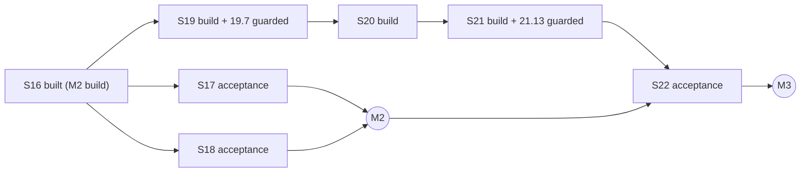

# harness:DSH-M3 -- Technical specification (problem, scope, proof, risks)

> Story `harness:DSH-M3`: milestone **M3** of
> [impl.md sec. 3.3](../../harness/impl.md#33-milestones-and-when-a-feature-may-be-enabled),
> stages [DH-S-19](../../harness/impl.md#dh-s-19) to [DH-S-22](../../harness/impl.md#dh-s-22).
> **Status: design only.** Nothing here is built, run or tested. No story-point number
> is given; the size facts are in sec. 3.6 and the estimate is open question M3-Q-10.

This document states **what M3 must achieve (A), which stages, decisions and
deliverables produce it (B), and which scenarios and records prove it (C)**, plus scope,
non-goals, constraints, risks and open questions. It follows the structure of the M1
story's [tech-spec.md](../harness-DSH-M1/tech-spec.md) and reuses its constraint IDs
(NG-*, RM-*, QG-*, EV-*, EN-*, SP-*, DC-*) and its test-strategy IDs (TC-* in the M1
[architecture.md](../harness-DSH-M1/architecture.md)). New story-level IDs start with `M3-`.
Planned siblings (an architecture slice, an implementation plan and scenario scripts) are
not written yet; when they are, they build against this file.

Source documents, never re-decided here: [design.md](../../harness/design.md),
[impl.md](../../harness/impl.md) (rules of sec. 1.4, evidence record sec. 7.3, scenario
index sec. 7.5, problems sec. 10) and the area specs under `docs/harness/areas/` and
`docs/harness/libs/`.

---

## 1. Problem statement

### 1.1 What was asked, read precisely

| Phrase in the request | Meaning adopted | Source that fixes it |
|---|---|---|
| "milestone M3 of the dsh harness" | Build stages DH-S-19 (routes and event stream), DH-S-20 (shell and design system), DH-S-21 (chat and transcript), and close acceptance stage DH-S-22. M3 is reached only when DH-S-22 is closed and the guarded scenarios of DH-S-19 and DH-S-21 have passed | impl.md sec. 3.3, M3 row |
| "a first working harness" | `dsh web` on Linux: sign-in link, session list, chat, live transcript, tool cards, approvals and session grants in a real browser; configuration edited from several processes | impl.md sec. 3.3, "What is usable" |
| "EXECUTES scenarios ... against real browsers and a real deployed `dsh web`" | The 20 scenarios of DH-S-22 and the 3 guarded scenarios of steps 19.7 and 21.13 run against the built binary, its served UI, its real HTTP API and, where the scenario's Given says so, the real model API. 23 scenarios in all | impl.md sec. 7.5 rows S19, S21, S22 |
| "M2 closed as the entry prerequisite" | Acceptance (DH-S-22) starts only after DH-S-17 and DH-S-18 are closed. Build work (DH-S-19 to -21) starts as soon as DH-S-16 is built | Caller instruction; impl.md sec. 1.4 rule 1 and the sec. 3.1 flowchart (S16 to S19). See decision M3-D-1 |
| "follow impl" (inherited from the M1 story) | impl.md order, step IDs, rules and evidence format bind this story; a disagreement becomes an open question, never a silent code change | M1 tech-spec NG-11, DC-2 |

### 1.2 The problem in one paragraph

At M2 a person can drive `dsh` from a terminal or a Go program. Nobody can use it from a
browser, which is the product's main surface ([DH-O-12](../../harness/design.md#dh-o-12)
"Live HTML UI in the browser"). M3 must add the whole web carrier -- routes that answer a
browser, an access decision for every route, a live event stream, a shell and design
system, chat, transcript, tool cards and inline approvals -- on top of a spine it may not
change (RM-7: the spine never imports a carrier), and then prove in real browsers that
the page shows every event once and in order, that only the person who started `dsh` can
sign in, and that approvals and grants behave the same from two tabs. A rendered-HTML
test cannot make these claims (impl.md DH-S-22 "Result").

### 1.3 Why M3 is the right cut, and why it is hard

- **It completes P0.** After DH-S-22 every deliverable the ledger marks P0 is built
  (impl.md sec. 3.3). The next stages are P1 parity.
- **It is the first acceptance that needs three engines and three operating systems.**
  M2's acceptance runs on Linux against a model; M3's needs Chromium-family browsers on
  Linux, Windows and macOS, Firefox and Safari for the engine-sensitive set
  ([DH-ADR-39](../../harness/design.md#dh-adr-39)), and a second machine on the network.
- **One acceptance step cannot close as impl.md stands.** Step 22.12 (Firefox and Safari)
  stays open while those runs are a manual checklist, and no stage or deliverable builds
  the second browser driver. See risk M3-R-1 and question M3-Q-1.
- **The browser holds owner authority.** A signed-in page can approve commands that run
  as the user, so a rendering or access defect is a security defect, not a cosmetic one
  (design.md sec. 6; NG-10 of M1 still holds: no boundary stronger than design.md sec. 6
  is claimed).

### 1.4 Terms used in this document

| Term | Plain meaning | Why it matters here |
|---|---|---|
| **Sign-in link** | The URL `dsh` prints (or opens) with a **launch token** in it: a random secret that works once and expires after `LaunchTokenTTL` ([DH-ADR-HOST-3](../../harness/areas/host-telemetry.md#dh-adr-host-3)) | It is the only transport into the UI. A scenario reads it from the host's own output at run time |
| **Browser session / peer** | What one successful token exchange creates: a cookie for one browser, backed by a hashed, durable row on the host. Each browser is its own peer and can be signed out alone | Sign-in state survives a host restart; sign-out and "revoke all" delete rows |
| **Access decision** | The check every route and stream makes before it answers ([DH-D-API-3](../../harness/areas/api.md#dh-d-api-3)). At M3 only the owner is admitted | Distinguishes *who may look or act* from *who owns a resource* |
| **Session grant** | A permission the owner gives while answering an approval, for example "allow writes in directory S for this session". It lives in memory with the live agent and is never copied to a resume, fork or subagent (NG-8, [DH-D-HUMAN-3](../../harness/areas/interaction-credentials.md#dh-d-human-3)) | A grant is permission, not ownership; it ends with the session or on revoke |
| **Event stream** | The server-sent event connection that keeps an open page live; each event has a sequence number `seq`, and a reconnect resumes from the last one seen | "Every event once and in order" is a claim about `seq` across cuts and restarts |
| **Keyless browser lane** | A CI job that drives a real Chromium against the real binary with a recorded (replayed) model and no key ([DH-D-WEBAPP-6](../../harness/areas/app-web.md#dh-d-webapp-6)) | Fast real-browser evidence on every commit; it is local evidence, not a scenario (impl.md sec. 1.3 "Keyless replay") |
| **Engine-sensitive scenario** | A scenario whose behaviour can differ by browser engine and must also pass in current Firefox and Safari | Needs a second driver (W3C WebDriver, [DH-ADR-PLAYWRIGHT-2](../../harness/libs/playwright.md#dh-adr-playwright-2)) or a manual checklist |
| **Controller** | The machine that runs `go test -tags scenario`. It may be a developer machine that reaches the environment machines over SSH | Separates where commands are issued from where `dsh` and the browser run |
| **Guarded scenario** | A scenario whose defect could delete, restore over or take ownership of something; it runs inside its build stage on scratch data (impl.md sec. 7.4) | Steps 19.7 and 21.13 |

### 1.5 Starting point in the repository (read on this branch)

| Fact | Value today | Consequence |
|---|---|---|
| M1 story | Stages DH-S-1 to -11 have code and evidence records; [DH-S-11 evidence](../harness-DSH-M1/evidence/DH-S-11.md) says DH-S-11 is **not closed** (its M1 manual check has not run with a real key; `built-through` stays at DH-S-7) | M3's chain of entry conditions starts from an unclosed M1 |
| M2 story | Being written in parallel; no `docs/stories/harness-DSH-M2/` folder exists yet | This file depends only on impl.md's DH-S-12 to -18 text |
| `src/harness/internal/host` | Holds `diag` and `sharing` only; no listener, admission, route or stream code | DH-S-15 (M2) must land the listener before DH-S-19 |
| `test/scenario` | Does not exist; the scenario helper ([DH-D-UTIL-8](../../harness/areas/util-test-support.md#dh-d-util-8)) arrives in step 16.7 (M2) | M3 scenarios cannot run before M2's step 16.7 |
| `src/harness/test/e2e/harness-DSH/*.feature` | Story-local godog features from M1 | Local evidence only (M3-D-8); they never tick a `DH-E-*` scenario |

---

## 2. Outcomes (A)

Each story outcome refines one or more design outcomes and links forward to the stages
that build it (B) and the scenarios that prove it (C, sec. 4.2).

| ID | Observable outcome at M3 | Design outcome | Built in (B) | Proven by (C) |
|---|---|---|---|---|
| M3-O-1 | A browser reaches the UI only through the sign-in link; another origin, another machine without the stated path, and a process the host started for the model are refused; a launch that cannot serve fails loudly | DH-O-7, DH-O-12 | 19.1, 19.2 (with DH-S-15 HOST-1..3) | DH-E-HOST-1, -HOST-2, -API-2, -BOOT-1 |
| M3-O-2 | An open page shows every event once and in order across a network cut, a parked tab, a host restart and seven tabs | DH-O-12 | 19.3, 20.3 | DH-E-API-1, -GOUISTACK-1, -GOUISTACK-2, -UICORE-2 |
| M3-O-3 | A person writes a message, watches the reply stream, reads tool calls as cards with an honest state, and can read a long conversation | DH-O-12, DH-O-6 | 19.4, 21.1 to 21.6 | DH-E-UICONV-1, -UICHAT-5. Hostile output being inert is a local test and manual check at M3; its scenario DH-E-UICONV-2 runs in DH-S-48 |
| M3-O-4 | Approvals, questions and session grants are answered inline; two tabs agree; only the session's creator answers; with nobody to ask the answer is no | DH-O-7 | 21.7 (with DH-S-10 HUMAN-1..5) | DH-E-HUMAN-1, -HUMAN-6, -HUMAN-7; guarded DH-E-HUMAN-2 |
| M3-O-5 | Every page is one document in one shell, in English or Chinese, keyboard-operable, light or dark; a feature's UI appears and disappears with it in an open page | DH-O-12, DH-O-1 | 20.1 to 20.15 | DH-E-UICORE-1, -UICORE-3, -UIKIT-1, -UIKIT-2, -UIKIT-5 |
| M3-O-6 | Several processes on one home do not lose or half-apply a configuration edit, and share machine state (workspaces, archive) correctly | DH-O-2, DH-O-5 | 19.5, 19.6, 21.13 (with BOOT-7, STORAGE-7 from M1) | Guarded DH-E-BOOT-2, DH-E-STORAGE-1 |
| M3-O-7 | The `web`, `headless` and `sdk` profiles send nothing but model requests | DH-O-14 | 21.11 (with DH-S-14, -16 bundles) | DH-E-BUNDLE-3 |
| M3-O-8 | The keyless browser lane runs on a clean runner and fails when it should | DH-O-15 | 21.12 | DH-E-WEBAPP-5 |
| M3-O-9 | A person sees every workspace and session, starts one, and adds a directory as a workspace | DH-O-12 | 19.5, 19.6, 21.8, 21.9 | Built, not done at M3: DH-E-UISIDE-1 runs in DH-S-42 and the last scenario of UISIDE-8 in DH-S-58 (impl.md sec. 10.4, S-1). At M3: local tests and the 21.x manual checks only |

---

## 3. In scope (B)

### 3.1 Stages

Each build stage is entered when every stage on its impl.md Entry line is *built* (rule 1).
Steps, deliverables and sequences are impl.md's; they are not repeated. No stage exceeds
20 steps, so none needs splitting.

| Stage | Result (impl.md, condensed) | Entry dependencies | Priority | Steps | Exit evidence |
|---|---|---|---|---|---|
| [DH-S-19](../../harness/impl.md#dh-s-19) | The host answers a browser one way (pages, fragments, forms, errors), decides access for every route and stream, keeps a page live with every event once and in order, and lets a person start, read, prompt, steer, cancel, continue and fork a conversation | S8, S9, S11, S15, S16 built. External: a real model key for 19.7 | P0 (1 P1: API-6 pulled forward). Held open: API-5 (H-5, H-6) | 7 (6 deliverables + guarded 19.7) | Evidence record; the test that a handler declaring no resource cannot register; DH-E-STORAGE-1 passed with the home listed before and after and both processes' views of the workspace registry |
| [DH-S-20](../../harness/impl.md#dh-s-20) | One shell, two languages, one partial library and one stylesheet; contribution points whose UI leaves with the feature; connection state; keyboard widgets; a gallery with goldens | S6, S14, S19 built. External: current browsers; owner default "product shows `dsh` with a neutral mark" | P0 (4 P1 pulled forward: HOST-10, UICORE-5, UICORE-6, UIKIT-3). Held open: HOST-10 (H-9), UIKIT-3 (H-22) | 15 | Evidence record; golden files of every partial; the check that one component writes the one `Content-Security-Policy`; observation of fact F-5 (import-map hash source) per browser |
| [DH-S-21](../../harness/impl.md#dh-s-21) | `dsh web` starts one assembled product: session list, composer, streaming transcript, tool cards, inline approvals and grants; hostile output inert; a real browser drives the product without a key in CI | S10, S16, S19, S20 built. External: Chromium-family browser for the lane | P0. Held open: UICONV-1 (H-8) | 13 (12 deliverables + guarded 21.13) | Evidence record; keyless lane passing on a clean runner; DH-E-HUMAN-2 and DH-E-BOOT-2 passed with session logs of both hosts and layer files compared; the M3 open list (M3-D-9) |
| [DH-S-22](../../harness/impl.md#dh-s-22) | In real browsers: events once and in order across cut, park and restart; sign-in only by the stated path; loud launch failure; approvals and grants the same from two tabs; a late answer becomes a user message | S21 built with all its guarded scenarios passed; S19's guarded scenario passed; S17 closed (impl.md); **S18 closed (this story, M3-D-1)**. External: E1, E2, E5 (sec. 4.4) | P0 | 12 (20 scenarios) | One record per scenario per browser and OS: browser name and version, console and policy-violation log, session export; M3 declared |

### 3.2 Status by stage

The five statuses of impl.md sec. 1.2 are kept apart. "Built" (code merged, local tests
pass, manual check recorded) and "done" (every proving scenario passed, every held-open
dependency closed) are never merged (EV-2).

| Stage | Design | Implementation | Test authoring | Local passes | Real-environment acceptance |
|---|---|---|---|---|---|
| DH-S-19 | Done, as documents | Not started | Not started | Not started | Guarded 19.7: not run |
| DH-S-20 | Done, as documents | Not started | Not started | Not started | None of its own (runs in S22) |
| DH-S-21 | Done, as documents | Not started | Not started | Not started | Guarded 21.13: not run |
| DH-S-22 | Done, as documents | n/a (acceptance) | Authored in S19 to S21 | n/a | 20 scenarios: not run |

### 3.3 What overlaps M2 acceptance, and what must wait

| Work | May start when | Overlaps S17/S18? |
|---|---|---|
| Provisioning the acceptance environments (macOS and Windows 11 machines, second network machine, test certificate, reverse proxy, recording proxy, clean Linux runner) and the M3-Q-1 decision | Story start | Yes: long pole, started first |
| DH-S-19 steps 19.1 to 19.6 | S8, S9, S11, S15, S16 built | Yes |
| Step 19.7, DH-E-STORAGE-1 (guarded, Linux, real key) | 19.1 to 19.6 built | Yes; it runs on its own scratch home |
| DH-S-20, all steps | S19 built | Yes |
| DH-S-21 steps 21.1 to 21.12 and the keyless lane | S19, S20 built | Yes |
| Step 21.13, DH-E-HUMAN-2 and DH-E-BOOT-2 (guarded, Linux and Windows 11) | 21.1 to 21.12 built | Yes |
| DH-S-22, every step | S21 built, guarded 19.7 and 21.13 passed, **S17 and S18 closed** | **No, waits** |
| Declaring M3 | S22 closed | No |

A fix made during M2 acceptance that changes a component already exercised by a passed
guarded scenario re-runs that scenario at DH-S-22 entry (M3-D-3).

### 3.4 Story-level decisions

| ID | Decision | Why | Tradeoff or constraint | Serves | Verified by |
|---|---|---|---|---|---|
| M3-D-1 | Build stages overlap M2 acceptance; DH-S-22 waits for **both** S17 and S18 closed, one condition stricter than impl.md's S22 Entry (S17 only) | M3's "usable" list includes M2's Linux sandbox and launchers; DH-E-HUMAN-1 and -7 write files under the `workspace-write` preset, which uses the policy resolver and sandbox that S18 proves | Acceptance may idle until S18 closes; build work fills that time | All M3-O | The S22 evidence record cites the S17 and S18 records; owner confirms (M3-Q-7) |
| M3-D-2 | Six kinds of evidence are kept apart (sec. 4.1); only a `DH-E-*` scenario run through the scenario helper on the built binary ticks a scenario | EV-1; impl.md sec. 7 "What is not real-environment evidence" | More bookkeeping per record | M3-O-1..9 | Review of every evidence record |
| M3-D-3 | Guarded scenarios run in their build stage, before any S22 run. At S22 entry, a guarded scenario is re-run only if a component it exercised changed since its pass | Rule 5; sec. 7.4; "never re-run what passed unless inputs changed" | A late M2 fix can cost a re-run | M3-O-4, M3-O-6 | The S22 record lists each guarded scenario's build identity and the diff check |
| M3-D-4 | The real model is used only where a scenario's Given names it (STORAGE-1, HUMAN-1, -2, -6, -7, BUNDLE-3); the others use the replay provider. Step 22.1 (keyless) runs first | A wrong build is found before a credential is spent (impl.md DH-S-17 sequence); replay is deterministic | Replay proves the UI, not the provider; the provider was proven in S17 | M3-O-2, -3, -5, -8 | Each record names the model source |
| M3-D-5 | Firefox and Safari runs done from a written checklist are recorded `manual` and leave step 22.12 open. M3 is not declared while 22.12 is open. No partial closure | DH-ADR-39 tradeoff; impl.md DH-S-22 "Manual checks"; sec. 10.4 S-1 ("no partial runs") | M3 may be blocked by a missing driver (M3-R-1) | M3-O-5, -2, -3 | The S22 record lists 22.12 per engine as passed, failed or open |
| M3-D-6 | One build identity per acceptance batch. A fix during S22 makes a new build; scenarios whose exercised components changed re-run. A failed scenario is re-run only after a diagnosed change; a flaky pass is a failure | Rule 7 (scope of the guarantee); no "re-run until green" | Slower closure after a late fix | All | The record shows one checksum per scenario run and the reason for each re-run |
| M3-D-7 | Retained browser artifacts (screenshot, HTML, console, network and host logs) are scrubbed of launch tokens, cookie values, form tokens and the model key before they enter a record; every run ends with sign-out or revoke-all and a deleted browser profile | SP-11, EN-3; a leaked cookie is owner authority | Scrubbing can hide a diagnostic; raw artifacts stay on the environment machine until review | M3-O-1 | Record review: the run's key and cookie values occur in no retained file |
| M3-D-8 | Story-local godog features (the M1 convention) are local evidence. `DH-E-*` scenarios live in `test/scenario` behind the scenario build tag, are run by the scenario helper and are listed in `DSH_REQUIRE_SCENARIOS` | impl.md sec. 7.2; rule 4 | Two test trees to keep apart | All | Required list in the credentialed workflow equals sec. 4.2 |
| M3-D-9 | The M3 open list is computed from impl.md sec. 10.3 (H-1 to H-6, H-8 to H-10, H-22), not from DH-S-21's exit text | The two disagree (M3-Q-5) | None | M3 enabling rule | S21 exit record |

### 3.5 Work products in scope

1. **Code** for the 33 deliverables of steps 19.1-19.6, 20.1-20.15 and 21.1-21.12
   (28 P0, 5 P1 pulled forward: API-6, HOST-10, UICORE-5, UICORE-6, UIKIT-3). Pulled
   forward does not lower the evidence bar (impl.md sec. 4).
2. **Local tests** named in each deliverable's "Done when" line, under the gate runner,
   with the 85% coverage floor (QG-3) and race and shuffle (QG-4).
3. **Goldens**: the partial gallery and rendered fragments (step 20.15), one update switch
   (QG-6).
4. **Authored scenarios**: the 23 of sec. 4.2, written against the scenario helper,
   reviewed, and listed in the acceptance workflow's required list (rule 4); also the four
   authored here that run later (sec. 4.3).
5. **One manual check per build step**, labelled `manual`, with the commit (EV-3),
   including the stage checks impl.md names (stream reconnect with an HTTP client; refused
   form token; the gallery in three browsers; a real-model browser session with approve,
   reject, grant, reload and a pasted script tag).
6. **CI**: the keyless browser lane on a clean Linux runner in the keyless job; the
   credentialed browser and model runs in the separate workflow with its preflight (QG-10).
7. **Evidence records** `docs/stories/harness-DSH-M3/evidence/DH-S-19.md` to `DH-S-22.md`
   in the format of impl.md sec. 7.3.
8. **Ledger upkeep**: `tools/harness-trace verify` keeps passing (QG-9).

### 3.6 Size facts (no estimate)

4 stages; 47 steps (35 build, 12 acceptance); 33 deliverables; 23 scenarios executed
(3 guarded, 20 acceptance) and 4 authored for later; 5 held-open items created here
(H-5, H-6, H-8, H-9, H-22); 3 environments (E1, E2 with Linux, Windows 11 and macOS,
E5 with three engines and a second machine). The point estimate is M3-Q-10.

### 3.7 Definition of done, and the M3 enabling rule

The story is done when, at one commit and one build identity:

- every step 19.1-19.7, 20.1-20.15 and 21.1-21.13 is ticked *built*, with its manual check;
- the three guarded scenarios passed in their build stages (re-run per M3-D-3 if needed);
- DH-S-17 and DH-S-18 are closed (M2);
- every step 22.1-22.12 passed, per browser and operating system its scenarios name;
- evidence records exist for DH-S-19 to DH-S-22, and the M3 open list is published.

**M3 enabling rule, as impl.md sec. 3.3 states it:** "**Nothing is enabled for users
yet**; the team uses `dsh web` on Linux. Every deliverable the ledger marks P0 is built.
Not done at M3, and so not enabled: the P0 deliverables held open (sec. 10.3) and the 44
whose last scenario runs later (sec. 10.4, S-1), among them stopping (`DH-E-CLI-1`, `-2`,
DH-S-27) and every behaviour on macOS and Windows."

What is still not done at M3, and why:

| Not done | Why | Done at |
|---|---|---|
| SDK-4 (H-1, H-2, H-3), SDK-5 (H-4): P0 | Schedule hook, multi-route validation, inline images, goal stop signal wait for P1 work | 23.13, 30.7 |
| API-5 (H-5 model catalogue, H-6 skill catalogue): P0 | Built with one provider's models, no skills | 23.13, 25.8 |
| UICONV-1 (H-8): P0 | Sent user text is plain escaped text until chips exist | 41.10 |
| HOST-10 (H-9), UIKIT-3 (H-22), UTIL-7 (H-10): P1 pulled forward | Plugin inventory rows; appearance controls in settings; replay of sessions with children | 34.8, 43.2, 29.7 |
| M3-built deliverables of S-1: API-1, WEBAPP-1, WEBAPP-2, UICORE-7, UIKIT-5, UICHAT-1, UICONV-2, -3, -6 | Their last scenario needs P1 pages or parity work | DH-S-48 |
| UISIDE-1; UICONV-4; HOST-8, UISIDE-8 | Last scenario in DH-S-42; DH-S-32; DH-S-58 | as named |
| Stopping (DH-E-CLI-1, -2); every macOS and Windows behaviour | Need the macOS and Windows backends | DH-S-27, DH-S-39 |

Running scenarios on Windows and macOS (BOOT-1, BOOT-2, UICORE-3, HOST-1, UIKIT-5) proves
those contracts for the tested builds; it enables nothing on those systems.

---

## 4. Proof (C)

### 4.1 Evidence kinds, kept apart

| Kind | Example in M3 | Counts as | Never counts as |
|---|---|---|---|
| Local unit and composition tests (`DH-T-*`) | Access table, stream hub, partial goldens, `httptest` route tests | Built (with the manual check) | A scenario |
| Stubbed-browser tests | Scenario helper against a fake CDP peer (`DH-T-PLAYWRIGHT-1`), fake WebDriver (`DH-T-PLAYWRIGHT-3`) | Local evidence for the helper | A browser run |
| Route smoke | Manual HTTP-client check of the stream and form token (S19) | `manual` record | A scenario; "a request that was merely accepted" (impl.md sec. 7) |
| Keyless browser lane on each commit | Real Chromium, real binary, replayed model, in CI | Local evidence (DH-S-21 exit) | DH-E-WEBAPP-5, which runs once in 22.1 with its three control builds |
| Manual checklist runs | Firefox and Safari before the WebDriver back end exists | `manual` record | Step 22.12 |
| Real-environment scenario | 23 `DH-E-*` runs of sec. 4.2 against the built binary | The only thing that ticks a scenario box | -- |

A missing, skipped, blocked or failed scenario is open, never a pass (rule 6). A closed
stage proves its contracts for the tested build, inputs, browsers and machines only
(rule 7).

### 4.2 Scenarios executed in this story (23)

Given, When, Then and Cleanup are in each linked spec; this table gives what a reviewer
needs to plan the run. "Replay" is the recorded model provider; "real" needs E1.

| Step | Scenario | What it shows | Machines and browsers (from its Given) | Model | Proves | Outcome |
|---|---|---|---|---|---|---|
| 19.7 (guarded) | [DH-E-STORAGE-1](../../harness/areas/storage.md#dh-e-storage-1) | A web host and a command-line run share machine state; archive and unarchive | Linux, scratch home; controller drives A over loopback HTTP and B on stdin | Real | STORAGE-7 | M3-O-6 |
| 21.13 (guarded) | [DH-E-HUMAN-2](../../harness/areas/interaction-credentials.md#dh-e-human-2) | Only the creator answers; nobody means no | SDK program plus a second `dsh web` on one home; a real terminal and a no-terminal run | Real | HUMAN-1 | M3-O-4 |
| 21.13 (guarded) | [DH-E-BOOT-2](../../harness/areas/boot.md#dh-e-boot-2) | Two `dsh web` and one headless process do not lose or half-apply an edit | Windows 11 and Linux; scenario build with probe entries | None | BOOT-7 | M3-O-6 |
| 22.1 | [DH-E-WEBAPP-5](../../harness/areas/app-web.md#dh-e-webapp-5) | The keyless lane passes, its three control builds fail, no browser means "not run" | Clean Linux runner: Go, Chromium, no Node, no key, loopback only | Replay | WEBAPP-6 | M3-O-8 |
| 22.2 | [DH-E-HOST-1](../../harness/areas/host-telemetry.md#dh-e-host-1) | Sign-in by `dsh`; a second `dsh` reuses the host; other origins refused | Windows, macOS, Linux desktops; each supported browser as default in turn (M3-Q-2) | None | HOST-2, HOST-3 | M3-O-1 |
| 22.2 | [DH-E-HOST-2](../../harness/areas/host-telemetry.md#dh-e-host-2) | Network listener: no plain HTTP, TLS, path prefix, certificate reload | Two machines; trusted test certificate; reverse proxy | None | HOST-1, HOST-2 | M3-O-1 |
| 22.2 | [DH-E-API-2](../../harness/areas/api.md#dh-e-api-2) | A browser on another machine is admitted only by the stated path | Two machines; test certificate; browser on machine 2 | None | API-3, API-2 | M3-O-1 |
| 22.3 | [DH-E-BOOT-1](../../harness/areas/boot.md#dh-e-boot-1) | Held port and bad overlay: exit 78 with positions; then readiness; exit 0 on signal | Windows 11 and Linux | None | BOOT-5, BOOT-3 | M3-O-1 |
| 22.4 | [DH-E-API-1](../../harness/areas/api.md#dh-e-api-1) | Every event once across cut, parked tab, host restart | Linux loopback, Chromium | Replay | API-4, API-5 | M3-O-2 |
| 22.4 | [DH-E-GOUISTACK-1](../../harness/libs/go-ui-stack.md#dh-e-gouistack-1) | The stream resumes in all three ways | Chromium | Replay | LIB-GOUISTACK-R6, -R7 | M3-O-2 |
| 22.4 | [DH-E-GOUISTACK-2](../../harness/libs/go-ui-stack.md#dh-e-gouistack-2) | Seven tabs over plain HTTP stay usable | Chromium; "one terminal open" (M3-Q-3) | Replay | LIB-GOUISTACK-R8 | M3-O-2 |
| 22.5 | [DH-E-UICORE-1](../../harness/areas/ui-core.md#dh-e-uicore-1) | A feature appears and disappears without reload; a new build asks to reload | Chromium, script on and off profiles; a second build | Replay (Given silent; M3-D-4) | UICORE-1, -2 | M3-O-5 |
| 22.6 | [DH-E-UICORE-2](../../harness/areas/ui-core.md#dh-e-uicore-2) | Reconnect through offline, hidden tab, sign-out, renderer fault, stream-killing proxy | Chromium, two profiles, fault proxy | Replay | UICORE-3, -5 | M3-O-2 |
| 22.6 | [DH-E-UICORE-3](../../harness/areas/ui-core.md#dh-e-uicore-3) | Islands load on demand; the keyboard reaches everything | Windows, macOS, Linux with Chromium-family; Chinese input method | Replay | UICORE-4, -6 | M3-O-5 |
| 22.7 | [DH-E-UIKIT-1](../../harness/areas/ui-kit.md#dh-e-uikit-1) | Widgets by keyboard alone, with roles | Gallery; Chromium; Chinese input method | None | UIKIT-1, -4 | M3-O-5 |
| 22.7 | [DH-E-UIKIT-2](../../harness/areas/ui-kit.md#dh-e-uikit-2) | Appearance in the first paint, both schemes, no violation | Gallery; Chromium emulation | None | UIKIT-2, -3 | M3-O-5 |
| 22.8 | [DH-E-UICONV-1](../../harness/areas/ui-conversation.md#dh-e-uiconv-1) | A streamed answer reads the same in two tabs across a cut and a restart | Chromium; Given also names Firefox and Safari (M3-Q-2) | Replay | UICONV-1, -3 | M3-O-3 |
| 22.8 | [DH-E-UICHAT-5](../../harness/areas/ui-chat.md#dh-e-uichat-5) | Long conversation: fold, page back, jump | Chromium; Given also names Firefox and WebKit (M3-Q-2) | Replay | UICHAT-6 | M3-O-3 |
| 22.9 | [DH-E-HUMAN-1](../../harness/areas/interaction-credentials.md#dh-e-human-1) | Approve and reject one call at a time, two tabs | Linux, Chromium two tabs | Real | HUMAN-2 | M3-O-4 |
| 22.10 | [DH-E-HUMAN-6](../../harness/areas/interaction-credentials.md#dh-e-human-6) | A timed question; the late answer after a restart becomes one user message | Linux, Chromium | Real | HUMAN-5 | M3-O-4 |
| 22.10 | [DH-E-HUMAN-7](../../harness/areas/interaction-credentials.md#dh-e-human-7) | A directory grant is created, used, listed, revoked and gone after restart | Linux, Chromium two tabs | Real | HUMAN-3 | M3-O-4 |
| 22.11 | [DH-E-BUNDLE-3](../../harness/areas/bundle-preset.md#dh-e-bundle-3) | `web`, `headless`, `sdk` send only model requests | Linux behind a recording proxy; Go SDK client; Chromium | Real | BUNDLE-2, -3 | M3-O-7 |
| 22.12 | [DH-E-UIKIT-5](../../harness/areas/ui-kit.md#dh-e-uikit-5), plus the engine-sensitive scenarios of 22.4 and 22.6 repeated | Browser features and widget contract in Firefox and Safari | Firefox on Windows, macOS, Linux; Safari on macOS; via WebDriver (M3-Q-1) | None / replay | UIKIT-4, -2 | M3-O-5 |

### 4.3 Scenarios authored here, run later

`DH-E-API-5` (DH-S-48: it disables the jobs routes of DH-S-40); `DH-E-UICONV-2`
(hostile output, DH-S-48); `DH-E-UICONV-4` (two browsers, macOS and Windows backends,
DH-S-39); `DH-E-UICONV-5` (tool cards for a real command, DH-S-32). They are written and
reviewed here because the stage texts say "authored here"; they are not in this story's
required list and are not run (M3-Q-9).

### 4.4 Acceptance environment

There is no lab: the environments are ordinary machines (impl.md sec. 7.1, E1, E2, E5).

| Concern | Requirement |
|---|---|
| Binary under test | The `dsh` built by the release-rehearsal pipeline of DH-S-1 (unsigned), one checksum and embedded version per batch (M3-D-6). A scenario never builds its own binary (impl.md sec. 7.2, step 1) |
| Machines and OSes | Linux (main host; also a clean runner with Go and Chromium, no Node, no key, loopback only); Windows 11 (BOOT-1, BOOT-2, UICORE-3, HOST-1, Firefox); macOS (UICORE-3, HOST-1, Firefox, Safari with `safaridriver`); a second machine on the same network (HOST-2, API-2) |
| Browsers | Current Chromium-family through chromedp for every scenario; current Firefox (`geckodriver`) and Safari for the engine-sensitive set; releases since 2024 (DH-ADR-39). A fresh profile per run |
| Target discovery | The scenario starts the built `dsh` itself on a scratch home and reads the sign-in link from the host's own output, or asks a second `dsh` to print a fresh one through the control endpoint. No URL, port or token is configured in advance |
| Transport | The sign-in link only: loopback for single-machine runs; TLS to the first machine's name for two-machine runs (plain HTTP must be refused). The controller may run on a developer machine and reach environment machines over SSH; browsers run on the environment machine |
| Credentials at run time | Model key as an environment variable of the job (for example `DEEPSEEK_API_KEY`) and the route id, only for the real-model rows; the test certificate created per run; the launch token read at run time. Nothing is stored in the repository, a layer file or a record (EN-3) |
| Command | `DSH_BIN=... DSH_REQUIRE_SCENARIOS=<IDs> DSH_SCENARIO_REPORT=... go test -tags scenario -run '<pattern>' -timeout <job limit> -count=1 ./test/scenario/...`, with names as fixed by the scenario helper in step 16.7 (impl.md sec. 7.2 marks them a proposal) |
| Order | 22.1 keyless lane; 22.2 sign-in and admission (every later scenario signs in); 22.3; stream; shell; widgets; transcript; approvals and grants; 22.11; cross-engine 22.12 last (impl.md DH-S-22 sequence) |
| Time limits | E5: 10 min per scenario per browser, 2 h per browser per job; E1: 15 min and 2 h; E2: 20 min including restore, 3 h per variant (starting values, impl.md sec. 7.2). Bounds in a Given (ten-second question, two-second reload) are part of the scenario. A deadline reached is a failure, not a skip |
| Preflight | The job fails before any scenario if a key, a machine variant, a browser or a driver program is missing; a listed scenario that does not run fails the job |
| Report | One record per scenario per browser per OS with every field of impl.md sec. 7.3 plus browser and driver versions, the console and policy-violation log, the session export, and on failure a screenshot, the page HTML and the host log; published as one report in `evidence/DH-S-22.md` |
| Recovery | If cleanup fails: keep the scratch home, the host's fatal report, the process list, the session exports and the browser logs; mark the scenario failed; restore the baseline by the environment's own means (delete the scratch user or home, delete the browser profile, remove the certificate from the trust store, stop proxies and port holders) |

### 4.5 Failure, retry and cleanup of shared state

| State | Created by | Failure and retry | Cleanup |
|---|---|---|---|
| Sign-in (launch token, browser session) | `dsh` mints a token; one exchange creates one durable, hashed session row per browser | A used, pasted or expired token is refused; the retry is a **fresh link** (second `dsh` or restart), never a reused token. If the session table cannot load, `required` routes answer 503 and nothing is admitted. Sign-out ends that browser's streams; revoke-all ends every browser's | Sign out or revoke-all, delete the browser profile and the site data for the origin, delete the scratch home (which deletes the rows). On a failed refusal step keep the request log and browser version |
| Session grant | The owner's answer path (`allow for this session`), logged as `grant/created` | A second tab's late answer is told the item is settled; a non-creator's answer is refused and the call waits; with no answerer the outcome is `unavailable` and the body never runs (SP-7). A restart leaves no grant | Revoke in the panel (`grant/ended` with `revoked`), stop the host, delete the home and workspace; keep the session export on failure. A grant created and revoked in the same scratch home is not guarded (impl.md sec. 7.4) |
| Configuration edited by several processes | `config.Service.Apply`: takes the lock, re-reads all layers, checks the revision and ownership index, writes the profile layer, reconciles ([DH-D-BOOT-7](../../harness/areas/boot.md#dh-d-boot-7)) | A bad edit changes nothing and names file, line and column in every process; a process killed while holding the lock does not block the next edit beyond the lock bound, and the file still parses; concurrent edits of different fields both land | Stop all processes, delete the home; on failure keep the layer file, its backups and both logs |
| Machine state shared by a web host and a CLI run | The workspace registry and archive flags (DH-D-STORAGE-7) | Archiving a busy session refuses and says what runs, or stops it first; both processes' views agree | List the home before and after; delete it |

**Ownership versus permission.** A run *creates and owns* its scratch home, browser
profiles, test certificate, proxies and port holder, and may delete all of them. It
*never owns* the tester's home, installed browsers, trust store entries it did not add, or
the operating system; it changes none of them. Being signed in, or holding a grant, is
*permission* to act; it never makes the browser the owner of a file or session.

### 4.6 Acceptance criteria

| ID | Criterion | Proves |
|---|---|---|
| M3-AC-19 | Steps 19.1-19.6 built (local tests under the gate runner, coverage floor, manual checks); the register-without-declaration test fails a handler with no declared resource; DH-E-STORAGE-1 passed with its cleanup evidence; the S19 scenarios are in the required list | DH-S-19, M3-O-1, -2, -6 |
| M3-AC-20 | Steps 20.1-20.15 built; partial goldens committed; one component writes the CSP; the gallery manual check recorded per browser; F-5 observed per browser | DH-S-20, M3-O-5 |
| M3-AC-21 | Steps 21.1-21.12 built; the keyless lane passes on a clean runner; DH-E-HUMAN-2 and DH-E-BOOT-2 passed on their named systems with cleanup evidence; the M3 open list published per M3-D-9 | DH-S-21, M3-O-3, -4, -6, -8, -9 |
| M3-AC-22 | All 20 scenarios of steps 22.1-22.12 passed on the browsers and machines their Given names, against one build identity, with records per sec. 4.4 | DH-S-22, all M3-O |
| M3-AC-M3 | M3-AC-19 to -22 hold and M2 is reached; the enabling rule of sec. 3.7 is published unchanged | Milestone M3 |

---

## 5. Out of scope

| Excluded | Owning stage | Why it cannot be pulled in |
|---|---|---|
| Any M2 work (DH-S-12 to -18), including fixes found in M2 acceptance | M2 story | Separate story; M3 only consumes its built and closed state |
| Jobs, terminals, settings and file pages; the UI services | DH-S-40 to -45 | P1; DH-E-API-5 and the settings-page scenarios wait for them |
| The full composer island, chips, attachments (closes H-8) | DH-S-41 | P1 |
| macOS and Windows sandbox backends; stopping scenarios DH-E-CLI-1, -2 | DH-S-27 | P1; nothing is enabled on those systems |
| More providers and the model catalogue (closes H-5); skills (H-6) | DH-S-23, DH-S-25 | P1 |
| Plugin inventory rows (H-9); appearance controls in settings (H-22) | DH-S-34, DH-S-43 | P1 |
| Signed release, documentation website | DH-S-46 | Open owner matters (impl.md sec. 9.2) |
| Live sharing and any non-owner principal (DH-D-API-10) | DH-S-57 | P2 |

## 6. Non-goals

Non-goals NG-1 to NG-12 of the [M1 tech-spec](../harness-DSH-M1/tech-spec.md#4-non-goals)
hold unchanged. Three bite hardest here: **NG-8** (no grant outlives its session; the
grants panel never offers "always"), **NG-12** (no desktop or webview shell: the UI is
HTML served by the host to the user's own browser) and **NG-10** (no boundary stronger
than design.md sec. 6). Story-specific additions:

| ID | Non-goal | Decision |
|---|---|---|
| M3-NG-1 | Node, npm or a bundler on the runners or in the product | DH-ADR-PLAYWRIGHT-1 (chromedp, pure Go); DH-E-WEBAPP-5 requires a runner without Node |
| M3-NG-2 | Phones as supported devices | U-K2-10 (best effort; desktop browsers are supported) |
| M3-NG-3 | Admitting anyone but the owner | DH-D-API-3 (owner path only at first) |

## 7. Hard constraints

All constraints of the M1 tech-spec sec. 5 continue: module layout
([RM-1 to RM-10](../harness-DSH-M1/tech-spec.md#51-repository-and-module-layout); RM-7 above
all), gates ([QG-1 to QG-10](../harness-DSH-M1/tech-spec.md#52-build-and-quality-gates)),
evidence ([EV-1 to EV-7](../harness-DSH-M1/tech-spec.md#53-evidence-and-status-discipline)),
spine invariants ([SP-1 to SP-14](../harness-DSH-M1/tech-spec.md#54-behavioural-invariants-of-the-spine-non-negotiable-at-m1)),
environment ([EN-1 to EN-6](../harness-DSH-M1/tech-spec.md#56-environment-and-secrets)) and
change control ([DC-1 to DC-6](../harness-DSH-M1/tech-spec.md#57-documentation-and-change-control);
DC-6: ASCII only). Gate tests keep the TC strategies of the M1 architecture (TC-X1 for
race, shuffle and coverage). One change: EV-6 ("the real API is reached only by manual
checks") was an M1 rule; at M3 the real API is also reached by the six real-model
scenarios, always in the credentialed workflow and never as a keyless gate criterion.

| ID | Constraint | Source |
|---|---|---|
| M3-C-1 | Safe rendering is built first: nothing from a model or a tool is drawn before DH-D-UICONV-2 exists | impl.md DH-S-21 sequence |
| M3-C-2 | No handler registers without declaring what it touches; every route and stream has an access decision | DH-D-API-1, -3 |
| M3-C-3 | One component writes the one `Content-Security-Policy` | DH-S-20 exit evidence |
| M3-C-4 | The binary carries every file a page loads and nothing it does not; no page loads from the network | DH-D-WEBAPP-2; SP-13 |
| M3-C-5 | Unconfirmed defaults stay in configuration until confirmed (DC-4): `dsh` name and neutral mark (confirm before DH-S-20); the six continuation failure codes are fixed (before DH-S-19); a second `dsh web` reuses the host (I3 Q1, already due before DH-S-16) | impl.md sec. 9.1 |
| M3-C-6 | The test driver is imported only by `test/scenario` and the browser provider package | DH-LIB-PLAYWRIGHT-R6 |

## 8. Risks

| ID | Risk | L | I | Trigger | Mitigation | Response |
|---|---|---|---|---|---|---|
| M3-R-1 | **M3 cannot close as written.** Step 22.12 stays open while Firefox and Safari are a manual checklist, and no stage or deliverable builds the WebDriver back end (DH-ADR-PLAYWRIGHT-2, `DH-T-PLAYWRIGHT-3`) | H | H | Story start: no step owns the back end | Raise M3-Q-1 at story start; it is the long pole | Owner chooses: build the back end in this story (recommended: alongside step 21.12, which depends on `DH-LIB-PLAYWRIGHT`) or accept that M3 stays open. Never record a manual run as a pass |
| M3-R-2 | **Environment breadth.** 23 scenarios need Linux, Windows 11, macOS, a second network machine, a trusted certificate, a reverse proxy, a recording proxy and Safari; one missing variant leaves its scenario open | M | H | Preflight fails for a variant | Provision first (sec. 3.3); reuse the M2 machines of E2 | The scenario stays open; M3 is not declared |
| M3-R-3 | **Placement defects surface at run time.** DH-E-GOUISTACK-2 needs a terminal (DH-S-27/40); UICHAT-5, UICONV-1 and HOST-1 name engines and systems beyond step 22.12's set | H | M | Scenario review in S19-S21 | Resolve M3-Q-2, M3-Q-3 during authoring, before S22 | Record per DC-3; the owner moves or amends the scenario; never edit it silently |
| M3-R-4 | **Stream and timing flakiness** (cuts, parked tabs, restarts) tempts re-runs until green | M | M | A scenario passes on one run, fails on another | Virtual time in local tests; bounded waits in the helper; artifacts on failure | M3-D-6: a flaky result is a failure; re-run only after a diagnosed change |
| M3-R-5 | **Owner authority in the browser.** A rendering or access defect lets model output act as the owner | L | H | A policy violation or a script executing in a record | M3-C-1, -2, -3; the pasted-script manual check; policy-violation logs in every record | Stop S22; fix; re-run everything the change touches. DH-E-UICONV-2 still runs only in DH-S-48 |
| M3-R-6 | **Credential leakage in browser artifacts** (cookie, token, key in screenshots, HTML or network logs) | M | H | A value found in a retained file | M3-D-7; one-time, expiring tokens | Revoke all sessions, rotate the key, purge the record, add a regression test |
| M3-R-7 | **Churn from M2 acceptance** changes S15/S16 under S19-S21 | M | M | An S17/S18 fix touches the listener, launchers or scenario helper | Build on contracts; keep the build identity in every record | M3-D-3 re-runs affected guarded scenarios |
| M3-R-8 | **Size.** 47 steps, 33 deliverables and 23 scenarios on three systems and three engines | H | H | S20 not built at half the budget | Land per stage, each with its own record | Stop at the last built stage; re-plan the rest (M3-Q-10) |
| M3-R-9 | **Fact F-5 is bad**: a supported browser rejects a hash source for an import map | L | H | Gallery manual check in S20 | Observe in S20, before islands spread | The page policy for islands is redesigned in ui-core.md by the owner (impl.md sec. 9.3) |
| M3-R-10 | **Clean-runner drift**: the hosted image lacks Chromium or carries Node | M | M | DH-E-WEBAPP-5 preflight | Pin and check the image in the lane's first step | Fix provisioning; never relax "no Node" |

## 9. Assumptions and dependencies

| ID | Assumption | If false |
|---|---|---|
| M3-A-1 | M1 closes and M2 reaches DH-S-16 built, then closes S17 and S18 | Build cannot start or S22 cannot start |
| M3-A-2 | The scenario helper (DH-D-UTIL-8) and replay (DH-D-UTIL-7) from step 16.7 support a browser channel, profile directory and per-browser records | The helper is extended under its own deliverable in M2 |
| M3-A-3 | The team has a macOS and a Windows 11 machine and a second networked machine, as E2 already requires for M2 | M3-R-2 response |
| M3-A-4 | An operator supplies a model key at run time for the six real-model scenarios | They stay open; M3 is not declared |

External dependencies: chromedp v0.24.0 (libs/playwright.md); current Chromium, Firefox
with `geckodriver`, Safari with `safaridriver`; the model provider of DH-S-9; GitHub
Actions for the keyless lane.

## 10. Open questions and inconsistencies

None of these is resolved here (DC-2). Each names both citations.

| ID | Question or inconsistency | Citations | Proposed handling |
|---|---|---|---|
| M3-Q-1 | The WebDriver back end has no `DH-D-*` deliverable and no impl.md step, yet step 22.12 cannot close without it | impl.md DH-S-22 "Manual checks"; libs/playwright.md DH-ADR-PLAYWRIGHT-2, `DH-T-PLAYWRIGHT-3` | Owner: schedule it (recommended: with 21.12) or accept M3 open |
| M3-Q-2 | Step 22.12 repeats only UIKIT-5 and the engine-sensitive scenarios of 22.4 and 22.6, but the Givens of DH-E-UICONV-1 and DH-E-UICHAT-5 (22.8) name Firefox and Safari/WebKit, and DH-E-HOST-1 names each supported browser on three systems | impl.md step 22.12; ui-conversation.md, ui-chat.md, host-telemetry.md Givens | Owner fixes the engine-sensitive set per scenario |
| M3-Q-3 | DH-E-GOUISTACK-2 needs "one terminal open"; terminals are built in DH-S-27 and DH-S-40 | libs/go-ui-stack.md; impl.md sec. 7.5 places it in S22 | Drop the terminal clause for M3 or move the scenario to DH-S-48 |
| M3-Q-4 | DH-S-20's sequence says "Five P1 deliverables are pulled forward"; its steps and the stage index show four | impl.md DH-S-20 sequence vs. steps and sec. 5 | Mechanical fix to "Four" |
| M3-Q-5 | DH-S-21's exit lists open items "H-1 to H-6 and H-8 to H-12"; sec. 10.3 gives H-1 to H-6, H-8 to H-10 and H-22 at M3 (H-11, H-12 are created in DH-S-25) | impl.md DH-S-21 exit vs. sec. 10.3 | Use sec. 10.3 (M3-D-9) |
| M3-Q-6 | DH-S-22's entry says "its guarded scenario" (singular); DH-S-21 has two, and DH-S-19's is not named, while the M3 row names both stages' | impl.md DH-S-22 entry vs. sec. 3.3 | Require all three |
| M3-Q-7 | DH-S-22's entry needs only DH-S-17 closed; this story also waits for DH-S-18 | impl.md DH-S-22 entry; M3-D-1 | Owner confirms |
| M3-Q-8 | Environment E2's stage list omits 21 and 22, though DH-E-BOOT-2 (S21) and DH-E-BOOT-1, -UICORE-3, -HOST-1 (S22) need Windows or macOS machines | impl.md sec. 7.1 | Add 21 and 22 to E2 |
| M3-Q-9 | Rule 4 requires authoring only the scenarios indexed to the paired acceptance stage, but the S19 and S21 texts say DH-E-API-5 and DH-E-UICONV-2, -4, -5 are "authored here" | impl.md sec. 1.4 rule 4 vs. DH-S-19, DH-S-21 "Scenarios" | Author them here; do not list them as required |
| M3-Q-10 | Story estimate. Size facts in sec. 3.6; M1 alone covered 11 stages | sec. 3.6 | Owner assigns points, or splits build (S19-S21) from acceptance (S22) |
| M3-Q-11 | Step 19.7 says DH-E-STORAGE-1 proves DH-D-STORAGE-1 and -7; the scenario says it proves STORAGE-7 | impl.md 19.7 vs. storage.md | Ledger `proves` governs |

## 11. Coverage of the request

| Request element | Where handled |
|---|---|
| Stages DH-S-19 to -22, result, entry, priority, steps, exit | sec. 3.1, 3.2 |
| Overlap with M2 and what waits | sec. 3.3, M3-D-1 |
| Scenarios executed, real browsers, real `dsh web` | sec. 4.2, 4.4 |
| Local, stubbed and route-smoke evidence versus real browsers | sec. 4.1, M3-D-2, M3-D-8 |
| M3 enabling rule and what is not done | sec. 3.7 |
| Failure, retry and cleanup of sign-in, grants and shared configuration | sec. 4.5 |
| A-B-C links | sec. 2 (A to B and C), 3.4 (decisions to outcomes), 4.2 and 4.6 (C to outcomes) |
| No story points | sec. 3.6, M3-Q-10 |
