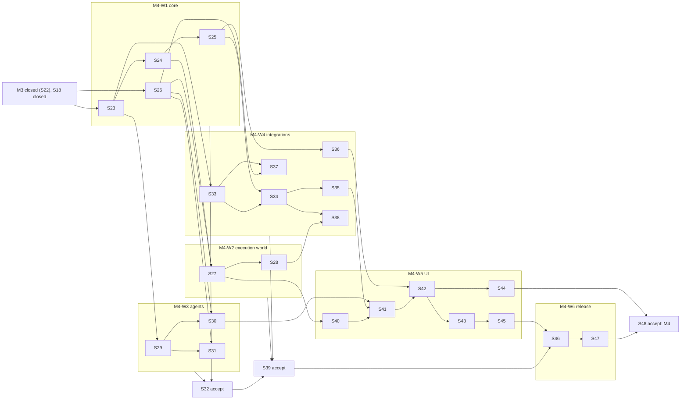

# harness:DSH-M4 -- Technical specification (problem, scope, constraints, risks)

> Story `harness:DSH-M4`, the milestone M4 follow-on of story
> [`harness:DSH`](../harness-DSH-M1/tech-spec.md) (M1). The operator instruction still
> holds: "follow impl". This story takes impl.md stages **DH-S-23 to DH-S-48**,
> milestone [M4](../../harness/impl.md#m4), "Parity on the main paths: the first
> public release".

This document states **what M4 must achieve, what it builds and in what groups, how
completion is proven in real environments, what it will never do, which constraints
are hard and which risks can sink it**. It is a **design document only**: nothing in
it has been built, run or tested, and it claims no test result.

| Planned sibling (not yet written) | Will own | Relationship to this file |
|---|---|---|
| `architecture.md` | M4 components, flows and the M4 rows of the Test & Environment Contract | Extends the M1 contract (TC-01a .. TC-X2 of [the M1 architecture](../harness-DSH-M1/architecture.md)); TC-X2 gains real-environment rows |
| `implementation-plan.md` | Ordered work items and commits for steps 23.1 .. 48.15 | Must stay inside sec. 2 and obey sec. 8 |
| `e2e-scenarios.md` | The `DH-E-*` scripts that execute in this story | Must honour sec. 3 and sec. 4 |

Source documents (the requirements; this story never re-decides them):
[design.md](../../harness/design.md) (outcomes `DH-O-1..16`, owner decisions
`DH-ADR-1..40`), [impl.md](../../harness/impl.md) (stages, rules, environments,
scenario index), the area and library specifications under `docs/harness/areas/`
and `docs/harness/libs/`, and the debt registers under `docs/harness/debt/`.

---

## 0. Vocabulary used in this document

Terms of [impl.md sec. 1.3](../../harness/impl.md#13-vocabulary) (deliverable, stage,
step, build and acceptance stage, guarded scenario, manual check, built, done, held
open, milestone) are used as defined there. The terms below are added or sharpened
for M4.

| Term | Meaning | Why it matters here |
|---|---|---|
| **Workstream** (`M4-W1` .. `M4-W6`) | A story-level group of impl.md stages that build one coherent part of the product and share one proving acceptance stage | M4 has 26 stages; groups make order, parallelism and proof reviewable |
| **Acceptance batch** | The run of one acceptance stage (DH-S-32, -39 or -48): every scenario indexed to it, against one recorded build | The batch closes only when every listed scenario passed (impl.md rule 6) |
| **Real environment** (E1 .. E8) | A real model API, real operating-system machines, an SSH host, real external programs, real browsers, real accounts, clean machines, other parties' software ([impl.md sec. 7.1](../../harness/impl.md#71-the-environments)). This product has no lab | The only evidence that M4 works outside a test double |
| **Sandbox backend** | The operating-system mechanism that confines a command: bubblewrap or Landlock on Linux (M2), **Seatbelt** on macOS (`sandbox-exec`, DH-D-SANDBOX-5) and a **restricted token** on Windows (a token with fewer rights than the user's, DH-D-SANDBOX-6) | Until DH-S-27, commands on macOS and Windows run only under full access |
| **Journal** | A row written **before** a change to something outside the harness home (for example an access-control entry on the user's directory), naming what will be added | Cleanup removes only journalled entries, so dsh never removes what it did not add |
| **Receipt** | A record written **after** a remote operation over SSH, saying what happened, read again by the next connection | A lost connection leaves an honest "outcome unknown", not a guess |
| **Approved copy** | The copy of an operator's plugin directory that dsh reads, digests and runs from (DH-D-EXT-1) | The operator can keep editing the original; nothing runs from it |
| **MCP / ACP** | Model Context Protocol (external tool servers the harness starts and supervises); Agent Client Protocol (an editor-style client drives the harness, or the harness drives an ACP agent) | Two of the protocol integrations M4 adds |
| **Wheel** | A Python installation package; the M4 wheels carry the Go binary (DH-D-PYSDK-3) | The Python SDK installs dsh without a separate download |
| **Release candidate** | The signed binaries, checksums and three module tags produced by DH-S-46 that DH-S-48 tests; when DH-S-48 closes it becomes the first public release | Rule 7: the evidence proves this build, not another |
| **Sharing page** | The settings page that lists every kind of data that can leave the machine, each with its switch and the one off-switch (DH-D-UISET-3) | Named in DH-S-48's result |

---

## 1. Problem statement

### 1.1 What was asked, read precisely

| Phrase or fact | Meaning adopted in this story | Source that fixes the meaning |
|---|---|---|
| "follow impl" (story `harness:DSH`) | Execute DH-S-23 .. DH-S-48 in impl.md's dependency order, with its step IDs, the rules of sec. 1.4 and the evidence record of sec. 7.3. Where a stage's Scenarios line and the index of sec. 7.5 differ, the index governs | [impl.md sec. 1.4](../../harness/impl.md#14-rules-that-hold-for-every-stage), sec. 6 preamble |
| Milestone M4 | Reached when [DH-S-48](../../harness/impl.md#dh-s-48) is **closed**, which needs DH-S-39 closed and DH-S-46, DH-S-47 built | [impl.md sec. 3.3](../../harness/impl.md#33-milestones-and-when-a-feature-may-be-enabled) |
| "Parity on the main paths" | The 170 P1 deliverables of the ledger: 143 are built in these stages, 27 were pulled forward into P0 stages. Two P2 deliverables are pulled forward into M4 (DH-D-TOOLS-6, DH-D-UISIDE-9) | [impl.md sec. 4](../../harness/impl.md#4-priorities-and-deferred-scope), sec. 10.1 |
| "The first public release" | One **signed** binary per platform as GitHub release assets, three module tags on one commit, a documentation website and an operator guide | [DH-S-46](../../harness/impl.md#dh-s-46) |
| Executes real-environment scenarios | Unlike M1, this story **runs** scenarios: 22 guarded scenarios inside build stages and 101 in three acceptance batches | [impl.md sec. 7.4, 7.5](../../harness/impl.md#75-index-of-all-scenarios); sec. 3.2 below |

### 1.2 The problem in one paragraph

At M3 a team can use `dsh web` on Linux, but nothing is enabled for users: there is
no confinement on macOS or Windows, the guarded stop scenarios have not run, and the
product lacks most of what an upstream user expects (more providers, compaction,
skills, terminals, SSH, subagents, schedules, workflows, MCP, plugins, office
documents, ACP, the Python SDK and the full UI). **The problem of this story is to
build those features on the M3 spine, prove each one on every platform it claims in
real environments, and hand an operator a signed release whose stated limits are
true** -- without relaxing a gate, without enabling any feature whose scenarios have
not passed, and with two owner decisions (signing, website hosting) still open.

### 1.3 Why this cut, and why it is hard

- **It is the first release.** Every earlier milestone says "nothing is enabled". M4
  is where features become usable by people outside the team, so every enabling
  claim must be backed by a passed scenario on the named platform.
- **It is large.** Size facts, counted from impl.md: 26 stages (23 build, 3
  acceptance), **225 steps**, **145 deliverables** built (143 P1, 2 P2 pulled
  forward), **123 scenarios executed** (22 guarded, 101 in batches), 7 of the 8
  real environments, 178 carried known-limit rows written down in DH-S-47, and 12
  held-open items closed. M1, for comparison, had 11 stages, 103 steps and
  executed no scenario.
- **It touches things dsh does not own.** The user's directories (Windows
  access-control entries), a remote host (SSH helper), the operating-system
  keychain, a vendor account, plugin directories the operator placed, Git
  repositories, and homes that several `dsh` processes share. Sec. 4 states the
  ownership rules.
- **Its last step is blocked from outside.** Steps 46.5 and 46.6 need code-signing
  certificates and a key-custody decision that nobody has made (sec. 6).

### 1.4 Starting point in the repository (at the time of writing)

| Fact | Value today | Consequence |
|---|---|---|
| M1 stages DH-S-1 .. DH-S-11 | Merged on `main` (commits through `dd3f78e`, "Context Pipeline and M1 Closure") with evidence records under `docs/stories/harness-DSH-M1/evidence/` | The spine exists |
| M2 and M3 (DH-S-12 .. DH-S-22) | Being specified by sibling stories; not built | This story cannot start until its entry (sec. 2.1) holds |
| Credentialed workflow | [`harness-scenarios.yml`](../../../.github/workflows/harness-scenarios.yml): manual dispatch and schedule only; one secret (`DSH_DEEPSEEK_API_KEY`); GitHub-hosted Linux, macOS, Windows runners | Too narrow for M4; extended per sec. 3.3 |
| Acceptance index | [`test/harness/acceptance-index.yaml`](../../../test/harness/acceptance-index.yaml), `built-through: DH-S-7`, read by `harness-gate require` and `preflight` | M4 adds its 123 scenario IDs here, each in the change that authors it |
| Scenario location | Scenarios run with `go -C src/harness test -tags scenario`, not from `test/scenario` as impl.md sec. 7.2 proposes | sec. 7.2 says it is corrected when the helper is built; recorded as M4-I-9 |

---

## 2. In scope

### 2.1 Entry prerequisite

The story starts when **M3 is reached: DH-S-22 is closed**, with the guarded
scenarios of DH-S-16, DH-S-19 and DH-S-21 passed. Two further facts must hold:

- **DH-S-17 and DH-S-18 (M2) are closed.** DH-S-32's entry names them, and DH-S-22
  closed does not imply DH-S-18 closed (DH-S-22's entry is DH-S-17 and DH-S-21).
- **The second browser driver exists.** DH-S-22 step 22.12 stays open while Firefox
  and Safari runs are only a manual checklist, so DH-S-22 closed implies it; DH-S-48
  relies on the same rule.

Build stages may start as soon as their own entry stages are built (rule 1); only
the acceptance stages wait for earlier acceptance stages.

### 2.2 Workstreams

The six workstreams follow impl.md's dependency direction
([sec. 3.1](../../harness/impl.md#31-direction-of-dependencies)): the core grows
first, then the execution world and the agent features that rest on it, then
integrations, then the UI that shows all of it, then the release.

| ID | Workstream | Stages | Steps | Deliverables | Outcomes served (A) | Proved by (C) |
|---|---|---|---|---|---|---|
| M4-W1 | Core at parity: providers, sessions, views, file features, context and skills, jobs and the tool command line | 23, 24, 25, 26 | 37 | 34 | DH-O-3, -4, -5, -6, -7, -8, -13 | DH-S-32 (Linux); every-backend parts in DH-S-39; guarded 23.14 |
| M4-W2 | Execution world on three systems: terminals, persistent shells, macOS and Windows sandboxes, SSH | 27, 28 | 12 | 9 | DH-O-1, -5, -7, -10 | DH-S-39; guarded 27.8, 27.9, 28.3 |
| M4-W3 | Agent features: subagents and teams, schedules, goals, plan mode, workflows | 29, 30, 31 | 19 | 16 | DH-O-3, -4, -5, -9 | DH-S-32; every-backend workflows in DH-S-39; guarded 30.8 |
| M4-W4 | Integrations and operations: MCP and web, plugins, keychain and vendor, office documents, ACP and Python SDK, admin commands and watchdog | 33 .. 38 | 39 | 34 | DH-O-1, -6, -7, -8, -10, -11, -13, -14 | DH-S-39; guarded 34.9, 35.7, 38.4 |
| M4-W5 | UI at parity: UI services, chat, sidebar and panels, settings pages, work views, the web product | 40 .. 45 | 49 | 46 | DH-O-2, -7, -12, -14, -15 | DH-S-48; guarded 42.8, 43.9 |
| M4-W6 | Release and known limits: website, signed release, operator lifecycle, documented limits | 46, 47 | 23 | 6 | DH-O-14, -16 | DH-S-48; guarded 46.7 |
| -- | Acceptance batches | 32, 39, 48 | 46 | -- | as above | -- |

Steps add up to 225 and deliverables to 145. Every workstream links forward to an
acceptance stage, and every acceptance stage links back to its build stages, so no
deliverable or scenario of the range is an orphan. DH-S-47 has no scenario of its
own: its pages are checked with the release candidate in DH-S-48, and its proof is
the table of 178 unit IDs against pages and tests (problem G-7).

**What may proceed in parallel.** After entry, DH-S-23 and DH-S-26 start together
(both need only M2/M3 stages). After DH-S-23: DH-S-24, DH-S-29 and DH-S-33 in
parallel. DH-S-27 waits for DH-S-24 and DH-S-26; DH-S-30 and DH-S-31 wait for
DH-S-26 and DH-S-29. In M4-W4, DH-S-36 (needs DH-S-25) and DH-S-37 (needs DH-S-26,
DH-S-33) run beside the plugin chain DH-S-34 -> DH-S-35. M4-W5 starts with DH-S-40
once DH-S-27 is built, so the UI overlaps M4-W4. DH-S-44 runs beside DH-S-43.

**Critical path.** DH-S-23 -> 24 -> 25 -> 34 -> 35 -> 41 -> 42 -> 43 -> 45 -> 46
-> 47 -> 48, joined at DH-S-46 by the acceptance chain DH-S-32 -> DH-S-39. The two
long poles are external: the environments of sec. 3 for DH-S-39, and the signing
decision of sec. 6 for DH-S-46.

### 2.3 Stages

All 26 stages are P1. None exceeds 20 checklist steps; DH-S-39 is exactly at the
limit. "Guarded" names the step in which guarded scenarios run inside the build
stage. The deliverables of each step are in the stage's section of impl.md; they are
not repeated here.

| Stage | WS | Kind | Entry (stages) | Steps | Result (impl.md, condensed) | Exit evidence (beyond sec. 7.3 record) | Executes here |
|---|---|---|---|---|---|---|---|
| [DH-S-23](../../harness/impl.md#dh-s-23) | W1 | build | 16 | 17 | Any key-authenticated provider on four wire protocols; safe image admission; fork, search, archive, model-facing listing; log-only handoff; retention | Scratch-home listing before/after 23.14; H-2, H-3, H-5 struck | Guarded 23.14: 1 |
| [DH-S-24](../../harness/impl.md#dh-s-24) | W1 | build | 12, 13, 23 | 6 | Read-before-edit, `read_image`, `present`, changed files recorded, loop reminders, task list | Repository comparison of the manual check | -- |
| [DH-S-25](../../harness/impl.md#dh-s-25) | W1 | build | 13, 14, 23, 24 | 8 | Compaction under pressure, pruning without a model call, manual compaction, mentions, skills catalogue | H-6 struck; H-11, H-12 opened | -- |
| [DH-S-26](../../harness/impl.md#dh-s-26) | W1 | build | 8, 10, 16 | 6 | Jobs registry; `dsh tool call` through the tool endpoint, checked and logged; script-calling mode | Test per item of the "one door" list | -- |
| [DH-S-27](../../harness/impl.md#dh-s-27) | W2 | build | 13, 21, 24, 26 | 9 | Pseudo-terminals on three systems; persistent `bash`/`pwsh`; Seatbelt and restricted-token backends; per-backend network denial and home protection | Exposure per backend; `.git` hash listings; process lists after stops; ACL listings | Guarded 27.8, 27.9: 5 |
| [DH-S-28](../../harness/impl.md#dh-s-28) | W2 | build | 27 | 3 | Filesystem, processes, terminals and sandbox on a remote host over one SSH connection | Scratch account home before install and after removal | Guarded 28.3: 3 |
| [DH-S-29](../../harness/impl.md#dh-s-29) | W3 | build | 11, 14, 23 | 7 | Lineage in the root's log; bounded fan-out; in-process children; messaging; delegation tools; task board | H-10 struck | -- |
| [DH-S-30](../../harness/impl.md#dh-s-30) | W3 | build | 8, 26, 29 | 8 | Schedules delivered once by one process; goals; plan mode | H-1, H-4 struck | Guarded 30.8: 1 |
| [DH-S-31](../../harness/impl.md#dh-s-31) | W3 | build | 13, 26, 29 | 4 | Workflows as one supervised, sandboxed script with members, record and honest end | Budget and cancellation tests | -- |
| [DH-S-32](../../harness/impl.md#dh-s-32) | accept | acceptance | 17, 18, 22, 23..26, 29..31 | 11 | Core at parity against real models and processes on Linux | Record per scenario; exports of every root and child session | Batch: 17 |
| [DH-S-33](../../harness/impl.md#dh-s-33) | W4 | build | 10, 13, 23 | 6 | MCP fleet; tools disclosed on demand (P2 pulled forward); `web_search`, `web_fetch` and the fetch guard | Import-direction test: one importer of the MCP module | -- |
| [DH-S-34](../../harness/impl.md#dh-s-34) | W4 | build | 23, 25, 33 | 9 | Plugin directory checked and copied; plugin protocol v1; capability gate; supervised process; management surface | Plugin directory listings around 34.9; H-9, H-12 struck | Guarded 34.9: 1 |
| [DH-S-35](../../harness/impl.md#dh-s-35) | W4 | build | 21, 23, 33, 34 | 7 | Keychain-encrypted secrets; vendor sign-in; vendor provider and services; opt-in exporter; local feedback | Proxy capture; keychain and vendor sign-in listings; what was learned of the U-K1-12 rows; H-15 opened | Guarded 35.7: 3 |
| [DH-S-36](../../harness/impl.md#dh-s-36) | W4 | build | 13, 23, 25 | 5 | Office tools with operator-installed LibreOffice, confined and bounded; `unavailable` without it | LibreOffice versions; H-11 struck | -- |
| [DH-S-37](../../harness/impl.md#dh-s-37) | W4 | build | 15, 16, 26, 33 | 8 | ACP both ways; protocol reference and TypeScript client; Python client and wheels; `acp`, `sdk-minimal` profiles | Generated files equal committed ones | -- |
| [DH-S-38](../../harness/impl.md#dh-s-38) | W4 | build | 21, 28, 34 | 4 | Cleanup observer and watchdog; admin commands with or without a live host | Scratch home before/after 38.4; live host's log | Guarded 38.4: 1 |
| [DH-S-39](../../harness/impl.md#dh-s-39) | accept | acceptance | 22, 27, 28, 32, 33..38 | 20 | Parity on real Linux, macOS, Windows and with external programs | Record per scenario and platform; versions of external programs; reported enforcement | Batch: 44 |
| [DH-S-40](../../harness/impl.md#dh-s-40) | W5 | build | 19, 20, 26, 27 | 9 | Routes for jobs, settings, terminals, files; upload; side panel, menus, shortcuts; policy-scoped principals | Route declarations of new handlers | -- |
| [DH-S-41](../../harness/impl.md#dh-s-41) | W5 | build | 21, 24, 25, 30, 33, 35, 40 | 10 | Rich-text composer with chips; completion; drafts; model picker; plan, goal and task controls | Island goldens; H-8 struck | -- |
| [DH-S-42](../../harness/impl.md#dh-s-42) | W5 | build | 23, 36, 40, 41 | 8 | Session actions; side panel; file browse and preview; terminals; session panel (P2 pulled forward) | Scratch homes around 42.8; H-20 opened | Guarded 42.8: 2 |
| [DH-S-43](../../harness/impl.md#dh-s-43) | W5 | build | 25, 33, 34, 40..42 | 9 | Live settings editor; sharing page; providers, plugins, MCP, permissions and skills pages | Layer files and secret store around 43.9; H-22 struck; H-16, H-17 opened | Guarded 43.9: 4 |
| [DH-S-44](../../harness/impl.md#dh-s-44) | W5 | build | 24, 29..31, 41, 42 | 8 | Trajectory, subagent tree, task board, workflow node, jobs, changed files, schedules, preset choice | H-18 opened | -- |
| [DH-S-45](../../harness/impl.md#dh-s-45) | W5 | build | 21, 23, 43 | 5 | First run to a first answer; own window and attention; host status; speed gate; desktop-duty checklist | Budget numbers on the reference runner | -- |
| [DH-S-46](../../harness/impl.md#dh-s-46) | W6 | build | 39 (closed), 45 | 7 | Catalogs; website; operator guide; release assets; macOS and Windows signing | Asset checksums; signing identities; home listing around 46.7 | Guarded 46.7: 1 |
| [DH-S-47](../../harness/impl.md#dh-s-47) | W6 | build | 32, 39 (closed), 46 | 16 | 178 carried limits and boundaries published and, where possible, shown by the product | Table of 178 unit IDs against page, surface and test | -- |
| [DH-S-48](../../harness/impl.md#dh-s-48) | accept | acceptance | 39 (closed), 46, 47; see M4-I-3 | 15 | UI at parity and the release candidate in real browsers; M4 | Record per scenario and browser against the candidate's checksums | Batch: 40 |

### 2.4 Scenarios executed in this story

123 scenarios run here. The placement is impl.md's
([sec. 7.4](../../harness/impl.md#74-guarded-scenarios),
[sec. 7.5](../../harness/impl.md#75-index-of-all-scenarios)); this story does not
move any.

| Where | Count | Scenarios |
|---|---|---|
| Guarded, inside build stages | 22 | 23.14 `STORAGE-2`; 27.8 `FS-4`, `CLI-1`, `CLI-2`, `VIEW-2`; 27.9 `SANDBOX-4`; 28.3 `SANDBOX-6`, `FS-5`, `STORAGE-4`; 30.8 `JOBS-2`; 34.9 `BOOT-3`; 35.7 `STORE-5`, `HUMAN-3`, `LLM-6`; 38.4 `CLI-4`; 42.8 `UISIDE-1`, `UIKIT-4`; 43.9 `UISET-1`, `STORAGE-5`, `UISET-4`, `UISET-3`; 46.7 `ELECTRONBUILDER-2` (all `DH-E-` prefixed) |
| DH-S-32 batch | 17 | The steps 32.1 .. 32.11 of impl.md |
| DH-S-39 batch | 44 | The steps 39.1 .. 39.20 |
| DH-S-48 batch | 40 | The steps 48.1 .. 48.15 |

Several of these finish deliverables built **before** M4 (impl.md problem S-1): for
example `DH-E-CLI-1` and `-2` are the first proof of stopping, and `DH-E-VIEW-2`
of views after a kill. Those P0 deliverables become *done* in this story.

### 2.5 Held-open items

| Held-open IDs | Status in this story |
|---|---|
| H-1, H-2, H-3, H-4, H-5, H-6, H-8, H-9, H-10, H-22 (open at entry) | **Closed** at steps 30.7, 23.13, 23.13, 30.7, 23.13, 25.8, 41.10, 34.8, 29.7, 43.2 |
| H-11, H-12 (opened at 25.6, cycle C-2) | **Closed** at 36.5 and 34.8 |
| H-15, H-16, H-17, H-18, H-20 (opened at 35.6, 43.6, 43.6, 44.4, 42.7) | **Stay open at M4**; they close in DH-S-50 and DH-S-52 (P2). HUMAN-10, UISET-7, UIWORK-6 and UISIDE-9 are built, not done |

### 2.6 Work products in scope

1. **Code** for the 145 deliverables named in steps of DH-S-23 .. DH-S-47.
2. **Local tests** named in each deliverable's "Done when" line, under the gate
   runner, with the 85% floor (QG-3) on every package a step touches.
3. **One manual-check record per step**, labelled `manual`, with the commit
   (EV-3). Acceptance stages have none that count.
4. **Authored scenarios**: all 123, written against the scenario helper
   (DH-D-UTIL-8), reviewed and listed in the acceptance index before the stage
   that authors them closes (impl.md rule 4). Scenarios authored here that execute
   after M4 (for example `DH-E-SUBAGENT-7`, `DH-E-CONNECT-2`) are authored and
   indexed to their later stage, not run.
5. **Executed scenarios** with one evidence record each (sec. 3.4).
6. **The environment work** of sec. 3.3 (`M4-ENV-1` .. `M4-ENV-9`).
7. **One evidence record per stage** (impl.md sec. 7.3), including held-open
   changes and open items.
8. **Ledger upkeep**: `tools/harness-trace verify` passes on every commit.

### 2.7 Statuses kept apart

The five statuses of [impl.md sec. 1.2](../../harness/impl.md#12-status) are
reported per stage and per workstream, never merged.

| Status | Meaning in this story | Today, every workstream |
|---|---|---|
| Design | The specifications and this tech-spec exist | Done, as documents |
| Implementation | The stage's deliverables are merged | Not started |
| Test authoring | Local tests and scenarios written, reviewed, indexed | Not started |
| Local passes | Local tests pass under the gate runner on three systems | Not started |
| Real-environment acceptance | The stage's scenarios passed in their environments | Not started |

A build stage closes as **built** (code, local tests, manual checks, scenarios
authored, its guarded scenarios passed). A deliverable is **done** only when every
scenario that proves it has passed and no held-open item is left on it.

### 2.8 Definition of done for this story

The story is done when **all** of the following hold:

- Every step 23.1 .. 48.15 is ticked. Build steps are ticked *built*; acceptance
  steps are ticked only on a passed scenario run.
- DH-S-32, DH-S-39 and DH-S-48 are **closed**: every indexed scenario passed, on
  every platform and browser the step names; nothing skipped, blocked or missing.
- All 22 guarded scenarios passed in their build stages, with cleanup evidence.
- Every stage has its evidence record; the open list shows exactly H-15 .. H-18
  and H-20, plus each deliverable whose last scenario runs after M4.
- The release candidate tested in DH-S-48 is published as the first public release,
  with the enabling statement of sec. 5.

If DH-S-46 stays blocked (sec. 6), the story **is not done**: it ends with M4-W1 ..
M4-W5 built and accepted as far as DH-S-39, DH-S-46 open, and DH-S-47, DH-S-48 not
entered.

---

## 3. Real-environment acceptance

### 3.1 What counts as evidence

| Kind | Examples | Ticks a scenario? |
|---|---|---|
| Local test (unit, composition, golden, keyless replay) | `DH-T-*` under the gate runner | No |
| Mocked or stubbed run | Fake model, fake access-control API, fake `ssh` process, rendered HTML no browser loaded | No |
| Accepted request, compiled binary, route smoke | An HTTP 200, a successful cross-compile | No |
| Manual check, Firefox or Safari checklist | A person's recorded observation, labelled `manual` | No; it leaves the step open |
| **Real-environment scenario run** | The built `dsh` against E1 .. E7, through the scenario helper, with its record | **Yes**, for the recorded build, inputs and environment only (rule 7) |

### 3.2 Environments M4 needs

E8 (other parties' software) is not needed before DH-S-50. Each requirement has an
ID so the planned `e2e-scenarios.md` and the workflow can cite it.

| ID | Env | Needed by | Target discovery and transport | Supplied at run time (never stored) | Cleanup and recovery |
|---|---|---|---|---|---|
| M4-ENV-1 | E1 model APIs | 27.8, 35.7, 43.9, S32, S39, S48 | Route named in the scenario's layer; run from the credentialed workflow or a tester's shell | The DeepSeek key and **keys for a second provider on another wire protocol** (`DH-E-LLM-2`, `-4`); model ids | Scratch home deleted; nothing left at the provider but usage |
| M4-ENV-2 | E2 machines | 23.14, 27.8, 27.9, 30.8, 35.7, 38.4, S32, S39, S48 | Hosted runners where the variant exists; otherwise team VMs reached by the controller over SSH (controller may run on a developer machine) | Built binary and checksum; required scenario IDs; a **scratch Windows account** for 27.9, a standard-user account for 46.7 | VM snapshot restored or scratch user removed; on Windows `dsh sandbox cleanup` then ACL listing compared |
| M4-ENV-3 | E3 SSH host | 28.3 | A team host with a scratch account, named by address in the job inputs; known host key in a configured alias | Host address, user, private key file | `dsh ssh uninstall`; account home compared with its pre-run listing |
| M4-ENV-4 | E4 external programs | 34.9, S39 (MCP servers, a conforming plugin, LibreOffice at the minimum version on each platform) | Installed by the tester; preflight finds each by the product's own discovery and records its version | Paths only where discovery is tested | Scratch home and plugin state deleted; programs stay |
| M4-ENV-5 | E5 browsers | 42.8, 43.9, S32 (32.6, 32.10), S39 (39.11), S48 | Driver starts Chromium-family and, for the engine-sensitive set, Firefox and Safari against the URL the host prints; a second machine on the network | The launch link, read from the host's terminal | Fresh browser profile per run, deleted afterwards |
| M4-ENV-6 | E6 accounts | 35.7, S39 | Team-owned vendor **test** account; recording collector and TLS-intercepting proxy started by the scenario | Account credentials and tokens; a proxy certificate created per run | Sign-out; vendor's list of sign-ins checked empty; keychain item the run created removed |
| M4-ENV-7 | E7 clean machines, clients | 46.7, S39 (ACP client, Python), S48 (clean macOS, clean Windows with no Go and no zone database) | Clean VMs from a snapshot; candidate assets downloaded as a user would | Nothing secret | Snapshot restored |
| M4-ENV-8 | Reference runner | S45 manual, S48 step 48.15 | One dedicated machine, nothing else running during the budget step | -- | -- |

Timeouts are impl.md's starting values
([sec. 7.2](../../harness/impl.md#72-how-a-run-proceeds)): 15 min per scenario and 2
h per job for E1, E4, E6; 20 min (with snapshot restore) and 3 h per variant for E2,
E3; 10 min per browser and 2 h per browser for E5; 30 min and 4 h for E7. A scenario
that reaches its deadline has **failed**, not skipped. The values are corrected from
the first recorded runs and the correction is recorded.

### 3.3 The credentialed workflow and preflight

`M4-ENV-9`: the credentialed workflow is extended, under DH-D-TOOLCHAIN-4 and the
scenario helper DH-D-UTIL-8 (no new `DH-D` ID, DC-5), so that:

1. **Identify the build.** Each run records the commit of the three modules, the
   binary checksum and embedded version; a scenario never builds its own binary.
2. **Preflight per environment.** Before any scenario starts, the job fails when a
   key, account, host address, browser channel, VM snapshot or external program
   needed by a required scenario is absent. The required list is
   `DSH_REQUIRE_SCENARIOS`, derived from the acceptance index for the stage.
3. **Run where the environment is.** Hosted runners for the plain Linux, macOS and
   Windows lanes; a controller job that reaches team VMs, the SSH host and clean
   machines over SSH for the rest. Credentialed jobs run on schedule, on pushes to
   `main` and on manual dispatch, **never** on a pull request from a fork.
4. **Report.** One record per scenario and platform (sec. 3.4), published as one
   report per acceptance stage, and one per guarded step.
5. **Recover.** If cleanup fails: keep the scratch home, the fatal report, the
   process list and session exports; mark the scenario failed; restore the baseline
   by the environment's own means (sec. 3.2).

### 3.4 Evidence record and reruns

Every executed scenario fills all fields of
[impl.md sec. 7.3](../../harness/impl.md#73-the-evidence-record): build identity,
environment and fixture (system and version, sandbox backend and **reported
enforcement**, browser and version, external program versions), exact commands and
`DSH_REQUIRE_SCENARIOS`, run ids (CI run, session ids, provider request ids),
results, cleanup evidence and open items.

- **A rerun is a new run.** A failed run's record is kept; the fix and the passing
  rerun are a second record. A flaky pass after a failure is investigated, not
  averaged away.
- **Scope of the guarantee.** DH-S-32 and DH-S-39 prove the builds they ran.
  DH-S-48 proves the signed candidate. Changes between the DH-S-39 build and the
  candidate are covered by local gates only, and the DH-S-48 record lists them
  (risk M4-R-09).

---

## 4. Ownership, failure, retry, rollback and cleanup

M4 is the first milestone that changes things outside the harness home. The design
rules are in [design.md sec. 5](../../harness/design.md#5-failure-retry-rollback-and-cleanup)
and the area specifications; this section states, for review, what dsh may undo.

**Ownership is not permission and not desired state.** A *grant* (an approval, a
session grant, a plugin capability) lets something act; it does not make dsh the
owner of what was touched. A *desired state* (a prepared workspace) is what dsh
wants to be true; it does not license removing what was already there. **Ownership**
says who may undo, and only an owner undoes. Five cases are distinguished:

| Case | Meaning | What dsh may undo |
|---|---|---|
| Created | dsh made it in this run | All of it, in reverse order |
| Previously owned | An earlier dsh run made it and a journal or receipt says so | Exactly what the record lists |
| Adopted | Existed before; dsh took responsibility by a recorded act (a lease takeover) | Manage it; never delete beyond the record |
| Shared | Another party also relies on it (another process on the home, a shared Low integrity label) | Nothing; it is reported and left |
| Uncertain | The outcome is unknown (an SSH write cut mid-flight, a tool killed mid-call) | Nothing automatically; reported as `outcome unknown`, never replayed |

| ID | Resource | Owner and record | Failure, retry, rollback | Cleanup and proof |
|---|---|---|---|---|
| M4-OWN-1 | Windows access-control entries on the user's directories (DH-D-SANDBOX-6) | dsh, per entry, journalled **before** each change | A failure rolls back that attempt only; refused consent changes nothing; a crash leaves journal rows for the sweep | `dsh sandbox cleanup` removes only journalled entries; shared label left and reported. 27.9 ACL listing before, after a crash, after cleanup |
| M4-OWN-2 | Confined command scratch (Seatbelt, restricted token) | dsh, per start | Dead start's scratch swept at restart | 27.9 step (4); per-backend exposure reported, never claimed |
| M4-OWN-3 | SSH helper and remote files (DH-D-SANDBOX-8, -9) | Helper: created by `dsh ssh install`; remote files: the session's tools | Loss fails pending changes as `outcome unknown`; nothing is replayed; bounded reconnect; lease expiry runs cleanup and writes a receipt | `dsh ssh uninstall`; 28.3 remote home listing before and after |
| M4-OWN-4 | Plugin approved copy and state directory (DH-D-EXT-1, DH-D-BOOT-9) | dsh owns the copy and state; the operator owns the original directory, which dsh never edits | A hung plugin fails its pending calls; restart within a budget; the host stays up | `--purge` removes copy and state only; 34.9 and 43.9 directory listings |
| M4-OWN-5 | Keychain item (DH-D-HUMAN-8) and vendor sign-in grant (DH-D-HUMAN-9) | The item created by `dsh secret set`; the grant created by sign-in | A secret never reaches a child or a log; sign-out during a tool is a scenario step | Only the run's item removed; vendor's sign-in list checked; 35.7 keychain listing before and after |
| M4-OWN-6 | A home shared by several `dsh` processes (schedules, log-only changes, settings edits, admin commands, deletes from two tabs) | The session's lease holder (SP-9); a schedule occurrence by its claimed row; a log-only change by the request table | A due schedule is claimed row by row, so it is delivered once; a log-only change is applied once by the holder; a bad settings edit changes nothing | 30.8, 35.7, 38.4, 42.8, 43.9: scratch homes and both processes' logs compared |
| M4-OWN-7 | The user's Git repository (DH-D-FS-9) | Not dsh: Git runs in a private directory | The changed-files record is not enabled until `DH-E-FS-4` passes | 27.8 `.git` hash listings before and after |
| M4-OWN-8 | The installed binary and the harness home on uninstall | The operator removes the binary; the home is the operator's | Removing the binary never removes the home | 46.7 home listing before and after removal |
| M4-OWN-9 | Child processes of MCP servers, LibreOffice, plugins, workflows | The owning fleet or job, as a process tree (SP-12) | A kill mid-call is `outcome unknown`; a workflow cancel leaves no process and no call token | Process lists in the S31 and S33 manual checks; `DH-E-PTC-3`, `-4` |

Model calls keep M1's rule SP-2: one attempt is one logged event, retry is bounded
outside the adapter, an authentication failure is never retried and never falls back.

---

## 5. The M4 enabling rule

impl.md's rule, verbatim from
[sec. 3.3](../../harness/impl.md#33-milestones-and-when-a-feature-may-be-enabled):

> **The first signed public release.** Each feature may be enabled on the platforms
> its scenarios passed on. Still disabled at M4, because a scenario that proves them
> runs later: vendor-account sign-in (`DH-E-HUMAN-4`, DH-S-51); the host-status page's
> update path (`DH-E-WEBAPP-3`, DH-S-50); the P1 deliverables held open (sec. 10.3);
> the P1 parts proven only together with P2 work (`DH-E-HOST-3`, `DH-E-UISET-2`,
> `DH-E-HUMAN-5`, `DH-E-UIWORK-2`, DH-S-58). The P2 features (a model-attached plugin,
> `isolation: worktree`, `dsh update`) are not part of M4.

How this story applies it:

- **Per platform.** A feature is enabled on Linux, macOS or Windows only where every
  scenario that proves it, guarded ones first, passed on that system; in the UI, per
  browser engine for the engine-sensitive set. A platform not run is not claimed.
- **Held open at M4.** Feedback with a session upload (H-15), account linking and
  connectors on the connections page (H-16, H-17), the job of a background workflow
  run (H-18), "open in" (H-20).
- **Later by impl.md's own placement.** The isolation option of subagents
  (`DH-E-SUBAGENT-7`, step 54.7); the `acp` and `sdk-minimal` profiles only after
  `DH-E-BUNDLE-5` passes in DH-S-39.
- **Also later by rule 9, though not in the verbatim list** (M4-I-7): the MCP fleet
  DH-D-CONNECT-2 (its done line needs `DH-E-CONNECT-2`, DH-S-58); keychain-encrypted
  secrets DH-D-HUMAN-8 (needs `DH-E-HUMAN-4`, DH-S-51); answer rating DH-D-UICHAT-8
  (needs `DH-E-UICHAT-6`, DH-S-58). This story treats them as **not enabled** until
  the owner rules otherwise (M4-Q-9).
- **Never enabled by a milestone.** Senders (telemetry, uploads) stay off until the
  user turns them on (DH-ADR-9).

---

## 6. External prerequisite: DH-S-46 is blocked

| Open owner matter ([impl.md sec. 9.2](../../harness/impl.md#92-what-is-still-open)) | Blocks | Effect on M4 |
|---|---|---|
| Code-signing certificates and where signing keys are kept | Steps 46.5 (macOS signing and notarisation) and 46.6 (Windows signing of `dsh.exe`) | The release candidate **cannot be signed**; DH-S-46 stays open; DH-S-47 (entry needs DH-S-46 built) and DH-S-48 cannot be entered; **M4 is not reached** and nothing is published |
| Where the documentation website is hosted | Publication in DH-S-46 | The site builds (46.2) and is not published; the known-limits pages of DH-S-47 exist only in the built site (M4-Q-4) |

What may proceed meanwhile: everything up to DH-S-45 and the DH-S-39 batch, and
steps 46.1 .. 46.4 (catalogs, website build, operator guide, unsigned release
assets as a rehearsal). Recommended: ask for both decisions **at story start**,
because certificate procurement and notarisation accounts have lead time that local
work cannot shorten.

---

## 7. Out of scope

| Excluded | Owner | Why |
|---|---|---|
| M2 and M3 work (DH-S-12 .. DH-S-22) | Sibling stories | Entry prerequisite of this story |
| P2 stages DH-S-49 .. DH-S-59: updater, importer, opt-in uploads, cloud sign-ins, external children, browser and computer use, worktrees, hooks, inspector, live sharing | M5 | Need DH-S-48 closed |
| Closing H-15 .. H-18, H-20 | Steps 50.8, 52.13 | Wait for P2 deliverables |
| Running scenarios indexed after M4 that prove M4 deliverables (`DH-E-CONNECT-2`, `-3`, `DH-E-EXT-3`, `DH-E-UISET-2`, `-5`, `DH-E-UICHAT-6`, `DH-E-UISIDE-4`, `DH-E-UIWORK-2`, `DH-E-HUMAN-4`, `-5`, `DH-E-HOST-3`, `DH-E-WEBAPP-3`, `DH-E-SUBAGENT-7`) | DH-S-50 .. DH-S-58 | impl.md rule 8 places them there; they are authored here when their stage of authoring is in M4 |
| The .NET port `src/net` | Owner | Open matter that blocks nothing (impl.md sec. 9.2) |
| A plugin registry or downloaded plugins | -- | Deferred by DH-ADR-13: no deliverable and no stage; only local directories |
| Re-auditing `docs/harness` | -- | Inconsistencies are recorded (sec. 11.2), not audited |

---

## 8. Non-goals

The M1 non-goals [NG-1 .. NG-12](../harness-DSH-M1/tech-spec.md) still hold. What each
rules out concretely in M4:

| # | Non-goal (decision) | Concretely in DH-S-23 .. DH-S-48 |
|---|---|---|
| NG-1 | Upstream compatibility (DH-ADR-2) | No upstream session reader (that importer is P2, DH-S-50); ACP and MCP are spoken as standards, not as upstream's dialect |
| NG-5 | Loading code into the host (DH-ADR-4) | Plugins run as separate confined processes (DH-S-34); a plugin never shares the host's address space |
| NG-6 | An embedded interpreter (DH-ADR-8) | Workflows and script-calling mode run model-written scripts as sandboxed child programs that call `dsh tool call` |
| NG-7 | Data leaving by default (DH-ADR-9, -27, -32) | The exporter has no default destination; feedback is sent only after the user saw it; the sharing page shows each sender off |
| NG-8 | Approval rules across sessions (DH-ADR-16) | A child never inherits the root's session grants (S29 manual check, `DH-E-SUBAGENT-3`) |
| NG-9 | Model-made durable configuration (DH-ADR-30) | The model manages schedules for its own session only, under an enforced authority (DH-D-JOBS-6) |
| NG-10 | A stronger boundary than design.md sec. 6 | Backends report `partial` and each exposure; the sandbox is stated unaudited |
| NG-12 | A desktop app or webview shell (DH-ADR-18) | The own window is an installable web app manifest (DH-S-45), not a native shell |
| M4-NG-13 | Bundled or downloaded office software (DH-ADR-20) | LibreOffice is operator-installed; absent means `unavailable` |
| M4-NG-14 | Automatic merging of a child's work (U-K1-3, DH-ADR-40) | Nothing an isolated child changed is merged by dsh |
| M4-NG-15 | What the owner dropped (impl.md sec. 4 "Not built") | No vendor release publisher, no mandatory-update service, no native computer-use helper |

---

## 9. Hard constraints

### 9.1 Inherited from M1

All M1 constraints apply unchanged unless a row below narrows them: RM-1 .. RM-10,
QG-1 .. QG-10, EV-1 .. EV-7, SP-1 .. SP-14, EN-1 .. EN-6, DC-1 .. DC-6 of
[the M1 tech-spec](../harness-DSH-M1/tech-spec.md), sec. 5. Notable deltas:

- **DC-1** step range becomes 23.1 .. 48.15; a commit stays within one stage.
- **EV-6** (real API only in manual checks) was an M1 rule. In M4 real APIs are
  reached by scenarios; they remain **never** a criterion of the keyless gate.
- **EN-3** extends to every M4 credential: provider keys, the SSH key, vendor test
  account, proxy certificates and, once decided, signing keys.
- **QG-2** no baseline and no exemption, also for real-environment failures: a
  failing scenario is fixed or the stage stays open.

### 9.2 Added for M4

| ID | Constraint | Source |
|---|---|---|
| M4-C-1 | Entry: DH-S-22 and DH-S-18 closed; guarded scenarios of DH-S-16, -19, -21 passed; second browser driver present | sec. 2.1 |
| M4-C-2 | A build stage that contains a guarded step closes only after that step passed with cleanup evidence | impl.md rule 5, sec. 7.4 |
| M4-C-3 | A guarded scenario runs only on scratch data: scratch homes, a scratch Windows account, a scratch SSH account, scratch repositories, test accounts, a scratch plugin directory | impl.md sec. 1.3 |
| M4-C-4 | No feature is enabled for users before its guarded scenarios passed; enabling follows sec. 5 per platform | impl.md rule 9 |
| M4-C-5 | The acceptance index lists every scenario ID authored in M4 exactly once, with its executing stage from impl.md sec. 7.5 | acceptance-index.yaml header; rule 4 |
| M4-C-6 | Credentialed jobs never run on fork pull requests; secrets are job environment only and scrubbed from records | DH-ADR-TOOLCHAIN-12; EN-3 |
| M4-C-7 | Signing keys never enter the repository, a layer file or a log; signing runs only in the release job | sec. 6 |
| M4-C-8 | Release builds stay `CGO_ENABLED=0`; the pseudo-terminal and keychain modules must build without cgo (fact F-3) | DH-ADR-15; QG-8 |
| M4-C-9 | A known limit that proves wrong is sent back to its area specification, never edited in DH-S-47 | impl.md DH-S-47 |

### 9.3 Defaults the owner has not confirmed, by stage

Each must be confirmed or changed **before the named stage starts**
([impl.md sec. 9.1](../../harness/impl.md#91-defaults-the-owner-has-not-confirmed));
until then it lives in configuration, not in a persisted format (DC-4).

| Confirm before | Default |
|---|---|
| DH-S-23 | Fork origin in two header fields; provider display names; export carries committed events only; quote recogniser limits |
| DH-S-25, DH-S-36 | Terminal-location context off (P2); Office skill text rewritten |
| DH-S-26, DH-S-27 | Jobs and terminals end with the host; no supervisor process |
| DH-S-28 | SSH stream multiplexer `yamux`, MPL-2.0 licence |
| DH-S-29, DH-S-30 | Subagent slots; no child on a remote machine; schedule wake, job and goal caps |
| DH-S-33 | MCP prompt templates become commands; fetched PDF saved; optional search controls; minimal web-tool arguments; vendor CLI plugins get a contract only |
| DH-S-35 | No compatibility version declared to the vendor; exporter has no default destination; client version and language on a user-started sign-in |
| DH-S-36, DH-S-37 | No embedded PDF rasteriser; ACP offers no `session/load` |
| DH-S-41 .. DH-S-45 | Half-typed answer stays in the browser; session panel docks and arrow keys; read-only team timeline; no per-user service; manifest without service worker |

---

## 10. Identified risks

L = likelihood, I = impact (High, Medium, Low). No risk is mitigated by relaxing a
gate or by counting a manual check as a scenario.

| ID | Risk | L | I | Trigger | Mitigation | Response |
|---|---|---|---|---|---|---|
| M4-R-01 | **Size.** 225 steps, 145 deliverables, 123 executed scenarios in one story; it stalls with many stages built and none accepted | H | H | DH-S-32 not closed when half the story's effort is spent | Land stage by stage; run DH-S-32 as soon as its stages are built; split at acceptance boundaries (M4-Q-1) | Stop at the last closed acceptance stage and re-plan the rest as a follow-up story |
| M4-R-02 | **Environments not ready.** VM variants, the SSH host, a vendor test account, clean machines, the second browser driver or the reference runner are missing when a batch is due | H | H | Preflight fails for a missing environment | Provision at story start, in parallel with W1 (long pole first); preflight dry-runs against each environment early | The stage stays open; nothing is marked passed; record the block and its owner |
| M4-R-03 | **Signing decision never made.** DH-S-46 cannot close, so M4 is never reached | M | H | No decision when DH-S-45 is built | Raise at story start (sec. 6); build 46.1 .. 46.4 meanwhile | Story ends at "built through DH-S-45, accepted through DH-S-39"; M4 not claimed |
| M4-R-04 | **Windows ACL cleanup damages user directories.** A defect removes an entry dsh did not add | M | H | 27.9 listing after cleanup differs from before | Journal before change, rollback per attempt, fake-API tests (`DH-T-SANDBOX-8`) first; scratch account only (M4-C-3) | Keep both listings; fix; rerun on a restored VM; Windows backend stays disabled |
| M4-R-05 | **cgo-free modules unavailable** for pseudo-terminals or the keychain (fact F-3) | M | M | Cross-compile with `CGO_ENABLED=0` fails or loses a platform | Measure first in steps 27.1 and 35.1 | A different module, or an own implementation behind the same seam |
| M4-R-06 | **Tool endpoint unreachable inside a backend** (fact F-4) | M | M | `DH-E-SANDBOX-5` fails on one backend | Endpoint rule checked by the start-up probe | `dsh tool call` is `unavailable` there; the policy is never loosened; workflows and script mode not enabled on that backend |
| M4-R-07 | **Non-deterministic real models** make scenario results vary | M | M | A scenario passes and fails on the same build | Scenarios assert logged facts, not wording; bounded retries are in the product, not the test | A failure is a failure; investigate; a rerun is a new record (sec. 3.4) |
| M4-R-08 | **Credential leakage** across many new secrets (provider keys, SSH key, vendor account, keychain item) | L | H | A secret substring in a log, record or page | SP-11; redaction tests; the DH-S-43 manual check searches page source, responses and logs for a stored key; records reviewed before commit | Rotate, purge the record, add a regression test at the leaking site |
| M4-R-09 | **Regression between the accepted build and the candidate.** DH-S-39 runs an earlier build than the signed candidate of DH-S-48 | M | M | A fix lands after DH-S-39 in a W2 or W4 area | Freeze W2 and W4 after DH-S-39 except for fixes; DH-S-48 record lists every change since | Owner decides whether to rerun affected DH-S-39 scenarios on the candidate (M4-Q-10) |
| M4-R-10 | **Batch coupling.** One of 44 DH-S-39 scenarios fails and holds DH-S-46 .. DH-S-48 | H | M | A failure late in the batch | Order per impl.md (sandboxes first); fix-and-rerun loop per scenario | Stage open until all 44 pass; no partial close |
| M4-R-11 | **Speed budgets missed** on the reference runner (DH-S-45, step 48.15) | M | M | `DH-E-WEBAPP-6` or `DH-E-UICONV-7` fails | Gate DH-D-WEBAPP-7 from DH-S-45 | Fix the page; budgets ignore overrides (QG-7) |
| M4-R-12 | **impl.md inconsistencies** misplace a scenario or an entry (sec. 11.2) | M | M | A scenario needs something not yet built | Index governs; this spec records each case | Raise to the owner (DC-2); never silently move a scenario |
| M4-R-13 | **Third-party drift.** MCP servers, LibreOffice, browsers or vendor APIs change between runs | M | L | A scenario fails on a new external version | Record every external version in the evidence | Record the version boundary as a known limit or fix |

---

## 11. Assumptions, open questions and inconsistencies

### 11.1 Assumptions

| ID | Assumption | If false |
|---|---|---|
| M4-A-1 | The M2 and M3 stories close DH-S-17, -18 and -22 with their guarded scenarios passed | This story cannot start (M4-C-1) |
| M4-A-2 | The team can obtain keys for a second provider protocol, a vendor test account and a TLS-intercepting proxy | DH-S-32, DH-S-35 and DH-S-39 stay open |
| M4-A-3 | Team-controlled VMs (Linux variants, macOS, Windows, clean snapshots) and an SSH host exist and the controller can reach them | M4-R-02 response |
| M4-A-4 | Hosted macOS runners keep `sandbox-exec`; hosted Windows runners allow a scratch local account | Use team VMs for those lanes |
| M4-A-5 | The ledger tracks dispositions, not build status, so `verify` stays green as statuses move | Ledger tooling change raised per DC-2 |

### 11.2 Inconsistencies found in impl.md (recorded, not fixed; DC-2, DC-3)

| ID | Finding | Citations | Choice taken in this story |
|---|---|---|---|
| M4-I-1 | DH-S-29 says `DH-E-SUBAGENT-2` uses an SDK-child provider of DH-S-52 and runs in DH-S-58; step 32.9 and sec. 7.5 place it in DH-S-32, and its specification needs only the spawn provider | impl.md DH-S-29 "Scenarios"; sec. 7.5; areas/subagent-team.md `DH-E-SUBAGENT-2` | Runs in DH-S-32 (index governs) |
| M4-I-2 | DH-S-23 says the guarded `DH-E-STORE-1` files a request through feedback and runs in DH-S-35; sec. 7.4 places STORE-1 in step 16.8 and the scenario that does this, `DH-E-STORE-5`, in step 35.7 | impl.md DH-S-23 "Scenarios"; sec. 7.4 | Read as `DH-E-STORE-5` |
| M4-I-3 | DH-S-48 runs the work-view scenarios of DH-S-44 (step 48.14) but its entry (39, 46, 47) does not reach DH-S-44: no stage on DH-S-46's chain depends on it | impl.md DH-S-48 "Entry"; stage index | DH-S-44 built is added as an entry condition of DH-S-48 by rule 8 |
| M4-I-4 | Sec. 7.1's stage column lists E3 (SSH) only for stage 38, but its guarded scenarios run in step 28.3; E4 omits stage 34 (step 34.9 uses a plugin directory) | impl.md sec. 7.1, DH-S-28, DH-S-34 | Environments assigned by what each scenario uses (sec. 3.2) |
| M4-I-5 | Fact F-7 says `DH-E-EXEC-7` runs in DH-S-18; sec. 7.5, step 39.5 and sec. 8 place it in DH-S-39 | impl.md sec. 9.3; sec. 7.5 | Runs in DH-S-39 |
| M4-I-6 | Sec. 4 says 20 dependencies are held open (H-1 to H-20); sec. 10.3 has 18 live entries among H-1 .. H-22 (four withdrawn, two added) | impl.md sec. 4; sec. 10.3 | Sec. 10.3 governs (sec. 2.5) |
| M4-I-7 | The M4 enabling rule's "still disabled" list omits DH-D-CONNECT-2, DH-D-HUMAN-8 and DH-D-UICHAT-8, whose "Done when" lines need `DH-E-CONNECT-2`, `DH-E-HUMAN-4` and `DH-E-UICHAT-6`, all placed after M4 | impl.md sec. 3.3 M4 row; sec. 10.4 S-4; the three area specs | Not enabled at M4 (sec. 5); M4-Q-9 |
| M4-I-8 | The ledger row of `DH-E-EXT-3` proves DH-D-EXT-1, but EXT-1's "Done when" names only `DH-E-EXT-1` | trace/ledger.jsonl; areas/extensions.md | Done when its own line holds; raised for the ledger |
| M4-I-9 | Sec. 7.2 runs scenarios from `./test/scenario/...`; the repository runs them from `src/harness` with `-tags scenario` | impl.md sec. 7.2; `harness-scenarios.yml` | Follow the repository; sec. 7.2 correction is a mechanical doc fix |
| M4-I-10 | DH-S-46's entry says steps 46.5 and 46.6 cannot be ticked without "them" (certificates **and** hosting); sec. 9.2 says hosting blocks only publication | impl.md DH-S-46 "Entry"; sec. 9.2 | Certificates block 46.5, 46.6; hosting blocks publication (sec. 6) |

### 11.3 Open questions

| ID | Question | Recommendation |
|---|---|---|
| M4-Q-1 | **Should M4 be split into sub-stories, and where?** | **Yes, later, at the three acceptance boundaries**: M4a = W1 + W3 closing on DH-S-32; M4b = W2 + W4 closing on DH-S-39; M4c = W5 + W6 closing on DH-S-48. Reasoning: each sub-story then ends on one acceptance batch, one report and a clear *done*; impl.md already pairs build stages with these batches; cross-links (DH-S-27 needs DH-S-24, -26; DH-S-40 needs DH-S-27; DH-S-41 needs DH-S-35) need only *built*, which rule 1 allows across sub-stories. If the signing decision is still open when W5 is built, carve W6 + DH-S-48 into a fourth sub-story so W5 can be reviewed while the release waits. Do not split by workstream below that: W1 and W3 share DH-S-32 and would duplicate one batch |
| M4-Q-2 | Story-point estimate | Not estimated here. Size facts: 26 stages, 225 steps, 145 deliverables, 123 executed scenarios in 7 environments, 178 known-limit rows, 12 held-open closures; M1 was 13 points for 103 steps and no executed scenario, so a ratio would understate the environment work. Owner to estimate per sub-story of M4-Q-1 |
| M4-Q-3 | Code-signing certificates (macOS Developer ID and notarisation; Windows Authenticode) and key custody | Decide at story start; blocks M4 (sec. 6) |
| M4-Q-4 | Documentation website hosting; is a published site required for M4, or is the built site in the release enough for DH-S-47's pages? | Decide with M4-Q-3 |
| M4-Q-5 | Python package names (impl.md sec. 9.2): may the first release ship wheels as assets without an index name? | Decide before DH-S-37 |
| M4-Q-6 | Who provides, pays for and secures the team VMs, SSH host, vendor test account, clean machines and reference runner, and may a self-hosted controller hold credentials? | Decide at story start (M4-R-02) |
| M4-Q-7 | Which second provider and protocol supply `DH-E-LLM-2` and `-4` | Decide before DH-S-23 |
| M4-Q-8 | Problem G-3: confirm that confined work was Linux-only until M4 and is enabled per platform at M4 | Confirm with sec. 5 |
| M4-Q-9 | M4-I-7: may MCP servers, keychain-encrypted secrets and answer rating be enabled at M4? | Either accept "disabled" or split the three scenarios by priority in their specs (impl.md S-4) so the P1 part runs in DH-S-39 or DH-S-48 |
| M4-Q-10 | Must DH-S-39 scenarios touched by post-DH-S-39 changes rerun on the signed candidate? | Rerun the affected ones in DH-S-48's environment and record it |
| M4-Q-11 | Problem G-4: the vendor's business-code list and effort field (U-K1-12) have no deliverable or test | Area spec to add a step in DH-S-35 before it starts |
| M4-Q-12 | Unconfirmed defaults of sec. 9.3 | Confirm each before its stage |
| M4-Q-13 | The ten inconsistencies of sec. 11.2 | Owner or spec authors to correct impl.md; this story proceeds on the stated choices |

---

## 12. Coverage of the story description

| Story element | Where this document handles it |
|---|---|
| Stages DH-S-23 .. DH-S-48, all P1, including acceptance stages 32, 39, 48 | sec. 2.2, 2.3 |
| Workstreams, dependency direction, parallel work, proving acceptance | sec. 2.2 |
| Result, entry, priority, step count, exit evidence per stage | sec. 2.3 |
| Statuses kept apart; built versus done | sec. 2.7, 2.8 |
| Real-environment acceptance: discovery, transport, credentials, workflow, preflight, timeouts, reports, recovery, cleanup | sec. 3 |
| Ownership, failure, retry, rollback, cleanup | sec. 4 |
| The M4 enabling rule and what stays disabled | sec. 5 |
| DH-S-46 blocked on owner decisions | sec. 6, M4-Q-3, M4-Q-4 |
| Split recommendation and size without a point number | M4-Q-1, M4-Q-2 |
| impl.md inconsistencies | sec. 11.2 |
