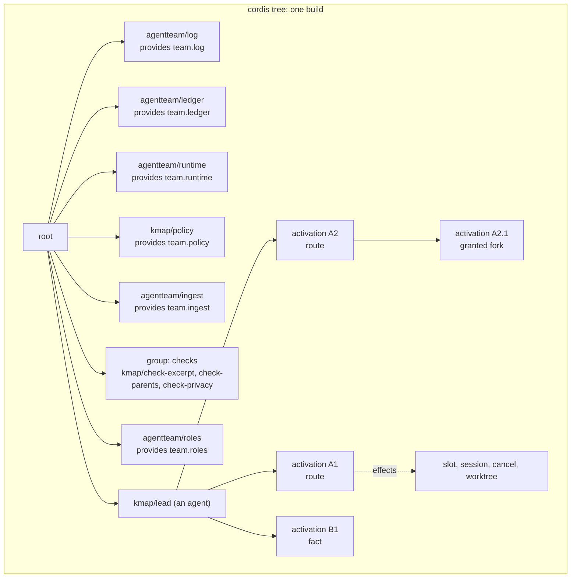

# Using cordis for agentic coding: a lead that orchestrates subagents

> **Status: design for review, not built.** Nothing in this document has been
> implemented or run; every test and scenario below is planned. The framework it
> builds on is built and tested ([architecture.md](architecture.md)).
>
> **Sources**, read on 2026-11-16:
> - the kmap ("seeded knowledge map") workflow in `code-intelligence`
>   (`docs/knowledge-map/design.md` and `impl.md`, code at `d3145781`, stage 112 done);
> - [deepseek-ai/deepseek-harness](https://github.com/deepseek-ai/deepseek-harness) at
>   `39163dd`, cited as **DSH**: an agent harness in which "everything is a plugin",
>   built on cordis;
> - [deepseek-ai/dsh-superagent-prototype](https://github.com/deepseek-ai/dsh-superagent-prototype)
>   at `8c32a9d`, cited as **SUPERAGENT**: a coding agent packaged as a DSH bundle of
>   cordis plugins and presets.
>
> Statements that are reasoning, not read facts, open with "Inference". Code
> sketches use the Go port ([src/go](../src/go/README.md)). IDs use an `AU` prefix.

## Contents

1. [Purpose and audience](#1-purpose-and-audience)
2. [Vocabulary](#2-vocabulary)
3. [What we want to achieve](#3-what-we-want-to-achieve)
4. [Starting point](#4-starting-point)
5. [The pattern: a team as a fiber tree](#5-the-pattern-a-team-as-a-fiber-tree)
6. [How a build runs, end to end](#6-how-a-build-runs-end-to-end)
7. [Components](#7-components)
8. [Composing a team from config](#8-composing-a-team-from-config)
9. [Failure, retry, rollback and cleanup](#9-failure-retry-rollback-and-cleanup)
10. [Design decisions](#10-design-decisions)
11. [Deliverables](#11-deliverables)
12. [Stages and delivery order](#12-stages-and-delivery-order)
13. [Acceptance](#13-acceptance)
14. [Limitations and open questions](#14-limitations-and-open-questions)
15. [Index](#15-index)

## 1. Purpose and audience

This is for engineers who build an agentic-coding host in which a **lead agent
acts as orchestrator**: it plans, spawns subagents, gives each one a bounded piece
of work, and collects, checks and combines their results. It is also for reviewers
who must judge whether such a team stays within its limits and cleans up after
itself.

The worked example is the kmap workflow. Its orchestrator already works but is
wired by hand ([§4.1](#41-the-kmap-orchestrator-today)); this document shows how it
is rebuilt on cordis, following the patterns of DSH and SUPERAGENT. The same
pattern fits any lead-and-workers coding task: a lead splits a feature into
tickets, workers implement each in its own worktree, and a verifier checks each
result.

Read [§5](#5-the-pattern-a-team-as-a-fiber-tree) first for the idea, then
[§6](#6-how-a-build-runs-end-to-end) for a walk-through.

## 2. Vocabulary

cordis terms (context, fiber, effect, service, inject, dependent, realm, intercept,
loader entry) are defined in [architecture.md §2](architecture.md#2-vocabulary).
The terms of an agent team:

| Term | Meaning | Why it exists |
|---|---|---|
| **Build** | One run of the team for one task (in kmap: one seed). It has an id and a folder. | The unit of budgets, limits and cleanup. |
| **Lead** | The agent that plans, spawns, judges and writes. One per build. | Judgement needs a model; counting and cleanup do not ([AU-DEC-3](#au-dec-3)). |
| **Subagent** | An agent that does exactly one work item and returns one result. | Keeps each context small and each result checkable. |
| **Work item** | A unit of work in the queue, with a canonical key, a brief, a budget and a state (kmap: a route or a fact). | Duplicate asks merge on the key; the queue orders work. |
| **Activation** | One subagent's life: start, attempts, result, teardown. Borrowed from DSH. | The thing that is owned, counted and cleaned up. |
| **Slot** | A running activation. At most `maxRunning` at once; the rest wait in the queue. | Bounds parallelism. |
| **Start** | Every activation and every retry. At most `maxStarted` per build. | Bounds total work; the slot cap alone does not. |
| **Depth, grant** | How far below the lead an activation is. Depth 1 is the default; 2 to 5 only for an agent the lead granted. | Bounds fan-out without trusting a prompt. |
| **Fork** | A child work item a running subagent asks for (only with a grant). The waiting parent gives its slot to the fork. | Lets a subagent split a task without deadlocking on its own slot. |
| **Spawn ledger** | The service that holds the queue, the counts, the grants and the budgets. It is not a model. | "A prompt is not trusted to count" (kmap design KMDEC-1). |
| **Runtime** | Where an agent runs: Copilot SDK or CLI, Claude Code CLI, Anthropic SDK, or a fake for tests. | Agents must run on more than one runtime, with a fallback. |
| **Role** | A named capability set: prompt template, tools, policy and model for one kind of agent (kmap: lead, route, fact, verifier). DSH calls it an agent preset. | Gives different agents different tools without code changes. |
| **Policy** | The per-agent tool allowlist and path scope, checked before every tool call. | Read-only and scope rules enforced by code, not by the brief. |
| **Record** | The one structured result an agent writes. It is the only way back (SUPERAGENT's `orchestrator_report` plays the same part). | Results can be checked by code before anyone trusts them. |
| **Ingest** | Checking a record with no model (Tier 0), returning it once to its author if it fails, then accepting or dropping the failing parts. | Bad records never reach the lead. |
| **Settlement** | The moment an activation's result is final: accepted, dropped or failed. | The parent waits for settlement, not for "the process ended". |
| **Frontier** | Work items still queued when the build stops. | Written down, never silently lost. |
| **Ledger log** | `ledger.jsonl`, the append-only event log of every start, attempt, refusal, settlement and stop. | The team panel and every audit read from it. |

## 3. What we want to achieve

### 3.1 Problem

The kmap orchestrator ([§4.1](#41-the-kmap-orchestrator-today)) enforces the team
limits and runs agents on four runtime adapters with a fallback. But each lifetime
rule is hand-written in one place. These rules are:
- which session ends when a subagent finishes;
- that a slot is released on every path;
- that running agents are cancelled when a token budget is spent;
- that a fork's session ends before its parent's;
- that the runtime client stays open until every session on it has ended.

Adding a role, a runtime or a check means editing that orchestrator. A single
missed path leaks a process or a slot. The team's composition (limits, runtimes,
roles, checks) is fixed in code.

### 3.2 Outcomes

| ID | Outcome (observable behaviour) |
|---|---|
| <a id="au-o-1"></a>**AU-O-1** | Every activation is owned by its parent agent. Disposing a parent, or ending a build, ends every descendant's session and process and releases its slot, leaves first. Records already written are kept. |
| <a id="au-o-2"></a>**AU-O-2** | The team limits hold by construction, in one ledger service, whatever the model does. These are: at most 50 starts per build (retries and every depth included), at most 10 running with the rest queued, and depth at most 5 (beyond 1 only by grant). A waiting parent releases its slot. |
| <a id="au-o-3"></a>**AU-O-3** | Runtimes are interchangeable services. The build checks them in order and uses the first that passes. A later failure to start a session switches new starts to the next runtime, without restarting agents that are running. The ledger names the runtime each agent used. |
| <a id="au-o-4"></a>**AU-O-4** | Every tool call of every agent passes the agent's policy before it runs, on every runtime. A refusal becomes a recorded decision. |
| <a id="au-o-5"></a>**AU-O-5** | Results come back only as records. Each record passes Tier 0 at ingest or is returned once to its author. The lead never reads an unchecked record. |
| <a id="au-o-6"></a>**AU-O-6** | Failures follow fixed rules. A failed attempt is retried once on the same model. A token or time stop cancels running agents and keeps their partial records. Other stops let running agents finish. Queued items become frontier. |
| <a id="au-o-7"></a>**AU-O-7** | A team is composed from a config file: limits, runtimes, roles and checks. The file may change while a build runs. A change applies to new starts only and never restarts a running agent. |
| <a id="au-o-8"></a>**AU-O-8** | Every start, attempt, refusal, settlement, fallback and stop is an append-only event in `ledger.jsonl`, from which the team panel is drawn. |
| <a id="au-o-9"></a>**AU-O-9** | The kmap behaviour proven in stage 112 still holds after the move: its tests KMT-5 and KMT-6 still pass, and the real-checkout scenario KMA-2 still writes nothing outside the build folder. |

### 3.3 Scope

- A reusable Go layer, `agentteam`, holding the spawn ledger, activations, the
  runtime seam, policy, ingest and the ledger log. It builds on `src/go/cordis`.
- kmap adopting it: the existing adapters, allowlist, Tier 0 checks and lead loop
  become cordis components.
- One build per cordis tree. One process.

### 3.4 Non-goals

- No change to kmap's record, brief or decision schemas (`kmap-record/v1`, ...).
- No change to the user's limits (50 / 10 / depth 5); they cannot be raised.
- No cross-process or multi-machine team. DSH is single-process as well (its
  "Known Limitations").
- No task board, inbox or peer messaging between subagents in this work (see
  [AU-Q-2](#au-q-2)).
- No continuable (resumable) subagents beyond kmap's one return-to-author round.

## 4. Starting point

### 4.1 The kmap orchestrator today

Read from `services/agent-memory/internal/kmap` at `d3145781`.

| Package | What it does | Non-test lines |
|---|---|---|
| `ledger` | Work items and canonical keys; the queue; the spawn ledger (`Push`, `Next` → `Lease`, `Retry`, `Release`, `Grant`, `Fork`, `Wait`, `Resume`, `OnStop`, `AddUsage`); budgets and stop rules; `ledger.jsonl` events; the brief template | 1,939 |
| `runtime` | The `Runtime` interface (`Check`, `Run`, `Revise`, `End`, `Close`), the `Chain` fallback, adapters for the Copilot SDK and CLI, the Claude CLI and SDK, and a fake runtime; the allowlist (`allow.go`); ingest with Tier 0 (`collect.go`); retry; the build loop (`loop.go`) | 3,594 |
| `lead` | The lead loop, build steps and the verifier | 1,713 |

What it already gets right, and what must be kept: the limits; the queue with
merge on key; a waiting parent releasing its slot; retry once on the same model; a
return to the author in the same session (Copilot: the open session; Claude: `--resume`); the allowlist in every adapter's pre-tool hook;
append-only events; partial records kept on a spend stop.

What is hand-wired: in `loop.go`, the worker goroutine of each lease must call
`Release`, `End` and the record checks on every exit path. The chain's adapters
must be closed by the caller. Cancellation flows through a `context.Context`
created per build. Nothing ties a fork's session to its parent's.

### 4.2 Patterns adopted from DSH

| DSH pattern | Where | Adopted as |
|---|---|---|
| **Everything is a plugin.** The model adapter, tool registry, session log and agent loop are all cordis plugins; activation is driven by service availability, not row order. | `docs/architecture.md`, `packages/bundle/base/cordis.patch.yml` | Every part of the team is a component ([§7](#7-components)). |
| **Seams.** A seam is an abstract service definition with providers (backends) and consumers (tools). Subagent backends are providers on `ctx.subagents`. | `docs/glossary.md`, `packages/subagent/subagent/src/index.ts` | The runtime seam ([§7.3](#73-runtime-seam-and-fallback-chain)). |
| **A subagent is a fiber in its creator's tree.** `createScope` loads a no-op plugin and extends its context with a scope key. The lifecycle attaches to the creator's fiber. Registrations made through the agent's context live and die with it. | `packages/core/scope/src/index.ts:139`, `core/agent/src/index.ts:185` | An activation is a fiber under its parent agent's context ([AU-DEC-1](#au-dec-1)). |
| **Activation result settles after teardown.** `result` settles only after slot release and the completion notice; `dispose()` releases exactly that activation. | `packages/subagent/subagent/README.md` | Settlement ([§7.2](#72-activation)). |
| **Depth is an absolute cap checked at start.** The tool stays visible at the cap and the start is rejected; depth is not a tool filter. | `.agents/notes/implemented/feature/2026-07-12-subagent-persona-tool-filter-and-depth.md` | The ledger refuses the start ([AU-DEC-2](#au-dec-2)). |
| **Presets need isolate realms.** A preset's service rows must sit in a `cordis:group` with `isolate`. Live agents keep the preset revision they were created with; new agents get the edit. | `packages/preset/agent-preset-registry/src/mount.ts:213`, its README | Roles, snapshot at spawn ([AU-DEC-8](#au-dec-8)). |
| **Delegated policy cannot widen.** A child copies the parent's sandbox override, pins approval to `never`, and is told it cannot widen scope. | `packages/subagent/subagent/src/child-agent.ts:224-283` | A fork's policy is the intersection with its parent's ([§7.4](#74-policy)). |
| **Unsupported capabilities are refused, never degraded.** | `docs/subsystems/subagent.md` | A runtime that cannot apply the policy fails its check. |
| **The subagent tree is the team.** There is no separate roster. | `.agents/notes/implemented/architecture/2026-10-15-agent-teams-as-subagents.md` | No roster ([AU-DEC-10](#au-dec-10)). |
| **"Every registration should have a disposer."** | `docs/cordis-primer.md` | Every resource is an effect. |

**Where we differ from DSH.** DSH admission **does not queue**. At capacity it
rejects with `ACTIVATION_LIMIT_REACHED`, "because a parent waiting for descendants
must not wait for its own occupied slot". Its default is 8 active per tree. kmap's
limits require a queue (10 running, the rest wait), and kmap avoids the deadlock
DSH describes by having a waiting parent release its slot. We keep kmap's queue
([AU-DEC-2](#au-dec-2)). DSH also has no cumulative start or token budget; kmap's
ledger has both, and we keep them.

### 4.3 Patterns adopted from SUPERAGENT

| SUPERAGENT pattern | Where | Adopted as |
|---|---|---|
| **The router routes; workers work.** "The main Session only routes… makes no technical decisions"; "Workers investigate and implement; never add implementation plans." | `docs/004-prompts.md`, `prompts/orchestrator.md` | The lead plans and judges. Every mechanical step belongs to services ([AU-DEC-3](#au-dec-3)). |
| **One unit of work, one session, one directory.** A Ticket gets its own worker Session (`worker-<ticketId>`) and its own directory, usually a git worktree. | `src/app/sessions.ts:138-150`, `docs/003-execution.md` | One activation per work item. For coding tasks, a worktree effect per activation ([§7.2](#72-activation)). |
| **One structured path back.** The worker reports through `orchestrator_report` with `state` ∈ {progress, ready, blocked, failed, dropped}, a summary and an optional `human_action`. | `src/app/tools/executor.ts:75-100` | The record plus a settlement state ([AU-DEC-6](#au-dec-6)). |
| **Roles as preset config trees.** The router and the workers run different presets with different tools, and the shell is in an isolated `cordis:group`. | `cordis.patch.yml` | Roles ([§8](#8-composing-a-team-from-config)). |
| **Plugins register into a service through effects.** Source plugins inject `orchestrator` and register with `ctx.effect(() => ctx.orchestrator.sources.register(...))`. | `src/sources/github.ts:111-122` | Checks and runtimes register into their services the same way. |
| **A slot semaphore with a reserved slot.** `maxWorkers` (default 3), plus one slot kept for a person's message. | `src/policy.ts:93`, `src/executor/dsh.ts:171` | The ledger keeps two slots for verification items when any is pending (kmap step 112.2 already does). |
| **The router never waits.** A guard refuses `sleep`, long shell timeouts and job waits for the router. | `src/app/sessions.ts` (`noWait`) | The lead's policy refuses blocking tools; the lead waits only through the ledger. |

**Where we differ from SUPERAGENT.** It has no token or cost budget, no depth cap
of its own, and it runs workers with full access as the operator's OS user. Its
authors say the blocked-command wrappers "establish defaults, not a security
boundary". kmap keeps a hard read-only policy and the full budget set.

## 5. The pattern: a team as a fiber tree

### 5.1 The idea

Each agent is a cordis **fiber**. A subagent is created by its parent agent, as
a child fiber in the parent's context. Everything the activation holds is an
**effect** of that fiber: its slot, its runtime session, its cancellation, its
worktree. Each effect is released in reverse order when the fiber unloads. The
build's shared machinery (ledger, runtime, policy, ingest, log) is a set of
**services** that every activation injects. A provider outlives its dependents
([architecture.md AR-ADR-7](architecture.md#ar-adr-7)). So the ledger and the
runtime client are always still there while the last session is being closed.



### 5.2 Mapping

| Concern | cordis construct | kmap today | DSH counterpart |
|---|---|---|---|
| A build | one tree (`cordis.New()`) whose root disposes everything | `runtime.Build` + a `context.Context` | one host process |
| An agent's life | a fiber of the `agentteam/activation` component | a worker goroutine per `Lease` | an Agent's scope fiber (`createScope`) |
| Parent owns children | the child fiber is created in the parent agent's context, so it is the parent's effect | not tied | lifecycle attached to the creator's fiber |
| Slot, session, cancel | effects of the activation, released in reverse order | calls on each exit path | slot returned "only after cleanup" |
| Queue, counts, budgets, depth | `team.ledger` service | `ledger.Ledger` | admission check (no queue) |
| Runtimes and fallback | `team.runtime` service with registered adapters | `runtime.Chain` | `ctx.subagents` providers |
| Allowlist | `team.policy` service, plus a per-agent policy in an intercept | `runtime.Policy` per lease | delegated policy overrides |
| Tier 0 | `team.ingest` with checks registered as effects | `runtime.Collector` | (none) |
| Roles | `team.roles`, snapshot at spawn | brief and task templates in code | agent presets in realms |
| Events | `team.log`, fed by ledger events and `Internal().OnStatus` | `ledger.Events` | the session log, `subagent/start`, `subagent/end` |
| Team composition | the loader's config file | Go code and flags | layered `cordis.patch.yml` |

## 6. How a build runs, end to end

```mermaid
sequenceDiagram
  participant H as host (codeintel kmap build)
  participant L as lead fiber
  participant LED as team.ledger
  participant A as activation fiber
  participant RT as team.runtime
  participant ING as team.ingest
  H->>H: cordis.New(); load build.cordis.json
  H->>L: Use(kmap/lead, seed)
  L->>LED: Push(work items)
  loop dispatcher (in the lead)
    L->>LED: Next(ctx)  (blocks for a slot)
    LED-->>L: Lease
    L->>A: leadCtx.Use(activation, Task{lease, role snapshot})
    A->>RT: Run(task) under the agent's policy
    RT-->>A: Result (record written)
    A->>ING: Ingest(record)
    ING-->>A: accepted / returned once / dropped parts
    A-->>L: settled (fiber Active, result in Instance)
    L->>A: Dispose()  (session ends, slot released)
  end
  L->>L: correlate, push round-2 facts, close, explain
  H->>H: root.Dispose()  (leaves first; ledger writes totals and frontier last)
```

The walk-through, for one kmap seed:
1. **Compose.** The host creates the tree and loads `build.cordis.json`
   ([§8](#8-composing-a-team-from-config)). The ledger, runtime, policy, ingest,
   checks and roles load. The runtime runs its model checks during `Init`, so
   nothing that injects `team.runtime` starts until a runtime has passed.
2. **Plan.** The lead fiber loads (it injects all of them), runs P0 to P3 of the kmap
   design, and pushes route items into the ledger.
3. **Dispatch.** The lead's dispatcher loop takes a lease from `Next`. That call
   blocks while 10 are running, and returns an error once the build has stopped.
   For each lease it uses one `agentteam/activation` fiber in the context of
   the item's parent agent: the lead for routes, the forking subagent for a fork.
4. **Run.** The activation registers its effects (slot, session, cancel) and runs
   the agent in `Init`, so the fiber is `Loading` while the agent works. Every tool call passes
   the policy. A failed attempt is retried once in the same slot. A record that
   fails Tier 0 is returned once in the same session.
5. **Settle.** Ingest accepts the record, or drops its failing parts. The fiber
   becomes `Active` with the result as its instance. The dispatcher hands the
   result to the lead and disposes the fiber. That ends the session and then
   releases the slot, in that order.
6. **Round 2.** The lead correlates, pushes fact items, and repeats from step 3
   until a stop rule fires.
7. **End.** `root.Dispose()` unloads leaves first. Any activation still alive is
   cancelled and its session ended. The runtime closes its clients after the last
   session. The ledger, the provider of everything, unloads last and writes the
   totals and `frontier.json`.

## 7. Components

Each subsection names the component, its service, what it injects, its config, its
effects, and how it fails. Signatures are sketches.

### 7.1 Spawn ledger

Component `agentteam/ledger`, service `team.ledger`. **Result.** One place enforces the team limits and budgets. **Why.** The limits are
the user's and must hold whatever the model does
([AU-O-2](#au-o-2)). **How.** The service wraps kmap's `ledger.Ledger` unchanged
(its tests are the proof of the counting rules). It adds two things:

- **Leases are owned.** `Acquire` turns a lease into an effect of the calling
  activation. The slot is released when that fiber unloads, on every path,
  including panics and cancellation.
- **Limits are not reloadable.** The component accepts config updates in place
  (`cordis.AcceptUpdate`): budgets may be lowered, and limits may be lowered but
  never raised. A loader edit therefore never restarts the ledger, and so never
  restarts the agents that depend on it ([AU-DEC-7](#au-dec-7)).

```go
var LedgerKey = cordis.NewServiceKey[*Ledger]("team.ledger")

var LedgerComponent = cordis.Construct("agentteam/ledger",
    func(ctx *cordis.Context, cfg LedgerOptions) (*Ledger, error) {
        log, err := LogKey.Get(ctx)
        if err != nil {
            return nil, err
        }
        l := &Ledger{inner: ledger.New(cfg.Limits(), cfg.Budget(), log.Events())}
        if _, err := cordis.AcceptUpdate(ctx, l.applyLowering); err != nil { // never a restart
            return nil, err
        }
        _, err = LedgerKey.Provide(ctx, l)
        return l, err // Close writes totals and frontier.json: it runs after every dependent unloaded
    }, cordis.WithInject("team.log"))

// Hold ties a lease to the calling activation: the slot is released when it unloads.
func (l *Ledger) Hold(ctx *cordis.Context, ls *ledger.Lease) error {
    _, err := ctx.Effect("slot "+ls.Agent, func() (cordis.Disposer, error) {
        return func() error { l.inner.Release(ls); return nil }, nil
    })
    return err
}
```

**Fails.** `Next` returns `ErrStopped`, `ErrSpawnCap` or `ErrEmpty` as today; the
dispatcher stops on the first two and the round ends on the third.

### 7.2 Activation

Component `agentteam/activation`. **Result.** One subagent's life as one fiber. **Why.** Ownership and cleanup by
construction ([AU-O-1](#au-o-1)). **How.** A constructor component whose config is
the task. Its effects are registered in the order they must be undone in
reverse: slot first, then session, then cancellation. So unloading cancels the
run, ends the session, and only then frees the slot. The agent runs in `Init`,
so the fiber is `Loading` while it works and settles when it is done.

```go
type Task struct {
    Lease  *ledger.Lease
    Role   RoleSnapshot // copied at spawn: role edits never reach a running agent
    Brief  string       // briefs/<agent>.md
    Record string       // the one file the agent may write
}

var Activation = cordis.Construct("agentteam/activation",
    func(ctx *cordis.Context, t Task) (*Activation, error) {
        led, err := LedgerKey.Get(ctx)
        if err != nil {
            return nil, err
        }
        rt, err := RuntimeKey.Get(ctx)
        if err != nil {
            return nil, err
        }
        if err := led.Hold(ctx, t.Lease); err != nil { // released last
            return nil, err
        }
        a := &Activation{ctx: ctx, task: t, led: led, rt: rt}
        if _, err := ctx.Effect("session", func() (cordis.Disposer, error) {
            return func() error { rt.End(t.Lease.Agent); return nil }, nil
        }); err != nil {
            return nil, err
        }
        run, cancel := context.WithCancel(context.Background())
        a.run = run
        _, err = ctx.Effect("cancel", func() (cordis.Disposer, error) { // released first
            return func() error { cancel(); return nil }, nil
        })
        return a, err
    }, cordis.WithInject("team.ledger", "team.runtime", "team.policy", "team.ingest"))

// Init runs the agent; the fiber is Loading until it returns.
func (a *Activation) Init() error {
    attempts := a.rt.RunWithRetry(a.run, a.led, a.task) // one retry, same model, same slot
    a.result = a.ingest(attempts)                       // Tier 0, one return to the author
    return a.result.Err                                 // an error leaves the fiber Failed
}
```

**Forks.** A granted subagent asks for a child item through the runtime's `Fork`
callback. The dispatcher creates that child's activation in the **subagent's**
context, `a.ctx.Use(Activation, childTask)`, and calls `Wait` / `Resume` on the
ledger around it. The fork is therefore an effect of its parent's fiber: disposing
the parent disposes the fork first.

**Coding tasks.** A worktree effect (a `git worktree add` with a `git worktree
remove` cleanup) follows SUPERAGENT's one-directory-per-ticket rule. It is
registered after the session, so it is removed before the session ends. kmap
builds are read-only and do not use it.

**Fails.** A body or `Init` error leaves the fiber `Failed` with the error; the
dispatcher records it as abandoned with its partial record. Retry happens inside
`Init`, so `Failed` is final for that item (as with
[architecture.md AR-ADR-9](architecture.md#ar-adr-9)).

### 7.3 Runtime seam and fallback chain

Component `agentteam/runtime`, service `team.runtime`. **Result.** Agents run on any registered runtime; the build falls back without
restarting running agents ([AU-O-3](#au-o-3)). **How.**
- Adapters are kmap's existing `runtime.Runtime` implementations, registered by
  kind (`copilot-sdk`, `copilot-cli`, `claude-cli`, `claude-sdk`, `fake`). This
  uses the same `Register` pattern as `loader.Register`.
- The component's config lists the chain in order. `Init` runs the model checks
  (`Chain.Start`). If no adapter passes, `Init` fails, and every agent stays
  `Pending` behind a `Failed` runtime: no agent starts on a missing model.
- On a session-start failure mid-build, `Fallback` moves the chain's pointer. The
  binding itself never changes, so no running agent's epoch changes and none
  restarts ([AU-DEC-4](#au-dec-4)).
- Each adapter's `Close` is an effect of this fiber. Because the runtime is a
  provider, it closes only after every activation has ended its session.

```go
var RuntimeComponent = cordis.Construct("agentteam/runtime",
    func(ctx *cordis.Context, cfg RuntimeOptions) (*Runtimes, error) {
        chain, err := buildChain(cfg.Adapters) // registered factories, in config order
        if err != nil {
            return nil, err
        }
        if _, err := ctx.Effect("adapters", func() (cordis.Disposer, error) { return chain.Close, nil }); err != nil {
            return nil, err
        }
        rs := &Runtimes{ctx: ctx, chain: chain}
        _, err = RuntimeKey.Provide(ctx, rs)
        return rs, err
    }, cordis.WithInject("team.log"))

func (r *Runtimes) Init() error { _, err := r.chain.Start(context.Background()); return err }
```

### 7.4 Policy

Component `kmap/policy`, service `team.policy`. **Result.** One allowlist is consulted by every adapter, for every call
([AU-O-4](#au-o-4)). **How.**
- The service builds each agent's `runtime.Policy` from the manifest, the role
  and the agent's depth.
- The activation's context carries it as an intercept,
  `ctx.Intercept("team.policy", policy)`, so an adapter reads the policy of the
  agent it runs for with `cordis.GetIntercept[*Policy](ctx, "team.policy")`.
- A fork's policy is the intersection of its role's policy and its parent's.
  Like DSH's delegated overrides, a child cannot widen its parent's scope.
- Refusals are appended to `decisions.jsonl` as dropped decisions, as today.

### 7.5 Ingest and checks

Component `agentteam/ingest`, service `team.ingest`. **Result.** Tier 0 is pluggable; no unchecked record reaches the lead
([AU-O-5](#au-o-5)). **How.**
- Ingest is a waterfall event, `RecordChecks = cordis.NewWaterfall[*Findings]`.
  Each check is a small component that registers a listener: excerpt at commit,
  decision parents, ids, quotes, privacy, em dash.
- Adding a check in the config file adds a listener, and restarts nothing.
- Return-once-then-drop stays as in kmap's `collect.go`.

### 7.6 Roles

Component `agentteam/roles`, service `team.roles`. **Result.** Roles (lead, route, fact, verifier) are config; edits apply to new
starts ([AU-O-7](#au-o-7)). **How.**
- The service holds the role table (prompt template, task template, tool set,
  policy base, model override if any).
- The dispatcher copies a `RoleSnapshot` into each `Task`, and activations do
  **not** inject `team.roles`. So reloading the roles service cannot change any
  running agent's epoch: running agents keep the revision they started with, as
  DSH presets do.

### 7.7 Log

Component `agentteam/log`, service `team.log`. **Result.** One append-only event stream ([AU-O-8](#au-o-8)). **How.**
- The service owns `ledger.Events`.
- It subscribes, as an effect, to `ctx.Internal().OnStatus` and logs the
  transitions of activation fibers: `Loading` (started), `Active` (settled),
  `Failed`, `Disposed`.
- The ledger and runtime write their own events through it (adapter checks,
  fallbacks, usage, stops).
- It is the first entry, so it unloads last and sees the final totals.

### 7.8 Lead

Component `kmap/lead`. **Result.** The lead does what needs judgement, and nothing else. **How.**
- It is kmap's existing `lead` package as a component injecting `team.*`.
- Its dispatcher loop and its own agent session are effects. Disposing the lead
  ends its session and every activation under it.
- Following SUPERAGENT's router rule, its role's policy refuses blocking tools
  (`sleep`, long shell waits). The lead waits only through the ledger.

## 8. Composing a team from config

A build's team is one loader file. The loader is in-process and the file is
optional: `codeintel kmap build` can write the default file into the build
folder, which also records what the team was.

```json
[
  { "id": "log", "name": "agentteam/log", "config": { "path": "ledger.jsonl" } },
  { "id": "ledger", "name": "agentteam/ledger",
    "config": { "maxStarted": 50, "maxRunning": 10, "maxDepth": 5, "depth": 1, "reserveVerify": 2 } },
  { "id": "runtime", "name": "agentteam/runtime",
    "config": { "adapters": [
      { "kind": "copilot-sdk", "model": "claude-opus-5.5", "effort": "high" },
      { "kind": "claude-cli",  "model": "claude-opus-5-5", "effort": "high" } ] } },
  { "id": "policy", "name": "kmap/policy", "config": { "manifest": "manifest.json" } },
  { "id": "ingest", "name": "agentteam/ingest" },
  { "id": "checks", "name": "group", "group": true, "children": [
      { "id": "excerpt", "name": "kmap/check-excerpt" },
      { "id": "parents", "name": "kmap/check-parents" },
      { "id": "privacy", "name": "kmap/check-privacy" } ] },
  { "id": "roles", "name": "agentteam/roles", "config": { "dir": "prompts" } },
  { "id": "lead", "name": "kmap/lead", "config": { "seed": "seed.json" } }
]
```

What a live edit does (with `Watch` on):

| Edit | Effect |
|---|---|
| Lower `maxRunning` | Accepted in place; no new start until the running count is below it. |
| Raise any limit | Rejected by the schema and logged; the file keeps the user's value. |
| Add or remove a check | A listener is added or removed; later ingests use it. |
| Change a role's prompt | The roles service reloads; new starts use it; running agents keep theirs. |
| Change the runtime chain | Not allowed during a build (it would restart every agent); the edit is rejected and logged. Adapters change between builds. |
| Disable `lead` | The lead and every activation under it are disposed, leaves first; this is the "stop this build" switch. |

## 9. Failure, retry, rollback and cleanup

Ownership decides what is undone ([architecture.md §2](architecture.md#2-vocabulary)):

| Resource | Owned by | Category | Undone when | Never undone |
|---|---|---|---|---|
| Slot | the activation (effect) | created | the activation unloads | |
| Runtime session, CLI process | the activation (effect) | created | the activation unloads | |
| Worktree (coding tasks) | the activation (effect) | created | the activation unloads | |
| Runtime client (SDK connection) | `team.runtime` | shared by all activations | after the last activation unloaded | |
| Records, briefs, decisions, `ledger.jsonl` | the build folder, nobody's effect | append-only | | always kept (KMINV-3) |
| A fork | the parent activation (effect) | created by the parent | the parent unloads, first | |
| An adopted runtime (after fallback) | `team.runtime` (the same binding) | switched in place, not re-provided | at build end | |
| A CLI child whose cleanup failed | uncertain | logged with its PID in `ledger.jsonl` | by hand | |

| Failure | What happens |
|---|---|
| An attempt fails or times out | Retried once in the same slot, on the same model; counts as a start; the second failure leaves the activation `Failed`, recorded as abandoned with its partial record. |
| A session cannot start | Not a retry. The chain falls back for new starts and the same attempt runs on the next runtime. |
| A record fails Tier 0 | Returned once in the same session; still failing, the failing parts are dropped and listed in `verdicts.jsonl`. |
| A tool call is refused | The agent sees the refusal; a dropped decision is appended. |
| Token or wall-clock budget spent | The ledger stops. The dispatcher disposes the running activations: their cancel effects end the runs, their partial records are kept, and queued items go to `frontier.json`. |
| Spawn cap, items, frontier or stall stop | Nothing new starts; running activations finish and settle. |
| The host process is interrupted | `root.Dispose()` from the signal handler ends every session leaves first. A hard kill leaves CLI children, which the next build start reports from the PIDs in the previous `ledger.jsonl` ([AU-Q-4](#au-q-4)). |
| A cleanup fails | Logged with what it held; the remaining cleanups run. |

## 10. Design decisions

<a id="au-dec-1"></a>
### AU-DEC-1 An activation is a fiber owned by its parent agent

- **Decision.** Each subagent is a fiber of `agentteam/activation`, created in its
  parent agent's context. Its slot, session and cancellation are effects.
- **Why.** Ownership and leaves-first cleanup come from the structure, not from
  each exit path ([AU-O-1](#au-o-1)). DSH builds subagents the same way (a scope
  fiber attached to its creator).
- **Pros.** No leaked slot or session on any path. A fork is torn down before its
  parent. Fiber states give settlement for free (`Loading` = running, `Active` =
  settled, `Failed` = abandoned).
- **Cons.** One more object per agent. Engineers must learn that an agent's
  lifetime is a fiber's.
- **Verified by.** [AU-T-2](#au-t-2), [AU-T-3](#au-t-3), [AU-E-3](#au-e-3), [AU-E-4](#au-e-4).

<a id="au-dec-2"></a>
### AU-DEC-2 Queue with slot release by waiting parents, not DSH's reject-at-capacity

- **Decision.** Keep kmap's ledger: a queue, 10 running, 50 starts, depth by grant,
  a waiting parent releasing its slot.
- **Why.** These are the user's limits. A queue lets the lead push a whole round at
  once.
- **Pros.** The lead does not retry admissions. Starts are counted. The deadlock
  DSH avoids by rejecting is avoided by releasing the slot.
- **Cons.** Different from DSH, so its subagent packages cannot be reused
  directly. A queued item can wait a long time behind slow agents.
- **Alternatives.** DSH's admission without a queue (simpler, but the lead must
  handle `ACTIVATION_LIMIT_REACHED` and re-ask).
- **Verified by.** KMT-5 (kept), [AU-T-1](#au-t-1).

<a id="au-dec-3"></a>
### AU-DEC-3 Services do the mechanical work; the lead only judges

- **Decision.** The ledger, ingest, policy, runtime and log are services. The lead
  plans, correlates and writes, and never counts, checks or cleans up.
- **Why.** kmap KMDEC-1 ("a prompt is not trusted to count"); SUPERAGENT's router
  that "makes no technical decisions".
- **Pros.** The limits and checks are code, testable without a model.
- **Cons.** More components to compose.
- **Verified by.** [AU-T-1](#au-t-1), [AU-T-5](#au-t-5).

<a id="au-dec-4"></a>
### AU-DEC-4 Fallback switches inside one stable binding

- **Decision.** `team.runtime` is one binding whose current adapter changes on
  fallback. It is not a re-provide, a `Registry.Replace` or a per-adapter service.
- **Why.** A new binding changes every dependent's epoch, which would unload every
  running agent.
- **Pros.** Running agents are untouched; new starts use the new runtime.
- **Cons.** Adapters are not individually swappable while a build runs; a chain
  change waits for the next build.
- **Alternatives.** One service per adapter with a selector (natural in cordis,
  but a dependent must inject them all, or be restarted to move).
- **Verified by.** [AU-T-4](#au-t-4), [AU-E-2](#au-e-2).

<a id="au-dec-5"></a>
### AU-DEC-5 The policy travels as an intercept on the agent's context

- **Decision.** One policy service; each activation's context carries its own policy
  as an intercept; adapters read it from the context they run for.
- **Why.** Every adapter applies the same rules ([AU-O-4](#au-o-4)), and a fork
  inherits its parent's limits through the context chain.
- **Pros.** No per-adapter policy copies. Narrowing composes down the tree.
- **Cons.** The intercept chain must be intersected, not replaced; that needs a
  test ([AU-T-5](#au-t-5)).
- **Verified by.** KMT-6 (kept), [AU-T-5](#au-t-5).

<a id="au-dec-6"></a>
### AU-DEC-6 One structured path back: the record and a settlement state

- **Decision.** An agent's only result is its record plus a settlement state
  (accepted, dropped-parts, abandoned).
- **Why.** SUPERAGENT's single report tool; kmap's record.
- **Pros.** Results are checked by code before the lead reads them.
- **Cons.** Agents cannot stream partial findings to the lead; they appear at
  settlement.
- **Verified by.** [AU-T-6](#au-t-6).

<a id="au-dec-7"></a>
### AU-DEC-7 Services that live agents depend on never restart mid-build

- **Decision.** `team.ledger`, `team.runtime`, `team.policy` and `team.ingest`
  accept config updates in place, or reject them. Restarting one is not allowed
  during a build.
- **Why.** A provider restart unloads its dependents (correct in general, wrong
  for a running agent).
- **Pros.** Live edits are safe.
- **Cons.** Some edits must wait for the next build.
- **Verified by.** [AU-T-7](#au-t-7), [AU-E-5](#au-e-5).

<a id="au-dec-8"></a>
### AU-DEC-8 Roles are snapshotted at spawn

- **Decision.** A role is copied into the task. Activations do not inject the roles
  service.
- **Why.** DSH's rule that live agents keep the preset revision they were created
  with.
- **Pros.** Editing a prompt mid-build is safe and takes effect for the next start.
- **Cons.** A fix to a role does not reach agents already running.
- **Verified by.** [AU-T-7](#au-t-7).

<a id="au-dec-9"></a>
### AU-DEC-9 The generic layer lives here, kmap's parts in code-intelligence

- **Decision.** `agentteam` (ledger service, activation, runtime seam, ingest, roles,
  log) is a package under `src/go` in this repository. kmap's adapters, policy,
  checks and lead stay in `code-intelligence` as components that use it.
- **Why.** Other hosts (a coding team with worktrees) need the same layer.
- **Pros.** One tested implementation of the team rules.
- **Cons.** Two repositories to version together; kmap pins a commit of this
  module.
- **Alternatives.** Keep everything in `code-intelligence` (simpler, not
  reusable).
- **Verified by.** [AU-T-8](#au-t-8) (the layer's tests run without kmap).

<a id="au-dec-10"></a>
### AU-DEC-10 No roster: the activation tree is the team

- **Decision.** There is no separate team object, task board or inbox in this
  work.
- **Why.** DSH removed its roster ("the subagent tree is the Team"); kmap's work
  items already play the task-board role.
- **Pros.** One source of truth.
- **Cons.** No peer messaging between subagents ([AU-Q-2](#au-q-2)).
- **Verified by.** Scope ([§3.4](#34-non-goals)).

<a id="au-dec-11"></a>
### AU-DEC-11 Move by wrapping first, then moving code

- **Decision.** Stage 1 wraps kmap's existing packages as components with no
  behaviour change, and proves KMT-5, KMT-6 and KMA-2 unchanged. Only then does the
  lead's loop move onto activations.
- **Why.** Stage 112 is proven; the move must not lose that proof.
- **Pros.** Every step has a green baseline.
- **Cons.** A short period with two dispatch paths.
- **Verified by.** [AU-O-9](#au-o-9) scenarios.

## 11. Deliverables

| ID | Deliverable (plain result) | How, and where | Depends on | Priority | Done when | Serves |
|---|---|---|---|---|---|---|
| <a id="au-d-1"></a>**AU-D-1** | A ledger service whose leases are released by their owner's unload | `src/go/agentteam/ledger.go`; wraps a ledger interface matching kmap's `ledger.Ledger`; `Hold`; in-place updates | — | P0 | [AU-T-1](#au-t-1), [AU-T-7](#au-t-7) | AU-O-2, AU-O-7 |
| <a id="au-d-2"></a>**AU-D-2** | An activation component: slot, session and cancel effects, run in `Init`, forks under the parent | `src/go/agentteam/activation.go` | AU-D-1, AU-D-3 | P0 | [AU-T-2](#au-t-2), [AU-T-3](#au-t-3) | AU-O-1 |
| <a id="au-d-3"></a>**AU-D-3** | A runtime seam with registered adapters and in-binding fallback | `src/go/agentteam/runtime.go`; adapter registry; a fake adapter | — | P0 | [AU-T-4](#au-t-4) | AU-O-3 |
| <a id="au-d-4"></a>**AU-D-4** | Ingest as a waterfall with pluggable checks | `src/go/agentteam/ingest.go` | — | P0 | [AU-T-6](#au-t-6) | AU-O-5 |
| <a id="au-d-5"></a>**AU-D-5** | Roles with spawn-time snapshots; a log fed by fiber status | `src/go/agentteam/roles.go`, `log.go` | — | P1 | [AU-T-7](#au-t-7), [AU-T-9](#au-t-9) | AU-O-7, AU-O-8 |
| <a id="au-d-6"></a>**AU-D-6** | kmap's adapters, allowlist and Tier 0 checks registered as components | `code-intelligence/.../kmap/team/` (adapters register by kind; `kmap/policy`; `kmap/check-*`) | AU-D-1 to AU-D-4 | P0 | KMT-5, KMT-6 pass unchanged; [AU-T-5](#au-t-5) | AU-O-4, AU-O-9 |
| <a id="au-d-7"></a>**AU-D-7** | The kmap lead and dispatcher on activations | `code-intelligence/.../kmap/lead` | AU-D-6 | P0 | [AU-E-1](#au-e-1) | AU-O-1, AU-O-6 |
| <a id="au-d-8"></a>**AU-D-8** | A build composed from `build.cordis.json`, live edits as in [§8](#8-composing-a-team-from-config) | `codeintel kmap build --team <file>`; default file written into the build folder | AU-D-5, AU-D-7 | P1 | [AU-E-5](#au-e-5) | AU-O-7 |

## 12. Stages and delivery order

Order: stage 1 first (it builds the shared layer); stage 2 needs it; stage 3 needs
stage 2; stage 4 is the acceptance batch for all three. Cleanup and ownership
scenarios, whose defect could orphan a process, run in their build stage, not in
stage 4. A manual check is labelled `manual` and never ticks a scenario.

### Stage 1: the agentteam layer (P0)

**Result.** The team rules as cordis components, tested on a fake runtime.
**Entry.** `src/go` at `25f50db` or later. **Exit evidence.** `go test -race
./agentteam/...` output; commit id.

| Step | What | Done when |
|---|---|---|
| 1.1 | Ledger interface (`Push`, `Next`, `Retry`, `Release`, `Grant`, `Fork`, `Wait`, `Resume`, `OnStop`, `AddUsage`) matching kmap's | compiles against kmap's ledger via an adapter in a test |
| 1.2 | `agentteam/ledger` component with `Hold` | AU-T-1 |
| 1.3 | In-place limit lowering; raise rejected | AU-T-7 (ledger part) |
| 1.4 | Runtime seam, adapter registry, fake adapter | unit tests |
| 1.5 | Chain start in `Init`, in-binding fallback | AU-T-4 |
| 1.6 | Activation component with its three effects | AU-T-2 |
| 1.7 | Retry inside `Init` (one retry, same slot) | unit test |
| 1.8 | Forks under the parent's context with `Wait` / `Resume` | AU-T-3 |
| 1.9 | Ingest waterfall, return-once-then-drop | AU-T-6 |
| 1.10 | Roles with snapshots | AU-T-7 (roles part) |
| 1.11 | Log fed by `OnStatus` and ledger events | AU-T-9 |
| 1.12 | Spend stop disposes running activations; others let them finish | AU-T-10 |
| 1.13 | README section and package docs | reviewed |
| 1.14 | `go vet`, `gofmt`, `-race` x5 | clean, recorded |

### Stage 2: kmap on agentteam, wrapped (P0)

**Result.** kmap's adapters, allowlist and checks run as components; behaviour
unchanged. **Entry.** Stage 1. **Exit evidence.** KMT-5, KMT-6 output; AU-E-3 and
AU-E-4 run ids.

| Step | What | Done when |
|---|---|---|
| 2.1 | Pin this module in `code-intelligence` | `go build ./...` |
| 2.2 | Register the five adapters by kind | each passes its existing unit tests |
| 2.3 | `kmap/policy` as the policy service; per-agent intercept | KMT-6 unchanged; AU-T-5 |
| 2.4 | `kmap/check-*` listeners from `verify` | Tier 0 fixtures give the same verdicts |
| 2.5 | `runtime.Build` dispatch through activations (one path) | `TestLoopWithCannedRecords` and the loop tests pass |
| 2.6 | KMT-5 on the new path | pass |
| 2.7 | Run AU-E-3 (spend stop) | recorded run id |
| 2.8 | Run AU-E-4 (parent disposal) | recorded run id |
| 2.9 | Remove the old dispatch path | tests pass |
| 2.10 | Lint as in kmap stage 109 | clean |

### Stage 3: lead and config-composed builds (P1)

**Result.** `codeintel kmap build --team` composes a build from a file; live edits
behave as in [§8](#8-composing-a-team-from-config). **Entry.** Stage 2.

| Step | What | Done when |
|---|---|---|
| 3.1 | `kmap/lead` component and its dispatcher | unit tests on the fake runtime |
| 3.2 | Default `build.cordis.json` written into the build folder | file matches the run |
| 3.3 | `--team <file>`; schema for every entry | invalid files rejected with the entry named |
| 3.4 | Live-edit rules of §8 | AU-T-7 extended; AU-E-5 authored and linted |
| 3.5 | Team panel from the new log | the existing `TestTeamPanelFromLedger` passes |

### Stage 4: acceptance batch (P0)

**Result.** The remaining real-environment scenarios pass. **Entry.** Stage 3.
**Exit evidence.** Run ids, reports and cleanup evidence for AU-E-1, AU-E-2,
AU-E-5 and KMA-2.

| Step | What |
|---|---|
| 4.1 | AU-E-1 on the Copilot SDK |
| 4.2 | AU-E-2 forced fallback |
| 4.3 | AU-E-5 live edits |
| 4.4 | KMA-2 re-run on the new path |
| 4.5 | Record results; open items stay open |

## 13. Acceptance

Evidence of three kinds is kept apart: local tests (AU-T), with a fake runtime and
no real repos; real-environment scenarios (AU-E), on real runtimes and real
checkouts; and the kept kmap tests and scenarios (KMT-5, KMT-6, KMA-2). A missing,
skipped, blocked or failed required scenario stays open. The guarantee is for the
tested build, inputs and environment only.

### 13.1 Local tests

| ID | Proves | Assertion |
|---|---|---|
| <a id="au-t-1"></a>**AU-T-1** | AU-D-1 | With a fake runtime: never more than 10 running and 50 started (retries counted); a lease is released when its activation unloads by success, failure, panic or cancel. |
| <a id="au-t-2"></a>**AU-T-2** | AU-D-2 | Unloading an activation runs cancel, then session end, then slot release, in that order, on every exit path. |
| <a id="au-t-3"></a>**AU-T-3** | AU-D-2 | Disposing a parent activation disposes its forks first; a waiting parent's slot is used by its fork; depth beyond the grant is refused at start. |
| <a id="au-t-4"></a>**AU-T-4** | AU-D-3 | The first adapter failing its check selects the second; a mid-build session failure switches new starts only; no running activation's state changes; the runtime closes after the last session ended. |
| <a id="au-t-5"></a>**AU-T-5** | AU-D-6 | A fork's effective policy is the intersection with its parent's; an adapter reads the policy of the agent it runs for. |
| <a id="au-t-6"></a>**AU-T-6** | AU-D-4 | A seeded fault is returned once, then its parts dropped; adding a check listener mid-build applies to the next ingest only. |
| <a id="au-t-7"></a>**AU-T-7** | AU-D-1, AU-D-5 | Lowering a limit is applied in place; raising is rejected; a role edit reaches the next start and not a running one; no running activation restarts. |
| <a id="au-t-8"></a>**AU-T-8** | AU-D-1 to AU-D-5 | The `agentteam` tests build and pass with no kmap import. |
| <a id="au-t-9"></a>**AU-T-9** | AU-D-5 | Every started, settled, failed and disposed activation appears once in the log, in order. |
| <a id="au-t-10"></a>**AU-T-10** | AU-D-1, AU-D-2 | A token stop cancels running activations and keeps their partial records; a spawn-cap stop lets them finish; queued items are in `frontier.json`. |

### 13.2 Real-environment scenarios

These run against real agent runtimes and real checkouts on the controller machine.
There is no remote lab and no jump host. Credentials are supplied at run time: the
Copilot sign-in, the Claude Code sign-in, and `ANTHROPIC_API_KEY` for the SDK
adapter. They are never written to the build folder. Each scenario's report is
written to `E:\kmap\builds\<run id>.md`.

<a id="au-e-1"></a>**AU-E-1 One route through activations on the Copilot SDK.**
- **Given:** the recon build `kma-1-20261116-235500-dr` (the disaster recovery
  seed, 21 repos); the default `build.cordis.json`; a Copilot sign-in that lists
  `claude-opus-5.5`.
- **When:** run `codeintel kmap route --recon <recon> --team build.cordis.json` with
  the route used by KMA-2, on the controller.
- **Then:**
  - the record passes Tier 0;
  - `ledger.jsonl` shows one start, the adapter `copilot`, an activation `Loading`
    then `Active` then `Disposed`, and a `totals` event;
  - no `copilot` process of the build is left after exit;
  - the KMA-2 snapshot shows 0 files changed outside the build folder.
- **Cleanup:** none outside the build folder; keep the folder as evidence.
  Timeout 15 minutes.

<a id="au-e-2"></a>**AU-E-2 Forced fallback mid-build.**
- **Given:** as AU-E-1, with three routes and a fault switch that makes the
  Copilot adapter's second session start fail.
- **When:** run the three routes.
- **Then:**
  - the first route completes on Copilot without a restart;
  - `ledger.jsonl` shows one `adapter` fallback event;
  - routes two and three run on `claude-cli`;
  - all three records pass Tier 0.
- **Cleanup:** as AU-E-1. Timeout 30 minutes.

<a id="au-e-3"></a>**AU-E-3 Spend stop cleans up (runs in stage 2).**
- **Given:** as AU-E-1, with 12 routes and a wall-clock budget of 120 seconds.
- **When:** run them.
- **Then:**
  - at the stop, the running activations are cancelled;
  - each running agent's partial record is kept;
  - the queued items are in `frontier.json`;
  - within 30 seconds of the stop, no runtime child process of the build
    remains (process list by parent PID).
- **Cleanup:** kill any leftover child by the PIDs in `ledger.jsonl`, and record
  that as a failure. Timeout 10 minutes.

<a id="au-e-4"></a>**AU-E-4 Disposing the lead ends the team (runs in stage 2).**
- **Given:** as AU-E-1, with 6 routes, one of them granted a fork.
- **When:** dispose the lead fiber (disable `lead` in the build file) while the
  fork runs.
- **Then:**
  - the fork's session ends before its parent's;
  - all slots are released;
  - no child process remains;
  - every record already written is unchanged (md5 before and after).
- **Cleanup:** as AU-E-3.

<a id="au-e-5"></a>**AU-E-5 Live edits never restart a running agent.**
- **Given:** as AU-E-1, with 6 routes and `Watch` on.
- **When:** while agents run, lower `maxRunning` to 3, add a check, change the
  route role's task template, and try to raise `maxStarted` to 60.
- **Then:**
  - no running activation leaves `Loading` early;
  - new starts respect 3 and use the new template;
  - the new check appears in later verdicts;
  - the raise is rejected and logged, and the file is not rewritten to 60.
- **Cleanup:** as AU-E-1.

Plus, kept from kmap: **KMT-5**, **KMT-6** and **KMA-2**, re-run on the new path
([AU-O-9](#au-o-9)).

## 14. Limitations and open questions

**Limitations.**
- In-process only: a team cannot span machines, as in DSH.
- A runtime chain change waits for the next build ([AU-DEC-4](#au-dec-4)).
- The framework has no timeout on cleanup. A hung `End` holds its slot, so the
  activation bounds `End` with the attempt timeout.

**Open questions for the user.**

| ID | Question | Recommendation |
|---|---|---|
| <a id="au-q-1"></a>**AU-Q-1** | Where does `agentteam` live: in this repository (shared), or inside `code-intelligence` (kmap only)? | In this repository ([AU-DEC-9](#au-dec-9)). |
| <a id="au-q-2"></a>**AU-Q-2** | Do subagents need peer messaging and a task board (DSH's `send_message`, `team_task_*`)? | Not for kmap; revisit for coding teams. |
| <a id="au-q-3"></a>**AU-Q-3** | Should subagents be continuable (resumable from a log) beyond the one return to author? | No, until a use appears. |
| <a id="au-q-4"></a>**AU-Q-4** | Should a new build kill CLI children left by a hard-killed previous build? | Report them; kill only with a flag. |
| <a id="au-q-5"></a>**AU-Q-5** | Adopt DSH's admission-without-queue for any non-kmap team? | Keep one ledger with a `queue: false` option. |

## 15. Index

| Outcome | Decisions | Deliverables | Tests and scenarios |
|---|---|---|---|
| AU-O-1 | AU-DEC-1 | AU-D-2, AU-D-7 | AU-T-2, AU-T-3, AU-E-3, AU-E-4 |
| AU-O-2 | AU-DEC-2, AU-DEC-3 | AU-D-1 | AU-T-1, KMT-5 |
| AU-O-3 | AU-DEC-4 | AU-D-3 | AU-T-4, AU-E-2 |
| AU-O-4 | AU-DEC-5 | AU-D-6 | AU-T-5, KMT-6 |
| AU-O-5 | AU-DEC-6 | AU-D-4 | AU-T-6, AU-E-1 |
| AU-O-6 | AU-DEC-1, AU-DEC-3 | AU-D-1, AU-D-2, AU-D-7 | AU-T-10, AU-E-3 |
| AU-O-7 | AU-DEC-7, AU-DEC-8 | AU-D-5, AU-D-8 | AU-T-7, AU-E-5 |
| AU-O-8 | AU-DEC-3 | AU-D-5 | AU-T-9, AU-E-1 |
| AU-O-9 | AU-DEC-11 | AU-D-6 | KMT-5, KMT-6, KMA-2 |
| Scope: a reusable layer ([§3.3](#33-scope)) | AU-DEC-9 | AU-D-1 to AU-D-5 | AU-T-8 |
